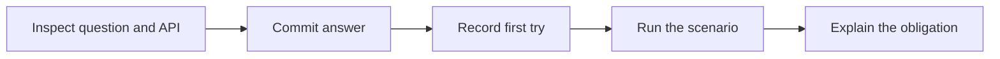
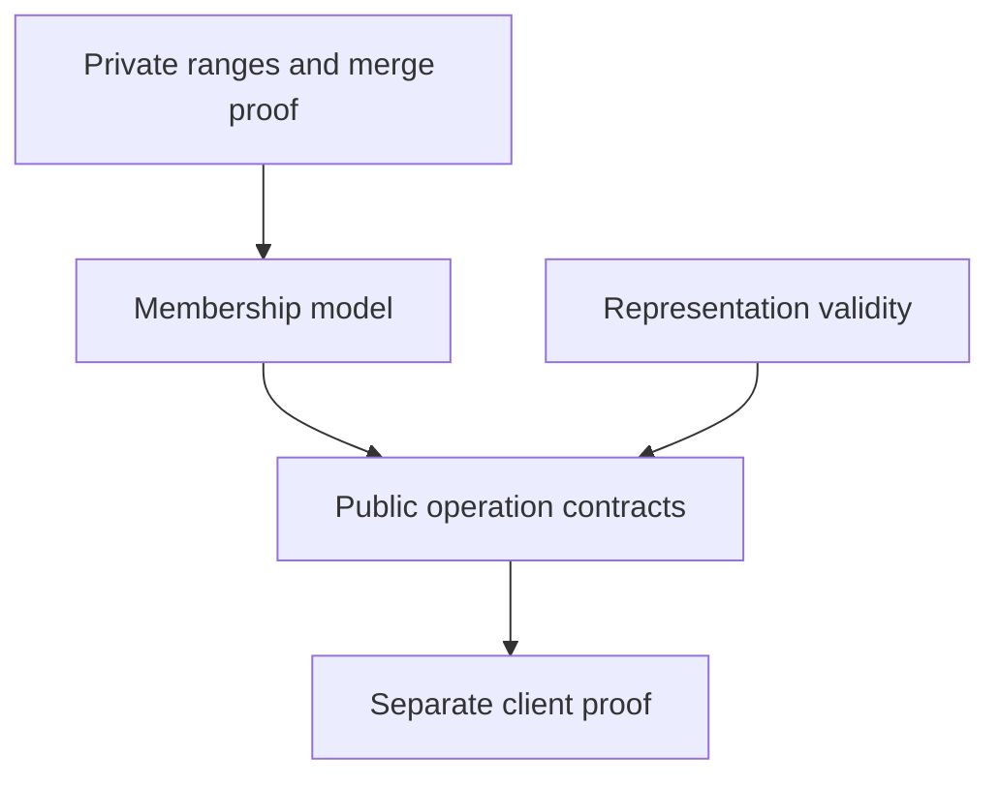
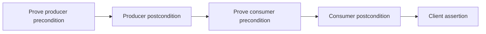
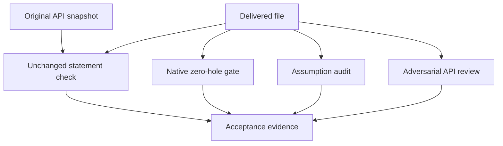

# R03 — Modules and APIs

A verified component is useful when another component can rely on it without
repeating its internal proof. That reliance needs an interface: a collection
of available names, contracts and mathematical observations. This module asks
you to build such an interface for character classes and then use it from a
separate client. You will see that a name being accessible, a definition being
transparent and an executable operation having a useful postcondition are
three separate facts. Each fact affects a different obligation at a call.

R is standalone. Use the README setup and your R01/R02 experience; no Q work
is assumed. The declared layer is A1. Its regex definitions are available in
the generated unit, but the character-class implementation is local to this
module. Do not import the later A2 layer, which re-supplies completed APIs for
later work. No earlier learner exercise is imported. The given range-insertion
implementation is complete, including its internal proof; your work is the
five operations in each language and the review of the resulting boundary.

The useful question throughout is concrete: what fact does this client need,
and which visible contract supplies it? Answering that question is more
precise than saying the verifier “knows the implementation”. Write the
obligation first, locate its producer, and then test your account through the
pinned wrapper. A changed belief after a run belongs in your explanation;
your first prediction remains a separate record.

## 0. Route and first predictions

**Budget: 300 minutes**, including the viva and excluding contractor wall time.
Keep actual time separately from the plan. If a tool or an unsupported
operation blocks work, record the command, stage and remaining obligation;
do not replace the evidence with an assumed result.

| setup | read | worked examples | cards | predictions | hand holes | API review | agent review | paper | bench card | viva | calibration | total |
|---|---|---|---|---|---|---|---|---|---|---|---|---|
| 5 | 60 | 30 | 8 | 12 | 70 | 15 | 30 | 15 | 20 | 30 | 5 | **300** |

Read all four prediction prompts and inspect their actual program text before
reading the explanatory sections below. P1d and P2v have comment slots in
`specimens/R03/`; P3dv and P4dv have verdict slots in `slots/R03.slots`.
Commit the filled answers while their switches remain disabled, then run
`scripts/firsttry.sh R03 --check`. That command evaluates scratch copies and
records the first answer, including an incorrect one. Only afterward enable
the slots or inspect the scenario runs, expected output, cards, bank, rubric
or CI. Do not obtain an answer from a tool and present it as a prediction.

> **Predict (P1d) — commit in the specimen before reading on.** The API's ClassMember now requires ClassValid. Which labelled calls fail their precondition: the supplied singleton producer, the inserted range, a literal built inside the API or an unrestricted client parameter?

> **Predict (P2v) — commit in the specimen before reading on.** The analogous Rust membership call requires the class's validity. Which labelled callers establish that requirement? Use the program as written, including which module owns each call.

> **Predict (P3dv) — commit in the slot file before reading on.** The singleton constructor promises only validity. A separate client asserts membership of the character passed to it. What verdict do you predict for each language with the stated hidden definitions?

> **Predict (P4dv) — commit in the slot file before reading on.** The definitions named in this scenario are exposed as printed, while the executable Rust constructor retains its validity-only postcondition. Predict both verdicts and identify the fact your client would need.

An obligation answer starts with `FAILS` and uses the specimen's labels. A
verdict answer includes the printed `D:` and `V:` prefixes. Preserve the
answer form rather than translating your reasoning into a different syntax.
You can explain uncertainty in your notes; the tool still needs an exact
answer in the slot. Once the first try is recorded, a repair is welcome, but
it does not rewrite that initial evidence.



**Takeaway:** a prediction says what you expected before the observation. A
verified client, a good explanation and a faithful first-try record are
separate achievements. Keep each with the evidence that establishes it.

## 1. The mathematical object and its representation

A character class denotes a set of characters. Its current representation is
a sequence or vector of inclusive ranges. One range contains a character
when its lower endpoint is no greater than the character and the character
is no greater than its upper endpoint. The full class contains a character
when some stored range does. The public model describes membership; the
private storage is one way to implement that model.

Validity has two parts. Every stored interval is nonempty, and ranges are
sorted and separated: an earlier interval ends strictly before a later one
begins. Empty storage is valid. Two distinct valid storage values can denote
related or equal sets; validity alone is not the set's full meaning. Keep the
representation invariant separate from a constructor's intended relationship
to its arguments. That relationship belongs in a postcondition clients can use.

In Dafny the wrapper datatype stores a `seq<CRange>`. The inner range type is
revealed, but the wrapper is provided through the export boundary. Inside the
API module, given code can inspect the wrapper's fields. Outside it, a client
works with the exported functions and predicates. The mathematical model
`InClass` is ghost, so it can express a contract without becoming a runtime
search routine. The implementation still needs compiled operations where an
executable result is requested.

In Verus the `CharClass` has a private `Vec<(char,char)>`. Its `View` is an
`ISet<char>`, used with `@` to describe the denoted set. `ISet` is the pinned
library's set vocabulary for this predicate model; do not replace it with a
finite set without checking the required representation and library APIs.
The view and validity predicate are closed at the public boundary. The code
inside the defining module can relate storage to the view; a different module
uses published contracts to obtain the observations it needs.



The arrows describe proof responsibilities, not a runtime data pipeline.
Clients need not execute a mathematical set to use its membership facts in
specifications. Likewise, a specification's convenient set notation does not
supply a runtime vector algorithm. Identify the model and the executable
operation separately before choosing how to implement a hole.

**Takeaway:** a valid representation and a specific membership relationship
are different claims. The model connects the operation's result to its
inputs, while the invariant ensures that later operations may safely consume it.

## 2. Dafny: choose what crosses an export boundary

A Dafny module groups declarations. An export set selects which names and
information another module receives. The distinction between `provides` and
`reveals` matters for logical reasoning: a provided declaration exposes its
interface, while revealing a definition makes its defining information
available under the language's export rules. Do not infer a body's equation
merely because its name resolves in another module.

The independent `SpanAPI` worked example in the exercise is small enough to
read from start to finish. Its wrapper stores two endpoints. The exported
model is a tuple, and the factory's contract connects that tuple to the
arguments. The client uses that contract and the membership operation's
contract; it need not inspect the concrete fields. This is a different object
and interface from your class operations, so study it as a boundary example
rather than a body to paste into an exercise.

```dafny
module SpanAPI {
  export provides SpanBox, SpanValid, SpanModel, MakeSpan, SpanHas
  datatype SpanBox = SpanBox(lo: char, hi: char)
  function SpanModel(s: SpanBox): (char, char) { (s.lo, s.hi) }
  predicate SpanValid(s: SpanBox) { s.lo <= s.hi }
  function MakeSpan(lo: char, hi: char): (s: SpanBox)
    requires lo <= hi
    ensures SpanValid(s) && SpanModel(s) == (lo, hi)
  { SpanBox(lo, hi) }
  function SpanHas(s: SpanBox, c: char): (b: bool)
    ensures b == (SpanModel(s).0 <= c <= SpanModel(s).1)
  { s.lo <= c <= s.hi }
}
module SpanClient {
  import opened SpanAPI
  lemma SpanContractExample() {
    var s := MakeSpan('a', 'd');
    assert SpanValid(s);
    assert SpanHas(s, 'c');
  }
}
```

Read the client assertion as a short chain of obligations. The factory call
must meet its endpoint precondition. Its postcondition gives the result's
validity and model tuple. The membership contract relates its Boolean result
to that tuple. The caller combines these facts with the concrete character
ordering. The internal datatype fields are unnecessary to this argument.
If you change a contract, trace which link is removed before blaming the
implementation or adding assertions at random.

`import opened` brings selected names into scope without repeated qualification.
A qualified import is often useful when several APIs use similar names.
Neither spelling increases what the export set exposes. If a declaration is
absent from the selected export, a client may fail during resolution before
there is any logical assertion to prove. That stage is evidence about the
interface's names. It is not evidence of a false membership theorem.

The export declaration in your exercise intentionally omits definitions you
will complete. Add their `provides` entries when making them available to the
client. Keep the representation and private merge helpers hidden. The module's
freeze permits the designated additions and checks the original boundary;
it does not grant permission to reveal arbitrary helpers so that a client
assertion happens to go green. Treat export changes as API changes and review
them alongside signatures and postconditions.

A measure in a public signature must also make sense through the boundary.
The supplied `ClassRank` is a ghost observation for that purpose. It states a
quantity without exposing a field access in the public measure. Its presence
does not choose your recursive calls or prove that they decrease. You still
owe the actual strict comparison for the calls your implementation makes.
The ghost quantity is an interface for the termination argument, just as the
membership predicate is an interface for the semantic argument.

**Observe after predictions.** The neutral export demo tests a different small
API whose client tries to use information the printed export does not supply.
Read its location and obligation before explaining the result.

<!-- pin: card-export -->

**Takeaway:** select the names and facts the client needs deliberately. A
qualified name, a provided contract, a revealed equation and a legal public
measure solve different parts of the interface problem.

## 3. Verus: public operations, private storage and a view

Rust's visibility rules apply to executable code as well as to type names.
Making a struct public does not automatically make each of its fields public.
An independent client can own or borrow a value without being allowed to
construct it with a field literal or read its fields directly. A factory and
accessor can provide those capabilities through contracts while preserving
that restriction. Keep compiler visibility errors distinct from a verifier's
failure to prove an otherwise well-formed assertion.

The Verus `View` trait gives a logical observation of a runtime value. In the
mini-span example it is a tuple of endpoints. In the main class API it is a
set model of membership. The notation `s@` invokes this logical observation;
it is not a copied vector, a runtime iterator or an executable getter. It can
appear in contracts and proof expressions. Compiled code must use operations
that actually run, with specifications that connect their results to the view.

The supplied mini-API uses a closed view and a closed validity predicate.
Its public factory states both validity and the model tuple. The membership
method relates its executable Boolean to that tuple. The client can combine
the postconditions while the fields remain private. Read the `ensures` at the
call site, where the body is unavailable, rather than mentally executing a
convenient implementation and assuming the verifier does the same.

```rust
use vstd::prelude::*;
verus! {
pub mod span_api {
    use vstd::prelude::*;
    pub struct SpanBox { lo: char, hi: char, }
    impl View for SpanBox {
        type V = (char, char);
        closed spec fn view(&self) -> (char, char) { (self.lo, self.hi) }
    }
    impl SpanBox {
        pub closed spec fn valid(&self) -> bool { self.lo <= self.hi }
        pub fn make_span(lo: char, hi: char) -> (s: SpanBox)
            requires lo <= hi,
            ensures s.valid(), s@ == (lo, hi),
        { SpanBox { lo, hi } }
        pub fn span_has(&self, c: char) -> (b: bool)
            ensures b == (self@.0 <= c && c <= self@.1),
        { self.lo <= c && c <= self.hi }
    }
}
pub mod span_client {
    use vstd::prelude::*;
    use super::span_api::SpanBox;
    pub fn span_contract_example() {
        let s=SpanBox::make_span('a', 'd');
        assert(s.valid());
        let b=s.span_has('c'); assert(b);
    }
}
}
```

The public name `SpanBox` permits the client to refer to the type. The
constructor and method names permit calls. Their postconditions supply logical
relationships. The private fields remain private. If one of these elements
is missing, adding another does not necessarily repair the same obligation.
For example, importing a type cannot manufacture a `View` implementation, and
opening a spec does not add a missing runtime postcondition.

`open` and `closed` control availability of a specification definition across
the boundary. An open definition must itself be legal to expose; it cannot
refer to opaque private data in a way the tool forbids. That well-formedness
condition is checked before the intended assertion. In the independent P3/P4
scenarios, the range field is deliberately public in both variants so the
printed open view is a legal definition. The main exercise retains private
fields. Keep each scenario's own boundary when comparing observations.

Three small cards isolate different failures. The view card tries `@` without
a suitable implementation. The closed-spec card names a public specification
but asks a separate module to use its hidden equation. The visibility card
tries to access a private field. Predictive work comes first; now inspect the
actual stage and location in each capture. Do not flatten all three into the
same statement that “the proof failed”. Some never reach a logical proof.

<!-- pin: card-view -->

<!-- pin: card-closed -->

<!-- pin: card-visibility -->

At this module's level, ownership is a practical part of the interface. The
class operations borrow their input classes. A returned class is a new owned
value. The supplied copy operation makes an independent runtime vector while
preserving the model. A proof equality between two models does not make the
underlying runtime values interchangeable for Rust ownership. Read the
receiver and argument types before choosing whether you can move, borrow or
reuse a value after an operation.

**Takeaway:** use a runtime operation to obtain a runtime result, and use its
contract to reason about the model. Public names, private fields and spec
transparency are separate controls with observable failures at different stages.

## 4. Calls create obligations on both sides

A function's body proves its postcondition under its preconditions. A caller
first proves those preconditions, then uses the promised postcondition about
the result. Hiding the body does not remove either responsibility. This is
why an interface can be checked separately: the body need not be re-opened
for every caller, provided the exported statement is adequate.

The P1/P2 specimens ask about the caller side. Their membership operation is
an abstract contract stub for this prediction, not an implementation of a hand
hole. The supplied producers and range insertion code remain complete. Each
label marks a call whose validity requirement has to be established. A
parameter with the right type and a result from a particular constructor can
arrive with different logical facts. Likewise, code inside the API can
construct a literal that has the representation type without meeting its
semantic invariant. Examine the given contracts and the literal itself.

After the first tries are recorded, enable the obligation slots and observe
the actual failing labels. For each label, write either the producer fact
that discharges the requirement or the precise requirement not established.
Do this before changing any program. You are explaining the specimen as
written, not repairing it by strengthening a client's assumptions.

<!-- pin: obligation-d -->

<!-- pin: obligation-v -->

The fact supplied by one operation may become the precondition for the next.
Draw this connection explicitly in your API review. For a generic producer
`Make` and consumer `Use`, the question is whether `Make`'s postcondition
implies `Use`'s precondition for the value that is passed. A name suggesting
validity is not that implication. Nor does a comment about the intended
result establish a formula that is absent from the contract.



The P3/P4 scenarios examine a different side of the same boundary. Here a
constructor's postcondition is deliberately limited. In the Dafny variants,
the export set changes what definitions are available. In the Verus variants,
the view/spec transparency changes while the executable constructor's
postcondition stays the same. Do not assume that these language mechanisms
must produce matching observations. Inspect the exact program and the actual
proof obligation for each one.

A revealed existential definition may still require useful instantiations or
a witness. Visibility is not a guarantee that a particular empty proof body
will discover the necessary fact. Conversely, a failed proof does not show
that the corresponding mathematical claim is false. It shows that this
program did not establish the claim with the pinned settings. This distinction
matters when you explain the Dafny P4 capture: opening a body and automatically
proving a client assertion are separate events.

<!-- pin: p3-d -->

<!-- pin: p3-v -->

<!-- pin: p4-d -->

<!-- pin: p4-v -->

Keep the captures with their input files. A changed scenario, different
solver pin or altered postcondition may change the result. When explaining
an observation, name the stage, the claimed fact, the boundary and the exact
premises available. A verbal shortcut such as “Rust is more opaque” hides
which control is responsible and will not transfer to a new program.

**Takeaway:** prove each call's requirement from facts actually available at
that point. Then check whether the exported result contract is strong enough
for the next operation or assertion. The verifier's stage tells you which
part of that account failed to get established.

## 5. Read the given insertion as an implementation of a model

The long worked example is range insertion. It is already finished in both
languages, including its proof. Read it twice: first as a runtime algorithm
on intervals, then as a preservation argument about the membership model.
Use the actual branches, intermediate ranges and invariant clauses in the
file. The goal of the reading is to explain why a consumer may rely on the
operation's contract without repeating its merge proof.

Start with the totality convention. An input whose lower endpoint exceeds
its upper endpoint contributes no character. The public insertion operation
handles that case while preserving the original class's membership. This is
not the same as permitting an invalid stored range in a valid class. A raw
argument interval and a stored representation have different roles. The
wrapper handles the raw argument before invoking the nonempty-range merge.
Distinguish the requirement on the input class from the treatment of the
new interval; do not accidentally add a precondition that changes this API.

For a nonempty interval, look at the first stored range. A range strictly
before the inserted interval can be retained. An interval strictly before
the current stored range can be placed before it. Overlap requires combining
endpoints and continuing with the appropriate pending range. Draw one
concrete example for each branch, but then return to the general inequalities
in the code. The theorem is about arbitrary valid ranges, not only your three
drawings. Record which comparison selects each branch and which invariant
explains the resulting order.

The Dafny implementation works with a head and a tail of an immutable
sequence. When it constructs a new sequence, membership indices may shift.
A proof about a head/tail decomposition must connect a witness in the old
sequence with a witness in the new one. Notice the explicit quantified
arguments in the given proof. They establish a relationship between models;
they are not runtime searches. In particular, a witness chosen in ghost
code does not become an executable membership implementation.

The Verus implementation makes progress with a vector index and builds an
output vector. A pending interval and the unprocessed suffix account for
what remains to be represented. The supplied coverage predicate names this
combination, and the step lemma relates one branch's output to the previous
coverage. At loop exit the unprocessed suffix is empty, so the coverage fact
becomes the operation's advertised set equation. Match each part of that
sentence with the actual invariant and exit condition before accepting it.

A useful way to review a loop invariant is to ask three questions. Why does
it hold before the first iteration? Which branch preserves it at one arbitrary
step? What additional fact does the exit condition give? “It says the result
is correct” is too vague for any of the three. Point to the processed prefix,
pending interval and remaining suffix. If you cannot explain a term, identify
its role using the given definition rather than deleting it experimentally
and concluding that an easier assertion happens to verify.

At the public boundary, all these details collapse to a compact contract:
the output is valid, and its model is the old membership together with the
new interval's membership. An independent client does not receive the output
vector's history. It receives the result contract. This is the benefit of
separate verification: one substantial internal proof supports many short
client arguments. The abstraction is useful only while the published statement
remains faithful and strong enough for those clients.

**Takeaway:** explain the given merge through its progress and model
preservation, then use its contract as a boundary. Internal proof size and
client proof size need not be similar.

## 6. Complete the hand API without changing its promise

The hand work has five holes in each language. Their pair markers connect
related operations, not identical syntax or identical proof scripts. Read
one declaration's full signature, preconditions, postconditions and supplied
progress information before writing a body. Decide what is executable, what
is a model and what each recursive or loop step must establish. Keep that
account beside the actual implementation rather than copying a technique
because the neighbouring hole used it.

H1 concerns executable membership. The Dafny routine states the relationship
to the ghost class model. The Rust helper has an explicit starting index,
with a corresponding suffix claim; its decreasing measure is learner work.
Respect the exact domain printed in each declaration. Do not introduce a
validity precondition merely because the model uses ranges: a particular
operation may be defined on representations that another operation does not
accept. A stronger precondition is a different interface, not a free proof aid.

H2 specifies a total interval constructor, including the ordering of endpoints
as written. Its membership statement describes every character. Check both
the intended ordinary case and the reversed case when reading the formula.
Do not replace a biconditional with an implication, or infer that the validity
part alone identifies the set. For the Dafny client to name a completed
operation, its permitted export addition is part of completing the API.
The source freeze distinguishes that addition from exposing private storage.

H3 specifies the combination of two valid classes. Its input conditions name
validity, and its postcondition names the result's validity and membership
relationship. Empty or equal inputs remain inside that domain. Preserve them
when choosing the implementation. When using a supplied operation, obtain
its exact preconditions and result fact at the actual call, rather than
assuming a private representation property can be used by the client module.
A recursive or iterative implementation must also establish progress.

H4 is deliberately in a separate client module. Treat its imports as the
information boundary. A field access that works inside the implementation
module is not automatically a legitimate client step. If a needed fact is
missing, first distinguish a missing name from a missing semantic guarantee.
Review the published API rather than revealing everything. The contract
is the common language between the component and its client.

H5 connects a runtime sequence of characters to a class model. The formal
statement quantifies over every character, and the input may be empty. In
Rust, ownership and borrowing still apply while the logical view describes
the sequence. Keep the index bounds, consumed data and model relationship
consistent with the algorithm you actually write. A supplied set model is
useful for expressing the relationship; it does not itself implement a
compiled sequence traversal.

The `Uncomment as you go:` block supplies client checks. Retain them and
enable them when their prerequisites are available. A check about a concrete
value can reveal an API omission, but success on that value does not replace
a general result contract. Keep the checker text fixed so that the same
client observation remains comparable as your implementation develops.
If a new failure appears, record its stage and first relevant obligation.

R03 and later R modules use manual Dafny lemma induction under the pinned
options. A needed recursive proof call must be explicit. This is a course
setting, not permission to add automation attributes or change resource limits.
Executable function recursion still needs its own well-founded measure.
When you compare two recursive arguments, state which component decreases
and which facts make it strict; do not equate “looks shorter” with a proved
termination obligation.

Before editing, the shipped units verify in the learner loop with five holes
each. The loop admits the typed placeholders so you can work incrementally.
It is not the done gate. The captures below are the shipped state, including
the counted holes; a green verdict with those holes does not certify a
finished API. Native gate, audit and freeze checks answer different questions.

<!-- pin: shipped-d -->

<!-- pin: shipped-v -->

**Takeaway:** each hole has a precise domain and semantic promise. Complete
that promise, the required progress argument and the intended export, then
check the separate client. Do not trade away an input case or model relation
for a more convenient green display.

## 7. Review the API and the contractor's delivery

The `API REVIEW` block is learner-owned work, with fifteen minutes allocated.
Apply a total-API checklist to what you actually built. Is every operation
defined on every input allowed by its public precondition? Does a producer
supply the invariant a consumer requires? Are the postconditions sufficient
for the supplied client? Which representation details stay hidden? Cite the
particular declaration and client obligation, not just a general opinion
that abstraction is useful.

Totality is always relative to the stated domain. Requiring the class's
representation invariant may be part of that domain. Adding a requirement
that a valid class be nonempty, or that two valid inputs differ, changes it.
Check an empty valid class and equal valid inputs explicitly in your review.
Likewise, identify where raw reversed endpoints are allowed and what the
contract says they mean. These distinctions prevent an interface from
quietly moving difficult cases onto its callers.

The agent exercise changes scale. Its two API statements describe intersection
and difference over copies of the given class infrastructure. They do not
import your hand implementations. The contractor must deliver implementations
whose contracts hold on every valid input, with no added restrictions. This
is an API implementer role: the stated interface is frozen, and both code
and proof must support it. A plausible report is data to review, not evidence
that the obligations have been checked.

Before starting `/contract R03`, save the original permitted file as a snapshot
outside the delivery and record its hash. Use the supplied CONTRACT block to
state the goal, exact allowed file and acceptance commands. Follow the
contractor workflow in CLAUDE.md; keep coaching and examination in their
proper sessions. The saved original makes it possible to compare statements
rather than trusting the contractor's description of its changes.

Each language's source has two API holes. This is why the contractor starts
with a gate that cannot be accepted, even though the learner loop can verify
the assumed interface. The shipped captures below record that distinction.
After delivery, require a successful native gate with zero counted holes,
a clean assumption audit, an unchanged-snapshot check and a diff restricted
to the permitted file. Retain the actual commands and transcript.

<!-- pin: agent-d -->

<!-- pin: agent-v -->

The agent includes given scalar-neighbour helpers because inclusive interval
boundaries need an exact account of characters. At these pins characters are
Unicode scalars: the surrogate block is excluded. The smallest and largest
scalar also need strict bounds before requesting a predecessor or successor.
Read the helpers' contracts rather than treating a character code as an
arbitrary integer that can always be incremented or decremented.

The Rust helper constructs a valid UTF-8 encoding and proves the precondition
of the existing vstd conversion contract before calling it. It does not add
a new trusted specification for an unsupported standard-library function.
That distinction matters in the audit: an implementation cannot make a
missing proof disappear by declaring a new external contract. Preserve the
given helper proof and its exact strict input bounds when reviewing the diff.
The low-level conversion is infrastructure, not the agent's target algorithm.

Use the thirty-minute `ADVERSARIAL REVIEW` block after the delivery. Inspect
empty classes, equal operands, complete overlap, disjoint intervals, containment
and intervals touching extreme scalars. For each selected case, state the
contractual result before asking for a concrete test. A test can expose a
bug, while the proof establishes the quantified statement under its assumptions.
If you find an added precondition or weakened postcondition, the unchanged
snapshot is the decisive comparison even when examples happen to pass.



Fill the dashboard with the goal, changed files, remaining obligations, gate
summary, audit, freeze result, transcript and correction. Keep failed edits
in the record. If a live contractor cannot run, record that limitation rather
than fabricating a session or presenting an author reference as the delivery.
The build may have scripted reference checks; those establish the scope of
those checks and do not supply a learner's transcript or review.

**Takeaway:** accept the contractor's artifact against the saved statement
and observed checks. The totality review, file scope, native proof and trust
audit each cover a different way a convincing delivery can fail its contract.

## 8. Paper card and your second local bench card

The written task is card03.2, on intent formalization. Use the exact source
range and checksum printed in `paper/R03_problems.tex`, and fill the eight
fields in `paper/R03_answers.tex`. The source is a position paper's summary,
including surveyed earlier results. Preserve that distinction when describing
the task, oracle, metric and evidence. A proposal about better specification
practice is not itself a new controlled model experiment.

The source's test-relative notions of soundness and completeness need their
quantifiers and denominator. Identify the designated input/output examples
and the proposed mutated outputs. Ask what the selected suite can distinguish
and what remains unexamined. Do not use the word completeness to imply a
universal characterisation that the selected finite checks do not establish.
A formal proof against a chosen predicate has a different scope from a score
measuring that predicate on examples.

Connect the Trust field to your API review. Name one formal relationship your
operation establishes and one judgement that formal relationship does not
settle. This can concern whether the postcondition expresses the intended
behaviour or whether the chosen library boundary has the claimed meaning.
Use an actual declaration and its role rather than a generic sentence about
all software having assumptions. A useful trust statement identifies where
the checked argument ends and the external judgement begins.

State missing evidence plainly. If the pinned range supplies no shared
call/token budget, repeated-run estimate or immutable artifact revision, say
so rather than filling the field with a number from another paper. Numerical
claims need a source location and the original measurement unit. Your grade
is the minimum of the eight field grades, so a confident contradiction in
one field is not averaged away by seven fluent paragraphs.

The bench-card task takes twenty minutes and produces your second local R
card. Use `bench/local/r/README.md` and keep the five artifacts separate: the
statement, stripped task, completed solution, positive witness and negative
checks. Choose a fresh API or client observation, not a renamed course hole
or a copied reference. Stay within A1 and the pinned wrapper settings.
This is an exercise in making a small reproducible task, not an automatic
admission to a later laboratory benchmark pool.

An API card should state what is public, what is hidden, which operations a
client may call and which formula the client must establish. Retain the same
boundary in the stripped and completed versions. If your negative check
changes the boundary, explain whether it tests a compiler visibility rule,
a logical claim or a contract omission. A parse error is useful only for a
syntax question; it is not a counterexample to the semantic property you
intended to study.

For the positive witness, show that its preconditions really hold. Then
retain the actual command, exit and relevant observation. For a negative
check, name a plausible wrong implementation or statement and show why the
check distinguishes it. Merely running a deliberately malformed file does
not establish that the checker detects a weak postcondition. Keep the first
version when revising your task, and explain what the revision repaired.

**Takeaway:** a paper card distinguishes claims from their evidence; a local
bench card makes that distinction concrete in a small task of your own.
Record the original oracle, boundary and budget before interpreting a result.

## 9. Close the module with evidence

Finish the formal work with both native unit gates at zero holes, clean
assumption audits, the source freeze and the strict firsttry report. Review
the changed export entries as well as the function bodies. Keep the given
checks, typed hole identities and public statements intact. When a command
fails, preserve its actual stage and obligation before making the next edit;
a successful later run does not erase the earlier learning record.

Useful completion commands are `scripts/vcheck --gate` on each generated
unit, `scripts/vaudit` on each exercise and delivered agent file,
`scripts/specfreeze --check R03`, and
`scripts/firsttry.sh R03 --report --strict`. The agent also needs its saved
snapshot comparison. `make -C paper paper` builds the written pair. A PDF
build establishes that the document compiles; it does not grade its reasoning.
The API review, adversarial review, bench-card artifacts and viva remain
part of completion alongside these commands.

Use the chapter's shipped captures as baselines, not as your final count.
A learner-loop result may still contain counted placeholders. The gate
requires them to be gone and checks that the declared contracted work
actually ran. An assumption audit checks a different trust surface; it does
not prove that your English explanation captures intent. Keep the command,
file state and conclusion together so a later reader can assess the scope.

The viva uses six questions from the module bank. Explain from the API and
observations you have, without assuming that another language's keyword has
identical effects. A live prediction should be committed before its referee
run. If the pinned observation differs from the recorded author capture,
report drift and investigate the files and toolchain; do not silently grade
a remembered answer as if it were the new result.

Finally fill the calibration line with an estimate, actual time, correction
and observation. A useful correction identifies a mistaken premise, such as
confusing a public name with a public equation, and the concrete evidence
that changed your account. “I understand modules now” gives you little to
review later. Keep a smaller statement whose correctness you can test again
in a fresh setting.

**Takeaway:** a module closes when its promised behaviour, boundary and
review record agree with observed evidence. A single green display has a
specific scope; completion brings the relevant scopes together.

## 10. Final divergence card: what crosses the boundary

Read this final card only after P3dv and P4dv have been committed and recorded.
Its two small demos avoid the existential witness issue of the earlier
singleton scenario. They isolate an exposed mathematical definition and an
executable result whose published postcondition is weaker than the client
assertion. Use the exact programs; this card does not licence a rule that
all bodies or all fields are available whenever a name is public.

<!-- pin: divergence-d -->

<!-- pin: divergence-v -->

In the Dafny demo, the selected export reveals the neutral function's
definition. The client has access to its defining value. In the Rust demo,
the open model definition is visible, while the executable operation's
postcondition still permits more than that model value. An executable
function's implementation is not automatically an equation available to a
separate caller. Both descriptions concern these printed interfaces and the
observed runs, rather than a general ranking of verification strength.

Return to your original P3/P4 reasoning. Which step concerned a visible name,
which concerned a logical definition, which needed a witness, and which
needed a stronger executable result contract? Separating those steps gives
you a reusable way to diagnose the next client failure. It also gives your
API review a clear test: every claimed client fact should have an identifiable,
legitimate producer across the boundary you intended to preserve.
