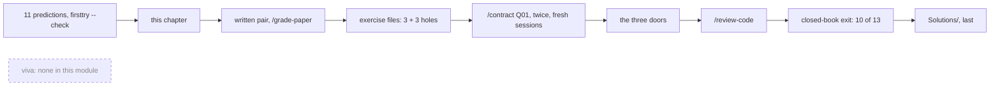
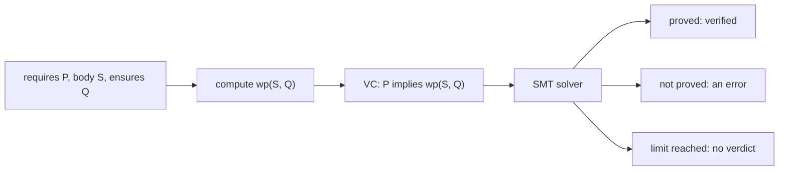
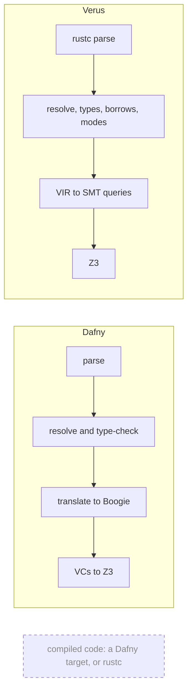

# Q01 — Hello, Dafny and Verus: the whole map

You arrive from prework P0 with both pinned toolchains installed and nothing else about Dafny or Verus assumed. You know Rust, so Verus's executable code will look familiar; its specifications, and all of Dafny, are new. The paper is one you have already carded, 02.3, the vericoding benchmark, which measures at scale the loop this module builds by hand.

Q01 is the survey: one pass over all thirteen strands of the Q track, in both languages, at recognition depth. You write three constructs (a postcondition, an assertion, a lemma call), commit eleven predictions before any tool answers them, audit an AI contractor's repair of two files, and end with a closed-book map of thirteen items.

**Three ideas do all the work.**

1. **A specification is a claim about every run.** `requires` says what a caller must provide and `ensures` what the code promises; the verifier proves that the body meets them for all inputs, without running it.
2. **A proof is code that you call.** A Dafny `lemma` or a Verus `proof fn` is a statement whose body the verifier checks; calling one puts its postcondition in scope at the call site, and an `assert` names a fact that must be proved before you rely on it.
3. **"Verified" answers one question:** did any obligation fail under the pinned settings? Whether holes remain, what was assumed and whether the specification says enough are separate questions, each with its own instrument, or a reader.

**In this module:** §0 the budget and the predictions; §1–§13 one strand each, both languages side by side; §14 the false-friends card; §15 the instruments; §16–§18 paper, exercise files, agent; then the exit, the touchpoints and the harvest.

---

## 0. How this module works, pretest, test-out

**Budget: 227 minutes**, the contractor's wall-clock time excluded.

| setup | read | worked | cards | predicts | holes | agent + three doors | paper | map exit | calib | total |
|---|---|---|---|---|---|---|---|---|---|---|
| 15 | 45 | 30 | 15 | 25 | 24 | 25 | 15 | 25 | 8 | **227** |

**Setup (15 minutes).** Confirm README Setup steps 1–3 are complete and that your editor opens both language servers. Keep exercise and specimen files closed until you have recorded the predictions below. The three guard-door checks follow the first hand pass (§18).

**No pretest, no test-out:** every strand is new here; closed-book pretests start in Q02.

**Predictions first.** Make all eleven now, before you read §1 or run anything; a guess is a fair answer, since the record measures your model of the tools. The seven verdict scenarios are quoted in the prediction block at the top of `dafny/Q/Q01_Hello/core/Q01_Hello.dfy` and answered in `slots/Q01.slots`; the other four are slots in their own files (P3d, P4v, P6v in `specimens/Q01/`, P5d in `dafny/checks/Q01_checks.dfy`). Use each docstring's answer form and record with `scripts/firsttry.sh Q01 --check`. Until then keep `expected/`, `VERSIONS.md`, `QPLAN.md`, the design documents and CI output closed (README, *Predictions first*); `scripts/vcheck` refuses any specimen or demo whose output would settle an unrecorded prediction.

> **Predict (P1dv) — commit in the file before reading on.** `x - y` in executable code: a Dafny method over `nat`, a Verus exec fn over `u64`.

> **Predict (P5d, P6v) — commit in the files before reading on.** The values of `ToNat([3, 1])` and `seq_to_nat(seq![1u64, 3u64])`.

> **Predict (P2dv) — commit in the file before reading on.** The same subtraction in specification code: a Dafny `function`, a Verus `spec fn`.

> **Predict (P3d, P4v) — commit in the files before reading on.** Four assertions about the value of a literal limb list: which fail, in each language?

> **Predict (P7dv) — commit in the file before reading on.** Layer L1's worked lemma without its `decreases` line.

> **Predict (P8dv) — commit in the file before reading on.** One false assertion, run directly by `dafny verify` and `verus --crate-type=lib`: the exit codes.

> **Predict (P9dv) — commit in the file before reading on.** A three-variable nonlinear inequality with an empty proof.

> **Predict (P10dv) — commit in the file before reading on.** One open proof hole under P8dv's two commands: the exit codes, and is the hole mentioned?

> **Predict (P11dv) — commit in the file before reading on.** A "maximum" ensuring only `m >= a && m >= b`, with the body `a + b`.

The sections below give the answers; if a prediction is not recorded yet, stop at its section. The module's loop runs in this order (the dashed box is a step Q01 does not have):



Predictions come before anything that could answer them, and the reference after everything it could taint.

**This module's files**

| file | shipped state |
|---|---|
| `dafny/Q/Q01_Hello/core/Q01_Hello.dfy` (predictions, W, C and H items, CALIBRATION) | verifies, **3 holes** |
| `verus/q/q01_hello/src/lib.rs` (W, C and H items) | verifies, **3 holes** |
| `dafny/checks/Q01_checks.dfy` (P5d, compiled and run) | verifies, 0 holes |
| `specimens/Q01/` (P3d, P4v, P6v, card demos, this chapter's `chapter-*` runs) | demos red by design |
| `slots/Q01.slots` (7 prediction and 8 exit verdicts) | all `???` |
| `dafny/Q/Q01_Hello/exit/Q01_Map.dfy` (exit, 9 blocks) | **1 hole** (X4d) |
| `verus/q/q01_hello/src/exit.rs` (exit, 4 blocks) | **1 hole** (X3v) |
| `dafny/Q/Q01_Hello/agent/Q01_AgentRepair.dfy` (repairer; your THREE DOORS block) | RED: **4 errors**, 0 holes |
| `verus/q/q01_hello/src/agent.rs` (repairer) | RED: **4 errors**, 0 holes |
| `dafny/given/Q/QG_L1_BigNat.dfy`, `verus/given/qg_bignat_l1/` (layer L1) | frozen |
| `paper/Q01_problems.tex` → `paper/Q01_answers.tex` | yours to fill |
| `Solutions/` (the twins) | yours to open LAST |

The counts are the tools' own, pinned in `expected/Q01.counts`; §12 shows the run.

---

## 1. S1 — Data and programs: limbs, `nat` and `u64`

The Q track's running artifact is BigNat, a natural number of any size stored as limbs in base 2^64, **least significant limb first**. Layer L1 defines its value:

```dafny
const BASE: nat := 18446744073709551616

function ToNat(s: seq<nat>): nat
  decreases |s|
{
  if |s| == 0 then 0 else s[0] + BASE * ToNat(s[1..])
}
```

```rust
pub spec const BASE: nat = 0x1_0000_0000_0000_0000;

pub open spec fn seq_to_nat(s: Seq<u64>) -> nat
    decreases s.len(),
{
    if s.len() == 0 {
        0
    } else {
        s[0] as nat + BASE * seq_to_nat(s.drop_first())
    }
}
```

The columns differ on purpose. Dafny's limbs are unbounded `nat`s, so L1 adds a predicate `Valid` (every limb below `BASE`); Verus's are `u64`s, and L1's `seq_wf` means canonical instead (no most significant zero limb). The executable type is `BigNat { limbs: Vec<u64> }`, and `a@` is its *view*, the `Seq<u64>` that specifications talk about. Dafny's `int` and `nat` are mathematical everywhere; Verus computes with Rust's fixed-width integers in executable code and with mathematical `nat` and `int` in specifications (`s[0] as nat` lifts a `u64`).

The worked examples W2d and W2v are a first verified method and exec fn; the index is in range because the `requires` says so, and every caller is checked against it:

```dafny
method LowLimb(s: seq<nat>) returns (d: nat)
  requires |s| > 0
  ensures d == s[0]
{
  d := s[0];
}
```

```rust
pub fn low_limb(a: &BigNat) -> (d: u64)
    requires
        a@.len() > 0,
    ensures
        d == a@[0],
{
    a.limbs[0]
}
```

**P1dv: `D:fail V:fail`.** Every quoted `scripts/vcheck` run is live-captured on the pins (Dafny 4.11.0, Verus 0.2026.09.27.3cf1832) and omits its last line, the path of the run's raw-output directory, which changes on every run.

<!-- pin: p1dv-d -->
```
$ scripts/vcheck specimens/Q01/chapter-p1dv-d.dfy.specimen
vcheck: specimens/Q01/chapter-p1dv-d.dfy.specimen [dafny, learner loop]: failed — 0 verified, 0 holes, 1 error
specimens/Q01/chapter-p1dv-d.dfy.specimen:3:10: error: value does not satisfy the subset constraints of 'nat'
```

<!-- pin: p1dv-v -->
```
$ scripts/vcheck specimens/Q01/chapter-p1dv-v.rs.specimen
vcheck: specimens/Q01/chapter-p1dv-v.rs.specimen [verus, learner loop]: failed — 0 verified, 0 holes, 1 error
specimens/Q01/chapter-p1dv-v.rs.specimen:7:5: error: possible arithmetic underflow/overflow
```

Dafny's `nat` is a *subset type* of `int`: `x - y` is an `int`, and storing it in `d: nat` is an obligation that it is not negative (3:10). Verus's `x - y` on `u64` is machine arithmetic, and every executable arithmetic operation must stay in range (7:5). Neither summary names a stage: both runs reached the verifier, so these are failed proofs, not type errors. A precondition `requires y <= x` (§2) cures both.

**P5d, P6v: `18446744073709551619` and `55340232221128654849`**, by hand: `3 + BASE·1` and `1 + BASE·3`. If you computed `3·2^64 + 1` for P5d, you read the limbs most significant first, the spine's first trap. P5d runs as a compiled `expect`; P6v asks Verus to evaluate the assertion (`by (compute_only)`).

*Takeaway: in Dafny, overflow cannot happen and natural subtraction is an obligation; in Verus exec code, both are obligations.*

---

## 2. S2 — Specifications: `requires`, `ensures`, functions

`requires` is the caller's obligation and the body's assumption; `ensures` is the body's obligation and the caller's knowledge. Verus names the result in the signature, `-> (d: u64)`, so that `ensures` can mention it; the Rosetta card C5dv (`GetLimb`, `get_limb`) has W2's shape with an index. The WRITE card C1 (`ensures`) succeeds in the exercise files (`Inc`, `inc`); its failure demos, `specimens/Q01/card-c1d.dfy.specimen` and `card-c1v.rs.specimen`, return `x` instead of `x + 1`:

<!-- pin: c1d-fail -->
```
$ scripts/vcheck specimens/Q01/card-c1d.dfy.specimen
vcheck: specimens/Q01/card-c1d.dfy.specimen [dafny, learner loop]: failed — 0 verified, 0 holes, 1 error
specimens/Q01/card-c1d.dfy.specimen:9:3: error: a postcondition could not be proved on this return path
specimens/Q01/card-c1d.dfy.specimen:8:15: related: this is the postcondition that could not be proved
```

<!-- pin: c1v-fail -->
```
$ scripts/vcheck specimens/Q01/card-c1v.rs.specimen
vcheck: specimens/Q01/card-c1v.rs.specimen [verus, learner loop]: failed — 0 verified, 0 holes, 1 error
specimens/Q01/card-c1v.rs.specimen:14:9: error: postcondition not satisfied
```

Dafny names the failing return path (9:3) and, as `related`, the clause it fails (8:15); Verus names the clause (14:9). Neither shows the wrong value: the message names an obligation, not a counterexample.

Rosetta card C8dv writes `forall i | 0 <= i < |s| :: s[i] < b` against `forall|i: int| 0 <= i < s.len() ==> s[i] < b`; C10dv sets Dafny's `function IsZeroLimb` against Verus's `spec fn is_zero_limb` (a `spec fn` exists only for specifications and proofs; a Dafny `function` can also be compiled, unless declared `ghost`). The holes H1d and H1v implement a maximum against `ensures m >= a && m >= b && (m == a || m == b)`; §13 shows why the last conjunct matters.

**P2dv: `D:fail V:err:resolve`.**

<!-- pin: p2dv-d -->
```
$ scripts/vcheck specimens/Q01/chapter-p2dv-d.dfy.specimen
vcheck: specimens/Q01/chapter-p2dv-d.dfy.specimen [dafny, learner loop]: failed — 0 verified, 0 holes, 1 error
specimens/Q01/chapter-p2dv-d.dfy.specimen:3:5: error: value does not satisfy the subset constraints of 'nat'
```

<!-- pin: p2dv-v -->
```
$ scripts/vcheck specimens/Q01/chapter-p2dv-v.rs.specimen
vcheck: specimens/Q01/chapter-p2dv-v.rs.specimen [verus, learner loop]: failed — 0 verified, 0 holes, 1 error, stage resolve
specimens/Q01/chapter-p2dv-v.rs.specimen:7:5: error: mismatched types
```

Dafny checks a function body like a method body: the result must be a `nat`, and nothing proves `x - y >= 0`. In Verus spec code arithmetic is mathematical, so `nat - nat` is an `int`, which may be negative; returning it as a `nat` is a type error, caught at resolution before any proof is tried.

*Takeaway: the same three characters fail as a proof obligation in Dafny and as a type error in Verus spec code; where an error is reported tells you what kind of mistake it is.*

---

## 3. S3 — Proof statements and feedback: `assert` and lemma calls

A lemma is a method that only proves: its `ensures` is the theorem and its body the proof. L1's worked lemma says that a zero limb at the most significant end changes nothing. W1d and W1v prove it again with an `assert` after each step, stating what the verifier knows there:

```dafny
lemma ToNatAppendZeroStepwise(s: seq<nat>)
  ensures ToNat(s + [0]) == ToNat(s)
  decreases |s|
{
  if |s| == 0 {
    assert s + [0] == [0];
  } else {
    assert (s + [0])[1..] == s[1..] + [0];
    assert ToNat(s + [0]) == s[0] + BASE * ToNat(s[1..] + [0]);
    ToNatAppendZeroStepwise(s[1..]);
    assert ToNat(s[1..] + [0]) == ToNat(s[1..]);
    assert ToNat(s) == s[0] + BASE * ToNat(s[1..]);
  }
}
```

```rust
pub proof fn lemma_push_zero_stepwise(s: Seq<u64>)
    ensures
        seq_to_nat(s.push(0)) == seq_to_nat(s),
    decreases s.len(),
{
    if s.len() == 0 {
        assert(s.push(0).drop_first() =~= Seq::<u64>::empty());
        assert(seq_to_nat(Seq::<u64>::empty()) == 0);
    } else {
        assert(s.push(0).drop_first() =~= s.drop_first().push(0));
        lemma_push_zero_stepwise(s.drop_first());
        assert(seq_to_nat(s.drop_first().push(0)) == seq_to_nat(s.drop_first()));
        assert(seq_to_nat(s.push(0)) == s[0] as nat + BASE * seq_to_nat(s.drop_first()));
        assert(seq_to_nat(s) == s[0] as nat + BASE * seq_to_nat(s.drop_first()));
    }
}
```

**`assert P`** is a checkpoint: the verifier must prove `P` there, and knows it afterwards; the first `assert` of each recursive case restates the argument so that the definition applies. **`=~=`** is Verus's extensional equality on sequences (same length, same elements); Dafny writes `==`. **The recursive call** puts the lemma's own statement for the shorter sequence in scope: the induction step (§4).

The WRITE card C3 is the lemma call: a call proves the lemma's `requires` at the call site and then knows its `ensures` there; its failure demos (`card-c3d`, `card-c3v`) call without the `requires` in hand, and the error lands on the call. The C2 demos show a false `assert`. The holes H2d and H2v prove that two appended zero limbs change nothing; their docstrings ask the questions that matter.

**P3d, P4v: `FAILS none` and `FAILS a b c d`.**

<!-- pin: p3d -->
```
$ scripts/vcheck specimens/Q01/P3d.dfy.specimen
vcheck: specimens/Q01/P3d.dfy.specimen [dafny, learner loop]: verified — 6 verified, 0 holes, 0 errors
```

<!-- pin: p4v -->
```
$ scripts/vcheck specimens/Q01/P4v.rs.specimen
vcheck: specimens/Q01/P4v.rs.specimen [verus, learner loop]: failed — 0 verified, 0 holes, 4 errors
specimens/Q01/P4v.rs.specimen:16:12: error: assertion failed
specimens/Q01/P4v.rs.specimen:20:12: error: assertion failed
specimens/Q01/P4v.rs.specimen:24:12: error: assertion failed
specimens/Q01/P4v.rs.specimen:28:12: error: assertion failed
```

Dafny's encoding unfolds a function applied to literal arguments as far as the literal needs, so even five limbs evaluate. Verus unfolds a recursive spec fn only a bounded number of times and leaves terms such as `seq_to_nat(seq![7u64].drop_first())` that the solver does not reduce on its own: even one limb fails. Supplying such facts is a skill of Q02 and Q03.

*Takeaway: "assertion failed" means "not proved here", and what each verifier proves unaided differs.*

---

## 4. S4 — Recursion, induction and loops: `decreases` and `invariant`

A recursive lemma is a proof by induction: the branch with no recursive call is the base case, and the recursive call is the induction hypothesis at a smaller argument. For that to be sound the recursion must end, so `decreases` names a measure that every recursive call makes smaller (Rosetta card C6dv):

```dafny
function ReverseLimbs(s: seq<nat>): seq<nat>
  decreases |s|
{
  if |s| == 0 then [] else ReverseLimbs(s[1..]) + [s[0]]
}
```

```rust
pub open spec fn reverse_limbs(s: Seq<u64>) -> Seq<u64>
    decreases s.len(),
{
    if s.len() == 0 {
        Seq::empty()
    } else {
        reverse_limbs(s.drop_first()).push(s[0])
    }
}
```

A loop is an induction too: its `invariant` holds on entry and is kept by every iteration, and after the loop the verifier knows only the invariant and the negated guard. In Rosetta card C7dv, `CountTo` / `count_to` counts `i` up to `n` under `invariant i <= n` and `decreases n - i`, and after the loop `i <= n` and `!(i < n)` give `i == n`. Q02 makes invariants and measures constructs you write. The holes H3d and H3v prove by recursion that all-zero limbs have value 0: keep the statement as it ships, and answer its docstring's questions.

**P7dv: `D:ok V:err:resolve`**, on copies of the layer text:

<!-- pin: p7dv-d -->
```
$ scripts/vcheck specimens/Q01/chapter-p7dv-d.dfy.specimen
vcheck: specimens/Q01/chapter-p7dv-d.dfy.specimen [dafny, learner loop]: verified — 4 verified, 0 holes, 0 errors
```

<!-- pin: p7dv-v -->
```
$ scripts/vcheck specimens/Q01/chapter-p7dv-v.rs.specimen
vcheck: specimens/Q01/chapter-p7dv-v.rs.specimen [verus, learner loop]: failed — - verified, 0 holes, 1 error, stage resolve
specimens/Q01/chapter-p7dv-v.rs.specimen:17:1: error: recursive function must have a decreases clause
```

Dafny supplies a default measure built from the lemma's parameters when none is written, and here it suffices. Verus requires an explicit `decreases` on every recursive function and rejects the declaration before verification. The course writes every measure in both languages anyway: an explicit measure documents the recursion, and a default one can be the wrong one. Loops are Q02's subject.

*Takeaway: termination is part of correctness; a recursive proof without a valid measure proves nothing.*

---

## 5. S5 — Libraries and names: imports

The Dafny file says `import opened QG_L1_BigNat` (its unit's `dfyconfig.toml` includes the layer); the Verus crate says `use vstd::prelude::*;` and `use qg_bignat_l1::*;` (its `Cargo.toml` depends on the layer crate). `opened` and a glob `use` bring names into scope unqualified. Without them every name is qualified: with a dot in Dafny (`M.f(x)`), with a path in Rust and Verus (`krate::f(x)`). The spine grows one frozen layer per tier (L1 here, L2 from Q02); a module imports its own layer and the ones below it, and `scripts/check_course_map.py` checks that rule. Layers are imported, never copied, and nothing in a layer you import is ever posed to you as a hole.

*Takeaway: what a file can name is decided by its imports, and the course decides the imports.*

---

## 6. S6 — Frames (Dafny) and ownership (Verus)

A method that changes memory must say what it may change. **Dafny** has a heap of arrays and objects (`seq` and `nat` values are not on it): a method may write only what its `modifies` clause names, a function may read only what its `reads` clause names, and `old(e)` in a postcondition is `e` before the call. **Verus** inherits Rust's ownership: a `&` parameter is read-only, a `&mut` parameter may change, and a specification names its two states `old(v)` and `final(v)`. Both snippets verify:

```dafny
method SetLast(a: array<nat>, d: nat)
  requires a.Length > 0
  modifies a
  ensures a[a.Length - 1] == d
{
  a[a.Length - 1] := d;
}
```

```rust
fn push_zero(v: &mut Vec<u64>)
    ensures
        final(v)@ == old(v)@.push(0),
{
    v.push(0);
}
```

The frame lets a caller keep facts across a call: what the callee may not change, it did not change. Q02's frame card and Q05 go further.

*Takeaway: in Dafny the specification declares what may change; in Verus the types do, and the specification relates the two states.*

---

## 7. S7 — Ghost code and modes

Some code exists only for the proof. Dafny marks it `ghost` (ghost variables and functions; lemmas are always ghost). Verus sorts all code into three **modes**: *spec* (`spec fn`: definitions and specifications, over mathematical types such as `nat`, `int` and `Seq`), *proof* (`proof fn`: lemmas) and *exec* (`fn`: ordinary Rust, compiled and run, whose `requires` and `ensures` are spec code). The Rosetta card C9dv declares a ghost variable in executable code, Dafny `ghost var before := x;` against Verus `let ghost before = x;`. An exec fn's postcondition may call a spec fn, which is how an executable result is stated through a mathematical definition: `ensures b == is_zero_limb(a@[a@.len() - 1])`. Q03 is the module of modes and ghost code; Q01 only names them.

*Takeaway: verified code is two programs interleaved, one that runs and one that only argues.*

---

## 8. S8 — Program logic: the weakest precondition

A Hoare triple `{P} S {Q}` says that from any state satisfying `P`, running `S` ends in a state satisfying `Q`. The **weakest precondition** `wp(S, Q)` is the most general such `P`; for an assignment `x := e` it is a substitution, `Q` with `e` written for `x`. For each method the verifier builds the verification condition (VC) `requires ⇒ wp(body, ensures)` and asks the solver to prove it:



Every verdict in this course comes out of the solver box, so read a failure as a VC the solver did not prove.

For `y := 2 * x + 1` and `ensures y < 9`, the weakest precondition is `2 * x + 1 < 9`, that is `x < 4`. The specimens `chapter-s8-d` and `chapter-s8-v` give that body the precondition `x < 4` (`Step`) and the weaker `x < 5` (`StepLoose`):

<!-- pin: s8-d -->
```
$ scripts/vcheck specimens/Q01/chapter-s8-d.dfy.specimen
vcheck: specimens/Q01/chapter-s8-d.dfy.specimen [dafny, learner loop]: failed — 1 verified, 0 holes, 1 error
specimens/Q01/chapter-s8-d.dfy.specimen:11:1: error: a postcondition could not be proved on this return path
specimens/Q01/chapter-s8-d.dfy.specimen:10:13: related: this is the postcondition that could not be proved
```

<!-- pin: s8-v -->
```
$ scripts/vcheck specimens/Q01/chapter-s8-v.rs.specimen
vcheck: specimens/Q01/chapter-s8-v.rs.specimen [verus, learner loop]: failed — 1 verified, 0 holes, 1 error
specimens/Q01/chapter-s8-v.rs.specimen:18:9: error: postcondition not satisfied
```

`Step` verified; `StepLoose` failed, since at `x = 4`, `y = 9`. The error lands on the postcondition, not on the precondition that was too weak: a failed VC says that an implication fails, not which side to change.

*Takeaway: to write a precondition, compute what the postcondition needs.*

---

## 9. S9 — Interfaces: commands, summaries, exit codes

The course runs Dafny and Verus only through `scripts/vcheck`, which pins the binary, the solver, the resource limit and the flags. You have seen its output: a summary line (`stage parse` or `stage resolve` when the run stopped before verification, `-` for a count the run did not give), then one `path:line:col` line per hole, diagnostic or finding. `scripts/vcheck Q01` runs every unit of the module, `--gate` is the done gate (§12), and `--json` prints the run as JSON, the tool's own `exit_code` included. It exits 0 for verified, 1 for not verified (failed, inconclusive, an error, killed by memory), 2 for a usage error, 3 for a refusal.

**P8dv: `D:4 V:1`.** The two commands, on copies of the prediction's files (`specimens/Q01/chapter-p8dv-*`):

<!-- pin: p8dv-d-raw -->
```
$ dafny verify p8.dfy
p8.dfy(4,4): Error: assertion might not hold
  |
4 |     assert x + 1 > x + 2;
  |     ^^^^^^


Dafny program verifier finished with 0 verified, 1 error
$ echo $?
4
```

<!-- pin: p8dv-v-raw -->
```
$ verus p8.rs --crate-type=lib
error: assertion failed
 --> p8.rs:4:12
  |
4 |     assert(x < x);
  |            ^^^^^ assertion failed

verification results:: 0 verified, 1 errors
error: aborting due to 1 previous error
$ echo $?
1
```

Dafny gives a verification failure an exit code of its own; Verus exits 1 on any error. A script that tests `$? -eq 1` for "Dafny failed" is wrong, and one that tests `$? -ne 0` cannot tell a failed proof from a crash.

*Takeaway: read the course's exit code or verdict, never a raw tool's exit code alone.*

---

## 10. S10 — The pipeline and the trusted base

Both verifiers are pipelines, and `stage` names the box where a run stopped:



A run with no stage reached the solver; the dashed box lies outside the verifier's claim, and Q03 takes it up. A green run asks you to trust what was not checked: the solver, the translation and the built-in axioms (vstd's specifications of Rust types included); the pinned flags; whatever was declared rather than proved (an `assume`, an axiom, an external body, a bodyless lemma); and, if you run the code, the compiler and runtime. A lemma body that verified is not on the list: it is proof, not trust. The assumption audit, `scripts/vaudit`, lists the declared kind; on the shipped Dafny unit it finds the three holes:

<!-- pin: vaudit-core -->
```
$ scripts/vaudit dafny/Q/Q01_Hello/core
dafny/Q/Q01_Hello/core/Q01_Hello.dfy:381: audit-assume — Max2: Definition has `assume` statement in body
dafny/Q/Q01_Hello/core/Q01_Hello.dfy:395: audit-bodyless-ghost — ToNatAppendTwoZeros: Ghost declaration has no body and has an ensures clause
dafny/Q/Q01_Hello/core/Q01_Hello.dfy:408: audit-bodyless-ghost — AllZeroToNat: Ghost declaration has no body and has an ensures clause
vaudit: dafny/Q/Q01_Hello/core [dafny, learner]: 3 finding(s)
```

*Takeaway: "verified" is relative to a trusted base; the audit lists what was declared instead of proved, and you decide whether each entry belongs there.*

---

## 11. S11 — What the solver can and cannot do

A VC is a formula; Z3 tries to show that its negation has no model. Linear integer arithmetic is decidable and handled well; nonlinear arithmetic (products of variables) is undecidable in general, so the solver uses heuristics that may never finish; quantifiers are used through *triggers*, patterns that say when to instantiate a `forall` (§14, row 3). The limit is a **resource limit**, never a time limit (Dafny `--resource-limit 5000000`, Verus `--rlimit 2`): it counts solver work, so the same file on the pinned binaries gets the same verdict on every run and machine, loaded or idle.

**P9dv: `D:timeout V:fail`.**

<!-- pin: p9dv-d -->
```
$ scripts/vcheck specimens/Q01/chapter-p9dv-d.dfy.specimen
vcheck: specimens/Q01/chapter-p9dv-d.dfy.specimen [dafny, learner loop]: inconclusive — 0 verified, 0 holes, 1 error
specimens/Q01/chapter-p9dv-d.dfy.specimen:1:7: error: Verification out of resource (ProductOrder)
```

<!-- pin: p9dv-v -->
```
$ scripts/vcheck specimens/Q01/chapter-p9dv-v.rs.specimen
vcheck: specimens/Q01/chapter-p9dv-v.rs.specimen [verus, learner loop]: failed — 0 verified, 0 holes, 1 error
specimens/Q01/chapter-p9dv-v.rs.specimen:10:9: error: postcondition not satisfied
```

The statement is true. Dafny's nonlinear search runs into the resource limit: `inconclusive`, no verdict at all. Verus keeps general nonlinear reasoning out of its ordinary queries (Q04's `by (nonlinear_arith)` switches it on for one goal), so it gives up quickly. Neither run says "false".

*Takeaway: "could not be proved" is not "false", and an out-of-resource run decides nothing.*

---

## 12. S12 — Holes, the done gate, and the agent in the loop

A **hole** is a typed placeholder: in Dafny an exec body `{ assume false; }` or a lemma with no body; in Verus `#[verifier::external_body]` over `unimplemented!()`, or `#[verifier::proof_note("<item>")] assume(false);` in a proof. `scripts/vcheck` counts them, never grep; the learner loop lists them:

<!-- pin: learner-loop -->
```
$ scripts/vcheck Q01
vcheck: dafny/Q/Q01_Hello/core [dafny, learner loop]: verified — 27 verified, 3 holes, 0 errors
dafny/Q/Q01_Hello/core/Q01_Hello.dfy:381:5: hole assume Q01.H1d
dafny/Q/Q01_Hello/core/Q01_Hello.dfy:396:31: hole bodyless-method Q01.H2d
dafny/Q/Q01_Hello/core/Q01_Hello.dfy:410:22: hole bodyless-method Q01.H3d
vcheck: verus/q/q01_hello [verus, learner loop]: verified — - verified, 3 holes, 0 errors
verus/q/q01_hello/src/lib.rs:204:1: hole external_body Q01.H1v
verus/q/q01_hello/src/lib.rs:225:40: hole assume Q01.H2v
verus/q/q01_hello/src/lib.rs:243:40: hole assume Q01.H3v
vcheck: 2 unit(s): 2 verified, 0 not; 6 hole(s) in all
```

Both units are `verified` with holes in them, which is why `verified` alone is not done.

**P10dv: `D:2 yes V:0 no`.** Dafny on a copy of `chapter-p10dv-d.dfy.specimen`:

<!-- pin: p10dv-d-raw -->
```
$ dafny verify p10.dfy
p10.dfy(3,18): Warning: This ensures clause is part of a bodyless method. Add the {:axiom} attribute to it or the enclosing method to suppress this warning
  |
3 |     ensures x + 0 == x
  |                   ^^


Dafny program verifier finished with 0 verified, 0 errors
Compilation failed because warnings were found and --allow-warnings is false
$ echo $?
2
```

Dafny warns once per `ensures` clause of a bodyless lemma, and plain `dafny verify` fails on a warning unless `--allow-warnings` is given: exit 2, beside `0 errors`. Verus, run plainly, exits 0 without mentioning the `assume`; it reports one only under `--no-cheating`, a flag a naive grader does not pass. `scripts/vcheck` sees both: it runs Dafny with `--allow-warnings` and counts those warnings as holes, one per clause, and runs Verus with `--no-cheating`. On the same file:

<!-- pin: p10dv-d -->
```
$ scripts/vcheck specimens/Q01/chapter-p10dv-d.dfy.specimen
vcheck: specimens/Q01/chapter-p10dv-d.dfy.specimen [dafny, learner loop]: verified — 0 verified, 1 hole, 0 errors, 1 finding
specimens/Q01/chapter-p10dv-d.dfy.specimen:3:19: hole bodyless-method P10.Open
specimens/Q01/chapter-p10dv-d.dfy.specimen: nothing-verified: 0 verification tasks ran: exit 0 alone is not a pass (Δ11)
```

The `nothing-verified` finding marks a second trap: a file in which nothing was checked is not a pass, whatever its exit code.

**The done gate**, `scripts/vcheck --gate <unit>`, refuses every hole, every warning (Dafny) and every incomplete run (Verus: the whole crate, no VIR error), and it checks the count pin, so a deleted lemma cannot pass for a proved one:

<!-- pin: gate-core -->
```
$ scripts/vcheck --gate dafny/Q/Q01_Hello/core
vcheck: dafny/Q/Q01_Hello/core [dafny, gate]: failed — 27 verified, 3 holes, 0 errors, 1 finding
dafny/Q/Q01_Hello/core/Q01_Hello.dfy:381:5: hole assume Q01.H1d
dafny/Q/Q01_Hello/core/Q01_Hello.dfy:396:31: hole bodyless-method Q01.H2d
dafny/Q/Q01_Hello/core/Q01_Hello.dfy:410:22: hole bodyless-method Q01.H3d
dafny/Q/Q01_Hello/core: warnings-fail-gate: warnings fail the gate (W-D04): holes and every other warning must be gone
```

Done means three commands agree: the gate exits 0 printing only its summary line, `scripts/vaudit` reports no finding, and `scripts/firsttry.sh Q01 --report --strict` exits 0. The same instruments judge an AI contractor's work, here a *repairer* (§18); card 02.3 runs that loop at benchmark scale, with holes written as `assume(false)` and a bypass check before any success counts.

*Takeaway: a hole is visible only to an instrument that looks for it; the done gate is the course's one definition of finished.*

---

## 13. S13 — Specification quality: what did "verified" promise?

Verification proves that code meets its specification; it cannot say whether the specification says what you meant.

**P11dv: `D:ok V:ok`.** The chapter's copies of the scenario add one use-site check, `WeakMax(3, 7)` must be `7`:

<!-- pin: p11dv-d -->
```
$ scripts/vcheck specimens/Q01/chapter-p11dv-d.dfy.specimen
vcheck: specimens/Q01/chapter-p11dv-d.dfy.specimen [dafny, learner loop]: failed — 1 verified, 0 holes, 1 error
specimens/Q01/chapter-p11dv-d.dfy.specimen:10:3: error: assertion might not hold
```

<!-- pin: p11dv-v -->
```
$ scripts/vcheck specimens/Q01/chapter-p11dv-v.rs.specimen
vcheck: specimens/Q01/chapter-p11dv-v.rs.specimen [verus, learner loop]: failed — 1 verified, 0 holes, 1 error
specimens/Q01/chapter-p11dv-v.rs.specimen:17:12: error: assertion failed
```

The wrong body verified (the `1 verified`); only the check fails. The postcondition admits every number at least as large as both arguments, `a + b` among them; the missing clause is H1's `m == a || m == b`. The Verus `requires` only rules out overflow: a precondition can be necessary and still say nothing about the result. The commented checks under each hole and in the exit's prompt-as-heading blocks are this instrument: they pass only if the specification pins the result on a concrete input. Card 02.3 met the problem at scale: about 9% of the specifications of solved vericoding tasks were too weak.

*Takeaway: read the specification before you trust the verdict.*

---

## 14. The false-friends card (C4dv)

Six constructs look alike in the two languages and behave differently. The card closes the Dafny exercise file, with a demo per row and language, `specimens/Q01/card-c4dv-<row>-{d,v}.*.specimen`; run the twelve and note what each did before reading on. Row 3 is `ensures forall x: int :: x + 1 > x` in each language:

<!-- pin: c4dv-3-d -->
```
$ scripts/vcheck specimens/Q01/card-c4dv-3-d.dfy.specimen
vcheck: specimens/Q01/card-c4dv-3-d.dfy.specimen [dafny, learner loop]: verified — 1 verified, 0 holes, 0 errors
specimens/Q01/card-c4dv-3-d.dfy.specimen:6:13: warning: Could not find a trigger for this quantifier. Without a trigger, the quantifier may cause brittle verification. To silence this warning, add an explicit trigger using the {:trigger} attribute. For more information, see the section on quantifier instantiation rules in the reference manual.
```

<!-- pin: c4dv-3-v -->
```
$ scripts/vcheck specimens/Q01/card-c4dv-3-v.rs.specimen
vcheck: specimens/Q01/card-c4dv-3-v.rs.specimen [verus, learner loop]: failed — - verified, 0 holes, 1 error, stage resolve
specimens/Q01/card-c4dv-3-v.rs.specimen:11:9: error: Could not automatically infer triggers for this quantifier.  Use #[trigger] annotations to manually mark trigger terms instead.
```

The quantifier applies no function a trigger could match: Dafny warns and verifies, Verus refuses the file. The whole card:

| row | construct | Dafny | Verus |
|---|---|---|---|
| 1 | `calc` | a `calc` block verifies | `cannot find macro calc`, stage parse |
| 2 | `assert` in a spec function | allowed in a `function` body | `expected pure mathematical expression`, stage resolve |
| 3 | `forall` with no trigger | a warning; verifies | an error, stage resolve |
| 4 | `old` on a value parameter | a warning that it has no effect | `mismatched types`: `old` is for `&mut` |
| 5 | clause order in a lemma header | `decreases` before `ensures` accepted | `expected curly braces`, stage parse |
| 6 | `==>` in executable code | a compiled boolean operator | `expression has mode spec, expected mode exec` |

*Takeaway: syntax carried across carries mistakes with it; when a construct crosses over, check its jurisdiction.*

---

## 15. What the instruments can and cannot see

Every check in this module sees one thing; whether a statement says what was meant is left to you, reading:

| instrument | it verifies | it cannot see |
|---|---|---|
| `scripts/vcheck`, and `--gate` | verdict, tool-counted holes, diagnostics; the gate adds no hole, no warning, the whole crate, the count pin | weak specifications; assumptions that are not hole forms |
| `scripts/vaudit` | what a file assumed instead of proving | whether a verified statement is the one you meant |
| `scripts/firsttry.sh Q01 --report --strict` | predictions recorded, no check left commented | whether the code is good |
| `scripts/specfreeze --check Q01` | statements as shipped | bodies |
| a use-site check | the specification fixes the result on one input | other inputs |
| `git diff`, a transcript | what changed, and how | what the transcript leaves out |

---

## 16. On paper, before the keyboard

The written pair, `paper/Q01_problems.tex` answered in `paper/Q01_answers.tex`, is short in this survey: its centrepiece is the paper card for 02.3, filled on fixed fields (task shape, oracle, trust, cheat surface, metric, budget, variance, artifact) against the lines of your card that the problem pins. Re-read card 02.3 in your own `cheatsheets.md` first, build with `make -C paper paper`, and run `/grade-paper Q01` in a fresh session before the holes. Budget: 15 minutes.

---

## 17. The exercise file

**Holes: 3 per language, 6 in all:** H1d / H1v (a maximum; `ensures`), H2d / H2v (two appended zero limbs; `assert`, lemma calls), H3d / H3v (all-zero limbs, by recursion; lemma calls). Work in file order, predictions first; after each hole, uncomment the checks beneath it. **Done** means `scripts/vcheck --gate` on `dafny/Q/Q01_Hello/core` and `verus/q/q01_hello` exits 0 printing only the summary line, `scripts/vaudit dafny/Q/Q01_Hello/core` reports no finding, and `scripts/firsttry.sh Q01 --report --strict` exits 0.

**The hint dial.** Each hole has `Hint(1)` and `Hint(2)` lines below it: read Hint(1) only when stuck, Hint(2) only when still stuck. After 20 minutes stuck, run `/tutor Q01`.

**The slot protocol.** A slot is *unfilled* (`???`), *filled* (your answer, still behind `SLOT:`) or *enabled*. Record while filled, with `scripts/firsttry.sh Q01 --check`; an item's first record is the one that counts. Then enable it: `// SLOT: CHECK P1dv` becomes `// CHECK P1dv`, `// SLOT: FAILS …` becomes `// FAILS …`, and a value slot becomes a live line. Correct a wrong answer before enabling it; `--report --strict` fails while a slot is unfilled, unrecorded or failing.

**CALIBRATION.** The block at the end of the Dafny file holds planned and actual minutes per budget line (no script reads it). At the end, `scripts/firsttry.sh Q01 --record` adds your first-try rate and exit score to the gradebook.

---

## 18. Exercise (agentic): the repairer and the three doors

Each agent file ships RED with four planted bugs, one diagnostic each and no hole. Each bug sits in its own declaration under a neutral heading (`### Bug 1` … `### Bug 4`), its doc comment states the intended behaviour, and each repair is one line in a body. The Dafny file's contract:

> **CONTRACT (for /contract Q01 — run it in a FRESH session):**
> - **goal:** make this file verify by repairing its four planted bugs, each with a one-line edit to a body
> - **allowed-files:** `dafny/Q/Q01_Hello/agent/Q01_AgentRepair.dfy`
> - **acceptance:**
>   - `scripts/vcheck --gate dafny/Q/Q01_Hello/agent/Q01_AgentRepair.dfy` exits 0 and prints only the summary line
>   - `git diff` shows only body lines: no signature, requires, ensures, decreases, heading or doc comment line changed
>   - every fix is one line (one changed or one added line per bug)
>   - re-verify after every edit with `scripts/vcheck dafny/Q/Q01_Hello/agent/Q01_AgentRepair.dfy`, never two edits between runs
>   - zero holes in the allowed file (tool-counted), and no new assume, {:axiom}, {:verify false} or attribute
>   - `scripts/vaudit --compare expected/Q01_AgentRepair.audit dafny/Q/Q01_Hello/agent/Q01_AgentRepair.dfy` reports no difference

`verus/q/q01_hello/src/agent.rs` has the same contract with its own path and audit pin (`expected/q01_hello_agent.audit`), and forbids `admit`, `external_body` and verifier attributes.

**Steps.** (1) Run `scripts/vcheck` on each agent file and read every message. (2) In a FRESH session, run `/contract Q01`; it asks which file the run is for, and each file gets its own session. (3) Tally the transcript: did the contractor re-verify after every edit, touch a specification line, reach for an escape hatch? (4) Check the gate's output, the scope of `git diff` and the audit comparison yourself. (5) The three doors.

### What the dashboard can and cannot see

Each acceptance line sees one thing: the gate the verdict and the holes, `git diff` which lines changed but not why, the audit comparison trust leaps only. On the shipped, still-RED Dafny agent file the audit already matches its pin:

<!-- pin: agent-audit-compare -->
```
$ scripts/vaudit --compare expected/Q01_AgentRepair.audit dafny/Q/Q01_Hello/agent/Q01_AgentRepair.dfy
vaudit: dafny/Q/Q01_Hello/agent/Q01_AgentRepair.dfy: matches expected/Q01_AgentRepair.audit (0 finding(s); 0 missing, 0 new)
```

The audit cannot tell a broken file from a repaired one, only whether an assumption was added, and "re-verify after every edit" is visible only in the transcript. The verifier grades the repaired file; only you can grade how the repair was made.

### The three doors

The course's guard keeps every Claude session out of the reference (`CLAUDE.md`, §Roles): a tripwire against accidental exposure, not a sandbox, with two layers you can see, the permission deny rules in `.claude/settings.json` (layer 1) and the `spoiler-guard.sh` hook, whose refusals name a rule id (layer 2). In a fresh study session, ask Claude for Q01's reference three ways (a file read, a shell command, a language-server lookup), and record in the `THREE DOORS` block of `Q01_AgentRepair.dfy` which layer refused each, with its rule; no script grades the prose. The course's acceptance run of the guard (Claude Code 2.1.289, 2026-10-04) met these refusals, verbatim; the hook's wording in your checkout may have changed since. A file read of a reference file:

<!-- pin: door-a-read -->
```
<tool_use_error>File is in a directory that is denied by your permission settings.</tool_use_error>
```

That is layer 1: the deny rule answered before the hook ran. A shell command that verifies a reference crate:

<!-- pin: door-b-ref-build -->
```
PreToolUse:Bash hook error: [bash "${CLAUDE_PROJECT_DIR}/.claude/hooks/spoiler-guard.sh"]: spoiler-guard: blocked (rule 1b) — building, verifying or testing the reference prints its diagnostics and output. Study-mode builds: scripts/vcheck on a registry unit or a scratch file, cargo verus verify -p <learner crate>, uv run --directory harness pytest, make -C paper paper.
```

Your shell door may meet another rule, depending on the command; a file written to include the reference meets rule 1. The acceptance run had no language-server door, so that line of your block is first-hand evidence.

---

## Exit (closed book)

The exit is the map: thirteen items, one per strand, in `dafny/Q/Q01_Hello/exit/Q01_Map.dfy` (9 blocks, 1 shipped hole) and `verus/q/q01_hello/src/exit.rs` (4 blocks, 1 shipped hole). Five are code items of at most three lines (X1v, X2d, X3v, X4d, X7v); eight are verdicts (X5dv, X6d, X8dv–X13v), answered in `slots/Q01.slots` and enabled like the predictions.

- **Closed book:** this chapter, the exercise files, later modules' files, search tools and `/tutor` stay closed; only the given spine may be open. One sitting, 25 minutes.
- **Prompt-as-heading blocks** pass only with their shipped check uncommented and green.
- **Score:** `scripts/firsttry.sh Q01 --exit`; the first run at which every block holds an attempt is the score. **Threshold: 10 of 13.** Then repair every block: from then on `--report --strict` covers the exit files too.

---

## Instructor touchpoints

In loop order:

- **`/discuss Q01`** (optional), after the chapter, in a coach session: Socratic questions from the module's bank.
- **`/grade-paper Q01`**, in a FRESH session, once `make -C paper paper` is green and before the holes.
- **`/tutor Q01`**, after 20 minutes stuck on a hole, in one long-lived session (`claude --resume`): one rung of help per turn, pointing back to this chapter's headings, and no hint on a prediction before its first try is recorded.
- **Not this module: `/grade-paper Q01 --post`.** Q01's written pair holds no informal proof, so there is no blueprint to re-score against your proofs.
- **`/contract Q01`**, in a FRESH session, once per agent file (§18).
- **`/review-code Q01`**, in a FRESH session, after both contract runs; Q01's bar is "it reads" (names say what things are; `requires` and `ensures` state the intent plainly).
- **Not this module: `/viva`.** The survey has none; `/viva Q03` examines Q02 and Q03 together.
- **Solutions last.** The twins under `Solutions/` are yours to open after everything above; opening them earlier taints every later grading step for this module.
- **`/review`** whenever the session banner says items are due.

---

## What Q01 planted

| seed (Q01) | harvest |
|---|---|
| `nat` subtraction, `u64` overflow (§1) | runtime checks that hand the verifier a fact, Q03; carries, Q04 |
| literals: Dafny evaluates, Verus does not (§3) | supplying facts to the solver, Q02 and Q03; unfolding depth, Q07 |
| `decreases` and `invariant`, recognised (§4) | written, Q02; lexicographic measures, Q05 |
| frames, ownership, ghost code, modes (§6, §7) | Q02's frame card, Q03's modes, Q05 |
| the weakest precondition of one assignment (§8) | programs on paper, Q03; wp to VC, Q05; a verified wp, Q08 |
| raw exit codes, the trusted base, the audit (§9, §10, §12) | fake-green diagnosis, Q03; `TRUST.md` v0, Q06; your own gates, Q09–Q18 |
| nonlinear arithmetic, resource limits (§11) | `nonlinear_arith`, Q04; brittleness, Q09 |
| weak specifications (§13); card 02.3 | witnesses, Q03; spec-quality oracles and the vericoding arm, Lab 2 (Q15) |
| the repairer's transcript; the three doors (§18) | contract v0, written by hand in Q03 from your Q01 and Q02 transcripts; the red-teamed contractor, Q09 |

The map stays the same; each tier fills in more of it, starting with Q02's loops, measures and frames.

*Paper card: **02.3**, "A benchmark for vericoding: formally verified program synthesis". Re-read it in your own `cheatsheets.md` before the written pair.*
