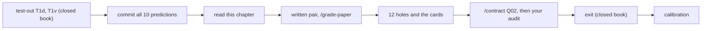
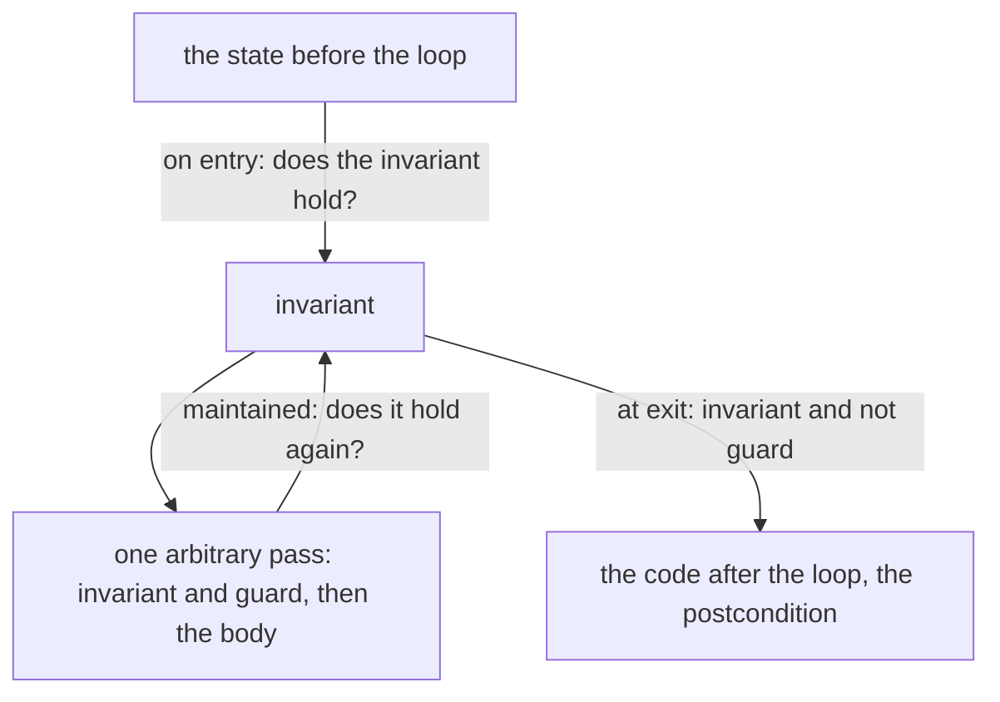
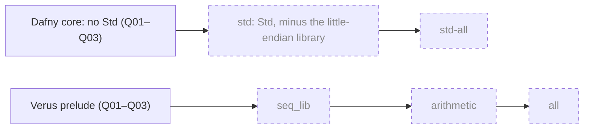
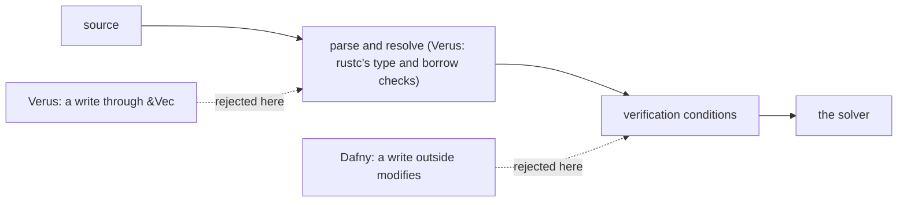
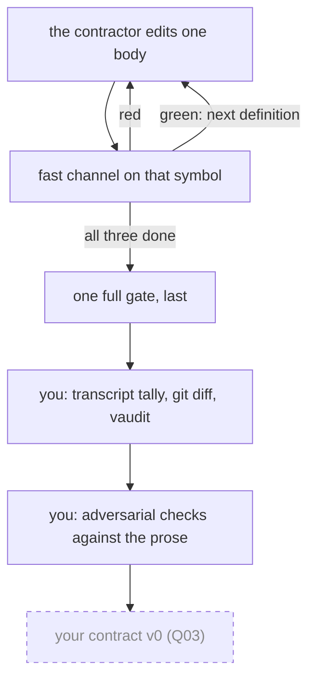

# Q02 — First syntax I

Q01 walked all thirteen strands once and wrote `ensures`, `assert` and a lemma call in both languages. Q02 returns to strands S1–S6 with the syntax that makes loops and recursion verify: `assert … by`, loop invariants, `decreases`, quantified postconditions and, in Dafny, frames. Spine layer L2 joins L1: helper lemmas and `Canonical`, `Normalize`, `FromNat`, `AddLimb` in Dafny; `limb_at` and a carry-lifting lemma in Verus.

Three ideas do all the work:

1. **A loop is known only through its invariant.** The verifier checks the invariant on entry and across one arbitrary pass; after the loop it knows the invariant and the negated guard, and nothing else. Writing an invariant is writing an induction over the passes.
2. **Termination is an obligation with a measure.** Every recursive call and every loop pass must shrink a quantity that cannot fall below zero. The course writes that measure out with `decreases`, in both languages, everywhere.
3. **Proof text hands the verifier one fact or one permission, at one place.** An `assert … by` block, a lemma call, a witness, a `modifies` clause, a `&mut` parameter: each states something the verifier would not invent, and says where it applies.

Last, a contractor implements three definitions against six shipped checks, and you look for what the checks miss.

---

## 0. How this module works, pretest, test-out

**Budget: 234 minutes.**

| setup | test-out | read | worked | cards | predicts | holes | agent | paper | exit | calib | total |
|---|---|---|---|---|---|---|---|---|---|---|---|
| 5 | 10 | 45 | 32 | 10 | 24 | 48 | 15 | 15 | 25 | 5 | **234** |

"Worked" is W1d, W1v and the nine WRITE cards; "cards" is the divergence cards C6v, C7dv and the Rosetta cards C8dv, C9dv. The contractor's own time is outside the budget. Each step waits for the one before it:



The first two steps protect your first tries: a pretest taken after reading measures the chapter, and a prediction made after a run measures your memory.

**Pretest (10 minutes, closed book, before §1).** T1d and T1v, at the top of each exercise file, ask for `PadZeros` and `pad_zeros` by recursion: no chapter, hint or tutor. Run `scripts/firsttry.sh Q02 --check`, which records each first try by running the block's commented check in a scratch copy, then uncomment the checks. If `scripts/firsttry.sh Q02 --report` shows both first tries passing, skip §4.2's teaching and the C3 cards, but not its predict box and answer.

**Predictions (24 minutes), all ten before §1:** five verdicts in the Dafny file's prediction block (answers in `slots/Q02.slots`), four obligation specimens (`specimens/Q02/P1d`, `P2v`, `P5d`, `P6v`) and one value slot (P9d, `dafny/checks/Q02_checks.dfy`). Record them with `scripts/firsttry.sh Q02 --check`. Until then `scripts/vcheck` refuses the specimens and every demo marked `// after: <item>`, and the files on the README's *Predictions first* list stay closed. Each section below stops at its box; answers come after it.

**Setup (5 minutes).** Both exercise units verify as shipped, with their holes counted by the tool. Every output block in this chapter is live-captured on the course pins (Dafny 4.11.0, Verus 0.2026.09.27.3cf1832) and pinned in `expected/Q02.chapter.toml`, so `scripts/pins.py --ci` fails if one drifts:

<!-- pin: q02-unit-d -->
```
$ scripts/vcheck dafny/Q/Q02_FirstSyntaxI/core
vcheck: dafny/Q/Q02_FirstSyntaxI/core [dafny, learner loop]: verified — 42 verified, 6 holes, 0 errors
dafny/Q/Q02_FirstSyntaxI/core/Q02_FirstSyntaxI.dfy:359:33: hole bodyless-method Q02.H1d
dafny/Q/Q02_FirstSyntaxI/core/Q02_FirstSyntaxI.dfy:375:5: hole assume Q02.H2d
dafny/Q/Q02_FirstSyntaxI/core/Q02_FirstSyntaxI.dfy:395:33: hole bodyless-method Q02.H3d
dafny/Q/Q02_FirstSyntaxI/core/Q02_FirstSyntaxI.dfy:408:22: hole bodyless-method Q02.H4d
dafny/Q/Q02_FirstSyntaxI/core/Q02_FirstSyntaxI.dfy:422:5: hole assume Q02.H5d
dafny/Q/Q02_FirstSyntaxI/core/Q02_FirstSyntaxI.dfy:436:5: hole assume Q02.H6d
```

<!-- pin: q02-unit-v -->
```
$ scripts/vcheck verus/q/q02_first_syntax_i
vcheck: verus/q/q02_first_syntax_i [verus, learner loop]: verified — - verified, 6 holes, 0 errors
verus/q/q02_first_syntax_i/src/lib.rs:215:40: hole assume Q02.H1v
verus/q/q02_first_syntax_i/src/lib.rs:232:40: hole assume Q02.H2v
verus/q/q02_first_syntax_i/src/lib.rs:251:1: hole external_body Q02.H5v
verus/q/q02_first_syntax_i/src/lib.rs:267:1: hole external_body Q02.H6v
verus/q/q02_first_syntax_i/src/lib.rs:294:40: hole assume Q02.H7v
verus/q/q02_first_syntax_i/src/lib.rs:309:40: hole assume Q02.H8v
```

Read them aloud: (1) `verified`, exit 0: the learner loop counts holes and never fails on them; (2) one line per hole, with its kind and item (`bodyless-method` is Dafny's internal name for a lemma without a body); (3) the Verus count is `-`: a hole anywhere in a crate makes Verus drop its counts. Below, a failed run's last line (`raw output: <path>`, a fresh scratch directory) is left out, and `probe.dfy` and `probe.rs` are scratch files run with `scripts/vcheck --module Q02`, which gives a probe this module's given layers and options.

### This module's files

| file | what it is | shipped state |
|---|---|---|
| `dafny/Q/Q02_FirstSyntaxI/core/Q02_FirstSyntaxI.dfy` | Dafny exercise file: T1d, prediction block, W1d, cards, H1d–H6d | verified, **6 holes** |
| `verus/q/q02_first_syntax_i/src/lib.rs` | Verus exercise crate: T1v, W1v, cards, H1v, H2v, H5v–H8v | verified, **6 holes** |
| `dafny/checks/Q02_checks.dfy` | value check unit (P9d) | verified, no hole, 1 slot |
| `specimens/Q02/` | obligation specimens P1d, P2v, P5d, P6v; card demos `card-*` | demos red by design |
| `slots/Q02.slots` | your five verdict answers | `???` |
| `dafny/Q/Q02_FirstSyntaxI/exit/Q02_Exit.dfy` | exit, Dafny half (X1d–X3d), outside every build | verified, **1 hole** (X3d), two empty blocks |
| `verus/q/q02_first_syntax_i/src/exit.rs` | exit, Verus half (X1v–X3v), never `mod`-declared | verified, **3 holes** |
| `dafny/Q/Q02_FirstSyntaxI/agent/Q02_AgentImplement.dfy` | agentic exercise, Dafny half (spec-first), outside every build | RED: **3 holes, 6 errors** |
| `verus/q/q02_first_syntax_i/src/agent.rs` | agentic exercise, Verus half, never `mod`-declared | RED: **6 holes, 1 error** |
| `dafny/given/Q/QG_L1_BigNat.dfy`, `QG_L2_BigNat.dfy`; `verus/given/qg_bignat_l1`, `qg_bignat_l2` | the given spine, frozen | verified |
| `paper/Q02_problems.tex` → your `paper/Q02_answers.tex` | the written pair (§8) | — |
| `Solutions/` | the reference twins | yours to open LAST |

---

## 1. S1 — Computed values and exec vectors

S1 is data and the programs over it. Dafny's spine functions are mathematics and code at once: the verifier unfolds them, and a check unit runs them compiled. Verus exec code holds `Vec<u64>` and machine integers, which specifications see through views (`v@` is a `Seq<u64>`).

> **Predict (P9d) — commit in the file before reading on.** In `dafny/checks/Q02_checks.dfy`: how many limbs does `Normalize([0, 5, 0, 0])` keep?

*Commit your prediction first.*

L2's definition:

```dafny
  // Strip the most significant zero limbs.
  function Normalize(s: seq<nat>): seq<nat>
    decreases |s|
  {
    if |s| == 0 then []
    else if s[|s| - 1] != 0 then s
    else Normalize(s[..|s| - 1])
  }
```

**Answer: 2.** Limbs are little-endian: `s[0]` is the least significant, `s[|s| - 1]` the most. `Normalize` drops the top limb while it is zero: `[0, 5, 0, 0]`, `[0, 5, 0]`, `[0, 5]`. The low zero is a digit (the value is 5 · 2^64), not padding. `Canonical(s)` is `Valid(s)` plus a non-zero top limb (or the empty sequence); Verus's `seq_wf` states only the top-limb half, since a `u64` limb is below `BASE` by its type.

The sequence vocabulary of the two spines:

| | Dafny `seq<nat>` | Verus `Seq<u64>` (spec) |
|---|---|---|
| length, element | `\|s\|`, `s[i]` | `s.len()`, `s[i]` with `i: int` |
| without the top limb | `s[..\|s\| - 1]` | `s.drop_last()` |
| without the low limb | `s[1..]` | `s.drop_first()` |
| a zero limb on top | `s + [0]` | `s.push(0)` |
| the top limb | `s[\|s\| - 1]` | `s.last()` |

**Exec vectors (Verus).** Exec code writes `v.len()` and `v[i]` with `i: usize`; specifications write `v@[j]` with `j: int`, casting where the two meet (`v@[i as int]`). A vector is built with `Vec::new()` and `v.push(x)` and written in place through `&mut` with `v.set(i, x)`. Every exec `+` carries Q01's overflow obligation; in W1v (§4.1) the guard `i < v.len()` keeps `i + 1` in range.

---

## 2. S2 — Quantified specifications

> **Predict (P5d, P6v) — commit in the files before reading on.** `specimens/Q02/P5d.dfy.specimen` and `P6v.rs.specimen`: four lemmas (proof fns) with empty bodies, each on its own. Which labelled postconditions does the verifier fail to prove?

*Commit your prediction first.*

A `forall` postcondition states a property of every element at once. The WRITE cards C4d and C4v build the sequence 0, 1, …, n − 1:

```dafny
  method CardIndices(n: nat) returns (s: seq<nat>)
    ensures |s| == n && forall i | 0 <= i < n :: s[i] == i
```

```rust
pub fn card_indices(n: u64) -> (v: Vec<u64>)
    ensures
        v@.len() == n,
        forall|i: int| 0 <= i < n ==> v@[i] as int == i,
```

Dafny writes the range after `|` and the body after `::`; Verus binds a typed variable between bars, writes `==>`, and casts the `u64` element to compare it with the `int`. The failure demos keep the specification but build `i + 1` at index `i`, as their invariant says:

<!-- pin: c4d-fail -->
```
$ scripts/vcheck specimens/Q02/card-c4d.dfy.specimen
vcheck: specimens/Q02/card-c4d.dfy.specimen [dafny, learner loop]: failed — 1 verified, 0 holes, 1 error
specimens/Q02/card-c4d.dfy.specimen:8:3: error: a postcondition could not be proved on this return path
specimens/Q02/card-c4d.dfy.specimen:7:25: related: this is the postcondition that could not be proved
```

<!-- pin: c4v-fail -->
```
$ scripts/vcheck specimens/Q02/card-c4v.rs.specimen
vcheck: specimens/Q02/card-c4v.rs.specimen [verus, learner loop]: failed — 1 verified, 0 holes, 1 error
specimens/Q02/card-c4v.rs.specimen:12:9: error: postcondition not satisfied
```

Read them aloud: (1) a postcondition failed; (2) which one: Dafny's `related` line points at 7:25, where the `forall` conjunct starts, and Verus reports the failing `ensures` clause itself; (3) why: at the return the verifier knows the invariant (`… == i + 1`) and that the loop is over, and nothing turns `i + 1` into `i`.

**Answers. P5d: `FAILS d`. P6v: `FAILS d`.** [a] and [b] follow from sequence axioms the verifiers apply on their own (Dafny relates `s[1..][i]` to `s[i + 1]` and `(s + t)[i]` to `s` or `t`; vstd settles the `subrange` and `push`/`drop_last` equalities). The existentials differ. A solver proves `exists i :: P(i)` by finding a term `t` with `P(t)` among the terms it already holds. In [c] the `requires` mentions `s[k]`, so `k` is at hand; in [d] no sequence term occurs anywhere, and the solver does not invent one:

<!-- pin: p5d-run -->
```
$ scripts/vcheck specimens/Q02/P5d.dfy.specimen
vcheck: specimens/Q02/P5d.dfy.specimen [dafny, learner loop]: failed — 8 verified, 0 holes, 1 error
specimens/Q02/P5d.dfy.specimen:40:3: error: a postcondition could not be proved on this return path
specimens/Q02/P5d.dfy.specimen:39:13: related: this is the postcondition that could not be proved
```

<!-- pin: p6v-run -->
```
$ scripts/vcheck specimens/Q02/P6v.rs.specimen
vcheck: specimens/Q02/P6v.rs.specimen [verus, learner loop]: failed — 3 verified, 0 holes, 1 error
specimens/Q02/P6v.rs.specimen:38:9: error: postcondition not satisfied
```

The repair is a **witness**: name a term and assert the body at it, as the Rosetta card C9dv does:

```dafny
  lemma CardExists(s: seq<nat>)
    requires |s| > 0 && s[|s| - 1] != 0
    ensures exists i :: 0 <= i < |s| && s[i] != 0
  {
    var w := |s| - 1;
    assert 0 <= w < |s| && s[w] != 0;
  }
```

```rust
pub proof fn card_exists(s: Seq<u64>)
    requires
        s.len() > 0,
        s.last() != 0,
    ensures
        exists|i: int| 0 <= i < s.len() && s[i] != 0,
{
    let w = s.len() - 1;
    assert(0 <= w < s.len() && s[w] != 0);
}
```

Q02 asks you to recognise this; Q03 makes witnesses a WRITE construct. `Valid` is itself a `forall` predicate, which puts H4d (`Canonical(Normalize(s))` from `Valid(s)`) in this strand.

---

## 3. S3 — `assert … by`, scoped facts, the fast channel

> **Predict (P8dv) — commit in the file before reading on.** After `assert P by { L(); }`, a second `assert` states `L`'s own postcondition (not `P`). What does `scripts/vcheck` report in each language?

*Commit your prediction first.*

`assert P by { … }` proves `P` with the steps inside the block, at the place `P` is needed. The WRITE cards call a lemma whose fact needs an induction the solver does not find alone:

```dafny
  lemma CardAssertBy(s: seq<nat>)
    requires Valid(s)
    ensures ToNat(s) < BASE * Pow(|s|)
  {
    assert ToNat(s) < Pow(|s|) by {
      ToNatBound(s);
    }
  }
```

```rust
pub proof fn card_assert_by(a: BigNat)
    ensures
        seq_to_nat(a@.push(0)) == a.to_nat(),
{
    assert(seq_to_nat(a@.push(0)) == seq_to_nat(a@)) by {
        lemma_seq_to_nat_push_zero(a@);
    }
}
```

The failure demos are the same proofs with the call left out of the block:

<!-- pin: c1d-fail -->
```
$ scripts/vcheck specimens/Q02/card-c1d.dfy.specimen
vcheck: specimens/Q02/card-c1d.dfy.specimen [dafny, learner loop]: failed — 10 verified, 0 holes, 1 error
specimens/Q02/card-c1d.dfy.specimen:63:21: error: assertion might not hold
```

<!-- pin: c1v-fail -->
```
$ scripts/vcheck specimens/Q02/card-c1v.rs.specimen
vcheck: specimens/Q02/card-c1v.rs.specimen [verus, learner loop]: failed — 0 verified, 0 holes, 1 error
specimens/Q02/card-c1v.rs.specimen:14:12: error: assertion failed
```

Both mark the asserted proposition. The Dafny demo is long (line 63) because a Dafny specimen stands alone: it carries copies of the L1–L2 declarations it uses.

**Answer: `D:fail V:fail`.** A `by` block fences its steps in: inside it the verifier knows what its calls establish; after it, only the asserted proposition survives, not the lemma's postcondition. The two scenarios of the prediction block, run as probes:

```dafny
module Probe {
  import opened QG_L1_BigNat
  import opened QG_L2_BigNat

  lemma Scoped(s: seq<nat>)
    requires Valid(s)
  {
    assert ToNat(s) >= 0 by { ToNatBound(s); }
    assert ToNat(s) < Pow(|s|);
  }
}
```

<!-- pin: p8dv-d -->
```
$ scripts/vcheck --module Q02 probe.dfy
vcheck: probe.dfy [dafny, learner loop]: failed — 22 verified, 0 holes, 1 error
probe.dfy:9:21: error: assertion might not hold
```

```rust
use vstd::prelude::*;
use qg_bignat_l2::*;

verus! {

pub proof fn scoped(s: Seq<u64>) {
    assert(seq_to_nat(s.push(0)) >= 0) by { lemma_seq_to_nat_push_zero(s); }
    assert(seq_to_nat(s.push(0)) == seq_to_nat(s));
}

} // verus!
```

<!-- pin: p8dv-v -->
```
$ scripts/vcheck --module Q02 probe.rs
vcheck: probe.rs [verus, learner loop]: failed — 0 verified, 0 holes, 1 error
probe.rs:8:12: error: assertion failed
```

Both fail on the second assert (the Dafny count includes the given layers' tasks, which a probe verifies too). To keep a lemma's fact for the rest of a body, call the lemma at the top level. Scoping is the point of `by`: it says which fact a step uses and keeps the rest of the proof's context small.

**The fast channel.** `scripts/vcheck --symbol <Module.Name> <file>` (Dafny) or `--symbol <fn> <target>` (Verus) verifies one declaration and ends with a status line for it. It is feedback, never a verdict: only `--gate` decides done. §10's contract is built on that split, and §10 runs both channels, including a case where the Verus one misleads.

---

## 4. S4 — Loops, termination, induction

### 4.1 Loop invariants

> **Predict (P1d, P2v) — commit in the files before reading on.** `specimens/Q02/P1d.dfy.specimen` and `P2v.rs.specimen`: a loop that zeroes an array (in Verus a `&mut Vec<u64>`), with its `decreases` stated and one invariant that stops one step short. Which labelled lines fail?

*Commit your prediction first.*

The worked examples W1d and W1v find the first zero limb:

```dafny
    i := 0;
    while i < |s| && s[i] != 0
      invariant i <= |s|
      invariant forall j | 0 <= j < i :: s[j] != 0
      decreases |s| - i
    {
      i := i + 1;
    }
    // At loop exit: both invariants hold, and the guard is false.
    assert i <= |s| && forall j | 0 <= j < i :: s[j] != 0;
    assert !(i < |s| && s[i] != 0);
    assert i == |s| || s[i] == 0;
```

```rust
    let mut i: usize = 0;
    while i < v.len() && v[i] != 0
        invariant
            i <= v.len(),
            forall|j: int| 0 <= j < i ==> v@[j] != 0,
        decreases v.len() - i,
    {
        i = i + 1;
    }
```

The clauses sit between the guard and the body. Each invariant is three obligations, each with its own failure message:



The "maintained" arrow is the induction step: the verifier never runs the loop, it proves one arbitrary pass. The asserts after W1d's loop (W1v has the same) state what the "at exit" arrow delivers. The C2 failure demos break the "on entry" arrow with `1 <= i`, false at `i == 0`:

<!-- pin: c2d-fail -->
```
$ scripts/vcheck specimens/Q02/card-c2d.dfy.specimen
vcheck: specimens/Q02/card-c2d.dfy.specimen [dafny, learner loop]: failed — 0 verified, 0 holes, 1 error
specimens/Q02/card-c2d.dfy.specimen:11:19: error: this loop invariant could not be proved on entry
Related message: loop invariant violation
```

<!-- pin: c2v-fail -->
```
$ scripts/vcheck specimens/Q02/card-c2v.rs.specimen
vcheck: specimens/Q02/card-c2v.rs.specimen [verus, learner loop]: failed — 1 verified, 0 holes, 1 error
specimens/Q02/card-c2v.rs.specimen:16:13: error: invariant not satisfied before loop
```

**Answers. P1d: `FAILS a d`. P2v: `FAILS b e`.** The one-short invariant (Dafny [d], Verus [e]) says the positions below `j - 1` are zero. A pass zeroes position `j`; for `j + 1` the invariant then needs every position below `j`, `j - 1` included, which it never mentioned: maintenance fails. At exit it gives zeros below `a.Length - 1` only, so the postcondition (Dafny [a], Verus [b]) fails too. One weak invariant, two errors:

<!-- pin: p1d-run -->
```
$ scripts/vcheck specimens/Q02/P1d.dfy.specimen
vcheck: specimens/Q02/P1d.dfy.specimen [dafny, learner loop]: failed — 1 verified, 0 holes, 2 errors
specimens/Q02/P1d.dfy.specimen:14:5: error: a postcondition could not be proved on this return path
specimens/Q02/P1d.dfy.specimen:11:13: related: this is the postcondition that could not be proved
specimens/Q02/P1d.dfy.specimen:17:17: error: this invariant could not be proved to be maintained by the loop
Related message: loop invariant violation
```

<!-- pin: p2v-run -->
```
$ scripts/vcheck specimens/Q02/P2v.rs.specimen
vcheck: specimens/Q02/P2v.rs.specimen [verus, learner loop]: failed — 0 verified, 0 holes, 2 errors
specimens/Q02/P2v.rs.specimen:22:13: error: invariant not satisfied at end of loop body
specimens/Q02/P2v.rs.specimen:15:9: error: postcondition not satisfied
```

Everything else holds, Verus's length invariant [d] included, and the postcondition needs [d]: a loop forgets whatever its invariant does not state. A clause false on entry or not kept by a pass is what card 02.7 calls non-inductive (§8).

### 4.2 Termination: `decreases`

> **Predict (P4dv) — commit in the file before reading on.** A counting `while` loop with no `decreases` clause, in each language: what does `scripts/vcheck` report?

*Commit your prediction first.*

A measure is an expression that every pass, or every recursive call, makes strictly smaller and that cannot fall below zero. W1d's loop uses `|s| - i`: each pass raises `i`, which never passes `|s|`. The C3 cards keep every other limb by recursion; the measure is the length, which `s[2..]` shortens:

```dafny
  function CardEvens(s: seq<nat>): seq<nat>
    decreases |s|
  {
    if |s| < 2 then s else [s[0]] + CardEvens(s[2..])
  }
```

```rust
pub open spec fn card_evens(s: Seq<u64>) -> Seq<u64>
    decreases s.len(),
{
    if s.len() < 2 {
        s
    } else {
        seq![s[0]] + card_evens(s.subrange(2, s.len() as int))
    }
}
```

The failure demos state a measure, `n`, that their recursive call `CountTo(n + 1, k)` makes larger:

<!-- pin: c3d-fail -->
```
$ scripts/vcheck specimens/Q02/card-c3d.dfy.specimen
vcheck: specimens/Q02/card-c3d.dfy.specimen [dafny, learner loop]: failed — 0 verified, 0 holes, 1 error
specimens/Q02/card-c3d.dfy.specimen:9:34: error: decreases clause might not decrease
```

<!-- pin: c3v-fail -->
```
$ scripts/vcheck specimens/Q02/card-c3v.rs.specimen
vcheck: specimens/Q02/card-c3v.rs.specimen [verus, learner loop]: failed — 0 verified, 0 holes, 1 error
specimens/Q02/card-c3v.rs.specimen:15:9: error: could not prove termination
```

Both point at the recursive call, where the stated measure grows.

**Answer: `D:ok V:err:resolve`.** The prediction block's two programs, run as probes:

```dafny
module Probe {
  method CountUp(n: nat) returns (i: nat)
    ensures i == n
  {
    i := 0;
    while i < n
      invariant i <= n
    {
      i := i + 1;
    }
  }
}
```

<!-- pin: p4dv-d -->
```
$ scripts/vcheck --module Q02 probe.dfy
vcheck: probe.dfy [dafny, learner loop]: verified — 23 verified, 0 holes, 0 errors
```

```rust
use vstd::prelude::*;

verus! {

pub fn count_up(n: u64) -> (i: u64)
    ensures
        i == n,
{
    let mut i: u64 = 0;
    while i < n
        invariant
            i <= n,
    {
        i = i + 1;
    }
    i
}

} // verus!
```

<!-- pin: p4dv-v -->
```
$ scripts/vcheck --module Q02 probe.rs
vcheck: probe.rs [verus, learner loop]: failed — - verified, 0 holes, 1 error, stage resolve
probe.rs:10:5: error: loop must have a decreases clause
```

When a loop states no measure, Dafny guesses one from the guard (for `i < n`, how far `i` still is from `n`), and here the guess works. Verus does not guess for exec loops: it rejects the loop before any solver runs, at the stage `scripts/vcheck` names `resolve` (the attribute that waives the rule is banned in course files). The course writes every measure out, so both languages behave alike and a reviewer can read it.

### 4.3 Induction: who writes the recursive call

> **Predict (P3dv) — commit in the file before reading on.** An empty-bodied lemma `Count(n) == n` about a recursive count: Dafny as this unit runs it, Dafny with `{:induction false}` on the lemma, and Verus. What does each report?

*Commit your prediction first.*

A recursive proof is an induction: the recursive call on a smaller argument is the induction hypothesis, and `decreases` makes the recursion well-founded. L1's worked lemmas (`ToNatAppendZero`, `lemma_seq_to_nat_push_zero`) show the shape: a base case, then a step that says how the sequence splits and calls the lemma on the shorter part. Where Dafny states that split with `==`, Verus writes `=~=`, which asks it to compare two sequences element by element. The divergence card C7dv runs P3dv's first and third programs:

<!-- pin: c7dv-d -->
```
$ scripts/vcheck specimens/Q02/card-c7dv-d.dfy.specimen
vcheck: specimens/Q02/card-c7dv-d.dfy.specimen [dafny, learner loop]: verified — 2 verified, 0 holes, 0 errors
```

<!-- pin: c7dv-v -->
```
$ scripts/vcheck specimens/Q02/card-c7dv-v.rs.specimen
vcheck: specimens/Q02/card-c7dv-v.rs.specimen [verus, learner loop]: failed — 1 verified, 0 holes, 1 error
specimens/Q02/card-c7dv-v.rs.specimen:20:9: error: postcondition not satisfied
```

The second program, the lemma with the attribute, runs as a probe:

```dafny
module Probe {
  function Count(n: nat): nat
    decreases n
  {
    if n == 0 then 0 else 1 + Count(n - 1)
  }

  lemma {:induction false} CountId(n: nat)
    ensures Count(n) == n
  {
  }
}
```

<!-- pin: p3dv-doff -->
```
$ scripts/vcheck --module Q02 probe.dfy
vcheck: probe.dfy [dafny, learner loop]: failed — 23 verified, 0 holes, 1 error
probe.dfy:10:3: error: a postcondition could not be proved on this return path
probe.dfy:9:22: related: this is the postcondition that could not be proved
```

**Answer: `D:ok D-off:fail V:fail`.** By default Dafny tries automatic induction on a lemma: it assumes, on its own, the lemma for smaller arguments, and one unfolding of `Count` finishes. `{:induction false}` switches that off for one lemma; Verus never does it. The failures are unproved, not refuted: the lemma is true, and what is missing is the call `CountId(n - 1)` when `n > 0` (Verus: `count_id((n - 1) as nat)`). Do not lean on the convenience: H4d carries `{:induction false}`, so its induction is yours to write, as in Verus, and from Q03 on every unit switches automatic lemma induction off.

---

## 5. S5 — Finding a given fact; library staging

> **Predict (P10dv) — commit in the file before reading on.** One line added, nothing else: `import opened Std.Wrappers` inside the Dafny exercise module, `use vstd::seq_lib::*;` under the Verus crate's prelude import. What does `scripts/vcheck` report for each, holes and all?

*Commit your prediction first.*

**Search the spine first.** The given layers are small, and each header says what its layer holds. Before you write a helper lemma, list what exists:

```sh
grep -n "lemma\|function\|predicate" dafny/given/Q/QG_L1_BigNat.dfy dafny/given/Q/QG_L2_BigNat.dfy
grep -n "fn " verus/given/qg_bignat_l1/src/lib.rs verus/given/qg_bignat_l2/src/lib.rs
```

Then read each `ensures` as an equation you can rewrite with, in its own language's vocabulary (§1's table), and compare its shape with your goal's. H8v asks you to find the fact it needs and reuse it.

**Libraries are staged.** Through Q03 every course file sits in the lowest import tier: Dafny `core` (no standard library) and Verus `prelude`. The next tiers open in Q04's S5 files:



The dashed tiers are not open yet. Hand first, library second: a library lemma arrives after you have proved one like it by hand.

**Answer: `D:err:resolve V:ok`.** Dafny's standard library is an option of the verification unit, off in a `core` unit, so the module `Std` does not exist there and name resolution fails. Recorded on a scratch copy of the course with the line added (line 46):

<!-- pin: p10dv-d -->
```
$ scripts/vcheck dafny/Q/Q02_FirstSyntaxI/core
vcheck: dafny/Q/Q02_FirstSyntaxI/core [dafny, learner loop]: failed — - verified, 0 holes, 1 error, stage resolve
dafny/Q/Q02_FirstSyntaxI/core/Q02_FirstSyntaxI.dfy:46:21: error: module Std does not exist (position 0 in path Std.Wrappers)
```

No hole is counted: resolution failed before verification began. Every Verus crate links all of vstd, so the `use` line resolves and the learner loop is unchanged:

<!-- pin: p10dv-v -->
```
$ scripts/vcheck verus/q/q02_first_syntax_i
vcheck: verus/q/q02_first_syntax_i [verus, learner loop]: verified — - verified, 6 holes, 0 errors
...
```

(Cut: the six hole lines, each one line lower than in §0.) The verifier accepting an import is not the course accepting it. Staging has its own instrument, the registry checker's import-tier group (`python3 scripts/check_course_map.py --only import-tiers`, run by CI), which on the same copy rejects both lines, the Verus one included, naming the file, the line and the tier.

---

## 6. S6 — Frames and ownership

> **Predict (P7dv) — commit in the file before reading on.** Dafny writes `a[0]` in a method with no `modifies` clause; Verus calls `v.set(0, 1)` on `v: &Vec<u64>`. Both are rejected. At which stage, as `scripts/vcheck` reports it?

*Commit your prediction first.*

**Dafny frames.** An array lives on the heap. A method may write only what its `modifies` clause names; its postcondition describes the new state, in which `old(e)` is `e` evaluated as the method started. The WRITE card C5d swaps two limbs:

```dafny
  method CardSwapLimbs(a: array<nat>, i: nat, j: nat)
    requires i < a.Length && j < a.Length
    modifies a
    ensures a[i] == old(a[j]) && a[j] == old(a[i])
```

Its failure demo is a caller: `SwapEnds` saves `a[1]`, swaps positions 0 and 2, and asserts that `a[1]` is unchanged:

<!-- pin: c5d-fail -->
```
$ scripts/vcheck specimens/Q02/card-c5d.dfy.specimen
vcheck: specimens/Q02/card-c5d.dfy.specimen [dafny, learner loop]: failed — 3 verified, 0 holes, 1 error
specimens/Q02/card-c5d.dfy.specimen:20:5: error: assertion might not hold
```

The body never touches `a[1]`, but a caller does not see bodies: it sees `modifies a`, which lets the callee change any element, and a postcondition about two of them. What a caller may rely on about a modified array must be in the callee's postcondition.

**Verus ownership.** Verus has no heap frames; Rust's reference types carry the permission. `&Vec<u64>` is read-only, `&mut Vec<u64>` writable, and a specification names a `&mut` parameter's value at the call `old(v)` and at the return `final(v)`. The Rosetta card C8dv:

```dafny
  method CardOld(a: array<nat>)
    requires a.Length > 0
    modifies a
    ensures a[0] == old(a[0]) + 1
```

```rust
pub fn card_old(v: &mut Vec<u64>)
    ensures
        final(v)@ == old(v)@.push(7u64),
```

The caller's lesson holds in Verus too: after the call it knows `final(v)` only through the `ensures`.

**Answer: `D:verify V:resolve`.** The divergence card C6v runs P7dv's two programs:

<!-- pin: c6v-d -->
```
$ scripts/vcheck specimens/Q02/card-c6v-d.dfy.specimen
vcheck: specimens/Q02/card-c6v-d.dfy.specimen [dafny, learner loop]: failed — 1 verified, 0 holes, 1 error
specimens/Q02/card-c6v-d.dfy.specimen:8:6: error: assignment might update an array element not in the enclosing context's modifies clause
```

<!-- pin: c6v-v -->
```
$ scripts/vcheck specimens/Q02/card-c6v-v.rs.specimen
vcheck: specimens/Q02/card-c6v-v.rs.specimen [verus, learner loop]: failed — 0 verified, 0 holes, 1 error, stage resolve
specimens/Q02/card-c6v-v.rs.specimen:12:5: error: cannot borrow `*v` as mutable, as it is behind a `&` reference
```

Read them aloud. Dafny: the write at 8:6 (the `[` of `a[0]`) carries an obligation, "this location is in the frame", that the verifier could not prove; no stage is printed, so the stage is `verify`. Verus: rustc's borrow checker will not lend `*v` mutably through a shared reference (Rust's E0596), and `scripts/vcheck` names the stage `resolve`. One intent, two stages:



Dafny's frame is a proof obligation, discharged like any other; Verus's permission is a type, settled before any proof. In H6d and H6v the frame ships, and the postcondition speaks about every element through `old`.

---

## 7. What the instruments can and cannot see

Each instrument answers one question; know which before you call something done.

| instrument | sees | does not see |
|---|---|---|
| `scripts/vcheck <target>` (learner loop) | the verdict, every diagnostic, the holes counted by the tool | whether a proof follows its method clause; whether a spec says what you meant |
| `scripts/vcheck --gate <file>` | done: a positive count, no warning, no hole, and every declaration pinned in `expected/Q02.counts` still runs (a deleted or emptied lemma fails) | the same |
| `scripts/vcheck --symbol` | one declaration, quickly | a verdict; in Verus, see §10 |
| `scripts/vaudit <target>` | every assumption: bodyless lemmas, `assume`, `external_body` | a spec that is weak but assumption-free |
| `scripts/firsttry.sh Q02 --check`, `--report --strict` | predictions recorded before their runs, test-out first tries, checks left commented | whether you peeked |
| `scripts/specfreeze --check Q02` | every shipped statement unchanged (no weakened `ensures`) | proofs |
| the import-tier checker | staging (§5) | anything the verifier decides |

As shipped, the audit's findings are exactly the holes:

<!-- pin: audit-d -->
```
$ scripts/vaudit dafny/Q/Q02_FirstSyntaxI/core
dafny/Q/Q02_FirstSyntaxI/core/Q02_FirstSyntaxI.dfy:357: audit-bodyless-ghost — ToNatDropLastZero: Ghost declaration has no body and has an ensures clause
dafny/Q/Q02_FirstSyntaxI/core/Q02_FirstSyntaxI.dfy:375: audit-assume — NormalizeLoop: Definition has `assume` statement in body
...
```

<!-- pin: audit-v -->
```
$ scripts/vaudit verus/q/q02_first_syntax_i
verus/q/q02_first_syntax_i/src/lib.rs:215: hole-assume — an assume hole (in lemma_seq_to_nat_drop_last_zero) not on the trust allowlist
...
```

(Cut from each: the other findings, one per hole, and the summary line, `6 finding(s)`; the Verus kinds are `hole-assume` and `hole-external-body`.) "Ghost declaration" is Dafny's word for code that is never compiled, a lemma here. The trust allowlist names the given-layer holes a crate may rely on; Q02's given layers hold none.

Only a reader sees the **method clauses** (one `assert … by` in H1d and H1v; a `while` loop with its `decreases` in H5d and H6d; recursion that counts up where the exit asks for it), whether an invariant is natural or lucky, and whether a specification says what you meant (C5d's caller; §10's prose contracts). `/review-code` and the rubric check those.

---

## 8. On paper, before the keyboard

The written pair (15 minutes): `paper/Q02_problems.tex` states the problems, and you write `paper/Q02_answers.tex`. `make -C paper paper` must be green before `/grade-paper Q02` (a fresh session); once the exercise file is done, `/grade-paper Q02 --post` re-scores your informal argument against your own formal proof.

**Paper card 02.7, DafnyPro** (Banerjee, Bouissou, Zetzsche, 2026). One problem grades your card against your own `cheatsheets.md`; re-read card 02.7 there now. Two of its guards are this module's constructs seen from the agent's side: pruning drops invariant clauses that are not inductive (§4.1's entry and maintenance failures), and the diff-check accepts an attempt only if stripping its annotations gives back the original program, §10's "`git diff` shows only the bodies" in another form.

---

## 9. The exercise file

**Holes: 12**, 6 per language (§0 quotes the tool's list). Each hole's `HOLE:` comment says what to replace (a missing body, an `assume` line, an `external_body` line with its `unimplemented!()` body). Keep every statement.

| item | strand | what it asks | pair |
|---|---|---|---|
| H1d, H1v | S3 | dropping a zero top limb keeps the value; one `assert … by` | each other |
| H2d, H2v | S4 | the invariants of `NormalizeLoop` / the in-place `normalize` (code and measure given) | each other |
| H3d | S4 | normalizing keeps the value: `ToNat(Normalize(s)) == ToNat(s)` | — |
| H4d | S2 | a valid sequence normalizes to a canonical one, under `{:induction false}` | — |
| H5d, H5v | S2 | `n` zero limbs, built by a `while` loop with its `decreases` | each other |
| H6d, H6v | S6 | clear every limb from position `k` on, in place | each other |
| H7v | S4 | a non-empty canonical sequence has a positive value | — |
| H8v | S5 | any number of zero limbs on top keeps the value; reuse a given fact | — |

**Hint dial.** `Hint(1)` only when stuck, `Hint(2)` only when still stuck; stuck 20 minutes after that, `/tutor Q02`.

**Done**, per language: `scripts/vcheck --gate dafny/Q/Q02_FirstSyntaxI/core/Q02_FirstSyntaxI.dfy` (Verus: `scripts/vcheck --gate verus/q/q02_first_syntax_i`) prints only its summary line and exits 0, `scripts/vaudit` on the unit (crate) reports no finding, and `scripts/firsttry.sh Q02 --report --strict` exits 0 (T blocks written, their checks uncommented, every slot filled and recorded).

**Slot protocol.** A verdict: `???` in `slots/Q02.slots` becomes your answer in double quotes, in the item's answer form (`P3dv = "D:<v> D-off:<v> V:<v>"`); an obligation: `// SLOT: FAILS ???` becomes, say, `// SLOT: FAILS x y`; the value: a numeral. Record with `scripts/firsttry.sh Q02 --check`, then enable each slot by deleting `SLOT: ` from its line (a verdict's `// SLOT: CHECK` line). `scripts/pins.py Q02` checks the enabled slots.

**CALIBRATION.** Fill the planned and actual minutes at the end of the Dafny file, then run `scripts/firsttry.sh Q02 --record`.

---

## 10. Exercise (agentic): implementer vs checks

Q01's contractor repaired; this one implements. Each agent file states three definitions over limb sequences: the number of zero limbs, the index of the most significant non-zero limb (−1 when there is none), and the sum of the limbs (not the value). Each has a prose contract (its doc comment), a partial formal one (Dafny: one `ensures`; Verus: a bound lemma), a hole for its body and two shipped checks. Both files ship RED:

<!-- pin: agent-d -->
```
$ scripts/vcheck dafny/Q/Q02_FirstSyntaxI/agent/Q02_AgentImplement.dfy
vcheck: dafny/Q/Q02_FirstSyntaxI/agent/Q02_AgentImplement.dfy [dafny, learner loop]: failed — 25 verified, 3 holes, 6 errors
dafny/Q/Q02_FirstSyntaxI/agent/Q02_AgentImplement.dfy:46:31: hole bodyless-function Q02.A1d
dafny/Q/Q02_FirstSyntaxI/agent/Q02_AgentImplement.dfy:51:16: hole bodyless-function Q02.A1d
dafny/Q/Q02_FirstSyntaxI/agent/Q02_AgentImplement.dfy:56:22: hole bodyless-function Q02.A1d
...
```

<!-- pin: agent-v -->
```
$ scripts/vcheck verus/q/q02_first_syntax_i/src/agent.rs
vcheck: verus/q/q02_first_syntax_i/src/agent.rs [verus, learner loop]: failed — - verified, 6 holes, 1 error
verus/q/q02_first_syntax_i/src/agent.rs:58:1: hole uninterp Q02.A1v
verus/q/q02_first_syntax_i/src/agent.rs:63:1: hole uninterp Q02.A1v
verus/q/q02_first_syntax_i/src/agent.rs:68:1: hole uninterp Q02.A1v
verus/q/q02_first_syntax_i/src/agent.rs:78:40: hole assume Q02.A1v
verus/q/q02_first_syntax_i/src/agent.rs:86:40: hole assume Q02.A1v
verus/q/q02_first_syntax_i/src/agent.rs:94:40: hole assume Q02.A1v
verus/q/q02_first_syntax_i/src/agent.rs:100:12: error: assert_by_compute_only failed to simplify down to true.  Instead got: count_zero_limbs(array_view([0, 5, 0])) == 2.
```

(Cut: six lines `assertion might not hold`, one per check, at lines 60–65.) Dafny's holes are three bodyless functions, and every check fails over them. Verus's are three `uninterp spec fn`s (declared, no body) and three bound-lemma holes; its checks are `assert(…) by (compute_only)`, settled by evaluation, and an uninterpreted function does not evaluate, so the first check stops at `count_zero_limbs(array_view([0, 5, 0])) == 2` (`array_view` is how Verus prints a `seq!` literal).

The contract, as the files' CONTRACT headers state it:

> **CONTRACT (for /contract Q02 — run it in a FRESH session):**
> - **goal:** give the three definitions bodies that meet their doc contracts (Verus: and prove the three bound lemmas), so that every shipped check in the file verifies.
> - **allowed-files:** the agent file of this run, `dafny/Q/Q02_FirstSyntaxI/agent/Q02_AgentImplement.dfy` or `verus/q/q02_first_syntax_i/src/agent.rs`.
> - **acceptance:**
>   - per edit, feedback only from the fast channel `scripts/vcheck --symbol Q02_AgentImplement.<Name> <file>` (Verus: `--symbol <fn>`), on the definition just edited and the checks that use it; never stack unverified edits
>   - exactly one full `scripts/vcheck --gate <file>` run, as the last verifier command: exit 0, only the summary line printed
>   - zero tool-counted holes in the allowed file
>   - `git diff` shows only the bodies (Verus: each `uninterp spec fn … ;` becomes an `open spec fn … { … }`, and each bound lemma's hole line its proof); no signature, `ensures`, doc comment or check changes
>   - `scripts/vaudit --compare expected/Q02_AgentImplement.audit <file>` (Verus: `expected/q02_first_syntax_i_agent.audit`) reports no difference

Your steps (15 minutes of your own, after the exercise file is done):

1. Before the run: read the prose contracts and the checks; run the check command.
2. In a fresh session, `/contract Q02`, one agent file per run: Dafny, then Verus.
3. Tally each transcript: only the fast channel per edit? one full gate, last? a statement or check touched, an escape hatch tried? Fill the `LATENCY LOG` from the transcript's timings, and note one moment that deserves a rule in your Q03 contract v0.
4. Check the artifact yourself: the gate's output, `git diff` (bodies only), `scripts/vaudit`.
5. Write `ADVERSARIAL CHECKS` in the file's trailing block: inputs the six checks never tried, judged against the prose contract, not the formal one.

The run splits into the contractor's loop and your audit:



The contractor's loop is the top half; your exercise is the bottom half, and its last step belongs to Q03.

**The Verus checks report one at a time.** The Verus file's header documents this limit of the pinned Verus: `compute_only` checks are evaluated for the whole file before SMT verification starts, and the run stops at the first one that does not evaluate to true. Nor can the fast channel isolate a check; asked about the third, it reports the first:

<!-- pin: agent-v-symbol -->
```
$ scripts/vcheck --symbol check_top_index_1 verus/q/q02_first_syntax_i/src/agent.rs
vcheck: verus/q/q02_first_syntax_i/src/agent.rs [verus, fast channel check_top_index_1]: failed — - verified, 6 holes, 1 error
verus/q/q02_first_syntax_i/src/agent.rs:58:1: hole uninterp Q02.A1v
verus/q/q02_first_syntax_i/src/agent.rs:63:1: hole uninterp Q02.A1v
verus/q/q02_first_syntax_i/src/agent.rs:68:1: hole uninterp Q02.A1v
verus/q/q02_first_syntax_i/src/agent.rs:78:40: hole assume Q02.A1v
verus/q/q02_first_syntax_i/src/agent.rs:86:40: hole assume Q02.A1v
verus/q/q02_first_syntax_i/src/agent.rs:94:40: hole assume Q02.A1v
verus/q/q02_first_syntax_i/src/agent.rs:100:12: error: assert_by_compute_only failed to simplify down to true.  Instead got: count_zero_limbs(array_view([0, 5, 0])) == 2.
symbol check_top_index_1: failed
```

The Dafny fast channel does isolate:

<!-- pin: agent-d-symbol -->
```
$ scripts/vcheck --symbol Q02_AgentImplement.CheckTopIndex1 dafny/Q/Q02_FirstSyntaxI/agent/Q02_AgentImplement.dfy
vcheck: dafny/Q/Q02_FirstSyntaxI/agent/Q02_AgentImplement.dfy [dafny, fast channel Q02_AgentImplement.CheckTopIndex1]: failed — 0 verified, 3 holes, 1 error
dafny/Q/Q02_FirstSyntaxI/agent/Q02_AgentImplement.dfy:46:31: hole bodyless-function Q02.A1d
dafny/Q/Q02_FirstSyntaxI/agent/Q02_AgentImplement.dfy:51:16: hole bodyless-function Q02.A1d
dafny/Q/Q02_FirstSyntaxI/agent/Q02_AgentImplement.dfy:56:22: hole bodyless-function Q02.A1d
dafny/Q/Q02_FirstSyntaxI/agent/Q02_AgentImplement.dfy:62:28: error: assertion might not hold
symbol Q02_AgentImplement.CheckTopIndex1: failed
```

So in a Verus transcript, read the error's line, not the symbol line: as the header says, `symbol <fn>: failed` can mean that a check above it failed, even for a fn whose own checks hold.

### What the dashboard can and cannot see

The dashboard is what the contractor and you watch: the gate's summary line, the hole count, the fast channel's symbol line, `vaudit`'s findings. The two runs above are live evidence of its first limit: in Verus a red symbol line does not locate the red. The second limit is larger. The gate sees six checks, two inputs per definition, and a formal contract weaker than the prose (`CountZeroLimbs(s) <= |s|` holds for many wrong counts), while the prose covers every limb sequence. A body can turn every check green and still break the prose on inputs no check tries (step 5). The discipline shows only in the transcript, the scope only in `git diff`: a delivery that passes every shipped check has met the checks, not necessarily the contract.

---

## Exit (closed book)

`dafny/Q/Q02_FirstSyntaxI/exit/Q02_Exit.dfy` (X1d–X3d) and `verus/q/q02_first_syntax_i/src/exit.rs` (X1v–X3v), about 25 minutes, outside every build. As shipped, the Dafny file holds 1 hole (X3d) and two empty prompt-as-heading blocks, each with a commented check to uncomment; the Verus file holds 3 holes.

- **Closed:** this chapter, the exercise files and specimens, later modules' files, search tools and `/tutor`. **Open, at most:** the given spine (`dafny/given/Q/`, `verus/given/`).
- **Score:** when every block holds an attempt (a guess counts; an empty block or a hole does not), run `scripts/firsttry.sh Q02 --exit`. It judges each block on its own and records that first run. A block passes with no error, no hole, no commented check, and every `need:` line of its marker in its code. **Threshold: 5 of 6.**
- **Then repair** every block until both files verify with no hole; from then on `--report --strict` covers them.

---

## Instructor touchpoints

- **`/discuss Q02`** (optional, after this chapter): Socratic questions from the Q02 bank, with the `sharp-dev` persona.
- **`/grade-paper Q02`** (fresh session): once `make -C paper paper` is green (§8); `--post` after the exercise file is done.
- **`/tutor Q02`** (one long-lived session): after 20 minutes stuck, with your attempt and the verifier's message, or after a missed first try. One hint rung per turn, up to rung 5 (a parallel problem); rung 2 points at this chapter's headings.
- **`/contract Q02`** (fresh session, once per agent file): §10 only.
- **`/review-code Q02`** (fresh session): once both exercise files are done and both contract runs audited. Bar "it reads": it checks the method clauses no instrument sees (§7).
- **`/viva`**: not this module. `/viva Q02` refuses: Q02's tier is examined by `/viva Q03`.
- **Solutions last**: open Q02's `Solutions/` only after `/viva Q03`, which examines Q02 too.
- **`/review`**: whenever the session banner says ledger items are due.

---

## What Q02 planted

| seed (Q02) | harvested |
|---|---|
| the recursive call you write under `{:induction false}` (H4d, P3dv) | Q03: manual lemma induction in every unit; Q04: auto vs manual induction |
| facts scoped by `assert … by` (P8dv) | Q04: `calc`; Q06: `opaque` and `reveal` |
| an invariant's three obligations; the one-short invariant (P1d, P2v) | Q03 S8: weakest preconditions by hand; Q05: wp to verification conditions |
| every measure written out (T1d, T1v, P4dv) | Q05: lexicographic `decreases` |
| an existential needs a term (P5d, P6v, C9dv) | Q03: witnesses as WRITE; Q06: triggers |
| `modifies`, `old`; `&mut`, `old`, `final` (C5d, C6v, C8dv) | Q05: dynamic frames and `reads` (Dafny), `&mut self` with `Result` (Verus) |
| library staging (P10dv) | Q04's S5 files: the standard library, `broadcast use` |
| the fast channel and one gate; the latency log (A1d, A1v) | Q03: contract v0, its rules cited from your Q01 and Q02 transcripts |
| checks that pass while the prose fails (adversarial checks) | Q03 S13: vacuous specifications; Q15, Lab 2: spec quality, vericoding |
