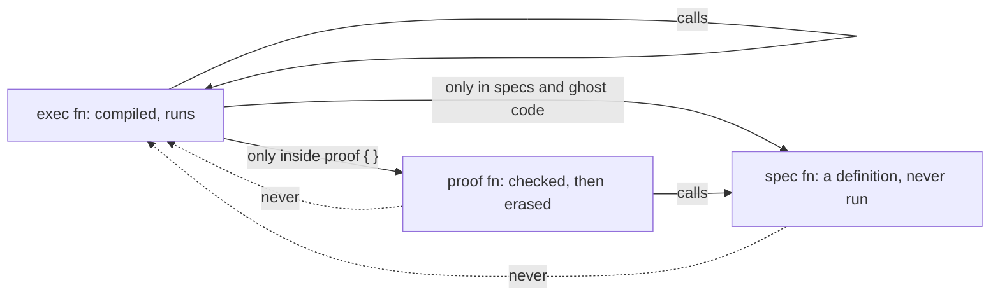
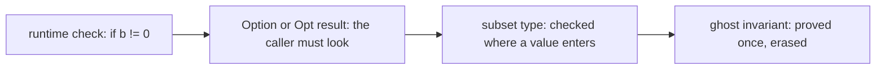
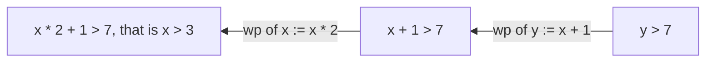
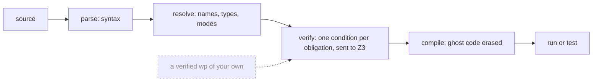
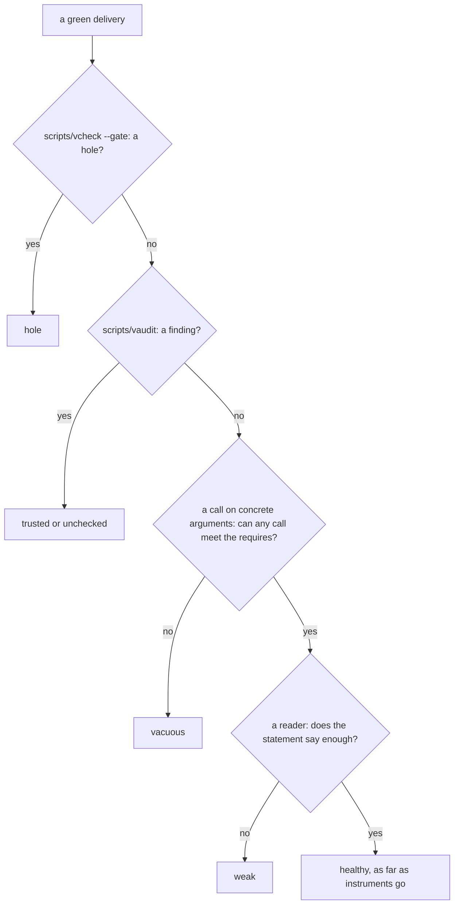

# Q03 — First syntax II: modes, logic, tooling, trust

Q02 gave you the everyday syntax of strands S1–S6 in both languages and an implementer
held to your checks. Q03 is the second half of the intro tier, strands S7–S13, and
`/viva Q03` examines the two together. The syntax is lighter than Q02's and the ideas
are heavier: from here on you are asked what a green run is evidence of.
Three ideas do all the work:

1. **Some code exists only for the verifier.** Ghost variables, spec and proof
   functions and a subset type's predicate are checked, then erased: the compiled
   program never sees them. Dafny marks such code `ghost`; Verus gives every function a
   mode, `spec`, `proof` or `exec`, and checks every call against it.
2. **Every verdict comes from one stage of one tool.** Parse, resolve, verify, compile,
   run: each stage can refuse, an early refusal hides every later problem, and a plain
   binary and the course wrapper report the same file differently.
3. **Green is a claim about what was checked.** A green file can rest on a hole, an
   assumption, unchecked code, contradictory premises or a statement that says nothing.
   Each has an instrument that exposes it, and contract v0, which you write by hand at
   the end of the module, turns that knowledge into rules for every later contractor.

---

## 0. How this module works, pretest, test-out

**Minutes: 251, plus the 30-minute tier viva.** Setup 5 · test-out 10 · reading 45 ·
worked examples and WRITE cards 26 · comparison cards 12 · predictions 24 · holes 32 ·
wp on paper 20 · fake-green specimens 12 · contract v0 20 · blueprint and paper card 15 ·
exit 25 ·
calibration 5.

**Setup.** Start one long-lived `/tutor Q03` session. `scripts/vcheck Q03` shows both
units verified with five holes each (§10).

**Pretest, before reading anything.** T1 is a pair of test-out items, `MaxLimb` and
`max_limb`: the largest limb of a non-empty sequence, with the index of the current
maximum in a ghost variable (keep it even if you see a proof without it: the item
practises ghost state). Write both closed book, hints unread, run
`scripts/firsttry.sh Q03 --check` (it records your first try by running T1's commented
checks in a scratch copy), and only then uncomment the checks. **Skip rule:** if both
pass on that first try, skip §1.1; the C1 cards, H1v and the exit items stay.

**Predictions, all fourteen, before §1**, because several sections explain what a later
box asks about:

| items | where the answer goes |
|---|---|
| P1, P2, P5–P8 (the Dafny file's prediction block); P4 (the Verus file's) | `slots/Q03.slots` |
| P3 (an obligation) | the `// SLOT: FAILS ???` line of `specimens/Q03/P3d.dfy.specimen` |
| P9 (a value) | the `// SLOT:` line of `dafny/checks/Q03_checks.dfy` |
| P10 (a value) | the `// SLOT:` line of `specimens/Q03/P10v.rs.specimen` |
| P11–P14 (diagnoses) | `slots/Q03.slots`, after reading each delivery and running nothing on it |

Then run `scripts/firsttry.sh Q03 --check` again and enable each slot as its file says.
Until then keep the README's *Predictions first* list closed, and with it the Q03 bank
and rubric, the exit files and the `card-c6dv`, `card-c7dv`, `card-c8dv` and `chapter-*`
specimens (`scripts/vcheck` refuses each until the prediction it settles is recorded).
Each prediction reappears below in a box,

> **Predict (Pn) — commit in the file before reading on.**

and its answer comes only after the box, below the words *Commit your prediction
first.*

**Outputs.** Every output fence is a real run on the course pins (Dafny 4.11.0, Verus
0.2026.09.27.3cf1832), through the course tools or, in §3, the pinned binaries run
plainly, pinned in `expected/Q03.chapter.toml` (the comment above each fence names its
entry; `scripts/pins.py --chapter Q03` re-runs them). `probe.dfy`, `probe.rs` and
`p7.dfy` are scratch files. Each fence drops the wrapper's last line,
`raw output: <dir>`. A Verus summary shows `-` where the run reported no count, and a
Dafny probe run with `--module Q03` also counts the given spine's tasks.

**This module's files**

| file | what it is |
|---|---|
| `dafny/given/Q/QG_L1_BigNat.dfy`, `QG_L2_BigNat.dfy`; `verus/given/qg_bignat_l1`, `qg_bignat_l2` | the given spine, frozen; L2 adds `Canonical`, `Normalize`, `FromNat`, `AddLimb` (Dafny), `limb_at`, `lemma_add_limb_lift` (Verus) |
| `dafny/Q/Q03_FirstSyntaxII/core/Q03_FirstSyntaxII.dfy` | the Dafny exercise file: **5 holes** (T1d, H1d–H4d) and the prediction block |
| `verus/q/q03_first_syntax_ii/src/lib.rs` | the Verus exercise file: **5 holes** (T1v, H1v–H4v) and P4 |
| `dafny/checks/Q03_checks.dfy` | a given-only check unit, no hole: the value prediction P9 |
| `specimens/Q03/` | P3, P10, the deliveries P11–P14, the card demos, this chapter's `chapter-*` specimens |
| agent file | none: the agentic exercise is contract v0, written by hand (§11) |
| `dafny/Q/Q03_FirstSyntaxII/exit/Q03_Exit.dfy` | the closed-book exit, Dafny half: **2 holes** and an empty block |
| `verus/q/q03_first_syntax_ii/src/exit.rs` | the closed-book exit, Verus half: **3 holes** |
| `paper/Q03_problems.tex`, `paper/Q03_answers.tex` | the written pair (§9) |
| `CLAUDE.md`, §Contractor contract | where you write contract v0 |
| `Solutions/` mirrors of these files | the reference: yours to open LAST |

---

## 1. S7 — Ghost code, modes and subset types

Specifications, lemmas and ghost variables are checked like code, then removed before
compilation. Both languages enforce one rule: a ghost value may flow into
specifications and other ghost code, never into code that runs.

### 1.1 Ghost variables

A ghost variable records something the proof needs and the program does not. C1's
success example counts zero limbs, and its invariant needs the limbs read so far, so
each file keeps them in a ghost sequence. Dafny declares it `ghost var` and assigns it
anywhere; Verus declares it `let ghost` and assigns it only inside a `proof { }` block:

```dafny
ghost var seen: seq<nat> := [];
seen := seen + [s[i]];                       // inside the loop
```

```rust
let ghost mut seen: Seq<u64> = Seq::empty();
proof { seen = seen.push(v@[i as int]); }    // inside the loop
```

Each card's failure demo lets a ghost value reach compiled code:

<!-- pin: c1d -->
```
$ scripts/vcheck specimens/Q03/card-c1d.dfy.specimen
vcheck: specimens/Q03/card-c1d.dfy.specimen [dafny, learner loop]: failed — - verified, 0 holes, 1 error, stage resolve
specimens/Q03/card-c1d.dfy.specimen:8:10: error: ghost variables such as g are allowed only in specification contexts. g was inferred to be ghost based on its declaration or initialization.
```

<!-- pin: c1v -->
```
$ scripts/vcheck specimens/Q03/card-c1v.rs.specimen
vcheck: specimens/Q03/card-c1v.rs.specimen [verus, learner loop]: failed — - verified, 0 holes, 1 error, stage resolve
specimens/Q03/card-c1v.rs.specimen:10:20: error: cannot access spec-mode place in executable context
```

Read them aloud: (1) line 8 of the Dafny demo assigns the ghost `g` to the compiled
out-parameter `n`, and line 10 of the Verus demo does the same with `let n: usize = g`;
(2) both stop at `stage resolve`, a mode check before any proof; (3) Verus calls the
ghost variable a *spec-mode place*: ghost data has spec mode.

A function can also return a ghost result. Dafny marks an out-parameter `ghost`; Verus
returns a `Ghost<T>` wrapper, built with `Ghost(e)` and read with `@`:

```dafny
method FirstOrZero(s: seq<nat>) returns (r: nat, ghost nonempty: bool)
  ensures nonempty == (|s| > 0)
  ensures nonempty ==> r == s[0]
{
  if |s| > 0 {
    r, nonempty := s[0], true;
  } else {
    r, nonempty := 0, false;
  }
}
```

<!-- pin: ghost-out-d -->
```
$ scripts/vcheck --module Q03 probe.dfy
vcheck: probe.dfy [dafny, learner loop]: verified — 24 verified, 0 holes, 0 errors
```

```rust
use vstd::prelude::*;

verus! {

pub fn first_or_zero(v: &Vec<u64>) -> (r: (u64, Ghost<bool>))
    ensures
        r.1@ == (v.len() > 0),
        r.1@ ==> r.0 == v@[0],
{
    if v.len() > 0 {
        (v[0], Ghost(true))
    } else {
        (0, Ghost(false))
    }
}

} // verus!
```

<!-- pin: ghost-out-v -->
```
$ scripts/vcheck --module Q03 probe.rs
vcheck: probe.rs [verus, learner loop]: verified — 1 verified, 0 holes, 0 errors
```

### 1.2 Verus modes: spec, proof, exec

> **Predict (P4v) — commit in the file before reading on.** Four crates share `triple`
> (an exec fn) and `lemma_pos` (a proof fn); each adds one call: [a] a proof fn calls
> `triple`; [b] a spec fn calls `triple`; [c] an exec fn calls `lemma_pos(x as int)`
> outside any proof block; [d] the same call inside `proof { }`. Which crates does
> `scripts/vcheck` accept?

*Commit your prediction first.* The answer is `d`, and the refusals differ in kind:

<!-- pin: p4v-a -->
```
$ scripts/vcheck specimens/Q03/chapter-p4v-a.rs.specimen
vcheck: specimens/Q03/chapter-p4v-a.rs.specimen [verus, learner loop]: failed — - verified, 0 holes, 1 error, stage resolve
specimens/Q03/chapter-p4v-a.rs.specimen:27:13: error: cannot call function `chapter_p4v_a::triple` with mode exec
```

<!-- pin: p4v-c -->
```
$ scripts/vcheck specimens/Q03/chapter-p4v-c.rs.specimen
vcheck: specimens/Q03/chapter-p4v-c.rs.specimen [verus, learner loop]: failed — 0 verified, 0 holes, 1 error, stage parse
specimens/Q03/chapter-p4v-c.rs.specimen:28:19: error: The Verus types 'nat' and 'int' can only be used in ghost code (e.g., in a 'spec' or 'proof' function, inside a 'proof' block, or when assigning to a 'ghost' or 'tracked' variable)
```

Crate [b] fails as [a] does: ghost code never calls code that runs, because exec code
may have effects and may not terminate. Crate [c] stops a stage earlier, at the cast
`x as int`: `int` and `nat` are mathematical integers with no machine size, so they
exist only in ghost code. Inside `proof { }`, crate [d], the cast and the call are ghost
code, and the crate verifies. W1v shows the pattern, the mode triangle: a spec fn says
what a value is, a proof fn proves a fact about it, and an exec fn is specified through
the spec fn and calls the proof fn in a proof block:

```rust
pub fn succ(x: u64) -> (r: u64)
    requires
        x < u64::MAX,
    ensures
        r == succ_spec(x as int),
        r > x,
{
    proof {
        lemma_succ_gt(x as int);  // the fact `succ_spec(x as int) > x` is now known
    }
    x + 1
}
```

The other direction is closed too: C5's failure demo assigns an exec variable inside a
proof block.

<!-- pin: c5v -->
```
$ scripts/vcheck specimens/Q03/card-c5v.rs.specimen
vcheck: specimens/Q03/card-c5v.rs.specimen [verus, learner loop]: failed — - verified, 0 holes, 1 error, stage resolve
specimens/Q03/card-c5v.rs.specimen:11:9: error: cannot mutate exec-mode place in proof-code
```

The call rules as a picture:



Calls flow from code that runs toward definitions, never back. Dafny has the same
lattice under other keywords: a `ghost function` or `ghost predicate` is spec, a
`lemma` is proof, a `method` is exec, and a plain `function` serves both sides. A method
calls a lemma as an ordinary statement, and no function or lemma may call a method.

### 1.3 Subset types (Dafny)

> **Predict (P3d) — commit in the file before reading on.** `Limb` is the naturals below
> `BASE`. Four methods assign `BASE - 1` [a], `BASE` [b], `5 + 5` [c] and the sum of two
> `Limb` parameters [d] to a `Limb` variable. Which labelled lines fail?

A subset type is a base type plus a predicate every value carries. The verifier checks
the predicate wherever a value enters the type and assumes it wherever a value of the
type is used. The type must be inhabited, and Dafny tries `0` first, so a predicate
that rejects `0` needs a `witness` clause, as W1d shows:

```dafny
type NZDigit = x: nat | 1 <= x <= 9 witness 1

function DigitPred(d: NZDigit): nat
  ensures DigitPred(d) < 9
{
  d - 1
}
```

`d - 1` is a `nat` only because `d >= 1` comes with `d`. A witness must satisfy the
predicate, which C4's failure demo breaks:

<!-- pin: c4d -->
```
$ scripts/vcheck specimens/Q03/card-c4d.dfy.specimen
vcheck: specimens/Q03/card-c4d.dfy.specimen [dafny, learner loop]: failed — 0 verified, 0 holes, 1 error
specimens/Q03/card-c4d.dfy.specimen:5:37: error: the given witness expression might not satisfy constraint
```

*Commit your prediction first.* P3 is `FAILS b d`:

<!-- pin: p3d -->
```
$ scripts/vcheck specimens/Q03/P3d.dfy.specimen
vcheck: specimens/Q03/P3d.dfy.specimen [dafny, learner loop]: failed — 4 verified, 0 holes, 2 errors
specimens/Q03/P3d.dfy.specimen:20:20: error: value does not satisfy the subset constraints of 'Limb'
specimens/Q03/P3d.dfy.specimen:28:22: error: value does not satisfy the subset constraints of 'Limb'
```

Line 20 is [b] and line 28 is [d]. Constant arithmetic is evaluated, so [a] and [c]
pass; two limbs can sum to `2 * BASE - 2`, and nothing in [d] rules that out. Verus has
no subset types: a bound lives in a `requires`, in a machine type (a `u64` is already
"an integer below 2^64") or, later, in a type invariant, which is why Verus limbs are
`u64` and Dafny limbs are `nat` under L1's `Valid`.

### 1.4 Exec checks: handing the verifier a fact

When a caller cannot promise a precondition, test it in code: inside the branch, the
test is a fact the verifier knows. C2's success example, in both columns:

```dafny
method SafeDiv(a: nat, b: nat) returns (r: Opt<nat>)
  ensures (r.Some? <==> b != 0) && (r.Some? ==> r.value == a / b)
{
  if b != 0 { r := Some(a / b); } else { r := None; }
}
```

```rust
pub fn safe_div(a: u64, b: u64) -> (r: Option<u64>)
    ensures
        r.is_some() <==> b != 0,
        r.is_some() ==> r.unwrap() == a / b,
{
    if b != 0 { Some(a / b) } else { None }
}
```

Without the test, the division's own obligation fails:

<!-- pin: c2d -->
```
$ scripts/vcheck specimens/Q03/card-c2d.dfy.specimen
vcheck: specimens/Q03/card-c2d.dfy.specimen [dafny, learner loop]: failed — 0 verified, 0 holes, 1 error
specimens/Q03/card-c2d.dfy.specimen:7:12: error: possible division by zero
```

A runtime check is one end of a spectrum of places that can enforce an invariant:



Moving right, the cost moves from run time to verification time. H4 and the exit's
checked arithmetic sit at the left end. In Verus `BASE` is a spec const that exec code
cannot read; H4v's docstring asks what the code tests instead.

### 1.5 Computed values and termination

> **Predict (P9d) — commit in the file before reading on.** How many limbs does L2's
> `FromNat` give for `BASE`?

> **Predict (P10v) — commit in the file before reading on.** The value of
> `limb_at(seq![7u64, 8u64], -1) + limb_at(seq![7u64, 8u64], 1)`?

*Commit your prediction first.* P9 is `2`: `BASE` in base `BASE` is "10", as ten needs
two decimal digits. P10 is `8`: `limb_at` reads every index outside `0 <= j < s.len()`
as 0. Dafny's `expect` sits in a `@Test` method, so it is compiled and run; Verus's
`assert(…) by (compute_only)` is evaluated by the verifier's interpreter, with no
solver.

H1d and H2d recurse under the `decreases` that ships with their statements; Q03 asks for
no new measure. Each recursive call must be on an argument that measure ranks lower.

---

## 2. S8 — Weakest preconditions by hand

A Hoare triple `{P} S {Q}` says: started in a state satisfying `P`, program `S` ends in
one satisfying `Q`. The **weakest precondition** `wp(S, Q)` is the least demanding such
`P`, and the verifier shows that your `requires` implies it. For loop-free code it is
computed backwards:

- assignment: `wp(x := e, Q)` is `Q` with `e` substituted for `x`;
- sequence: `wp(S1; S2, Q) = wp(S1, wp(S2, Q))`;
- conditional: `wp(if b then S1 else S2, Q) = (b ==> wp(S1, Q)) && (!b ==> wp(S2, Q))`.

A loop has no such formula: its invariant splits it into the three obligations of Q02.

> **Predict (P8dv) — commit in the file before reading on.** For `x := x * 2; y := x + 1;`
> and the postcondition `y > 7`, which option is equivalent to the weakest precondition:
> a) `x > 3`, b) `x > 7`, c) `x + 1 > 7`, d) `x > 6`?

*Commit your prediction first.* The answer is a, computed backwards:



Option c stops after the last assignment and forgets the first. The verifier checks a
derivation for you: give the program the computed precondition and a weaker one, and
only the computed one should verify.

```dafny
method Computed(x0: int) returns (y: int)
  requires x0 > 3
  ensures y > 7
{
  var x := x0 * 2;
  y := x + 1;
}

method TooWeak(x0: int) returns (y: int)
  requires x0 > 2
  ensures y > 7
{
  var x := x0 * 2;
  y := x + 1;
}
```

<!-- pin: p8dv-d -->
```
$ scripts/vcheck --module Q03 probe.dfy
vcheck: probe.dfy [dafny, learner loop]: failed — 23 verified, 0 holes, 1 error
probe.dfy:12:1: error: a postcondition could not be proved on this return path
probe.dfy:11:13: related: this is the postcondition that could not be proved
```

```rust
use vstd::prelude::*;

verus! {

proof fn computed(x0: int) -> (y: int)
    requires
        x0 > 3,
    ensures
        y > 7,
{
    let x = x0 * 2;
    x + 1
}

proof fn too_weak(x0: int) -> (y: int)
    requires
        x0 > 2,
    ensures
        y > 7,
{
    let x = x0 * 2;
    x + 1
}

} // verus!
```

<!-- pin: p8dv-v -->
```
$ scripts/vcheck --module Q03 probe.rs
vcheck: probe.rs [verus, learner loop]: failed — 1 verified, 0 holes, 1 error
probe.rs:19:9: error: postcondition not satisfied
```

`TooWeak` fails at its postcondition in each file: `x0 = 3` gives `y = 7`.

---

## 3. S9 — What the tools print, and who reads it

The course wrapper prints one summary line (with `, stage <s>` when the run stopped
before verification), then one line per hole and diagnostic; its exit code is the
verdict (0 verified, 1 failed, 3 refused), and `--json` prints the same for a program.
The raw verifiers have interfaces of their own, and a grader that reads one signal of a
raw tool is easy to satisfy.

> **Predict (P5dv) — commit in the file before reading on.** The exit code of
> `dafny audit` run directly on a file whose audit lists one finding; and N in
> `verification results:: N verified, E errors` when `verus <file> --crate-type=lib`
> runs plainly on three proof fns: one proved, one whose body is `assume(false)`, one
> `#[verifier::external_body]`.

*Commit your prediction first.* The answer is `D:0 V:2`. The Dafny file is C8's demo, a
lemma with no body, copied to a scratch file:

<!-- pin: p5dv-d-plain -->
```
$ dafny audit probe.dfy
probe.dfy(6,18): Warning: This ensures clause is part of a bodyless method. Add the {:axiom} attribute to it or the enclosing method to suppress this warning
probe.dfy(5,8): Warning: DoubleIsSum: Ghost declaration has no body and has an ensures clause. Possible mitigation: Provide a body or add `{:axiom}`.
Dafny auditor completed with 1 findings

Dafny program verifier did not attempt verification
$ echo $?
0
```

`dafny audit` is a report: it exits 0 whatever it found, and `scripts/vaudit` turns a
finding into exit 1 (§6). The Verus file, plainly and then through the wrapper:

<!-- pin: p5dv-v-plain -->
```
$ verus probe.rs --crate-type=lib
verification results:: 2 verified, 0 errors
$ echo $?
0
```

<!-- pin: p5dv-v-vcheck -->
```
$ scripts/vcheck specimens/Q03/chapter-p5dv-v.rs.specimen
vcheck: specimens/Q03/chapter-p5dv-v.rs.specimen [verus, learner loop]: verified — - verified, 2 holes, 0 errors
specimens/Q03/chapter-p5dv-v.rs.specimen:20:5: hole assume lemma_b
specimens/Q03/chapter-p5dv-v.rs.specimen:24:1: hole external_body lemma_c
```

The `assume(false)` body counts as verified, because everything verifies under that
assumption; the `external_body` fn is not counted, because Verus never looked inside it.
The wrapper runs Verus with `--no-cheating`, which turns both into holes (its learner
loop reports progress; `--gate` fails on any hole). An exit code, a count or the word
"verified" is a claim of one tool under one set of options: read it with its options,
or let a wrapper read it for you.

---

## 4. S10 — The pipeline and the trusted base

> **Predict (P1dv) — commit in the file before reading on.** A method or exec fn
> specified to return 7, whose body assumes `false` and then returns 8, is compiled and
> called from a test. What value does the call return?

*Commit your prediction first.* `D:8 V:8`. C6's demos are P1's files, run as tests:

<!-- pin: c6dv-d -->
```
$ scripts/vcheck --test specimens/Q03/card-c6dv-d.dfy.specimen
vcheck: specimens/Q03/card-c6dv-d.dfy.specimen [dafny, test]: failed — 0 passed, 1 failed
FAILED Q03_CardC6d.SevenTest
specimens/Q03/card-c6dv-d.dfy.specimen:9:5: hole assume Q03_CardC6d.Seven
specimens/Q03/card-c6dv-d.dfy.specimen:5:1: error: Test failures occurred: see above.
specimens/Q03/card-c6dv-d.dfy.specimen:16:5: error: expectation violation
```

<!-- pin: c6dv-v -->
```
$ scripts/vcheck --test specimens/Q03/card-c6dv-v.rs.specimen
vcheck: specimens/Q03/card-c6dv-v.rs.specimen [verus, test]: failed — 0 passed, 1 failed
FAILED seven_test
(no file): error: test seven_test failed
```

Both tests fail. The verifier accepted `r == 7` because anything follows from `false`;
the compiler erased the assumption, as it erases every ghost statement, and the code
that ran returned 8. A verified postcondition speaks about every execution *in which the
assumptions hold*, and nothing at run time checks them. The columns differ in what the
test run says about the assumption (C6dv): Dafny's lists it as a hole at line 9,
Verus's names only the failed test.

What you trust when a run is green is the **trusted computing base**: the verifier
(Dafny via Boogie to Z3, Verus via its own intermediate languages to Z3), the compiler
and its erasure of ghost code, the runtime, the specifications, and every assumption in
the file. The audit (§6) makes the last one visible.

> **Predict (P6dv) — commit in the file before reading on.** A file holds one type error
> and one false `assert`. How many errors does `scripts/vcheck` report, and at which
> stage does it stop?

*Commit your prediction first.* `D:1 resolve V:1 resolve`:

<!-- pin: p6dv-d -->
```
$ scripts/vcheck specimens/Q03/chapter-p6dv-d.dfy.specimen
vcheck: specimens/Q03/chapter-p6dv-d.dfy.specimen [dafny, learner loop]: failed — - verified, 0 holes, 1 error, stage resolve
specimens/Q03/chapter-p6dv-d.dfy.specimen:7:17: error: RHS (of type int) not assignable to LHS (of type bool)
```

<!-- pin: p6dv-v -->
```
$ scripts/vcheck specimens/Q03/chapter-p6dv-v.rs.specimen
vcheck: specimens/Q03/chapter-p6dv-v.rs.specimen [verus, learner loop]: failed — 0 verified, 0 holes, 1 error, stage resolve
specimens/Q03/chapter-p6dv-v.rs.specimen:10:19: error: mismatched types
```

The one error is the type error, and the false `assert` on the next line is never
reported, because verification never ran. Each stage consumes the previous one's
output:



A refusal at one stage hides everything after it, so a short error list is not a short
problem list: fix in order and re-run. (The dashed node is not yours yet: a wp
calculator you verify in Q08.)

---

## 5. S11 — What a failure message does and does not say

> **Predict (P7dv) — commit in the file before reading on.** In this unit, two
> empty-bodied lemmas about `Count`: `Count(n) == n` (true) and `Count(n) == n + 1`
> (false). Does each tool print the same message for both?

*Commit your prediction first.* `D:same V:same`. The Dafny lemmas run on a scratch copy
with the Q03 unit's options:

<!-- pin: p7dv-d -->
```
$ scripts/vcheck --module Q03 p7.dfy
vcheck: p7.dfy [dafny, learner loop]: failed — 23 verified, 0 holes, 2 errors
p7.dfy:15:3: error: a postcondition could not be proved on this return path
p7.dfy:14:22: related: this is the postcondition that could not be proved
p7.dfy:20:3: error: a postcondition could not be proved on this return path
p7.dfy:19:22: related: this is the postcondition that could not be proved
```

<!-- pin: p7dv-v -->
```
$ scripts/vcheck specimens/Q03/chapter-p7dv-v.rs.specimen
vcheck: specimens/Q03/chapter-p7dv-v.rs.specimen [verus, learner loop]: failed — 1 verified, 0 holes, 2 errors
specimens/Q03/chapter-p7dv-v.rs.specimen:17:9: error: postcondition not satisfied
specimens/Q03/chapter-p7dv-v.rs.specimen:23:9: error: postcondition not satisfied
```

"Verified" means Z3 showed that no counterexample exists; every other outcome (a
counterexample, `unknown`, a resource limit) is reported as "could not be proved". Z3 is
incomplete on what proofs need most: quantifiers, nonlinear arithmetic, recursive
definitions unfolded only so far, and induction, which it never does by itself. The true
lemma needs induction on `n`. Verus never inducts for you, and from Q03 on the Q
track's Dafny units turn automatic lemma induction off (Q02.P3dv showed it on), so that
you write the induction H1d and H2d need.

This is the **verdict asymmetry**: "verified" is trustworthy, "could not be proved" is
not a refutation. To show a lemma false, exhibit a counterexample (`Count(0)` is 0, not
1); to show it true, prove it. A contractor who calls a lemma false because the verifier
rejected it has confused the two (README, *Disputes go to the verifier*).

**Triggers (C9dv, recognise only).** A `forall` fact is used only when a term matching
its *trigger* appears in the proof. The Rosetta card writes one in each language,
`forall i {:trigger s[i]} | 0 <= i < |s| :: s[i] < 100` and
`forall|i: int| 0 <= i < s.len() ==> #[trigger] s[i] < 100`; both lemmas verify,
because the goal mentions `s[k]`, which matches `s[i]`. A quantifier whose trigger never
appears is a fact the solver never uses, with the same "could not be proved". You write
triggers in Q06.

---

## 6. S12 — Green is not done: fake greens and the audit

**The audit (C10dv, recognise only).** `scripts/vaudit <file>` runs `dafny audit` plus
the course lint over a Dafny file; for Verus, `scripts/vcheck` already runs
`--no-cheating`, and `scripts/vaudit <crate>` adds the lint. Each finding line starts
`<path>:<line>: <kind>`; an empty report is a clean audit.

**Loud and silent holes (C8dv).** A hole is loud when the plain tool reports it. C8's
demos, a bodyless Dafny lemma and a Verus proof fn whose body is `assume(false)`, run
through the wrapper:

<!-- pin: c8dv-d -->
```
$ scripts/vcheck specimens/Q03/card-c8dv-d.dfy.specimen
vcheck: specimens/Q03/card-c8dv-d.dfy.specimen [dafny, learner loop]: verified — 0 verified, 1 hole, 0 errors, 1 finding
specimens/Q03/card-c8dv-d.dfy.specimen:6:19: hole bodyless-method Q03_CardC8d.DoubleIsSum
specimens/Q03/card-c8dv-d.dfy.specimen: nothing-verified: 0 verification tasks ran: exit 0 alone is not a pass (Δ11)
```

<!-- pin: c8dv-v -->
```
$ scripts/vcheck specimens/Q03/card-c8dv-v.rs.specimen
vcheck: specimens/Q03/card-c8dv-v.rs.specimen [verus, learner loop]: verified — - verified, 1 hole, 0 errors
specimens/Q03/card-c8dv-v.rs.specimen:11:5: hole assume lemma_double_is_sum
```

The Dafny hole is loud even in a plain run (a warning, as Q01 showed); the Verus one is
silent in a plain run (§3 counted it as verified) and loud only under `--no-cheating`.
The Dafny run also notes that no task ran: exit 0 with nothing verified is no pass.

> **Predict (P11d, P12d, P13v, P14v) — commit in the files before reading on.** For each
> delivery specimen, its species and the instrument that exposes it.

*Commit your prediction first.* The species, each with the cheapest instrument that
exposes it:

| species | what is wrong | instrument |
|---|---|---|
| hole | an unfinished placeholder the hole counter reports | `gate` (`scripts/vcheck --gate`) |
| trusted | an assumption or axiom no hole counter reports, such as `assume {:axiom}` | `audit` (`scripts/vaudit`) |
| unchecked | part of it never verified, such as Dafny's `{:verify false}` | `gate` or `audit`, by form |
| vacuous | proved, but its assumptions contradict each other | `witness` (a call on concrete arguments, §7) |
| weak | verified and honest, but the statement says too little | `reader` |
| healthy | none of these | `none` |

P11d is `trusted audit`: its gate is green, its audit is not.

<!-- pin: p11d-gate -->
```
$ scripts/vcheck --gate specimens/Q03/P11d.dfy.specimen
vcheck: specimens/Q03/P11d.dfy.specimen [dafny, gate]: verified — 4 verified, 0 holes, 0 errors
$ echo $?
0
```

<!-- pin: p11d-audit -->
```
$ scripts/vaudit specimens/Q03/P11d.dfy.specimen
specimens/Q03/P11d.dfy.specimen:50: assume-axiom — `assume {:axiom}` is silent in verify (Δ3, G1)
specimens/Q03/P11d.dfy.specimen:50: audit-assume-axiom — TwoLimbsStep: Definition has `assume {:axiom}` statement in body
vaudit: specimens/Q03/P11d.dfy.specimen [dafny, learner]: 2 finding(s)
$ echo $?
1
```

The helper "proves" its statement by assuming it, and `{:axiom}` silences the warning a
bare `assume` gets. P12d is `weak reader`: every instrument passes it,

<!-- pin: p12d-gate -->
```
$ scripts/vcheck --gate specimens/Q03/P12d.dfy.specimen
vcheck: specimens/Q03/P12d.dfy.specimen [dafny, gate]: verified — 4 verified, 0 holes, 0 errors
```

<!-- pin: p12d-audit -->
```
$ scripts/vaudit specimens/Q03/P12d.dfy.specimen
vaudit: specimens/Q03/P12d.dfy.specimen [dafny, learner]: 0 finding(s)
```

and its `ensures ToNat(s) >= 0` holds of every natural number: the comment promised a
bound, the statement gives none. P13v is `hole gate`: `external_body` is the course's
exec-hole form, which the hole counter reports on sight; the gate's error line also
lists what else it demands of a Verus run.

<!-- pin: p13v-gate -->
```
$ scripts/vcheck --gate specimens/Q03/P13v.rs.specimen
vcheck: specimens/Q03/P13v.rs.specimen [verus, gate]: failed — - verified, 1 hole, 1 error
specimens/Q03/P13v.rs.specimen:36:7: hole external_body Q03.P13v
(no file): error: gate: 'success' is false, not true; --output-json lacks 'is-verifying-entire-crate'; 'encountered-vir-error' is true, not false; --output-json lacks 'verified'; 1 hole(s); exit 1
```

P14v is `healthy none`, a small, true, useful proof fn: the decoy every forensic set
needs.

<!-- pin: p14v-gate -->
```
$ scripts/vcheck --gate specimens/Q03/P14v.rs.specimen
vcheck: specimens/Q03/P14v.rs.specimen [verus, gate]: verified — 1 verified, 0 holes, 0 errors
```

The catalogue as a procedure, cheapest instrument first:



Every branch but the last ends in an artifact you can re-run; the last ends in your own
reading, which no tool replaces. Q09 makes this a full forensic exercise.

**What contract v0 must cover** (§11), however you word it: (1) when the contractor
re-checks: after every edit, never stacked, unless an acceptance line names another
discipline (Q02's fast channel); (2) done as artifacts a third party can re-run, `--gate`
green with zero holes **and** a clean `scripts/vaudit`, because a green gate can rest
on a trusted line; (3) a statement that blocks green is reported, never weakened; (4) no
escape hatch: an assumption, an axiom, an external body, a skip or a filter;
(5) evidence is commands and their output, never prose.

---

## 7. S13 — Witnesses and vacuous specifications

**Witnesses (C3d, C3v).** An `exists` goal is proved by naming a term that works; the
solver rarely invents one. C3's success examples name 2:

```dafny
lemma ExistsSquareFour()
  ensures exists i: nat :: Square(i) == 4
{
  assert Square(2) == 4;
}
```

```rust
pub proof fn lemma_exists_square_four()
    ensures
        exists|i: nat| square(i) == 4,
{
    assert(square(2) == 4);
}
```

The assertion puts the term `Square(2)` before the solver, which matches it against the
`exists`; with an empty body (the demos `card-c3d` and `card-c3v`) the lemma fails in
both languages. The word covers two more moves: a subset type's `witness` (§1.3), and a
call of a lemma on concrete arguments, which checks that its premises can hold. H3 is a
witness proof, and its docstring asks what the solver must know about your witness.

> **Predict (P2dv) — commit in the file before reading on.** A lemma whose `requires`
> contradict each other (`x > 5` and `x < 3`), whose `ensures` is `false`, with an empty
> body, checked with `scripts/vcheck --gate`. What does each check report?

*Commit your prediction first.* `D:ok V:ok`:

<!-- pin: c7dv-d-gate -->
```
$ scripts/vcheck --gate specimens/Q03/card-c7dv-d.dfy.specimen
vcheck: specimens/Q03/card-c7dv-d.dfy.specimen [dafny, gate]: verified — 1 verified, 0 holes, 0 errors
```

<!-- pin: c7dv-v-gate -->
```
$ scripts/vcheck --gate specimens/Q03/card-c7dv-v.rs.specimen
vcheck: specimens/Q03/card-c7dv-v.rs.specimen [verus, gate]: verified — 1 verified, 0 holes, 0 errors
```

No state satisfies both premises, so every conclusion follows from them, `false`
included. The lemma is **vacuous**: proved and useless, because no caller can meet its
`requires`, and the gate and the audit both pass it. The witness instrument exposes it:
call the lemma on a concrete argument, watch the call fail at the `requires`, and find
that no argument could pass:

<!-- pin: p2dv-witness -->
```
$ scripts/vcheck specimens/Q03/chapter-p2dv-witness-v.rs.specimen
vcheck: specimens/Q03/chapter-p2dv-witness-v.rs.specimen [verus, learner loop]: failed — 1 verified, 0 holes, 1 error
specimens/Q03/chapter-p2dv-witness-v.rs.specimen:19:5: error: precondition not satisfied
```

Here the languages part (C7dv). Dafny has a built-in report, `--analyze-proofs`, which
the learner loop passes through:

<!-- pin: c7dv-d-analyze -->
```
$ scripts/vcheck specimens/Q03/card-c7dv-d.dfy.specimen -- --analyze-proofs
vcheck: specimens/Q03/card-c7dv-d.dfy.specimen [dafny, learner loop]: verified — 1 verified, 0 holes, 0 errors
specimens/Q03/card-c7dv-d.dfy.specimen:7:13: warning: ensures clause proved using contradictory assumptions
```

The course's Verus column has no such report; its instruments are the witness call and
one more probe: replace the conclusion with `false`, and if the lemma still verifies, its
premises contradict each other.

**Spec quality.** A vacuous statement is the extreme case of a statement that says too
little. Your paper card, **02.13** (Clover), catches verified code whose specification
and intent disagree, by checking that code, annotations and docstring agree with each
other. Reread it in your own `cheatsheets.md` before §9: it is the research version of
the reader's row in §6's table.

---

## 8. What the instruments can and cannot see

| instrument | what it sees | what it cannot see |
|---|---|---|
| `scripts/vcheck` (learner loop) | the verdict, the stage, every tool-counted hole and error | whether a statement says what you meant |
| `scripts/vcheck --gate` | zero holes, no warnings (Dafny), a complete Verus run, the count pins of `expected/Q03.counts` | a trusted line (P11d); a vacuous or weak statement |
| `scripts/vaudit` | assumptions, axioms, external bodies, skipped or filtered verification, the lint's banned forms | contradictory premises; a weak statement |
| a witness call, a `--test` run | that premises can hold; what compiled code returns on the inputs tried | every other input; anything erased before the run |
| `scripts/specfreeze --check Q03` | that no shipped statement changed | whether the shipped statement was right |
| `scripts/firsttry.sh Q03 --report --strict` | slots, commented checks, first tries, test-outs | whether you understood why |
| a reader (you, `/review-code`, `/grade-paper`) | intent, weakness, names that lie | nothing mechanical: advisory until an artifact confirms it |

Each row's blind spot is the next row's job. Done is the first three rows plus the
strict report; the reader's row is what the instructor layer adds.

---

## 9. On paper, before the keyboard

`paper/Q03_problems.tex` holds the S8 lab, B1 and B2: weakest preconditions and
verification conditions by hand (20 minutes, after §2). The written pair follows
(15 minutes, before the holes): B3, a blueprint for H1d written before you prove it or
read its hints, and B4, the paper card 02.13. Fill `paper/Q03_answers.tex`, build with
`make -C paper paper` until green, and run `/grade-paper Q03` in a fresh session before
you start the holes; once H1d's unit passes its gate, `/grade-paper Q03 --post`
re-scores B3's blueprint against your own proof. Calculations are
graded step by step, the card field by field against the pinned range of your
`cheatsheets.md`. Write each derivation before you check it with the verifier as §2
did: the lab grades the steps.

---

## 10. The exercise file

Both units, as shipped:

<!-- pin: units -->
```
$ scripts/vcheck Q03
vcheck: dafny/Q/Q03_FirstSyntaxII/core [dafny, learner loop]: verified — 41 verified, 5 holes, 0 errors
dafny/Q/Q03_FirstSyntaxII/core/Q03_FirstSyntaxII.dfy:79:5: hole assume Q03.T1d
dafny/Q/Q03_FirstSyntaxII/core/Q03_FirstSyntaxII.dfy:432:34: hole bodyless-method Q03.H1d
dafny/Q/Q03_FirstSyntaxII/core/Q03_FirstSyntaxII.dfy:452:31: hole bodyless-method Q03.H2d
dafny/Q/Q03_FirstSyntaxII/core/Q03_FirstSyntaxII.dfy:471:13: hole bodyless-method Q03.H3d
dafny/Q/Q03_FirstSyntaxII/core/Q03_FirstSyntaxII.dfy:484:5: hole assume Q03.H4d
vcheck: verus/q/q03_first_syntax_ii [verus, learner loop]: verified — - verified, 5 holes, 0 errors
verus/q/q03_first_syntax_ii/src/lib.rs:48:1: hole external_body Q03.T1v
verus/q/q03_first_syntax_ii/src/lib.rs:309:40: hole assume Q03.H1v
verus/q/q03_first_syntax_ii/src/lib.rs:359:1: hole external_body Q03.H2v
verus/q/q03_first_syntax_ii/src/lib.rs:385:40: hole assume Q03.H3v
verus/q/q03_first_syntax_ii/src/lib.rs:397:1: hole external_body Q03.H4v
vcheck: 2 unit(s): 2 verified, 0 not; 10 hole(s) in all
```

Ten holes, five per file, as `expected/Q03.counts` pins them. In file order:

- **T1d / T1v** (§0): the largest limb, with a ghost index.
- **P1–P14** (§0's table), W1d and W1v, the WRITE cards C1–C5, the Rosetta cards C9dv
  and C10dv, and the divergence cards C6dv–C8dv in each file's final section.
- **H1d** `AddLimbToNat`, **H2d** `FromNatCorrect`: lemmas by induction on the shipped
  measure, with the L2 helpers; the unit's options make the induction yours (§5).
- **H1v** `add_limb`: the code, the ghost carries, the measure and the call of the
  given lift lemma ship; you write the rest of the loop invariant. Read the lift
  lemma's `requires` first.
- **H2v** `from_u64`: the canonical limbs of one machine word.
- **H3d / H3v**: a witness proof (§7). **H4d / H4v**: a checked conversion (§1.4).

**The hint dial.** Hints sit on comment lines below each hole: `Hint(1)` only when
stuck, `Hint(2)` only when still stuck; after 20 minutes stuck, ask `/tutor Q03`.

**Slots.** A verdict answer goes in `slots/Q03.slots` (`P1dv = ???` becomes
`P1dv = "<answer>"`); a value or obligation slot is its own `// SLOT:` line. Fill it,
run `scripts/firsttry.sh Q03 --check`, then enable it: `// SLOT: CHECK P1dv` becomes
`// CHECK P1dv`, and a value or obligation slot loses its `SLOT: ` prefix. After each
hole, uncomment the checks under `Uncomment as you go:`.

**Done** = `scripts/vcheck --gate dafny/Q/Q03_FirstSyntaxII/core` and
`scripts/vcheck --gate verus/q/q03_first_syntax_ii` each print only the summary line and
exit 0, `scripts/vaudit` reports no finding on either, **and**
`scripts/firsttry.sh Q03 --report --strict` exits 0.

**Calibration.** The Dafny file ends with a `CALIBRATION` block of §0's planned minutes;
write your actual minutes beside each line (no script reads it). At the end,
`scripts/firsttry.sh Q03 --record` appends your calibration row to
`instructor/gradebook.md`.

---

## 11. Exercise (agentic): contract v0, by hand

Q03 has no agent file, and `/contract Q03` refuses by design. The contract skill's
Step 0 prescribes this one-line refusal:

> Q03's agentic exercise is contract v0, which you write by hand with no AI session,
> below the learner-owned marker in CLAUDE.md, so /contract is closed for it.

This rung of the ladder is the contract itself. You watched a repairer in Q01 and an
implementer in Q02; now you write the rules every later contractor works under. No
Claude session drafts, reviews or edits them: a contractor that wrote its own rules
would grade itself. The slot is in `CLAUDE.md`, §Contractor contract, below
`<!-- learner-owned below: contract v0/v1/v2 -->`: replace
`### Q-v0 — Q03 (not written yet)` with `### Q-v0 — Q03, YYYY-MM-DD`, three to six
numbered rules, each `<rule> — earned by: <source run> — <one-line transcript moment>`,
and a line `Done means (re-checkable by a third party): <commands, and the output each
must show>`. v0 adds to the `/contract` fallback rules and never relaxes them; where two
rules conflict, the stricter wins.

The steps (20 minutes):

1. Reread your two contractor transcripts (`claude --resume`), your Q01 tally and the
   `LATENCY LOG` block of Q02's agent file. Mark each moment: an edit re-checked or not,
   a statement or check touched, an escape hatch reached for, a claim of done.
2. Write v0, covering at least §6's list, each rule tied to its moment. A rule you
   cannot tie to a moment is a guess; leave it for v1.
3. Classify each rule by what can check it: **the verifier** (a command whose output
   settles it), **an audit** (the diff, the transcript, `scripts/vaudit`) or **only a
   reader**, and write the class after the rule.
4. Read v0 as a stranger: could someone who never saw your sessions re-run every
   command of the done clause and see the output it names?

### What the dashboard can and cannot see

No command checks `CLAUDE.md`, and no tool or skill grades v0. Its first live test is
Q04's contract run, where a contractor works under it and you audit the transcript.
Rules of the first class hold by themselves, rules of the second only if you run the
audit, rules of the third only while someone reads. Expect v1 (Q09) to move rules up
that list.

---

## Exit (closed book)

The last step. Close this chapter, the exercise files, the specimens, later modules'
files, search tools and `/tutor`; at most the given spine stays open. Six items, three
per language, 25 minutes:

- **X1d / X1v**: search for a limb at least a bound, returning a ghost index as the
  witness;
- **X2d**: declare a subset type of the odd naturals, then enable its shipped check;
  **X2v**: prove that a well-formed limb sequence of length two exists;
- **X3d / X3v**: checked subtraction on naturals; checked doubling against a given spec
  fn.

The exit files ship 2 + 3 holes and one empty block (X2d). When every block holds an
attempt (a guess counts; an empty block or a hole does not), run
`scripts/firsttry.sh Q03 --exit` once, before fixing anything: that first complete run is
your score, **threshold 5 of 6**. Then repair every block with
`scripts/vcheck <exit file>`; from then on the strict report covers the exit files too.

---

## Instructor touchpoints

> **The Q03 module loop, with the instructor in place:**
>
> - **`/discuss Q03`** (optional; a coach session): a Socratic pass over the Q03 bank,
>   with a sharp developer new to verifiers, who maps ghost code to debug-only code and
>   asks where that breaks.
> - **`/grade-paper Q03`** (fresh session): once `make -C paper paper` is green, before
>   the holes (§9).
> - **`/tutor Q03`** (one long-lived session): after 20 minutes stuck, with the message
>   or the goal; it points at this chapter's headings by name.
> - **`/grade-paper Q03 --post`** (fresh session): once
>   `scripts/vcheck --gate dafny/Q/Q03_FirstSyntaxII/core` exits 0, it re-scores B3's
>   blueprint against your own `AddLimbToNat` (§9).
> - **`/contract Q03`**: not this module; it refuses by design (§11).
> - **`/review-code Q03`** (fresh session): once both files pass §10's Done line. Bar:
>   "it reads", with ghost and executable code separated on purpose.
> - **`/viva Q03`** (fresh session): **the intro-tier exam** for Q02 and Q03, after the
>   exit: five questions from five strands of the two banks, at least one a prediction
>   refereed live by the verifier. Advisory; PASS is no MISSED and at most one SHAKY.
> - **Solutions last**: the `Solutions/` mirrors of Q02's and Q03's files, only after the
>   viva.
> - **`/review`**: whenever the session banner says ledger items are due.

---

## What Q03 planted

| seed | harvested |
|---|---|
| ghost variables, `Ghost<T>`, the mode lattice | Q05 (ghost code in compiled output, `&mut self`), Q08 (`tracked`, permissions) |
| exec checks and `Option` results | Q05 (`:-` and `?` over results, a decimal parser) |
| subset types and their witnesses | Q08 (§2.1: subset types and newtypes), Q11 (Q11.H5d) |
| wp by hand for loop-free code | Q05 (wp to verification conditions), Q08 (a verified wp) |
| the signals a naive grader trusts | Q06 (the verifier loop's exit codes), Q12 (a hole counter you specify), Q18 (gate v2) |
| the stages parse, resolve, verify | Q12 and Q15 (stage attribution) |
| "could not be proved" is not "false"; induction by hand | Q04 (manual and automatic induction), Q09 (brittleness) |
| triggers, recognised | Q06 (triggers written), Q15 (a trigger battery) |
| six fake-green species, diagnosed | Q09 (forensics and repair) |
| vacuity and the witness call | Q15 (Lab 2: oracles for weak, vacuous and over-strong specifications) |
| contract v0 | Q04 (its first live `/contract` run), Q09 (v1), Q18 (v2) |
