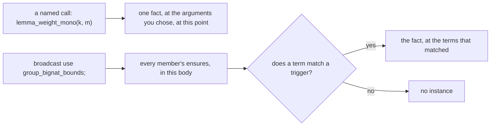
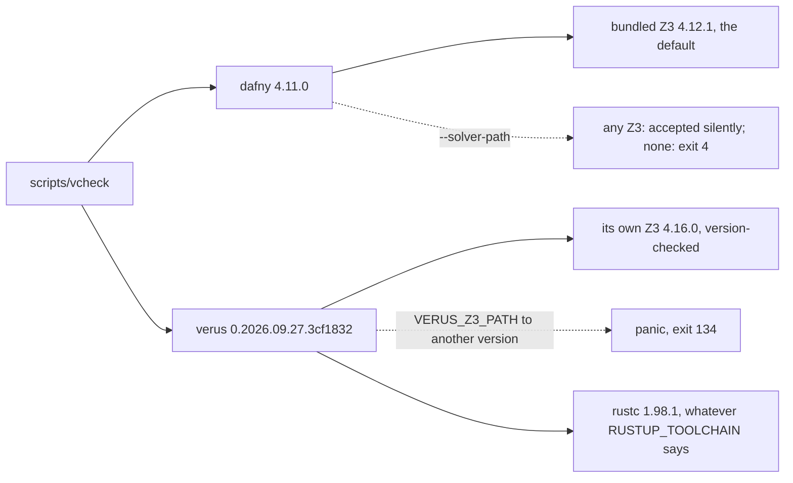
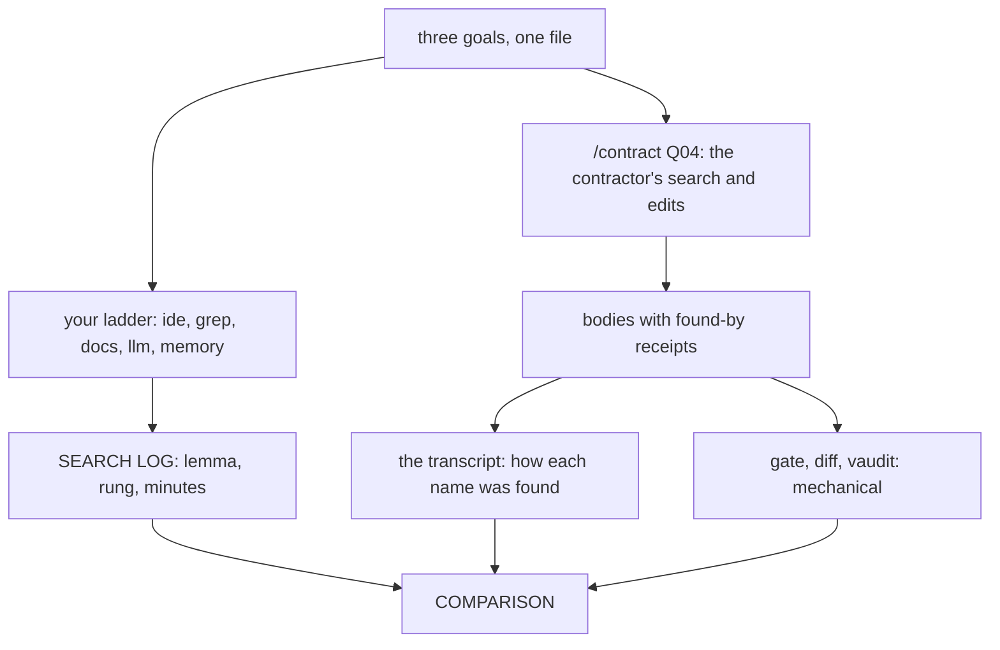

# Q04 — Proof craft, loops and libraries

Q03 closed the intro tier with ghost code, weakest preconditions, fake greens and contract v0. Q04 opens the moderate tier and returns to strands S1–S5 to prove things at length: chains of small steps, inductions you write, and lemmas someone else proved. Spine layer L3 joins L1 and L2: `Cmp` and the bridge `PowIsStdPow` in Dafny; the opaque power `weight`, a group of bound lemmas and `lemma_lt_at` in Verus; in both, proved versions of several Q02 and Q03 holes. The standard libraries enter in the S5 files only, and contract v0 meets its first live contractor.

Three ideas do all the work:

1. **A proof is a chain of small steps, each checked alone.** A `calc` step, a `forall` instance and a `nonlinear_arith` assertion each get their own hint and their own facts. A true step still fails when nothing it needs is in scope.
2. **Induction is a recursive call you write.** Its postcondition at a smaller argument is the hypothesis, and `decreases` makes it sound. Verus never inducts by itself, and the course switches Dafny's attempt off, so the call is yours in both.
3. **A library is someone else's proofs, fetched by name and paid for in solver work.** Each lemma has a name to find, a precondition to meet and a cost; a lemma group applies many at once. The verifier checks the call, never how you found the name.

---

## 0. How this module works, pretest, test-out

**Budget: 251 minutes.**

| setup | test-out | read | worked | cards | predicts | holes | library + lab | agent | paper | exit | calib | total |
|---|---|---|---|---|---|---|---|---|---|---|---|---|
| 5 | 10 | 45 | 30 | 8 | 22 | 54 | 20 | 15 | 15 | 22 | 5 | **251** |

"Worked" is W1d, W1v and the ten WRITE cards (C1–C6); "cards" is C7d, C8dv and C9dv. Holes take 5 to 6 minutes each, 8 for H1v; the contractor's time is outside the budget. The moderate tier puts the predictions before the pretest, because a test-out item can settle a prediction.


Each step waits for the one before: proofs by hand come before library calls, and the lab and the race come after you have used the libraries yourself.

**Layer L3 is open now.** Read `dafny/given/Q/QG_L3_BigNat.dfy` and `verus/given/qg_bignat_l3/src/lib.rs` first: P2d and P9v are about its definitions.

**Predictions (22 minutes), all nine before anything else:**

| items | where the answer goes |
|---|---|
| P1dv, P3dv, P8dv (the Dafny core file's prediction block); P6v, P7v (the Verus crate root's) | `slots/Q04.slots` |
| P4d, P5d, P9v (obligations) | the `// SLOT: FAILS ???` line of `specimens/Q04/P4d.dfy.specimen`, `P5d.dfy.specimen`, `P9v.rs.specimen` |
| P2d (a value) | the `// SLOT:` line of `dafny/checks/Q04_checks.dfy` |

Record them with `scripts/firsttry.sh Q04 --check`. Until then `scripts/vcheck` refuses the specimens and every demo marked `// after: <item>`, and the README's *Predictions first* list stays closed. Each section repeats its box,

> **Predict (Pn) — commit in the file before reading on.**

and answers only after it, below the words *Commit your prediction first.*

**Pretest (10 minutes, closed book, after the predictions).** T1d and T1v state one fact in each language: a limb sequence of value zero has only zero limbs. Prove both from their statements, with no chapter, hint or tutor, then run `scripts/firsttry.sh Q04 --check` again: it records each first try by running T1's commented checks in a scratch copy, and refuses while a Q04 prediction is unrecorded. Then uncomment the checks. **Skip rule:** if both first tries pass (`scripts/firsttry.sh Q04 --report`), skip §4.1 and the C3 cards; everything else stays.

**Setup (5 minutes).** Start one long-lived `/tutor Q04` session.

**Outputs.** Every output fence is a real run on the course pins (Dafny 4.11.0, Verus 0.2026.09.27.3cf1832), pinned in `expected/Q04.chapter.toml`, except four marked *recorded quotes*, the author's verbatim copies of runs no course command can repeat. `probe.dfy`, `probe.rs` and the `p6v_*` files are scratch files run with `scripts/vcheck --module Q04`, which adds Q04's given layers and options (a Dafny probe's count includes the spine's tasks). Fences drop the wrapper's last line, `raw output: <dir>`; a path in a run's scratch directory prints as `<scratch>/…`.

### This module's files

| file | what it is | shipped state |
|---|---|---|
| `dafny/Q/Q04_ProofCraft/core/Q04_ProofCraft.dfy` | Dafny core unit (L1, L2, no library): prediction block, T1d, W1d, C1d–C3d, C7d, H1d, H2d, C8dv | verified, **3 holes** |
| `dafny/Q/Q04_ProofCraft/std/Q04_Library.dfy` | Dafny std unit (L1–L3 and `Std`): C4d, H3d, H4d, the `TOOLCHAIN LAB` block | verified, **2 holes** |
| `dafny/checks/Q04_checks.dfy` | value check unit (P2d) | verified, no hole, 1 slot |
| `verus/q/q04_proof_craft/src/lib.rs` | Verus crate root (no `vstd::arithmetic`): prediction block, T1v, W1v, C1v–C3v, H2v | verified, **2 holes** |
| `verus/q/q04_proof_craft/src/library.rs` | its library module (`vstd::arithmetic`): C4v–C6v, H1v, H3v, H4v, H5v, C9dv | verified, **4 holes** |
| `specimens/Q04/` | obligation specimens P4d, P5d, P9v; card demos `card-*` | slots unfilled; demos red by design |
| `slots/Q04.slots` | your five verdict answers | `???` |
| `dafny/Q/Q04_ProofCraft/exit/Q04_Exit.dfy`, `verus/q/q04_proof_craft/src/exit.rs` | the closed-book exit, outside every build | verified, **2 + 2 holes** |
| `dafny/Q/Q04_ProofCraft/agent/Q04_AgentRetriever.dfy`, `verus/q/q04_proof_craft/src/agent.rs` | the retriever race (§9), outside every build | verified, **3 + 3 holes** |
| `dafny/given/Q/QG_L1_BigNat.dfy` to `QG_L3_BigNat.dfy`; `verus/given/qg_bignat_l1` to `qg_bignat_l3` | the given spine, frozen; L3 is new | verified |
| `paper/Q04_problems.tex` → your `paper/Q04_answers.tex` | the written pair (§7) | — |
| `Solutions/` mirrors of these files | the reference twins | yours to open LAST |

---

## 1. S1 — Carries and computed values

Limbs are digits in base `BASE` = 2^64, least significant first, so two limbs add up to a low limb and a carry of 0 or 1. Dafny limbs are `nat`s, split by `%` and `/`; Verus limbs are `u64`s, summed in a `u128` and split by a narrowing cast and a shift, the idiom a Rust programmer reaches for.

> **Predict (P1dv) — commit in the file before reading on.** `SplitSum` (Dafny: `nat`s, `%` and `/`) and `split_sum` (Verus: a `u128` sum split by `as u64` and `>> 64`), each specified by `lo + hi * BASE == a + b` and checked with `scripts/vcheck --module Q04`. What does each check report?

*Commit your prediction first.* `D:ok V:fail`. The Dafny program, in a module of its own:

```dafny
module SplitD {
  import opened QG_L1_BigNat

  method SplitSum(a: nat, b: nat) returns (lo: nat, hi: nat)
    requires a < BASE && b < BASE
    ensures lo + hi * BASE == a + b
  {
    var s := a + b;
    lo := s % BASE;
    hi := s / BASE;
  }
}
```

<!-- pin: p1dv-d -->
```
$ scripts/vcheck --module Q04 probe.dfy
vcheck: probe.dfy [dafny, learner loop]: verified — 23 verified, 0 holes, 0 errors
```

```rust
use vstd::prelude::*;
use qg_bignat_l1::*;

verus! {

fn split_sum(a: u64, b: u64) -> (r: (u64, u64))
    ensures
        r.0 + r.1 * BASE == a + b,
{
    let s: u128 = a as u128 + b as u128;
    (s as u64, (s >> 64) as u64)
}

} // verus!
```

<!-- pin: p1dv-v -->
```
$ scripts/vcheck --module Q04 probe.rs
vcheck: probe.rs [verus, learner loop]: failed — 0 verified, 0 holes, 1 error
probe.rs:8:9: error: postcondition not satisfied
```

Read the Verus error aloud: (1) line 8 is the postcondition, not a line of the body; (2) no overflow is reported, since two `u64`s fit in a `u128` and an integer `as` cast truncates, defined on every value; (3) the solver does not connect the cast and the shift to `%` and `/` by 2^64, so the two halves' sum is unknown to it. Write the split in the specification's arithmetic and it verifies:

```rust
use vstd::prelude::*;
use qg_bignat_l1::*;

verus! {

fn split_sum(a: u64, b: u64) -> (r: (u64, u64))
    ensures
        r.0 + r.1 * BASE == a + b,
{
    let s: u128 = a as u128 + b as u128;
    ((s % 0x1_0000_0000_0000_0000) as u64, (s / 0x1_0000_0000_0000_0000) as u64)
}

} // verus!
```

<!-- pin: p1dv-v-div -->
```
$ scripts/vcheck --module Q04 probe.rs
vcheck: probe.rs [verus, learner loop]: verified — 1 verified, 0 holes, 0 errors
```

State an operation the way the specification states it, or bring the fact that relates the two.

> **Predict (P2d) — commit in the file before reading on.** In `dafny/checks/Q04_checks.dfy`: what does L3's `Cmp` return for the limb sequences `[5, 1]` and `[7, 0, 0]`?

*Commit your prediction first.* `1`. `Cmp` compares the tails first (`Head` and `Tail` read a missing limb as 0) and the heads only when the tails are equal, so the most significant difference decides:

| call | the tails compare | then |
|---|---|---|
| `Cmp([], [0])` | `Cmp([], [])` is 0 | heads 0 and 0: **0** |
| `Cmp([1], [0, 0])` | 0 | heads 1 and 0: **1** |
| `Cmp([5, 1], [7, 0, 0])` | 1 | the tails decided: **1** |

`[5, 1]` is 5 + 2^64 and `[7, 0, 0]` is 7. On literals the verifier unfolds `Cmp` as far as it needs, and confirms the table:

```dafny
module CmpProbe {
  import opened QG_L1_BigNat
  import opened QG_L2_BigNat
  import opened QG_L3_BigNat

  lemma TwoCalls()
  {
    assert Cmp([1], [0, 0]) == 1;
    assert Cmp([5, 1], [7, 0, 0]) == 1;
  }
}
```

<!-- pin: p2d -->
```
$ scripts/vcheck --module Q04 probe.dfy
vcheck: probe.dfy [dafny, learner loop]: verified — 31 verified, 0 holes, 0 errors
```

H4d proves that `Cmp` agrees with the order of the values; H4v asks the same of an exec `cmp` that scans from the top limb down (§4.3).

---

## 2. S2 — Quantified proofs: the `forall` statement

Q04 proves quantified goals whose instances each need a step. Dafny's `forall` *statement* names a bound variable, its range and what holds for it, and its body proves one arbitrary instance, range assumed; Verus writes `assert forall … implies … by`. The WRITE cards C2 apply L1's worked lemma to every sequence of a batch:

```dafny
  lemma AppendZeroEach(ss: seq<seq<nat>>)
    ensures forall j | 0 <= j < |ss| :: ToNat(ss[j] + [0]) == ToNat(ss[j])
  {
    forall j | 0 <= j < |ss|
      ensures ToNat(ss[j] + [0]) == ToNat(ss[j])
    {
      ToNatAppendZero(ss[j]);
    }
  }
```

```rust
pub proof fn lemma_push_zero_each(ss: Seq<Seq<u64>>)
    ensures
        forall|j: int| 0 <= j < ss.len() ==> seq_to_nat(#[trigger] ss[j].push(0)) == seq_to_nat(ss[j]),
{
    assert forall|j: int| 0 <= j < ss.len() implies seq_to_nat(#[trigger] ss[j].push(0))
        == seq_to_nat(ss[j]) by {
        lemma_seq_to_nat_push_zero(ss[j]);
    }
}
```

In Verus, `implies` puts the range in front of the `by` block, and `#[trigger]` names the term an instance is matched on (given here; you choose triggers in Q06). Leave the call out and each language complains in its own words:

<!-- pin: c2d -->
```
$ scripts/vcheck specimens/Q04/card-c2d.dfy.specimen
vcheck: specimens/Q04/card-c2d.dfy.specimen [dafny, learner loop]: failed — 5 verified, 0 holes, 1 error
specimens/Q04/card-c2d.dfy.specimen:33:34: error: possible violation of postcondition of forall statement
```

<!-- pin: c2v -->
```
$ scripts/vcheck specimens/Q04/card-c2v.rs.specimen
vcheck: specimens/Q04/card-c2v.rs.specimen [verus, learner loop]: failed — 0 verified, 0 holes, 1 error
specimens/Q04/card-c2v.rs.specimen:15:53: error: assertion failed
```

The two forms are false friends (C8dv, row 2). A Dafny `forall` statement always assumes the range in its body; Verus assumes it only after `implies`. With `==>` the body must prove the whole implication, and a call that needs the range cannot have it:

<!-- pin: c8dv-2-d -->
```
$ scripts/vcheck specimens/Q04/card-c8dv-2-d.dfy.specimen
vcheck: specimens/Q04/card-c8dv-2-d.dfy.specimen [dafny, learner loop]: verified — 4 verified, 0 holes, 0 errors
```

<!-- pin: c8dv-2-v -->
```
$ scripts/vcheck specimens/Q04/card-c8dv-2-v.rs.specimen
vcheck: specimens/Q04/card-c8dv-2-v.rs.specimen [verus, learner loop]: failed — 1 verified, 0 holes, 1 error
specimens/Q04/card-c8dv-2-v.rs.specimen:24:5: warning: using ==> in `assert forall` does not currently assume the antecedent in the body; consider using `implies` instead of `==>`
specimens/Q04/card-c8dv-2-v.rs.specimen:25:9: error: precondition not satisfied
```

Verus warns at line 24, then the call at line 25 cannot meet `0 <= i < s.len()`: the warning explains the error. The S2 holes: **H2d**, every prefix of valid limbs is below its power, by one `forall` statement around a given bound; **H2v**, a first difference that favours `b` makes `a` smaller, by one `assert forall … by` around L3's `lemma_lt_at`. Each docstring asks what the body must know before its call.

---

## 3. S3 — `calc` chains, and choosing a prover

A `calc` chain proves `e0 R en` through intermediate lines; each pair of neighbouring lines is a step, checked on its own, and a hint in braces serves that step only. W1 in each language:

```dafny
  lemma PowSucc(n: nat)
    ensures Pow(n + 1) == Pow(n) * BASE
  {
    calc {
      Pow(n + 1);
    ==  // the definition of Pow, at an argument above 0
      BASE * Pow(n + 1 - 1);
    ==  { assert n + 1 - 1 == n; }
      BASE * Pow(n);
    ==  // multiplication commutes
      Pow(n) * BASE;
    }
  }
```

```rust
pub proof fn lemma_weight_succ_comm(n: nat)
    ensures
        weight(n + 1) == weight(n) * BASE,
{
    calc! {
        (==)
        weight(n + 1); { lemma_weight_succ(n); }
        BASE * weight(n);
        (==) {}
        weight(n) * BASE;
    }
}
```

Dafny writes the relation between two lines and the hint after it. Verus's `calc!` (`use vstd::calc;`) states the chain's relation first, then the lines, each step's hint in braces after the line it starts from, with an optional relation override (`(==) {}`). `weight`, L3's power of `BASE`, is opaque: the solver knows it only through L3's lemmas, such as its two equations `lemma_weight_zero` and `lemma_weight_succ`, so the first step calls one (Q06 is the module of opacity). The C1 cards unfold a sequence's value twice.

> **Predict (P3dv) — commit in the file before reading on.** A chain from `x + 1` to `x + 4` in steps of one, every step a false `==`, alone in a scratch file in each language: how many errors does `scripts/vcheck` report for each, and does the first error name a line of the chain?

*Commit your prediction first.* `D:3 yes V:1 no`:

```dafny
lemma Chain(x: int)
{
  calc {
    x + 1;
  ==
    x + 2;
  ==
    x + 3;
  ==
    x + 4;
  }
}
```

<!-- pin: p3dv-d -->
```
$ scripts/vcheck --module Q04 probe.dfy
vcheck: probe.dfy [dafny, learner loop]: failed — 22 verified, 0 holes, 3 errors
probe.dfy:6:7: error: the calculation step between the previous line and this line could not be proved
probe.dfy:8:7: error: the calculation step between the previous line and this line could not be proved
probe.dfy:10:7: error: the calculation step between the previous line and this line could not be proved
```

```rust
use vstd::prelude::*;
use vstd::calc;

verus! {

proof fn chain(x: int) {
    calc! {
        (==)
        x + 1; {}
        x + 2; {}
        x + 3; {}
        x + 4;
    }
}

} // verus!
```

<!-- pin: p3dv-v -->
```
$ scripts/vcheck --module Q04 probe.rs
vcheck: probe.rs [verus, learner loop]: failed — 0 verified, 0 holes, 1 error
<scratch>/…:52:9: error: assertion failed
```

Read them aloud: (1) Dafny reports one error per false step, at the line that ends it (6, 8 and 10 hold `x + 2`, `x + 3`, `x + 4`); (2) Verus reports one error for three false steps, outside your file: the failed assertion is one the macro wrote, at line 52 of vstd's `calc_macro.rs`, printed under the run's scratch directory; (3) neither says what a step needed. A failing `calc!` says only that some step failed: shorten the chain, or `assert` one step at a time, until the error lands on your line. The C1 failure demos show a false Dafny step and a Verus chain whose lines have different types:

<!-- pin: c1d -->
```
$ scripts/vcheck specimens/Q04/card-c1d.dfy.specimen
vcheck: specimens/Q04/card-c1d.dfy.specimen [dafny, learner loop]: failed — 2 verified, 0 holes, 1 error
specimens/Q04/card-c1d.dfy.specimen:25:19: error: the calculation step between the previous line and this line could not be proved
```

<!-- pin: c1v -->
```
$ scripts/vcheck specimens/Q04/card-c1v.rs.specimen
vcheck: specimens/Q04/card-c1v.rs.specimen [verus, learner loop]: failed — 0 verified, 0 holes, 1 error, stage resolve
specimens/Q04/card-c1v.rs.specimen:20:9: error: mismatched types
```

The Verus demo drops the casts to `nat` (`s[0]` is a `u64`), so rustc refuses the sum before any proof. False friends, row 1: a chain may mix `<=` and `<`; Dafny writes each step's relation, Verus overrides the chain's per step. One false `<` step in each:

<!-- pin: c8dv-1-d -->
```
$ scripts/vcheck specimens/Q04/card-c8dv-1-d.dfy.specimen
vcheck: specimens/Q04/card-c8dv-1-d.dfy.specimen [dafny, learner loop]: failed — 0 verified, 0 holes, 1 error
specimens/Q04/card-c8dv-1-d.dfy.specimen:15:9: error: the calculation step between the previous line and this line could not be proved
```

<!-- pin: c8dv-1-v -->
```
$ scripts/vcheck specimens/Q04/card-c8dv-1-v.rs.specimen
vcheck: specimens/Q04/card-c8dv-1-v.rs.specimen [verus, learner loop]: failed — 0 verified, 0 holes, 1 error
<scratch>/…:52:9: error: assertion failed
```

> **Predict (P4d) — commit in the file before reading on.** `specimens/Q04/P4d.dfy.specimen`: a `calc` chain over `ToNat` with no hint on any step, whose four labelled steps are [a] dropping an appended zero limb, [b] the head-and-tail split, [c] the same split written with indices, [d] a final `<=`. Which steps fail?

*Commit your prediction first.* `FAILS a c`:

<!-- pin: p4d -->
```
$ scripts/vcheck specimens/Q04/P4d.dfy.specimen
vcheck: specimens/Q04/P4d.dfy.specimen [dafny, learner loop]: failed — 4 verified, 0 holes, 2 errors
specimens/Q04/P4d.dfy.specimen:38:12: error: the calculation step between the previous line and this line could not be proved
specimens/Q04/P4d.dfy.specimen:42:19: error: the calculation step between the previous line and this line could not be proved
```

Lines 38 and 42 end steps [a] and [c]. [a] is true, it is L1's worked lemma `ToNatAppendZero`, but a step gets only what a little unfolding shows, and this fact needs an induction: it needs the lemma as its hint, `== { ToNatAppendZero(s); }`. [c] is false: `s[0] * BASE` multiplies the wrong term. [b] is one unfolding under `|s| > 0`; [d] adds `BASE` to one side. True and provable differ, and the hint closes the gap.

> **Predict (P6v) — commit in the file before reading on.** `lemma_limb_product_bound`: for three `u64`s, `x * y + c` fits in 128 bits; its body is one assertion closed by [a] `nonlinear_arith`, [b] `bit_vector` or [c] `compute`, each variant in a crate of its own. Which verify?

*Commit your prediction first.* `a b`. Crate [a]:

```rust
use vstd::prelude::*;

verus! {

pub proof fn lemma_limb_product_bound(x: u64, y: u64, c: u64)
    ensures
        (x as nat) * (y as nat) + (c as nat) <= 0xFFFF_FFFF_FFFF_FFFF_FFFF_FFFF_FFFF_FFFFnat,
{
    assert((x as nat) * (y as nat) + (c as nat) <= 0xFFFF_FFFF_FFFF_FFFF_FFFF_FFFF_FFFF_FFFFnat)
        by (nonlinear_arith);
}

} // verus!
```

<!-- pin: p6v-a -->
```
$ scripts/vcheck --module Q04 p6v_a.rs
vcheck: p6v_a.rs [verus, learner loop]: verified — 2 verified, 0 holes, 0 errors
```

The same file with `bit_vector` (crate [b]) and with `compute` (crate [c]) in the place of `nonlinear_arith`:

<!-- pin: p6v-b -->
```
$ scripts/vcheck --module Q04 p6v_b.rs
vcheck: p6v_b.rs [verus, learner loop]: verified — 2 verified, 0 holes, 0 errors
```

<!-- pin: p6v-c -->
```
$ scripts/vcheck --module Q04 p6v_c.rs
vcheck: p6v_c.rs [verus, learner loop]: failed — 0 verified, 0 holes, 1 error
p6v_c.rs:9:12: warning: Failed to simplify expression <<clip(nat, clip(nat, x * y) + c) <= 340282366920938463463374607431768211455>> before sending to Z3
p6v_c.rs:9:12: error: assertion failed
```

A `by (…)` clause sends one assertion to another prover. `nonlinear_arith` gives it to Z3 as a separate query with nonlinear arithmetic on; the `u64` bounds come with the types. `bit_vector` restates it as arithmetic on fixed-width words. `compute` evaluates it with Verus's interpreter, which needs closed terms: with `x`, `y`, `c` unknown it could not simplify (the warning shows what was left), and Z3 could not prove the rest. Choose by the goal: `compute` for ground terms, `nonlinear_arith` for products of variables (§5.3), `bit_vector` for facts about machine words.

---

## 4. S4 — Lemma recursion: induction by hand and by default

### 4.1 Lemma recursion by hand

A lemma that calls itself on a smaller argument is a proof by induction: the call's postcondition is the hypothesis, the branch without a call is the base case, and `decreases` names the measure that makes the circle well-founded. The C3 cards:

```dafny
  lemma FromNatShort(n: nat)
    ensures |FromNat(n)| <= n
    decreases n
  {
    if n > 0 {
      FromNatShort(n / BASE);
    }
  }
```

```rust
pub proof fn lemma_weight_above(n: nat)
    ensures
        n < weight(n),
    decreases n,
{
    if n == 0 {
        lemma_weight_zero();
    } else {
        lemma_weight_above((n - 1) as nat);
        lemma_weight_succ((n - 1) as nat);
    }
}
```

Each call follows its definition's recursion (`n / BASE`; `n - 1` through the equation lemma). The shape:

```mermaid
flowchart TD
  goal["lemma L(n) ensures P(n)"] --> base{"is n a base case?"}
  base -->|"yes"| direct["prove P(n) directly"]
  base -->|"no"| call["call L(m) for a smaller m"]
  call --> hyp["P(m) is now a known fact: the hypothesis"]
  hyp --> step["prove P(n) from P(m) and one unfolding"]
  meas["decreases: m ranks below n"] -.-> call
```

The call is the only place the hypothesis enters. Leave it out and the step has nothing to stand on (the Dafny demo also carries `{:induction false}`, since a specimen runs with no unit options: §4.2):

<!-- pin: c3d -->
```
$ scripts/vcheck specimens/Q04/card-c3d.dfy.specimen
vcheck: specimens/Q04/card-c3d.dfy.specimen [dafny, learner loop]: failed — 2 verified, 0 holes, 1 error
specimens/Q04/card-c3d.dfy.specimen:21:3: error: a postcondition could not be proved on this return path
specimens/Q04/card-c3d.dfy.specimen:19:26: related: this is the postcondition that could not be proved
```

<!-- pin: c3v -->
```
$ scripts/vcheck specimens/Q04/card-c3v.rs.specimen
vcheck: specimens/Q04/card-c3v.rs.specimen [verus, learner loop]: failed — 0 verified, 0 holes, 1 error
specimens/Q04/card-c3v.rs.specimen:12:9: error: postcondition not satisfied
```

### 4.2 Automatic induction, and why the course turns it off

> **Predict (P5d) — commit in the file before reading on.** `specimens/Q04/P5d.dfy.specimen`: four lemmas with empty bodies, verified as a specimen is (alone, with no unit options): [a] `Pow(n)` is at least 1; [b] normalizing keeps the value; [c] valid limbs are below the power of their length; [d] adding one limb makes a sequence at most one limb longer. Which fail?

*Commit your prediction first.* `FAILS b`:

<!-- pin: p5d -->
```
$ scripts/vcheck specimens/Q04/P5d.dfy.specimen
vcheck: specimens/Q04/P5d.dfy.specimen [dafny, learner loop]: failed — 10 verified, 0 holes, 1 error
specimens/Q04/P5d.dfy.specimen:58:3: error: a postcondition could not be proved on this return path
specimens/Q04/P5d.dfy.specimen:57:33: related: this is the postcondition that could not be proved
```

Dafny can attempt an induction itself: it assumes the statement for smaller arguments and tries the step. A specimen runs with Dafny's defaults, where this is on, and [a], [c], [d] fall to it: each step is the hypothesis plus one unfolding and some arithmetic. [b] does not: `Normalize` strips the top limb while `ToNat` peels the bottom one, so the step needs a fact about the top limb, L3's `ToNatDropLastZero`, that no hypothesis states. A found induction is also invisible: in no file, resting on a heuristic and an option, and it does not port to Verus. So the course's units set `manual-lemma-induction`, and every hypothesis in your files is a call you can read; the RECOGNISE card C7d shows `{:induction …}`, the per-lemma switch you will meet elsewhere. False friends, row 3: one lemma about doubling, with `{:induction false}` and with the default, beside Verus, which never inducts:

<!-- pin: c8dv-3-d -->
```
$ scripts/vcheck specimens/Q04/card-c8dv-3-d.dfy.specimen
vcheck: specimens/Q04/card-c8dv-3-d.dfy.specimen [dafny, learner loop]: failed — 2 verified, 0 holes, 1 error
specimens/Q04/card-c8dv-3-d.dfy.specimen:16:3: error: a postcondition could not be proved on this return path
specimens/Q04/card-c8dv-3-d.dfy.specimen:14:23: related: this is the postcondition that could not be proved
```

<!-- pin: c8dv-3-v -->
```
$ scripts/vcheck specimens/Q04/card-c8dv-3-v.rs.specimen
vcheck: specimens/Q04/card-c8dv-3-v.rs.specimen [verus, learner loop]: failed — 1 verified, 0 holes, 1 error
specimens/Q04/card-c8dv-3-v.rs.specimen:21:9: error: postcondition not satisfied
```

The same empty body is a proof in one setting and not in another; only a written call means the same everywhere.

### 4.3 The holes of S4

**H1d**: powers add, by a recursive call and a `calc` chain (its Verus pair H1v is in `library.rs`). **H4d**: `Cmp` agrees with the order of the values, by recursion along `Cmp`'s own (`decreases |a| + |b|` ships). A loop is an induction over its passes, its invariant the hypothesis: **H4v**'s `cmp` scans down from the top limb while the limbs agree, and its docstring asks what holds of the limbs scanned so far. (H4v also brings L3's bounds group in, so it sits in `library.rs`.)

---

## 5. S5 — Standard libraries, lemma groups, nonlinear arithmetic

### 5.1 Two libraries, two tiers

Dafny's standard library ships in the Dafny tree, but a unit sees it only when its options say `standard-libraries = true` (`dafny/options/std.toml`): Q04's core unit cannot name `Std`, its std unit reaches L3 and `Std.Arithmetic`. Verus links all of vstd into every crate, so which file uses which part is a course rule, the import tiers (`prelude`, `seq_lib`, `arithmetic`, `all`), checked by `python3 scripts/check_course_map.py --only import-tiers` over every `vstd::` path a file names.

L1's `Pow(n)` and the library's `Power.Pow(b, e)` are different functions that agree at `BASE`, as L3's `PowIsStdPow(n)` proves, so a proof about `Pow` crosses to `Power.Pow(BASE, …)`, uses library lemmas there, and crosses back. The WRITE cards C4 call one library lemma through its module and meet its `requires`:

```dafny
  lemma ScaleLe(a: nat, b: nat, w: nat)
    requires a <= b
    ensures a * w <= b * w
  {
    Mul.LemmaMulInequality(a, b, w);
  }
```

```rust
pub proof fn lemma_scale_le(a: nat, b: nat, w: nat)
    requires
        a <= b,
    ensures
        a * w <= b * w,
{
    lemma_mul_inequality(a as int, b as int, w as int);
}
```

vstd states its lemmas over `int`, so `nat` arguments are cast. Drop the `requires` and the call fails:

<!-- pin: c4d -->
```
$ scripts/vcheck specimens/Q04/card-c4d.dfy.specimen
vcheck: specimens/Q04/card-c4d.dfy.specimen [dafny, learner loop]: failed — 0 verified, 0 holes, 1 error
specimens/Q04/card-c4d.dfy.specimen:12:27: error: a precondition for this call could not be proved
dafny:DafnyStandardLibraries.dfy:7401:16: related: this is the precondition that could not be proved
```

<!-- pin: c4v -->
```
$ scripts/vcheck specimens/Q04/card-c4v.rs.specimen
vcheck: specimens/Q04/card-c4v.rs.specimen [verus, learner loop]: failed — 0 verified, 0 holes, 1 error
specimens/Q04/card-c4v.rs.specimen:15:5: error: precondition not satisfied
```

The Dafny `related:` line points into the library's own source, `DafnyStandardLibraries.dfy`, where the precondition is written.

> **Predict (P8dv) — commit in the file before reading on.** Two names for one thing. Dafny: a module that opens both `QG_L1_BigNat` and `Std.Arithmetic.Power` and proves `Pow(1) == BASE` with an empty body; Verus: a file with `use vstd::arithmetic::power::*;` that declares its own `pow(b, e) = b + e` and proves `pow(2, 3) == 5`. What does `scripts/vcheck --module Q04` say for each?

*Commit your prediction first.* `D:err:resolve V:ok`:

```dafny
module UsePowD {
  import opened QG_L1_BigNat
  import opened Std.Arithmetic.Power

  lemma UsePow()
    ensures Pow(1) == BASE
  {
  }
}
```

<!-- pin: p8dv-d -->
```
$ scripts/vcheck --module Q04 probe.dfy
vcheck: probe.dfy [dafny, learner loop]: failed — - verified, 0 holes, 1 error, stage resolve
probe.dfy:6:13: error: The name Pow ambiguously refers to a static member in one of the modules QG_L1_BigNat, Power (try qualifying the member name with the module name)
```

```rust
use vstd::prelude::*;
use vstd::arithmetic::power::*;
use qg_bignat_l3::*;

verus! {

pub open spec fn pow(b: int, e: nat) -> int {
    b + e
}

proof fn use_pow()
    ensures
        pow(2, 3) == 5,
{
}

} // verus!
```

<!-- pin: p8dv-v -->
```
$ scripts/vcheck --module Q04 probe.rs
vcheck: probe.rs [verus, learner loop]: verified — 1 verified, 0 holes, 0 errors
```

In Dafny, two opened modules each give `Pow`, the use is ambiguous, and resolution stops the file before any proof; qualify it (`Power.Pow`) or import without `opened`, as the library file does. In Rust a local item silently shadows a glob import: `pow(2, 3)` is your `b + e`, a proof about a function you may not have meant. False friends, row 4, with a stand-in module:

<!-- pin: c8dv-4-d -->
```
$ scripts/vcheck specimens/Q04/card-c8dv-4-d.dfy.specimen
vcheck: specimens/Q04/card-c8dv-4-d.dfy.specimen [dafny, learner loop]: failed — - verified, 0 holes, 1 error, stage resolve
specimens/Q04/card-c8dv-4-d.dfy.specimen:20:13: error: The name Pow ambiguously refers to a static member in one of the modules Limbs, Power (try qualifying the member name with the module name)
```

<!-- pin: c8dv-4-v -->
```
$ scripts/vcheck specimens/Q04/card-c8dv-4-v.rs.specimen
vcheck: specimens/Q04/card-c8dv-4-v.rs.specimen [verus, learner loop]: verified — 1 verified, 0 holes, 0 errors
```

The divergence card C9dv names a library lemma by its full path, with no import:

<!-- pin: c9dv-d -->
```
$ scripts/vcheck specimens/Q04/card-c9dv-d.dfy.specimen
vcheck: specimens/Q04/card-c9dv-d.dfy.specimen [dafny, learner loop]: failed — - verified, 0 holes, 2 errors, stage resolve
specimens/Q04/card-c9dv-d.dfy.specimen:10:5: error: unresolved identifier: Std
specimens/Q04/card-c9dv-d.dfy.specimen:10:42: error: expected method call, found expression
```

<!-- pin: c9dv-v -->
```
$ scripts/vcheck specimens/Q04/card-c9dv-v.rs.specimen
vcheck: specimens/Q04/card-c9dv-v.rs.specimen [verus, learner loop]: verified — 1 verified, 0 holes, 0 errors
```

Dafny reaches a library module only through an import (both errors sit on the one call line). A Rust path reaches vstd from anywhere with no `use` line, so the compiler never tells you a file used the library; the import-tier check reads paths for that reason.

### 5.2 Lemma groups: `broadcast use`

A `broadcast proof fn` can be used without a call: in a body that starts with `broadcast use <lemma or group>;`, the solver applies its `ensures` wherever a term matches its trigger. L3's `group_bignat_bounds` holds three: `weight` is monotone, and a sequence's value lies between two weights. The WRITE card C5v proves one fact both ways:

```rust
pub proof fn lemma_weight_order_by_name(k: nat, m: nat, n: nat)
    requires
        k <= m,
        m <= n,
    ensures
        weight(k) <= weight(n),
{
    lemma_weight_mono(k, m);
    lemma_weight_mono(m, n);
}

pub proof fn lemma_weight_order_by_group(k: nat, m: nat, n: nat)
    requires
        k <= m,
        m <= n,
    ensures
        weight(k) <= weight(n),
{
    broadcast use group_bignat_bounds;  // did: weight(k) <= weight(n), through lemma_weight_mono's triggers
}
```

The difference, drawn:



A named call is one fact you chose; a group is every fact its triggers find, which saves calls and hides which facts were used. Q04 puts `broadcast use` at the top of one body, never over a module.

> **Predict (P7v) — commit in the file before reading on.** `at_least_low_limb` (`seq_to_nat(s) >= s[0]` for a non-empty `s`) verifies with an empty body. With `broadcast use vstd::arithmetic::mul::group_mul_properties;` as its body's only line, what does `scripts/vcheck --module Q04` report?

*Commit your prediction first.* `V:ok`:

```rust
use vstd::prelude::*;
use qg_bignat_l3::*;

verus! {

pub proof fn at_least_low_limb(s: Seq<u64>)
    requires
        s.len() > 0,
    ensures
        seq_to_nat(s) >= s[0],
{
    broadcast use vstd::arithmetic::mul::group_mul_properties;
}

} // verus!
```

<!-- pin: p7v -->
```
$ scripts/vcheck --module Q04 probe.rs
vcheck: probe.rs [verus, learner loop]: verified — 1 verified, 0 holes, 0 errors
```

An unneeded group did no harm here: the goal is one unfolding of `seq_to_nat` away. The design spike recorded the other side on 2026-10-03, a recorded quote: the plain `verus` binary at `--rlimit 2`, the same group over a whole module, around a lemma whose empty body does not verify (the drop-last-zero lemma L3 now proves), so the solver searched with every multiplication fact in play:

<!-- pin: p7v-dv0 -->
```
note: function body check has been running for 2 seconds
...
note: function body check finished in 36 seconds
...
error: function body check: Resource limit (rlimit) exceeded; consider rerunning with --profile for more details
...
```

It used about 7 GB of memory before the limit stopped it: a group is cheap while the goal is easy and floods the search when it is not, ending in no verdict at all.

> **Predict (P9v) — commit in the file before reading on.** `specimens/Q04/P9v.rs.specimen`: four proof fns about `weight` and `seq_to_nat` with empty bodies, some carrying `broadcast use group_bignat_bounds;`: [a] an order of two weights, with the group; [b] the same, without it; [c] a canonical three-limb value above a weight, with the group; [d] a value below the next weight, with the group. Which fail?

*Commit your prediction first.* `FAILS b`:

<!-- pin: p9v -->
```
$ scripts/vcheck specimens/Q04/P9v.rs.specimen
vcheck: specimens/Q04/P9v.rs.specimen [verus, learner loop]: failed — 3 verified, 0 holes, 1 error
specimens/Q04/P9v.rs.specimen:28:9: error: postcondition not satisfied
```

[a] holds: `weight(3)` and `weight(5)` are both in the goal, the pair the monotonicity lemma's two triggers ask for. [b] fails: `weight` is opaque and nothing relates the two. [c] holds through the lower bound, whose `requires` the specimen states. [d] takes two members in turn: the upper bound puts `weight(s.len())` in play, and monotonicity relates it to `weight(s.len() + 1)`. The C5v demo is [b] again, the group version with its line removed:

<!-- pin: c5v -->
```
$ scripts/vcheck specimens/Q04/card-c5v.rs.specimen
vcheck: specimens/Q04/card-c5v.rs.specimen [verus, learner loop]: failed — 0 verified, 0 holes, 1 error
specimens/Q04/card-c5v.rs.specimen:17:9: error: postcondition not satisfied
```

### 5.3 Nonlinear arithmetic

The default solver treats a product of two unknowns as an opaque term, so "a product of bounded numbers is bounded" needs a lemma. The WRITE card C6v proves `x * y <= xb * yb` first with `lemma_mul_upper_bound` from `vstd::arithmetic::mul`, then with the nonlinear prover:

```rust
pub proof fn lemma_product_le_by_nl(x: nat, y: nat, xb: nat, yb: nat)
    requires
        x <= xb,
        y <= yb,
    ensures
        x * y <= xb * yb,
{
    // did: the product bound, from the two factor bounds
    assert(x * y <= xb * yb) by (nonlinear_arith)
        requires
            x <= xb,
            y <= yb,
    ;
}
```

The nonlinear prover works apart from the proof around it: it sees the assertion, its own `requires` and the variables' types, nothing else. Leave the `requires` out and the facts stay behind:

<!-- pin: c6v -->
```
$ scripts/vcheck specimens/Q04/card-c6v.rs.specimen
vcheck: specimens/Q04/card-c6v.rs.specimen [verus, learner loop]: failed — 1 verified, 0 holes, 1 error
specimens/Q04/card-c6v.rs.specimen:18:12: error: assertion failed
```

P6's crate [a] needed none: its bounds came with the `u64` types. Dafny leaves nonlinear arithmetic to Z3's heuristics unless a module says `{:disableNonlinearArithmetic}`, as the Dafny agent file does. The S5 holes: **H1v**, weights add, by recursion and a `calc!` chain where a `vstd::arithmetic` lemma may close a step; **H3d** and **H3v**, a value below a power, shifted up by `m` limbs, stays below the larger power (each docstring names the lemmas it may use); **H4v**, `cmp`'s invariant clause and group line; **H5v**, a value times a limb fits in one more limb.

### 5.4 The toolchain-mismatch lab (20 minutes, by hand)

Work the four steps of the `TOOLCHAIN LAB` block at the end of `Q04_Library.dfy` in your own terminal, in a scratch directory under `/tmp`: never in the course tree, and never in a Claude session, where the guard refuses some of them. They run each verifier against the other Z3 in the Dafny tree, against a missing solver, and against your default Rust, then read the library tiers off the files. Write each command, its exit code and its first line in the block, then read `VERSIONS.md` §1 and only §1: later sections record what later predictions ask about.

**Fill the block before you read on.** The author's runs, in `/tmp/lab` on `one.dfy` and `one.rs` (below), with `dafny` and `verus` for the pinned binaries and `$ZDIR` for the Dafny tree's `z3/bin`:

```dafny
lemma Sum(x: nat)
  ensures x + x == 2 * x
{
}
```

<!-- pin: lab-dafny -->
```
$ dafny verify one.dfy
Dafny program verifier finished with 1 verified, 0 errors
$ echo $?
0
```

<!-- pin: lab-dafny-solver -->
```
$ dafny verify --solver-path "$ZDIR/z3-4.14.1" one.dfy
Dafny program verifier finished with 1 verified, 0 errors
$ echo $?
0
$ dafny verify --solver-path ./no-such-z3 one.dfy
CLI: Error: Z3 not found at /tmp/lab/no-such-z3. Please either provide a path to the `z3` executable using the `--solver-path <path>` option, manually place the `z3` directory next to the `dafny` executable you are using (this directory should contain `bin/z3-4.12.1` or `bin/z3-4.12.1.exe`), or set the PATH environment variable to also include a directory containing the `z3` executable.
1 resolution/type errors detected in one.dfy
$ echo $?
4
```

```rust
use vstd::prelude::*;

verus! {

proof fn sum(x: nat)
    ensures
        x + x == 2 * x,
{
}

} // verus!
```

<!-- pin: lab-verus -->
```
$ verus one.rs --crate-type=lib
verification results:: 1 verified, 0 errors
$ echo $?
0
```

<!-- pin: lab-verus-z3 -->
```
$ VERUS_Z3_PATH="$ZDIR/z3-4.14.1" verus one.rs --crate-type=lib
...
The verifier expects z3 version "4.16.0", found version "4.14.1"
...
error: expected z3 version 4.16.0, found 4.14.1
...
thread caused non-unwinding panic. aborting.
$ echo $?
134
```

<!-- pin: lab-rustc -->
```
$ verus --version
Verus
  Version: 0.2026.09.27.3cf1832
  Profile: release
  Platform: linux_x86_64
  Toolchain: 1.98.1-x86_64-unknown-linux-gnu (overridden by environment variable RUSTUP_TOOLCHAIN)
$ rustc --version
rustc 1.92.0 (ded5c06cf 2025-12-08)
$ rustup toolchain list
stable-x86_64-unknown-linux-gnu (active, default)
1.98.1-x86_64-unknown-linux-gnu
$ RUSTUP_TOOLCHAIN=stable verus --version
...
  Toolchain: 1.98.1-x86_64-unknown-linux-gnu (overridden by environment variable RUSTUP_TOOLCHAIN)
$ RUSTUP_TOOLCHAIN=stable verus one.rs --crate-type=lib
verification results:: 1 verified, 0 errors
$ echo $?
0
```

The last three fences are recorded quotes of 2026-10-05, run by hand. Cut: the panic's thread ids, backtrace and abort lines, whose order varies; the `$ echo $?` lines of the first four commands (each 0); the first four lines of the second `--version`.

Dafny ran on another Z3 without a word, and with no solver it exited 4 counting one "resolution/type" error: a grader reading only the count would call it a type error. Verus checks the Z3 version inside its session and panics on a mismatch (exit 134). It also pins its Rust: the `Toolchain:` line names 1.98.1 against the host's 1.92.0, and `RUSTUP_TOOLCHAIN` changes neither the line nor the result, because the launcher sets that variable itself (`VERSIONS.md` §1). Step 4: only the std options switch the library on, only `library.rs` names `vstd::arithmetic`, and `Std.Arithmetic.LittleEndianNat`, a near-answer for the spine, is rejected in every BigNat file. The pins, drawn:



The wrapper never takes a dashed edge: `scripts/vcheck` runs the pinned binaries with their own solvers and refuses solver pass-through, so a course verdict always means one toolchain.

---

## 6. What the instruments can and cannot see

| instrument | what it sees | what it cannot see |
|---|---|---|
| `scripts/vcheck` (learner loop) | the verdict, the stage, every hole and error and where it is | which step of a `calc!` failed; what a step needed; what a group cost |
| `scripts/vcheck --gate` | zero holes, a complete run, the count pins of `expected/Q04.counts` | a method clause: one `forall` statement, a `calc` chain, library calls only |
| `scripts/vaudit` | assumptions, axioms, external bodies, skipped verification, banned forms | where a proof's facts came from: a named lemma, a group, the solver's heuristics |
| `scripts/specfreeze --check Q04` | that no shipped statement changed | whether the statement says what you meant |
| `python3 scripts/check_course_map.py --only import-tiers` | which library each file reaches, against its tier | whether the lemma called was the right one |
| `scripts/firsttry.sh Q04 --report --strict` | slots, first tries, commented checks, test-outs | whether you understood why |
| `// found-by:` lines, the `SEARCH LOG` | nothing: they are claims | (the transcript checks them, §9) |
| a reader (you, `/review-code`, `/grade-paper`) | method clauses, proof shape, intent | nothing mechanical: advisory until an artifact confirms it |

Done is the first three rows plus the strict report; the method clauses rest on the reader, which is why `/review-code Q04` reviews proof shape.

---

## 7. On paper, before the keyboard

`paper/Q04_problems.tex` holds the written pair (15 minutes, after this chapter, before the holes). **B1** is a blueprint for H4d and H4v (6 minutes): an informal proof that `Cmp` agrees with the order of the values, written before you open the hints under H4 in the library file and in `library.rs`. **B2** is a concept question (3 minutes): what the gate and the audit report of three bodies for the C4 card's goal, and whether each keeps the retriever race's contract (§9). **B3** is the paper card **02.2**, AutoVerus (6 minutes). Reread the card in your own `cheatsheets.md`; the problems file pins its line range and hash. Fill `paper/Q04_answers.tex`, build with `make -C paper paper` until green, and run `/grade-paper Q04` in a fresh session before the holes. Once H4d and H4v verify, `/grade-paper Q04 --post` re-scores B1's blueprint against your own proofs. The card is graded field by field against your pinned `cheatsheets.md` range, the rest against `paper/rubrics/Q04_rubric.md`.

---

## 8. The exercise file

Both languages' units, as shipped:

<!-- pin: units -->
```
$ scripts/vcheck Q04
vcheck: dafny/Q/Q04_ProofCraft/core [dafny, learner loop]: verified — 32 verified, 3 holes, 0 errors
dafny/Q/Q04_ProofCraft/core/Q04_ProofCraft.dfy:196:13: hole bodyless-method Q04.T1d
dafny/Q/Q04_ProofCraft/core/Q04_ProofCraft.dfy:314:24: hole bodyless-method Q04.H1d
dafny/Q/Q04_ProofCraft/core/Q04_ProofCraft.dfy:337:13: hole bodyless-method Q04.H2d
vcheck: dafny/Q/Q04_ProofCraft/std [dafny, learner loop]: verified — 32 verified, 2 holes, 0 errors
dafny/Q/Q04_ProofCraft/std/Q04_Library.dfy:65:24: hole bodyless-method Q04.H3d
dafny/Q/Q04_ProofCraft/std/Q04_Library.dfy:92:13: hole bodyless-method Q04.H4d
vcheck: verus/q/q04_proof_craft [verus, learner loop]: verified — - verified, 6 holes, 0 errors
verus/q/q04_proof_craft/src/lib.rs:117:40: hole assume Q04.T1v
verus/q/q04_proof_craft/src/lib.rs:236:40: hole assume Q04.H2v
verus/q/q04_proof_craft/src/library.rs:128:40: hole assume Q04.H1v
verus/q/q04_proof_craft/src/library.rs:154:40: hole assume Q04.H3v
verus/q/q04_proof_craft/src/library.rs:188:40: hole assume Q04.H4v
verus/q/q04_proof_craft/src/library.rs:248:40: hole assume Q04.H5v
vcheck: 3 unit(s): 3 verified, 0 not; 11 hole(s) in all
```

Eleven holes, as `expected/Q04.counts` pins them: Dafny 3 + 2, Verus 2 + 4. After the predictions and T1d / T1v (§0):

- **The core file and `lib.rs`, by hand:** W1d, W1v, the cards C1–C3 and C7d, **H1d** `PowAdd`, **H2d** `PrefixBounds`, **H2v** `lemma_first_difference`, and the false-friends card C8dv at the end of the Dafny file.
- **Then the library file and `library.rs`:** the cards C4–C6, **H3d** `ShiftBound`, **H4d** `CmpCorrect`, **H1v** `lemma_weight_add`, **H3v** `lemma_shift_bound`, **H4v** `cmp`, **H5v** `lemma_value_times_limb`, and the divergence card C9dv.

Hand before automation: H1d's powers precede every library call, and H2v's named call H4v's group. A docstring's method clause is checked by the reviewer, not the gate (§6).

**The hint dial.** `Hint(1)` only when stuck, `Hint(2)` only when still stuck; after 20 minutes stuck, `/tutor Q04`.

**Slots.** A verdict goes in `slots/Q04.slots` (`P1dv = ???` becomes `P1dv = "<answer>"`); an obligation or value slot is its own `// SLOT:` line. Fill it, run `scripts/firsttry.sh Q04 --check`, then enable it (`// SLOT: CHECK P1dv` becomes `// CHECK P1dv`; the other slots lose their `SLOT: ` prefix). After each hole, uncomment the checks under `Uncomment as you go:`.

**Done** = `scripts/vcheck --gate dafny/Q/Q04_ProofCraft/core`, `scripts/vcheck --gate dafny/Q/Q04_ProofCraft/std` and `scripts/vcheck --gate verus/q/q04_proof_craft` each print only the summary line and exit 0, `scripts/vaudit` reports no finding on any of the three, **and** `scripts/firsttry.sh Q04 --report --strict` exits 0.

**Calibration.** Write your actual minutes in the Dafny core file's `CALIBRATION` block; at the end, `scripts/firsttry.sh Q04 --record` appends your row to `instructor/gradebook.md`.

---

## 9. Exercise (agentic): the retriever race

Rung 4 of the ladder: a retriever. Each agent file holds three goals whose proofs are short chains of standard-library calls: products, quotients and remainders in Dafny (nonlinear arithmetic off), powers of `BASE` in Verus. Both ship green with holes, and the audit dashboard is one row per open goal:

<!-- pin: agent-d -->
```
$ scripts/vcheck dafny/Q/Q04_ProofCraft/agent/Q04_AgentRetriever.dfy
vcheck: dafny/Q/Q04_ProofCraft/agent/Q04_AgentRetriever.dfy [dafny, learner loop]: verified — 32 verified, 3 holes, 0 errors
dafny/Q/Q04_ProofCraft/agent/Q04_AgentRetriever.dfy:62:19: hole bodyless-method Q04.A1d
dafny/Q/Q04_ProofCraft/agent/Q04_AgentRetriever.dfy:67:29: hole bodyless-method Q04.A1d
dafny/Q/Q04_ProofCraft/agent/Q04_AgentRetriever.dfy:73:35: hole bodyless-method Q04.A1d
```

<!-- pin: agent-d-audit -->
```
$ scripts/vaudit dafny/Q/Q04_ProofCraft/agent/Q04_AgentRetriever.dfy
dafny/Q/Q04_ProofCraft/agent/Q04_AgentRetriever.dfy:60: audit-bodyless-ghost — ScaleStrict: Ghost declaration has no body and has an ensures clause
dafny/Q/Q04_ProofCraft/agent/Q04_AgentRetriever.dfy:65: audit-bodyless-ghost — HighLimbOfShift: Ghost declaration has no body and has an ensures clause
dafny/Q/Q04_ProofCraft/agent/Q04_AgentRetriever.dfy:71: audit-bodyless-ghost — ProductMod: Ghost declaration has no body and has an ensures clause
vaudit: dafny/Q/Q04_ProofCraft/agent/Q04_AgentRetriever.dfy [dafny, learner]: 3 finding(s)
```

<!-- pin: agent-v -->
```
$ scripts/vcheck verus/q/q04_proof_craft/src/agent.rs
vcheck: verus/q/q04_proof_craft/src/agent.rs [verus, learner loop]: verified — - verified, 3 holes, 0 errors
verus/q/q04_proof_craft/src/agent.rs:59:40: hole assume Q04.A1v
verus/q/q04_proof_craft/src/agent.rs:67:40: hole assume Q04.A1v
verus/q/q04_proof_craft/src/agent.rs:77:40: hole assume Q04.A1v
```

<!-- pin: agent-v-audit -->
```
$ scripts/vaudit verus/q/q04_proof_craft/src/agent.rs
verus/q/q04_proof_craft/src/agent.rs:59: hole-assume — an assume hole (in lemma_pow_of_pow) not on the trust allowlist
verus/q/q04_proof_craft/src/agent.rs:67: hole-assume — an assume hole (in lemma_low_limb_of_power) not on the trust allowlist
verus/q/q04_proof_craft/src/agent.rs:77: hole-assume — an assume hole (in lemma_pow_mod_base) not on the trust allowlist
vaudit: verus/q/q04_proof_craft/src/agent.rs [verus, learner]: 3 finding(s)
```

The contract, as the files' CONTRACT headers state it:

> **CONTRACT (for /contract Q04 — run it in a FRESH session):**
> - **goal:** close the three goals of the agent file of this run, each with standard-library lemma calls only (Verus: `vstd` library lemma calls).
> - **allowed-files:** the agent file of this run, `dafny/Q/Q04_ProofCraft/agent/Q04_AgentRetriever.dfy` or `verus/q/q04_proof_craft/src/agent.rs`.
> - **acceptance:**
>   - `scripts/vcheck --gate <file>` exits 0 and prints only the summary line
>   - zero tool-counted holes in the allowed file
>   - `git diff` shows only the three goals' bodies: no signature, `requires`, `ensures`, attribute, doc comment or import line changes, and no declaration is added or removed
>   - each body holds only library lemma calls with their arguments, each call on its own line followed by `// found-by: <rung>`, where `<rung>` is `ide`, `grep`, `docs`, `llm` or `memory`: no lemma of the contractor's own, no `assert`, `calc` (Verus: `calc!`, `broadcast use`) or other statement
>   - re-verify after every edit with `scripts/vcheck <file>`; never stack unverified edits
>   - `scripts/vaudit --compare expected/Q04_AgentRetriever.audit <file>` (Verus: `expected/q04_proof_craft_agent.audit`) reports no difference

Your steps (15 minutes, after the exercise files are done):

1. **Race the contractor first.** Take each goal down your own ladder in order: IDE hover and go-to-definition, a scoped `grep` of the library's source (Dafny's is the `program` member of the zip archive `DafnyStandardLibraries.doo` in the Dafny tree; Verus's `vstd` is the pinned crate's source in Cargo's registry, `~/.cargo/registry/src/*/vstd-0.0.0-2026-09-20-0158/`), the documentation, a model, memory. Time each and fill the `SEARCH LOG` block: goal, lemma, rung, minutes. Do not edit the goals.
2. In a fresh session, `/contract Q04`, one file per run, Dafny first: the first live run of your contract v0, which binds the contractor beside the fallback rules.
3. Check the artifact yourself: the gate's output, `git diff` (three bodies only), the `// found-by:` lines, `scripts/vaudit`.
4. Fill `COMPARISON` from the transcript: did each rung match where the lemma lives? A lemma name that does not exist (a resolution error), a step that is no library call, a statement edit? Which v0 rules did the run test, and which did nothing test?

The race, drawn:



The tools settle what they can see; only your two records, side by side, show how the names were found.

### What the dashboard can and cannot see

The dashboard is the gate's summary line, the hole count and `vaudit`'s rows above: three per file as shipped, none once every goal is closed. It cannot see three things. The method clause: a goal proved by an `assert`, a helper lemma or a `calc` is correct, green and audit-clean, and breaks the contract; only `git diff` shows it. The receipts: `// found-by: docs` is the contractor's prose, and a model that invented a lemma name, failed to resolve it and then found the right one leaves only the right one in the file; only the transcript shows the detour. The cost: minutes and attempts appear in no artifact. Your paper card, **02.2** (AutoVerus), counts gaps in `vstd` knowledge among the reference Verus agent's failures, and its Lynette tool rejects candidates that change the code or the specification or add an `assume`, the course's diff and freeze checks in another form. The race is that gap at your desk, with you as the baseline.

---

## Exit (closed book)

The last step, 22 minutes in one sitting. Close this chapter, the exercise files and specimens, later modules' files, search tools and `/tutor`; at most the given spine and the pinned standard library's own source stay open.

- **Four unseen items**, two per language: X1d, X2d in `dafny/Q/Q04_ProofCraft/exit/Q04_Exit.dfy` and X1v, X2v in `verus/q/q04_proof_craft/src/exit.rs`, each a shipped statement with a hole (2 + 2 holes, outside every build).
- **Score:** when every block holds an attempt (a guess counts; a hole does not), run `scripts/firsttry.sh Q04 --exit` once, before fixing anything; that first complete run is the score. **Threshold: 3 of 4, with at least 1 of 2 in each language**, the moderate tier's rule.
- **Then repair** every block with `scripts/vcheck <exit file>`; from then on `--report --strict` covers the exit files.

---

## Instructor touchpoints

- **`/discuss Q04`** (optional, after this chapter; a coach session): Socratic questions from the Q04 bank, with a sharp developer new to verifiers.
- **`/grade-paper Q04`** (fresh session): once `make -C paper paper` is green, before the holes (§7).
- **`/grade-paper Q04 --post`** (fresh session): once H4d and H4v verify, it re-scores B1's blueprint against your own proofs (§7).
- **`/tutor Q04`** (one long-lived session): after 20 minutes stuck, with your attempt and the verifier's message. One hint rung per turn, up to rung 5; rung 2 points at this chapter's headings.
- **`/contract Q04`** (fresh session, once per agent file): §9 only.
- **`/review-code Q04`** (fresh session): once §8's Done line holds and both contract runs are audited. Bar: proof shape, the method clauses no instrument sees.
- **`/viva`**: not this module. `/viva Q04` refuses; `/viva Q06` examines the moderate tier, Q04 included.
- **Solutions last**: open Q04's `Solutions/` only after `/viva Q06`.
- **`/review`**: whenever the session banner says ledger items are due.

---

## What Q04 planted

| seed (Q04) | harvested |
|---|---|
| carries in the specification's arithmetic (P1dv) | Q06: property tests of limb adders |
| `calc` chains and where their errors land (P3dv, P4d) | Q10: assertion repair (H3) |
| `forall` statements, `assert forall … implies … by` | Q06: triggers you choose |
| lemma recursion, automatic induction off (P5d, C7d) | Q05: lexicographic measures; Q06: the audited prover |
| `Cmp` and the top-down `cmp` scan (H4d, H4v) | Q05: `CmpFast`, a scan inside `by method` |
| the shifted-value bound (H3d, H3v) | Q06: proofs inside a resource budget |
| prover choice (P6v, C6v) | Q07: bit-vector proofs you write |
| library staging, two names for one thing (P8dv, C9dv) | Q07: the arithmetic library |
| lemma groups and their cost (P7v, P9v) | Q09: brittleness under seeds and limits |
| the toolchain pins (§5.4) | Q06: the verifier loop's exit codes |
| the retriever race, `found-by:` receipts, contract v0 under load | Q05: the infra debugger; Q09: contract v1; Q12: search at matched compute |

Q05 continues the tier with frames and verification conditions; Q06 closes it with the machine around the verifier.

*Paper card: **02.2**, "AutoVerus: Automated Proof Generation for Rust Code". Reread it in your own `cheatsheets.md` before the written pair.*
