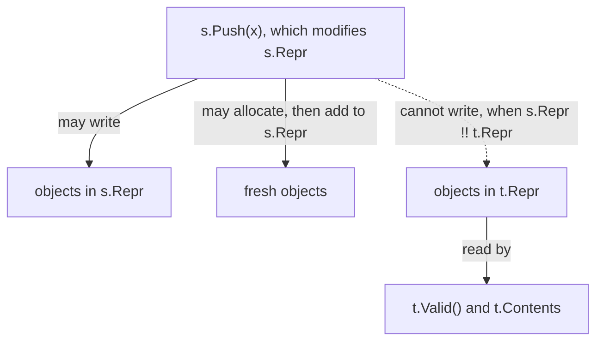
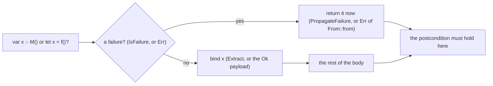
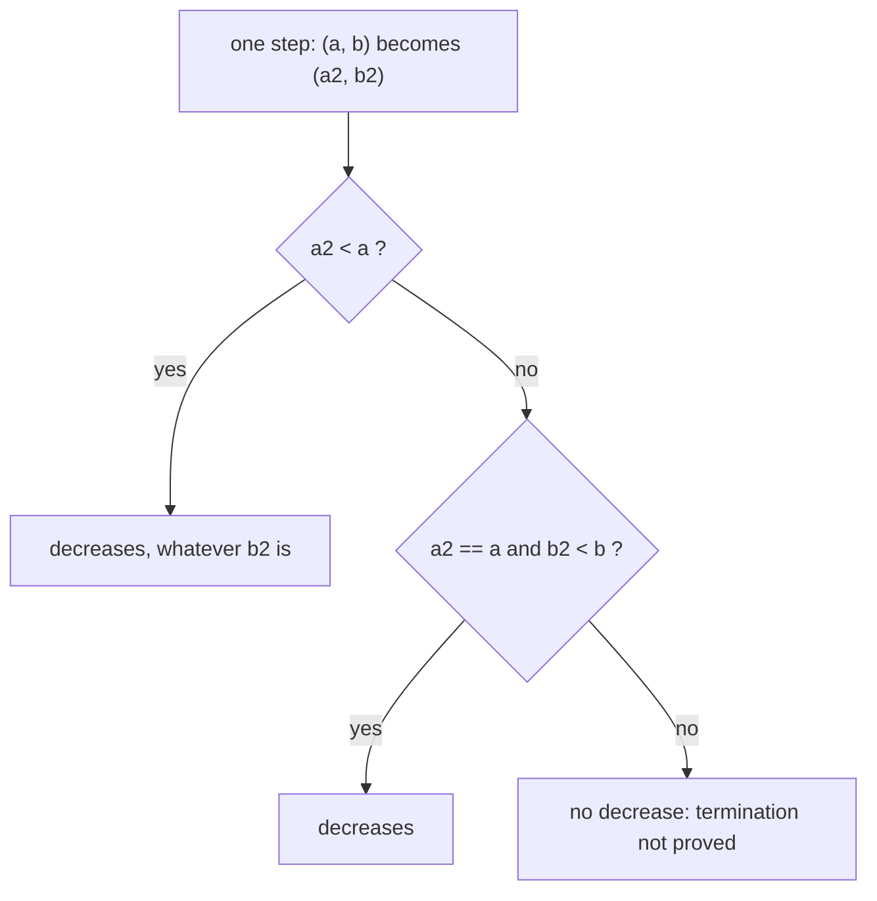
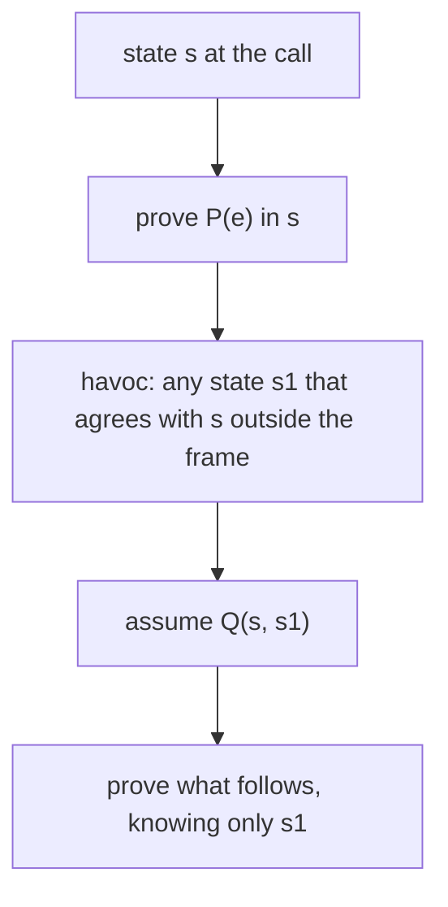
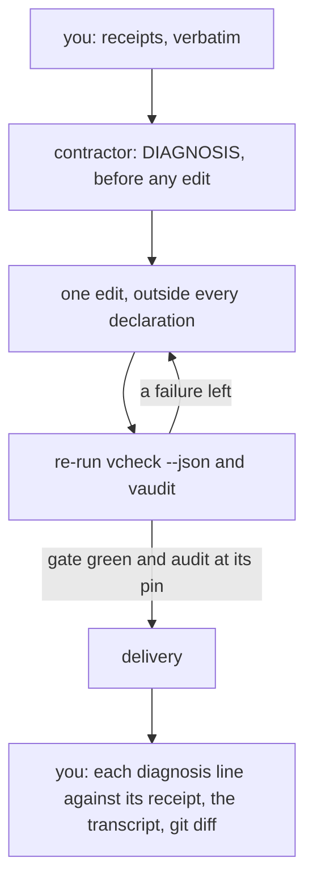

# Q05 — Frames, ownership, modes, wp→VC

Q04 gave you proof craft on pure sequences. Q05, the moderate tier's second module,
sweeps strands S6–S8 with code that changes state: Q02's frames and ownership return
with objects made of several heap objects and with calls that can fail, Q03's modes with
a name that has two bodies, and Q03's weakest preconditions with calls and loops.
`/viva Q06` examines Q04–Q06 together.
Three ideas do all the work:

1. **A caller knows a call only through its contract.** Precondition, postcondition and
   frame: Dafny's `reads`, `modifies` and `fresh`; Verus's `&` and `&mut` with `old` and
   `final`; a `Result` whose postcondition says what each variant means. What the
   contract does not say, the caller cannot use, whatever the body does.
2. **Termination and computation are separate obligations.** A measure, possibly a tuple
   compared left to right, proves that every recursion and loop ends. A
   `function … by method` gives one name a definition to reason with and a loop to run,
   and the verifier proves the two equal.
3. **A verification condition is a formula you can write down.** Q03's weakest
   preconditions extend to calls and loops, and the formula the verifier sends to Z3 is
   one you can derive by hand; a failed proof is a conjunct of it that nothing in your
   text supports.

Last, a contractor diagnoses two planted wiring failures from receipts you collect, and
you audit whether its diagnosis rests on them.

---

## 0. How this module works, pretest, test-out

**Minutes: 253; the tier viva (30 minutes) comes after Q06.** Setup 5 · test-out 10 ·
reading 45 · worked examples and WRITE cards 32 · divergence cards 8 · predictions 22 ·
holes 54 · wp→VC on paper 20 · agent 15 · paper card and written pair 15 · exit 22 ·
calibration 5.

**Setup.** Start one long-lived `/tutor Q05` session. `scripts/vcheck Q05` shows both
units verified with their holes counted (§6). From this tier on the order differs from
Q01–Q03: **predictions first, then the pretest**, and `scripts/firsttry.sh` enforces it.

**Predictions, all eight, before anything else**, because several sections explain what
a later box asks about:

| items | where the answer goes |
|---|---|
| P1dv, P2dv, P3dv, P9dv (the Dafny file's prediction block, both languages) | `slots/Q05.slots` |
| P4d, P5v, P6d (obligations) | the `// SLOT: FAILS ???` line of each specimen in `specimens/Q05/` |
| P8d (a value) | the `// SLOT:` line of `dafny/checks/Q05_checks.dfy` |

Then run `scripts/firsttry.sh Q05 --check` and enable each slot as its file says. Until
then keep the README's *Predictions first* list closed, with the Q05 bank and rubric, the
exit files and the demos that carry an `// after:` line (`card-c1d`, `card-c4d`,
`card-c4v`, `card-c5v`, both `card-c7dv` files), which `scripts/vcheck` refuses until
the prediction they settle is recorded. Each prediction reappears below in a box,

> **Predict (Pn) — commit in the file before reading on.**

and its answer comes only after the box, below the words *Commit your prediction first.*

**Pretest, after the predictions and before reading.** T1d and T1v ask for `Odometer`
and `odometer`, a step count written by recursion (the prompt is in each file). Write
both closed book, then run `scripts/firsttry.sh Q05 --check`, which records your first
try by running T1's commented check in a scratch copy and refuses while any Q05
prediction is unrecorded; only then uncomment the checks. **Skip rule:** if both pass on
that first try, skip §2.1's teaching; its box and answer, the C4 cards, H4d and H4v
stay.

**Outputs.** Every output fence is a real run on the course pins (Dafny 4.11.0, Verus
0.2026.09.27.3cf1832), pinned in `expected/Q05.chapter.toml` (the comment above each
fence names its entry; `scripts/pins.py --chapter Q05` re-runs them). `probe.dfy` and
`probe.rs` are scratch files run with `scripts/vcheck --module Q05`, which gives them
this module's layers and options (a Dafny probe's count includes the spine's tasks).
§2.3 runs the pinned `dafny` binary plainly and quotes one recorded run of `grep`
(2026-10-05), which no course command runs. Each fence drops the wrapper's last line,
`raw output: <dir>`; a Verus summary shows `-` where the run reported no count.

**This module's files**

| file | what it is |
|---|---|
| `dafny/given/Q/QG_L1_BigNat.dfy`, `QG_L2_BigNat.dfy`, `QG_L3_BigNat.dfy`; `verus/given/qg_bignat_l1`, `qg_bignat_l2`, `qg_bignat_l3` | the given spine, frozen; H3d computes L3's `Cmp`, H1v changes an L1 `BigNat` in place |
| `dafny/Q/Q05_Frames/std/Q05_Frames.dfy` | the Dafny exercise file: the prediction block, T1d, the cards, W1d, **5 holes** (H1d–H5d) |
| `verus/q/q05_frames/src/lib.rs` | the Verus exercise crate: T1v, W1v, the cards, **4 holes** (H1v, H2v, H4v, H5v) |
| `dafny/checks/Q05_checks.dfy` | a given-only check unit, no hole: the value prediction P8d |
| `specimens/Q05/` | P4d, P5v, P6d and the card demos |
| `slots/Q05.slots` | your four verdict answers |
| `dafny/Q/Q05_Frames/exit/Q05_Exit.dfy`, `verus/q/q05_frames/src/exit.rs` | the closed-book exit, outside every build: **2 + 2 holes** |
| `dafny/Q/Q05_Frames/agent/Q05_AgentInfra.dfy`, `verus/q/q05_frames/src/agent.rs` | the agentic exercise (§7): RED by design, two planted wiring failures each, no hole and **1 error** each as `scripts/vcheck` counts them |
| `paper/Q05_problems.tex` → your `paper/Q05_answers.tex` | the wp→VC lab and the written pair (§5) |
| `Solutions/` mirrors of these files | the reference: yours to open LAST |

---

## 1. S6 — Frames and ownership

Q02 met frames on one array and ownership through one `&mut` parameter. Here objects
span several heap objects and calls can fail. A caller sees no body; it asks the
contract what the callee may read and change, and what it promises about both.

### 1.1 Reads: what a function may depend on

> **Predict (P1dv) — commit in the file before reading on.** A type with one field and a
> function that reads the field with no `reads` clause: Dafny `function Size(): nat { n }`
> in a class with `var n: nat`; Verus `spec fn size(&self) -> nat { self.n as nat }` on
> a struct with `n: u64`. What does `scripts/vcheck` say about each file?

*Commit your prediction first.* `D:fail V:ok`. C1's failure demo is P1dv's Dafny file
under other names:

<!-- pin: c1d-fail -->
```
$ scripts/vcheck specimens/Q05/card-c1d.dfy.specimen
vcheck: specimens/Q05/card-c1d.dfy.specimen [dafny, learner loop]: failed — 0 verified, 0 holes, 1 error
specimens/Q05/card-c1d.dfy.specimen:12:7: error: insufficient reads clause to read field; Consider adding 'reads this' or 'reads this`count' in the enclosing function specification for resolution
```

Read it aloud: (1) line 12 is the field read `count` inside `Count()`; (2) no stage is
named, so this is a verification error, a frame obligation like Q02's `modifies` error;
(3) a Dafny function must name every heap location its value depends on, and the message
itself proposes `reads this`. The Verus file verifies:

```rust
use vstd::prelude::*;

verus! {

pub struct Counter {
    pub n: u64,
}

impl Counter {
    pub open spec fn size(&self) -> nat {
        self.n as nat
    }
}

} // verus!
```

<!-- pin: p1dv-v -->
```
$ scripts/vcheck --module Q05 probe.rs
vcheck: probe.rs [verus, learner loop]: verified — 0 verified, 0 holes, 0 errors
```

`0 verified`: a spec fn is a definition with no obligation of its own. The difference is
the memory model. A Dafny object lives on a shared heap that any method may change, so a
function that reads it must say where; in exchange its value survives every update
outside its `reads` frame, which lets a caller keep `s.Valid()` across a call that never
touched `s`. A Verus spec fn of `&self` is a function of the value it is given, and who
may change that value is settled by the reference's type (§1.3). Dafny's frame
vocabulary:

| clause | on | says |
|---|---|---|
| `reads S` | functions, predicates | the value depends only on the objects in `S` |
| `modifies S` | methods, loops | only the objects in `S` may change |
| `old(e)` | postconditions, invariants | `e` evaluated in the state at the call |
| `fresh(o)`, `fresh(S)` | postconditions | allocated during the call, so unknown to every caller |

### 1.2 Dynamic frames: `Repr`, `Valid()`, `fresh`

When an object's state spans several heap objects, a stack and its array, naming them
one by one in every clause breaks the first time a method replaces the array. Dynamic
frames name them once, in a ghost set. W1d's `LimbStack`:

```dafny
class LimbStack {
  var a: array<nat>
  var n: nat
  ghost var Contents: seq<nat>
  ghost var Repr: set<object>

  ghost predicate Valid()
    reads this, Repr
  {
    this in Repr && a in Repr && n <= a.Length && Contents == a[..n]
  }

  constructor (cap: nat)
    requires cap > 0
    ensures Valid() && fresh(Repr) && Contents == []
```

Four conventions make it work. `Repr` holds the object and every heap object its state
lives in, and `Valid()` reads exactly `this, Repr` and says the pieces are in `Repr`. A
method that changes the stack says `modifies Repr`. A method that may allocate promises
`fresh(Repr - old(Repr))`: whatever joined the set is new, so no other object a caller
holds can own it. And a client reasons with the ghost view `Contents`, never with `a` or
`n`. C1's success example, `Meter`, is the idiom in one contract:

```dafny
method Tick()
  requires Valid()
  modifies Repr
  ensures Valid() && count == old(count) + 1 && fresh(Repr - old(Repr))
```

A call on one stack, seen from another:



A fact about `t` survives a call on `s` exactly when everything the fact reads lies
outside everything the call may write: `!!` is set disjointness, and it is the caller's
to establish.

> **Predict (P4d) — commit in the file before reading on.** `specimens/Q05/P4d.dfy.specimen`
> copies the given `LimbStack` with `Push` declared by its contract only. Four clients
> call `s.Push(x)` and assert: [a] the other stack is still valid, the representations
> being disjoint; [b] the same, without the disjointness requirement; [c] the
> representations are still disjoint; [d] after two pushes, the contents. Which fail?

*Commit your prediction first.* P4d is `FAILS b`:

<!-- pin: p4d -->
```
$ scripts/vcheck specimens/Q05/P4d.dfy.specimen
vcheck: specimens/Q05/P4d.dfy.specimen [dafny, learner loop]: failed — 11 verified, 1 hole, 4 errors
specimens/Q05/P4d.dfy.specimen:49:58: hole bodyless-method Q05.P4d
specimens/Q05/P4d.dfy.specimen:65:19: error: assertion might not hold
specimens/Q05/P4d.dfy.specimen:25:12: related: this proposition could not be proved
specimens/Q05/P4d.dfy.specimen:65:19: error: assertion might not hold
specimens/Q05/P4d.dfy.specimen:25:25: related: this proposition could not be proved
specimens/Q05/P4d.dfy.specimen:65:19: error: assertion might not hold
specimens/Q05/P4d.dfy.specimen:25:38: related: this proposition could not be proved
specimens/Q05/P4d.dfy.specimen:65:19: error: assertion might not hold
specimens/Q05/P4d.dfy.specimen:25:62: related: this proposition could not be proved
```

Read it aloud: (1) the bodyless `Push` counts as a hole, which keeps the contract alone
in view; (2) all four errors sit on line 65, [b]'s `assert`, and their related lines
point at the four conjuncts of `Valid()` on line 25; (3) no other client fails. Without
`s.Repr !! t.Repr`, the stacks may share objects, `t` itself included, and
`modifies s.Repr` lets `Push` rewrite anything `t.Valid()` reads. With disjointness, [a]
holds by §1.1's frame rule. [c] holds because the set after the call is the old set plus
fresh objects, and a fresh object cannot be in `t.Repr`, which existed before the call:
C1's `fresh(Repr - old(Repr))` at work. [d] holds because each call re-establishes the
`Valid()` the next one requires.

H1d and H2d are `LimbStack`'s own methods. A loop has a frame as well: with no
`modifies` clause of its own it may write whatever its method may, and after it the
verifier knows about those locations only what the invariant restates; H1d's docstring
asks what that costs. For H2d, `specfreeze` accepts added `modifies` and `ensures`
clauses in `Pop`'s header, and only there (§4).

### 1.3 Ownership: `&mut self`, `old` and `final`

Verus has no heap frames; the type of a reference is the permission. Through `&self` the
callee only reads, through `&mut self` it may change `*self` arbitrarily, and a caller
learns about `*self` what the postcondition relates between `final(self)` and
`old(self)`. W1v:

```rust
impl Counter {
    pub fn reset(&mut self)
        ensures
            final(self).hits == 0,
            final(self).cap == old(self).cap,
    {
        self.hits = 0;
    }
}
```

The second clause is not decoration: without it, a caller could not know that `cap`
survived, though the body never touches it. C5's success example takes two `&mut u64`;
on a reference to a plain value, `final` and `old` are dereferenced:

```rust
pub fn swap_limbs(a: &mut u64, b: &mut u64)
    ensures
        *final(a) == *old(b),
        *final(b) == *old(a),
```

Rust's aliasing rule is Verus's free frame: two live `&mut` never alias, so a call
through `&mut s` cannot touch a `t` that was not lent. About the lent object itself,
ownership gives nothing beyond the postcondition.

> **Predict (P5v) — commit in the file before reading on.** `specimens/Q05/P5v.rs.specimen`:
> a module-owned `Bounded` whose `maybe_push(&mut self, x)` is declared by its contract
> only; the contract promises the push only on `Ok`. Four clients assert after the call:
> [a] another container is unchanged; [b] the same container is unchanged after an `Err`;
> [c] its limit is unchanged; [d] its length is within the limit. Which fail?

*Commit your prediction first.* P5v is `FAILS b`:

<!-- pin: p5v -->
```
$ scripts/vcheck specimens/Q05/P5v.rs.specimen
vcheck: specimens/Q05/P5v.rs.specimen [verus, learner loop]: failed — - verified, 1 hole, 1 error
specimens/Q05/P5v.rs.specimen:50:5: hole external_body Q05.P5v
specimens/Q05/P5v.rs.specimen:74:20: error: assertion failed
```

Read it aloud: (1) the `external_body` is a hole, Verus's way of keeping a contract with
no body; (2) one error, at line 74, [b]; (3) no other. [a] holds by ownership: `t` was
never lent. [c] and [d] are in the contract (`final(self).limit == old(self).limit`,
`final(self).inv()`). [b] is a fact about the `Err` path that the contract never states:
for all the caller knows, the body pushed and then returned `Err`. C5's failure demo
meets the same gap from the other side, a method that changes nothing and does not say
so:

<!-- pin: c5v-fail -->
```
$ scripts/vcheck specimens/Q05/card-c5v.rs.specimen
vcheck: specimens/Q05/card-c5v.rs.specimen [verus, learner loop]: failed — 1 verified, 0 holes, 1 error
specimens/Q05/card-c5v.rs.specimen:36:16: error: assertion failed
```

`check_room` returns `Err` with `hits` untouched, and the client at line 36 still cannot
prove `c.hits == 5`. A `&mut` contract has two halves on every path, what changed and
what did not, and the second is as much a promise as the first.

### 1.4 Results and early returns: `:-` and `?`

A fallible call returns a `Result`, and its postcondition says what each variant means.
C6's success example, in Verus's spec syntax (`r is Ok` tests the variant, `r->Ok_0`
reads its payload):

```rust
pub fn get_limb(v: &Vec<u64>, i: usize) -> (r: Result<u64, OutOfRange>)
    ensures
        r is Ok <==> i < v.len(),
        r is Ok ==> r->Ok_0 == v@[i as int],
```

The `<==>` makes the variant exact: `Ok` when in range, and `Err` only otherwise. Its
failure demo tests `i > 0 && i < v.len()`, and the first clause catches the skipped
limb:

<!-- pin: c6v-fail -->
```
$ scripts/vcheck specimens/Q05/card-c6v.rs.specimen
vcheck: specimens/Q05/card-c6v.rs.specimen [verus, learner loop]: failed — 0 verified, 0 holes, 1 error
specimens/Q05/card-c6v.rs.specimen:13:9: error: postcondition not satisfied
```

Dafny's `var x :- M();` and Rust's `let x = f()?;` bind the success value, or return the
failure at once as the caller's own result. C3's success examples:

```dafny
method FirstIsZero(s: seq<nat>) returns (r: Result<bool, string>)
  ensures r.Success? <==> |s| > 0
  ensures r.Success? ==> (r.value <==> s[0] == 0)
{
  var x :- FirstLimb(s);
  return Success(x == 0);
}
```

```rust
pub fn first_is_zero(v: &Vec<u64>) -> (r: Result<bool, NoLimb>)
    ensures
        r is Ok <==> v.len() > 0,
        r is Ok ==> (r->Ok_0 <==> v@[0] == 0),
{
    let x = first_limb(v)?;
    Ok(x == 0)
}
```

The early return is a return path, and the postcondition must hold on it too. C3's
failure demos promise success unconditionally:

<!-- pin: c3d-fail -->
```
$ scripts/vcheck specimens/Q05/card-c3d.dfy.specimen
vcheck: specimens/Q05/card-c3d.dfy.specimen [dafny, learner loop]: failed — 2 verified, 0 holes, 1 error
specimens/Q05/card-c3d.dfy.specimen:21:11: error: a postcondition could not be proved on this return path
specimens/Q05/card-c3d.dfy.specimen:19:15: related: this is the postcondition that could not be proved
```

<!-- pin: c3v-fail -->
```
$ scripts/vcheck specimens/Q05/card-c3v.rs.specimen
vcheck: specimens/Q05/card-c3v.rs.specimen [verus, learner loop]: failed — 1 verified, 0 holes, 1 error
specimens/Q05/card-c3v.rs.specimen:25:9: error: postcondition not satisfied
```

Read them aloud: Dafny places the failing return path at line 21, column 11, the `:-`
itself, where the path leaves; Verus names the clause that failed, `r is Ok` at line 25.
Both say the same: an empty input returns the failure, where `r.Success?` is false.

**What `:-` and `?` are (C8dv).** The two look alike and are built differently. Dafny's
`:-` works on any *failure-compatible* type: one with an `IsFailure()` predicate, a
`PropagateFailure()` that converts a failure to the caller's return type, and, for the
value-binding form, an `Extract()`. `Std.Wrappers` gives `Result`, `Option` and
`Outcome`; the card's Dafny demo declares its own:

```dafny
datatype Outcome<T> = Good(v: T) | Bad(msg: string)
{
  predicate IsFailure() {
    Bad?
  }

  function PropagateFailure<U>(): Outcome<U>
    requires Bad?
  {
    Bad(msg)
  }

  function Extract(): T
    requires Good?
  {
    v
  }
}
```

Rust's `?` works on `Result` and `Option`, and on the way out it converts the error with
`From::from`: the Verus demo's `quarter` returns `Result<u64, ParseFail>` and applies `?`
to `half`'s `Result<u64, Odd>`, through the demo's `From<Odd> for ParseFail`:

```rust
pub fn quarter(x: u64) -> (r: Result<u64, ParseFail>)
    ensures
        r is Ok ==> r->Ok_0 * 4 == x,
{
    let h = half(x)?;
    let q = half(h)?;
    Ok(q)
}
```

Both demos verify:

<!-- pin: c8dv-d -->
```
$ scripts/vcheck specimens/Q05/card-c8dv-d.dfy.specimen
vcheck: specimens/Q05/card-c8dv-d.dfy.specimen [dafny, learner loop]: verified — 6 verified, 0 holes, 0 errors
```

<!-- pin: c8dv-v -->
```
$ scripts/vcheck specimens/Q05/card-c8dv-v.rs.specimen
vcheck: specimens/Q05/card-c8dv-v.rs.specimen [verus, learner loop]: verified — 3 verified, 0 holes, 0 errors
```

The protocol as one flow, both languages:



Every `:-` and `?` adds a return path, and every return path meets the postcondition.
H5d and H5v use the operator inside a loop.

---

## 2. S7 — Measures, two bodies, erasure

### 2.1 Lexicographic `decreases`

A measure must go down at every recursive call and loop pass, in a well-founded order
(Q01, Q02). When no single quantity does, a tuple may: `decreases a, b` holds at a step
when `a` goes down, whatever `b` does, or when `a` stays and `b` goes down. C4's success
examples are Ackermann's function and a loop over pairs:

```dafny
function Ack(m: nat, n: nat): nat
  decreases m, n
{
  if m == 0 then n + 1
  else if n == 0 then Ack(m - 1, 1)
  else Ack(m - 1, Ack(m, n - 1))
}
```

```rust
    while i > 0
        invariant
            j <= i,
            i > 0 ==> j < i,
        decreases i, i - j,
```

The comparison, one step at a time:



The first component may only stay or drop; a later one may jump arbitrarily high
whenever an earlier one drops, which is how `Ack(m - 1, Ack(m, n - 1))` passes a huge
second argument and still terminates.

> **Predict (P2dv) — commit in the file before reading on.** `G(m, n)` returns `n` when
> `m == 0`, calls `G(m - 1, 7)` when `n == 0`, and `G(m, n - 1)` otherwise: as a Dafny
> `function` with no `decreases` clause, and as a Verus `spec fn` with the clause
> `decreases m`. What does `scripts/vcheck` say about each file?

*Commit your prediction first.* `D:ok V:fail`. The Dafny file:

```dafny
function G(m: nat, n: nat): nat
{
  if m == 0 then n else if n == 0 then G(m - 1, 7) else G(m, n - 1)
}
```

<!-- pin: p2dv-d -->
```
$ scripts/vcheck --module Q05 probe.dfy
vcheck: probe.dfy [dafny, learner loop]: verified — 23 verified, 0 holes, 0 errors
```

```rust
use vstd::prelude::*;

verus! {

pub open spec fn g(m: nat, n: nat) -> nat
    decreases m,
{
    if m == 0 {
        n
    } else if n == 0 {
        g((m - 1) as nat, 7)
    } else {
        g(m, (n - 1) as nat)
    }
}

} // verus!
```

<!-- pin: p2dv-v -->
```
$ scripts/vcheck --module Q05 probe.rs
vcheck: probe.rs [verus, learner loop]: failed — 0 verified, 0 holes, 1 error
probe.rs:13:9: error: could not prove termination
```

Read them aloud. Dafny: with no clause, Dafny supplies the function's parameters in
order, here `decreases m, n`, and that tuple drops at both calls. Verus supplies none (a
recursive spec fn without a clause does not even resolve, as Q01 showed) and checks the
one you wrote: at line 13, `g(m, n - 1)` keeps `m`, so `decreases m` does not drop. C4's
failure demos show the limit of the guess. `Steps(a, b)` calls `Steps(3, b - 1)` when
`a == 0` and `Steps(a - 1, b)` otherwise; the guessed `a, b` fails at column 47, where
`a` climbs from 0 to 3, and a Verus `decreases b` fails where `b` stays:

<!-- pin: c4d-fail -->
```
$ scripts/vcheck specimens/Q05/card-c4d.dfy.specimen
vcheck: specimens/Q05/card-c4d.dfy.specimen [dafny, learner loop]: failed — 0 verified, 0 holes, 1 error
specimens/Q05/card-c4d.dfy.specimen:9:47: error: cannot prove termination; try supplying a decreases clause
```

<!-- pin: c4v-fail -->
```
$ scripts/vcheck specimens/Q05/card-c4v.rs.specimen
vcheck: specimens/Q05/card-c4v.rs.specimen [verus, learner loop]: failed — 0 verified, 0 holes, 1 error
specimens/Q05/card-c4v.rs.specimen:18:9: error: could not prove termination
```

The right measure for both is `decreases b, a`. A guess is the parameter order, nothing
more. For loops, Dafny guesses from the guard (`n - i` for `i < n`) and Verus requires a
clause on every loop (Q02); H4d and H4v need a measure that no guess finds.

### 2.2 One name, two bodies: `function … by method`

A Dafny `function` is a definition, most naturally recursive, and compiled as written it
can be slow. A `by method` clause gives it a second body that the compiled program runs
instead, proved to return the function's value. C2:

```dafny
function Triangle(n: nat): nat
  decreases n
{
  if n == 0 then 0 else n + Triangle(n - 1)
} by method {
  var t := 0;
  var k := 0;
  while k < n
    invariant 0 <= k <= n
    invariant t == Triangle(k)
    decreases n - k
  {
    k := k + 1;
    t := t + k;
  }
  return t;
}
```

Proofs unfold the definition; the program runs the loop. The method body carries an
implicit postcondition, that its result equals `Triangle(n)`, and the loop must earn it:
C2's failure demo drops the second invariant.

<!-- pin: c2d-fail -->
```
$ scripts/vcheck specimens/Q05/card-c2d.dfy.specimen
vcheck: specimens/Q05/card-c2d.dfy.specimen [dafny, learner loop]: failed — 1 verified, 0 holes, 1 error
specimens/Q05/card-c2d.dfy.specimen:20:5: error: a postcondition could not be proved on this return path
specimens/Q05/card-c2d.dfy.specimen:10:5: related: this is the postcondition that could not be proved
```

Read it aloud: line 20 is `return t;`, and the related location, line 10, is the
`by method` keyword: the implicit postcondition has no line of its own. After the loop
the verifier knows `k == n` and nothing about `t`. In H3d the function is L3's `Cmp`, and
the method scans the limbs once from the most significant end; you write what the scan
keeps true. Verus has no `by method`: the pair is two names, a spec fn and an exec fn
whose `ensures` says `r == spec(…)`, Q03's mode triangle.

### 2.3 Erasure: ghost state at run time

> **Predict (P3dv) — commit in the file before reading on.** Dafny: a class with
> `var x: nat` and `ghost var Shadow: seq<nat>`, built with `dafny build --target py` in
> a scratch directory: does the generated Python mention `Shadow` anywhere? Verus:
> `struct Tagged { x: u64, shadow: Ghost<Seq<u64>> }`: what does
> `core::mem::size_of::<Tagged>()` return in a test?

*Commit your prediction first.* `D:no V:8`. The Dafny file, from the prediction block:

```dafny
class Tagged {
  var x: nat
  ghost var Shadow: seq<nat>

  constructor ()
  {
    x := 0;
    Shadow := [];
  }
}

method Main() {
  var t := new Tagged();
  print t.x, "\n";
}
```

The build, with the pinned binary run plainly in a scratch directory:

<!-- pin: p3dv-build -->
```
$ dafny build --target py p3dv.dfy
Dafny program verifier finished with 2 verified, 0 errors
$ echo $?
0
```

The build writes the Python program to `p3dv-py/`. A search of it, recorded from the
author's run:

<!-- pin: p3dv-grep -->
```
$ grep -rl Shadow p3dv-py/
$ echo $?
1
$ grep -n -A 8 "class Tagged" p3dv-py/module_.py
26:class Tagged:
27-    def  __init__(self):
28-        self.x: int = int(0)
29-        pass
30-
31-    def __dafnystr__(self) -> str:
32-        return "_module.Tagged"
33-    def ctor__(self):
34-        (self).x = 0
```

No file mentions `Shadow` (`grep` exits 1 when nothing matches): the class keeps `x`,
`ctor__` assigns only `x`, and the ghost field and its assignment are gone. The
divergence card C7dv shows both sides. Its Dafny demo lets a compiled method read a ghost
field, and resolution refuses, since erased state cannot be read at run time:

<!-- pin: c7dv-d -->
```
$ scripts/vcheck specimens/Q05/card-c7dv-d.dfy.specimen
vcheck: specimens/Q05/card-c7dv-d.dfy.specimen [dafny, learner loop]: failed — - verified, 0 holes, 1 error, stage resolve
specimens/Q05/card-c7dv-d.dfy.specimen:19:13: error: a ghost field is allowed only in specification contexts
```

Its Verus demo tests that `Tagged` and `Plain { x: u64 }` have the same size:

<!-- pin: c7dv-v -->
```
$ scripts/vcheck --test specimens/Q05/card-c7dv-v.rs.specimen
vcheck: specimens/Q05/card-c7dv-v.rs.specimen [verus, test]: verified — 1 passed, 0 failed
PASSED tests::same_size
```

`Ghost<T>` is a zero-sized type in the compiled program, so `Tagged` is as large as its
one `u64`: `size_of::<Tagged>()` is 8. Dafny erases by mode: the compiler drops every
`ghost` declaration and statement. Verus erases code by mode too (spec and proof code,
`proof { }` blocks) and data by type: `Ghost<T>` and `Tracked<T>` fields take no space.
Both refuse to let a ghost value flow into code that runs (Q03), so erasure cannot change
what a verified program computes.

### 2.4 Computed values

> **Predict (P8d) — commit in the file before reading on.** How many limbs does L2's
> `AddLimb` give when it adds 1 to the two-limb numeral whose limbs are both `BASE - 1`
> (`18446744073709551615`)?

*Commit your prediction first.* P8d is `3`. The value is
`(BASE - 1) + (BASE - 1) * BASE + 1 = BASE * BASE`, limbs 0, 0, 1: the carry runs
through both limbs, and `AddLimb` appends the last carry as a new limb. The `expect` is
compiled and run by `scripts/vcheck --test dafny/checks/Q05_checks.dfy`, as Q03's was.

---

## 3. S8 — From weakest preconditions to verification conditions

Q03 computed weakest preconditions by hand for assignment, sequence and conditional. A
verifier turns each method into one formula, its **verification condition** (VC), valid
exactly when the method meets its contract, and asks Z3 to prove it. Calls and loops
were left.

**A call.** A callee has a precondition `P`, a frame `W` (Dafny: its `modifies` clause;
Verus: its `&mut` arguments) and a postcondition `Q` relating the states before and after
the call. The caller's `M(e); S` is checked in four steps:

1. prove `P(e)` in the current state;
2. forget every location in `W`: the callee may have changed it;
3. assume `Q`, with `old(…)` meaning the state before the call;
4. continue with `S` in that state.

As a formula, with `s` the state at the call and `s1` the state after it:
`wp(M(e), R) = P(e)(s) && forall s1 :: (s1 == s outside W && Q(s, s1)) ==> R(s1)`.



The body is never consulted: a fact true of the callee's body but not of its contract is
invisible to the caller, §1's lesson as a formula.

**A loop.** With invariant `I`, guard `b` and measure `d`: on entry, the state before
the loop satisfies `I`; for maintenance, `I && b` implies `wp(body, I)` and a smaller
`d`; at exit, `I && !b` implies what follows. The loop's frame is forgotten at its head,
like a call's, and when the body makes a call, the call's VC sits inside
`wp(body, I)`: the lab (§5) writes exactly that.

> **Predict (P9dv) — commit in the file before reading on.** For
> `Bump(a, 0); assert a[0] >= 1 && a[1] == old(a[1]);` against `Bump`'s contract
> (requires `i < a.Length`, modifies `a`, ensures limb `i` up by one and every other
> limb unchanged), which of the prediction block's four formulas must the verifier
> prove?

*Commit your prediction first.* The answer is b, the four steps written out with `a` the
contents before the call and `a1` any contents after it:

```dafny
0 < a.Length && forall a1 :: (a1[0] == a[0] + 1 &&
  forall j | 0 <= j < 2 && j != 0 :: a1[j] == a[j])
  ==> (a1[0] >= 1 && a1[1] == a[1])
```

Option a is step 1 alone: the call may be made, and the assertion is forgotten. Option c
reasons with what `Bump` does, which a caller never sees, and its `==>` turns the
precondition from an obligation into a hypothesis. Option d drops the precondition and
the frame conjunct: with only `a1[0] == a[0] + 1` assumed, nothing ties `a1[1]` to
`a[1]`.

> **Predict (P6d) — commit in the file before reading on.** `specimens/Q05/P6d.dfy.specimen`:
> four lemmas, each one candidate verification condition of that caller over the
> sequences `s0` before the call and `s1` after it ([a] the call's precondition; [b] the
> first limb after the call; [c] the second limb, from the whole postcondition; [d] the
> second limb, from the postcondition's first conjunct only). Which fail?

*Commit your prediction first.* P6d is `FAILS d`:

<!-- pin: p6d -->
```
$ scripts/vcheck specimens/Q05/P6d.dfy.specimen
vcheck: specimens/Q05/P6d.dfy.specimen [dafny, learner loop]: failed — 6 verified, 0 holes, 1 error
specimens/Q05/P6d.dfy.specimen:43:3: error: a postcondition could not be proved on this return path
specimens/Q05/P6d.dfy.specimen:42:19: related: this is the postcondition that could not be proved
```

Read it aloud: (1) the error is `OtherLimbNoFrame`'s postcondition, reported at its body;
(2) the related location, line 42, is [d]'s `ensures`; (3) no other lemma fails. Each
lemma checks one piece of option b, and [d] is option d's mistake with the precondition
restored: the first conjunct of `Bump`'s postcondition says nothing about limb 1. The
verifiers build option b from code. P9dv's caller, against `Bump`'s whole contract and
against a `BumpNoFrame` without the second `ensures`:

```dafny
method Bump(a: array<nat>, i: nat)
  requires i < a.Length
  modifies a
  ensures a[i] == old(a[i]) + 1
  ensures forall j | 0 <= j < a.Length && j != i :: a[j] == old(a[j])
{
  a[i] := a[i] + 1;
}

method Caller(a: array<nat>)
  requires a.Length == 2
  modifies a
{
  Bump(a, 0);
  assert a[0] >= 1 && a[1] == old(a[1]);
}

method BumpNoFrame(a: array<nat>, i: nat)
  requires i < a.Length
  modifies a
  ensures a[i] == old(a[i]) + 1
{
  a[i] := a[i] + 1;
}

method CallerNoFrame(a: array<nat>)
  requires a.Length == 2
  modifies a
{
  BumpNoFrame(a, 0);
  assert a[0] >= 1 && a[1] == old(a[1]);
}
```

<!-- pin: vc-call-d -->
```
$ scripts/vcheck --module Q05 probe.dfy
vcheck: probe.dfy [dafny, learner loop]: failed — 29 verified, 0 holes, 1 error
probe.dfy:31:28: error: assertion might not hold
```

The same pair in Verus, on a `&mut Vec<u64>`, with a ghost copy of the vector taken
before the call:

```rust
use vstd::prelude::*;

verus! {

fn bump(v: &mut Vec<u64>, i: usize)
    requires
        i < old(v).len(),
        old(v)@[i as int] < 100,
    ensures
        final(v)@.len() == old(v)@.len(),
        final(v)@[i as int] == old(v)@[i as int] + 1,
        forall|j: int| 0 <= j < old(v)@.len() && j != i ==> final(v)@[j] == old(v)@[j],
{
    let x = v[i] + 1;
    v.set(i, x);
}

fn caller(v: &mut Vec<u64>)
    requires
        old(v)@.len() == 2,
        old(v)@[0] < 100,
{
    let ghost before = v@;
    bump(v, 0);
    assert(v@[0] >= 1 && v@[1] == before[1]);
}

fn bump_no_frame(v: &mut Vec<u64>, i: usize)
    requires
        i < old(v).len(),
        old(v)@[i as int] < 100,
    ensures
        final(v)@.len() == old(v)@.len(),
        final(v)@[i as int] == old(v)@[i as int] + 1,
{
    let x = v[i] + 1;
    v.set(i, x);
}

fn caller_no_frame(v: &mut Vec<u64>)
    requires
        old(v)@.len() == 2,
        old(v)@[0] < 100,
{
    let ghost before = v@;
    bump_no_frame(v, 0);
    assert(v@[0] >= 1 && v@[1] == before[1]);
}

} // verus!
```

<!-- pin: vc-call-v -->
```
$ scripts/vcheck --module Q05 probe.rs
vcheck: probe.rs [verus, learner loop]: failed — 3 verified, 0 holes, 1 error
probe.rs:47:12: error: assertion failed
```

Read them aloud. Dafny reports `CallerNoFrame`'s assertion at column 28, the second
conjunct: `a[0] >= 1` followed from the first `ensures`, and `a[1] == old(a[1])` had
nothing to rest on. Verus reports the whole assertion of `caller_no_frame`. In both,
`modifies a` or the `&mut` grants the whole array, so only the postcondition can say what
stayed; the bounds `< 100` only keep Verus's `u64` addition from overflowing.

**Your paper card, 03.12 (Lemur).** Lemur's calculus is built from these objects: a
property is a formula at a program line, and `q →P p` means that `p` holds in every
execution of `P` satisfying the assumption `q` (assume `q`, prove `p`: steps 3 and 4
above). A language model proposes the `q`s, invariants and sub-goals; the verifier must
prove every implication, so the model can change speed and completeness, never
correctness. Reread the card in your own `cheatsheets.md` before §5.

---

## 4. What the instruments can and cannot see

| instrument | what it sees | what it cannot see |
|---|---|---|
| `scripts/vcheck` (learner loop) | the verdict, the stage, every hole and error, Dafny frame violations included | whether a contract says what its callers need (P5v's [b]) |
| `scripts/vcheck --gate` | zero holes, no warnings (Dafny), a complete Verus run, the count pins of `expected/Q05.counts` | a frame too weak for its clients: dropping a postcondition never makes a body fail |
| a client check (`PushCheck`, `PopCheck`, the Verus `*_check` fns) | that a caller can use the contract, on the call it makes | every other caller |
| `scripts/vcheck --test` | what compiled code does on the inputs a test tries (C7dv, P8d) | every other input; anything erased before the run |
| `scripts/vaudit` | assumptions, holes, the lint's banned forms | a weak frame; a missing case on an early-return path |
| `scripts/specfreeze --check Q05` | every shipped statement unchanged; in `Pop`'s open header, only `modifies` and `ensures` clauses added | whether the added clauses are the right ones |
| `scripts/firsttry.sh Q05 --report --strict` | slots, commented checks, first tries, test-outs, predictions before the pretest | whether you understood why |
| a reader (you, `/review-code`, `/grade-paper`) | intent; the unchanged half of a contract; whether an invariant states what the loop established | nothing mechanical: advisory until an artifact confirms it |

The third row matters most here: a frame is a promise to callers, and only a caller
tests it. Done (§6) is the gate, the audit and the strict report; the review rubric adds
the freeze, and the reader's row is what the instructor layer adds.

---

## 5. On paper, before the keyboard

`paper/Q05_problems.tex` holds the wp→VC lab, B1 and B2 (20 minutes, after §3): the
verification condition of a call against its callee's contract and frame, and those of
a loop whose body makes the call, step by step as §3 writes them; P6d and P9dv were your
first try. The written pair follows (15 minutes, before the holes): B3, a blueprint for
H4d and H4v written before you open their hints, and B4, the paper card 03.12. Fill
`paper/Q05_answers.tex`, build with `make -C paper paper` until green, and run
`/grade-paper Q05` in a fresh session before the holes; once H4d verifies,
`/grade-paper Q05 --post` re-scores B3's blueprint against your own proof. The lab is
graded step by step, the card field by field against the pinned range of your
`cheatsheets.md`.

---

## 6. The exercise file

Both units, as shipped:

<!-- pin: units -->
```
$ scripts/vcheck Q05
vcheck: dafny/Q/Q05_Frames/std [dafny, learner loop]: verified — 58 verified, 5 holes, 0 errors
dafny/Q/Q05_Frames/std/Q05_Frames.dfy:490:5: hole assume Q05.H3d
dafny/Q/Q05_Frames/std/Q05_Frames.dfy:533:5: hole assume Q05.H4d
dafny/Q/Q05_Frames/std/Q05_Frames.dfy:591:5: hole assume Q05.H5d
dafny/Q/Q05_Frames/std/Q05_Frames.dfy:409:7: hole assume Q05.H1d
dafny/Q/Q05_Frames/std/Q05_Frames.dfy:442:7: hole assume Q05.H2d
vcheck: verus/q/q05_frames [verus, learner loop]: verified — - verified, 4 holes, 0 errors
verus/q/q05_frames/src/lib.rs:236:1: hole external_body Q05.H1v
verus/q/q05_frames/src/lib.rs:294:5: hole external_body Q05.H2v
verus/q/q05_frames/src/lib.rs:347:1: hole external_body Q05.H4v
verus/q/q05_frames/src/lib.rs:431:1: hole external_body Q05.H5v
vcheck: 2 unit(s): 2 verified, 0 not; 9 hole(s) in all
```

Nine holes, as `expected/Q05.counts` pins them. The Dafny file runs: the prediction
block, T1d, the WRITE cards C1d–C4d, W1d (`LimbStack`, whose last two methods are H1d and
H2d, which is why the cards come first), H3d–H5d, and C7dv.

- **H1d** `Push`: the code is given; write the copy loop's invariants and its frame
  (§1.2).
- **H2d** `Pop`: write the frame clauses in the header, so that `PopCheck` verifies once
  uncommented (§1.2, §4).
- **H3d** `CmpFast`: inside `by method`, the invariants and the facts they need (§2.2);
  its implicit postcondition is its check.
- **H4d** `CountOnes`: the code is given; write the invariants and the `decreases` (§2.1).
- **H5d** `ParseDecimal`: annotations given, code missing: the case before the loop and
  the loop body, with `:-` (§1.4).
- **Verus**, after T1v, W1v and the cards C3v–C6v: H1v `shift_up` (multiply an L1
  `BigNat` by `BASE` in place, §1.3), H2v `try_push`, H4v `count_ones` and H5v
  `parse_decimal` (the pairs of H4d and H5d), then C8dv. H4v and H5v are whole exec
  bodies, 10 minutes each, the module's longest holes.

**The hint dial.** Hints sit on comment lines below each hole: `Hint(1)` only when
stuck, `Hint(2)` only when still stuck; after 20 minutes stuck, ask `/tutor Q05`.

**Slots.** A verdict goes in `slots/Q05.slots` (`P1dv = ???` becomes
`P1dv = "<answer>"`); an obligation or value slot is its own `// SLOT:` line. Fill it,
run `scripts/firsttry.sh Q05 --check`, then enable it: `// SLOT: CHECK P1dv` becomes
`// CHECK P1dv`, and an obligation or value slot loses its `SLOT: ` prefix. After each
hole, uncomment the checks under `Uncomment as you go:`.

**Done** = `scripts/vcheck --gate dafny/Q/Q05_Frames/std` and
`scripts/vcheck --gate verus/q/q05_frames` each print only the summary line and exit 0,
`scripts/vaudit` reports no finding on either, **and**
`scripts/firsttry.sh Q05 --report --strict` exits 0.

**Calibration.** The Dafny file ends with a `CALIBRATION` block of §0's planned minutes;
write your actual minutes beside each line (no script reads it). At the end,
`scripts/firsttry.sh Q05 --record` appends your calibration row to
`instructor/gradebook.md`.

---

## 7. Exercise (agentic): the infra debugger

Q04's retriever raced you to library facts; this rung's contractor diagnoses. Each agent
file is RED by design, with two planted wiring failures and no hole: every declaration
is right as written, and what is wrong is how the file is wired to the course, not what
it states. The contractor works from receipts you collect, and a wiring file (a
`dfyconfig.toml`, a `Cargo.toml`, `MODULES.toml`, anything under `scripts/`) is never
the fix: the guard refuses every edit there.

The contract, as the files' CONTRACT headers state it:

> **CONTRACT (for /contract Q05 — run it in a FRESH session):**
> - **goal:** diagnose the file's two wiring failures from its `RECEIPTS` block, then
>   repair them.
> - **allowed-files:** the agent file of this run,
>   `dafny/Q/Q05_Frames/agent/Q05_AgentInfra.dfy` or `verus/q/q05_frames/src/agent.rs`.
> - **acceptance:**
>   - a `DIAGNOSIS` block, filled in the file before any other edit: one line per
>     failure, naming the instrument that reports it, the cause, and the `RECEIPTS` line
>     it rests on
>   - `git diff` changes no line of a lemma, function, method or predicate (Verus: of a
>     fn), signature, contract or body: only lines outside every declaration change, and
>     the `DIAGNOSIS` block
>   - `scripts/vcheck --gate <file>` exits 0 and prints only the summary line
>   - zero holes in the allowed file (tool-counted)
>   - after every edit, re-run both `scripts/vcheck --json <file>` and
>     `scripts/vaudit <file>`, never two edits between runs
>   - `scripts/vaudit --compare expected/Q05_AgentInfra.audit <file>` (Verus:
>     `expected/q05_frames_agent.audit`) reports no difference

Your steps (15 minutes of your own, after the exercise files are done):

1. **Receipts first.** Run `scripts/vcheck --json` and `scripts/vaudit` on each agent
   file and copy into its `RECEIPTS` block, verbatim, each command, its exit code and
   every diagnostic or finding line, and the layer chain as `MODULES.toml` states it
   (the record's `layer` and the given layers its units include). Copy; do not
   interpret: a rephrased receipt is no longer evidence.
2. In a fresh session, `/contract Q05`, one agent file per run.
3. **Audit the transcript.** Does each `DIAGNOSIS` line cite a receipt line that says
   what it claims? Did the contractor try a wiring file (a guard refusal) or a
   declaration? Did it stop at a green gate before the audit matched its pin?
4. Check the artifact yourself: the gate, the audit comparison, `git diff`.

The run, with your part in it:



The contractor's loop ends at two instruments; your audit starts there.

### What the dashboard can and cannot see

The dashboard is the summary line, the hole count and the audit's count. The two agent
files' summary lines, as shipped:

<!-- pin: agent-d -->
```
$ scripts/vcheck dafny/Q/Q05_Frames/agent/Q05_AgentInfra.dfy
vcheck: dafny/Q/Q05_Frames/agent/Q05_AgentInfra.dfy [dafny, learner loop]: failed — - verified, 0 holes, 1 error, stage resolve
...
```

<!-- pin: agent-v -->
```
$ scripts/vcheck verus/q/q05_frames/src/agent.rs
vcheck: verus/q/q05_frames/src/agent.rs [verus, learner loop]: failed — 0 verified, 0 holes, 1 error, stage resolve
...
```

(Cut from each: the one diagnostic line, which your receipt copies whole.) Each header
promises two failures, and the learner loop counts one error in each. Part of the gap is
the stage: resolution stopped, so nothing after it ran (Q03's pipeline). The rest is
that a failure need not be a verifier error at all. The audit reports its own set of
lines, which is why the receipts take both instruments' output and the acceptance needs
both clean: a summary line tells you that a file is broken, never in how many ways.
Neither instrument sees what your audit grades, whether a diagnosis rests on a receipt
or on a guess and whether the repair stayed in scope: those are in the transcript and
the diff.

---

## Exit (closed book)

The last step. Close this chapter, the exercise files, the specimens, later modules'
files, search tools and `/tutor`; at most the given spine stays open. Four unseen items,
two per language, about 22 minutes:

- `dafny/Q/Q05_Frames/exit/Q05_Exit.dfy`: X1d (S7) and X2d (S6);
- `verus/q/q05_frames/src/exit.rs`: X1v and X2v (S6), never part of the crate's build.

Each item is statement-shipped: the statement and the definitions it uses are in the
file, and the hole is the body. When every block holds an attempt (a guess counts; a hole
does not), run `scripts/firsttry.sh Q05 --exit` once, before fixing anything: that first
complete run is your score. **Threshold 3 of 4, with at least 1 of the 2 in each
language.** Then repair every block with `scripts/vcheck <exit file>`; from then on the
strict report covers the exit files too.

---

## Instructor touchpoints

> **The Q05 module loop, with the instructor in place:**
>
> - **`/discuss Q05`** (optional; a coach session): a Socratic pass over the Q05 bank
>   with a sharp developer who maps frames onto Rust's borrow rules and asks where the
>   map breaks.
> - **`/grade-paper Q05`** (fresh session): once `make -C paper paper` is green, before
>   the holes (§5).
> - **`/grade-paper Q05 --post`** (fresh session): once H4d verifies, it re-scores B3's
>   blueprint against your own proof (§5).
> - **`/tutor Q05`** (one long-lived session): after 20 minutes stuck, with your attempt
>   and the verifier's message. One hint rung per turn, up to rung 5 (a parallel
>   problem); rung 2 points at this chapter's headings by name.
> - **`/contract Q05`** (fresh session, once per agent file): §7, after the exercise
>   files are done and the receipts are in.
> - **`/review-code Q05`** (fresh session): once both files pass §6's Done line. Bar
>   "proof-shape": invariants say what the loop established, measures follow the
>   recursion.
> - **`/viva`**: not this module. `/viva Q05` refuses; `/viva Q06`, the moderate-tier
>   exam, examines Q04, Q05 and Q06 together after Q06's exit.
> - **Solutions last**: open Q05's `Solutions/` mirrors only after `/viva Q06`, which
>   examines Q05 too.
> - **`/review`**: whenever the session banner says ledger items are due.

---

## What Q05 planted

| seed | harvested |
|---|---|
| dynamic frames: `Repr`, `Valid()`, `fresh` | Q11 (a `Repr`/`Valid` class), Q17 (a priority queue refined with frames) |
| `&mut self`, `old` and `final`, the unchanged half of a contract | Q08 (`tracked` state and permissions), Q14 (a trait with a ghost view) |
| `Result` postcondition per variant; `:-` and `?` | Q11 (a `&mut` and `Result` API at practice scale) |
| lexicographic measures; Dafny's guess and its limit | Q14 (the termination and erasure pair) |
| `function … by method`: a definition and a loop, proved equal | Q13 (accumulator generalization) |
| erasure: ghost fields and `Ghost<T>` at run time | Q08 (`tracked`: ghost data with linear permissions), Q14 |
| VCs of calls and loops, by hand | Q08 (a verified wp), Q11 (VCs by hand, wp soundness for `if`), Q17 (VC-generator soundness statements) |
| receipts before a diagnosis; two instruments, not one | Q06 (the audited prover), Q09 (forensics, contract v1), Q15 (grading an agent's stage attributions) |
| card 03.12: the model proposes, the verifier decides | Q06 (the audited prover's skeleton) |

*Paper card:* 03.12 (Lemur), in your `cheatsheets.md`; §3 and §5.
