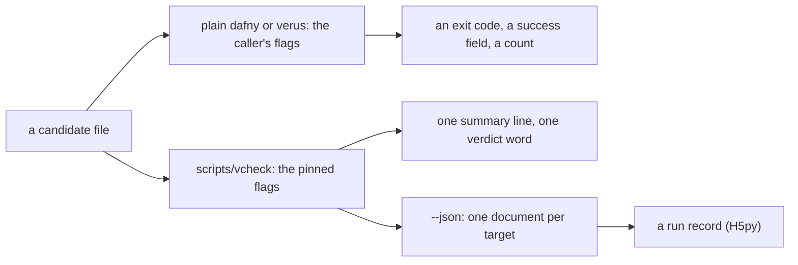
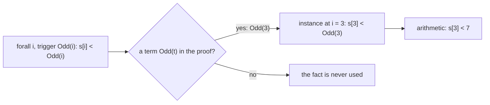
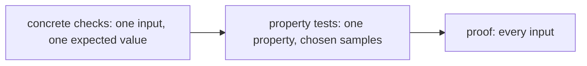
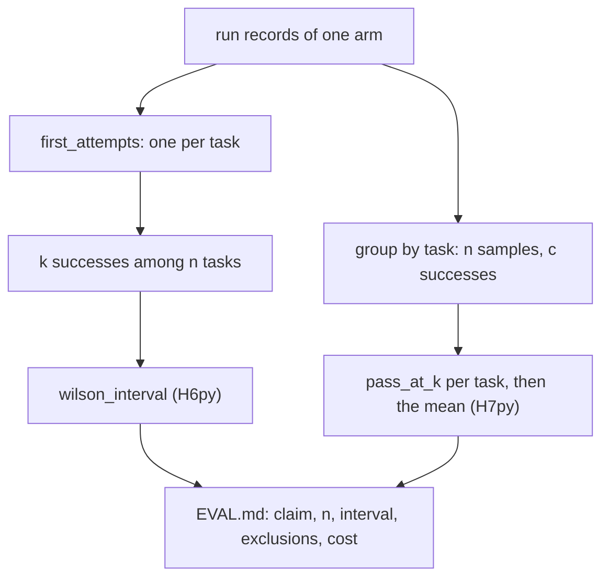
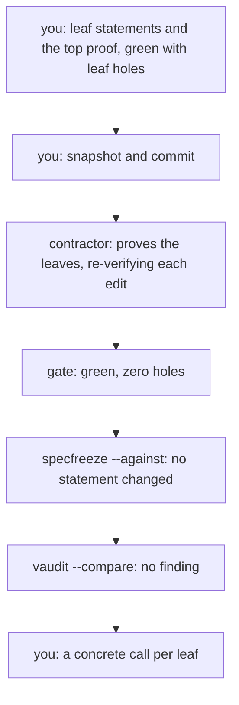

# Q06 — The machine and the verifier loop

Q04 gave you proof craft and Q05 the frames, ownership and verification conditions behind a
green run. Q06 closes the moderate tier with family C, strands S9–S13: the machine around a
proof, from the verdict a tool prints to the number a report claims. Python joins as the
third language, for the evaluation harness `fvh`, and `/viva Q06` examines Q04, Q05 and
Q06 together.
Three ideas do all the work:

1. **A verdict is a document, and each door prints its own.** The plain binary, the course
   wrapper and the wrapper's JSON each report a file with their own exit codes, words and
   flags; a harness must know which field of which door it reads.
2. **The solver uses only what it is shown.** A quantified fact fires only on terms that
   match its trigger, an opaque definition stays folded outside its `reveal`, and a search
   that exhausts the pinned budget ends *out of resource*, which says nothing about truth.
3. **One run is an anecdote; n runs are an estimate.** Property tests check a candidate on
   chosen samples before any proof, statistics turn first tries into a claim with an
   interval, and `EVAL.md` and `TRUST.md` write down the claim and what it trusted.

---

## 0. How this module works, pretest, test-out

**Minutes: 281, plus the 30-minute tier viva.** Setup 5 · test-out 10 · reading 48 ·
worked examples and WRITE cards 25 · divergence cards 8 · predictions 22 · holes 36 ·
property tests 15 · statistics by hand and in Python 30 · `EVAL.md` v0 15 · `TRUST.md` v0 10 ·
agent 15 · paper 15 · exit 22 · calibration 5.

**Setup.** Start one long-lived `/tutor Q06` session. The harness is a `uv` project under
`harness/`: run `uv sync --directory harness --frozen` once (with `uv` installed:
`README.md`'s Setup, step 5), which builds `harness/.venv` (git ignores it) from the pinned
lock. `scripts/vcheck Q06` shows both verifier units
verified with five holes each (§9).

**Predictions, all nine, first.** In the moderate tier the prediction block comes before
the test-out:

| items | where the answer goes |
|---|---|
| P1dv, P2dv, P5dv, P6dv, P8dv (the Dafny file's prediction block) | `slots/Q06.slots` |
| P3d, P4v (obligations) | the `// SLOT: FAILS ???` line of `specimens/Q06/P3d.dfy.specimen` and of `P4v.rs.specimen` |
| P7py, P9py (the Python file's prediction block) | `slots/Q06.slots` |

Record them with `scripts/firsttry.sh Q06 --check`, then enable each slot. Until then keep
the README's *Predictions first* list closed (from Q06 on it holds `harness/fvh/` and
`harness/tests/`), and with it the Q06 bank and rubric, the exit files and the card demos,
which `scripts/vcheck` refuses until the prediction they settle is recorded.

**Pretest, after the predictions, before reading.** T1 is a pair of test-out items,
`SecondLimb` and `lemma_second_limb`: a fact about every limb, guarded by an explicit
trigger, used for limb 1. Write both closed book, hints unread, and run
`scripts/firsttry.sh Q06 --check` again (it refuses T1 while any prediction is unrecorded).
**Skip rule:** if both pass on that first try, skip §3.1; the C1 cards, H1d, H1v and the
exit stay.

Each prediction reappears below in a box,

> **Predict (Pn) — commit in the file before reading on.**

and its answer comes only after the box, below the words *Commit your prediction first.*

**Outputs.** Every output fence is a real run on the course pins (Dafny 4.11.0, Verus
0.2026.09.27.3cf1832), pinned in `expected/Q06.chapter.toml`; §5's three `fvh.stats` runs
are recorded quotes you can repeat. `p1.*` and `probe.*` are scratch files. Wrapper fences
drop the last line, `raw output: <dir>`; JSON shows `[...]` for `cmd` and `...` for
`raw_dir`.

**This module's files**

| file | what it is |
|---|---|
| `dafny/given/Q/QG_L1_BigNat.dfy` to `QG_L3_BigNat.dfy`; `verus/given/qg_bignat_l1` to `qg_bignat_l3` | the given spine, frozen; Verus L3's `weight` is opaque, with two defining lemmas |
| `dafny/Q/Q06_Machine/std/Q06_Machine.dfy` | the Dafny exercise file: **5 holes** (T1d, H1d–H4d), the prediction block and the `AUDIT ROWS` block |
| `verus/q/q06_machine/src/lib.rs` | the Verus exercise file: **5 holes** (T1v, H1v–H4v) |
| `harness/q/fvh_q/q06_stats.py` | the Python exercise file: **3 holes** (H5py–H7py), counted on the syntax tree, and P7py, P9py |
| `specimens/Q06/` | P3d, P4v and the card demos |
| `dafny/Q/Q06_Machine/agent/Q06_AgentProver.dfy` | the agent file (audited prover): green with **1 hole**, the frozen top lemma, and an empty `SKELETON` (§10) |
| `dafny/Q/Q06_Machine/exit/Q06_Exit.dfy`, `verus/q/q06_machine/src/exit.rs` | the closed-book exit: **2 + 2 holes** |
| `research/EVAL.md`, `research/TRUST.md` | your standards documents; Q06 writes their first sections (§7) |
| `paper/Q06_problems.tex`, `paper/Q06_answers.tex` | the written pair (§8) |
| `Solutions/` mirrors of these files | the reference: yours to open LAST |

---

## 1. S9 — Doors, exit codes and run records

Q03 §3 showed that a raw verifier's exit code is a claim made under its options. A
verifier has three doors: the plain binary, with whatever flags its caller passes;
`scripts/vcheck`, with the pinned flags and one summary line; and `scripts/vcheck --json`,
one document per target:



Only the wrapper's paths carry the course's flags, and a harness reads the JSON, never a
plain exit code. This section shows why.

### 1.1 Switching verification off

> **Predict (P1dv) — commit in the file before reading on.** A Dafny file whose only
> problem is a lemma with a false `ensures`, plus one passing `@Test` method, run as
> `dafny test --no-verify --target py p1.dfy`; a Verus file whose only problem is a proof
> fn with a false `ensures`, run as `verus p1.rs --crate-type=lib --no-verify
> --output-json`. The two exit codes, and the value of `success` in Verus's JSON.

*Commit your prediction first.* `D:0 V:0 true`. The files, verbatim from the docstring:

```dafny
module P1 {
  lemma Wrong(x: nat)
    ensures x + 1 == x
  {
  }

  @Test
  method Passes() {
    expect 1 + 1 == 2;
  }
}
```

<!-- pin: p1dv-d -->
```
$ dafny test --no-verify --target py p1.dfy
Dafny program verifier did not attempt verification
P1.Passes: PASSED
$ echo $?
0
```

```rust
use vstd::prelude::*;

verus! {

proof fn wrong(x: nat)
    ensures
        x + 1 == x,
{
}

} // verus!
```

<!-- pin: p1dv-v -->
```
$ verus p1.rs --crate-type=lib --no-verify --output-json
{
  "func-details": {},
  "verification-results": {
    "encountered-error": false,
    "encountered-vir-error": false,
    "success": true,
    "verified": 0,
    "errors": 0,
    "is-verifying-entire-crate": true
...
$ echo $?
0
```

(Cut: the document's `verus` block, the version and platform.) Read them aloud: (1) Dafny
did not attempt verification, compiled the file to Python, ran its one test and exited 0;
(2) Verus printed `"success": true` beside `"verified": 0` and exited 0; (3) the false
lemma reached no solver, and neither tool mentioned it. A grader that reads the exit code,
or `success`, records a pass for a file that states something false. The course wrappers
never pass `--no-verify` and refuse it on their command lines: never let a candidate choose
its grader's flags.

### 1.2 Verdicts that are neither yes nor no

> **Predict (P2dv) — commit in the file before reading on.** A lemma that runs out of the
> pinned resource limit, checked with `scripts/vcheck --json` in each language: the exit
> code of `scripts/vcheck` itself, and the `verdict` field of its JSON document.

*Commit your prediction first.* `D:1 inconclusive V:1 inconclusive`. Card C3's failure demos
are such lemmas (§3.3):

<!-- pin: p2dv-d -->
```
$ scripts/vcheck --json specimens/Q06/card-c3d.dfy.specimen
{"cmd": [...], "count_unit": "tasks", "diagnostics": [{"code": "W-D11", "col": 9, "file": "specimens/Q06/card-c3d.dfy.specimen", "line": 9, "message": "Verification out of resource (Q06_CardC3d.FourthPowerMono)", "severity": "error"}], "exit_code": 4, "findings": [], "holes": [], "lang": "dafny", "per_symbol": {"Q06_CardC3d.FourthPowerMono": "inconclusive"}, "raw_dir": "...", "stage": "verify", "target": "specimens/Q06/card-c3d.dfy.specimen", "verdict": "inconclusive", "verified_count": 0}
$ echo $?
1
```

<!-- pin: p2dv-v -->
```
$ scripts/vcheck --json specimens/Q06/card-c3v.rs.specimen
{"cmd": [...], "count_unit": "verified", "diagnostics": [{"code": "W-V05", "col": 1, "file": "specimens/Q06/card-c3v.rs.specimen", "line": 21, "message": "function body check: Resource limit (rlimit) exceeded; consider rerunning with --profile for more details", "severity": "error"}], "exit_code": 1, "findings": [], "holes": [], "lang": "verus", "per_symbol": {"lemma_tri_sixty": "failed", "tri": "verified"}, "raw_dir": "...", "stage": "verify", "target": "specimens/Q06/card-c3v.rs.specimen", "verdict": "inconclusive", "verified_count": 1}
$ echo $?
1
```

Read them aloud: (1) both runs exit 1 with `"verdict": "inconclusive"`, because
`scripts/vcheck` exits 0 only for `verified` and 3 only for a refusal; (2) each
document's own `exit_code` is the verifier's (Dafny 4, Verus 1), not `scripts/vcheck`'s;
(3) the messages differ, `Verification out of resource` against `Resource limit (rlimit)
exceeded`; (4) the per-symbol table is each tool's detail, and Verus files the event under
`failed`. Only the top-level `verdict` is the course's word: `verified`, `failed`,
`inconclusive`, `refused`, `killed(memory)` or `error`, and only the first is a pass.
`failed` means a problem was found; `inconclusive` means the tool gave up. A harness that
files `inconclusive` under "false" turns a budget into a refutation.

**The divergence card (C5dv).** C5's demos are P1's two files, through the wrapper:

<!-- pin: c5dv-d -->
```
$ scripts/vcheck specimens/Q06/card-c5dv-d.dfy.specimen
vcheck: specimens/Q06/card-c5dv-d.dfy.specimen [dafny, learner loop]: failed — 0 verified, 0 holes, 1 error
specimens/Q06/card-c5dv-d.dfy.specimen:10:3: error: a postcondition could not be proved on this return path
specimens/Q06/card-c5dv-d.dfy.specimen:9:19: related: this is the postcondition that could not be proved
```

<!-- pin: c5dv-v -->
```
$ scripts/vcheck specimens/Q06/card-c5dv-v.rs.specimen
vcheck: specimens/Q06/card-c5dv-v.rs.specimen [verus, learner loop]: failed — 0 verified, 0 holes, 1 error
specimens/Q06/card-c5dv-v.rs.specimen:13:9: error: postcondition not satisfied
```

The wrapper verifies, so both fail at the false postcondition, with the same word and exit
code in each language. The columns diverge at the plain door: Dafny's skipped verification
looks like a passing test run, Verus's like a JSON document claiming success; and for one
verdict their own exit codes differ (4 against 1, §1.2).

### 1.3 Run records

A run becomes data as a record: `fvh.records.RunRecord` holds `task_id`, `arm` (which
prover or policy), `attempt` (1 for the first try), `lang`, `verdict`, `holes`, `errors`
and `verified_count`, and its `success` is the course's done, `verdict == "verified" and
holes == 0`. H5py builds one from a `scripts/vcheck --json` document like those above.

---

## 2. S10 — What a green run trusts

Q03 §4 named the trusted computing base. Here you make it an inventory, because every
number in §5 rests on it:

| component | Dafny | Verus |
|---|---|---|
| front end | Dafny 4.11.0, through Boogie | Verus 0.2026.09.27.3cf1832 on rustc 1.98.1, through VIR and AIR |
| solver | Z3 4.12.1, bundled | Z3 4.16.0, bundled |
| standard library | `Std`, with declarations it assumes | `vstd`, with `external_body` fns and `assume_specification`s |
| course wrappers | `scripts/vcheck`, `scripts/vaudit`, the generated `dfyconfig.toml`s | the same, with `--no-cheating` and the pinned `--rlimit` |
| given layers | L1–L3 | L1–L3 |

Each row can make a green run wrong without a line of your file changing: a solver that
answers "unsat" to everything, a trusted library specification that is false, a wrapper
bug, a given lemma that does not say what its name says.

> **Predict (P8dv) — commit in the file before reading on.** Dafny: when `scripts/vaudit`
> audits a unit that uses the standard library, does its report list any finding located
> inside the standard library? Verus: when `scripts/vcheck` verifies a crate that uses
> `vstd`, does it report the trusted sites inside `vstd`?

*Commit your prediction first.* `D:no V:no`. Both shipped units use their library:

<!-- pin: p8dv-d -->
```
$ scripts/vaudit dafny/Q/Q06_Machine/std
dafny/Q/Q06_Machine/std/Q06_Machine.dfy:211: audit-bodyless-ghost — SecondLimb: Ghost declaration has no body and has an ensures clause
dafny/Q/Q06_Machine/std/Q06_Machine.dfy:366: audit-bodyless-ghost — FirstPrefix: Ghost declaration has no body and has an ensures clause
dafny/Q/Q06_Machine/std/Q06_Machine.dfy:386: audit-bodyless-ghost — PackToNat: Ghost declaration has no body and has an ensures clause
dafny/Q/Q06_Machine/std/Q06_Machine.dfy:409: audit-bodyless-ghost — TwoShifts: Ghost declaration has no body and has an ensures clause
dafny/Q/Q06_Machine/std/Q06_Machine.dfy:437: audit-assume — CheckSplit: Definition has `assume` statement in body
vaudit: dafny/Q/Q06_Machine/std [dafny, learner]: 5 finding(s)
$ echo $?
1
```

<!-- pin: p8dv-v -->
```
$ scripts/vaudit verus/q/q06_machine
verus/q/q06_machine/src/lib.rs:70: hole-assume — an assume hole (in lemma_second_limb) not on the trust allowlist
verus/q/q06_machine/src/lib.rs:237: hole-assume — an assume hole (in lemma_first_prefix) not on the trust allowlist
verus/q/q06_machine/src/lib.rs:259: hole-assume — an assume hole (in lemma_pack_to_nat) not on the trust allowlist
verus/q/q06_machine/src/lib.rs:291: hole-assume — an assume hole (in lemma_seq_to_nat_append) not on the trust allowlist
verus/q/q06_machine/src/lib.rs:318: hole-external-body — an external_body hole (in check_split_results) not on the trust allowlist
vaudit: verus/q/q06_machine [verus, learner]: 5 finding(s)
$ echo $?
1
```

Five findings each, every one a hole of your own file. **The divergence card (C6dv), Dafny
column**: C6's demo proves commutativity with one `Std` lemma and verifies,

<!-- pin: c6dv-d -->
```
$ scripts/vcheck specimens/Q06/card-c6dv-d.dfy.specimen
vcheck: specimens/Q06/card-c6dv-d.dfy.specimen [dafny, learner loop]: verified — 1 verified, 0 holes, 0 errors
```

and the plain auditor, run on a copy with the standard library on, as every std unit sets
it, shows what `scripts/vaudit` left out:

<!-- pin: c6dv-d-plain -->
```
$ dafny audit --standard-libraries probe.dfy
DafnyStandardLibraries.dfy(15327,26): Warning: Omega: Declaration has explicit `{:axiom}` attribute. Possible mitigation: Provide a proof or test.
DafnyStandardLibraries.dfy(15332,17): Warning: Succ: Declaration has explicit `{:axiom}` attribute. Possible mitigation: Provide a proof or test.
DafnyStandardLibraries.dfy(15335,26): Warning: PlusLimit: Declaration has explicit `{:axiom}` attribute. Possible mitigation: Provide a proof or test.
...
$ echo $?
0
```

(Cut: 78 more rows of four kinds, `{:axiom}` declarations, bodyless declarations with an
`ensures`, `assume {:axiom}` statements and trait calls assumed to terminate; then
`Dafny auditor completed with 81 findings`.) The wrapper pins that count, 81, and drops
those rows; a different count would be a finding. Verus never looks: `vaudit` runs
`--no-cheating` over your crate and its path dependencies, the given layers, and `vstd` is
neither. So "no" means "pinned and hidden" in one column and "never examined" in the
other; either way `TRUST.md` names the library (§7). C6's Verus column waits for P6dv
(§4.2).

---

## 3. S11 — Triggers, opacity and the resource limit

Z3 proves a verification condition by search, and three levers decide what the search can
use: which instances of a quantified fact it creates (triggers), which definitions it sees
(opacity), and how long it may search (the resource limit).

### 3.1 Triggers

A `forall` among your hypotheses is not used by itself. Z3 *instantiates* it: each time a
term matching its trigger appears in the proof, it creates the instance at that term.
Dafny takes the trigger from `{:trigger …}` (or chooses one), Verus from `#[trigger]`. C1's
success examples:

```dafny
lemma OddBound(s: seq<nat>)
  requires |s| > 3
  requires forall i {:trigger Odd(i)} | 0 <= i < |s| :: s[i] < Odd(i)
  ensures s[3] < 7
{
  assert s[3] < Odd(3);
}
```

```rust
pub proof fn lemma_odd_bound(s: Seq<u64>)
    requires
        s.len() > 3,
        forall|i: int| 0 <= i < s.len() ==> (s[i] as int) < #[trigger] odd(i),
    ensures
        s[3] < 7,
{
    assert((s[3] as int) < odd(3));
}
```

The goal mentions `s[3]`, which matches nothing; the assertion mentions `Odd(3)`, which
does:



A proof switches a quantified fact on by naming a term of the trigger's shape, and that
term need not be the goal.

> **Predict (P3d, P4v) — commit in the files before reading on.** Four lemmas share the
> hypothesis that every prefix of `s` is below a power of `BASE`, with an explicit trigger,
> and have empty bodies: [a] the bound at an index `k`; [b] the bound for two limbs,
> written `BASE * BASE`; [c] the same with the hypothesis triggered on the prefix; [d] the
> bound for two limbs, written `Pow(2)` (Verus: `weight(2)`). Which fail, in each language?

*Commit your prediction first.* P3d is `FAILS b` and P4v is `FAILS b c`:

<!-- pin: p3d -->
```
$ scripts/vcheck specimens/Q06/P3d.dfy.specimen
vcheck: specimens/Q06/P3d.dfy.specimen [dafny, learner loop]: failed — 10 verified, 0 holes, 1 error
specimens/Q06/P3d.dfy.specimen:46:3: error: a postcondition could not be proved on this return path
specimens/Q06/P3d.dfy.specimen:45:27: related: this is the postcondition that could not be proved
```

<!-- pin: p4v -->
```
$ scripts/vcheck specimens/Q06/P4v.rs.specimen
vcheck: specimens/Q06/P4v.rs.specimen [verus, learner loop]: failed — 2 verified, 0 holes, 2 errors
specimens/Q06/P4v.rs.specimen:34:9: error: postcondition not satisfied
specimens/Q06/P4v.rs.specimen:43:9: error: postcondition not satisfied
```

Line 45 of the Dafny specimen is [b]; lines 34 and 43 of the Verus specimen are [b] and [c].
[a] and [d] name the triggered function at the needed argument, so the hypothesis fires and
its instance is the goal. [b] names no term of the trigger's shape, so the hypothesis never
fires. [c] fires on the prefix `s[..2]` and yields a bound by `Pow(2)` or `weight(2)`, not
by `BASE * BASE`. Dafny can see `Pow`'s definition and closes the gap; in Verus `weight` is
opaque (L3), so nothing relates `weight(2)` to `BASE * BASE`, and [c] fails. Same shape,
different answers: the instance a trigger produces is only as useful as the definitions
the solver can see (§3.2).

C1's failure demos are the success examples with empty bodies:

<!-- pin: c1d -->
```
$ scripts/vcheck specimens/Q06/card-c1d.dfy.specimen
vcheck: specimens/Q06/card-c1d.dfy.specimen [dafny, learner loop]: failed — 2 verified, 0 holes, 1 error
specimens/Q06/card-c1d.dfy.specimen:18:3: error: a postcondition could not be proved on this return path
specimens/Q06/card-c1d.dfy.specimen:17:18: related: this is the postcondition that could not be proved
```

<!-- pin: c1v -->
```
$ scripts/vcheck specimens/Q06/card-c1v.rs.specimen
vcheck: specimens/Q06/card-c1v.rs.specimen [verus, learner loop]: failed — 0 verified, 0 holes, 1 error
specimens/Q06/card-c1v.rs.specimen:21:9: error: postcondition not satisfied
```

No tool says "no trigger matched": the message is the plain postcondition failure. When a
quantified hypothesis should have closed a goal, ask which term would fire it. A trigger
can also fire too often: if an instance creates a new term of the trigger's shape (a fact
relating `f(n)` and `f(n + 1)`, triggered on `f(n)`), the solver keeps instantiating, a
*matching loop*, which never ends in a counterexample, only out of resource (§3.3).

### 3.2 Opacity and a scoped reveal

An opaque definition is known by its signature only, until a `reveal` unfolds it: Dafny
writes `opaque function` and `reveal F();`, Verus `#[verifier::opaque]` and `reveal(f);`.
Opacity keeps a large definition out of every proof that does not need it, and makes each
proof that does need it say so. W1, in both columns:

```dafny
opaque function Twice(x: nat): nat
{
  2 * x
}

lemma TwiceEven(x: nat)
  ensures Twice(x) % 2 == 0
{
  assert Twice(x) == 2 * x by { reveal Twice(); }
}
```

```rust
#[verifier::opaque]
pub open spec fn twice(x: nat) -> nat {
    2 * x
}

pub proof fn lemma_twice_even(x: nat)
    ensures
        twice(x) % 2 == 0,
{
    assert(twice(x) == 2 * x) by {
        reveal(twice);
    }
}
```

A reveal lasts to the end of its block; inside `assert … by { … }` that block is the
assertion's proof, and only the asserted fact leaves it.

> **Predict (P5dv) — commit in the file before reading on.** An opaque function
> `F(x) == x + 1` and a lemma `ensures F(x) > x` whose body is one
> `assert true by { reveal F(); }` (Verus: `assert(true) by { reveal(f); }`). What does
> `scripts/vcheck` say about each?

*Commit your prediction first.* `D:fail V:fail`. The scenarios, verbatim:

```dafny
opaque function F(x: nat): nat
{
  x + 1
}

lemma FAbove(x: nat)
  ensures F(x) > x
{
  assert true by { reveal F(); }
}
```

<!-- pin: p5dv-d -->
```
$ scripts/vcheck --module Q06 probe.dfy
vcheck: probe.dfy [dafny, learner loop]: failed — 23 verified, 0 holes, 1 error
probe.dfy:8:1: error: a postcondition could not be proved on this return path
probe.dfy:7:16: related: this is the postcondition that could not be proved
```

```rust
use vstd::prelude::*;

verus! {

#[verifier::opaque]
pub open spec fn f(x: nat) -> nat {
    x + 1
}

pub proof fn lemma_f_above(x: nat)
    ensures
        f(x) > x,
{
    assert(true) by { reveal(f); }
}

} // verus!
```

<!-- pin: p5dv-v -->
```
$ scripts/vcheck --module Q06 probe.rs
vcheck: probe.rs [verus, learner loop]: failed — 0 verified, 0 holes, 1 error
probe.rs:12:9: error: postcondition not satisfied
```

The reveal happened, inside a block whose only export is `true`; the postcondition is
checked outside it, where `F` is folded again. C2's success example reveals `Mid` at the
top of the body, so the whole proof sees it. Its failure demos confine the reveal to an
assertion about another instance, `Mid(a, a)`:

<!-- pin: c2d -->
```
$ scripts/vcheck specimens/Q06/card-c2d.dfy.specimen
vcheck: specimens/Q06/card-c2d.dfy.specimen [dafny, learner loop]: failed — 1 verified, 0 holes, 2 errors
specimens/Q06/card-c2d.dfy.specimen:17:3: error: a postcondition could not be proved on this return path
specimens/Q06/card-c2d.dfy.specimen:16:15: related: this is the postcondition that could not be proved
specimens/Q06/card-c2d.dfy.specimen:17:3: error: a postcondition could not be proved on this return path
specimens/Q06/card-c2d.dfy.specimen:16:28: related: this is the postcondition that could not be proved
```

<!-- pin: c2v -->
```
$ scripts/vcheck specimens/Q06/card-c2v.rs.specimen
vcheck: specimens/Q06/card-c2v.rs.specimen [verus, learner loop]: failed — 0 verified, 0 holes, 1 error
specimens/Q06/card-c2v.rs.specimen:21:9: error: postcondition not satisfied
```

Dafny reports each conjunct of `a <= Mid(a, b) <= b` separately (columns 15 and 28), Verus
the postcondition once. H2d and H2v ask where `Pack`'s body must be visible.

### 3.3 The resource limit

Every course run carries a pinned resource limit, a count of solver work rather than
seconds, so a verdict replays on any machine with the same pins. A search that exhausts it
is `inconclusive` (§1.2): not false, not nearly proved, and not promised to succeed with a
larger limit. A proof that fits because the solver was lucky is brittle; one that fits
because it hands the solver the steps it cannot find is not.

C3 shows two ways to fit. The Dafny success example gives the solver four facts about
products from `Std.Arithmetic.Mul`; its failure demo (§1.2) is the same lemma with an empty
body:

```dafny
lemma FourthPowerMono(x: nat, y: nat)
  requires x <= y
  ensures x * x * x * x <= y * y * y * y
{
  Mul.LemmaMulInequality(x, y, x);      // x * x <= y * x
  Mul.LemmaMulInequality(x, y, y);      // x * y <= y * y
  var a, b := x * x, y * y;
  Mul.LemmaMulInequality(a, b, a);      // a * a <= b * a
  Mul.LemmaMulInequality(a, b, b);      // a * b <= b * b
}
```

The Verus example changes who does the work. Unfolding `tri` sixty times exhausts the
solver (the failure demo); `by (compute_only)` evaluates `tri(60)` in Verus's interpreter
and spends no solver budget:

```rust
pub proof fn lemma_tri_sixty()
    ensures
        tri(60) == 1830,
{
    assert(tri(60) == 1830) by (compute_only);  // did: evaluated by the interpreter
}
```

What you never do is raise the limit. H3d and H3v each quote, commented, an attempt that
ends out of resource at the pin; neither is the answer with lines missing. Write a proof
that verifies at the pin with no resource attribute anywhere in the file, as its header
says: the strict report and the exit charge an attribute the audit reports (§4.2) to the
budget item whose block holds it, or to every budget item of the file.

---

## 4. S12 — Property tests, resource attributes, audited delivery

### 4.1 The escalation ladder

Q02 and Q03 checked candidates on single inputs; a property test checks one property on
many chosen samples; a proof covers every input:



Each rung costs more and sees more. A property test belongs before a proof: it rejects a
wrong candidate in seconds, before an hour goes into proving a wrong statement.

The course's form makes the test itself checkable. The checker is a verified method whose
postcondition is **two-sided**, `ok` exactly when every sample has the property, so no
constant body verifies. Tests outside the verified code (Dafny `@Test` methods, Rust
`#[test]`s after `verus!`) run it on a correct candidate, which must pass, and a planted
one, which must be rejected. C4's Dafny checker:

```dafny
method AllBelow(f: nat -> nat, samples: seq<nat>, bound: nat) returns (ok: bool)
  ensures ok <==> forall k | 0 <= k < |samples| :: f(samples[k]) < bound
```

`Clip` sends every input below 1000; the planted `ClipPlanted` lets 1000 through, and the
samples `[0, 999, 1000, 1001, BASE]` include that boundary. The shipped units run C4's
tests already:

<!-- pin: c4-test-d -->
```
$ scripts/vcheck --test dafny/Q/Q06_Machine/std
vcheck: dafny/Q/Q06_Machine/std [dafny, test]: verified — 2 passed, 0 failed
PASSED Q06_Machine.ClipPasses
PASSED Q06_Machine.ClipPlantedRejected
```

<!-- pin: c4-test-v -->
```
$ scripts/vcheck --test verus/q/q06_machine
vcheck: verus/q/q06_machine [verus, test]: verified — 2 passed, 0 failed
PASSED card_c4::clip_passes
PASSED card_c4::clip_planted_rejected
```

H4's suites ship commented, so each unit gains two tests when you enable them. C4's
failure demos weaken the postcondition to `ok ==> …` and give the checker the constant
body `false`, which verifies; the caller's `assert ok` on a correct candidate then fails:

<!-- pin: c4d -->
```
$ scripts/vcheck specimens/Q06/card-c4d.dfy.specimen
vcheck: specimens/Q06/card-c4d.dfy.specimen [dafny, learner loop]: failed — 3 verified, 0 holes, 1 error
specimens/Q06/card-c4d.dfy.specimen:22:5: error: assertion might not hold
```

<!-- pin: c4v -->
```
$ scripts/vcheck specimens/Q06/card-c4v.rs.specimen
vcheck: specimens/Q06/card-c4v.rs.specimen [verus, learner loop]: failed — 1 verified, 0 holes, 1 error
specimens/Q06/card-c4v.rs.specimen:23:12: error: assertion failed
```

A one-sided checker promises nothing when it says no, so its "no" carries no information.
No crates.io dependency enters a course crate, so samples are hand-written: choose the
boundaries (0, the largest value, where a carry starts). H4d and H4v check a limb adder
over such samples.

### 4.2 Resource attributes and the audit

> **Predict (P6dv) — commit in the file before reading on.** Three files, each one small
> lemma that verifies: [a] a Dafny lemma carrying `{:rlimit 1000}`; [b] a Verus proof fn
> carrying `#[verifier::rlimit(1)]`; [c] the same with `#[verifier::rlimit(4)]`. For which
> does `scripts/vaudit` report a finding?

*Commit your prediction first.* `a c`. The three files, verbatim:

```dafny
lemma {:rlimit 1000} Small(x: nat)
  ensures x + 0 == x
{
}
```

<!-- pin: p6dv-a -->
```
$ scripts/vaudit probe.dfy
probe.dfy:1: resource-attribute — a per-declaration resource limit overrides the course pin (Δ56)
vaudit: probe.dfy [dafny, learner]: 1 finding(s)
$ echo $?
1
```

```rust
use vstd::prelude::*;

verus! {

#[verifier::rlimit(1)]
pub proof fn lemma_small(x: nat)
    ensures
        x + 0 == x,
{
}

} // verus!
```

<!-- pin: p6dv-b -->
```
$ scripts/vaudit probe.rs
vaudit: probe.rs [verus, learner]: 0 finding(s)
$ echo $?
0
```

```rust
use vstd::prelude::*;

verus! {

#[verifier::rlimit(4)]
pub proof fn lemma_small(x: nat)
    ensures
        x + 0 == x,
{
}

} // verus!
```

<!-- pin: p6dv-c -->
```
$ scripts/vaudit probe.rs
probe.rs:5: rlimit-inflation — a per-item rlimit above the pin (V22)
vaudit: probe.rs [verus, learner]: 1 finding(s)
$ echo $?
1
```

The pins are 5,000,000 resource units per batch in Dafny (every unit's `dfyconfig.toml`)
and `--rlimit 2` in Verus. Any Dafny per-declaration limit overrides the pin and is a
finding. A Verus attribute is in the pin's units: `rlimit(1)` only lowers the budget, which
makes passing harder, never easier, so only `rlimit(4)`, above the pin, is reported.
**C6dv, Verus column**: the demo carries [b]'s attribute and one `vstd` lemma, and is clean:

<!-- pin: c6dv-v -->
```
$ scripts/vaudit specimens/Q06/card-c6dv-v.rs.specimen
vaudit: specimens/Q06/card-c6dv-v.rs.specimen [verus, learner]: 0 finding(s)
$ echo $?
0
```

C6's two columns diverge twice: Dafny's audit reports any resource attribute and hides the
library's pinned rows; Verus's reports only an attribute above the pin and never examines
`vstd`.

### 4.3 Audited delivery

Rung 6 of the agent ladder joins this section's halves. You write and commit the
statements, a skeleton of leaf lemmas; a contractor writes the proofs; you audit with
instruments that each see one thing: the gate, the statement freeze, the audit, and a
usefulness check no instrument automates. §10 is the exercise.

---

## 5. S13 — Statistics, by hand and with `fvh.stats`

A success rate on 20 goals is a fact about those 20; the claim you want is about goals like
them. Each computation below is done by hand once, then by the frozen `fvh.stats`, the only
place statistics code lives in this course: your Python composes it, never re-derives it.

### 5.1 A pass rate and its interval

A **pass rate** counts one record per task, the first attempt: retries of one task are not
independent samples, and counting them inflates the rate and its apparent precision. With
`k` successes among `n` tasks, `p = k / n`.

The textbook (Wald) interval `p ± z·√(p(1 − p)/n)` fails where provers live: at `k = n` its
width is zero, and at small `n` it covers the true rate less often than it claims. The
**Wilson score interval**, with `z = 1.96` for 95 %:

- centre `= (p + z²/2n) / (1 + z²/n)`;
- half-width `= z · √(p(1 − p)/n + z²/4n²) / (1 + z²/n)`.

> **Predict (P7py) — commit in the file before reading on.** A prover closes 14 of 20
> goals. Which is closest to the half-width of the 95 % Wilson interval: a) 2 pp b) 10 pp
> c) 20 pp d) 40 pp?

*Commit your prediction first.* The answer is c. With `p = 0.7`, `n = 20`, `z² = 3.8416`:
`z²/n = 0.19208`, so the denominator is `1.19208`; the centre is `0.79604 / 1.19208 =
0.6678`; under the root, `0.0105 + 0.0024 = 0.0129`, whose root is `0.1136`; the
half-width is `1.96 × 0.1136 / 1.19208 = 0.187`. The interval is about `(0.481, 0.855)`:

<!-- pin: p7py-wilson -->
```
$ uv run --directory harness python3 -c "from fvh import stats; print(stats.wilson_interval(14, 20))"
(0.4810271816464765, 0.8545227551323956)
```

At `n = 20` a rate is known to within about ±19 points: 65 % and 75 % on the same 20 goals
do not show that two provers differ. That takes §5.3's paired comparison, or more tasks.

### 5.2 pass@k

**pass@k** is the probability that at least one of `k` attempts succeeds. Draw `n ≥ k`
samples per task and count `c` successes; the unbiased estimator counts the ways to choose
`k` samples that all fail: `pass@k = 1 − C(n − c, k) / C(n, k)`, and `1` when `n − c < k`.
The plug-in `1 − (1 − c/n)^k` treats the attempts as draws with replacement from a known
rate, and is biased low.

> **Predict (P9py) — commit in the file before reading on.** A task sampled 10 times is
> solved in 3 samples. Which is closest to the unbiased pass@5 estimate: a) 0.30 b) 0.83
> c) 0.92 d) 1.00?

*Commit your prediction first.* The answer is c: `C(7, 5) = 21` and `C(10, 5) = 252`, so
`1 − 21/252 = 0.9167`. The plug-in gives `1 − 0.7⁵ = 0.8319`, option b, and option a is
pass@1, which is `c/n`:

<!-- pin: p9py-passk -->
```
$ uv run --directory harness python3 -c "from fvh import stats; print(stats.pass_at_k(10, 3, 5), stats.pass_at_k(10, 3, 1))"
0.9166666666666666 0.3
```

Over a benchmark, pass@k is the mean of the per-task estimates (H7py); unlike a pass rate,
it uses every sample.

### 5.3 Paired comparisons

Two arms run on the same tasks are compared task by task. A task both solve, or both miss,
says nothing about which is better; only the **discordant** tasks count: `b` that only arm
A solves, `c` that only arm B solves. If the arms were equal, each discordant task would be
a fair coin, and McNemar's exact test asks how surprising the split is:
`p = 2 · P(X ≤ min(b, c))` for `X ~ Binomial(b + c, 1/2)`, at most 1. With `b = 7`, `c = 1`:
`P(X ≤ 1) = 9/256`, so `p = 18/256 = 0.0703`:

<!-- pin: stats-mcnemar -->
```
$ uv run --directory harness python3 -c "from fvh import stats; print(stats.mcnemar(7, 1))"
0.0703125
```

Seven to one looks decisive and is not significant at 0.05: eight informative tasks are
few. From records to a claim:



Every arrow is a function of `fvh` or of your file, so a reader can re-run a claim from its
records.

### 5.4 Composing `fvh.stats`

H6py and H7py are compositions, as their docstrings say, and both raise `ValueError` for
an arm with no records, where neither statistic exists. The frozen acceptance tests wrap
the core's functions and fail a hole that computes the number another way, even correctly.

**Your paper card, 02.4** (VeruSAGE), reports per-model success rates on 849 Verus tasks,
and its Limitations note that the results appear to be single runs. Reread it in your own
`cheatsheets.md` before §8, asking: which numbers are rates, over how many tasks, from how
many runs, and which compared settings differ in more than one way?

---

## 6. What the instruments can and cannot see

| instrument | what it sees | what it cannot see |
|---|---|---|
| a plain `dafny` or `verus` run | what the caller's flags asked for | what those flags switched off (P1dv) |
| `scripts/vcheck` (`--json`) | one verdict under the pinned flags; holes, errors, stage | why a run was `inconclusive` |
| `scripts/vcheck --gate` | zero holes, a complete run, the count pins | a trusted line, a weak statement |
| `scripts/vaudit` | your assumptions, holes and resource attributes | the libraries' trusted parts (P8dv) |
| `scripts/vcheck --test` | a property on the samples you chose | every other sample |
| `scripts/specfreeze` | that no statement changed | whether the statement was right |
| `scripts/firsttry.sh Q06 --report --strict` | slots, checks, first tries, property tests, budget attributes | whether you understood why |
| `fvh.stats` | what its inputs imply | whether the records are first tries, independent, honest |
| a reader (you, `/review-code`, `/grade-paper`, `/viva`) | intent, usefulness, a claim larger than its evidence | nothing mechanical: advisory until an artifact confirms it |

Each row's blind spot is another row's job; the last two meet in `EVAL.md`, where a
statistic is only as good as its records.

---

## 7. The research layer: `EVAL.md` v0 and `TRUST.md` v0

Both files are yours, written by hand, one section per version; a later version adds to
the earlier ones and never relaxes them. No AI session writes either.

**`EVAL.md` v0 (15 minutes, after the exit).** Your first evaluation report, over your own
first tries: `fvh.records.load_calib` reads a module's `instructor/calib/<ID>.tsv`,
`calib_records(rows, arm)` turns its `predict` rows into run records and counts the rest as
exclusions, and your H6py function does the rest. Under `## Q-v0 — Q06, <date>` in
`research/EVAL.md`, write:

1. the claim, with its population ("my first-try prediction rate over Q01–Q06");
2. the metric and its estimator (first-try pass; a proportion with a 95 % Wilson interval);
3. `n`, the interval, and the exclusions with their count;
4. the cost (your calibration minutes);
5. a disclosure line: who made the predictions, which sessions tutored or graded, and
   anything you saw before committing.

Then turn what the report taught you into rules in the section's format, each `earned by`
the report and `checked by` a command, an audit or only a reader. Q09 writes v1.

**`TRUST.md` v0 (10 minutes, after the exit).** Your trusted-base inventory for Q04–Q06, in
the file's section format (Scope, Proved, Tested, Assumed, Escape hatches). Start from §2's
table: per language, the front end, the solver and its version, the standard library's
trusted parts, the course wrappers and the given layers, each with what would make a green
run wrong. Under Tested, list the property suites and what they sampled; under Escape
hatches, "none" and the `scripts/vaudit` runs that show it. Q18 writes the final version.

---

## 8. On paper, before the keyboard

`paper/Q06_problems.tex` holds the statistics by hand, B1–B4 (12 minutes, after §5), and the
paper card 02.4, B5 (the written pair's 15 minutes). The statistics problems use their own
numbers: a Wilson interval and its width at `n = 20`, pass@k from its definition on a small
table, why only first attempts enter a pass rate, and a paired comparison read from its
discordant pairs. Write each computation step by step before you check it with `fvh.stats`:
the steps are graded. Fill `paper/Q06_answers.tex`, build with `make -C paper paper` until
green, and run `/grade-paper Q06` in a fresh session before H6py and H7py; the card is
graded field by field against the pinned range of your `cheatsheets.md`.

---

## 9. The exercise file

The two verifier units, as shipped:

<!-- pin: units -->
```
$ scripts/vcheck Q06
vcheck: dafny/Q/Q06_Machine/std [dafny, learner loop]: verified — 55 verified, 5 holes, 0 errors
dafny/Q/Q06_Machine/std/Q06_Machine.dfy:214:18: hole bodyless-method Q06.T1d
dafny/Q/Q06_Machine/std/Q06_Machine.dfy:369:27: hole bodyless-method Q06.H1d
dafny/Q/Q06_Machine/std/Q06_Machine.dfy:387:26: hole bodyless-method Q06.H2d
dafny/Q/Q06_Machine/std/Q06_Machine.dfy:411:19: hole bodyless-method Q06.H3d
dafny/Q/Q06_Machine/std/Q06_Machine.dfy:437:5: hole assume Q06.H4d
vcheck: verus/q/q06_machine [verus, learner loop]: verified — - verified, 5 holes, 0 errors
verus/q/q06_machine/src/lib.rs:70:40: hole assume Q06.T1v
verus/q/q06_machine/src/lib.rs:237:40: hole assume Q06.H1v
verus/q/q06_machine/src/lib.rs:259:40: hole assume Q06.H2v
verus/q/q06_machine/src/lib.rs:291:40: hole assume Q06.H3v
verus/q/q06_machine/src/lib.rs:318:1: hole external_body Q06.H4v
vcheck: 2 unit(s): 2 verified, 0 not; 10 hole(s) in all
```

Ten holes, five per file, as `expected/Q06.counts` pins them: in Dafny four bodyless lemmas
and H4d's `assume false` exec hole, in Verus four `proof_note` assumes and H4v's
`external_body`. The Python file, through its frozen acceptance tests:

<!-- pin: py-shipped -->
```
$ scripts/vcheck harness/q/fvh_q/q06_stats.py
vcheck: harness/q/fvh_q/q06_stats.py [python, learner loop]: failed — 0 passed, 16 failed, 3 holes
harness/q/fvh_q/q06_stats.py:70:1: hole raise-not-implemented Q06.H5py
harness/q/fvh_q/q06_stats.py:91:1: hole raise-not-implemented Q06.H6py
harness/q/fvh_q/q06_stats.py:109:1: hole raise-not-implemented Q06.H7py
...
```

(Cut: sixteen `error:` lines, one per acceptance test; the first is the test that no hole
is left, the other fifteen end in `NotImplementedError` from a hole.) In file order: the
prediction block and T1 (§0); W1, the WRITE cards C1–C4 and a divergence card (C5dv closes
the Dafny file, C6dv the Verus file); then in each language H1 (§3.1), H2 (§3.2), the budget
item H3 (§3.3) and the checker H4 (§4.1); and H5py–H7py (§1.3, §5).

**The hint dial.** Hints sit on comment lines below each hole: `Hint(1)` only when stuck,
`Hint(2)` only when still stuck; after 20 minutes stuck, ask `/tutor Q06`.

**Slots.** A verdict answer goes in `slots/Q06.slots` (`P1dv = ???` becomes
`P1dv = "<answer>"`); an obligation slot is its specimen's `// SLOT: FAILS ???` line. Fill
it, run `scripts/firsttry.sh Q06 --check`, then enable it: `// SLOT: CHECK P1dv` becomes
`// CHECK P1dv` (Python: `# SLOT: CHECK P7py` becomes `# CHECK P7py`) and `// SLOT: FAILS …`
becomes `// FAILS …`. After each hole, uncomment the checks under `Uncomment as you go:`.

**Done** = `scripts/vcheck --gate dafny/Q/Q06_Machine/std` and
`scripts/vcheck --gate verus/q/q06_machine` each print only the summary line and exit 0,
`scripts/vaudit` reports no finding on either, `scripts/vcheck --test` passes every test of
each, `scripts/vcheck --gate harness/q/fvh_q/q06_stats.py` exits 0, **and**
`scripts/firsttry.sh Q06 --report --strict` exits 0.

**Calibration.** The Dafny file ends with the `AUDIT ROWS` block (Instructor touchpoints)
and a `CALIBRATION` block of §0's minutes; write your actual minutes beside each line. At
the end, `scripts/firsttry.sh Q06 --record` appends your row to `instructor/gradebook.md`.

---

## 10. Exercise (agentic): audited prover

Q04's contractor raced a retriever and Q05's debugged wiring. This one proves lemmas whose
statements you write, and the exercise is your audit. The agent file ships one frozen top
lemma, `CanonicalUnique` (two canonical numerals with the same value are equal), as a hole
above an empty `SKELETON` section:

<!-- pin: agent -->
```
$ scripts/vcheck dafny/Q/Q06_Machine/agent/Q06_AgentProver.dfy
vcheck: dafny/Q/Q06_Machine/agent/Q06_AgentProver.dfy [dafny, learner loop]: verified — 30 verified, 1 hole, 0 errors
dafny/Q/Q06_Machine/agent/Q06_AgentProver.dfy:58:15: hole bodyless-method Q06.A1d
```

The contract, as the file's CONTRACT header states it:

> **CONTRACT (for /contract Q06 — run it in a FRESH session):**
> - **goal:** prove every leaf lemma of the skeleton in this file (the lemmas of its
>   `SKELETON` section), so that the file verifies with zero holes.
> - **allowed-files:** `dafny/Q/Q06_Machine/agent/Q06_AgentProver.dfy`.
> - **acceptance:**
>   - re-verify after every edit with `scripts/vcheck dafny/Q/Q06_Machine/agent/Q06_AgentProver.dfy`; never stack unverified edits
>   - `scripts/vcheck --gate dafny/Q/Q06_Machine/agent/Q06_AgentProver.dfy` exits 0 and prints only the summary line
>   - zero tool-counted holes in the allowed file
>   - `scripts/specfreeze --against research/q06_skeleton.dfy dafny/Q/Q06_Machine/agent/Q06_AgentProver.dfy` reports no change: no statement of the skeleton changed
>   - `git diff` against the committed skeleton shows only the bodies of the leaf lemmas: no statement, attribute, doc comment or other line changed
>   - no new lemma, function or method: the skeleton's leaves (at most 5) are the only lemmas you prove
>   - `scripts/vaudit --compare expected/Q06_AgentProver.audit dafny/Q/Q06_Machine/agent/Q06_AgentProver.dfy` reports no difference (an empty report: no finding)

Your steps (15 minutes: the skeleton 8, the run and audit 7), after the exercise file:

1. **The skeleton.** In `SKELETON`, write at most five leaf lemmas without bodies, and
   replace the top lemma's hole by a proof from them, until the file is green with only the
   leaves' holes. The section's comment names the shape of one decomposition that works.
2. **Freeze it.** Copy the file to `research/q06_skeleton.dfy` and commit both.
3. **The run.** In a fresh session, `/contract Q06`.
4. **The audit.** Statements: `scripts/specfreeze --against`, as in the contract.
   Assumptions: `scripts/vaudit`. Usefulness: call each leaf once on concrete arguments, or
   say why its `requires` can hold.
5. **Record** in the file's `AUDIT` block which leaf took the contractor longest, and why.



The first two boxes and the last are yours; the instruments between them check the
contractor against your statements, never your statements against the problem.

### What the dashboard can and cannot see

The dashboard is the gate's summary line, the freeze report and the audit's findings: every
leaf you wrote is proved, unchanged and free of assumptions. It cannot show that a leaf is
useful. A leaf whose `requires` no caller can meet is proved by anything (Q03's vacuity),
and a contractor asked for green has every reason to find that out first. Only step 4's
concrete call shows that the premises can hold, and only your reading shows that the
leaves add up to the top lemma for the reason you intended.

---

## Exit (closed book)

The last step. Close this chapter, the exercise files, the specimens, later modules' files,
search tools and `/tutor`; at most the given spine stays open. Four unseen items, two per
language, 22 minutes; the exit files ship 2 + 2 holes under shipped statements. A budget
item counts only with no resource attribute in its block. When every block holds an
attempt (a guess counts; a hole does not), run `scripts/firsttry.sh Q06 --exit` once,
before fixing anything: that first complete run is your score, **threshold 3 of 4, with
at least 1 of 2 in each language**. Then repair every block with
`scripts/vcheck <exit file>`; from then on the strict report covers the exit files too.

---

## Instructor touchpoints

> **The Q06 module loop, with the instructor in place:**
>
> - **`/discuss Q06`** (optional; a coach session): a Socratic pass over the Q06 bank, with
>   a sharp developer who reads `inconclusive` as "probably fine".
> - **`/tutor Q06`** (one long-lived session): after 20 minutes stuck, with the message or
>   the goal; it points at this chapter's headings.
> - **`/grade-paper Q06`** (fresh session): once `make -C paper paper` is green, before H6py
>   and H7py (§8).
> - **`/contract Q06`** (fresh session): after the skeleton is committed (§10). Claude Code
>   asks you to approve each write of `.claude/state/contract-allowlist`; approve that file
>   and no other.
> - **`/review-code Q06`** (fresh session): once §9's Done line holds. Bar: proof shape, with
>   triggers, reveals and budgets placed on purpose.
> - **`/viva Q06`** (fresh session): **the moderate-tier exam** for Q04, Q05 and Q06, after
>   the three exits. First, once `scripts/firsttry.sh <ID> --report --strict` passes for all
>   three, fill the `AUDIT ROWS` block of `Q06_Machine.dfy` (the `scripts/vaudit` findings
>   you expect per target, then whether each line held); the rows are advisory, and the viva
>   opens on any line that did not hold. Five questions from five strands of the three
>   banks, at least one per module and one a prediction refereed live by the verifier.
>   Advisory; PASS is no MISSED and at most one SHAKY.
> - **Solutions last**: the `Solutions/` mirrors of Q04's, Q05's and Q06's files, only after
>   the viva.
> - **`/review`**: whenever the session banner says ledger items are due.

---

## What Q06 planted

| seed | harvested |
|---|---|
| three doors, `--no-verify`, the verdict words | Q09 (gate core), Q12 (naive-grader signals), Q18 (gate v2) |
| `inconclusive` is not `failed` | Q09 (seed flips, brittleness), Q12 (a retry client) |
| run records as data | Q12 (Lab 1's policies and report), Q15 (Lab 2) |
| the trusted base as an inventory, `TRUST.md` v0 | Q09 (forensics), Q18 (the final `TRUST.md`) |
| triggers written; matching loops | Q09 (trigger rewrites), Q15 (a trigger battery) |
| opacity and a scoped reveal | Q07 (fuel and unfolding depth) |
| fitting a proof to the budget | Q07 (fuel), Q09 (a stabilising split) |
| property tests, the escalation ladder | Q15 (refute, repair, prove) |
| resource attributes in the audit | Q09 (gate core), Q18 (gate v2) |
| the audited prover (rung 6) | Q07 (rung 7), Q08 (rung 8, spec to proof), Q09 (a red-teamed contractor, contract v1) |
| Wilson intervals, pass@k, McNemar | Q09 (the minimum detectable effect), Q12 (Lab 1: paired tests at matched compute) |
| `EVAL.md` v0 | Q09 (v1), every lab report |
