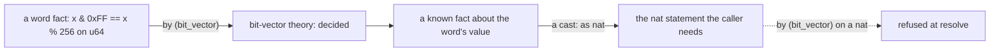
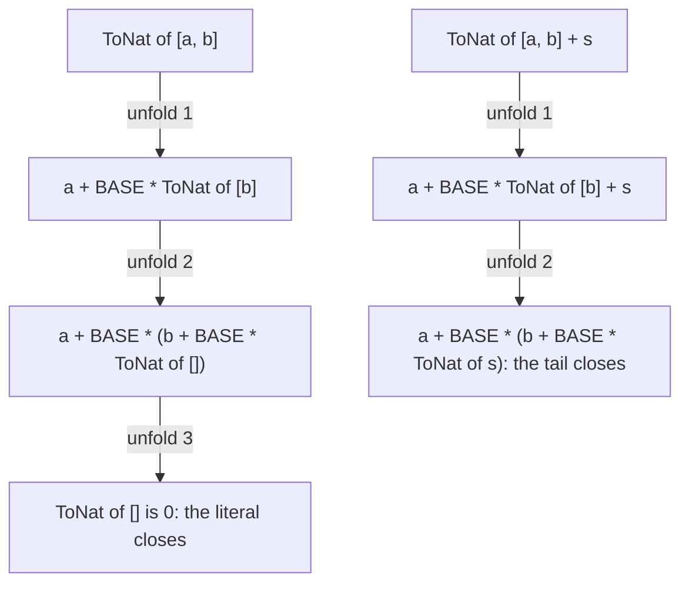
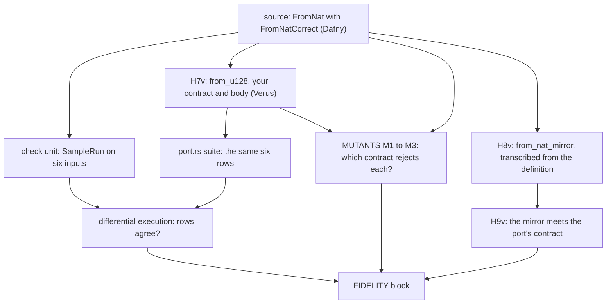
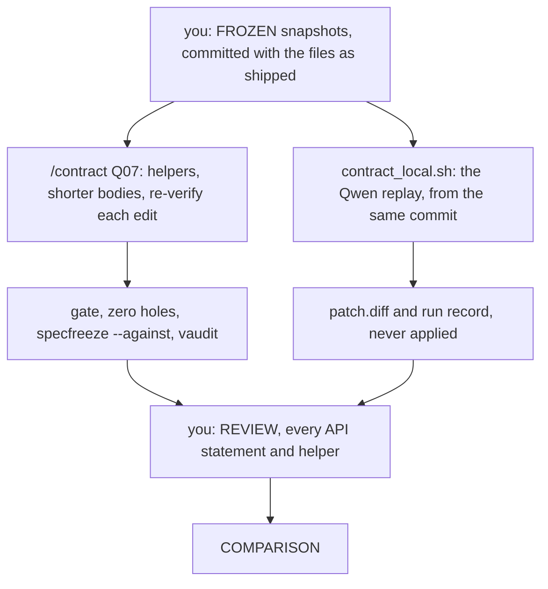

# Q07 — Internals I: proof engineering, translation

Q06 closed the moderate tier with the machine around a proof. Q07 opens the detailed tier and returns to strands S1–S5 at the level of the verifier's mechanics: how far a definition is unfolded, which arithmetic the solver reaches without nonlinear reasoning, how a machine word is reasoned about, and what a translation from Dafny to Verus must carry over. Spine layer L4 joins: addition with a carry and multiplication by one limb, proved in both languages; the frozen abstract module `QG_L4_Spec` with its limb refinement (Dafny); `big_add`, `mul_limb` and the trait `NatLike` (Verus). The agent ladder reaches rung 7, a refactorer under harness, with a local-model replay of the same contract in a per-run sandbox.

Three ideas do all the work:

1. **Unfolding is a resource you hand out.** The solver sees a recursive definition only as far as it has been unfolded, and an opaque one not at all until revealed. A proof supplies missing levels by hand or raises the definition's fuel for one lemma.
2. **Arithmetic is several theories, and each prover sees one.** Linear arithmetic, products, fixed-width words and the interpreter are separate engines; a fact crosses between them only through a named lemma or a bridge you state.
3. **A port is a claim about two programs.** Running both on the same samples, killing mutants with both contracts and transcribing the source independently each check one part of it; none checks that the source said what you meant.

---

## 0. How this module works, pretest, test-out

**Budget: 270 minutes.**

| setup | test-out | read | worked | cards | predicts | holes | port + fidelity | agent | paper | exit + explain-back | calib | total |
|---|---|---|---|---|---|---|---|---|---|---|---|---|
| 5 | 10 | 45 | 30 | 6 | 20 | 56 | 35 | 15 | 15 | 28 | 5 | **270** |

"Worked" is W1d, W1v, W2d and the five WRITE cards; "cards" is C4d, C5d, C6v and the divergence card C7dv; "port" holds H7v–H9v, the suite and the mutants. The contractor's time is outside the budget. The order of work:


The port comes last because it uses everything before it: a word split, unfolding and division meet in one function.

**Layer L4 is open now.** Read `dafny/given/Q/QG_L4_BigNat.dfy` and `verus/given/qg_bignat_l4/src/lib.rs` before H1d, whose statement evaluates L4's `Add`. L4 is frozen and complete, and holds proved versions of several Q04 and Q06 holes.

**Predictions (20 minutes), all seven before anything else.** All are verdicts:

| items | where the answer goes |
|---|---|
| P1dv, P2dv, P4d, P5dv, P7d (the Dafny file's prediction block); P3v, P6v (the Verus crate root's) | `slots/Q07.slots` |

Record them with `scripts/firsttry.sh Q07 --check`; until then `scripts/vcheck` refuses every demo marked `// after: <item>`, and the README's *Predictions first* list stays closed. Each section repeats its box,

> **Predict (Pn) — commit in the file before reading on.**

and gives the answer only after it, below the words *Commit your prediction first.*

**Pretest (10 minutes, closed book, after the predictions).** T1d `ThreeLimbs` and T1v `lemma_three_limbs` state the value of a three-limb literal. Prove both with no chapter, hint or tutor, then run `scripts/firsttry.sh Q07 --check` again: it records each first try, and refuses while a prediction is unrecorded. **Skip rule:** if both first tries pass (`scripts/firsttry.sh Q07 --report`), skip §4.1; the C1 cards, H1d, H4v, H9v and the exit stay.

**Setup (5 minutes).** Start one long-lived `/tutor Q07` session.

**Outputs.** Every output fence is a real run on the course pins (Dafny 4.11.0, Verus 0.2026.09.27.3cf1832), pinned in `expected/Q07.chapter.toml`; two in §10 are *recorded quotes*, the author's verbatim copies of runs no course command repeats. `probe.*` and `p3v_*` are scratch files run with `scripts/vcheck --module Q07`, which adds Q07's given layers and options (a Dafny probe's count includes the spine's tasks). Fences drop the wrapper's last line, `raw output: <dir>`; JSON shows `[...]` for `cmd` and `...` for `raw_dir`.

### This module's files

| file | what it is | shipped state |
|---|---|---|
| `dafny/Q/Q07_InternalsI/std/Q07_InternalsI.dfy` | Dafny exercise file (std unit, nonlinear arithmetic off): prediction block, T1d, W1d, W2d, C1d, C2d, C4d, C5d, H1d–H3d, C7dv | verified, **4 holes** |
| `dafny/checks/Q07_checks.dfy` | the port's Dafny check unit: the sample run and the mutant evaluation, both given (§6) | verified, no hole, no slot |
| `verus/q/q07_internals_i/src/lib.rs` | Verus crate root: P3v, P6v, T1v, W1v, C1v–C3v, C6v, H4v–H6v | verified, **4 holes** |
| `verus/q/q07_internals_i/src/port.rs` | the port module: H7v–H9v, the commented differential suite, `MUTANTS`, the `FIDELITY` block | verified, **3 holes** |
| `specimens/Q07/` | the card demos `card-*` | red by design |
| `slots/Q07.slots` | your seven verdict answers | `???` |
| `dafny/Q/Q07_InternalsI/exit/Q07_Exit.dfy`, `verus/q/q07_internals_i/src/exit.rs` | the closed-book exit and the `EXPLAIN-BACK` block, outside every build | verified, **2 + 2 holes** |
| `dafny/Q/Q07_InternalsI/agent/Q07_AgentRefactor.dfy`, `verus/q/q07_internals_i/src/agent.rs` | the refactorer under harness (§10): monolithic proofs in `FROZEN` and `API`, an empty `HELPERS` | verified, **no hole** |
| `research/q07_frozen.dfy`, `research/q07_frozen.rs` | your snapshots of the `FROZEN` sections (§10) | absent until you write them |
| `dafny/given/Q/QG_L1_BigNat.dfy` to `QG_L4_BigNat.dfy`; `verus/given/qg_bignat_l1` to `qg_bignat_l4` | the given spine, frozen; L4 is new | verified |
| `paper/Q07_problems.tex` → your `paper/Q07_answers.tex` | the written pair (§8) | — |
| `Solutions/` mirrors of these files | the reference twins | yours to open LAST |

---

## 1. S1 — Machine words, bit-vectors and division across languages

### 1.1 One symbol, two divisions

> **Predict (P2dv) — commit in the file before reading on.** A port of halving: Dafny's `Half` (`int`) and Verus's `half` (`i64`) each return `x / 2` under `ensures r == x / 2`, as the prediction block quotes them. What does `scripts/vcheck` say about each?

*Commit your prediction first.* `D:ok V:fail`. The two files:

```dafny
module {:disableNonlinearArithmetic} P2 {
  method Half(x: int) returns (r: int)
    ensures r == x / 2
  {
    r := x / 2;
  }
}
```

<!-- pin: p2dv-d -->
```
$ scripts/vcheck --module Q07 probe.dfy
vcheck: probe.dfy [dafny, learner loop]: verified — 24 verified, 0 holes, 0 errors
```

```rust
use vstd::prelude::*;

verus! {

fn half(x: i64) -> (r: i64)
    ensures
        r == x / 2,
{
    x / 2
}

} // verus!
```

<!-- pin: p2dv-v -->
```
$ scripts/vcheck --module Q07 probe.rs
vcheck: probe.rs [verus, learner loop]: failed — 0 verified, 0 holes, 1 error
probe.rs:7:9: error: postcondition not satisfied
```

The Dafny method computes exactly the expression its postcondition names, with one division in both places, so there is nothing to prove. The Verus function only looks the same. Its body is Rust, where `/` on an `i64` truncates toward zero: `-7 / 2` is `-3`. Its `ensures` is a specification, computed on mathematical integers, where `/` is Euclidean (the remainder is never negative): `-7 / 2` is `-4`. For every negative odd `x` the two differ, and the solver finds one. Nothing in the source text shows the difference; only the position of each `/` does.

**The divergence card (C7dv).** Its two demos put the facts side by side:

<!-- pin: c7dv-d -->
```
$ scripts/vcheck specimens/Q07/card-c7dv-d.dfy.specimen
vcheck: specimens/Q07/card-c7dv-d.dfy.specimen [dafny, learner loop]: failed — 3 verified, 0 holes, 1 error
specimens/Q07/card-c7dv-d.dfy.specimen:20:7: error: possible division by zero
```

<!-- pin: c7dv-v -->
```
$ scripts/vcheck specimens/Q07/card-c7dv-v.rs.specimen
vcheck: specimens/Q07/card-c7dv-v.rs.specimen [verus, learner loop]: verified — 2 verified, 0 holes, 0 errors
```

Read them aloud: (1) both languages prove `(-7) / 2 == -4` and `(-7) % 2 == 1` in a specification: both define integer division the Euclidean way there; (2) in code, Dafny's `x / 2` returns `-4` for `-7` and Verus's returns `-3`; (3) Dafny rejects `function Ratio(x: int, d: int): int { x / d }`, *possible division by zero*: every Dafny division, in a specification too, must show a nonzero divisor; (4) Verus accepts the same `spec fn ratio`, because a spec fn is total and its value at `d == 0` is simply unspecified. Porting a Dafny division into Verus code changes the value for negative operands; porting it into a Verus spec fn loses the divisor check. The course's limbs are unsigned, which removes the first trap, not the second.

### 1.2 Choosing a prover for a word fact

> **Predict (P3v) — commit in the file before reading on.** `split(p: u128)` ensures `(p >> 64u128) == p / 0x1_0000_0000_0000_0000u128`; its body asserts the postcondition [a] `by (nonlinear_arith)`, [b] `by (bit_vector)`, [c] `by (compute)`, or is [d] empty, each in a crate of its own. Which verify?

*Commit your prediction first.* `b`. Crate [a], verbatim from the prediction block:

```rust
use vstd::prelude::*;

verus! {

proof fn split(p: u128)
    ensures
        (p >> 64u128) == p / 0x1_0000_0000_0000_0000u128,
{
    assert((p >> 64u128) == p / 0x1_0000_0000_0000_0000u128) by (nonlinear_arith);
}

} // verus!
```

<!-- pin: p3v-a -->
```
$ scripts/vcheck --module Q07 p3v_a.rs
vcheck: p3v_a.rs [verus, learner loop]: failed — 1 verified, 0 holes, 1 error
p3v_a.rs:9:12: error: assertion failed
```

Crate [b] puts `bit_vector` in the place of `nonlinear_arith`, crate [c] puts `compute` there, and crate [d] leaves the body empty:

<!-- pin: p3v-b -->
```
$ scripts/vcheck --module Q07 p3v_b.rs
vcheck: p3v_b.rs [verus, learner loop]: verified — 2 verified, 0 holes, 0 errors
```

<!-- pin: p3v-c -->
```
$ scripts/vcheck --module Q07 p3v_c.rs
vcheck: p3v_c.rs [verus, learner loop]: failed — 0 verified, 0 holes, 1 error
p3v_c.rs:9:12: warning: Failed to simplify expression <<p >> 64 == p / 18446744073709551616>> before sending to Z3
p3v_c.rs:9:12: error: assertion failed
```

<!-- pin: p3v-d -->
```
$ scripts/vcheck --module Q07 p3v_d.rs
vcheck: p3v_d.rs [verus, learner loop]: failed — 0 verified, 0 holes, 1 error
p3v_d.rs:7:9: error: postcondition not satisfied
```

A shift is a bit operation. To the integer engines (the default call, [d], and `nonlinear_arith`, [a]) `>>` is a function they know almost nothing about, so its relation to division is out of reach. `bit_vector` restates the assertion as arithmetic on 128-bit words, where shifting right by 64 and dividing by 2^64 are facts about the same bits. `compute` runs Verus's interpreter, which needs closed terms: with `p` unknown it could not simplify (the warning shows what was left), and Z3 could not prove the rest. Q04.P6v asked this about a product bound, and the answer moved with the goal: words and shifts go to `bit_vector`, products of variables to `nonlinear_arith` or a library lemma (§5), ground terms to `compute`.

**W1v, and where `bit_vector` stops.** The worked example in `lib.rs` states a mask as a remainder on a `u32`:

```rust
pub proof fn lemma_mask_is_rem(x: u32)
    ensures
        x & 0xFFFF == x % 0x10000,
{
    assert(x & 0xFFFF == x % 0x10000) by (bit_vector);  // did: the mask as a remainder
}
```

Every term of a `bit_vector` assertion must be a fixed-width integer (a word, a cast of one, a constant). About a `nat` it refuses before anything is verified:

```rust
use vstd::prelude::*;

verus! {

proof fn rem_below(n: nat)
    ensures
        n % 256 < 256,
{
    assert(n % 256 < 256) by (bit_vector);
}

} // verus!
```

<!-- pin: w1v-nat -->
```
$ scripts/vcheck --module Q07 probe.rs
vcheck: probe.rs [verus, learner loop]: failed — - verified, 0 holes, 1 error, stage resolve
probe.rs:9:12: error: IntRange error: expected finite-width integer for bit-vector, got Int(Nat)
```

The stage is `resolve`: no solver ran. The bridge runs the other way: prove the fact about the word by `bit_vector`, and the ordinary solver uses it about the word's value. C3v's success carries it to `nat` through casts:

```rust
pub proof fn lemma_low_byte_value(x: u64)
    ensures
        (x & 0xFF) as nat == x as nat % 256,
{
    assert(x & 0xFF == x % 256) by (bit_vector);  // did: the low byte as a remainder
}
```

The bridge, drawn:



Facts start on the word side and reach `nat` through the ordinary solver, never the reverse. C3v's failure demo hands the same assertion to `nonlinear_arith`:

<!-- pin: c3v -->
```
$ scripts/vcheck specimens/Q07/card-c3v.rs.specimen
vcheck: specimens/Q07/card-c3v.rs.specimen [verus, learner loop]: failed — 1 verified, 0 holes, 1 error
specimens/Q07/card-c3v.rs.specimen:15:12: error: assertion failed
```

**H6v** splits a `u128` into its high and low limb by a shift and a mask; its `form: bv-exec` line allows no `*`, `/` or `%` in the code (`scripts/firsttry.sh` checks it). The facts that relate shift and mask to the postcondition's value are `bit_vector` assertions in `proof { }`, where a division may appear. Without the form, `/` and `%` would verify, and the item would teach nothing about words.

### 1.3 Bit-vectors in Dafny

> **Predict (P4d) — commit in the file before reading on.** `SplitWide` takes a `bv128` apart by a shift and a mask into two `bv64`s and promises `(hi as nat) * BASE + (lo as nat) == x as nat`, in this module's options. What does `scripts/vcheck` say?

*Commit your prediction first.* `D:timeout`:

```dafny
module {:disableNonlinearArithmetic} P4 {
  import opened QG_L1_BigNat

  method SplitWide(x: bv128) returns (hi: bv64, lo: bv64)
    ensures (hi as nat) * BASE + (lo as nat) == x as nat
  {
    hi := (x >> 64) as bv64;
    lo := (x & 0xFFFF_FFFF_FFFF_FFFF) as bv64;
  }
}
```

<!-- pin: p4d -->
```
$ scripts/vcheck --module Q07 probe.dfy
vcheck: probe.dfy [dafny, learner loop]: inconclusive — 23 verified, 0 holes, 1 error
probe.dfy:4:10: error: Verification out of resource (P4.SplitWide)
```

The verdict is `inconclusive`, which the answer form writes `timeout`. The code is all bit-vector and the postcondition all integer, so every term crosses: each `as nat` relates a 128-bit word to an unbounded integer, with a product by `BASE` on top. Nothing is false; the solver gave up within the pinned budget. **C5d** puts both cases in one demo:

<!-- pin: c5d -->
```
$ scripts/vcheck specimens/Q07/card-c5d.dfy.specimen
vcheck: specimens/Q07/card-c5d.dfy.specimen [dafny, learner loop]: inconclusive — 4 verified, 0 holes, 1 error
specimens/Q07/card-c5d.dfy.specimen:18:10: error: Verification out of resource (Q07_CardC5d.SplitWide)
```

`MaskIsMod` (a `bv64` mask equals a remainder, all on one side) verifies with an empty body; `SplitWide` runs out of resource again. Dafny's `bv64` and `bv128` are real types with bit operations, wrapping arithmetic and conversions: one side is the solver's home ground, crossing is expensive. You will read them in other code; this course writes machine words in Verus, where `bit_vector` is scoped to one assertion and the bridge is explicit.

---

## 2. S2 — Partial specifications: `recommends`

> **Predict (P6v) — commit in the file before reading on.** `top(s)`, a spec fn returning `s[s.len() - 1]` that `recommends s.len() > 0`, and `r1`, which ensures `top(s) == s[s.len() - 1]` with no `requires` and an empty body. What does `scripts/vcheck` say about the crate?

*Commit your prediction first.* `V:ok`:

```rust
use vstd::prelude::*;

verus! {

pub open spec fn top(s: Seq<u64>) -> u64
    recommends
        s.len() > 0,
{
    s[s.len() - 1]
}

proof fn r1(s: Seq<u64>)
    ensures
        top(s) == s[s.len() - 1],
{
}

} // verus!
```

<!-- pin: p6v -->
```
$ scripts/vcheck --module Q07 probe.rs
vcheck: probe.rs [verus, learner loop]: verified — 1 verified, 0 holes, 0 errors
```

A spec fn is a total mathematical function. For an empty `s`, `s[s.len() - 1]` is still a value, one nothing is known about; `top(s)` unfolds to that same expression for every `s`, so `r1` holds without a `requires`. `recommends` states the domain the author meant and restricts nothing. It surfaces in few places, as **C6v**'s demo shows:

<!-- pin: c6v -->
```
$ scripts/vcheck specimens/Q07/card-c6v.rs.specimen
vcheck: specimens/Q07/card-c6v.rs.specimen [verus, learner loop]: failed — 1 verified, 0 holes, 1 error
specimens/Q07/card-c6v.rs.specimen:30:5: warning: recommendation not met
specimens/Q07/card-c6v.rs.specimen:30:9: warning: recommendation not met
specimens/Q07/card-c6v.rs.specimen:25:9: error: postcondition not satisfied
```

<!-- pin: c6v-json -->
```
$ scripts/vcheck --json specimens/Q07/card-c6v.rs.specimen
{"cmd": [...], "count_unit": "verified", "diagnostics": [{"code": "", "col": 5, "file": "specimens/Q07/card-c6v.rs.specimen", "line": 30, "message": "recommendation not met", "severity": "warning"}, {"code": "", "col": 9, "file": "specimens/Q07/card-c6v.rs.specimen", "line": 30, "message": "recommendation not met", "severity": "warning"}, {"code": "W-V03", "col": 9, "file": "specimens/Q07/card-c6v.rs.specimen", "line": 25, "message": "postcondition not satisfied", "severity": "error"}, {"code": "", "col": 9, "file": "specimens/Q07/card-c6v.rs.specimen", "line": 25, "message": "recommendation not met", "severity": "info"}], "exit_code": 1, "findings": [], "holes": [], "lang": "verus", "per_symbol": {"below_top": "verified", "r1": "verified", "r2": "failed"}, "raw_dir": "...", "stage": "verify", "target": "specimens/Q07/card-c6v.rs.specimen", "verdict": "failed", "verified_count": 1}
```

Read them aloud: (1) `below_top`, a `spec(checked)` fn, calls `top(s.drop_last())` without knowing that `s` has two elements and draws two warnings at line 30, one per call, while `per_symbol` still lists it as verified; (2) `r2` claims `top(s) > 0`, which is false, and fails; (3) only the JSON carries the `info` note "recommendation not met" beside `r2`'s error, the hint that a failing proof used `top` outside its domain; the text output prints no `info` line, hence the card's `--json`. A recommendation never becomes a caller's obligation and never fails a gate, which is why `recommends` is a RECOGNISE construct: you will meet it all over `vstd`.

Dafny draws the line elsewhere: a function's `requires`, and the divisor of every `/` (§1.1), are checked at every use, so partiality is an obligation in Dafny and a silence in Verus. **H8v** meets this in the port, transcribing L2's `FromNat` into a Verus spec fn. It ships as `pub uninterp spec fn from_nat_mirror` with its measure; Verus counts an `uninterp` spec fn as a hole, and you replace `uninterp` by `open` and the `;` by a body. A spec fn has no `ensures`: H9v and the freeze pin judge it through its uses (§6).

---

## 3. S3 — Assertion batches

> **Predict (P7d) — commit in the file before reading on.** Three lemmas over `x: nat`, each `ensures true` with the body `assert x == 1; assert x == 2; assert x == 3;`: [a] plain, [b] with `{:isolate_assertions}`, [c] with `{:isolate}` on the second assertion. How many errors for each?

*Commit your prediction first.* `D:2 2 2`. **C4d**'s demo is the three lemmas, `Plain`, `Isolated` and `Marked`:

<!-- pin: c4d -->
```
$ scripts/vcheck specimens/Q07/card-c4d.dfy.specimen
vcheck: specimens/Q07/card-c4d.dfy.specimen [dafny, learner loop]: failed — 2 verified, 0 holes, 6 errors
specimens/Q07/card-c4d.dfy.specimen:10:5: error: assertion might not hold
specimens/Q07/card-c4d.dfy.specimen:11:5: error: assertion might not hold
specimens/Q07/card-c4d.dfy.specimen:18:5: error: assertion might not hold
specimens/Q07/card-c4d.dfy.specimen:19:5: error: assertion might not hold
specimens/Q07/card-c4d.dfy.specimen:26:5: error: assertion might not hold
specimens/Q07/card-c4d.dfy.specimen:27:5: error: assertion might not hold
```

and once more with the wrapper's own switch, which isolates every assertion of the run:

<!-- pin: c4d-isolate -->
```
$ scripts/vcheck --isolate specimens/Q07/card-c4d.dfy.specimen
vcheck: specimens/Q07/card-c4d.dfy.specimen [dafny, learner loop]: failed — 6 verified, 0 holes, 6 errors
specimens/Q07/card-c4d.dfy.specimen:10:5: error: assertion might not hold
specimens/Q07/card-c4d.dfy.specimen:11:5: error: assertion might not hold
specimens/Q07/card-c4d.dfy.specimen:18:5: error: assertion might not hold
specimens/Q07/card-c4d.dfy.specimen:19:5: error: assertion might not hold
specimens/Q07/card-c4d.dfy.specimen:26:5: error: assertion might not hold
specimens/Q07/card-c4d.dfy.specimen:27:5: error: assertion might not hold
```

Six errors both times, two per lemma, at the first two assertions. Dafny checks a body's assertions in order, each assuming the ones before it, failed or not: the first is false; the second is false even given the first; with both assumed the context says `x == 1 && x == 2`, a contradiction, so the third holds. Isolation changes how the work is batched (the verified count moves from 2 to 6 as tasks multiply), never what an assertion may assume, so it cannot change which assertions fail.

What isolation buys is location: a batch shares one resource budget, so an out-of-resource error can land far from the costly assertion, while an isolated assertion has its own task and budget. L4's verified loops carry `{:isolate_assertions}`; read them. Verus has no such attribute; its nearest tool is Q06's `assert … by { … }`. Q09 measures what splits do to stability.

---

## 4. S4 — Unfolding, fuel and opacity

### 4.1 Unfolding by hand and by fuel

> **Predict (P1dv) — commit in the file before reading on.** Unfolding depth. With empty bodies: the value of the literal `[a, b]`, and of `[a, b] + s` with a symbolic tail, as `ToNat` (Dafny, this module's options) and as `seq_to_nat` (Verus). What does `scripts/vcheck` say about each, the literal first?

*Commit your prediction first.* `D:fail ok V:fail fail`. The Dafny lemmas:

```dafny
module {:disableNonlinearArithmetic} P1 {
  import opened QG_L1_BigNat

  lemma TwoLimbs(a: nat, b: nat)
    ensures ToNat([a, b]) == a + BASE * b
  {
  }

  lemma TwoLimbsThen(a: nat, b: nat, s: seq<nat>)
    ensures ToNat([a, b] + s) == a + BASE * (b + BASE * ToNat(s))
  {
  }
}
```

<!-- pin: p1dv-d -->
```
$ scripts/vcheck --module Q07 probe.dfy
vcheck: probe.dfy [dafny, learner loop]: failed — 23 verified, 0 holes, 1 error
probe.dfy:6:3: error: a postcondition could not be proved on this return path
probe.dfy:5:27: related: this is the postcondition that could not be proved
```

The error is at line 6, `TwoLimbs`; the tail version verifies. The Verus proof fns:

```rust
use vstd::prelude::*;
use qg_bignat_l4::*;

verus! {

proof fn two_limbs(a: u64, b: u64)
    ensures
        seq_to_nat(seq![a, b]) == a + BASE * b,
{
}

proof fn two_limbs_then(a: u64, b: u64, s: Seq<u64>)
    ensures
        seq_to_nat(seq![a, b] + s) == a + BASE * (b + BASE * seq_to_nat(s)),
{
}

} // verus!
```

<!-- pin: p1dv-v -->
```
$ scripts/vcheck --module Q07 probe.rs
vcheck: probe.rs [verus, learner loop]: failed — 0 verified, 0 holes, 2 errors
probe.rs:8:9: error: postcondition not satisfied
probe.rs:14:9: error: postcondition not satisfied
```

Count the levels each goal needs. `ToNat` peels one limb per call: `ToNat([a, b])` is `a + BASE * ToNat([b])`, then `a + BASE * (b + BASE * ToNat([]))`, and only at the third level does `ToNat([]) == 0` close the literal. The tail goal stops a level earlier, at `ToNat(s)`, which appears on both sides and is never unfolded. Dafny's default budget reaches the second level and not the third, as the results show. Verus unfolds a recursive spec fn once by default, short of both goals; and since `seq_to_nat` is defined through `drop_first`, each level also needs a sequence equality, which the solver learns only from extensionality (`=~=`) when a proof states it.



A literal closes only at the empty sequence; a symbolic tail closes where the tail begins. **C1** gives the two remedies. Dafny's success examples:

```dafny
lemma TwoLimbsByHand(a: nat, b: nat)
  ensures ToNat([a, b]) == a + BASE * b
{
  assert [a, b][1..] == [b];
  assert ToNat([b]) == b;
}

lemma {:fuel ToNat, 3} TwoLimbsByFuel(a: nat, b: nat)
  ensures ToNat([a, b]) == a + BASE * b
{
}
```

and Verus's:

```rust
pub proof fn lemma_two_limbs_by_hand(a: u64, b: u64)
    ensures
        seq_to_nat(seq![a, b]) == a + BASE * b,
{
    assert(seq![a, b].drop_first() =~= seq![b]);
    assert(seq_to_nat(seq![b].drop_first()) == 0);
    assert(seq_to_nat(seq![b]) == b);
}

pub proof fn lemma_two_limbs_by_fuel(a: u64, b: u64)
    ensures
        seq_to_nat(seq![a, b]) == a + BASE * b,
{
    reveal_with_fuel(seq_to_nat, 3);  // did: three unfoldings of seq_to_nat
}
```

By hand, each assertion about `ToNat` or `seq_to_nat` of a new term unfolds it once there, so the proof walks the levels; by fuel, `{:fuel ToNat, 3}` on a lemma or `reveal_with_fuel(seq_to_nat, 3)` in a proof raises the budget for that proof alone. The failure demos have empty bodies:

<!-- pin: c1d -->
```
$ scripts/vcheck specimens/Q07/card-c1d.dfy.specimen
vcheck: specimens/Q07/card-c1d.dfy.specimen [dafny, learner loop]: failed — 2 verified, 0 holes, 1 error
specimens/Q07/card-c1d.dfy.specimen:26:3: error: a postcondition could not be proved on this return path
specimens/Q07/card-c1d.dfy.specimen:25:27: related: this is the postcondition that could not be proved
```

<!-- pin: c1v -->
```
$ scripts/vcheck specimens/Q07/card-c1v.rs.specimen
vcheck: specimens/Q07/card-c1v.rs.specimen [verus, learner loop]: failed — 0 verified, 0 holes, 1 error
specimens/Q07/card-c1v.rs.specimen:15:9: error: postcondition not satisfied
```

As in Q06, no message says "not unfolded far enough": a missing level reads as a plain postcondition failure. Prefer the hand form when the levels carry meaning, fuel when they are bookkeeping. Fuel is never free: every unfolding adds terms to every goal of the lemma, which is why the agent contract forbids adding it (§10).

### 4.2 Opacity and fuel together

Q06 showed opacity: an opaque definition is known by its signature until a `reveal`. L4's `AddC`, the carry addition behind `Add`, is opaque. **H1d** states one concrete addition, two limbs of `BASE - 1` plus one, and evaluating it unfolds `AddC` at every call it makes. A `reveal` makes the body visible at the default depth; the depth needed is a separate setting, C1's fuel attribute. Count the calls before you choose a number. Verus has the same pair: `reveal(f)` and `reveal_with_fuel(f, k)`; L3's `weight` is opaque.

The holes of S4 are T1d and T1v (§0), **H1d**, **H4v** (P1dv's Verus tail scenario, now to be proved) and **H9v** in the port, where the mirror and `seq_to_nat` must unfold far enough to see a whole output (§6).

---

## 5. S5 — The arithmetic library without the nonlinear solver

### 5.1 What "off" leaves

Every Dafny module of Q07 carries `{:disableNonlinearArithmetic}` on its `module` line; the Verus crates keep a crate's default settings.

> **Predict (P5dv) — commit in the file before reading on.** With empty bodies: `x * y == y * x` and `x * (y + z) == x * y + x * z`, in Dafny with nonlinear arithmetic off and in a Verus crate with default settings. What does `scripts/vcheck` say about each, commutativity first?

*Commit your prediction first.* `D:ok fail V:ok fail`:

```dafny
module {:disableNonlinearArithmetic} P5 {
  lemma Comm(x: nat, y: nat)
    ensures x * y == y * x
  {
  }

  lemma Dist(x: nat, y: nat, z: nat)
    ensures x * (y + z) == x * y + x * z
  {
  }
}
```

<!-- pin: p5dv-d -->
```
$ scripts/vcheck --module Q07 probe.dfy
vcheck: probe.dfy [dafny, learner loop]: failed — 23 verified, 0 holes, 1 error
probe.dfy:9:3: error: a postcondition could not be proved on this return path
probe.dfy:8:25: related: this is the postcondition that could not be proved
```

```rust
use vstd::prelude::*;

verus! {

proof fn comm(x: int, y: int)
    ensures
        x * y == y * x,
{
}

proof fn dist(x: int, y: int, z: int)
    ensures
        x * (y + z) == x * y + x * z,
{
}

} // verus!
```

<!-- pin: p5dv-v -->
```
$ scripts/vcheck --module Q07 probe.rs
vcheck: probe.rs [verus, learner loop]: failed — 1 verified, 0 holes, 1 error
probe.rs:13:9: error: postcondition not satisfied
```

The two languages agree, for different reasons. With nonlinear arithmetic off, Dafny encodes a product of variables as an uninterpreted multiplication, and its prelude, in this mode, adds an axiom that the multiplication commutes (`DafnyPrelude.bpl`, under `ARITH_MUL_COMM`) and none that it distributes. So `Comm` verifies and `Dist` has nothing to stand on. Verus sends products to Z3 with nonlinear reasoning off (the reason `nonlinear_arith` exists); the solver evidently still treats `x * y` and `y * x` as one product, but distributing over a sum is reasoning, and nothing performs it. What off leaves is small: products are opaque terms, equal in either order, and every other fact about them is named.

### 5.2 Naming the step

The names live in Dafny's `Std.Arithmetic.Mul` and `Std.Arithmetic.DivMod` and in `vstd::arithmetic::mul` and `div_mod`, each lemma stated for any integers its `requires` admits. **C2**'s successes bound a product of two limbs with one call each:

```dafny
lemma LimbProductBelow(x: nat, y: nat)
  requires x < BASE && y < BASE
  ensures x * y < BASE * BASE
{
  LemmaMulUpperBound(x, BASE - 1, y, BASE - 1);
}
```

```rust
pub proof fn lemma_limb_product_at_most(x: u64, y: u64)
    ensures
        (x as nat) * (y as nat) <= (BASE - 1) * (BASE - 1),
{
    lemma_mul_upper_bound(x as int, (BASE - 1) as int, y as int, (BASE - 1) as int);
}
```

`vstd` states its lemmas over `int`, so the Verus call casts. The failure demos make no call:

<!-- pin: c2d -->
```
$ scripts/vcheck specimens/Q07/card-c2d.dfy.specimen
vcheck: specimens/Q07/card-c2d.dfy.specimen [dafny, learner loop]: failed — 1 verified, 0 holes, 1 error
specimens/Q07/card-c2d.dfy.specimen:18:3: error: a postcondition could not be proved on this return path
specimens/Q07/card-c2d.dfy.specimen:17:19: related: this is the postcondition that could not be proved
```

<!-- pin: c2v -->
```
$ scripts/vcheck specimens/Q07/card-c2v.rs.specimen
vcheck: specimens/Q07/card-c2v.rs.specimen [verus, learner loop]: failed — 0 verified, 0 holes, 1 error
specimens/Q07/card-c2v.rs.specimen:14:9: error: postcondition not satisfied
```

**W1d** is the habit at full length: two facts, one call each, each call's comment saying what it gives.

```dafny
lemma NonzeroLimbProduct(x: nat, y: nat)
  requires 0 < x < BASE && 0 < y < BASE
  ensures 0 < x * y <= (BASE - 1) * (BASE - 1)
{
  LemmaMulStrictlyPositive(x, y);              // 0 < x * y
  LemmaMulStrictUpperBound(x, BASE, y, BASE);  // x * y <= (BASE - 1) * (BASE - 1)
}
```

To find a name, use Q04's ladder: hover, a scoped search of the library's source, its documentation. Read a candidate's `requires` before its `ensures`: most failed calls at this tier are calls whose preconditions are not yet established.

### 5.3 The holes of S5

- **H2d** bounds a quotient by one limb: a bound on a product gives a bound on a quotient, and one fact of `Std.Arithmetic.DivMod` says so.
- **H3d** takes one step of long division by a limb: the next quotient digit stays a limb. It needs H2d's kind of fact, on a bound you first build from named steps.
- **H5v** drops one more limb: dividing by `weight(n + 1)` is dividing by `weight(n)`, then by `BASE`. `weight` is opaque, a divisor must be shown positive before `vstd` divides by it, and `form: no-nl` rules out `nonlinear_arith`: a proof by it verifies, and `--report --strict` then fails it on the form.

The Dafny holes are posed with the module's attribute in place; removing it removes the item. Each is a mechanism item: the library says a step the solver will not find, the skill the refactorer's helpers need too (§10).

---

## 6. The D→V port and its fidelity audit

Thirty-five minutes on one small object: L2's `FromNat`, with the contract L3's `FromNatCorrect` states, carried to Verus as `from_u128` (`port.rs`) for inputs below 2^128. **W2d** is the source as the port must read it:

```dafny
lemma FromNatSource(n: nat)
  requires n < BASE * BASE
  ensures Valid(FromNat(n)) && ToNat(FromNat(n)) == n
{
  FromNatCorrect(n);
}
```

A port is right when it computes what the source computes and promises what the source promises, on the inputs it claims. Independent instruments look at that claim, and the `FIDELITY` block records what they found:



Each arrow into `FIDELITY` is evidence of another kind; none says whether `FromNatCorrect` was the contract you wanted.

**Step 1: the port (H7v, 13 minutes).** `from_u128` ships `external_body` with no `ensures`: you write contract and body. Carry `Valid` and `ToNat` over in Verus's terms; the docstring asks which of `BigNat`'s spec fns do that and what each says, and the answer comes from reading both layers' definitions side by side. The body splits `x` by shifts and casts (`form: bv-exec`, as H6v). `expected/Q07.freeze` lists `from_u128` as an *open statement*: `scripts/specfreeze` accepts the `requires` and `ensures` you add and checks that nothing else moved. Done: the gate, and the use-site check below the block, uncommented: three concrete calls whose results your contract must determine.

**Step 2: differential execution (4 minutes).** The check unit runs `FromNat` on a fixed sample and `expect`s the limbs:

<!-- pin: check-test -->
```
$ scripts/vcheck --test dafny/checks/Q07_checks.dfy
vcheck: dafny/checks/Q07_checks.dfy [dafny, test]: verified — 2 passed, 0 failed
PASSED Q07_Checks.MutantEvaluation
PASSED Q07_Checks.SampleRun
```

The sample is `0`, `5`, `2^64 - 1`, `2^64 + 7`, `3 * 2^64 + 2` and `2^128 - 1`: no limb, one small limb, the largest one-limb value, two limbs twice, the largest input. The commented `#[cfg(test)]` suite at the end of `port.rs` holds the same rows for your port. As shipped the crate has no live test, and an empty test set never passes:

<!-- pin: port-test-shipped -->
```
$ scripts/vcheck --test verus/q/q07_internals_i
vcheck: verus/q/q07_internals_i [verus, test]: failed — 0 passed, 0 failed
(no file): error: no test ran (an empty test set never passes)
$ echo $?
1
```

Once H7v verifies, uncomment the suite and run it again: Dafny compiled to Python on one side, Verus's Rust on the other. H7v's `uses:` line names Q06's `property-test`, so `--report --strict` runs the suite too.

**Step 3: mutant-kill parity (6 minutes).** `MUTANTS` in `port.rs` describes three one-line changes to your `from_u128`. For each: commit your port first, make the change in `port.rs` itself (a copy of the crate elsewhere loses its relative paths to the given layers), and ask whether `scripts/vcheck verus/q/q07_internals_i` still verifies your contract; then put the file back with `git restore verus/q/q07_internals_i/src/port.rs`. Does the Dafny contract accept the matching Dafny output? `MutantEvaluation` prints `Valid` and `ToNat` per mutant and sample row and `expect`s nothing, so `PASSED` says only that it ran; `vcheck --test` prints no test output, so add `--json` and read the file `stdout.txt` in the directory `raw_dir` names. Reading those lines is the exercise, so this chapter does not show them. A mutant one contract kills and the other accepts is a fidelity finding.

**Step 4: the mirror (H8v 4 minutes, H9v 8).** H8v transcribes `FromNat`'s *definition*, not your H7v code; H9v proves that the mirror's output meets the port's contract below 2^128. The result holds *relative to the mirror*, as good as an independent transcription.

The `FIDELITY` block's last line answers: what does the port promise that the source does not, or the reverse? It is advisory (rubric and viva). Your paper card, **02.8** (AlphaVerus), bootstraps Verus code by translating DafnyBench, and its Limitations note a translation whose postcondition does not match its Dafny source: the defect a fidelity audit exists to catch.

---

## 7. What the instruments can and cannot see

| instrument | what it sees | what it cannot see |
|---|---|---|
| `scripts/vcheck` | the verdict and stage, every hole and error and where | why a goal failed: a missing unfolding, a missing product fact and a false statement read alike (§4.1) |
| `scripts/vcheck --json` | diagnostics the text omits, the `info` notes (§2), the raw-output directory | whether a recommendation mattered |
| `scripts/vcheck --isolate` | which assertion fails or runs out, each in its own task | what an assertion may assume: the failures stay (§3) |
| `scripts/vcheck --gate` | zero holes, a complete run, the count pins | a weak statement, a removed module attribute |
| `scripts/vaudit` | assumptions, external bodies, `uninterp` holes, resource attributes | a fuel attribute's cost, a weakened `API` statement (§10) |
| `scripts/specfreeze` | that frozen statements did not change; an open statement's added clauses | whether those clauses say enough |
| `scripts/firsttry.sh Q07 --report --strict` | slots, first tries, commented checks, `form:` lines, the property suite | whether a construct carries the proof |
| `scripts/vcheck --test` | that the sampled rows agree in both languages | every other input; what a test printed (§6) |
| the mirror lemma (H9v) | that the source's definition meets your contract | whether the transcription is faithful |
| a reader (you, `/review-code`, `/grade-paper`, `/viva`) | `FIDELITY`, `REVIEW`, proof shape, library conventions | nothing mechanical: advisory until an artifact confirms it |

A `form:` check is a tripwire: it confirms that a construct is present or absent, never that it makes the proof work. The port's rows are each relative to something you wrote.

---

## 8. On paper, before the keyboard

`paper/Q07_problems.tex` holds the written pair (15 minutes, before the holes): **B1**, a blueprint for H3d and H5v (6 minutes); **B2**, a concept question on what the gate, `specfreeze --against` and `vaudit` report on three edits of a file shaped like §10's (3 minutes); **B3**, the paper card **02.8**, AlphaVerus (6 minutes), whose `cheatsheets.md` range and hash the problems file pins: reread it first. Fill `paper/Q07_answers.tex`, build with `make -C paper paper` until green, and run `/grade-paper Q07` in a fresh session before the holes; once H3d and H5v verify, `/grade-paper Q07 --post` re-scores B1. The card is graded field by field against your pinned range, the rest against `paper/rubrics/Q07_rubric.md`.

---

## 9. The exercise file

Both units, as shipped:

<!-- pin: units -->
```
$ scripts/vcheck Q07
vcheck: dafny/Q/Q07_InternalsI/std [dafny, learner loop]: verified — 130 verified, 4 holes, 0 errors
dafny/Q/Q07_InternalsI/std/Q07_InternalsI.dfy:218:30: hole bodyless-method Q07.T1d
dafny/Q/Q07_InternalsI/std/Q07_InternalsI.dfy:336:44: hole bodyless-method Q07.H1d
dafny/Q/Q07_InternalsI/std/Q07_InternalsI.dfy:348:19: hole bodyless-method Q07.H2d
dafny/Q/Q07_InternalsI/std/Q07_InternalsI.dfy:361:32: hole bodyless-method Q07.H3d
vcheck: verus/q/q07_internals_i [verus, learner loop]: verified — - verified, 7 holes, 0 errors
verus/q/q07_internals_i/src/lib.rs:116:40: hole assume Q07.T1v
verus/q/q07_internals_i/src/lib.rs:223:40: hole assume Q07.H4v
verus/q/q07_internals_i/src/lib.rs:241:40: hole assume Q07.H5v
verus/q/q07_internals_i/src/lib.rs:255:1: hole external_body Q07.H6v
verus/q/q07_internals_i/src/port.rs:44:1: hole external_body Q07.H7v
verus/q/q07_internals_i/src/port.rs:69:1: hole uninterp Q07.H8v
verus/q/q07_internals_i/src/port.rs:85:40: hole assume Q07.H9v
vcheck: 2 unit(s): 2 verified, 0 not; 11 hole(s) in all
```

Eleven holes, as `expected/Q07.counts` pins them: four bodyless lemmas in Dafny; in Verus, `proof_note` assumes, two `external_body`s and H8v's `uninterp` spec fn. In file order, after the prediction blocks and T1:

- **The Dafny file:** W1d, W2d, C1d, C2d, C4d, C5d, then **H1d** `AddCarriesTwice`, **H2d** `DivLimbBound`, **H3d** `DivLimbStep`; C7dv closes it.
- **`lib.rs`:** W1v, C1v, C2v, C3v, C6v, then **H4v** `lemma_two_limbs_then`, **H5v** `lemma_div_weight_succ`, **H6v** `split_word`.
- **`port.rs`, last:** **H7v** `from_u128`, **H8v** `from_nat_mirror`, **H9v** `lemma_mirror_meets_port`, the suite, `MUTANTS`, `FIDELITY` (§6).

**Forms.** H5v counts only without `nonlinear_arith`, H6v and H7v only without `*`, `/` or `%` in code; `--report --strict` checks each `form:` line.

**The hint dial.** `Hint(1)` only when stuck, `Hint(2)` only when still stuck; after 20 minutes stuck, `/tutor Q07`.

**Slots.** A verdict goes in `slots/Q07.slots` (`P1dv = ???` becomes `P1dv = "<answer>"`). Fill it, run `scripts/firsttry.sh Q07 --check`, then enable it: `// SLOT: CHECK P1dv` becomes `// CHECK P1dv`. After each hole, uncomment the checks under `Uncomment as you go:`.

**Done** = `scripts/vcheck --gate dafny/Q/Q07_InternalsI/std` and `scripts/vcheck --gate verus/q/q07_internals_i` each print only the summary line and exit 0, `scripts/vaudit` reports no finding on either, `scripts/vcheck --test` passes every test of each (the crate's are H7v's suite), **and** `scripts/firsttry.sh Q07 --report --strict` exits 0. The crate's gate covers `lib.rs` and `port.rs` together.

**Calibration.** Write your actual minutes in the Dafny file's `CALIBRATION` block; at the end, `scripts/firsttry.sh Q07 --record` appends your row to `instructor/gradebook.md`.

---

## 10. Exercise (agentic): refactorer under harness

Rung 7 of the ladder. Rung 6 proved statements you wrote; this rung changes proofs that already work, and the danger moves from a missing proof to a changed statement. Each agent file holds four verified lemmas (Verus: exec fns) composing L4's `Add` and `MulLimb` (`big_add`, `mul_limb`), each proved monolithically. `FROZEN` (`ScaledSum`, `ScaledSumThree`; `scaled_sum`, `scaled_sum_three`) holds the statements the contract pins through your snapshot; `API` (`ScaleTwice`, `AddScaled`; `scale_twice`, `add_scaled`) holds statements callers rely on and **no acceptance line pins**; `HELPERS` is empty. Both ship green and clean:

<!-- pin: agent-d -->
```
$ scripts/vcheck dafny/Q/Q07_InternalsI/agent/Q07_AgentRefactor.dfy
vcheck: dafny/Q/Q07_InternalsI/agent/Q07_AgentRefactor.dfy [dafny, learner loop]: verified — 126 verified, 0 holes, 0 errors
```

<!-- pin: agent-d-audit -->
```
$ scripts/vaudit dafny/Q/Q07_InternalsI/agent/Q07_AgentRefactor.dfy
vaudit: dafny/Q/Q07_InternalsI/agent/Q07_AgentRefactor.dfy [dafny, learner]: 0 finding(s)
$ echo $?
0
```

<!-- pin: agent-v -->
```
$ scripts/vcheck verus/q/q07_internals_i/src/agent.rs
vcheck: verus/q/q07_internals_i/src/agent.rs [verus, learner loop]: verified — 4 verified, 0 holes, 0 errors
```

<!-- pin: agent-v-audit -->
```
$ scripts/vaudit verus/q/q07_internals_i/src/agent.rs
vaudit: verus/q/q07_internals_i/src/agent.rs [verus, learner]: 0 finding(s)
$ echo $?
0
```

The contract, as the Dafny file's CONTRACT header states it:

> **CONTRACT (for /contract Q07 — run it in a FRESH session):**
> - **goal:** refactor the proofs of this file so that the reasoning they share lives in helper lemmas under `HELPERS` and no proof body is longer than the `REFACTOR` comment's bound (3 lines); change no statement.
> - **allowed-files:** `dafny/Q/Q07_InternalsI/agent/Q07_AgentRefactor.dfy`.
> - **acceptance:**
>   - re-verify after every edit with `scripts/vcheck dafny/Q/Q07_InternalsI/agent/Q07_AgentRefactor.dfy`; never stack unverified edits
>   - `scripts/vcheck --gate dafny/Q/Q07_InternalsI/agent/Q07_AgentRefactor.dfy` exits 0 and prints only the summary line
>   - zero tool-counted holes in the allowed file
>   - `scripts/specfreeze --against research/q07_frozen.dfy dafny/Q/Q07_InternalsI/agent/Q07_AgentRefactor.dfy` reports no change
>   - `scripts/vaudit dafny/Q/Q07_InternalsI/agent/Q07_AgentRefactor.dfy` reports no finding
>   - `git diff` from the commit of `research/q07_frozen.dfy` changes no line of a `FROZEN` statement, and every new lemma sits under `HELPERS`
>   - no `{:fuel}` attribute is added to any lemma

The Verus file's contract has the same shape: helpers as proof fns, a bound of 4 lines, `research/q07_frozen.rs` as snapshot, and "no `reveal_with_fuel` call is added" as its last line.

Your steps (15 minutes, after the exercise files are done):

**Step 1: snapshot (2 minutes).** Copy each file's `FROZEN` section to `research/q07_frozen.dfy` and `.rs`, as each header says, and commit both with the agent files still as shipped. That commit is the starting state of every run below.

**Step 2: the run.** In a fresh session, `/contract Q07`, one file per run, Dafny first.

**Step 3: review (5 minutes).** From `git diff` against the snapshot's commit, fill `REVIEW`: every changed line; every `API` statement (weaker? a conjunct dropped? an attribute added?); every new helper (strong enough for its callers? a `requires` no caller can establish?).

**Step 4: the replay (A2d; 5 minutes).** The same Dafny contract, replayed by opencode with the local Qwen model in a per-run container from the snapshot's commit, in your own terminal: `scripts/contract_local.sh Q07 --file dafny/Q/Q07_InternalsI/agent/Q07_AgentRefactor.dfy`. The run itself takes the machine about ten minutes, outside your budget like the contractor's time. Its patch and run record land in `research/runs/Q07/<run>/` and are **never applied**. Q07's budget allows one replay (`qwen_runs = 1`, at most 40 model calls), and the module's ledger `research/runs/Q07/ledger.jsonl` counts it. It needs Docker with the course images and an OpenAI-compatible model server of your own on localhost (127.0.0.1) port 8000 or 8001 (`README.md`'s Setup, step 5, checks both), so ask first whether it can run on your machine:

<!-- pin: replay-available -->
```
$ scripts/contract_local.sh Q07 --available
contract_local: Q07: the replay can run here
$ echo $?
0
```

That is the author's machine on 2026-10-11 (a recorded quote, made on Ollama's `qwen3.8:latest` before Δ505). The author's replay, the same day, printed this (a recorded quote; the run directory's name is the run's start time):

<!-- pin: replay-run -->
```
$ scripts/contract_local.sh Q07 --file dafny/Q/Q07_InternalsI/agent/Q07_AgentRefactor.dfy
contract_local: replay 20261011T080339Z-replay-Q07_AgentRefactor-1-1: Q07, dafny/Q/Q07_InternalsI/agent/Q07_AgentRefactor.dfy, from 6e7173003a20; agent opencode, qwen3.8:latest, at most 40 calls
contract_local: started dvl-20261011T080339Z-replay-Q07_AgentRefactor-1-1 (dvl-agent, --memory 15.5g)
contract_local: containment controls: C1, C2, C3, C4, C5, C6, C7, C8 OK
contract_local: the agent's per-run gate: tools bash, edit, glob, grep, read, write only, the relay the only provider, 40 steps
contract_local: agent: exit 0 after 614.77 s (27 steps, 35 tool calls)
contract_local: verification container: 4 acceptance command(s) on the returned files
contract_local: started dvl-20261011T080339Z-replay-Q07_AgentRefactor-1-1-verify (dvl-toolchain, --memory 11.5g)
contract_local: containment controls: C1, C2, C3, C4, C7, C8 OK
contract_local: command scripts/vcheck --gate --json dafny/Q/Q07_InternalsI/agent/Q07_AgentRefactor.dfy: exit 0 (6.73 s)
contract_local: command scripts/vcheck --gate dafny/Q/Q07_InternalsI/agent/Q07_AgentRefactor.dfy: exit 0 (7.1 s)
contract_local: command scripts/specfreeze --against research/q07_frozen.dfy dafny/Q/Q07_InternalsI/agent/Q07_AgentRefactor.dfy: exit 0 (0.18 s)
contract_local: command scripts/vaudit dafny/Q/Q07_InternalsI/agent/Q07_AgentRefactor.dfy: exit 0 (6.27 s)
run directory: research/runs/Q07/20261011T080339Z-replay-Q07_AgentRefactor-1-1/
patch: research/runs/Q07/20261011T080339Z-replay-Q07_AgentRefactor-1-1/patch.diff (35 line(s) added, 22 removed); never applied: read it, and apply it by hand only if you choose to
agent: 27 model call(s), 535 GPU-s, ended by stop
  [for your audit] re-verify after every edit with `scripts/vcheck dafny/Q/Q07_InternalsI/agent/Q07_AgentRefactor.dfy`; never sta
  [met] `scripts/vcheck --gate dafny/Q/Q07_InternalsI/agent/Q07_AgentRefactor.dfy` exits 0 and prints only the summary (vcheck --gate --json: exit 0; the plain gate: exit 0, 1 output line(s))
  [met] zero tool-counted holes in the allowed file (the gate's document: 0 hole(s))
  [met] `scripts/specfreeze --against research/q07_frozen.dfy dafny/Q/Q07_InternalsI/agent/Q07_AgentRefactor.dfy` repo (exit 0: specfreeze: dafny/Q/Q07_InternalsI/agent/Q07_AgentRefactor.dfy: 0 finding(s))
  [met] `scripts/vaudit dafny/Q/Q07_InternalsI/agent/Q07_AgentRefactor.dfy` reports no finding (exit 0: vaudit: dafny/Q/Q07_InternalsI/agent/Q07_AgentRefactor.dfy [dafny, learner]: 0 finding(s))
  [for your audit] `git diff` from the commit of research/q07_frozen.dfy changes no line of a FROZEN statement, and every new lem
  [for your audit] no `{:fuel}` attribute is added to any lemma
verdict: verified; every checked acceptance line met (4); 3 line(s) for your audit
```

The verification container, a fresh container that holds the returned file and the run's read-only inputs (no agent and no model), checked four of the contract's seven lines; the other three are yours to check: the per-edit discipline (the agent's event stream, `transcript.jsonl.gz`), the `git diff` line (its evidence is `patch.diff`, since no `.git` enters a container) and the `{:fuel}` line. Your run is its own: the model samples, so its patch can differ from the author's. Audit your `patch.diff` and run record (`run.json`, `verify.json`) as you audited the `/contract` diff; an empty patch is a result.

**Step 5: compare (3 minutes).** Fill `COMPARISON`: which acceptance lines each run met (for the replay, its `verify.json` and your own check of the other lines), which statements each changed, what only a reader could catch.

The loop, drawn:



The machine checks sit in the middle; the snapshot before them and the review after them are yours, and only the review reads `API`.

### What the dashboard can and cannot see

The dashboard is the gate's summary line, the freeze report against your snapshot and the audit's empty report. It sees that every proof verifies, no `FROZEN` statement moved and nothing was assumed. It cannot see `API`. A contractor that finds a helper hard to state can weaken an `API` statement to fit it, a conjunct dropped or an equality relaxed, and every machine line still passes: the gate proves the weaker statement, the snapshot never held it, and a weaker `ensures` assumes nothing. Only your `REVIEW` catches it; that is this rung's point. Nor does the dashboard see a helper whose `requires` a future caller cannot meet. The contract's `git diff` line is an audit line for the same reason: your reading, with the diff as evidence.

---

## Exit (closed book)

The last step, 28 minutes in one sitting. Close this chapter, the exercise files and specimens, later modules' files, search tools and `/tutor`; at most the given spine and the pinned libraries' own sources stay open.

- **Four unseen items**, two per language: X1d, X2d in `dafny/Q/Q07_InternalsI/exit/Q07_Exit.dfy` (nonlinear arithmetic off) and X1v, X2v in `verus/q/q07_internals_i/src/exit.rs`, each a shipped statement with a hole. X1v counts only without `*`, `/` or `%` in code, X2v only without `nonlinear_arith` (their `form:` lines).
- **Score:** when every block holds an attempt (a guess counts; a hole does not), run `scripts/firsttry.sh Q07 --exit` once, before fixing anything; that first complete run is the score. **Threshold: 3 of 4, with at least 1 of 2 in each language**: the detailed tier's rule is the moderate one plus the explain-back.
- **Then the explain-back.** Choose one **Verus** exit item that passed and write in the `EXPLAIN-BACK` block at the end of the Dafny exit file, in at most 120 words, what the verifier needed and why each step is there. Advisory: no tool reads it; the detailed-tier viva opens on it.
- **Then repair** every block with `scripts/vcheck <exit file>`; from then on `--report --strict` covers the exit files.

---

## Instructor touchpoints

- **`/discuss Q07`** (optional, after this chapter; a coach session): Socratic questions from the Q07 bank, with a Rust developer who distrusts SMT.
- **`/grade-paper Q07`** (fresh session): once `make -C paper paper` is green, before the holes (§8).
- **`/grade-paper Q07 --post`** (fresh session): once H3d and H5v verify (§8).
- **`/tutor Q07`** (one long-lived session): after 20 minutes stuck, with your attempt and the verifier's message. One hint rung per turn, up to rung 5; rung 2 points at this chapter's headings.
- **`/contract Q07`** (fresh session, once per agent file): §10, after the snapshots are committed. Claude Code asks you to approve each write of `.claude/state/contract-allowlist`; approve that file and no other. The replay is no skill: `scripts/contract_local.sh`, in your terminal.
- **`/review-code Q07`** (fresh session): once §9's Done line holds and both runs are reviewed. Bar: library conventions (names and layout as in Dafny's standard library and `vstd`, library lemmas where this module taught them).
- **`/viva`**: not this module. `/viva Q07` refuses; `/viva Q09` is the detailed-tier exam over Q07, Q08 and Q09, after the three exits, and it opens on the three `EXPLAIN-BACK` blocks.
- **Solutions last**: open Q07's `Solutions/` only after `/viva Q09`.
- **`/review`**: whenever the session banner says ledger items are due.

---

## What Q07 planted

| seed (Q07) | harvested |
|---|---|
| unfolding depth, fuel and opacity (P1dv, C1, H1d) | Q08: refinements of L4's frozen statements; Q09: proofs that fit by luck; Q12: trigger and fuel practice |
| the arithmetic library, nonlinear arithmetic off (P5dv, C2) | Q08: the flagship's limb arithmetic; Q09: a stabilising split; Q13: a library goal |
| words, prover choice, two divisions (P2dv, P3v, H6v) | Q08: the flagship's limb shifts; Q10: the `u64` round trip; Q13: subtraction with a borrow |
| total spec fns and `recommends` (P6v, H8v) | taught in full here; no later module returns to `recommends` |
| assertion batches (P7d, C4d) | Q09: brittleness measured; Q15: a stability battery |
| the D→V port and its fidelity audit (§6) | Q08: spec to proof; Q15: Lab 2's prose specifications |
| the refactorer under harness, an unpinned `API` (§10) | Q08: rung 8; Q09: a red-teamed contractor, contract v1; Q18: reviewer to adversary |
| the local replay, its patch never applied (A2d) | Q12: Lab 1's runs at matched compute |
| the `EXPLAIN-BACK` block | Q08, Q09 and the detailed-tier viva |

Q08 continues the tier with refinement, permissions and a verified weakest precondition; Q09 closes it with brittleness, forensics and the gate core.

*Paper card: **02.8**, "AlphaVerus: Bootstrapping Formally Verified Code Generation through Self-Improving Translation and Treefinement". Reread it in your own `cheatsheets.md` before the written pair.*
