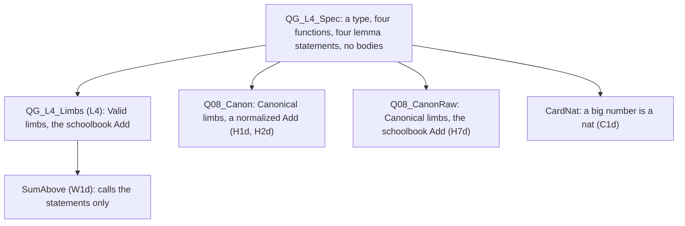
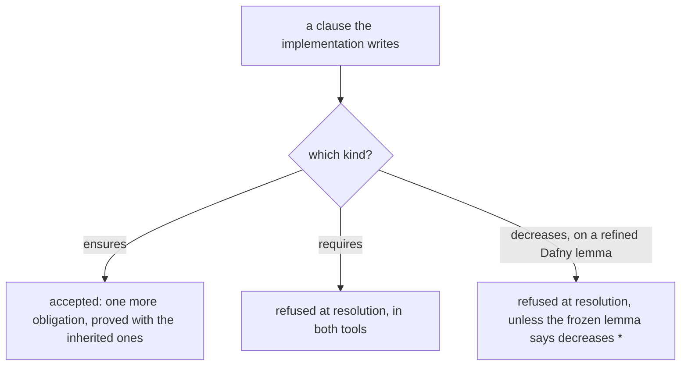
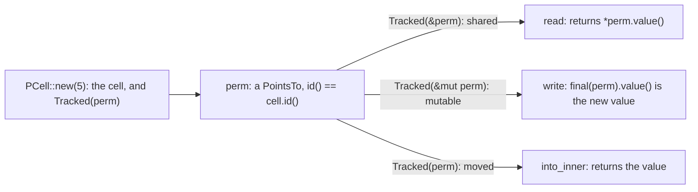
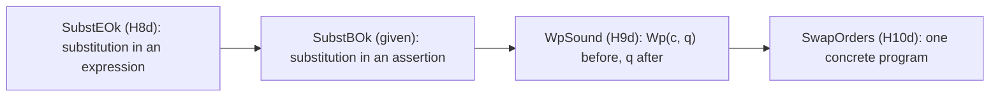
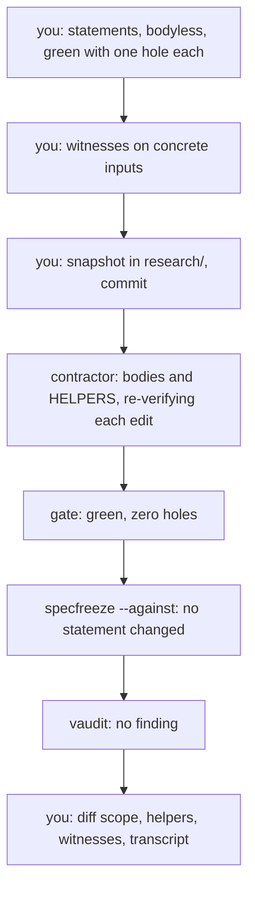

# Q08 — Internals II: refinement, permissions, verified wp

Q07 opened the verifier's internals: fuel, the arithmetic library, bit-vectors and an
audited port. Q08 takes family B (strands S6–S8) to the point where statements, types and
the logic itself are objects you work on: the weakest precondition you computed by hand
in Q03 and Q05 becomes a Dafny function whose soundness you prove. `/viva Q09` examines Q07, Q08 and Q09 together.
Three ideas do all the work:

1. **A frozen statement binds every implementation, in one direction only.** Dafny's
   abstract module and Verus's trait each state a contract once. A refinement or an
   implementation may promise more than it inherits, never demand more, and a client
   sees only what was frozen.
2. **Some facts ride on types.** A subset type carries its range, a datatype carries the
   order its recursion descends, a `Ghost` field carries a value the program never
   computes, and a `PointsTo` permission carries a cell's contents and cannot be copied.
3. **The logic is a program you can verify.** A weakest precondition is a function over
   syntax, and "the precondition it computes is enough" is a lemma by induction over
   commands. The flagship turns the same split outward: you write the statements, a
   contractor writes every proof, and the delivery is only as good as what you stated.

---

## 0. How this module works, pretest, test-out

**Minutes: 270, plus the 30-minute tier viva after Q09.** Setup 5 · test-out 10 ·
reading 45 · worked examples and WRITE cards 30 · divergence cards 6 · predictions 20 ·
holes 56 · verified wp 30 · agent 20 · paper card and written pair 15 · exit and
explain-back 28 · calibration 5.

**Setup.** Start one long-lived `/tutor Q08` session. `scripts/vcheck Q08` shows both
units verified with their holes counted (§6).

**Predictions, all six, first.** In the detailed tier, as in the moderate one, the
prediction block comes before the test-out:

| items | where the answer goes |
|---|---|
| P1dv, P3d, P4dv, P5dv (the prediction block of `Q08_InternalsII.dfy`) | `slots/Q08.slots` |
| P2v, P6v (the prediction block of `src/lib.rs`) | `slots/Q08.slots` |

All six are verdicts. Record them with `scripts/firsttry.sh Q08 --check`, then enable
each slot. Until then keep the README's *Predictions first* list closed, with the Q08 bank
and rubric, the exit files and the demos with an `// after:` line (`card-c2v`, both
`card-c4dv` and both `card-c5dv` files), which `scripts/vcheck` refuses until then.

**Pretest, after the predictions, before reading.** T1d asks for `AddWithCarry` on a
machine-word newtype (`Q08_InternalsII.dfy`), T1v for the specification of `Toggle::flip`
(`src/lib.rs`). Write both closed book, hints unread, run `scripts/firsttry.sh Q08 --check`
again, then uncomment their checks. **Skip rule:** if both pass on that first try, skip
§2.1's teaching and §1.3's C2 and W1v paragraphs; the boxes, the cards, H3v, H4v and the
exit stay.

Each prediction reappears below in a box,

> **Predict (Pn) — commit in the file before reading on.**

and its answer comes only after the box, below the words *Commit your prediction first.*

**Outputs.** Every output fence is a real run on the course pins (Dafny 4.11.0, Verus
0.2026.09.27.3cf1832), pinned in `expected/Q08.chapter.toml`. `probe.dfy` and `probe.rs`
are scratch files run with `scripts/vcheck --module Q08`, which gives them this module's
layers and options (a Dafny probe's count includes tasks of the spine); §1.5's two files
are scratch files too. Each wrapper fence drops its last line, `raw output: <dir>`; a
Verus summary shows `-` where the run reported no count.

**This module's files**

| file | what it is |
|---|---|
| `dafny/given/Q/QG_L1_BigNat.dfy` to `QG_L4_BigNat.dfy`; `verus/given/qg_bignat_l1` to `qg_bignat_l4` | the given spine, frozen; L4 holds `QG_L4_Spec` (the frozen statements), its refinement `QG_L4_Limbs`, and Verus's trait `NatLike` |
| `dafny/Q/Q08_InternalsII/std/Q08_InternalsII.dfy` | the main Dafny file: the prediction block, W1d, C1d, C4dv; **1 hole** (T1d) |
| `dafny/Q/Q08_InternalsII/std/Q08_Canon.dfy` | two refinements of `QG_L4_Spec`: **3 holes** (H1d, H2d, H7d) |
| `dafny/Q/Q08_InternalsII/std/Q08_Wp.dfy` | the verified weakest precondition: W2d and **3 holes** (H8d–H10d) |
| `verus/q/q08_internals_ii/src/lib.rs` | the crate root: P2v, P6v, W1v, C2v, C5dv; **3 holes** (T1v, H3v, H4v) |
| `verus/q/q08_internals_ii/src/perm.rs` | the permissions module: W3v, C3v and **2 holes** (H5v, H6v) |
| `specimens/Q08/` | the card demos |
| `slots/Q08.slots` | your six verdict answers |
| `dafny/Q/Q08_InternalsII/exit/Q08_Exit.dfy`, `verus/q/q08_internals_ii/src/exit.rs` | the closed-book exit, outside every build: **2 + 2 holes**; `EXPLAIN-BACK` in the Dafny file |
| `dafny/Q/Q08_InternalsII/agent/Q08_AgentFlagship.dfy`, `verus/q/q08_internals_ii/src/agent.rs` | the flagship (§7): green, **no hole** in either |
| `research/q08_statements.dfy`, `research/q08_statements.rs` | your committed statements (§7); absent until then |
| `paper/Q08_problems.tex` → your `paper/Q08_answers.tex` | the wp lab and the paper card (§5) |
| `Solutions/` mirrors of these files | the reference: yours to open LAST |

---

## 1. S6 — Frozen statements: refinement and trait specifications

Q05's caller knew a call only through its contract. Here the contract is a declaration
of its own, written once, with any number of implementations behind it.

### 1.1 An abstract module and a client of its statements

L4's `QG_L4_Spec` is the course's frozen statement layer. It declares a type `BigNat`, a
value `Val`, a well-formedness predicate `Wf`, four functions (`Zero`, `FromNat`, `Add`,
`Cmp`) and four lemmas with statements and no bodies, among them

```dafny
lemma AddCorrect(a: BigNat, b: BigNat)
  requires Wf(a) && Wf(b)
  ensures Wf(Add(a, b)) && Val(Add(a, b)) == Val(a) + Val(b)
```

An abstract module is not compiled. A module that `refines` it supplies the type, every definition and every proof; L4's own `QG_L4_Limbs` does so with
limb sequences (`Wf` is L1's `Valid`, `Add` L4's schoolbook addition). W1d, `SumAbove`, is
a client of that refinement that calls only the statements:

```dafny
lemma SumAbove(m: nat, n: nat)
  requires n > 0
  ensures Limbs.Wf(Limbs.Add(Limbs.FromNat(m), Limbs.FromNat(n)))
  ensures Limbs.Cmp(Limbs.FromNat(m), Limbs.Add(Limbs.FromNat(m), Limbs.FromNat(n))) < 0
{
  Limbs.FromNatCorrect(m);
  Limbs.FromNatCorrect(n);
  Limbs.AddCorrect(Limbs.FromNat(m), Limbs.FromNat(n));
  Limbs.CmpCorrect(Limbs.FromNat(m), Limbs.Add(Limbs.FromNat(m), Limbs.FromNat(n)));
}
```

Each call contributes one frozen statement, and no line looks at a limb. This module's
refinements of `QG_L4_Spec`:



Whatever a client derives from the statements alone holds the same way in each of them.
The representation is each refinement's choice, and the proofs are its cost.

### 1.2 Refining: definitions given, statements inherited

**C1 (`write:refines`).** A refining module defines the type and every function, and
proves each lemma by repeating only its name and parameters: the statement is inherited,
the body is its own. It may add declarations, such as a helper lemma. The success example,
`CardNat`, is the smallest refinement there is:

```dafny
module CardNat refines QG_L4_Spec {
  type BigNat = nat

  ghost function Val(x: BigNat): nat { x }
  ghost predicate Wf(x: BigNat) { true }

  function Zero(): BigNat { 0 }
  function FromNat(n: nat): BigNat { n }
  function Add(a: BigNat, b: BigNat): BigNat { a + b }
  function Cmp(a: BigNat, b: BigNat): int { if a < b then -1 else if a == b then 0 else 1 }

  lemma AddCorrect(a: BigNat, b: BigNat)
  {
  }
  ...
}
```

(Cut at `...`: the three other refined lemmas, each with an empty body, and the helper
lemma `AddCommutes`.) The failure demo defines `Add` as `a + b + 1`. A Dafny specimen is
verified alone, with no layer, so it cannot reach L4: it refines a small concrete base of
its own, `Q08_CardC1Base` (an abstract module would be a learner-lint finding), whose two
bodyless declarations `scripts/vcheck` counts as holes:

<!-- pin: c1d -->
```
$ scripts/vcheck specimens/Q08/card-c1d.dfy.specimen
vcheck: specimens/Q08/card-c1d.dfy.specimen [dafny, learner loop]: failed — 2 verified, 2 holes, 1 error
specimens/Q08/card-c1d.dfy.specimen:11:23: hole bodyless-function Q08_CardC1Base.Add
specimens/Q08/card-c1d.dfy.specimen:14:23: hole bodyless-method Q08_CardC1Base.AddCorrect
specimens/Q08/card-c1d.dfy.specimen:21:3: error: a postcondition could not be proved on this return path
specimens/Q08/card-c1d.dfy.specimen:14:23: related: this is the postcondition that could not be proved
```

Read it aloud: (1) the holes are the base's declarations, lines 11 and 14; (2) the error
is at line 21, the refining `AddCorrect`'s empty body, and the related location is line 14,
the statement it inherited; (3) the refining module states nothing: its definition broke a
statement written elsewhere.

**The holes of `Q08_Canon.dfy`.** Two refining modules, nonlinear arithmetic off, each
importing L1–L4 by name (`L1` … `L4`, never opened, so that no name clashes):

- `Q08_Canon`: `Wf` is L2's `Canonical` (valid, with no zero top limb), and `Add`
  normalizes L4's sum. H1d is its `AddCorrect`, H2d its `FromNatCorrect`.
- `Q08_CanonRaw`: the same `Wf`, and `Add` is L4's sum itself, with no normalization; H7d
  is its `AddCorrect`.

Every other refined lemma of the two modules ships proved. A refinement hole ships with
the body `{ assume false; }`, and its block quotes the inherited statement:

```dafny
  lemma AddCorrect(a: BigNat, b: BigNat)
  {
    assume false;  // HOLE: delete this line and write the proof
  }
```

The statement is not on the lemma's lines, but it binds all the same: delete the
`assume`, and the verifier asks for the quoted `ensures` under the quoted `requires`. H1d
and H7d prove one statement, word for word, about two different `Add`s: the text is
shared, the obligation is not.

### 1.3 Trait specifications

Verus's frozen statement is a trait whose methods carry `requires` and `ensures` over the
trait's own spec fns; an `impl` gives the spec fns definitions and the methods bodies.

> **Predict (P6v) — commit in the file before reading on.** A trait `Counter` whose `bump`
> promises only `final(self).count() > old(self).count()`, implemented on `Small { n: u64 }`
> with the extra `ensures final(self).n == old(self).n + 1`; two callers that each require
> a count of 5 and ensure 6 afterwards, [a] on `&mut Small`, [b] generic over
> `C: Counter`. What does `scripts/vcheck` say about each file?

*Commit your prediction first.* `V:ok fail`. Both callers, in one file beside the code of
the docstring:

```rust
use vstd::prelude::*;

verus! {

pub trait Counter: Sized {
    spec fn count(&self) -> nat;

    fn bump(&mut self)
        requires
            old(self).count() < 100,
        ensures
            final(self).count() > old(self).count(),
    ;
}

pub struct Small {
    pub n: u64,
}

impl Counter for Small {
    open spec fn count(&self) -> nat {
        self.n as nat
    }

    fn bump(&mut self)
        ensures
            final(self).n == old(self).n + 1,
    {
        self.n = self.n + 1;
    }
}

fn caller_a(s: &mut Small)
    requires
        old(s).count() == 5,
    ensures
        final(s).count() == 6,
{
    s.bump();
}

fn caller_b<C: Counter>(c: &mut C)
    requires
        old(c).count() == 5,
    ensures
        final(c).count() == 6,
{
    c.bump();
}

} // verus!
```

<!-- pin: p6v -->
```
$ scripts/vcheck --module Q08 probe.rs
vcheck: probe.rs [verus, learner loop]: failed — 2 verified, 0 holes, 1 error
probe.rs:46:9: error: postcondition not satisfied
```

Read it aloud: (1) one error, at line 46, `caller_b`'s postcondition; (2) `caller_a`
verifies: on a `&mut Small` the call is `Small`'s own `bump`, whose added `ensures` gives
exactly one step; (3) the generic caller knows only `>`, which allows 5 to become 7.

**C2 (`write:trait-spec`).** The card's success example:

```rust
pub trait Dial: Sized {
    spec fn pos(&self) -> nat;

    fn turn(&mut self)
        requires
            old(self).pos() < 9,
        ensures
            final(self).pos() == old(self).pos() + 1,
    ;

    fn at_zero(&self) -> (b: bool)
        ensures
            b == (self.pos() == 0),
    ;
}
```

`Knob` implements it, defining `pos` by an `open spec fn` over its field, and each body is
checked against the trait's clauses with `pos` read as that definition. A generic client,
`leave_zero<D: Dial>`, is checked once for every implementation, so it may use the trait's
clauses and nothing else. W1v does the same with L4's `NatLike`: `twice_plus_one` doubles
a value and adds one without knowing that a limb exists.

C2's failure demo is P6's gap again, a client generic over `Dial`:

<!-- pin: c2v -->
```
$ scripts/vcheck specimens/Q08/card-c2v.rs.specimen
vcheck: specimens/Q08/card-c2v.rs.specimen [verus, learner loop]: failed — 1 verified, 0 holes, 1 error
specimens/Q08/card-c2v.rs.specimen:43:9: error: postcondition not satisfied
```

What a caller may assume is settled by the type it calls through: a concrete type shows
the implementation's whole contract, a type parameter only the trait's.

**The statement holes, T1v and H3v.** A trait method ships with no specification (H3v's
`advance` with only the `requires` the item gives), beside a given implementation and a
given generic client whose body opens with a labelled assume, the hole:

```rust
    proof {
        #[verifier::proof_note("Q08.T1v")] assume(false);  // HOLE: delete this proof block once `flip` is specified
    }
```

You write the trait's clauses. Too strong a clause fails the implementation, too weak a
clause fails the client once the assume is gone. The statement freeze accepts added
`requires` and `ensures` on exactly the three open statements of `expected/Q08.freeze`
(`Toggle::flip`, `Odometer::advance`, `Odometer::current`). `current_check`, commented
below H3v, checks `current`'s specification, which the given client never calls. H4v is a
generic client you write: `scale` multiplies two `NatLike` values by repeated `plus`.

### 1.4 What an implementation may add

> **Predict (P1dv) — commit in the file before reading on.** Dafny: an abstract module
> with `lemma Bound(x: nat) requires x < 10 ensures x < 20`, refined [a] by
> `lemma Bound(x: nat) ensures x < 15 { }`, [b] by `lemma Bound(x: nat) requires x < 5 { }`.
> Verus: a trait method `bump` with `requires old(self).count() < 100` and
> `ensures final(self).count() == old(self).count() + 1`, implemented on a struct by a
> method that [a] adds `ensures final(self).n == old(self).n + 1`, [b] adds
> `requires old(self).n < 50`. What does `scripts/vcheck` say about each of the four
> files?

*Commit your prediction first.* `D:ok err:resolve V:ok err:resolve`. Case [a], verbatim
from the docstring, in each language:

```dafny
abstract module Spec {
  lemma Bound(x: nat)
    requires x < 10
    ensures x < 20
}

module RefA refines Spec {
  lemma Bound(x: nat)
    ensures x < 15
  {
  }
}
```

<!-- pin: p1dv-d -->
```
$ scripts/vcheck --module Q08 probe.dfy
vcheck: probe.dfy [dafny, learner loop]: verified — 23 verified, 0 holes, 0 errors
```

```rust
use vstd::prelude::*;

verus! {

pub trait Counter: Sized {
    spec fn count(&self) -> nat;

    fn bump(&mut self)
        requires
            old(self).count() < 100,
        ensures
            final(self).count() == old(self).count() + 1,
    ;
}

pub struct Small {
    pub n: u64,
}

impl Counter for Small {
    open spec fn count(&self) -> nat {
        self.n as nat
    }

    fn bump(&mut self)
        ensures
            final(self).n == old(self).n + 1,
    {
        self.n = self.n + 1;
    }
}

} // verus!
```

<!-- pin: p1dv-v -->
```
$ scripts/vcheck --module Q08 probe.rs
vcheck: probe.rs [verus, learner loop]: verified — 1 verified, 0 holes, 0 errors
```

Both verify: the added postcondition is one more obligation, proved beside the inherited
one. Case [b] is the divergence card's, after one more box.

> **Predict (P3d) — commit in the file before reading on.** A module refines L4's
> `QG_L4_Spec` as `QG_L4_Limbs` does and proves the inherited `FromNatCorrect` by
> recursing on itself (`FromNatCorrect(n - 1)` when `n > 0`, then `L3.FromNatCorrect(n)`),
> under a `decreases n` clause of its own. What does `scripts/vcheck` say about the file?

*Commit your prediction first.* `D:err:resolve`. **C4 (the divergence card).** Its Dafny
demo refines a local base, as C1's does: [1] adds an `ensures` (P1's [a]), [2] a
`requires` (P1's [b]), [3] a `decreases` clause and a recursion (P3's shape):

```dafny
module Q08_CardC4d refines Q08_CardC4Base {
  // [1] the refining lemma adds a postcondition
  lemma Below(x: nat)
    ensures x < 15
  {
  }

  // [2] the refining lemma adds a precondition
  lemma Narrow(x: nat)
    requires x < 5
  {
  }

  // [3] the refining lemma gives itself a termination measure and recurses
  lemma Twice(x: nat)
    decreases x
  {
    if x > 0 {
      Twice(x - 1);
    }
  }
}
```

<!-- pin: c4dv-d -->
```
$ scripts/vcheck specimens/Q08/card-c4dv-d.dfy.specimen
vcheck: specimens/Q08/card-c4dv-d.dfy.specimen [dafny, learner loop]: failed — - verified, 3 holes, 2 errors, stage resolve
specimens/Q08/card-c4dv-d.dfy.specimen:10:15: hole bodyless-method Q08_CardC4Base.Below
specimens/Q08/card-c4dv-d.dfy.specimen:14:15: hole bodyless-method Q08_CardC4Base.Narrow
specimens/Q08/card-c4dv-d.dfy.specimen:17:19: hole bodyless-method Q08_CardC4Base.Twice
specimens/Q08/card-c4dv-d.dfy.specimen:29:16: error: a refining method is not allowed to add preconditions
specimens/Q08/card-c4dv-d.dfy.specimen:35:15: error: decreases clause on refining method not supported, unless the refined method was specified with 'decreases *'
```

Read it aloud: (1) `stage resolve`: the file never reached the verifier, so [1] went
unchecked here (P1's [a] probe checked it); (2) the holes are the base's lemmas; (3) one
error each for [2] and [3], the rule in its message. The Verus demo's implementation adds
an `ensures` to `raise` ([1]) and a `requires` to `lower` ([2]):

<!-- pin: c4dv-v -->
```
$ scripts/vcheck specimens/Q08/card-c4dv-v.rs.specimen
vcheck: specimens/Q08/card-c4dv-v.rs.specimen [verus, learner loop]: failed — - verified, 0 holes, 1 error, stage resolve
specimens/Q08/card-c4dv-v.rs.specimen:44:5: error: trait method implementation cannot declare requires clauses; these can only be inherited from the trait declaration
```

Read it aloud: resolution again, one error, at [2], and the message is the rule: a
precondition is inherited from the trait or not stated at all. Behind both is
Q05's view from the call site: a caller who met the frozen precondition must still be
allowed to call, and gets at least the frozen postcondition. Both tools enforce the first
half by refusing to resolve, not by a failed proof:



The third branch is Dafny's alone, and H2d meets it: a refined lemma cannot recurse
under a measure of its own, so an induction goes into a helper lemma of the refining
module, with its own statement and measure. What a caller sees differs: in Verus, a caller through the concrete type may use an implementation's added `ensures`
(P6's [a]); a client of every implementation, a Dafny lemma over the abstract module's
names or a generic Verus fn, sees only the frozen clauses.

### 1.5 Refinement as statement freeze

A Dafny refinement is a statement freeze that the language enforces: the refining lemma
cannot narrow or re-measure what it inherits, and every body is checked against the one
statement written first. The course's own freeze covers every file in both languages:
`scripts/specfreeze --check Q08` compares the module's statements with
`expected/Q08.freeze` (§1.3's three open statements accept added clauses), and
`--against <snapshot> <file>` compares a file with a snapshot you committed, the
flagship's check (§7). A snapshot that states `Double`,

```dafny
module Snapshot {
  method Double(x: nat) returns (r: nat)
    ensures r == 2 * x
}
```

and a delivery that proves a weaker statement:

```dafny
module Snapshot {
  method Double(x: nat) returns (r: nat)
    ensures r >= x
  {
    r := x;
  }
}
```

<!-- pin: freeze -->
```
$ scripts/specfreeze --against stated.dfy delivered.dfy
delivered.dfy:2: freeze-changed — Snapshot.Double: the statement differs from the frozen one
specfreeze: delivered.dfy: 1 finding(s)
$ echo $?
1
```

The delivery's body meets its own statement (`r := x` gives `r >= x`), and the freeze
names the statement it changed. A verifier checks a body against the statement in front
of it; only a freeze checks that statement against the one you wrote. Card 02.1's agent
weakened a statement silently, and its proof went through.

---

## 2. S7 — Types that carry proofs: subset types, measures, ghost state

### 2.1 Subset types and newtypes

A Dafny subset type, `type Pos = x: int | x > 0`, holds the values of its base type that
satisfy the constraint; a `newtype` (`newtype byte = x: int | 0 <= x < 256`) is a new
numeric type under the same rule. Every expression that produces such a value carries an
obligation: an operation on two `byte`s yields a `byte`, and a conversion `e as byte` must
be proved in range. Two midpoints:

```dafny
newtype byte = x: int | 0 <= x < 256

method Mid(a: byte, b: byte) returns (m: byte)
  ensures m as int == (a as int + b as int) / 2
{
  m := (a + b) / 2;
}

method MidWide(a: byte, b: byte) returns (m: byte)
  ensures m as int == (a as int + b as int) / 2
{
  m := ((a as int + b as int) / 2) as byte;
}
```

<!-- pin: nt-d -->
```
$ scripts/vcheck --module Q08 probe.dfy
vcheck: probe.dfy [dafny, learner loop]: failed — 26 verified, 0 holes, 1 error
probe.dfy:6:11: error: result of operation might violate newtype constraint for 'byte'
```

Read it aloud: (1) line 6, column 11 is `a + b`, a `byte` that may reach 510; (2) the
message names the type's constraint, not an overflow; (3) `MidWide` verifies: it computes
in `int` and converts once, where the verifier proves the result below 256. Verus has no
user-defined subset types; Rust's fixed-width integers are its range types, and their
arithmetic carries an overflow obligation instead:

```rust
use vstd::prelude::*;

verus! {

fn mid(a: u8, b: u8) -> (m: u8)
    ensures
        m as int == (a as int + b as int) / 2,
{
    (a + b) / 2
}

fn mid_wide(a: u8, b: u8) -> (m: u8)
    ensures
        m as int == (a as int + b as int) / 2,
{
    ((a as u16 + b as u16) / 2) as u8
}

} // verus!
```

<!-- pin: nt-v -->
```
$ scripts/vcheck --module Q08 probe.rs
vcheck: probe.rs [verus, learner loop]: failed — 1 verified, 0 holes, 1 error
probe.rs:9:5: error: possible arithmetic underflow/overflow
```

`mid`'s `a + b` at line 9 may leave `u8`; `mid_wide` adds in `u16` and casts back a value
the verifier knows is below 256. T1d's `u64` is a newtype like `byte`.

### 2.2 Measures for recursion over datatypes

Q05 gave measures as tuples, Dafny's guess (the parameters, in order) and Verus's
insistence on a clause. Here the recursion is over a datatype.

> **Predict (P4dv) — commit in the file before reading on.** A binary tree,
> `Leaf | Node(l, r)`, and its size, recursive on both children, written with no
> `decreases` clause: as a Dafny `function`, and as a Verus `spec fn` over an enum whose
> children are boxed. What does `scripts/vcheck` say about each file?

*Commit your prediction first.* `D:ok V:err:resolve`. C5's demos are the same shape on a
`Shape` type (`Dot | Pair(left, right)`), with two functions each, `Depth` and `Dots`;
Dafny's carry no clause, and in Verus only `dots` has `decreases s`:

<!-- pin: c5dv-d -->
```
$ scripts/vcheck specimens/Q08/card-c5dv-d.dfy.specimen
vcheck: specimens/Q08/card-c5dv-d.dfy.specimen [dafny, learner loop]: verified — 2 verified, 0 holes, 0 errors
```

<!-- pin: c5dv-v -->
```
$ scripts/vcheck specimens/Q08/card-c5dv-v.rs.specimen
vcheck: specimens/Q08/card-c5dv-v.rs.specimen [verus, learner loop]: failed — - verified, 0 holes, 1 error, stage resolve
specimens/Q08/card-c5dv-v.rs.specimen:13:1: error: recursive function must have a decreases clause
```

Read them aloud: (1) Dafny verifies both: its guess is the parameter, `s`, and a
datatype brings its own order, in which a value built by a constructor is above each of
its arguments, so `l` and `r` are below `Pair(l, r)`; (2) Verus stops at resolution, at
`depth`: a recursive spec fn with no clause is not accepted (Q01); (3) that stop hides
`dots`, so the demo does not show its clause working. P4's Verus file with `decreases t`
does:

```rust
use vstd::prelude::*;

verus! {

pub enum Tree {
    Leaf,
    Node(Box<Tree>, Box<Tree>),
}

pub open spec fn size(t: Tree) -> nat
    decreases t,
{
    match t {
        Tree::Leaf => 1,
        Tree::Node(l, r) => size(*l) + size(*r) + 1,
    }
}

} // verus!
```

<!-- pin: p4dv-fix -->
```
$ scripts/vcheck --module Q08 probe.rs
vcheck: probe.rs [verus, learner loop]: verified — 1 verified, 0 holes, 0 errors
```

Verus orders enum values by the same structure, seeing through `Box`. H8d and H9d ship
with `decreases t` and `decreases c`, structural measures on the wp file's own datatypes;
that unit turns off automatic induction for lemmas, so their proofs write their recursive
calls.

### 2.3 Ghost state beside exec state

Q05 showed that `Ghost<T>` takes no space at run time. It carries a value the program
never computes: specifications read the field as `self.f@`, and exec code updates it only
by assigning a new `Ghost(…)`. Nothing updates it for you:

```rust
use vstd::prelude::*;

verus! {

pub struct Gap {
    pub hi: u64,
    pub lo: u64,
    pub width: Ghost<int>,
}

impl Gap {
    pub open spec fn inv(&self) -> bool {
        self.width@ == self.hi - self.lo
    }

    pub fn widen(&mut self)
        requires
            old(self).inv(),
            old(self).hi < u64::MAX,
        ensures
            final(self).inv(),
            final(self).width@ == old(self).width@ + 1,
    {
        self.hi = self.hi + 1;
        self.width = Ghost(self.width@ + 1);
    }

    pub fn narrow(&mut self)
        requires
            old(self).inv(),
            old(self).lo < old(self).hi,
        ensures
            final(self).inv(),
    {
        self.lo = self.lo + 1;
    }
}

} // verus!
```

<!-- pin: ghost -->
```
$ scripts/vcheck --module Q08 probe.rs
vcheck: probe.rs [verus, learner loop]: failed — 1 verified, 0 holes, 1 error
probe.rs:33:13: error: postcondition not satisfied
```

Read it aloud: (1) `widen` verifies, moving `hi` and `width` together; (2) the error at
line 33 is `narrow`'s `final(self).inv()`: it moved `lo` and left `width`, so the invariant
broke. A ghost field is free at run time and costs a line in every method that changes what
it describes; Dafny's `ghost var` fields obey the same rule. One more difference matters in
§3: a `Ghost` value is copied as often as it is used, and a `Tracked` one is not.

---

## 3. S8 — Permissions and a verified weakest precondition

### 3.1 Permissioned cells and tracked arguments

Verus's `PCell<T>` is a cell whose contents the verifier tracks through a separate ghost
object, its permission `PointsTo<T>`. First: how often may a permission be used?

> **Predict (P2v) — commit in the file before reading on.** A
> `proof fn consume(tracked p: PointsTo<u64>)` called twice in one `proof { }` block on
> the same permission (from `PCell::new`); and a `proof fn look(g: Seq<u64>)` called twice
> on the same ghost sequence. What does `scripts/vcheck` say about each file?

*Commit your prediction first.* `V:err:resolve ok`. The two files, verbatim from the
docstring:

```rust
use vstd::prelude::*;
use vstd::cell::pcell::*;

verus! {

proof fn consume(tracked p: PointsTo<u64>) {
}

fn twice() {
    let (cell, Tracked(perm)) = PCell::new(5u64);
    proof {
        consume(perm);
        consume(perm);
    }
}

} // verus!
```

<!-- pin: p2v-a -->
```
$ scripts/vcheck --module Q08 probe.rs
vcheck: probe.rs [verus, learner loop]: failed — 0 verified, 0 holes, 1 error, stage resolve
probe.rs:13:17: error: use of moved value: `perm`
```

```rust
use vstd::prelude::*;

verus! {

proof fn look(g: Seq<u64>) {
}

fn twice_ghost() {
    let ghost s: Seq<u64> = seq![1u64, 2u64];
    proof {
        look(s);
        look(s);
    }
}

} // verus!
```

<!-- pin: p2v-b -->
```
$ scripts/vcheck --module Q08 probe.rs
vcheck: probe.rs [verus, learner loop]: verified — 2 verified, 0 holes, 0 errors
```

Read them aloud: (1) [a] stops at resolution at line 13, column 17, the second
`consume(perm)`: a tracked value is erased like a `Ghost` one, but the type checker treats
it as a Rust value that is not `Copy`, so the first call moved it; (2) the message is
Rust's borrow checker: linearity is decided before any verification condition exists; (3)
[b] verifies, since a ghost `Seq` is a value like a number. A permission is the right to
the cell's contents; if it could be copied, two holders could each write and each believe
their own value.

W3v, in `perm.rs`, is a permission's whole life:

```rust
pub fn cell_round_trip() -> (r: u64)
    ensures
        r == 9,
{
    let (cell, Tracked(mut perm)) = PCell::new(5u64);
    cell.write(Tracked(&mut perm), 9);
    let v = cell.read(Tracked(&perm));
    assert(v == 9);
    cell.into_inner(Tracked(perm))
}
```

`PCell::new` returns the cell and the one permission to it, whose `id()` is the cell's
and whose `value()` is a reference to the contents. Each operation takes the permission in
the form its effect needs:



Shared to read, mutable to write, moved to give the cell up.

**C3 (`write:tracked`).** A function that works on a cell it does not own takes the
permission as a tracked argument, `Tracked<&PointsTo<T>>` or `Tracked<&mut PointsTo<T>>`,
and links the two by `id()` in its `requires`; one that holds a mutable borrow lends it
for a read as `Tracked(&*perm)`. Success, `is_small` calling `peek`:

```rust
pub fn is_small(cell: &PCell<u64>, Tracked(perm): Tracked<&mut PointsTo<u64>>) -> (b: bool)
    requires
        cell.id() == old(perm).id(),
    ensures
        b == (*old(perm).value() < 10),
{
    proof {
        assert(perm.id() == cell.id());
    }
    let v = peek(cell, Tracked(&*perm));
    v < 10
}
```

The failure demo gives `peek` the permission of another cell:

<!-- pin: c3v -->
```
$ scripts/vcheck specimens/Q08/card-c3v.rs.specimen
vcheck: specimens/Q08/card-c3v.rs.specimen [verus, learner loop]: failed — 1 verified, 0 holes, 1 error
specimens/Q08/card-c3v.rs.specimen:23:13: error: precondition not satisfied
```

Line 23 is the call `peek(&a, Tracked(&pb))`, and the precondition that fails is the `id`
link: `pb` describes `b`, and says nothing about `a`.

**The gated items, H5v and H6v.** Design §7.5's admissibility gate admits an item on a
less settled API only when four results hold: its reference verifies, its empty body
fails, its reference is stable over seeds 1–3, and the API is the one at the pin. Both
passed, and `MODULES.toml` admits them (6 and 8 minutes). H5v adds one to a cell through a
mutable borrow of its permission; H6v moves a value between two cells.

### 3.2 The weakest precondition by hand

Q03's rules, for a postcondition `Q`:

- `wp(x := e, Q) = Q[e/x]`, `Q` with `e` substituted for `x`;
- `wp(S1; S2, Q) = wp(S1, wp(S2, Q))`;
- `wp(if b then S1 else S2, Q) = (b ==> wp(S1, Q)) && (!b ==> wp(S2, Q))`.

> **Predict (P5dv) — commit in the file before reading on.** Over the integers, the
> weakest precondition of `x := x + 1; if x > 0 then y := x else y := 0` for the
> postcondition `y > 0`, up to logical equivalence: a) `x > 0` b) `x >= 0` c) `true`
> d) `x > -2`.

*Commit your prediction first.* The answer is b. From the back: the `if` gives
`(x > 0 ==> x > 0) && (x <= 0 ==> 0 > 0)`, which is `x > 0`; the assignment substitutes
`x + 1`, giving `x + 1 > 0`, which over the integers is `x >= 0`. Option a is too strong
(at `x = 0`, `y` ends at 1); option d is the off-by-one (at `x = -1`, `y` ends at 0);
option c forgets the `else` branch. One lemma per option, against a direct semantics:

```dafny
// The program's final y as a function of the initial x:
// x := x + 1; if x > 0 then y := x else y := 0
function FinalY(x: int): int
{
  var x1 := x + 1;
  if x1 > 0 then x1 else 0
}

// One lemma per option: the postcondition y > 0 holds afterwards
// exactly when the option holds before.
lemma OptionA(x: int)
  ensures FinalY(x) > 0 <==> x > 0
{
}

lemma OptionB(x: int)
  ensures FinalY(x) > 0 <==> x >= 0
{
}

lemma OptionC(x: int)
  ensures FinalY(x) > 0 <==> true
{
}

lemma OptionD(x: int)
  ensures FinalY(x) > 0 <==> x > -2
{
}
```

<!-- pin: p5dv -->
```
$ scripts/vcheck --module Q08 probe.dfy
vcheck: probe.dfy [dafny, learner loop]: failed — 23 verified, 0 holes, 3 errors
probe.dfy:13:1: error: a postcondition could not be proved on this return path
probe.dfy:12:25: related: this is the postcondition that could not be proved
probe.dfy:23:1: error: a postcondition could not be proved on this return path
probe.dfy:22:25: related: this is the postcondition that could not be proved
probe.dfy:28:1: error: a postcondition could not be proved on this return path
probe.dfy:27:25: related: this is the postcondition that could not be proved
```

Three errors, at lines 13, 23 and 28, the bodies of options a, c and d. Only b is both
sufficient (each state satisfying it reaches `y > 0`) and weakest (every state that
reaches `y > 0` satisfies it).

### 3.3 A verified wp: assignment, sequence, if

`Q08_Wp.dfy` makes those rules a program. W2d gives a language with no loops:
expressions `Expr`, assertions `BExp` (`Le`, `And`, `Not`, `Imp`) and commands `Cmd`
(`Assign`, `Seq`, `If`); a state is a function `nat -> int`; `Eval`, `Holds` and `Exec`
give each its meaning; `Update(s, x, v)`, opaque, is the state after an assignment. `Wp`
is §3.2, line by line:

```dafny
function Wp(c: Cmd, q: BExp): BExp
{
  match c
  case Assign(x, e) => SubstB(q, x, e)
  case Seq(c1, c2) => Wp(c1, Wp(c2, q))
  case If(b, c1, c2) => And(Imp(b, Wp(c1, q)), Imp(Not(b), Wp(c2, q)))
}
```

It computes an assertion from syntax alone. The assignment rule is a substitution, so
the first fact needed is the substitution lemma, and the lemmas form a chain:



Each arrow is a use: `SubstBOk` ships proved from H8d's statement. H8d connects syntax to
states: evaluating an expression with `e` substituted for `x` is evaluating it where `x`
holds `e`'s value. H9d is soundness: if `Wp(c, q)` holds before `c`, then `q` holds after
it. H10d applies it to the given three-assignment `Swap()` instead of running `Exec`.

The file proves soundness, one direction only: `Wp(c, q)` is sufficient. That it is
also the weakest is the converse, which no lemma here states; P5's probe checked it for
one program against a direct semantics.

### 3.4 Loops stay on paper

A loop has no finite syntactic `wp`: `while b { S }` can run any number of times. With an
invariant `I` and a measure `d`, the rule replaces it by three obligations: `I` holds on
entry; `I && b` implies `wp(S, I)` with `d` smaller and never negative; and `I && !b`
implies `Q`. §3.2's rules compute each when `S` has no loop. The rule's soundness needs
an induction over the iterations; this module states the rule on paper (§5), and Q14
verifies its soundness.

---

## 4. What the instruments can and cannot see

| instrument | what it sees | what it cannot see |
|---|---|---|
| `scripts/vcheck` (learner loop) | the verdict, the stage, every hole and error; refusals at resolution (C4dv, C5dv, P2v) | whether a statement says what you meant |
| `scripts/vcheck --gate` | zero holes, a complete run, the count pins | vacuity: the shipped Dafny agent file passes it (§7) |
| Dafny's refinement check | each refined lemma against its inherited statement; no added precondition or measure | whether `QG_L4_Spec`'s statements are right |
| a generic client (`leave_zero`, `flip_twice`, `advance_twice`) | that a trait's specification is strong enough for it | other clients; a specification too strong (the implementation shows that) |
| `scripts/specfreeze --check Q08` | shipped statements unchanged; only added clauses on the open ones | whether the added clauses are right |
| `scripts/specfreeze --against` | a delivery's statements against your snapshot | whether your snapshot was right |
| `scripts/vaudit` | assumptions, holes, external bodies, resource attributes | a weak or vacuous statement |
| your witnesses (§7) | each `requires` met and each `ensures` meaningful, on your inputs | every other input |
| `scripts/firsttry.sh Q08 --report --strict` | slots, commented checks, first tries | whether you understood why |
| a reader (you, `/review-code`, `/grade-paper`, `/viva`) | intent; a statement weaker than its name | nothing mechanical: advisory until an artifact confirms it |

Two pairs bound from both sides: the implementation and the generic client bound a trait
specification, the verifier and the freeze bound a delivery. Only a reader checks the
statement against the problem.

---

## 5. On paper, before the keyboard

`paper/Q08_problems.tex` holds the wp lab (10 minutes): B1, a weakest precondition through
assignment, sequence and `if`, step by step in §3.2's rules (P5dv was your first try); B2,
§3.4's loop rule written out for one loop. Do it before H8d–H10d mechanize the same rules.
B3, the paper card 02.1 (5 minutes), ends the pair. Fill `paper/Q08_answers.tex`, build with
`make -C paper paper` until green, and run `/grade-paper Q08` in a fresh session before
the verified-wp holes; the lab is graded step by step, the card field by field against the
pinned range of your `cheatsheets.md`.

---

## 6. The exercise file

Both units, as shipped:

<!-- pin: units -->
```
$ scripts/vcheck Q08
vcheck: dafny/Q/Q08_InternalsII/std [dafny, learner loop]: verified — 151 verified, 7 holes, 0 errors
dafny/Q/Q08_InternalsII/std/Q08_Canon.dfy:64:5: hole assume Q08.H1d
dafny/Q/Q08_InternalsII/std/Q08_Canon.dfy:80:5: hole assume Q08.H2d
dafny/Q/Q08_InternalsII/std/Q08_Canon.dfy:131:5: hole assume Q08.H7d
dafny/Q/Q08_InternalsII/std/Q08_InternalsII.dfy:248:5: hole assume Q08.T1d
dafny/Q/Q08_InternalsII/std/Q08_Wp.dfy:146:38: hole bodyless-method Q08.H8d
dafny/Q/Q08_InternalsII/std/Q08_Wp.dfy:160:18: hole bodyless-method Q08.H9d
dafny/Q/Q08_InternalsII/std/Q08_Wp.dfy:174:32: hole bodyless-method Q08.H10d
vcheck: verus/q/q08_internals_ii [verus, learner loop]: verified — - verified, 5 holes, 0 errors
verus/q/q08_internals_ii/src/lib.rs:182:44: hole assume Q08.T1v
verus/q/q08_internals_ii/src/lib.rs:352:44: hole assume Q08.H3v
verus/q/q08_internals_ii/src/lib.rs:376:1: hole external_body Q08.H4v
verus/q/q08_internals_ii/src/perm.rs:94:1: hole external_body Q08.H5v
verus/q/q08_internals_ii/src/perm.rs:119:1: hole external_body Q08.H6v
vcheck: 2 unit(s): 2 verified, 0 not; 12 hole(s) in all
```

Twelve holes, as `expected/Q08.counts` pins them: in Dafny, four `assume false` holes
(T1d and the refinements) and three bodyless lemmas; in Verus, two labelled assumes and
three `external_body` holes. In file order:

- **`Q08_InternalsII.dfy`:** the prediction block, T1d (§2.1), W1d (§1.1), C1d (§1.2),
  C4dv (§1.4).
- **`Q08_Canon.dfy`:** H1d and H2d in `Q08_Canon`, H7d in `Q08_CanonRaw` (§1.2, §1.4).
- **`Q08_Wp.dfy`:** W2d, H8d, H9d, H10d (§3.3).
- **`src/lib.rs`:** P2v, P6v, T1v, W1v, C2v, H3v, H4v (§1.3), C5dv (§2.2).
- **`src/perm.rs`:** W3v, C3v, H5v, H6v (§3.1).

Q08 has no property test: `scripts/vcheck --test` has nothing to run.

**The hint dial.** Hints sit on comment lines below each hole: `Hint(1)` only when stuck,
`Hint(2)` only when still stuck; after 20 minutes stuck, ask `/tutor Q08`.

**Slots.** A verdict goes in `slots/Q08.slots` (`P1dv = ???` becomes `P1dv = "<answer>"`).
Fill it, run `scripts/firsttry.sh Q08 --check`, then enable it: `// SLOT: CHECK P1dv`
becomes `// CHECK P1dv`. After each hole, uncomment the checks under
`Uncomment as you go:`.

**Done** = `scripts/vcheck --gate dafny/Q/Q08_InternalsII/std` and
`scripts/vcheck --gate verus/q/q08_internals_ii` each print only the summary line and exit
0, `scripts/vaudit` reports no finding on either, **and**
`scripts/firsttry.sh Q08 --report --strict` exits 0. Each gate covers all of its unit's
files.

**Calibration.** The main Dafny file ends with a `CALIBRATION` block of §0's planned
minutes; write your actual minutes beside each line (no script reads it). At the end,
`scripts/firsttry.sh Q08 --record` appends your calibration row to
`instructor/gradebook.md`.

---

## 7. Exercise (agentic): the spec-to-proof flagship

Rung 8 hands the contractor everything but the statements. Q06's prover worked under a
top lemma that shipped frozen; here nothing ships but the operations' names. Each agent
file is green with no hole and three empty sections: `STATEMENTS`, which names the
operations (Dafny: the shift left by `k` limbs, and the split at `k` limbs into the low
part and the part above; Verus: the shift, and the limbs above the low `k`), `WITNESSES`,
for your checks, and `HELPERS`, for the contractor's.

The contract, as the files' CONTRACT headers state it:

> **CONTRACT (for /contract Q08 — run it in a FRESH session):**
> - **goal:** implement and prove every statement of the `STATEMENTS` section of this
>   file, changing no statement.
> - **allowed-files:** the agent file of the run,
>   `dafny/Q/Q08_InternalsII/agent/Q08_AgentFlagship.dfy` or
>   `verus/q/q08_internals_ii/src/agent.rs`.
> - **acceptance:**
>   - re-verify after every edit with `scripts/vcheck <file>`; never stack unverified
>     edits
>   - `scripts/vcheck --gate <file>` exits 0 and prints only the summary line
>   - zero tool-counted holes in the allowed file
>   - `scripts/specfreeze --against research/q08_statements.dfy <file>` (Verus:
>     `research/q08_statements.rs`) reports no change: no statement changed
>   - `scripts/vaudit <file>` reports no finding
>   - `git diff` against the committed statements changes only the bodies of the
>     `STATEMENTS` methods (Verus: each stub's `#[verifier::external_body]` line with its
>     `unimplemented!()` body) and the `HELPERS` section
>   - every `WITNESSES` check is unchanged and verifies
>   - new helper functions and lemmas (Verus: helper fns and proof fns) go only under
>     `HELPERS`

Your steps (20 minutes of your own: the statements 10, the witnesses and the commit 4, the
audit 6), after the exercise files are done:

1. **The statements.** Dafny: a method with no body, its `requires` and one `ensures`
   clause joined by `&&`; never a bodyless function, whose delivered body would count as a
   changed statement. Verus: an `external_body` stub over `unimplemented!()`. The file is
   then green with one hole per statement.
2. **The witnesses.** A method (Verus: a fn) that calls each operation on concrete,
   non-trivial arguments and asserts what the statement gives.
3. **Freeze them.** Copy each file to `research/q08_statements.dfy` (`.rs`) and commit
   both.
4. **The run.** In a fresh session, `/contract Q08`, one agent file per run, Dafny first.
   Claude Code asks you to approve each write of `.claude/state/contract-allowlist`;
   approve that file and no other.
5. **The audit.** The freeze check; the diff's scope; each helper's statement (does a
   helper assume what it should prove?); your witnesses, unchanged and verifying; and the
   transcript (did the contractor ask to change a statement, or stop and report one it
   could not prove?). Write in the file's `AUDIT` block which statement cost the
   contractor most, and why.



Your snapshot is this exercise's abstract module: §1.5's freeze holds the delivery to it
as Dafny holds a refinement to `QG_L4_Spec`, and nothing holds the snapshot to the problem
but you.

**Your paper card, 02.1** (machine-generated proofs for a verified compiler), reports a
Rocq proof written by an agent under expert steering, and its Limitations note that the
agent silently weakened a statement and once erased a proof so that a file would compile.
Reread it in your own `cheatsheets.md` before §5, asking: which of this contract's lines
would have caught each of those moves, and which only a reader would?

### What the dashboard can and cannot see

The dashboard is the gate's summary line, the freeze report and the audit's count. Before
you write a single statement, the two gates on the shipped files:

<!-- pin: agent-gate-d -->
```
$ scripts/vcheck --gate dafny/Q/Q08_InternalsII/agent/Q08_AgentFlagship.dfy
vcheck: dafny/Q/Q08_InternalsII/agent/Q08_AgentFlagship.dfy [dafny, gate]: verified — 122 verified, 0 holes, 0 errors
```

<!-- pin: agent-gate-v -->
```
$ scripts/vcheck --gate verus/q/q08_internals_ii/src/agent.rs
vcheck: verus/q/q08_internals_ii/src/agent.rs [verus, gate]: failed — 0 verified, 0 holes, 1 error
(no file): error: gate: verified 0 < the unit's minimum 1 (none pinned: at least 1, Δ11)
```

Read them aloud: (1) the Dafny gate passes a file that states nothing: its 122 tasks are
the layers it imports; (2) the Verus gate fails it, but only because a crate file with no
verified item is below the unit's minimum of one; (3) one trivially true statement would
turn both green. Green says that the delivery meets the statements, the freeze that the
statements are yours; neither says that they are strong. A shift whose `ensures` says only
`Valid(r)` is met by returning `[]`, and a statement whose `requires` no input meets is
proved by anything (Q03's vacuity). Your witnesses rule out the second; only your reading
rules out the first.

---

## Exit (closed book)

The last step. Close this chapter, the exercise files, the specimens, later modules' files,
search tools and `/tutor`; at most the given spine stays open. Four unseen items, two per
language, 22 minutes:

- `dafny/Q/Q08_InternalsII/exit/Q08_Exit.dfy`: X1d (S6, a refined lemma with the body
  `{ assume false; }`, its inherited statement quoted in its block) and X2d (S7, a
  bodyless lemma);
- `verus/q/q08_internals_ii/src/exit.rs`: X1v (S6) and X2v (S7), each an `external_body`
  hole, never part of the crate's build.

Each item is statement-shipped: the statement and the definitions it uses are in the file,
and the hole is the body. When every block holds an attempt (a guess counts; a hole does
not), run `scripts/firsttry.sh Q08 --exit` once, before fixing anything: that first
complete run is your score. **Threshold 3 of 4, with at least 1 of the 2 in each
language.** Then repair every block with `scripts/vcheck <exit file>`; from then on the
strict report covers the exit files too.

**The explain-back** (6 minutes, after the score). In the `EXPLAIN-BACK` block at the end
of the Dafny exit file, choose one Dafny exit item that passed and write, in at most 120
words, what the verifier needed and why each step of your proof is there. It is advisory:
no tool reads it, and the detailed-tier viva opens on it.

---

## Instructor touchpoints

> **The Q08 module loop, with the instructor in place:**
>
> - **`/discuss Q08`** (optional; a coach session): a Socratic pass over the Q08 bank with
>   a Rust developer who distrusts SMT.
> - **`/tutor Q08`** (one long-lived session): after 20 minutes stuck, with your attempt
>   and the verifier's message. One hint rung per turn, up to rung 5 (a parallel problem);
>   rung 2 points at this chapter's headings by name.
> - **`/grade-paper Q08`** (fresh session): once `make -C paper paper` is green, before
>   H8d–H10d (§5).
> - **`/contract Q08`** (fresh session, once per agent file): after your statements and
>   witnesses are committed (§7). Claude Code asks you to approve each write of
>   `.claude/state/contract-allowlist`; approve that file and no other.
> - **`/review-code Q08`** (fresh session): once §6's Done line holds. Bar "library
>   conventions": names and layout as in Dafny's standard library and `vstd`, and no
>   library fact copied by hand.
> - **`/viva`**: not this module. `/viva Q08` refuses and names Q09; `/viva Q09`, the
>   detailed-tier exam, examines Q07, Q08 and Q09 together after Q09's exit, and opens on
>   the three modules' `EXPLAIN-BACK` blocks.
> - **Solutions last**: open Q08's `Solutions/` mirrors only after `/viva Q09`, which
>   examines Q08 too.
> - **`/review`**: whenever the session banner says ledger items are due.

---

## What Q08 planted

| seed | harvested |
|---|---|
| abstract modules, refinement, the refinement hole | Q14 (an abstract-BigNat refinement), Q17 (a priority queue refined with frames) |
| trait specifications; what a generic client may assume | Q14 (a trait with a ghost view) |
| an implementation may add an `ensures`, never a `requires` | Q14, Q17 |
| statements frozen by the language and by `specfreeze` | Q09 (forensics: weak and vacuous deliveries), Q18 (gate v2) |
| subset types and newtypes | Q11 (subset types at practice scale) |
| measures for datatype recursion | Q14 (the termination and erasure pair) |
| ghost fields kept in step | Q14 (a trait with a ghost view) |
| `PCell`, `PointsTo`, linearity; gated permission items | Q11 (a points-to primer, gated), Q14 (a permission node list, gated), Q17 (a permission ring buffer, gated) |
| a verified wp for assignment, sequence and `if` | Q11 (wp soundness for `if`), Q17 (VC-generator soundness statements) |
| the loop rule on paper | Q14 (loop-rule soundness, gated) |
| the flagship: your statements and witnesses, a contractor's proofs | Q09 (the red-teamed contractor, contract v1), Q18 (the capstone round, contract v2) |
| the explain-back | Q09 (the detailed-tier viva) |

*Paper card:* 02.1 (machine-generated, machine-checked proofs for a verified compiler), in
your `cheatsheets.md`; §1.5 and §7.
