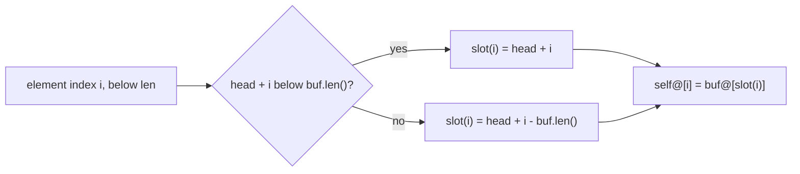
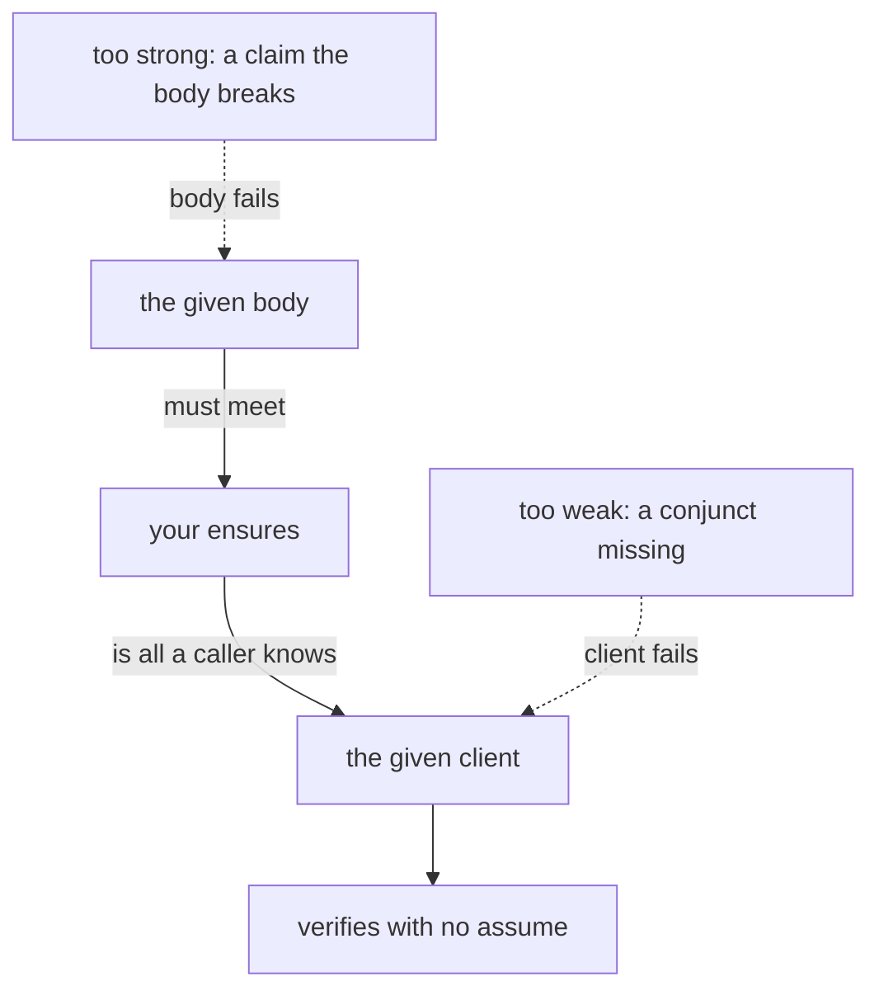
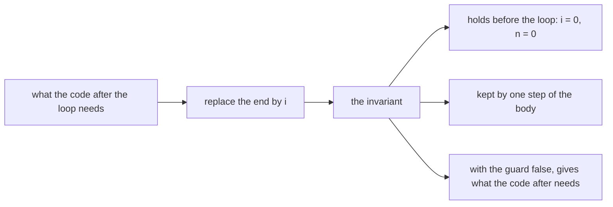

# Q10 — Practice I-A

Q01–Q09 taught one construct at a time, each with a worked card beside it. Q10 opens the
intro practice tier: twelve one-hole items over strands S1–S5, every statement given, every
reference ten lines or fewer in Dafny and fifteen or fewer in Verus, no card, and no new
construct. This chapter is a brief. It says what each strand's items practise, settles the two
warm-up predictions with real runs, and leaves the rest to the files.
Three ideas do all the work:

1. **A statement is a contract with two readers.** The body below it must meet it, and the
   clients above it must be able to use it. A specification item is judged by both: too weak
   and a client fails, too strong and the body fails.
2. **A failed proof usually lacks one named fact.** The verifier knows the definitions but
   does not unfold every equality between terms. A repair names the missing term in an
   assertion or a lemma call; it does not rewrite the proof.
3. **A loop's invariant is the postcondition with the loop index in place of the end.** At
   the exit the guard is false, and the invariant plus that fact must give what the code after
   the loop needs, a given lemma's preconditions included.

---

## 0. How this module works, pretest, test-out

**Minutes: 182.** Brief 15 · warm-up 8 · `u64` round-trip pair 24 · spec items 15 ·
assertion repairs 16 · `normalize` invariant pair 24 · search-then-name 20 · ring buffer
(Verus) 20 · exit 20 · paper 15 · ledger 5. The Dafny file's `CALIBRATION` block repeats this
line.

**Setup.** Start one long-lived `/tutor Q10` session. The given spine now has five layers; L5
is new and adds three helpers to Dafny and one to Verus (§0's files table).

**Predictions first.** Both warm-ups, P1dv and P2dv, are in the Dafny file's prediction
block; their answers go in `slots/Q10.slots`. Record them with `scripts/firsttry.sh Q10
--check` before you run anything they are about, then enable each slot.

**No pretest, no test-out.** A practice module is the practice: there is nothing to skip.
The exit (closed book, two items) is the module's check.

Each prediction reappears below in a box,

> **Predict (Pn) — commit in the file before reading on.**

and its answer comes only after the box, below the words *Commit your prediction first.*

**Outputs.** Every output fence is a real run on the course pins (Dafny 4.11.0, Verus
0.2026.09.27.3cf1832), pinned in `expected/Q10.chapter.toml`. `probe.*` and `count*.*` are
scratch files run with `scripts/vcheck --module Q10`, which adds Q10's given layers and
options (a Dafny probe's count includes the spine's tasks). Fences drop the wrapper's last
line, `raw output: <dir>`.

### This module's files

| file | what it is | shipped state |
|---|---|---|
| `dafny/Q/Q10_PracticeIA/std/Q10_PracticeIA.dfy` | the Dafny exercise file: the prediction block, then H1d–H4d in `Q10_PracticeIA`, then H5d in `Q10_Search` (nonlinear arithmetic off, last in the file) | verified, **5 holes** |
| `verus/q/q10_practice_ia/src/lib.rs` | the Verus crate root: H1v–H5v, then the ring buffer W1v with H6v and H7v | verified, **7 holes** |
| `slots/Q10.slots` | your two verdict answers | `???` |
| `dafny/Q/Q10_PracticeIA/exit/Q10_Exit.dfy`, `verus/q/q10_practice_ia/src/exit.rs` | the closed-book exit, outside every build | verified, **1 + 1 holes** |
| `dafny/given/Q/QG_L1_BigNat.dfy` to `QG_L5_BigNat.dfy`; `verus/given/qg_bignat_l1` to `qg_bignat_l5` | the given spine, frozen; L5 is new: `CanonicalLower`, `PowPositive`, `NormalizeTrim` (Dafny), `lemma_weight_pos` (Verus) | verified |
| `paper/Q10_problems.tex` → your `paper/Q10_answers.tex` | the written pair (§7) | — |
| `Solutions/` mirrors of these files | the reference twins | yours to open LAST |

---

## 1. S1 — Exec code against a value: one word, a ring buffer

S1's items are compiled code checked against a mathematical value. H1d and H1v return a
canonical number as one machine word when it fits; H6v and H7v read and append on a ring
buffer whose meaning is a `Seq` view. The first warm-up is about the word itself.

> **Predict (P1dv) — commit in the file before reading on.** A cast to one word: Dafny's `Low` converts a `nat` below `BASE` to `bv64` under `ensures b as nat == x`; Verus's `low` converts a `u128` below 2^64 to `u64` under `ensures r == x`, as the prediction block quotes them. What does `scripts/vcheck` say about each?

*Commit your prediction first.* `D:timeout V:ok`. The Dafny probe, in a module of Q10's unit
with L1 opened:

```dafny
module P1 {
  import opened QG_L1_BigNat

  method Low(x: nat) returns (b: bv64)
    requires x < BASE
    ensures b as nat == x
  {
    b := x as bv64;
  }
}
```

<!-- pin: p1dv-d -->
```
$ scripts/vcheck --module Q10 probe.dfy
vcheck: probe.dfy [dafny, learner loop]: inconclusive — 23 verified, 0 holes, 1 error
probe.dfy:4:10: error: Verification out of resource (P1.Low)
```

The Verus probe, in a crate of its own:

```rust
use vstd::prelude::*;

verus! {

fn low(x: u128) -> (r: u64)
    requires
        x < 0x1_0000_0000_0000_0000u128,
    ensures
        r == x,
{
    x as u64
}

} // verus!
```

<!-- pin: p1dv-v -->
```
$ scripts/vcheck --module Q10 probe.rs
vcheck: probe.rs [verus, learner loop]: verified — 1 verified, 0 holes, 0 errors
```

The conversion itself is not the problem. Drop the `ensures` and the Dafny method verifies:
the cast's range check is `x < BASE`, the precondition.

```dafny
module P1 {
  import opened QG_L1_BigNat

  method Low(x: nat) returns (b: bv64)
    requires x < BASE
  {
    b := x as bv64;
  }
}
```

<!-- pin: p1dv-d-noens -->
```
$ scripts/vcheck --module Q10 noens.dfy
vcheck: noens.dfy [dafny, learner loop]: verified — 23 verified, 0 holes, 0 errors
```

The round trip `b as nat == x` asks
the solver to relate a bit-vector to an integer, and that reasoning ran out of the course's
resource limit before it closed. Verus's `u64` and `u128` are integers to the solver, bounded
by their types, so the same claim is linear arithmetic. This is why the BigNat spine keeps its
limbs as `nat` in Dafny and as `u64` in Verus, and why H1d returns `Option<nat>`: its word is
an integer below `BASE`, not a `bv64`.

**H1d, H1v.** Split on the number of limbs; the Hints name the layer facts each case needs.
H1d's method clause, *the code does not call `ToNat`*, is a rule the verifier cannot check:
`ToNat` is a compiled function, so a body that computes the whole value and compares it would
verify. The block's `// form: no-call:ToNat` line states it for the tools instead, and
`scripts/firsttry.sh Q10 --report --strict` refuses a compiled call of `ToNat` in the body
(a call inside an `assert` is fine). The item is the case analysis.

**The ring buffer (W1v, H6v, H7v).** `Ring` keeps `len` elements starting at `head` in a
fixed `buf`, wrapping past the end. Its meaning is `self@`, built by `slot(i)`:



`slot` is a spec function, so its arithmetic is over `int` and cannot overflow; your exec
code computes the same position with `usize` and must never leave its range. H7v's view proof
needs to know which slots one `set` leaves alone.

---

## 2. S2 — Specifications of given code

H2d and H2v reverse the usual order: the body ships and verifies, the `ensures` is missing,
and a given client ends in a labelled assume, the hole. Delete the assume and the client
fails until the callee's statement says enough.



Write the statement from the client's needs, then check each branch of the body against it.
`scripts/specfreeze` treats `Shift` and `high_limb` as open statements: you may add `ensures`
clauses to them and nothing else in the file changes shape.

---

## 3. S3 — Assertion repair

H3d and H3v each quote a failing attempt in their docstrings. Copy it in, run it, read the
failing line, and add what is missing: the attempt's lines stay as they are. Q04's `calc`
chains and Q02's `assert … by` are the tools; most repairs here are one or two assertions
that name a term the solver would not build on its own.

This is the task of card 02.11 (Laurel): a real lemma blocked by one missing `assert`, found
by localizing the failure first and then naming the fact. Its placeholder and its retrieval
are two answers to *where* and *what*; on paper (§7) you compare them with what you did.

---

## 4. S4 — Loops: measures and invariants

> **Predict (P2dv) — commit in the file before reading on.** A loop that stops on `!=`: Dafny's `Count` and Verus's `count` step `i` up while `i != |s|` (`i != v.len()`), with the one invariant `i <= |s|` (`i <= v.len()`); the Dafny loop has no `decreases` clause and the Verus loop has `decreases v.len() - i`, as the prediction block quotes them. What does `scripts/vcheck` say about each?

*Commit your prediction first.* `D:ok V:ok`. The Dafny probe:

```dafny
module P2 {
  method Count(s: seq<nat>) returns (i: nat)
    ensures i == |s|
  {
    i := 0;
    while i != |s|
      invariant i <= |s|
    {
      i := i + 1;
    }
  }
}
```

<!-- pin: p2dv-d -->
```
$ scripts/vcheck --module Q10 count.dfy
vcheck: count.dfy [dafny, learner loop]: verified — 23 verified, 0 holes, 0 errors
```

The Verus probe:

```rust
use vstd::prelude::*;

verus! {

fn count(v: &Vec<u64>) -> (i: usize)
    ensures
        i == v.len(),
{
    let mut i: usize = 0;
    while i != v.len()
        invariant
            i <= v.len(),
        decreases v.len() - i,
    {
        i = i + 1;
    }
    i
}

} // verus!
```

<!-- pin: p2dv-v -->
```
$ scripts/vcheck --module Q10 count.rs
vcheck: count.rs [verus, learner loop]: verified — 2 verified, 0 holes, 0 errors
```

With no `decreases`, Dafny guesses a measure from the guard, and the postcondition follows
from the negated guard alone. The guess is sound only because of the invariant: drop
`invariant i <= |s|` and the same loop fails termination, since nothing keeps `i` from
running past `|s|`:

```dafny
module P2 {
  method Count(s: seq<nat>) returns (i: nat)
    ensures i == |s|
  {
    i := 0;
    while i != |s|
    {
      i := i + 1;
    }
  }
}
```

<!-- pin: p2dv-d-noinv -->
```
$ scripts/vcheck --module Q10 count_noinv.dfy
vcheck: count_noinv.dfy [dafny, learner loop]: failed — 22 verified, 0 holes, 1 error
count_noinv.dfy:6:5: error: cannot prove termination; try supplying a decreases clause for the loop
```

Verus guesses nothing: its `decreases v.len() - i` is checked as written. A Verus loop also
forgets every fact about its variables that no invariant states, so without `i <= v.len()` it
fails twice, on the measure and on the increment:

```rust
use vstd::prelude::*;

verus! {

fn count(v: &Vec<u64>) -> (i: usize)
    ensures
        i == v.len(),
{
    let mut i: usize = 0;
    while i != v.len()
        decreases v.len() - i,
    {
        i = i + 1;
    }
    i
}

} // verus!
```

<!-- pin: p2dv-v-noinv -->
```
$ scripts/vcheck --module Q10 count_noinv.rs
vcheck: count_noinv.rs [verus, learner loop]: failed — 1 verified, 0 holes, 2 errors
count_noinv.rs:10:5: error: decreases not satisfied at end of loop
count_noinv.rs:13:13: error: possible arithmetic underflow/overflow
```

**H4d, H4v.** The forward-scan normalize: the code, the `decreases` and (Dafny) the final
call of L5's `NormalizeTrim` are given, and the invariants are yours. Write them from the
exit backwards:



The Dafny item's "what is needed" is `NormalizeTrim`'s three preconditions; the Verus item's
is its three postconditions.

---

## 5. S5 — Search, then name

H5d and H5v are one fact each, a remainder of a remainder, and the work is finding the
library lemma that states it. Q04 gave you the search ladder (IDE, a scoped `grep` of the
library's source, the documentation, a model, memory); use it from the top. The Dafny module
`Q10_Search` has nonlinear arithmetic off, so the solver will not find the fact by itself,
and L1's `Pow(n + 1)` unfolds to a product the library lemma must match. vstd states its
lemmas over `int`: cast `nat` arguments with `as int`.

A found lemma has a `requires`. Meeting it at your arguments is part of the item; L5 adds
`PowPositive` and `lemma_weight_pos` for exactly that.

---

## 6. What the instruments can and cannot see

| instrument | what it sees | what it cannot see |
|---|---|---|
| `scripts/vcheck --gate` | zero holes, every pinned symbol checked | a body that meets the statement in a way the item forbids (H1d's clause: the form line's job) |
| `scripts/firsttry.sh Q10 --report --strict` | your slots, your uncommented checks, and H1d's form line (no compiled call of `ToNat`) | whether a form-abiding body is the case analysis the item meant |
| a given client (H2d, H2v) | whether your statement is strong enough for that client | a statement stronger than any client needs, as long as the body meets it |
| `scripts/specfreeze --check Q10` | that no statement changed but the open ones (`Shift`, `high_limb`) | whether your added `ensures` is the one the docstring asks for |
| `scripts/vaudit` | assumes, holes, trusted attributes, resource attributes left in | whether a repair kept the attempt's lines (H3's rule) |
| the uncommented checks | one concrete call each | every other input |
| a reader (`/review-code Q10`, design-lite bar) | the method clause, the attempt kept, a lemma named rather than re-proved | nothing mechanical |

---

## 7. On paper, before the keyboard

`paper/Q10_problems.tex` holds two problems (15 minutes, after §5 and before the holes). B1,
loop measures (5 minutes): for three short loops, say whether each verifies with no
`decreases`, and why, in one line each. B2, the paper card 02.11 (10 minutes), field by
field against the pinned range of your `cheatsheets.md`, with one question that ties
Laurel's placeholder to H3. Fill `paper/Q10_answers.tex`, build with `make -C paper paper`
until green, and run `/grade-paper Q10` in a fresh session.

---

## 8. The exercise file

The two units, as shipped:

<!-- pin: units -->
```
$ scripts/vcheck Q10
vcheck: dafny/Q/Q10_PracticeIA/std [dafny, learner loop]: verified — 135 verified, 5 holes, 0 errors
dafny/Q/Q10_PracticeIA/std/Q10_PracticeIA.dfy:144:5: hole assume Q10.H1d
dafny/Q/Q10_PracticeIA/std/Q10_PracticeIA.dfy:186:5: hole assume Q10.H2d
dafny/Q/Q10_PracticeIA/std/Q10_PracticeIA.dfy:212:22: hole bodyless-method Q10.H3d
dafny/Q/Q10_PracticeIA/std/Q10_PracticeIA.dfy:234:5: hole assume Q10.H4d
dafny/Q/Q10_PracticeIA/std/Q10_PracticeIA.dfy:279:24: hole bodyless-method Q10.H5d
vcheck: verus/q/q10_practice_ia [verus, learner loop]: verified — - verified, 7 holes, 0 errors
verus/q/q10_practice_ia/src/lib.rs:46:1: hole external_body Q10.H1v
verus/q/q10_practice_ia/src/lib.rs:96:44: hole assume Q10.H2v
verus/q/q10_practice_ia/src/lib.rs:123:40: hole assume Q10.H3v
verus/q/q10_practice_ia/src/lib.rs:142:40: hole assume Q10.H4v
verus/q/q10_practice_ia/src/lib.rs:181:40: hole assume Q10.H5v
verus/q/q10_practice_ia/src/lib.rs:254:5: hole external_body Q10.H6v
verus/q/q10_practice_ia/src/lib.rs:274:5: hole external_body Q10.H7v
vcheck: 2 unit(s): 2 verified, 0 not; 12 hole(s) in all
```

Twelve holes, as `expected/Q10.counts` pins them. In file order: the prediction block, H1d
(an exec `assume false;`), H2d (the client `ShiftTwice`'s labelled assume), H3d (a bodyless
lemma), H4d (an assume above the loop: delete it once the invariants are in) and H5d (a
bodyless lemma in `Q10_Search`); in `lib.rs`, H1v (`external_body`), H2v (the client
`high_client`'s labelled assume), H3v and H5v (`proof_note` assumes), H4v (an assume above
the loop), then the ring buffer's H6v and H7v (`external_body`).

**The hint dial.** `Hint(1)` only when stuck, `Hint(2)` only when still stuck; after 20
minutes stuck, ask `/tutor Q10`.

**Slots.** Fill `slots/Q10.slots` (`P1dv = ???` becomes `P1dv = "<answer>"`), run
`scripts/firsttry.sh Q10 --check`, then enable each: `// SLOT: CHECK P1dv` becomes
`// CHECK P1dv`.

**Done** = `scripts/vcheck --gate dafny/Q/Q10_PracticeIA/std` and
`scripts/vcheck --gate verus/q/q10_practice_ia` each print only the summary line and exit 0,
`scripts/vaudit` reports no finding on either, **and** `scripts/firsttry.sh Q10 --report
--strict` exits 0.

**Calibration.** Write your actual minutes beside each line of the Dafny file's
`CALIBRATION` block; at the end run `scripts/firsttry.sh Q10 --record`.

---

## Exit (closed book)

Close this chapter, the exercise files, later modules' files, search tools and `/tutor`; at
most the given spine stays open. Two unseen items, 20 minutes: a Dafny loop (S4) and a Verus
exec function (S1), in exit files shipping 1 + 1 holes, statements given. When both blocks
hold an attempt (a guess counts; a hole does not), run `scripts/firsttry.sh Q10 --exit` once,
before fixing anything: that first complete run is your score, **threshold 1 of 2**, the
intro practice tier's rule. Then repair both blocks with `scripts/vcheck <exit file>`.

---

## Instructor touchpoints

> **The Q10 module loop, with the instructor in place:**
>
> - **`/discuss Q10`** (optional; a coach session): a Socratic pass over the Q10 bank, with
>   a Rust developer who distrusts SMT.
> - **`/tutor Q10`** (one long-lived session): after 20 minutes stuck; one rung per turn, and
>   never the corrected line.
> - **`/grade-paper Q10`** (fresh session): once `make -C paper paper` is green (§7).
> - **`/review-code Q10`** (fresh session): once §8's Done line holds. Bar: design-lite, with
>   H1d's method clause and H3's kept attempts read by hand.
> - **`/viva Q10`**: not this module. The intro practice tier's viva is `/viva Q12`, over
>   Q10, Q11 and Q12 together.
> - **`/contract Q10`**: not this module. Q10 has no agentic file, and `/contract Q10`
>   refuses.
> - **Solutions last**: the `Solutions/` mirrors of Q10's files, only after `/viva Q12`,
>   which examines Q10 too.
> - **`/review`**: whenever the session banner says ledger items are due.

---

## What Q10 planted

| seed | harvested |
|---|---|
| the word round trip (H1) and the ring buffer's `Seq` view (W1v–H7v) | Q11 (`&mut` and `Result` APIs), Q17 (a permissioned ring buffer) |
| statements judged by a client (H2) | Q13 (a statement from prose), Q15 (Lab 2: specification quality) |
| assertion repair, one named fact (H3; card 02.11) | Q12 (Lab 1: proof completion), Q15 (refute → repair → prove) |
| invariants from the exit backwards (H4) | Q11 (`CopyFrom`), Q13 (an accumulator generalized) |
| search, then name (H5) | Q13 (a library goal), Q16 (multiplication with library facts) |

*Paper card: **02.11**, "Laurel: Unblocking Automated Verification with Large Language
Models". Reread it in your own `cheatsheets.md` before §7, asking: what its placeholder
localizes, what its retrieval supplies, and which of the two your H3 repairs needed.*
