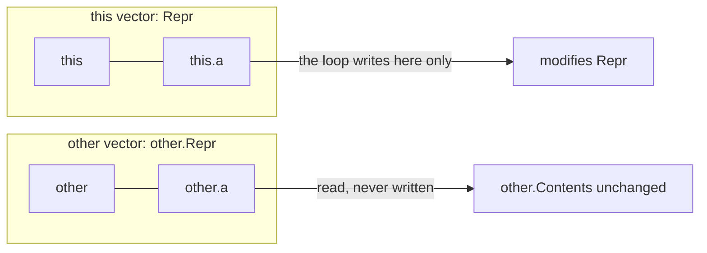
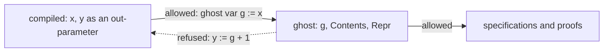
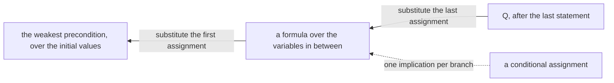

# Q11 — Practice I-B

Q10 practised strands S1–S5. Q11 practises S6–S8 the same way, statements given and one
hole per item: frames and ownership (a class with dynamic frames in Dafny, a `&mut` API
with `Result` in Verus), ghost code and modes (a subset type, a value proved through ghost
facts), and program logic (verification conditions by hand, one case of a verified wp's
soundness, and a first permission). This chapter is a brief: it settles the two warm-ups
with real runs and says what each strand's items practise.
Three ideas do all the work:

1. **A frame is a promise about everything else.** Dafny's `modifies` lists what a method
   may write and its `Repr` sets say which objects belong to whom; Verus gets the same
   promise from Rust's borrows. A method that writes outside its frame is rejected however
   right its result.
2. **Ghost state is the verifier's, and it knows only what you assign.** A ghost field or
   variable is never compiled and never computed for you: if `Contents` should change, the
   code changes it. Values flow from compiled code to ghost code, never back.
3. **A weakest precondition is computed backwards, one statement at a time.** An assignment
   substitutes its expression for its variable in what must hold after it; a conditional
   splits into one implication per way it can go.

---

## 0. How this module works, pretest, test-out

**Minutes: 177.** Brief 15 · warm-up 8 · `Repr`/`Valid` class (Dafny) 20 · `&mut` +
`Result` API (Verus) 20 · subset types (Dafny) 12 · modes (Verus) 12 · VCs by hand 20 ·
wp soundness for `if` (Dafny) 15 · points-to primer (Verus) 15 · exit 20 · paper 15 ·
ledger 5. The Dafny file's `CALIBRATION` block repeats this line.

**Setup.** Start one long-lived `/tutor Q11` session. The order of work is the main Dafny
file, then `Q11_Wp.dfy`, then `lib.rs`, then `perm.rs` last.

**Predictions first.** Both warm-ups, P1dv and P2dv, are in the main Dafny file's
prediction block; their answers go in `slots/Q11.slots`. Record them with
`scripts/firsttry.sh Q11 --check` before you run anything they are about, then enable each
slot.

**No pretest, no test-out.** A practice module is the practice. The exit (closed book, two
items) is the module's check.

Each prediction reappears below in a box,

> **Predict (Pn) — commit in the file before reading on.**

and its answer comes only after the box, below the words *Commit your prediction first.*

**Outputs.** Every output fence is a real run on the course pins (Dafny 4.11.0, Verus
0.2026.09.27.3cf1832), pinned in `expected/Q11.chapter.toml`. `cell*.*` and `bump*.*` are
scratch files run with `scripts/vcheck --module Q11`, which adds Q11's given layers and
options. Fences drop the wrapper's last line, `raw output: <dir>`.

### This module's files

| file | what it is | shipped state |
|---|---|---|
| `dafny/Q/Q11_PracticeIB/std/Q11_PracticeIB.dfy` | the main Dafny file: the prediction block, the class `LimbVec` (W1d, H1d, H2d), the subset type (H5d), then the three VC modules `Q11_VcProg`, `Q11_VcAnswer` and `Q11_VcCheck` (H7d, H8d) | verified, **5 holes** |
| `dafny/Q/Q11_PracticeIB/std/Q11_Wp.dfy` | a small language and its wp (W2d), and one case of soundness (H9d); nonlinear arithmetic off | verified, **1 hole** |
| `verus/q/q11_practice_ib/src/lib.rs` | the Verus crate root: the accumulator (H3v, H4v) and the two-limb value (H6v) | verified, **3 holes** |
| `verus/q/q11_practice_ib/src/perm.rs` | the permissions module: the points-to primer (H10v) | verified, **1 hole** |
| `slots/Q11.slots` | your two verdict answers | `???` |
| `dafny/Q/Q11_PracticeIB/exit/Q11_Exit.dfy`, `verus/q/q11_practice_ib/src/exit.rs` | the closed-book exit, outside every build | verified, **1 + 1 holes** |
| `dafny/given/Q/QG_L1_BigNat.dfy` to `QG_L5_BigNat.dfy`; `verus/given/qg_bignat_l1` to `qg_bignat_l5` | the given spine, frozen | verified |
| `paper/Q11_problems.tex` → your `paper/Q11_answers.tex` | the written pair (§5) | — |
| `Solutions/` mirrors of these files | the reference twins | yours to open LAST |

---

## 1. S6 — Frames and ownership

> **Predict (P1dv) — commit in the file before reading on.** A method that writes a field of a second object of its own type: Dafny's `Cell.CopyTo(other)` with `modifies this` assigns `other.n := n`; Verus's `copy_to(&mut self, other: &mut Self)` assigns `other.n = self.n`, as the prediction block quotes them. What does `scripts/vcheck` say about each?

*Commit your prediction first.* `D:fail V:ok`. The Dafny file:

```dafny
class Cell {
  var n: nat

  method CopyTo(other: Cell)
    modifies this
  {
    other.n := n;
  }
}
```

<!-- pin: p1dv-d -->
```
$ scripts/vcheck --module Q11 cell.dfy
vcheck: cell.dfy [dafny, learner loop]: failed — 22 verified, 0 holes, 1 error
cell.dfy:7:11: error: assignment might update an object not in the enclosing context's modifies clause
```

With `modifies other` in place of `modifies this`, the same method verifies:

```dafny
class Cell {
  var n: nat

  method CopyTo(other: Cell)
    modifies other
  {
    other.n := n;
  }
}
```

<!-- pin: p1dv-d-other -->
```
$ scripts/vcheck --module Q11 cell_other.dfy
vcheck: cell_other.dfy [dafny, learner loop]: verified — 23 verified, 0 holes, 0 errors
```

The Verus file:

```rust
use vstd::prelude::*;

verus! {

pub struct Cell {
    pub n: u64,
}

impl Cell {
    pub fn copy_to(&mut self, other: &mut Self) {
        other.n = self.n;
    }
}

} // verus!
```

<!-- pin: p1dv-v -->
```
$ scripts/vcheck --module Q11 cell.rs
vcheck: cell.rs [verus, learner loop]: verified — 1 verified, 0 holes, 0 errors
```

Dafny's heap is shared: any reference may point anywhere, so a method states what it may
write, and the verifier checks every write against that list. Verus's `&mut Self` already
is the permission: Rust's borrow rules make `self` and `other` two distinct objects that
nothing else can touch during the call, so the write needs no clause.

**H1d, H2d (the class `LimbVec`).** `Repr` holds the objects a vector is made of, and
`Valid()` reads only `this` and `Repr`. H2d copies between two vectors whose `Repr`s are
disjoint:



A loop inside a method that writes the heap must say what it writes, or the verifier
assumes it may have changed anything the method may modify, `other`'s fields included if
they were in the frame. The disjointness `Repr !! other.Repr` is what keeps `other`'s
contents out of reach.

**H3v, H4v (the accumulator).** A `&mut self` method with a `Result`: the `ensures` speaks
of `old(self)` and `final(self)`, and its `Err` clause says *nothing changed*. An early
`return` is the usual shape of a refusal; for H4v, think about how a value is moved out of
`*self` while a valid one stays behind.

---

## 2. S7 — Ghost code, modes and subset types

> **Predict (P2dv) — commit in the file before reading on.** A ghost variable assigned from a compiled one, then used to compute a compiled variable: Dafny's `Bump` declares `ghost var g := x;` and then `var y := g + 1;`; Verus's `bump` does `let ghost g = x;` then `let y = g + 1;` (with `x: u64`), as the prediction block quotes them. What does `scripts/vcheck` say about each?

*Commit your prediction first.* `D:ok V:err:resolve`. The Dafny file:

```dafny
method Bump(x: nat) {
  ghost var g := x;
  var y := g + 1;
}
```

<!-- pin: p2dv-d -->
```
$ scripts/vcheck --module Q11 bump.dfy
vcheck: bump.dfy [dafny, learner loop]: verified — 23 verified, 0 holes, 0 errors
```

The Verus file:

```rust
use vstd::prelude::*;

verus! {

fn bump(x: u64) {
    let ghost g = x;
    let y = g + 1;
}

} // verus!
```

<!-- pin: p2dv-v -->
```
$ scripts/vcheck --module Q11 bump.rs
vcheck: bump.rs [verus, learner loop]: failed — - verified, 0 holes, 1 error, stage resolve
bump.rs:7:13: error: cannot access spec-mode place in executable context
```

Dafny infers modes for local variables: `y` is assigned from a ghost value, so `y` becomes
ghost too, and nothing compiled ever reads it. The same flow fails once `y` must be
compiled, as an out-parameter is:

```dafny
method Bump(x: nat) returns (y: nat) {
  ghost var g := x;
  y := g + 1;
}
```

<!-- pin: p2dv-d-ret -->
```
$ scripts/vcheck --module Q11 bump_ret.dfy
vcheck: bump_ret.dfy [dafny, learner loop]: failed — - verified, 0 holes, 1 error, stage resolve
bump_ret.dfy:3:8: error: ghost variables such as g are allowed only in specification contexts. g was inferred to be ghost based on its declaration or initialization.
```

Verus infers nothing: `let y` is exec, and an exec expression may not read a ghost place.
The rule is the same in both languages, values flow from compiled to ghost and never back;
only the inference differs.



**H5d (a subset type).** `CanonSeq` is a type of canonical sequences. A function that
returns one must discharge the subset constraint as well as its `ensures`, and a function
body may call lemmas as statements before its expression.

**H6v (modes).** `value_two` computes a `u128` in exec code; the proof block beside it
tells the verifier why that number is `a.to_nat()`. The exec code may not call a spec
function, and the proof may not change an exec variable.

---

## 3. S8 — Program logic: VCs, a wp case, a permission

**The rule, on a toy.** For one assignment `x := x + 1` and the postcondition `x > 3`, the
weakest precondition substitutes the expression for the variable: `x + 1 > 3`. Two
assignments are read from the last one back, each substituting into the formula the next
one produced:



**H7d, H8d (VCs by hand).** `Q11_VcProg` gives two small programs over `x` and `y` and
their postconditions. Write each precondition in `Q11_VcAnswer` as arithmetic over the
initial `x` and `y`, computed by hand from §3's rule. `Q11_VcAnswer` imports nothing and
its import list is frozen, so the predicate cannot name the program. `Pre1Exact` and
`Pre2Exact` check that your formula *means* the right thing; they cannot see how you got
it. Each block's form line (`// form: formula:Pre1`, `formula:Pre2`) checks the form:
`scripts/firsttry.sh Q11 --report --strict` refuses a `var` binding, a `match` or a call in
the predicate's body, so the formula is arithmetic over `x` and `y` (§4).

**H9d (one case of a verified wp).** `Q11_Wp.dfy` gives a small language, its semantics
and its syntactic `Wp`. H9d is the `IfThen` case of soundness, with the branch's soundness
given as a hypothesis: the recursion over commands that would supply it is the rest of the
proof, and Q08's verified wp was yours. Unfold `Holds` of the conjunction one level at a
time and split on the condition.

**H10v (a points-to primer).** A `PCell<u64>` holds a value that only its `PointsTo`
permission can read or write. `max_into` gets the source's permission shared and the
destination's mutably, both `Tracked`: ghost objects that are checked like owned values.
The cell operations take the permission as an argument; read the `requires` and `ensures`
of `read` and `write` in vstd's `cell/pcell.rs` before writing the body.

---

## 4. What the instruments can and cannot see

| instrument | what it sees | what it cannot see |
|---|---|---|
| `scripts/vcheck --gate` | zero holes, every pinned symbol checked, every frame and mode rule | whether a VC predicate restates the program (the form lines' job) |
| `Pre1Exact`, `Pre2Exact` | that your predicate is equivalent to the program's weakest precondition | its form: a predicate that restates the program with `var` bindings is equivalent too |
| the `formula:` form lines, through `scripts/firsttry.sh Q11 --report --strict` | that `Pre1` and `Pre2` hold no `var` binding, `match` or call | whether you computed the formula or simplified someone else's |
| `scripts/specfreeze --check Q11` | that no statement changed but the open bodies (`AddCanon`, `Pre1`, `Pre2`), and that `Q11_VcAnswer` still imports nothing | what you wrote inside an open body |
| `scripts/vaudit` | assumes, holes, trusted attributes left in | an over-wide frame that the verifier accepts (a `modifies` larger than the method needs) |
| the uncommented checks | one call each, with a second, disjoint vector or accumulator | every other aliasing pattern |
| a reader (`/review-code Q11`, design-lite bar) | arithmetic in the VC predicates, frames no wider than needed, the refusal before any change | nothing mechanical |

---

## 5. On paper, before the keyboard

`paper/Q11_problems.tex` holds two problems (15 minutes, after §3 and before H7d). B1, a
weakest precondition by hand (5 minutes): a short program of its own with an assignment
and a conditional, its precondition computed step by step and then checked on two
concrete states. B2, the paper card 02.12 (10 minutes), field by field against the pinned
range of your `cheatsheets.md`. Fill `paper/Q11_answers.tex`, build with
`make -C paper paper` until green, and run `/grade-paper Q11` in a fresh session.

---

## 6. The exercise file

The two units, as shipped:

<!-- pin: units -->
```
$ scripts/vcheck Q11
vcheck: dafny/Q/Q11_PracticeIB/std [dafny, learner loop]: verified — 146 verified, 6 holes, 0 errors
dafny/Q/Q11_PracticeIB/std/Q11_PracticeIB.dfy:216:22: hole bodyless-function Q11.H5d
dafny/Q/Q11_PracticeIB/std/Q11_PracticeIB.dfy:158:7: hole assume Q11.H1d
dafny/Q/Q11_PracticeIB/std/Q11_PracticeIB.dfy:175:7: hole assume Q11.H2d
dafny/Q/Q11_PracticeIB/std/Q11_PracticeIB.dfy:289:5: hole assume Q11.H7d
dafny/Q/Q11_PracticeIB/std/Q11_PracticeIB.dfy:302:5: hole assume Q11.H8d
dafny/Q/Q11_PracticeIB/std/Q11_Wp.dfy:106:18: hole bodyless-method Q11.H9d
vcheck: verus/q/q11_practice_ib [verus, learner loop]: verified — - verified, 4 holes, 0 errors
verus/q/q11_practice_ib/src/lib.rs:59:5: hole external_body Q11.H3v
verus/q/q11_practice_ib/src/lib.rs:81:5: hole external_body Q11.H4v
verus/q/q11_practice_ib/src/lib.rs:130:1: hole external_body Q11.H6v
verus/q/q11_practice_ib/src/perm.rs:34:1: hole external_body Q11.H10v
vcheck: 2 unit(s): 2 verified, 0 not; 10 hole(s) in all
```

Ten holes, as `expected/Q11.counts` pins them. In file order: the prediction block, W1d,
H1d and H2d (exec `assume false;` lines), H5d (a bodyless function), then H7d and H8d (the
labelled assumes in `Pre1Exact` and `Pre2Exact`, in `Q11_VcCheck`; the predicates you write
are in `Q11_VcAnswer`); W2d and H9d (a bodyless lemma) in `Q11_Wp.dfy`; H3v, H4v and H6v
(`external_body`) in `lib.rs`; H10v (`external_body`) in `perm.rs`.

**The hint dial.** One hint per hole, read only when stuck; after 20 minutes stuck, ask
`/tutor Q11`.

**Slots.** Fill `slots/Q11.slots` (`P1dv = ???` becomes `P1dv = "<answer>"`), run
`scripts/firsttry.sh Q11 --check`, then enable each: `// SLOT: CHECK P1dv` becomes
`// CHECK P1dv`.

**Done** = `scripts/vcheck --gate dafny/Q/Q11_PracticeIB/std` and
`scripts/vcheck --gate verus/q/q11_practice_ib` each print only the summary line and exit 0,
`scripts/vaudit` reports no finding on either, `scripts/specfreeze --check Q11` reports no
finding, **and** `scripts/firsttry.sh Q11 --report --strict` exits 0.

**Calibration.** Write your actual minutes beside each line of the main Dafny file's
`CALIBRATION` block; at the end run `scripts/firsttry.sh Q11 --record`.

---

## Exit (closed book)

Close this chapter, the exercise files, later modules' files, search tools and `/tutor`; at
most the given spine stays open. Two unseen items, 20 minutes: a Dafny lemma (S7) and a
Verus `&mut self` method (S6), in exit files shipping 1 + 1 holes, statements given. When
both blocks hold an attempt (a guess counts; a hole does not), run
`scripts/firsttry.sh Q11 --exit` once, before fixing anything: that first complete run is
your score, **threshold 1 of 2**, the intro practice tier's rule. Then repair both blocks
with `scripts/vcheck <exit file>`.

---

## Instructor touchpoints

> **The Q11 module loop, with the instructor in place:**
>
> - **`/discuss Q11`** (optional; a coach session): a Socratic pass over the Q11 bank, with
>   a Rust developer who distrusts SMT.
> - **`/tutor Q11`** (one long-lived session): after 20 minutes stuck; one rung per turn, and
>   never the corrected line.
> - **`/grade-paper Q11`** (fresh session): once `make -C paper paper` is green (§5).
> - **`/review-code Q11`** (fresh session): once §6's Done line holds. Bar: design-lite, with
>   the VC predicates read for arithmetic over `x` and `y`.
> - **`/viva Q11`**: not this module. The intro practice tier's viva is `/viva Q12`, over
>   Q10, Q11 and Q12 together.
> - **`/contract Q11`**: not this module. Q11 has no agentic file, and `/contract Q11`
>   refuses.
> - **Solutions last**: the `Solutions/` mirrors of Q11's files, only after `/viva Q12`,
>   which examines Q11 too.
> - **`/review`**: whenever the session banner says ledger items are due.

---

## What Q11 planted

| seed | harvested |
|---|---|
| dynamic frames with `Repr` and disjointness (H1d, H2d) | Q17 (a priority queue with frames) |
| `&mut self` with `Result`, nothing changed on `Err` (H3v, H4v) | Q14 (Q14.H2v's toy: `&mut self` stated against `old` and `final`) |
| modes and ghost flow (P2dv, H6v), a subset type (H5d) | Q14 (termination and erasure) |
| VCs by hand, and a check that sees meaning but not form (H7d, H8d) | Q15 (Lab 2: specifications judged by oracles), Q17 (a VC generator's statements) |
| one case of a verified wp (H9d) | Q14 (the loop rule's soundness), Q17 (metatheory) |
| a first permission (H10v) | Q14 (a permissioned list), Q17 (a permissioned ring buffer) |

*Paper card: **02.12**, "Verifying the Rust Standard Library". Reread it in your own
`cheatsheets.md` before §5, asking: what a challenge's statement is and who writes it, which
parts of the library are trusted, and how its tools differ in what they can check.*
