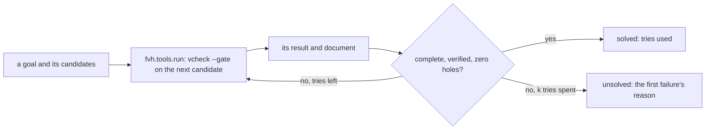
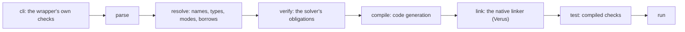
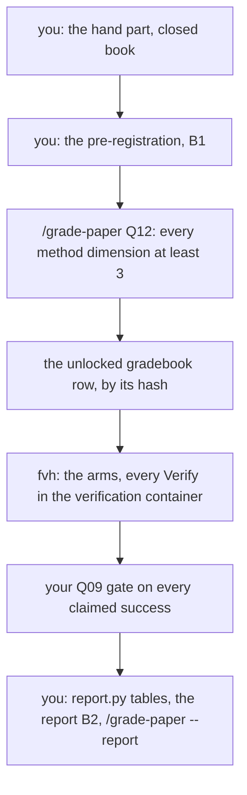
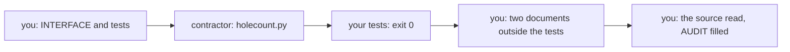

# Q12 — Practice I-C + Lab 1

Q10 and Q11 practised strands S1–S8. Q12 closes the intro practice tier with family C,
strands S9–S13, in two blocks. The **practice block** (100 minutes) is a retry client over
the verifier's JSON channel, six stage-attribution predictions, a fuel item and a trigger
item, and three fresh graders on one flawed pre-registration. The **Lab 1 block** (476
minutes) is your first experiment: at a matched budget of model calls, does feedback or
search beat independent sampling, and does the answer differ between Dafny and Verus?
`/viva Q12` then examines Q10, Q11 and Q12 together.
Three ideas do all the work:

1. **A client judges a run from its document, and only a complete document is a pass.**
   A killed, timed-out or incomplete run is a failed try, never a pass, and the stage a run
   stopped at says which part of the pipeline refused it.
2. **Compare arms at equal cost.** Three search strategies get the same budget of model
   calls per task; a strategy that wins only by spending more has won nothing. The budget
   arithmetic is written down before any run.
3. **Fix the plan before the data, then report against it.** The pre-registration fixes
   the claim, the tasks, the budget, the seeds, the minimum detectable effect and the
   exclusions; the report regenerates every table from the logs and lists every deviation.

---

## 0. How this module works, pretest, test-out

**Minutes: 576, plus the 30-minute tier viva.** *Practice:* brief 15 · S9 retry client 20 ·
S10 stage attribution 15 · S11 trigger and fuel 15 · S12 grade-the-grader 15 · exit 20.
*Lab 1:* hand items 96 · pre-registration 45 · `/grade-paper` 10 · policies and report
110 · run setup 20 · analysis 75 · transcript audit 20 · `--post` 10 · toolwright 15 ·
cards 45 · task cards 20 · ledger and calibration 10.

**Setup.** Start one long-lived `/tutor Q12` session. Q06's `harness/.venv` still serves
the Python files (`cd harness && uv run …`).

**Predictions first, all six**, before anything else:

| items | where the answer goes |
|---|---|
| P1d, P2v (the machine channel, S9), P3d–P6v (the pipeline, S10) | `slots/Q12.slots`; each switch is in its specimen under `specimens/Q12/` |

Each specimen names the command it is run with. Record all six with
`scripts/firsttry.sh Q12 --check`, then enable each switch. Until then `scripts/vcheck`
refuses the specimens.

**No pretest, no test-out.** A practice module is the practice; the Lab 1 block is new
work and has none either. The exit (closed book, two items) checks the practice block;
the lab's acceptance (§5.3) checks the lab.

Each prediction reappears below in a box,

> **Predict (Pn) — commit in the file before reading on.**

and its answer comes only after the box, below the words *Commit your prediction first.*
The four pipeline predictions share one box (§2).

**Outputs.** Every output fence is a real run on the course pins (Dafny 4.11.0, Verus
0.2026.09.27.3cf1832), pinned in `expected/Q12.chapter.toml`. Fences drop the wrapper's
last line, `raw output: <dir>`; JSON shows `[...]` for `cmd` and `...` for `raw_dir`.

**What is pending.** Lab 1's machinery is built: the live batch runner (`python -m fvh run
Q12 --plan <plan>`, and `python -m fvh resume Q12` after a stop; the plan's form is in
`harness/fvh/batch.py`'s docstring), the Docker sandbox, the network-less verification
container in which every `Verify` of every arm runs through the lab gate's lever check and
its assumption audit (`scripts/vaudit`'s rules, D24), the model gates with each run's
pre-registered seeds, and `python -m fvh report Q12 --reverify all`. The public strata's pools
are validated and pinned (`bench/public/POOLS.toml`): install the public sets once with
`scripts/get_bench.sh --all` (they are not in the repository), then `scripts/get_bench.sh
--check` compares the installed sets and their validation with the pins (with no set
installed it fails: nothing was checked). Lab 1's cards are attested (`sandbox/attested.toml`).
Do the rest in this order: the hand part, the pre-registration and its grading, the arms' file
(`policies.py`, written on the frozen protocol module `fvh.protocol`), the report's tables
on synthetic rows, the toolwright run and the cards; then the runs.

### This module's files

| file | what it is | shipped state |
|---|---|---|
| `dafny/Q/Q12_PracticeIC/std/Q12_PracticeIC.dfy` | the Dafny exercise file: the fuel item H3d; imports L1–L4, frozen | verified, **1 hole** |
| `dafny/Q/Q12_PracticeIC/std/Q12_Lab1Hand.dfy` | Lab 1's hand part, Dafny: H4d–H7d and the `HAND` block | verified, **4 holes** |
| `verus/q/q12_practice_ic/src/lib.rs` | the Verus crate root: the trigger item H3v | verified, **1 hole** |
| `verus/q/q12_practice_ic/src/lab1_hand.rs` | Lab 1's hand part, Verus: H4v–H7v | verified, **4 holes** |
| `specimens/Q12/P1d.dfy.specimen` … `P6v.rs.specimen` | the six stage specimens, each with its command and switch | red or refused by design |
| `slots/Q12.slots` | your six verdict answers | `???` |
| `harness/q/fvh_q/retry.py` | the retry client (S9): H1py, H2py; its frozen tests replay the battery | failed, **2 holes** |
| `harness/q/fvh_q/policies.py` | Lab 1's three arms and their prompt renderer: H8py–H11py | failed, **4 holes** |
| `harness/q/fvh_q/report.py` | Lab 1's analysis tables: H12py, H13py | failed, **2 holes** |
| `tools/Q12/holecount.py` | the toolwright's file (§9): a CONTRACT docstring and your `INTERFACE` and `AUDIT` blocks | no code |
| `bench/local/q/lab1/` | the local stratum: 22 task forms and `STRATUM.toml` | task forms shipped |
| `paper/fixtures/Q12_flawed_prereg.tex`, `research/q12_grade_the_grader.md` | the grade-the-grader fixture and your record of it (§4.2) | fixture shipped; record empty |
| `dafny/Q/Q12_PracticeIC/exit/Q12_Exit.dfy`, `verus/q/q12_practice_ic/src/exit.rs` | the closed-book exit, outside every build | verified, **1 + 1 holes** |
| `dafny/given/Q/QG_L1_BigNat.dfy` to `QG_L5_BigNat.dfy`; `verus/given/qg_bignat_l1` to `qg_bignat_l5` | the given spine, frozen | verified |
| `paper/Q12_problems.tex` → your `paper/Q12_answers.tex` | the pre-registration (B1), the lab report (B2), three cards (B3–B5) (§7) | — |
| `Solutions/` mirrors of these files | the reference twins | yours to open LAST |

---

## 1. S9 — The machine channel, and a retry client

A gate reads `scripts/vcheck --json`, Q06's third door, and Q09's `json_complete` named the
fields a pass needs. The `stage` field records the last stage a run reached.

> **Predict (P1d) — commit in the file before reading on.** The specimen `specimens/Q12/P1d.dfy.specimen` (a short lemma about adding zero), run as `scripts/vcheck --json specimens/Q12/P1d.dfy.specimen`: what is the value of the document's `stage` field?

*Commit your prediction first.* `parse`:

<!-- pin: p1d -->
```
$ scripts/vcheck --json specimens/Q12/P1d.dfy.specimen
{"cmd": [...], "count_unit": "tasks", "diagnostics": [{"code": "p_generic_syntax_error", "col": 1, "file": "specimens/Q12/P1d.dfy.specimen", "line": 22, "message": "rbrace expected", "severity": "error"}], "exit_code": 2, "findings": [], "holes": [], "lang": "dafny", "per_symbol": {}, "raw_dir": "...", "stage": "parse", "target": "specimens/Q12/P1d.dfy.specimen", "verdict": "failed", "verified_count": null}
$ echo $?
1
```

The lemma's `if` block never closes its brace, so the run stops at the parser. The
document is complete (every field present) and is still not a pass: its verdict is not
`verified`.

> **Predict (P2v) — commit in the file before reading on.** The specimen `specimens/Q12/P2v.rs.specimen` (a lemma that calls L3's upper bound), run as `scripts/vcheck --json specimens/Q12/P2v.rs.specimen -- --no-verify`: what is the value of the document's `stage` field?

*Commit your prediction first.* `cli`:

<!-- pin: p2v -->
```
$ scripts/vcheck --json specimens/Q12/P2v.rs.specimen -- --no-verify
{"cmd": [...], "count_unit": "verified", "diagnostics": [], "exit_code": null, "findings": [{"file": "specimens/Q12/P2v.rs.specimen", "kind": "refused", "line": 0, "message": "--no-verify: refused by the pins (verifies nothing and still exits 0 (V18, Δ11))"}], "holes": [], "lang": "verus", "per_symbol": {}, "raw_dir": null, "stage": "cli", "target": "specimens/Q12/P2v.rs.specimen", "verdict": "refused", "verified_count": null}
$ echo $?
3
```

The wrapper refuses the pass-through flag before Verus starts: the course pins how each
tool runs, and a flag that would switch verification off is a command-line refusal, the
earliest stage there is. The verdict is `refused`, the one finding says why, and
`exit_code` is `null`: no tool ran. A client that looked only for a solver error would
find none.

**H1py, H2py (the retry client).** The battery is twelve goals, six per language, each with
three candidate files written in advance; the client runs the done gate on each candidate
in order, at most `k`, and stops at the first complete pass:



The frozen tests replay recorded results (no solver runs in them) and require the pinned
solve count in `expected/Q12.battery`. A killed, timed-out or incomplete result counts as a
failed try. Your own live check runs the client over the battery on the host, once, one
solver job at a time (`retry.py`'s header gives the command).

---

## 2. S10 — Stage attribution, the pipeline

Each tool's pipeline has its own stages, and `scripts/vcheck` reports the one a run
stopped at, from the same list as the JSON field:



> **Predict (P3d, P4v, P5d, P6v) — commit in the files before reading on.** Four specimens, each with the command it names: `P3d.dfy.specimen` (a one-limb value, run with `scripts/vcheck`), `P4v.rs.specimen` (a limb count claimed positive), `P5d.dfy.specimen` (a specified method with a test, run with `scripts/vcheck --test`) and `P6v.rs.specimen` (a size comparison). For each, which stage does `scripts/vcheck` report?

*Commit your predictions first.* `resolve`, `verify`, `compile`, `parse`:

<!-- pin: p3d -->
```
$ scripts/vcheck specimens/Q12/P3d.dfy.specimen
vcheck: specimens/Q12/P3d.dfy.specimen [dafny, learner loop]: failed — - verified, 0 holes, 1 error, stage resolve
specimens/Q12/P3d.dfy.specimen:13:17: error: module QG_L1_BigNat does not exist
```

<!-- pin: p4v -->
```
$ scripts/vcheck specimens/Q12/P4v.rs.specimen
vcheck: specimens/Q12/P4v.rs.specimen [verus, learner loop]: failed — 0 verified, 0 holes, 1 error
specimens/Q12/P4v.rs.specimen:23:9: error: postcondition not satisfied
```

<!-- pin: p5d -->
```
$ scripts/vcheck --test specimens/Q12/P5d.dfy.specimen
vcheck: specimens/Q12/P5d.dfy.specimen [dafny, test]: failed — 0 passed, 0 failed, stage compile
specimens/Q12/P5d.dfy.specimen:16:15: hole bodyless-method Q12.P5d
specimens/Q12/P5d.dfy.specimen:15:10: error: Method Q12_P5._default.Double has no body so it cannot be compiled
```

<!-- pin: p6v -->
```
$ scripts/vcheck specimens/Q12/P6v.rs.specimen
vcheck: specimens/Q12/P6v.rs.specimen [verus, learner loop]: failed — 0 verified, 0 holes, 1 error, stage parse
specimens/Q12/P6v.rs.specimen:22:9: error: expected curly braces
```

P3d's module imports layer L1, and a Dafny specimen runs alone, outside the module's
units, so the resolver finds no such module. P4v's claim is false for the empty number, which `wf` allows: the
solver refutes it. P5d's method has no body: the run reports it as a hole and cannot compile it, so
`--test` stops at code generation; Q01's rule that a hole is loud in Dafny shows up here as
a stage. P6v's `requires` is missing a comma: the
parser stops before anything else runs. Each failure is reported by the first stage that
can see it, and a stage you read correctly tells you which tool's documentation to open.

---

## 3. S11 — Fuel and triggers

**H3d (fuel).** `Normalize` of a literal: the solver unfolds a recursive function to a fixed
depth, and a literal with three trailing zeros asks for more unfoldings than the default.
Q07 gave you the constructs; this item asks you to unfold *just enough*. The module's
import list is frozen.

**H3v (triggers).** Two limb-wise bounds, each a quantifier with a trigger, chained at one
index. Q09 taught triggers; the item asks which term each hypothesis waits for at `k`, and
which of those terms the goal does not mention by itself.

---

## 4. S12 — Lab 1: hand part, arms, tasks and graders

### 4.1 The question and the arms

At a budget of `B = 8` model calls per task, three Qwen arms:

| arm | policy | what the eight calls are |
|---|---|---|
| **A1** | `IndependentSampler` (H8py) | eight independent samples, none reading an earlier result |
| **A2** | `SequentialRepair` (H9py) | one sample, then seven repairs, each from the last candidate and its verifier document |
| **A3** | `BestFirst` (H10py) | a frontier of edit states ranked by failing obligations; each call expands the best |

A **Claude arm** runs the one arm your pre-registration predicts best, on a seeded subset
of 20 of the 60 tasks (10 per language), reported as repeated runs, never as seeds. Every
arm's prompts come from one renderer (H11py), whose source enters each arm's prompt hash.



The harness refuses a run whose pre-registration hash is not on an unlocked gradebook row.
A policy returns actions and never touches a file; the executor applies them to a work
copy, verifies them in the container and returns observations.

### 4.2 The hand part, and grade-the-grader

**H4d–H7d, H4v–H7v (the hand part, 96 minutes).** Eight short lemmas and functions about
the spine, done closed book before any run, 12 minutes each, timed from the first edit
and recorded in the `HAND` block. The lab's acceptance needs at least 3 of 4 within time
in each language. Some of them are also tasks of the agents' local stratum, so the report
can place your hit rate beside each arm's on the same tasks, descriptively.

**Grade-the-grader (S12, 15 minutes).** Before your own pre-registration, read the course's
flawed fixture `paper/fixtures/Q12_flawed_prereg.tex` and list every flaw you find; then run
three fresh `/grade-paper Q12 --fixture paper/fixtures/Q12_flawed_prereg.tex` sessions, and
record in `research/q12_grade_the_grader.md` the three score vectors, their spread per
dimension and which flaws each pass caught. The fixture never unlocks a run. Three lines at
the end say what the three passes license about using `/grade-paper` as Lab 1's unlock.

### 4.3 Tasks, budget and pre-registration

**The strata (60 tasks, 30 per language).** A local stratum of ten per language
(`bench/local/q/lab1/`, course-authored after the models' release: the contamination
control) and two public strata of twenty (DafnyBench's hint-free tasks; HumanEval-Verus
task forms), drawn by a pre-registered seed from validated pools. The HumanEval-Verus draw
excludes Lab 2's HumanEval problems across both languages (the Q15 `[[draw]]` records'
card IDs in `bench/public/POOLS.toml`): your task forms keep the specification, so drawing
one would show its Lab 2 reference even when translated. This removes the five Verus tasks
and four further matching problems from the Dafny stratum (D39).
`scripts/get_bench.sh --members humaneval-verus --lab Q12 --seed <your seed>` prints the 74
members you may draw, in your seed's order (without `--seed`, sorted); the pre-registration
names them.

**Run setup.** Install and check the sets first (`scripts/get_bench.sh --all`, then
`scripts/get_bench.sh --check`). For each public stratum, `--members <set> --lab Q12 --seed
<your seed>` gives the order you draw in: its first forty members are the pilot's candidates
(one Qwen sample each, 80 calls in all, under the pilot's own seeds), and its first twenty
are the stratum's tasks unless the pilot puts the stratum's rate outside 0.1 to 0.9, when the
redraw rule you pre-register applies. The pilot is a plan of its own, in the same form as the
arms' (`harness/fvh/batch.py`'s docstring: one Qwen arm, one attempt, one round, one repeat,
the forty candidates per public stratum), run with `python -m fvh run Q12 --plan <pilot plan>`
after its pre-registration fields are filled. Every task's answer verifies on the pins and its task form does not. A delivery that adds a verification lever
the task form does not ship is refused by the lab gate (`scripts/vcheck --gate --lab-task
<task form> <delivery>`), so no task can be closed by switching automation back on, and so
is a delivery that keeps an assumption the audit (`scripts/vaudit`'s rules) reports, even one
the task form ships. A
pilot on the public strata checks their difficulty under a pre-registered rule.

**The budget.** Calls = tasks × attempts × rounds × arms × repeats: the Qwen arms are
`60 × 8 × 3 × 3 = 4,320` calls, the pilot `80`, the Claude arm `20 × 8 = 160`, and at most
20 sentinel calls. The pre-registration redoes the GPU arithmetic per arm, because the
feedback arms' prompts grow with the documents they carry, and fixes a fallback (two
repeats instead of three) for the case where the totals exceed the registry's ceiling.

**The pre-registration (B1, 45 minutes).** Every field of the template in
`paper/Q12_answers.tex`, between its `% PREREG-BEGIN` and `% PREREG-END` markers: claim,
metric and estimator, arms, tasks and strata, the batch plan path and its `plan-sha256:`
line, budget arithmetic, generation settings, cost
per arm with its truncation rate, MDE (with `fvh.stats.mde_two_proportions`), seeds and
repeats, cheat surface and gate, exclusions, stopping rule, your 80% prediction intervals,
contamination and disclosure.

---

## 5. S13 — The report and its statistics

### 5.1 The tables (H12py, H13py)

`report.py` turns run records into a **paired table** (per task and repeat: solved within
the budget, per arm, with truncations and exclusions listed) and a **comparison** (the
paired difference with its bootstrap interval, McNemar per repeat as a sensitivity line,
Holm over the pre-registered family), by composing `fvh.stats` only. Its frozen tests run
now, on synthetic rows; Lab 1's rows exist only after the runs.

### 5.2 What the report must show

Your *Reproduce* line regenerates every table from the logs in `research/runs/Q12/`, and
`fvh report Q12` must reproduce them. The report lists every deviation from the
pre-registration, the gate's verdict on every claimed success, your intervals scored, the
hand part beside the arms, variance and contamination, and the disclosure: a small-scale
replication with model substitution, Claude as grader and subject, one machine, one solver
pin. It is graded on method and reproducibility, never on whether the numbers match
anything.

### 5.3 Lab 1's acceptance

`fvh report Q12` reproduces every table from the logs; every claimed success passes your
gate from a clean checkout; the disclosure block is present; the hand part passes at 3 of 4
per language.

---

## 6. What the instruments can and cannot see

| instrument | what it sees | what it cannot see |
|---|---|---|
| `scripts/vcheck --json`, the `stage` field | the last stage a run reached, and a complete document | why the stage refused it, beyond the message |
| your retry client | which candidate first passes the done gate | whether a candidate's statement is the goal's |
| `scripts/vcheck --gate --lab-task` | zero holes, a complete run, no lever the task form does not ship, and no assumption the audit (`vaudit`) reports | a weak specification inside the task itself |
| your Q09 gate | every instrument it calls, and `UNKNOWN` where none decides | the cheat classes no supplied oracle decides |
| `/grade-paper Q12` | the pre-registration's fields, its arithmetic recomputed, and its hash | whether the plan is wise; it grades method, not ideas |
| three graders on one fixture | the grader's spread on the same input | how a grader behaves on your own plan |
| `fvh report Q12` | that the tables follow from the logs, and the ledger chain | whether the logs are the experiment you meant to run |
| a reader (you, `/review-code`, `/viva`) | the transcripts, intent, a claim larger than its evidence | nothing mechanical: advisory until an artifact confirms it |

---

## 7. On paper, before the keyboard

`paper/Q12_problems.tex` holds five problems. **B1**, the pre-registration (45 minutes,
before any run; §4.3), graded by `/grade-paper Q12` in a fresh session: the runs unlock only
on its unlocked gradebook row. **B2**, the lab report (75 minutes, after the runs), graded
by `/grade-paper Q12 --report`. **B3–B5**, the paper cards 05.10, 06.1 and 04.8 (15 minutes
each), field by field against the pinned ranges of your `cheatsheets.md`. Build with
`make -C paper paper` until green.

---

## 8. The exercise file

The two verifier units, as shipped:

<!-- pin: units -->
```
$ scripts/vcheck Q12
vcheck: dafny/Q/Q12_PracticeIC/std [dafny, learner loop]: verified — 131 verified, 5 holes, 0 errors
dafny/Q/Q12_PracticeIC/std/Q12_Lab1Hand.dfy:46:22: hole bodyless-method Q12.H4d
dafny/Q/Q12_PracticeIC/std/Q12_Lab1Hand.dfy:54:36: hole bodyless-method Q12.H5d
dafny/Q/Q12_PracticeIC/std/Q12_Lab1Hand.dfy:63:29: hole bodyless-method Q12.H6d
dafny/Q/Q12_PracticeIC/std/Q12_Lab1Hand.dfy:70:28: hole bodyless-method Q12.H7d
dafny/Q/Q12_PracticeIC/std/Q12_PracticeIC.dfy:73:37: hole bodyless-method Q12.H3d
vcheck: verus/q/q12_practice_ic [verus, learner loop]: verified — - verified, 5 holes, 0 errors
verus/q/q12_practice_ic/src/lab1_hand.rs:43:40: hole assume Q12.H4v
verus/q/q12_practice_ic/src/lab1_hand.rs:50:1: hole external_body Q12.H5v
verus/q/q12_practice_ic/src/lab1_hand.rs:63:1: hole external_body Q12.H6v
verus/q/q12_practice_ic/src/lab1_hand.rs:77:1: hole external_body Q12.H7v
verus/q/q12_practice_ic/src/lib.rs:65:40: hole assume Q12.H3v
vcheck: 2 unit(s): 2 verified, 0 not; 10 hole(s) in all
```

Ten verifier holes, as `expected/Q12.counts` pins them: H3d and H4d–H7d in the Dafny unit
(bodyless lemmas and functions), H3v and H4v–H7v in the crate (`proof_note` assumes and
`external_body` functions). The three Python files, through their frozen tests:

<!-- pin: py-retry -->
```
$ scripts/vcheck harness/q/fvh_q/retry.py
vcheck: harness/q/fvh_q/retry.py [python, learner loop]: failed — 2 passed, 34 failed, 2 holes
harness/q/fvh_q/retry.py:155:1: hole raise-not-implemented Q12.H1py
harness/q/fvh_q/retry.py:191:1: hole raise-not-implemented Q12.H2py
...
```

<!-- pin: py-report -->
```
$ scripts/vcheck harness/q/fvh_q/report.py
vcheck: harness/q/fvh_q/report.py [python, learner loop]: failed — 0 passed, 15 failed, 2 holes
harness/q/fvh_q/report.py:116:1: hole raise-not-implemented Q12.H12py
harness/q/fvh_q/report.py:134:1: hole raise-not-implemented Q12.H13py
...
```

(Cut: one `error:` line per failing test.) `policies.py` ships its four holes too; its tests
run the arms on `fvh.protocol`'s actions.

**The hint dial.** One hint per hole, read only when stuck; after 20 minutes stuck, ask
`/tutor Q12`. The hand part is closed book: no hints, no tutor, until its rows are
written.

**Slots.** Every verdict answer goes in `slots/Q12.slots` (`P1d = ???` becomes
`P1d = "<answer>"`). Fill it, run `scripts/firsttry.sh Q12 --check`, then enable each
switch in its specimen: `// SLOT: CHECK P1d` becomes `// CHECK P1d`.

**Done** = `scripts/vcheck --gate dafny/Q/Q12_PracticeIC/std` and
`scripts/vcheck --gate verus/q/q12_practice_ic` each print only the summary line and exit 0,
`scripts/vaudit` reports no finding on either, `scripts/vcheck --gate` exits 0 on
`harness/q/fvh_q/retry.py`, `harness/q/fvh_q/report.py` and `harness/q/fvh_q/policies.py`,
**and** `scripts/firsttry.sh Q12 --report --strict` exits 0.

**Calibration.** The Dafny exercise file ends with a `CALIBRATION` block of §0's minutes;
write your actual minutes beside each line, and at the end run
`scripts/firsttry.sh Q12 --record`.

---

## 9. Exercise (agentic): the toolwright

Rung 10: the contractor builds a tool to your interface, and you test it. The tool reads
the verifier's and the auditor's JSON documents and prints, per file, the hole count by
kind, the assumption findings by kind and the verdict, taken from the documents only.

Before the run (8 minutes): write the `INTERFACE` block of `tools/Q12/holecount.py` (input,
output, an unreadable input, exit codes) and your acceptance tests
`tools/Q12/test_holecount.py` (standard-library `unittest`) over fixtures you copy from
earlier modules' recorded documents, each with its expected object written out. Commit
both. The contract, as the file's docstring states it:

> **CONTRACT (for /contract Q12 — run it in a FRESH session):**
> - **goal:** implement this file to the `INTERFACE` block below its header: a command-line tool that reads `scripts/vcheck --json` and `scripts/vaudit --json` documents and prints one JSON object per file with its hole count by kind, its assumption findings by kind and its verdict, taken from the documents only.
> - **allowed-files:** `tools/Q12/holecount.py`.
> - **acceptance:**
>   - re-run `python3 tools/Q12/test_holecount.py` after every edit; never stack unverified edits
>   - `python3 tools/Q12/test_holecount.py` exits 0
>   - the tool reads documents only: it runs no verifier or course tool, starts no process, and never opens or scans a source file; every count it prints comes from a document's own fields
>   - the standard library only; no file is written

After the run (7 minutes): run the tool on two documents your tests do not contain; audit
its source (does it count from anything but a document's fields? does it read a missing key
as zero?); fill the `AUDIT` block with the transcript moments your answers rest on.



The contractor writes code; the tests and the audit are yours, and only the audit reads how
the tool gets its numbers.

### What the dashboard can and cannot see

Your tests see the tool's output on the fixtures you chose; the contract's "documents only"
line is checked by nothing but your reading of the source. A tool that greps the source
text for `assume` passes every test whose fixture agrees with the document, and fails only
on a file where the two disagree: choose your two extra documents to include one.

---

## Exit (closed book)

Close this chapter, the exercise files, the specimens, later modules' files, search tools
and `/tutor`; at most the given spine stays open. Two unseen S11 items, 20 minutes: one
Dafny and one Verus, in exit files shipping 1 + 1 holes, statements given. When both blocks
hold an attempt (a guess counts; a hole does not), run `scripts/firsttry.sh Q12 --exit`
once, before fixing anything: that first complete run is your score, **threshold 1 of 2**,
the intro practice tier's rule. Then repair both blocks with `scripts/vcheck <exit file>`.

---

## Instructor touchpoints

> **The Q12 module loop, with the instructor in place:**
>
> - **`/discuss Q12`** (optional; a coach session): a Socratic pass over the Q12 bank, with a
>   Rust developer who distrusts SMT.
> - **`/tutor Q12`** (one long-lived session): after 20 minutes stuck, on the practice block
>   and the Python files; never on the hand part before its rows are written.
> - **`/grade-paper Q12 --fixture paper/fixtures/Q12_flawed_prereg.tex`** (three fresh
>   sessions): grade-the-grader (§4.2), never an unlock.
> - **`/grade-paper Q12`** (fresh session): the pre-registration B1 and the cards, before any
>   run; then **`/grade-paper Q12 --report`** after the runs, on B2.
> - **`/contract Q12`** (fresh session): the toolwright (§9), after your interface and tests
>   are committed. Claude Code asks you to approve each write of
>   `.claude/state/contract-allowlist`; approve that file and no other.
> - **`/review-code Q12`** (fresh session): once §8's Done line holds. Bar: design-lite.
> - **`/viva Q12`** (fresh session): **the intro practice tier's exam**, over Q10, Q11 and
>   Q12, after the three exits: five questions from five strands of the three banks, at
>   least one per module and one a prediction refereed live by the verifier. Advisory; PASS
>   is no MISSED and at most one SHAKY. `/viva Q10` and `/viva Q11` refuse and name this one.
> - **Solutions last**: the `Solutions/` mirrors of Q10's, Q11's and Q12's files, only after
>   the viva.
> - **`/review`**: whenever the session banner says ledger items are due.

---

## What Q12 planted

| seed | harvested |
|---|---|
| the retry client over `vcheck --json` (H1py, H2py) | Q15 (an LSP client) |
| stage attribution (P1d–P6v) | Q15 (pipeline forensics) |
| grade-the-grader (S12) | Q15 (Lab 2's graders), Q18 (Lab 3's false-positive rate) |
| matched compute, the arms and the renderer (H8py–H11py) | Q15 (Lab 2's arms), Q18 (Lab 3) |
| the pre-registration, the paired table and Holm (B1, H12py, H13py) | every later lab |
| the toolwright (`/contract Q12`) | Q18 (arm G: a tool you specified as an agent's acceptance tool, §5) |

*Paper cards: **05.10** (DafnyBench), **06.1** (Baldur) and **04.8** (VerMCTS). Reread each
in your own `cheatsheets.md` before §7, asking which of Lab 1's arms it is closest to, what
its budget counts, and how its cheat check compares with your gate.*
