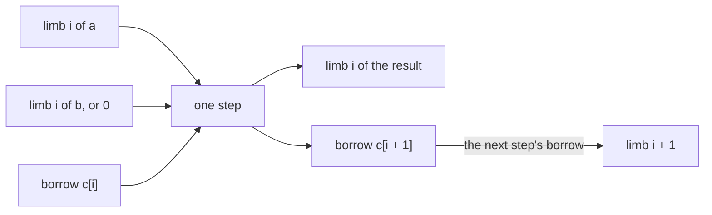
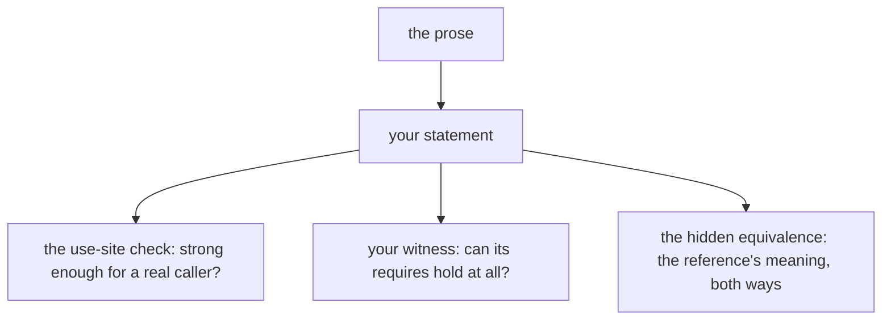
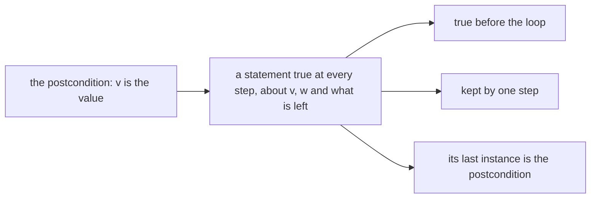

# Q13 — Practice II-A

Q10–Q12 handed you each statement with its proof's shape around it. Q13 opens the
intermediate practice tier: every item ships its statement and nothing else, no
skeleton; you choose the induction, the loop and the shape of the proof, and each item
allows at most one lemma of your own. One item ships no statement at all: you write it
from prose. References are 10–30 lines in Dafny and 15–45 in Verus, and items take 20–45
minutes. This chapter is a brief: it settles the warm-up with real runs and says what
each strand's items ask of you.
Three ideas do all the work:

1. **The induction follows the recursion the statement talks about.** Before writing a
   line, find the definition whose unfolding the goal needs, and recur on the argument
   that definition shrinks.
2. **Your one lemma is a step the statement does not give.** A helper earns its place when
   the main proof needs a fact about a smaller or a different shape: an idempotence, a
   lift over a whole loop, a generalization of an accumulator.
3. **A statement is judged by what it lets a caller conclude.** Too weak and a client
   fails; too strong and the body fails; a prose statement is right when a use site and a
   witness both verify, and an equivalence check against the reference holds.

---

## 0. How this module works, pretest, test-out

**Minutes: 200.** Brief 15 · warm-up 5 · `sub` with borrow (Verus) 35 · `normalize`
idempotent (Dafny) 30 · prose statement (Verus) 25 · library goal (pair) 30 · accumulator
generalization (Dafny) 20 · exit 20 · paper 15 · ledger 5. The Dafny file's
`CALIBRATION` block repeats this line.

**Setup.** Start one long-lived `/tutor Q13` session. Layer L6 is new: two lemmas
(`FromNatCanonical`, `NormalizeAddCorrect`) and a ghost specification of subtraction
(`Sub`) in Dafny; the exec `normalize` in Verus.

**Predictions first.** The warm-up, P1dv, is in the Dafny file's prediction block; its
answer goes in `slots/Q13.slots`. Record it with `scripts/firsttry.sh Q13 --check` before
you run anything it is about, then enable the slot.

**No pretest, no test-out.** A practice module is the practice. The exit (closed book,
one item) is the module's check.

Each prediction reappears below in a box,

> **Predict (Pn) — commit in the file before reading on.**

and its answer comes only after the box, below the words *Commit your prediction first.*

**Outputs.** Every output fence is a real run on the course pins (Dafny 4.11.0, Verus
0.2026.09.27.3cf1832), pinned in `expected/Q13.chapter.toml`. `p1.*` are scratch files run
with `scripts/vcheck --module Q13`, which adds Q13's given layers and options. Fences drop
the wrapper's last line, `raw output: <dir>`.

### This module's files

| file | what it is | shipped state |
|---|---|---|
| `dafny/Q/Q13_PracticeIIA/std/Q13_PracticeIIA.dfy` | the Dafny exercise file: the prediction block and H2d in `Q13_PracticeIIA`, then H4d and H5d in `Q13_Library` (nonlinear arithmetic off, last in the file) | verified, **3 holes** |
| `verus/q/q13_practice_iia/src/lib.rs` | the Verus crate root: H1v, the prose item H3v (its client and witness), H4v | verified, **3 holes** |
| `slots/Q13.slots` | your verdict answer | `???` |
| `verus/q/q13_practice_iia/src/exit.rs` | the closed-book exit, outside every build | verified, **1 hole** |
| `dafny/Q/Q13_PracticeIIA/exit/Q13_Exit.dfy` | the Dafny exit file: an empty module (exits come in pairs) | verified, no hole |
| `dafny/given/Q/QG_L1_BigNat.dfy` to `QG_L6_BigNat.dfy`; `verus/given/qg_bignat_l1` to `qg_bignat_l6` | the given spine, frozen; L6 is new | verified |
| `paper/Q13_problems.tex` → your `paper/Q13_answers.tex` | the written pair (§7) | — |
| `Solutions/` mirrors of these files | the reference twins | yours to open LAST |

---

## 1. S1 — Exec code against a value: subtraction with a borrow

**H1v.** `sub` walks the limbs from the low one, subtracting the next limb of `b` (zero
past its end) and the borrow, and borrowing when that goes below zero. The code is
Rust you have written before; the proof is the item. A loop invariant can speak about
every limb written so far only if it has a name for each borrow, so keep them in a ghost
sequence that grows with the loop:



Each step satisfies one equation between those five numbers. Your one lemma lifts the
equations of all the steps to the two values, by recursion on the length; after the
loop, a call puts that lift into context, and L6's `normalize` gives the result its
canonical form. A canonical `b` that is no larger than `a` has no more limbs than `a`:
the layers' bounds give that without a proof of your own.

---

## 2. S2 — Specifications: strength, and a statement from prose

> **Predict (P1dv) — commit in the file before reading on.** Two specifications of one method that returns the top limb of a canonical, non-empty number: [a] `ensures t < BASE`, [b] `ensures t != 0 ==> t == s[|s| - 1]` (Verus: the same over `a: &BigNat`), each with a client that calls it and asserts `t == s[|s| - 1]`, as the prediction block quotes them. Which clients verify?

*Commit your prediction first.* `D:none V:none`. The Dafny probe:

```dafny
module P1 {
  import opened QG_L1_BigNat
  import opened QG_L2_BigNat

  method TopA(s: seq<nat>) returns (t: nat)
    requires Canonical(s) && |s| > 0
    ensures t < BASE
  {
    t := s[|s| - 1];
  }

  method TopB(s: seq<nat>) returns (t: nat)
    requires Canonical(s) && |s| > 0
    ensures t != 0 ==> t == s[|s| - 1]
  {
    t := s[|s| - 1];
  }

  method ClientA(s: seq<nat>)
    requires Canonical(s) && |s| > 0
  {
    var t := TopA(s);
    assert t == s[|s| - 1];
  }

  method ClientB(s: seq<nat>)
    requires Canonical(s) && |s| > 0
  {
    var t := TopB(s);
    assert t == s[|s| - 1];
  }
}
```

<!-- pin: p1dv-d -->
```
$ scripts/vcheck --module Q13 p1.dfy
vcheck: p1.dfy [dafny, learner loop]: failed — 25 verified, 0 holes, 2 errors
p1.dfy:23:5: error: assertion might not hold
p1.dfy:30:5: error: assertion might not hold
```

The Verus probe:

```rust
use vstd::prelude::*;
use qg_bignat_l1::*;

verus! {

fn top_a(a: &BigNat) -> (t: u64)
    requires
        a.wf(),
        a@.len() > 0,
    ensures
        t < BASE,
{
    a.limbs[a.limbs.len() - 1]
}

fn top_b(a: &BigNat) -> (t: u64)
    requires
        a.wf(),
        a@.len() > 0,
    ensures
        t != 0 ==> t == a@[a@.len() - 1],
{
    a.limbs[a.limbs.len() - 1]
}

fn client_a(a: &BigNat)
    requires
        a.wf(),
        a@.len() > 0,
{
    let t = top_a(a);
    assert(t == a@[a@.len() - 1]);
}

fn client_b(a: &BigNat)
    requires
        a.wf(),
        a@.len() > 0,
{
    let t = top_b(a);
    assert(t == a@[a@.len() - 1]);
}

} // verus!
```

<!-- pin: p1dv-v -->
```
$ scripts/vcheck --module Q13 p1.rs
vcheck: p1.rs [verus, learner loop]: failed — 2 verified, 0 holes, 2 errors
p1.rs:32:12: error: assertion failed
p1.rs:41:12: error: assertion failed
```

[a] says nothing about which limb comes back. [b] looks like it pins the value, and it
does whenever `t` is not zero; but it lets the method return `0`, because the implication
is then vacuous, and nothing in [b] rules that out. The canonical form makes the true top
limb non-zero, but a specification is all a caller knows: neither client can conclude.
In card 05.5's words (your B1), both are *complete* (the right result meets them) and
neither is *sound* (each allows a wrong one).

**H3v, the prose item.** H3v gives you a sentence instead of a statement. The block
names the proof fn your statement must have, and ships a client whose body is one
labelled assume (the hole) with a commented use-site check under it. Write the statement
and its proof above the client, uncomment the check, write one non-vacuity witness in
`prose_witness` (a call whose `requires` hold), and delete the assume. Three instruments
judge the statement, each catching a different mistake:



The use site, as `prose_use_site` ships it, calls your lemma on two sequences of
different lengths and then asserts the strict inequality, so a statement that cannot be
applied there, or that concludes less, leaves it red; the witness is a call whose
`requires` must hold, so contradictory premises leave it red; the equivalence check runs
only in the grader container, the one place the author's statement is opened (it ships
sealed, and the container's own grader unseals it with no network and prints verdicts
alone).

**Running the hidden check.** You start it yourself, from your own terminal, once your
statement is final: a Claude session's guard refuses any line that names the sealed
archive, so no session runs it for you. Write a judging spec in a scratch file under
`/tmp`, for example `/tmp/q13-judge.toml`:

```toml
[[candidate]]
id = "mine"
item = "Q13.H3v"
```

and run `scripts/mksandbox-run --truth Hidden/labs/Q13/verdicts.tar.age --truth-check judge
--judge /tmp/q13-judge.toml` from the checkout's root (the candidate is your learner file;
a `file` key names another copy). The JSON it prints gives your statement one verdict
word, with the outcome words (`proved`, `failed` or `unknown`) of the checks behind it:
`base`, `vacuity`, and the four lemmas `req_from_ref` (the author's `requires` give yours),
`ens_to_ref` (yours give the author's `ensures`), `req_to_ref` and `ens_from_ref` (the same,
the other way). So the row shows on which side (`requires` or `ensures`) and in which
direction yours differs from the author's; no text of the author's statement is printed.
The verdict words: `faithful` (yours and the author's each give the other, both ways),
`strong` (yours claims more, or demands less: a `requires` dropped, say), `weak` (yours says
less, or demands more: a `requires` added, say), `vacuous` (its `requires` cannot
hold), `undecided` (anything else: a mix, more in one direction and less in the other, or a
difference the check cannot settle, such as one that needs an induction; unfaithful either
way), `mismatch` (the declaration is missing, unreadable or
not the block's, or a shipped statement changed) or `context` (your own definitions do not
verify).
`sandbox/image/truthcheck.py`'s docstring defines each.

**Run it once per item, and report the first run.** Run the check after your statement is
final (the use site and the witness pass, and you have read it against the prose one last
time), and report that first run's verdict line to `/review-code`, as you report a first
try. The outcome words say on which side and in which direction you differ, so a second
run after a fix made from them measures the check's hints, not your reading of the prose;
if you run it again, report the later run beside the first, as later. A reported `strong`,
`weak`, `vacuous` or `mismatch` is a finding of the review; `undecided` is the reader's to
decide. `/review-code` still reads your statement against the prose.

---

## 3. S3 — Assertions you choose

No item of Q13 is an assertion repair: the assertions are yours to place. In H2d and H5d
the step the solver misses is a sequence identity (a slice of a concatenation, a suffix of
a suffix); in H1v and H3v it is an instance of a quantified fact. Write the assertion that
names the term, run, and read where the failure moved.

---

## 4. S4 — Induction and loops without a skeleton

**H2d.** Normalizing twice changes nothing, and normalizing `a + b` keeps `a` whole unless
`b` normalizes to nothing. `Normalize` peels the top limb, which is `b`'s when `b` is not
empty: so the recursion shrinks `b`. One of the two conjuncts is a fact about any
sequence, and the other uses it; your one lemma is the place for the first.

**H5d.** The value by a loop from the **low** limb, in `Q13_Library` (nonlinear arithmetic
off). Q10's rule still holds (write the invariant from the exit backwards), but here the
postcondition says nothing about `w`, the place value the loop carries, or about the
limbs not yet read. The invariant must, so it is a generalization of the postcondition,
not a copy of it with `i` in place of `|s|`:



Find the statement that is true halfway through, of any sequence, then check its three
duties. With nonlinear arithmetic off, each product step is a call of
`Std.Arithmetic.Mul` (distributivity, associativity, commutativity), and L4's `MulNonneg`
keeps a product a natural number.

The direction is part of the item, and a tool checks it: H5d's block carries a
`// form: loop-dir:up, no-call:ToNat` line, which `scripts/firsttry.sh Q13 --report
--strict` checks. It reads your loop's guard and the steps your body gives the guard's
counter: the loop must count up (every assignment to its counter a step up). It reads the
indices too: every index of `s` your loop body reads adds the counter (`s[i]`, `s[i + 1..]`),
never subtracts it, so a loop that counts up but reads `s` from the top fails the form; and
the loop must carry the computation (read `s` at its counter and assign `v`), so a loop
beside some other computation of `v` is no loop of the form. `no-call:ToNat` refuses a
compiled call of the layer's `ToNat`; it stays yours to use in invariants, assertions and
lemma calls. Each fails the form whatever the verifier says.

---

## 5. S5 — Library goals, nonlinear arithmetic off

**H4d, H4v.** The value of `n` equal non-zero limbs, times `BASE - 1`, is `d` times
`Pow(n) - 1` (Verus: `weight(n) - 1`). The recursion peels one limb; what is left is
algebra on products of named quantities, and with nonlinear arithmetic off (Dafny's
attribute; Verus with no `nonlinear_arith`) each of those steps is a named library lemma:
distribute, reassociate, commute, subtract. Q04's search ladder finds them; write the
chain on paper first, one equation per step.

The rule is mechanical where it can be. H4v's block (and the exit's) carries a
`// form: no-nl` line, which `scripts/firsttry.sh Q13 --report --strict` checks: no
`nonlinear_arith` anywhere in the block. In Dafny the attribute on `Q13_Library`'s
`module` line is the rule; leave that line as shipped: `scripts/specfreeze --check Q13`
and `scripts/firsttry.sh Q13 --report --strict` both report a deleted attribute as
`freeze-lever-removed`, whatever the verifier says.

---

## 6. What the instruments can and cannot see

| instrument | what it sees | what it cannot see |
|---|---|---|
| `scripts/vcheck --gate` | zero holes, every pinned symbol checked | how many helpers you wrote (the tier allows one per item: a reader checks) |
| the use-site check (H3v) | that your statement applies to two sequences of different lengths and gives the strict inequality | a statement stronger than the prose |
| your witness (H3v) | that the statement's `requires` can hold | whether the conclusion is the prose's |
| the hidden equivalence (H3v; the grader container, from your own terminal, §2) | the reference's meaning, both directions, as one verdict word | a difference only an induction settles (`undecided`: a reader decides it) |
| `scripts/specfreeze --check Q13` | that no shipped statement changed, and that the nonlinear attribute on `Q13_Library`'s `module` line is still there | the statement you wrote for H3v (it is new) |
| `scripts/firsttry.sh Q13 --report --strict` | the prediction recorded, every commented check uncommented, H4v's and the exit's `form: no-nl` lines met, H5d's `form: loop-dir:up, no-call:ToNat` line met (its loop counts up, reads `s` from the low end at its counter and computes `v`; no compiled `ToNat`), and the nonlinear attribute still on `Q13_Library` | an index the form cannot follow (computed through a helper or read from another sequence: a reader checks it) |
| `scripts/vaudit` | assumes, holes, trusted attributes left in | a helper that restates the goal |
| a reader (`/review-code Q13`, design-judgment bar) | the induction's choice, the one helper's role, the prose statement | nothing mechanical |

---

## 7. On paper, before the keyboard

`paper/Q13_problems.tex` holds two problems (15 minutes, after §2 and before H3v). B1,
sound, complete, both or neither (5 minutes): five candidate postconditions of a small
function, each judged with card 05.5's definitions and a concrete pair for every property
it lacks. B2, the paper card 05.5 (10 minutes), field by field against the pinned range of
your `cheatsheets.md`. Fill `paper/Q13_answers.tex`, build with `make -C paper paper`
until green, and run `/grade-paper Q13` in a fresh session.

---

## 8. The exercise file

The two units, as shipped:

<!-- pin: units -->
```
$ scripts/vcheck Q13
vcheck: dafny/Q/Q13_PracticeIIA/std [dafny, learner loop]: verified — 132 verified, 3 holes, 0 errors
dafny/Q/Q13_PracticeIIA/std/Q13_PracticeIIA.dfy:104:61: hole bodyless-method Q13.H2d
dafny/Q/Q13_PracticeIIA/std/Q13_PracticeIIA.dfy:142:48: hole bodyless-method Q13.H4d
dafny/Q/Q13_PracticeIIA/std/Q13_PracticeIIA.dfy:163:5: hole assume Q13.H5d
vcheck: verus/q/q13_practice_iia [verus, learner loop]: verified — - verified, 3 holes, 0 errors
verus/q/q13_practice_iia/src/lib.rs:50:1: hole external_body Q13.H1v
verus/q/q13_practice_iia/src/lib.rs:96:40: hole assume Q13.H3v
verus/q/q13_practice_iia/src/lib.rs:121:40: hole assume Q13.H4v
vcheck: 2 unit(s): 2 verified, 0 not; 6 hole(s) in all
```

Six holes, as `expected/Q13.counts` pins them: H2d and H4d (bodyless lemmas) and H5d (an
exec `assume false;`) in the Dafny file; H1v (`external_body`), H3v (the client's
labelled assume) and H4v (a `proof_note` assume) in `lib.rs`. Each item's `HELPERS` area
sits above its marker.

**The hint dial.** One hint per hole, read only when stuck; after 20 minutes stuck, ask
`/tutor Q13`.

**Slots.** Fill `slots/Q13.slots` (`P1dv = ???` becomes `P1dv = "<answer>"`), run
`scripts/firsttry.sh Q13 --check`, then enable it: `// SLOT: CHECK P1dv` becomes
`// CHECK P1dv`.

**Done** = `scripts/vcheck --gate dafny/Q/Q13_PracticeIIA/std` and
`scripts/vcheck --gate verus/q/q13_practice_iia` each print only the summary line and exit
0, `scripts/vaudit` reports no finding on either, **and** `scripts/firsttry.sh Q13
--report --strict` exits 0.

**Calibration.** Write your actual minutes beside each line of the Dafny file's
`CALIBRATION` block; at the end run `scripts/firsttry.sh Q13 --record`.

---

## Exit (closed book)

Close this chapter, the exercise files, later modules' files, search tools and `/tutor`; at
most the given spine stays open. One unseen item, 20 minutes: a Verus lemma about a
sequence's value (S4), statement given, no skeleton, in an exit file shipping 1 hole.
When the block holds an attempt (a guess counts; a hole does not), run
`scripts/firsttry.sh Q13 --exit` once, before fixing anything: that first complete run is
your score, **threshold 1 of 1**, the intermediate tier's rule: it must pass. Then repair
the block with `scripts/vcheck <exit file>`.

---

## Instructor touchpoints

> **The Q13 module loop, with the instructor in place:**
>
> - **`/discuss Q13`** (optional; a coach session): a Socratic pass over the Q13 bank, with
>   an ML engineer who wants to know what a verified result promises.
> - **`/tutor Q13`** (one long-lived session): after 20 minutes stuck; one rung per turn,
>   and never the corrected line or a statement for the prose item.
> - **`/grade-paper Q13`** (fresh session): once `make -C paper paper` is green (§7).
> - **`/review-code Q13`** (fresh session): once §8's Done line holds. Bar: design
>   judgment, with the prose item's statement read against the prose.
> - **`/viva Q13`**: not this module. The intermediate tier's viva is `/viva Q15`, over
>   Q13, Q14 and Q15 together.
> - **`/contract Q13`**: not this module. Q13 has no agentic file, and `/contract Q13`
>   refuses.
> - **Solutions last**: the `Solutions/` mirrors of Q13's files, only after `/viva Q15`,
>   which examines Q13 too.
> - **`/review`**: whenever the session banner says ledger items are due.

---

## What Q13 planted

| seed | harvested |
|---|---|
| a ghost record of a loop's carries or borrows, lifted by one lemma (H1v) | Q16 (multiplication with an invented invariant), Q18 (the capstone's crate) |
| a statement from prose, judged by a use site, a witness and an equivalence (H3v) | Q15 (Lab 2: specifications from prose and their oracles) |
| soundness and completeness of a specification (P1dv, B1) | Q15 (the oracles' verdicts: faithful, weak, over-strong) |
| an accumulator generalized into an invariant (H5d) | Q16 (generalize before induction) |
| library algebra with nonlinear arithmetic off (H4d, H4v) | Q16 (multiplication), Q18 |

*Paper card: **05.5**, "VERINA: Benchmarking Verifiable Code Generation". Reread it in
your own `cheatsheets.md` before §7, asking: what it means for a generated specification
to be sound and complete, how it checks that when no proof comes, and why a specification
that restates the code cannot make an end-to-end proof trivial.*
