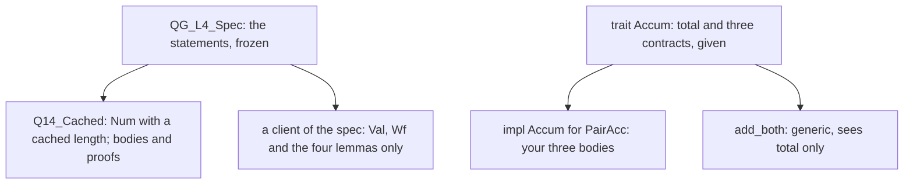
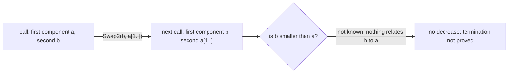
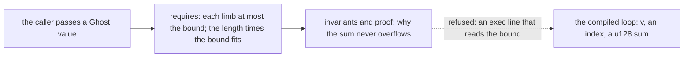

# Q14 — Practice II-B

Q13 practised strands S1–S5 in the intermediate tier. Q14 practises S6–S8 the same way:
every item ships its statement and nothing else, no skeleton, and each allows at most one
lemma of your own. The items are a refinement whose comparison decides by a cached length,
a trait implemented under a ghost view, a measure you choose and a bound that is ghost, the
loop rule's soundness for a semantics that can run out of fuel, and a linked list whose
nodes carry each other's permissions. This chapter is a brief: it settles the warm-up with
real runs, backs each claim about the tools with a pinned run on a toy, and says what each
strand's items ask of you.
Three ideas do all the work:

1. **A contract is all a client sees, and an implementation is checked against it alone.**
   A refinement inherits its base module's statements; a trait's implementation inherits
   its methods' `requires` and `ensures`. Neither may weaken them, and a client that is
   proved from the contract holds for every implementation of it.
2. **A measure must drop at every recursive call, whichever argument the call shrinks.**
   Dafny's guess is the parameters in order; a recursion that swaps its arguments defeats
   it, and then the measure is yours to find.
3. **Ghost state carries the proof and costs nothing at run time.** A ghost bound, a ghost
   length and a tracked permission are erased from the compiled code but checked like
   values: a ghost value never flows into exec code, and a permission has one owner at a
   time.

---

## 0. How this module works, pretest, test-out

**Minutes: 210.** Brief 15 · warm-up 5 · abstract-BigNat refinement (Dafny) 35 · trait with
ghost view (Verus) 30 · termination + erasure (pair) 25 · loop-rule soundness (Dafny) 30 ·
permission node list (Verus) 30 · exit 20 · paper 15 · ledger 5. The Dafny file's
`CALIBRATION` block repeats this line.

**Setup.** Start one long-lived `/tutor Q14` session. Q14 adds no layer: L6 is Q13's. The
order of work is the main Dafny file's header: P1, then H1 (in `Q14_Cached`), then the
Verus crate's H2 and H3, then H3's Dafny half (in `Q14_Term`), then `Q14_Loop.dfy` (H4),
and `perm.rs` (H5) last.

**Predictions first.** The warm-up, P1dv, is in the main Dafny file's prediction block; its
answer goes in `slots/Q14.slots`. Record it with `scripts/firsttry.sh Q14 --check` before
you run anything it is about, then enable the slot.

**No pretest, no test-out.** A practice module is the practice. The exit (closed book, one
item) is the module's check.

Each prediction reappears below in a box,

> **Predict (Pn) — commit in the file before reading on.**

and its answer comes only after the box, below the words *Commit your prediction first.*

**Outputs.** Every output fence is a real run on the course pins (Dafny 4.11.0, Verus
0.2026.09.27.3cf1832), pinned in `expected/Q14.chapter.toml`. `p1.*`, `ticker*.rs`,
`first_or_zero*.rs` and `hold.rs` are scratch files run with `scripts/vcheck --module Q14`,
which adds Q14's given layers and options. Fences drop the wrapper's last line,
`raw output: <dir>`.

### This module's files

| file | what it is | shipped state |
|---|---|---|
| `dafny/Q/Q14_PracticeIIB/std/Q14_PracticeIIB.dfy` | the main Dafny file: the prediction block and H3d in `Q14_Term`, then H1d in `Q14_Cached`, a refinement of L4's `QG_L4_Spec` (nonlinear arithmetic off, last in the file) | verified, **2 holes** |
| `dafny/Q/Q14_PracticeIIB/std/Q14_Loop.dfy` | a small language with a loop and its wp (W2d), and the loop case of soundness (H4d); nonlinear arithmetic off | verified, **1 hole** |
| `verus/q/q14_practice_iib/src/lib.rs` | the Verus crate root: the trait implementation H2v (three methods) and the erasure item H3v | verified, **4 holes** |
| `verus/q/q14_practice_iib/src/perm.rs` | the permissions module: the node list H5v (two operations) | verified, **2 holes** |
| `slots/Q14.slots` | your verdict answer | `???` |
| `dafny/Q/Q14_PracticeIIB/exit/Q14_Exit.dfy` | the closed-book exit, outside every build | verified, **1 hole** |
| `verus/q/q14_practice_iib/src/exit.rs` | the Verus exit file: one given empty proof fn, no block (exits come in pairs) | verified, no hole |
| `dafny/given/Q/QG_L1_BigNat.dfy` to `QG_L6_BigNat.dfy`; `verus/given/qg_bignat_l1` to `qg_bignat_l6` | the given spine, frozen | verified |
| `paper/Q14_problems.tex` → your `paper/Q14_answers.tex` | the written pair (§5) | — |
| `Solutions/` mirrors of these files | the reference twins | yours to open LAST |

Nine holes in all: three in the Dafny unit and six in the crate, where H2v's three methods
and H5v's two operations count one each.

---

## 1. S6 — Abstraction: a refinement and a trait with a ghost view

Both items of this strand put a contract above an implementation, and a client beside it
that sees only the contract:



Your work is always on the implementation side; the contracts and the clients ship.

**H1d (the refinement).** `QG_L4_Spec` is L4's abstract BigNat: a type, `Val`, `Wf`, four
operations and four lemmas, each lemma a statement with no body. L4's own `QG_L4_Limbs`
refines it with bare limb sequences; `Q14_Cached` refines it with a record that caches its
length. `Wf` asks for canonical limbs and a correct cache, and `Cmp` answers from the cached
lengths whenever they differ, without reading a limb. The statements are inherited, so
`CmpCorrect` appears in the file with no `requires` or `ensures` of its own (the docstring
quotes them), and the other three lemmas ship proved. What you prove is that the shortcut
is right: when the cached lengths differ, the values are ordered the same way. That is a
fact about canonical numbers, not about `Cmp`, and the docstring's question says what to
look for in the layers. Nonlinear arithmetic is off in `Q14_Cached`, so a step about powers
is a named lemma call, as in Q13's library goal.

**H2v (a trait with a ghost view).** `Accum` describes an accumulator only through
`spec fn total`, and `add_both` is proved once from those contracts, for every
implementation. `PairAcc` holds two words, and its view `lo + BASE * hi` ships. Two toy runs
show what an implementation is checked against. First, a body that breaks the trait's
`ensures`:

```rust
use vstd::prelude::*;

verus! {

pub trait Ticker: Sized {
    spec fn ticks(&self) -> nat;

    fn tick_once(&mut self)
        requires
            old(self).ticks() < 100,
        ensures
            final(self).ticks() == old(self).ticks() + 1,
    ;
}

pub struct Clicker {
    pub n: u64,
}

impl Ticker for Clicker {
    open spec fn ticks(&self) -> nat {
        self.n as nat
    }

    fn tick_once(&mut self) {
        self.n = self.n + 2;
    }
}

} // verus!
```

<!-- pin: trait-ensures -->
```
$ scripts/vcheck --module Q14 ticker.rs
vcheck: ticker.rs [verus, learner loop]: failed — 0 verified, 0 holes, 1 error
ticker.rs:12:13: error: postcondition not satisfied
```

The error points at the trait's `ensures` (line 12), not at the impl: the contract lives in
the trait, and every implementation answers to it. Second, an implementation that tries to
assume more than the trait grants, with a `requires` of its own:

```rust
use vstd::prelude::*;

verus! {

pub trait Ticker: Sized {
    spec fn ticks(&self) -> nat;

    fn tick_once(&mut self)
        ensures
            final(self).ticks() == old(self).ticks() + 1,
    ;
}

pub struct Clicker {
    pub n: u64,
}

impl Ticker for Clicker {
    open spec fn ticks(&self) -> nat {
        self.n as nat
    }

    fn tick_once(&mut self)
        requires
            old(self).n < 100,
    {
        self.n = self.n + 1;
    }
}

} // verus!
```

<!-- pin: trait-requires -->
```
$ scripts/vcheck --module Q14 ticker_req.rs
vcheck: ticker_req.rs [verus, learner loop]: failed — - verified, 0 holes, 1 error, stage resolve
ticker_req.rs:23:5: error: trait method implementation cannot declare requires clauses; these can only be inherited from the trait declaration
```

Refused before verification. A generic client such as `add_both` knows only the trait's
`requires`, so an implementation that needed more could be called where its extra
assumption fails. For `PairAcc`, then: each method may use exactly what the trait's
`requires` give it, written in terms of `total`, and must deliver its `ensures` in the same
terms. `from_big` states its result both ways (`Some` exactly when the value fits), so it
must refuse every number that does not fit and accept every number that does.

---

## 2. S7 — Termination and erasure

> **Predict (P1dv) — commit in the file before reading on.** A recursion whose recursive call swaps its two sequence arguments and shortens one: Dafny's `Swap2` with no `decreases` clause, and Verus's `swap2` with the measure written as the two lengths in parameter order, as the prediction block quotes them, each a file of its own. What does `scripts/vcheck` say about each?

*Commit your prediction first.* `D:fail V:fail`. The Dafny file:

```dafny
function Swap2(a: seq<nat>, b: seq<nat>): nat
{
  if |a| == 0 then |b| else Swap2(b, a[1..])
}
```

<!-- pin: p1dv-d -->
```
$ scripts/vcheck --module Q14 p1.dfy
vcheck: p1.dfy [dafny, learner loop]: failed — 22 verified, 0 holes, 1 error
p1.dfy:3:34: error: cannot prove termination; try supplying a decreases clause
```

The Verus file:

```rust
use vstd::prelude::*;

verus! {

pub open spec fn swap2(a: Seq<nat>, b: Seq<nat>) -> nat
    decreases a.len(), b.len(),
{
    if a.len() == 0 { b.len() } else { swap2(b, a.drop_first()) }
}

} // verus!
```

<!-- pin: p1dv-v -->
```
$ scripts/vcheck --module Q14 p1.rs
vcheck: p1.rs [verus, learner loop]: failed — 0 verified, 0 holes, 1 error
p1.rs:8:40: error: could not prove termination
```

Both fail at the recursive call, for one reason. With no clause, Dafny guesses the
parameters in order, `decreases a, b` (Q05), comparing sequences by its own order, not by
length; the Verus file writes a tuple of the lengths. A tuple drops when its first component
drops, or stays while a later one drops (Q05's rule). At the swapped call the first component is replaced by the other argument:



Nothing relates `b` to `a`, so neither the guess nor the written tuple decreases, and both
tools report a termination failure at the call. Q05's `Ack` passed because its first component never went
up: it dropped, or stayed while the second dropped; here it can go up.

**H3d (a measure of your own).** `Interleave` takes the two sequences' elements in turn, and
its recursive call swaps them, as `Swap2`'s does; its `decreases` ships. `InterleaveSpec`
ships with no measure: its proof recurs as `Interleave` does, so P1's lesson applies to the
lemma, and the measure is part of your answer. Of its four conjuncts, two say that the
length and the elements are kept and two say what appending one element to each side does;
the docstring's question, which call each case needs, is the plan. Automatic induction is
off in this unit, so every step of the recursion is a call you write. When it verifies,
`scripts/vcheck --brittleness --solvers dafny/Q/Q14_PracticeIIB/std` (Q09) tells you
whether your proof holds under every seed and both solvers; if it does not, Q09's repairs
apply.

**H3v (erasure).** `sum_limbs` adds the limbs of a vector into a `u128`. Its bound is a
`Ghost<nat>` parameter: the caller wraps a value in `Ghost(…)`, the `requires` uses it,
the proof may use it, and the compiled code never sees it. A toy shows both sides of that rule. A
ghost bound in the specification only:

```rust
use vstd::prelude::*;

verus! {

fn first_or_zero(v: &Vec<u64>, Ghost(cap): Ghost<nat>) -> (r: u64)
    requires
        forall|i: int| 0 <= i < v.len() ==> v@[i] <= cap,
    ensures
        r <= cap,
{
    if v.len() == 0 { 0 } else { v[0] }
}

} // verus!
```

<!-- pin: ghost-spec -->
```
$ scripts/vcheck --module Q14 first_or_zero.rs
vcheck: first_or_zero.rs [verus, learner loop]: verified — 1 verified, 0 holes, 0 errors
```

The same function with one exec line that reads it:

```rust
use vstd::prelude::*;

verus! {

fn first_or_zero(v: &Vec<u64>, Ghost(cap): Ghost<nat>) -> (r: u64)
    requires
        forall|i: int| 0 <= i < v.len() ==> v@[i] <= cap,
    ensures
        r <= cap,
{
    let c = cap;
    if v.len() == 0 { 0 } else { v[0] }
}

} // verus!
```

<!-- pin: ghost-exec -->
```
$ scripts/vcheck --module Q14 first_or_zero_read.rs
vcheck: first_or_zero_read.rs [verus, learner loop]: failed — - verified, 0 holes, 1 error, stage resolve
first_or_zero_read.rs:11:13: error: cannot access spec-mode place in executable context
```

Refused at resolution, as Q11's `bump` was: values flow from exec to ghost, never back. In
`sum_limbs` the bound is there for one purpose:



The loop's direction is part of the item: from the top limb down, `i` counting from
`v.len()` to 0, as the docstring says. A tool checks it: H3v's block carries a
`// form: loop-dir:i:down` line, which `scripts/firsttry.sh Q14 --report --strict` checks
(§4). It reads the loop whose guard names `i` and the steps the body gives `i`: every one
must be a step down, so a loop from the low limb up fails the form whatever the verifier
says. It reads the loop's indices too: each index of `v` the body reads adds `i` (a `let`
in the body is read through its definition), never subtracts it, so a loop that steps `i`
down but reads `v[v.len() - i]` fails it as well; and the loop must carry the computation
(read `v` at `i` and assign the sum).

---

## 3. S8 — Program logic and permissions: the loop rule, a node list

**W2d, H4d (the loop rule).** `Q14_Loop.dfy` is Q11's small language with one more command,
`While(b, inv, body)`, which carries its invariant. A loop need not end, so `Exec` cannot be
a total function of the command and the state alone: it takes a fuel, each iteration spends
one unit, and a run that would need more is `Stuck`. Soundness then speaks only of runs that
end (`Done`): it is partial correctness, and a `Stuck` run promises nothing. `Wp` gives a
loop its invariant and nothing more; that is sound only together with the loop's two side
conditions, which `Vcs` collects (for every loop, its body's loops included) and `Valid`
asks to hold in every state. H4d is the `While` case of soundness, with the body's soundness
given as a hypothesis, as Q11.H9d gave the branch's; the recursion is on the fuel, and the
statement's `decreases fuel` ships. The docstring's two questions, where the lemma's own
call starts and what each side condition says where it is used, are the proof's outline:
answer them on paper before writing a line.

**H5v (a permission node list).** Each node is a `PPtr<Node>` cell, and a cell is read
through its `PointsTo` permission only. The list holds the head node's permission, and each
node holds its successor's, so one permission passes per node and no map is needed:


`chain_wf` and `chain_view` read that chain for a ghost number of nodes, and both ship. A
permission is a tracked value, checked as an owned one is, so it has one owner at a time.
A toy that moves a permission into a struct and then reads the cell with it:

```rust
use vstd::prelude::*;
use vstd::simple_pptr::*;

verus! {

pub struct Holder {
    pub perm: Tracked<PointsTo<u64>>,
}

fn stash_and_read() {
    let (p, Tracked(perm)) = PPtr::<u64>::new(5);
    let h = Holder { perm: Tracked(perm) };
    let x = *p.borrow(Tracked(&perm));
}

} // verus!
```

<!-- pin: perm-moved -->
```
$ scripts/vcheck --module Q14 hold.rs
vcheck: hold.rs [verus, learner loop]: failed — 0 verified, 0 holes, 1 error, stage resolve
hold.rs:13:31: error: borrow of moved value: `perm`
```

After the move only `h` holds the permission. `push_front` and `sum` are about exactly that:
where each permission is at every moment, who lends it, and what each step hands on. Read
the `requires` and `ensures` of `PPtr::new` and `PPtr::borrow` in vstd's `simple_pptr.rs`
before writing either body. `sum` requires that the total fits in a `u64`, so it needs no
bound of its own.

---

## 4. What the instruments can and cannot see

| instrument | what it sees | what it cannot see |
|---|---|---|
| `scripts/vcheck --gate` | zero holes, every pinned symbol checked, every mode, ownership and termination rule | how many helpers you wrote (one per item: a reader checks); the direction of H3v's loop (the next row's) |
| `scripts/firsttry.sh Q14 --report --strict` | the prediction recorded, every commented check uncommented, H3v's `form: loop-dir:i:down` line met (`i` only steps down, every index of `v` adds `i`, and the loop computes the sum) | an index the form cannot follow (computed through a helper or read from another sequence: a reader checks it) |
| the trait and the refinement | that each implementation meets the inherited contracts | whether your proof says why the cached length is enough |
| `scripts/specfreeze --check Q14` | that no shipped statement or contract changed (a measure you add is allowed) | what you wrote inside a body |
| the uncommented checks | one concrete use each of H1d, H2v, H3d, H3v and H5v: a call, a value, a short list | every other input |
| `scripts/vaudit` | assumes, holes, trusted or external bodies left in | a helper that restates the goal |
| `scripts/vcheck --brittleness --solvers` (Q09) | whether a Dafny proof holds under every seed and both solvers | whether it is the proof you meant |
| a reader (`/review-code Q14`, design-judgment bar) | the measure's choice, which limb H3v's loop reads at each step, the one helper's role, where each permission goes | nothing mechanical |

---

## 5. On paper, before the keyboard

`paper/Q14_problems.tex` holds the written pair (15 minutes, after §1 and before H2v): B1,
which contracts may stand in for a trait's (S6, 5 minutes, answered without running
anything), and B2, the paper card 06.9 (10 minutes), field by field against the pinned range
of your `cheatsheets.md`. Fill
`paper/Q14_answers.tex`, build with `make -C paper paper` until green, and run
`/grade-paper Q14` in a fresh session.

---

## 6. The exercise file

The two units, as shipped:

<!-- pin: units -->
```
$ scripts/vcheck Q14
vcheck: dafny/Q/Q14_PracticeIIB/std [dafny, learner loop]: verified — 146 verified, 3 holes, 0 errors
dafny/Q/Q14_PracticeIIB/std/Q14_Loop.dfy:147:51: hole bodyless-method Q14.H4d
dafny/Q/Q14_PracticeIIB/std/Q14_PracticeIIB.dfy:111:88: hole bodyless-method Q14.H3d
dafny/Q/Q14_PracticeIIB/std/Q14_PracticeIIB.dfy:189:5: hole assume Q14.H1d
vcheck: verus/q/q14_practice_iib [verus, learner loop]: verified — - verified, 6 holes, 0 errors
verus/q/q14_practice_iib/src/lib.rs:101:5: hole external_body Q14.H2v
verus/q/q14_practice_iib/src/lib.rs:106:5: hole external_body Q14.H2v
verus/q/q14_practice_iib/src/lib.rs:111:5: hole external_body Q14.H2v
verus/q/q14_practice_iib/src/lib.rs:153:1: hole external_body Q14.H3v
verus/q/q14_practice_iib/src/perm.rs:124:5: hole external_body Q14.H5v
verus/q/q14_practice_iib/src/perm.rs:135:5: hole external_body Q14.H5v
vcheck: 2 unit(s): 2 verified, 0 not; 9 hole(s) in all
```

Nine holes, as `expected/Q14.counts` pins them. In the Dafny unit: H3d (a bodyless lemma) in
`Q14_Term`, H1d (an `assume false;` in the refined lemma) in `Q14_Cached`, and H4d (a
bodyless lemma) in `Q14_Loop.dfy`. In the crate: H2v's three methods and H3v
(`external_body`) in `lib.rs`, and H5v's two operations (`external_body`) in `perm.rs`. The
`HELPERS` areas sit above H1d, H3d and H3v, and the checks of H1d, H2v, H3d, H3v and H5v
sit below them under `Uncomment as you go:`.

**The hint dial.** One hint per hole, read only when stuck; after 20 minutes stuck, ask
`/tutor Q14`.

**Slots.** Fill `slots/Q14.slots` (`P1dv = ???` becomes `P1dv = "<answer>"`), run
`scripts/firsttry.sh Q14 --check`, then enable it: `// SLOT: CHECK P1dv` becomes
`// CHECK P1dv`.

**Done** = `scripts/vcheck --gate dafny/Q/Q14_PracticeIIB/std` and
`scripts/vcheck --gate verus/q/q14_practice_iib` each print only the summary line and exit
0, `scripts/vaudit` reports no finding on either, **and** `scripts/firsttry.sh Q14
--report --strict` exits 0. Each gate covers both files of its unit.

**Calibration.** Write your actual minutes beside each line of the main Dafny file's
`CALIBRATION` block; at the end run `scripts/firsttry.sh Q14 --record`.

---

## Exit (closed book)

Close this chapter, the exercise files, later modules' files, search tools and `/tutor`; at
most the given spine stays open. One unseen item, 20 minutes: a Dafny lemma about a given
recursive function (S7), statement given, no skeleton, its measure yours, in an exit file
shipping 1 hole; the Verus exit file has no block. When the block holds an attempt (a guess
counts; a hole does not), run `scripts/firsttry.sh Q14 --exit` once, before fixing anything:
that first complete run is your score, **threshold 1 of 1**, the intermediate tier's rule:
it must pass. Then repair the block with `scripts/vcheck <exit file>`.

---

## Instructor touchpoints

> **The Q14 module loop, with the instructor in place:**
>
> - **`/discuss Q14`** (optional; a coach session): a Socratic pass over the Q14 bank, with
>   an ML engineer who asks what a ghost value costs and what a trait's contract buys.
> - **`/tutor Q14`** (one long-lived session): after 20 minutes stuck; one rung per turn,
>   and never the corrected line, a measure or an invariant.
> - **`/grade-paper Q14`** (fresh session): once `make -C paper paper` is green (§5).
> - **`/review-code Q14`** (fresh session): once §6's Done line holds. Bar: design
>   judgment, with the limb H3v's loop reads at each step and H5v's permission flow read
>   by hand.
> - **`/viva Q14`**: not this module. The intermediate tier's viva is `/viva Q15`, over
>   Q13, Q14 and Q15 together.
> - **`/contract Q14`**: not this module. Q14 has no agentic file, and `/contract Q14`
>   refuses.
> - **Solutions last**: the `Solutions/` mirrors of Q14's files, only after `/viva Q15`,
>   which examines Q14 too.
> - **`/review`**: whenever the session banner says ledger items are due.

---

## What Q14 planted

| seed | harvested |
|---|---|
| a refinement whose inherited statements meet a cached field (H1d) | Q17 (a priority-queue refinement with frames) |
| a trait with a ghost view and a generic client proved once (H2v) | Q17 (the priority queue's given trait), Q18 (an extension trait of the mini-crate's API) |
| a measure of your own for a recursion the default cannot order (P1dv, H3d) | Q16 and Q18 (recursive lemmas whose measures are yours) |
| a ghost value that the compiled code never reads (H3v) | Q16 (a compiled loop specified by a ghost definition), Q18 |
| the loop rule's soundness for a fuelled semantics (W2d, H4d) | Q17 (this language with annotated loops, and a VC generator's statements) |
| one tracked permission per node, handed along a chain (H5v) | Q17 (a permissioned ring buffer) |

*Paper card: **06.9**, "CAPRI: Contract-Aware Proof Repair for Isabelle". Reread it in your
own `cheatsheets.md` before §5, asking: what a false success is and why a green build does
not rule one out, what the contract check compares and what it leaves editable, and what
the proof-body-only default costs, which is the trade the course makes when a statement is
frozen and only its proof is yours.*
