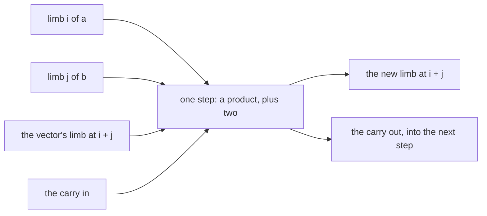
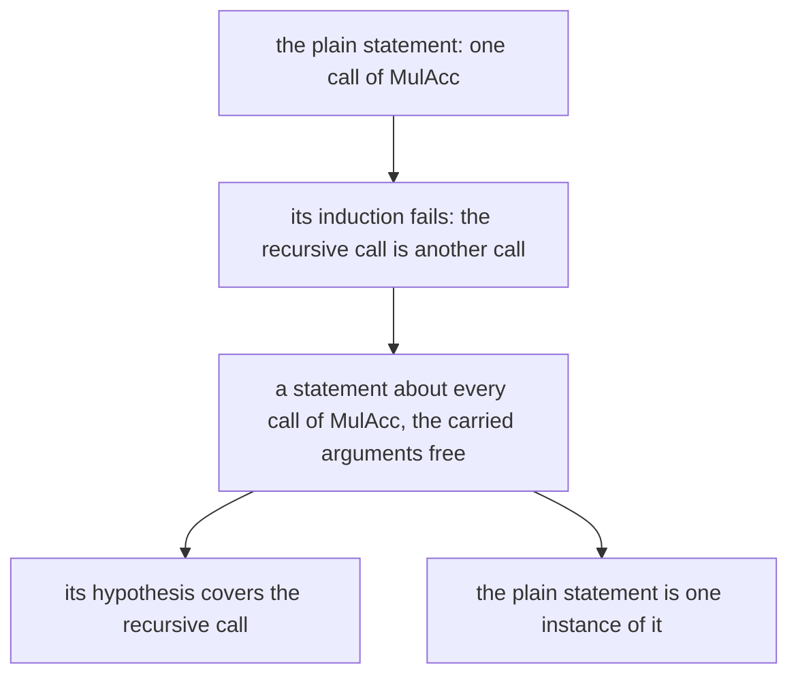
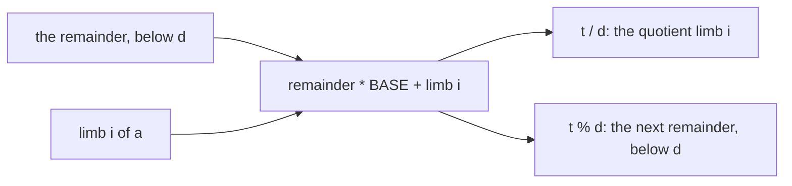
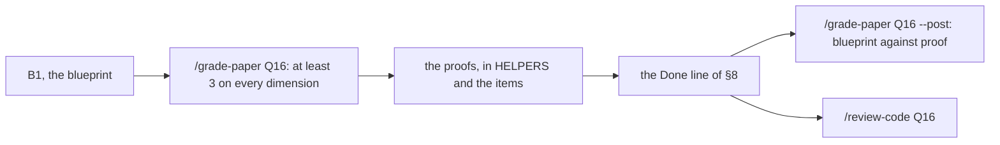

# Q16 — Practice III-A

Q13–Q15 handed you each statement and asked for one lemma of your own at most. Q16 opens
the hard practice tier: three problems of 40–75 minutes, and for each the plain statement
ships, as a hole, and is known not to go through as it stands. The statements under it are
yours: the generalization, the invariants and the two to four lemmas a problem needs, in
an order you choose, written down in a blueprint that is graded before you write any
proof. References are 30–80 proof lines in Dafny and 45–120 in Verus. The three problems
are about one operation, multiplication of two BigNats, and its inverse by one limb. This
chapter is a brief: it shows the plain attempt failing with a real run, says what each
strand's problems ask of you, and names what each instrument can and cannot see.
Three ideas do all the work:

1. **Generalize before you induct.** When a definition's recursion carries state from one
   step to the next (an accumulator, a position), a statement about its starting call
   cannot be its own induction hypothesis: the recursive call is not at the start. The
   statement you prove by induction is about every call, with the carried state free, and
   the shipped statement is one instance of it.
2. **The blueprint is the proof, minus the syntax.** Each invented lemma with its exact
   statement, the order they are proved in, the induction or the loop of each, and the
   place every library fact enters: a contractor could formalize it without inventing a
   statement. Writing it first is cheaper than finding out in the verifier.
3. **An invariant is a value equation about a partial state.** A loop that builds a
   number limb by limb is proved by an equation between what is built so far, what is left
   to read and what the inputs are worth, true at every step; one step of the loop is one
   step of arithmetic on that equation.

---

## 0. How this module works, pretest, test-out

**Minutes: 225.** Brief 10 · blueprint 30 · full multiplication (Dafny) 45 · division by
one limb (Verus) 50 · the in-place schoolbook (Verus and its Dafny half) 55 ·
`/review-code` 15 · paper 15 · ledger 5. The Dafny file's `CALIBRATION` block repeats
this line.

**Setup.** Start one long-lived `/tutor Q16` session. Layer L7 is new. In Dafny it holds
three definitions and no lemma: `Shift` (zero limbs below a sequence, compiled), `MulAcc`
(the schoolbook product row by row, ghost) and `Times` (`MulAcc` from the empty
accumulator at position 0, ghost). In Verus it holds `big_sub`, `to_u64` and the base API
`BigNatCore` that Q18's crate builds on.

**The blueprint first.** B1 of `paper/Q16_problems.tex` (§7) covers H1, H2 and H3. Run
`/grade-paper Q16` on it and get at least 3 on every dimension before you write a proof in
either file.

**No prediction, no pretest, no test-out, no exit file.** Q16 has no prediction item and no
slot. A practice module is the practice, and in the hard tier the module's exit is its
verifier part (the Done line of §8) with the two reviews: `/review-code Q16` at the
library bar and `/grade-paper Q16 --post`, which compares your blueprint with the proofs
you wrote.

**Outputs.** Every output fence is a real run on the course pins (Dafny 4.11.0, Verus
0.2026.09.27.3cf1832), pinned in `expected/Q16.chapter.toml`. `plain.dfy` and `ghost.dfy`
are scratch files run with `scripts/vcheck --module Q16`, which adds Q16's given layers
and options. Fences drop the wrapper's last line, `raw output: <dir>`.

### This module's files

| file | what it is | shipped state |
|---|---|---|
| `dafny/Q/Q16_PracticeIIIA/std/Q16_PracticeIIIA.dfy` | the Dafny exercise file: one module (nonlinear arithmetic off), its `HELPERS` area, H1d, then H3's Dafny half H3d | verified, **2 holes** |
| `verus/q/q16_practice_iiia/src/lib.rs` | the Verus crate root: its `HELPERS` area, H2v, H3's Verus half H3v, and H3's speed test (commented, after `verus!`) | verified, **2 holes** |
| `dafny/given/Q/QG_L1_BigNat.dfy` to `QG_L7_BigNat.dfy`; `verus/given/qg_bignat_l1` to `qg_bignat_l7` | the given spine, frozen; L7 is new | verified |
| `paper/Q16_problems.tex` → your `paper/Q16_answers.tex` | the written pair (§7): the blueprint and the card | — |
| `Solutions/` mirrors of these files | the reference twins | yours to open LAST |

---

## 1. S1 — Exec code against a value: the in-place schoolbook

**H3v.** `mul` multiplies two canonical BigNats the way you would on paper, with one
constraint that makes it an algorithm rather than a composition of layer calls: one result
vector, and for each limb of `b` one pass that adds that limb's row of products into the
vector at the limb's offset, with a carry of its own. No whole-number addition per row:
the block's `// form: no-call:big_add, no-call:plus, no-adder` line, checked by
`scripts/firsttry.sh Q16 --report --strict`, refuses a call of L4's `big_add` or of
`NatLike::plus`, in `mul` or in a helper `mul` calls, and (`no-adder`) a helper of your own
that `mul` calls and whose `ensures` states a whole-number sum (`r.to_nat() == x.to_nat() +
y.to_nat()`, either way round): L4's adder copied under another name is still an adder. One step of the inner pass touches
four numbers and leaves two:



The step's sum fits in 128 bits, and that is a fact you prove, not one Verus assumes: it
checks every cast and every overflow. Two loops mean two invariants, and each is a
statement about the **value** of the vector so far, true at every step; which facts about
values the steps need, beyond what L1–L7 and vstd give, is for your blueprint to find. L6's
`normalize` gives the result its canonical form at the end.

**The speed test.** Once `mul` verifies, uncomment the `#[cfg(test)]` module after
`verus!` and run `scripts/vcheck --test verus/q/q16_practice_iiia`. It multiplies two
four-limb factors and checks the product's limbs against constants written in the test. A
method that adds `a` to itself `b` times would loop about 2^256 times on these inputs, so
it cannot finish; the verifier alone would not tell those two methods apart, and the test
does. `scripts/firsttry.sh Q16 --report --strict` runs it too (the item's `uses:` line
names `property-test`).

---

## 2. S2 — A specification that pins a representation

**H3d**, H3's Dafny half, is a compiled loop whose `ensures` says more than the product's
value: `r == Times(a, b)` names the exact sequence L7's definition builds, row by row. Two
sequences can have one value and different limbs (a trailing zero is enough), so a result
that is right by value is not enough here. `Times` and `MulAcc` are ghost, so the `ensures`
and your proof may name them and your code may not call them:

```dafny
module GhostCall {
  import opened QG_L1_BigNat
  import opened QG_L7_BigNat

  method Product(a: seq<nat>, b: seq<nat>) returns (r: seq<nat>)
  {
    r := Times(a, b);
  }
}
```

<!-- pin: ghost-call -->
```
$ scripts/vcheck --module Q16 ghost.dfy
vcheck: ghost.dfy [dafny, learner loop]: failed — - verified, 0 holes, 1 error, stage resolve
ghost.dfy:7:15: error: a call to a ghost function is allowed only in specification contexts (consider declaring the function without the 'ghost' keyword)
```

The run stops at resolution: no proof was attempted. So the loop is yours, from the low
limb up (the block's `// form: loop-dir:up` line checks the direction), and its invariant
is yours: the blueprint states it. Your proof may call H1's lemma for the value
conjuncts.

---

## 3. S3 — Assertions you choose

No item of Q16 is an assertion repair, and the assertions the solver needs are the same
kind as in Q13: sequence identities. A slice of a slice (`b[k..][1..]`), a subrange that
grows by one limb, a sequence with one limb replaced: each is a term the solver does not
build for you, and an assertion that names it (an extensional equality in Verus, `=~=`)
puts it in context. When a step fails, write the identity it needs, run, and read where
the failure moved.

---

## 4. S4 — Generalize, then induct; a loop from the top

**H1d.** The plain statement says that `Times(a, b)` is valid and worth `ToNat(a) *
ToNat(b)`. Induct on it as it stands, peeling one limb of `b`, and the run fails on both
conjuncts:

```dafny
module {:disableNonlinearArithmetic} Plain {
  import opened QG_L1_BigNat
  import opened QG_L2_BigNat
  import opened QG_L4_BigNat
  import opened QG_L7_BigNat

  lemma MulPlain(a: seq<nat>, b: seq<nat>)
    requires Valid(a) && Valid(b)
    ensures Valid(Times(a, b)) && ToNat(Times(a, b)) == ToNat(a) * ToNat(b)
    decreases |b|
  {
    if |b| > 0 {
      ValidTail(b);
      MulPlain(a, b[1..]);
    }
  }
}
```

<!-- pin: plain-h1d -->
```
$ scripts/vcheck --module Q16 plain.dfy
vcheck: plain.dfy [dafny, learner loop]: failed — 133 verified, 0 holes, 2 errors
plain.dfy:12:16: error: a postcondition could not be proved on this return path
plain.dfy:9:18: related: this is the postcondition that could not be proved
dafny/given/Q/QG_L1_BigNat.dfy:26:5: related: this proposition could not be proved
plain.dfy:12:16: error: a postcondition could not be proved on this return path
plain.dfy:9:54: related: this is the postcondition that could not be proved
```

The recursive call is about `Times(a, b[1..])`, which starts its rows at position 0 from an
empty accumulator. Unfold `Times(a, b)` once and the remaining rows run from position 1,
from an accumulator that already holds a row: a different call of `MulAcc`, which the
hypothesis says nothing about. The cure is the first idea:



Find what `MulAcc`'s recursion changes between one call and the next, state what is true
of every call in terms of those arguments, prove it by induction, and prove the plain
statement as its instance. Every fact the inductive step needs that L1–L7 do not give is
a lemma of your own, and a line of the blueprint. With nonlinear arithmetic off, every
product step in these proofs is a named lemma (§5).

**H2v.** `div_limb` divides by one machine word `d`, from the top limb down, with a counter
`i` that steps down (the block's `// form: loop-dir:i:down` line checks that). Each step
takes the remainder so far and the next limb as one 128-bit number, divides it by `d`, and
writes one quotient limb:



The invariant is again a value equation, true at every step, and the facts it needs that
the layers and vstd do not give are your lemmas. The quotient may come out with zero limbs
on top: L6's `normalize` makes it canonical.

---

## 5. S5 — Library goals, nonlinear arithmetic off

The Dafny module turns nonlinear arithmetic off (the attribute on its `module` line), so
each product step of H1d and H3d is a call of `Std.Arithmetic.Mul`: distributivity,
associativity, commutativity, and the basics for 0 and 1; L4's `MulNonneg` keeps a
product a `nat`. Leave the attribute as shipped: `scripts/specfreeze --check Q16` reports a
deleted one as `freeze-lever-removed`, and so does `scripts/firsttry.sh Q16 --report
--strict`. In Verus, `vstd::arithmetic::mul` and `vstd::arithmetic::div_mod` are imported;
H2v's division step needs the latter's facts about `/` and `%` (the fundamental
decomposition, the remainder's bound, a quotient below a bound), and a scoped
`assert(…) by (nonlinear_arith) requires …` is allowed where one inequality between
products is all a step needs. Write the chain of equations on paper first, in the
blueprint, one named fact per step.

---

## 6. What the instruments can and cannot see

| instrument | what it sees | what it cannot see |
|---|---|---|
| `scripts/vcheck --gate` | zero holes, every pinned symbol checked | how many lemmas you wrote, and whether they are the blueprint's |
| `scripts/specfreeze --check Q16` | that no shipped statement changed, and that the module's nonlinear attribute is still there | the statements you invented (they are new) |
| `scripts/firsttry.sh Q16 --report --strict` | every commented check uncommented; H2v's `loop-dir:i:down`, H3v's `no-call:` and `no-adder` and H3d's `loop-dir:up` lines met (a `loop-dir` loop also reads its input at indices that add its counter and computes the result); H3's speed test passing; the nonlinear attribute still there | a whole-number addition inlined in `mul`, or a helper's sum stated another way; an index the forms cannot follow (through a helper or another sequence): a reader checks them |
| the speed test | that `mul` finishes on two four-limb factors with the right limbs | anything about other inputs (the verifier covers those) |
| `scripts/vaudit` | assumes, holes, trusted attributes left in | a lemma that restates the goal |
| `/grade-paper Q16`, then `--post` | the blueprint before formal work; then how far the proofs followed it | nothing mechanical |
| a reader (`/review-code Q16`, library bar) | documentation of every lemma you wrote, their factoring, needless automation | nothing mechanical |

---

## 7. On paper, before the keyboard

`paper/Q16_problems.tex` holds two problems. **B1, the blueprint** (30 minutes, before any
formal work): for each of H1, H2 and H3, the generalized statement or the invariants,
written as formulas; every lemma you will invent with its exact statement; the order you
prove them in; and where each library fact enters. `/grade-paper Q16` grades it on the
five dimensions of an informal proof, and you need at least 3 on every one before you
formalize. **B2, the paper card 01.13** (part of the 15-minute paper line), field by field
against the pinned range of your `cheatsheets.md`: a paper whose method is the one this
module asks of you, a sketch with named gaps that automation then closes. Fill
`paper/Q16_answers.tex`, build with `make -C paper paper` until green, and run
`/grade-paper Q16` in a fresh session. When the code is done, `/grade-paper Q16 --post`
compares the blueprint with what you proved:



A blueprint that the proofs had to depart from is not a failed blueprint: `--post` records
where the formal proof forced a stronger invariant or a lemma the paper missed, and that
record is what the next blueprint learns from.

---

## 8. The exercise file

The two units, as shipped:

<!-- pin: units -->
```
$ scripts/vcheck Q16
vcheck: dafny/Q/Q16_PracticeIIIA/std [dafny, learner loop]: verified — 134 verified, 2 holes, 0 errors
dafny/Q/Q16_PracticeIIIA/std/Q16_PracticeIIIA.dfy:63:32: hole bodyless-method Q16.H1d
dafny/Q/Q16_PracticeIIIA/std/Q16_PracticeIIIA.dfy:92:5: hole assume Q16.H3d
vcheck: verus/q/q16_practice_iiia [verus, learner loop]: verified — - verified, 2 holes, 0 errors
verus/q/q16_practice_iiia/src/lib.rs:51:1: hole external_body Q16.H2v
verus/q/q16_practice_iiia/src/lib.rs:90:1: hole external_body Q16.H3v
vcheck: 2 unit(s): 2 verified, 0 not; 4 hole(s) in all
```

Four holes, as `expected/Q16.counts` pins them: H1d (a bodyless lemma) and H3d (an exec
`assume false;`) in the Dafny file; H2v and H3v (each `external_body` with
`unimplemented!()`) in `lib.rs`. Each file has one `HELPERS` area, above its items, for
every lemma your blueprint names.

**The hint dial.** The prompts are questions, and there is no hint line in the hard tier;
after 20 minutes stuck, ask `/tutor Q16`.

**No slots.** Q16 has no prediction, so `scripts/firsttry.sh Q16 --check` has nothing to
record, and `slots/` holds no Q16 file.

**Done** = `scripts/vcheck --gate dafny/Q/Q16_PracticeIIIA/std` and
`scripts/vcheck --gate verus/q/q16_practice_iiia` each print only the summary line and exit
0, `scripts/vaudit` reports no finding on either, **and** `scripts/firsttry.sh Q16
--report --strict` exits 0 (the forms, the speed test and the uncommented checks); then
`/review-code Q16` and `/grade-paper Q16 --post`.

**Calibration.** Write your actual minutes beside each line of the Dafny file's
`CALIBRATION` block; at the end run `scripts/firsttry.sh Q16 --record`.

---

## Instructor touchpoints

> **The Q16 module loop, with the instructor in place:**
>
> - **`/discuss Q16`** (optional; a coach session): a Socratic pass over the Q16 bank, with
>   an ML engineer who wants to know when a generalization is the right one.
> - **`/tutor Q16`** (one long-lived session): after 20 minutes stuck; one rung per turn,
>   and never a generalized statement, an invariant or a lemma statement of yours.
> - **`/grade-paper Q16`** (fresh session): B1 before any proof, B2 with it; then
>   `/grade-paper Q16 --post` (fresh session) once §8's gate holds.
> - **`/review-code Q16`** (fresh session): once §8's Done line holds. Bar: a library pull
>   request, with documentation on every lemma you wrote.
> - **`/viva Q16`**: not this module. The hard tier's viva is `/viva Q18`, over Q16, Q17
>   and Q18 together.
> - **`/contract Q16`**: not this module. Q16 has no agentic file, and `/contract Q16`
>   refuses.
> - **Solutions last**: the `Solutions/` mirrors of Q16's files, only after `/viva Q18`,
>   which examines Q16 too.
> - **`/review`**: whenever the session banner says ledger items are due.

---

## What Q16 planted

| seed | harvested |
|---|---|
| a statement generalized over the state its recursion carries (H1d) | Q17 (a refinement's invariant), Q18 (the capstone's statements) |
| a blueprint graded before formal work, then compared with the proof (B1) | Q17, Q18 (each problem's blueprint), the challenge modules (the challenge branch) |
| a vector built in place, proved by a value equation per loop (H3v, H2v) | Q18 (the capstone's crate: its multiplication is yours) |
| a specification that pins a representation, over a ghost definition (H3d) | Q18 (the capstone's Dafny mirror states against L7's `Times`) |
| a speed test where the verifier cannot tell two methods apart (H3v) | Q18 (the capstone's tests: a sample row too large for a repeated-addition product, §4 step 2) |

*Paper card: **01.13**, "Draft, Sketch, and Prove: Guiding Formal Theorem Provers with
Informal Proofs". Reread it in your own `cheatsheets.md` before §7, asking: what a sketch
leaves open and who closes it, what the paper trusts, and what its numbers do and do not
show about drafts written by a model.*
