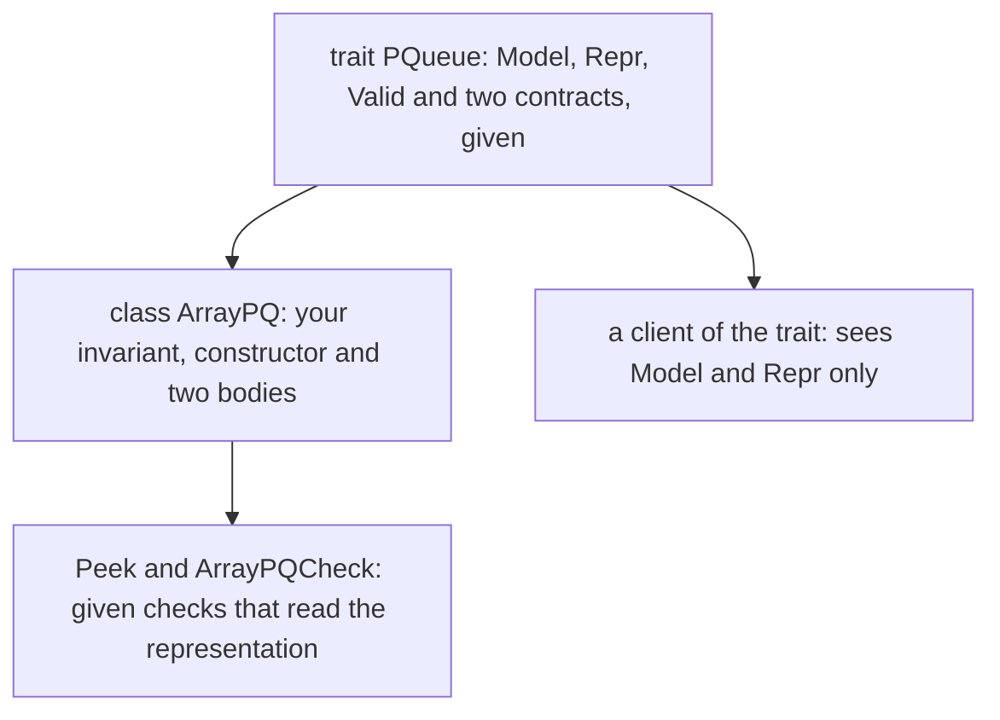
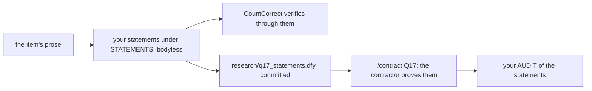
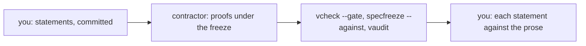

# Q17 — Practice III-B

Q16 practised strands S1–S5 in the hard tier. Q17 practises S6–S8 the same way: each
problem ships its statement and nothing else, a blueprint on paper is graded before any
formal work, and the decomposition is yours. The three problems are a priority queue that
implements a given trait over an array whose frame grows, a ring buffer whose every slot is
a permissioned cell, and the soundness statements of a verification-condition generator,
which you write and a contractor proves. This chapter is a brief: it backs each claim about
the tools with a pinned run on a toy, says what each strand's problem asks of you, and
quotes the metatheory run's contract.
Three ideas do all the work:

1. **An implementation is checked against the contract it inherits, and its invariant is
   what makes the contract provable.** A class that extends a trait restates the trait's
   specifications and may not weaken them; whatever the methods need beyond the
   specifications, the invariant must say, and the constructor must establish.
2. **A frame is a set of objects that grows only by objects that are new.** A method that
   allocates must put what it allocates into the frame it maintains, and the contract can
   then promise that everything it added is fresh. The same discipline holds for a tracked
   permission: each operation changes the permissions it borrows, and nothing else.
3. **A theorem is only as good as its statement.** A verifier checks that a proof proves a
   statement; it cannot check that the statement says what you meant. When a contractor
   proves your statements, the audit of the statements is yours.

---

## 0. How this module works, pretest, test-out

**Minutes: 225.** Brief 10 · blueprint 30 · priority-queue refinement with frames (Dafny)
50 · permission ring buffer (Verus, gated) 50 · VC-generator soundness statements (Dafny) 35
· metatheory run 15 · `/review-code` 15 · paper 15 · ledger 5. The main Dafny file's
`CALIBRATION` block repeats this line.

**Setup.** Start one long-lived `/tutor Q17` session. Q17 adds no layer: L7 is Q16's, and
Q17 uses none of the spine. The order of work is the main Dafny file's header: the blueprint
B1 first, graded; then H1 (`Q17_PracticeIIIB.dfy`), H2 (`perm.rs`), H3 (`Q17_Vcgen.dfy`,
ending with the commit of your statements), and the metatheory run (§7).

**No prediction, no pretest, no test-out.** Q17 has no prediction item, and a practice
module is the practice. Q16–Q18 have no exit file either: the module's check is the
verifier part (the Done line of §6) plus `/review-code Q17` at the `library-pr` bar and
`/grade-paper Q17` before and after the formal work.

**Outputs.** Every output fence is a real run on the course pins (Dafny 4.11.0, Verus
0.2026.09.27.3cf1832), pinned in `expected/Q17.chapter.toml`. `metronome.dfy`,
`cupboard.dfy`, `vault.dfy`, `itinerary.dfy`, `twice.rs`, `frozen.dfy` and `delivered.dfy`
are scratch files run with `scripts/vcheck --module Q17` (or `scripts/specfreeze`), which
adds Q17's given layers and options. Fences drop the wrapper's last line, `raw output:
<dir>`.

### This module's files

| file | what it is | shipped state |
|---|---|---|
| `dafny/Q/Q17_PracticeIIIB/std/Q17_PracticeIIIB.dfy` | the main Dafny file: the given trait `PQueue` and the class `ArrayPQ` to implement (H1d), with its checks | verified, **3 holes** |
| `dafny/Q/Q17_PracticeIIIB/std/Q17_Vcgen.dfy` | a small language with annotated loops and its VC generator (W2d), a given program and corollary, and the statement item (H3d) | verified, **1 hole** |
| `verus/q/q17_practice_iiib/src/lib.rs` | the Verus crate root; it declares `mod perm;` | verified, no hole |
| `verus/q/q17_practice_iiib/src/perm.rs` | the permissions module: the ring buffer of permissioned cells (H2v, two operations) | verified, **2 holes** |
| `dafny/Q/Q17_PracticeIIIB/agent/Q17_AgentMetatheory.dfy` | the metatheory contractor's file (rung 13, §7): W2d's language, an empty STATEMENTS section, an empty HELPERS section, the AUDIT block; outside every build | verified, no hole |
| `research/q17_statements.dfy` | your committed statements, the freeze reference of the run | absent until you write it |
| `dafny/given/Q/QG_L1_BigNat.dfy` to `QG_L7_BigNat.dfy`; `verus/given/qg_bignat_l1` to `qg_bignat_l7` | the given spine, frozen; the units include it and Q17 uses none of it | verified |
| `paper/Q17_problems.tex` → your `paper/Q17_answers.tex` | the written pair (§5) | — |
| `Solutions/` mirrors of these files | the reference twins | yours to open LAST |

Six holes in all: four in the Dafny unit (H1d's constructor, `Insert` and `ExtractMin`, and
H3d's labelled assume) and two in the crate (H2v's two operations).

---

## 1. S6 — Abstraction: a trait, a class and an invariant

H1 puts a contract above an implementation, as Q14's refinement did, and adds a frame that
changes size:



**The class restates the contract.** In Dafny a class that extends a trait repeats each
method's specification, and the restatement may strengthen it but never weaken it. A toy
whose class weakens the trait's postcondition:

```dafny
module MetronomeToy {
  trait Metronome {
    ghost var Beats: nat

    method Strike()
      modifies this
      ensures Beats == old(Beats) + 1
  }

  class Pendulum extends Metronome {
    var swings: nat

    method Strike()
      modifies this
      ensures Beats >= old(Beats)
    {
      swings := swings + 1;
      Beats := Beats + 1;
    }
  }
}
```

<!-- pin: trait-restate -->
```
$ scripts/vcheck --module Q17 metronome.dfy
vcheck: metronome.dfy [dafny, learner loop]: failed — 25 verified, 0 holes, 1 error
metronome.dfy:13:12: error: the method must provide an equal or more detailed postcondition than in its parent trait
```

The body would meet the trait's postcondition; the restatement is what is refused, at the
class's method. `ArrayPQ` ships with the trait's specifications restated exactly, and the
statement freeze keeps them so (§4).

**The frame grows by new objects only.** The trait's methods may modify everything in
`Repr` and promise `fresh(Repr - old(Repr))`: whatever joins the frame is new. A toy that
replaces its array and forgets the frame:

```dafny
module CupboardToy {
  class Cupboard {
    var slots: array<nat>
    ghost var Repr: set<object>

    ghost predicate Valid()
      reads this, Repr
    {
      this in Repr && slots in Repr
    }

    method Enlarge()
      requires Valid()
      modifies Repr
      ensures Valid() && fresh(Repr - old(Repr))
    {
      slots := new nat[slots.Length + 1];
    }
  }
}
```

<!-- pin: frame-grow -->
```
$ scripts/vcheck --module Q17 cupboard.dfy
vcheck: cupboard.dfy [dafny, learner loop]: failed — 24 verified, 0 holes, 1 error
cupboard.dfy:16:5: error: a postcondition could not be proved on this return path
cupboard.dfy:15:20: related: this is the postcondition that could not be proved
cupboard.dfy:9:29: related: this proposition could not be proved
```

The failing conjunct is the validity predicate's own (line 9): the new array is not in the
frame, so nothing licenses the next call to write it. Q05's and Q11's frames were fixed; here
the frame changes size, and the predicate must keep up.

**H1d (the priority queue).** The trait describes a queue of naturals by a ghost multiset
`Model` and a ghost frame `Repr`; `ArrayPQ` stores the elements as the prefix `a[..n]` of an
array, kept in descending order so that the minimum is the last element of the prefix. Its
fields ship; `Valid()` ships with the placeholder body `true`; the constructor, `Insert` and
`ExtractMin` ship as holes. When the array is full, `Insert` moves the elements to a larger
one. The plain implementation, with an invariant that says only what the prefix holds, does
not verify (the hard tier's rule: the plain attempt is known to fail), and the docstring asks
what the invariant must say for `ExtractMin`'s answer to be the minimum. Two given checks
ship commented: `Peek` (inside the class) reads the queue through your representation, so a
representation that kept the elements anywhere else could not make it verify, and
`ArrayPQCheck` drives the class through three insertions and one extraction. Your lemmas
(two to four is the tier's range) go in `HELPERS`, a helper method of the class inside the
class.

---

## 2. S7 — Termination and erasure: ghost state and fuel

Both of this strand's lessons are about what the compiled program never sees. H1's `Model`
and `Repr` are ghost: the proof uses them, and the compiled code may not read them. A toy
that tries:

```dafny
module VaultToy {
  class Vault {
    ghost var Secret: nat

    method Peep() returns (r: nat)
    {
      r := Secret;
    }
  }
}
```

<!-- pin: ghost-read -->
```
$ scripts/vcheck --module Q17 vault.dfy
vcheck: vault.dfy [dafny, learner loop]: failed — - verified, 0 holes, 1 error, stage resolve
vault.dfy:7:12: error: a ghost field is allowed only in specification contexts
```

Refused before verification. So `ExtractMin` cannot return an element of `Model`: the
number it returns comes from the array, and the invariant is what ties the two.

**Fuel instead of termination.** H3's language has loops that need not end, so its
interpreter `Exec` takes a fuel: each loop iteration spends one unit, and a run that would
need more is `Stuck`. Its measure is the pair `fuel, c`. A toy interpreter with the fuel
alone as its measure:

```dafny
module ItineraryToy {
  datatype Itinerary = Rest | Redo(p: Itinerary) | Duo(p: Itinerary, q: Itinerary)

  function Spend(c: Itinerary, fuel: nat): nat
    decreases fuel
  {
    match c
    case Rest => 0
    case Redo(p) => if fuel == 0 then 0 else 1 + Spend(c, fuel - 1)
    case Duo(p, q) => Spend(p, fuel) + Spend(q, fuel)
  }
}
```

<!-- pin: fuel-measure -->
```
$ scripts/vcheck --module Q17 itinerary.dfy
vcheck: itinerary.dfy [dafny, learner loop]: failed — 22 verified, 0 holes, 1 error
itinerary.dfy:10:28: error: decreases clause might not decrease
```

The loop-like case spends fuel and is fine; the sequential case passes the same fuel to its
parts, so only the command can decrease there, and a measure must say so (Q05's
lexicographic rule). The consequence for H3: a run that is `Stuck` says nothing, so a
soundness statement for this semantics is about the runs that end, partial correctness, as
the item's prose says.

---

## 3. S8 — Program logic and permissions: a ring of cells, a generator's soundness

**H2v (gated: a permission ring buffer).** Q10's ring buffer kept its elements in a `Vec`.
Here every storage slot is a `PCell` from `vstd::cell::pcell_maybe_uninit`, a cell that may
hold no value, and `perms` holds, slot by slot, the tracked permission of each cell. A
permission says whether its cell holds a value and which one. Every method that moves a
value into or out of a cell needs that cell's permission: `put` and `take`, and also
`replace`, `write`, `read` (for a value that is `Copy`), `borrow`, `borrow_mut` and
`into_inner`; H2v needs only `take` and `put`. A toy that takes twice:

```rust
use vstd::prelude::*;
use vstd::cell::pcell_maybe_uninit::*;

verus! {

fn take_twice() {
    let (cell, Tracked(mut perm)) = PCell::new(7u64);
    let a = cell.take(Tracked(&mut perm));
    let b = cell.take(Tracked(&mut perm));
}

} // verus!
```

<!-- pin: take-twice -->
```
$ scripts/vcheck --module Q17 twice.rs
vcheck: twice.rs [verus, learner loop]: failed — 0 verified, 0 holes, 1 error
twice.rs:9:13: error: precondition not satisfied
```

The first `take` leaves the permission saying the cell is empty, and the second needs it
full. The given `wf` says the same of the whole ring: exactly the live slots are full, and
each permission belongs to its own slot's cell. `push_back` appends, and when the ring is
full it first moves every element, in order, into storage of twice the capacity; `pop_front`
removes the first element. Each operation borrows the permission it changes mutably, in
place (`tracked_borrow_mut`); no permission is moved out of `perms` and back. The docstring
asks which permissions change and why `wf` still holds for every other slot. H2v is a gated
item (QPLAN §19.0): it ships with its gate recorded by the author.

**H3d (a statement item).** `Q17_Vcgen.dfy`'s worked example W2d is a language with
annotated loops: expressions, assertions, commands with a two-armed `If` and a `While` that
carries its invariant, the fuelled `Exec`, and the generator: `Pre(c, q)`, the precondition
it computes by syntax (a loop's is its invariant), and `Vcs(c, q)`, the side conditions it
emits (two per loop). H3 asks for the generator's soundness, stated, not proved:



You write `VcSound` (its parameters are fixed: the given corollary calls it) and any further
statement you want proved, with one `ensures` each, and a witness: a call whose `requires`
hold at a run that ends. The given corollary `CountCorrect`, about a counting loop whose side
conditions ship proved valid, must then verify through your statement once you uncomment its
three lines and delete its assume. That proves your statement strong enough for one
program; it says nothing about whether the statement is true. A false statement would make
the corollary verify just as well; the contractor cannot prove it, and the run's audit is
where you find out (§7). A statement that is true but special to `Count` is caught by the
reader (§4). Until the run delivers, each of your statements is a lemma with no body and a
counted hole; afterwards you copy the delivered proofs back (the file's header, step 3).

---

## 4. What the instruments can and cannot see

| instrument | what it sees | what it cannot see |
|---|---|---|
| `scripts/vcheck --gate` | zero holes, every pinned symbol checked, every frame, mode and permission rule | whether your statements say what the prose says |
| `scripts/specfreeze --check Q17` | that no shipped statement, contract, frame or definition changed (the trait's, the class's restatements, W2d's) | what you added: helpers, your statements |
| `scripts/specfreeze --against research/q17_statements.dfy …` | that the contractor changed none of your statements | whether they were the right statements |
| `scripts/firsttry.sh Q17 --report --strict` | every shipped check uncommented, no hole left | whether a check was edited as it was uncommented (a reader compares it with the shipped file) |
| the given checks (`Peek`, `ArrayPQCheck`, `ring_check`, `CountCorrect`) | one use each: a read of the representation, a short run, a five-element ring, one program | every other input; a false statement of yours (the corollary verifies through it) |
| `scripts/vaudit` | assumes, holes, trusted or external bodies left in, in your files and in the delivery | a helper that restates the goal |
| `scripts/vcheck --brittleness` (add `--solvers` for Dafny's second bundled Z3) | whether each proof holds under seeds 1–3 (with `--solvers`, under each bundled Z3) | whether it is the proof you meant |
| the hidden check (the grader container, from your own terminal, after the run and your AUDIT: Q13's §2 gives the judging spec, the verdict words and the rule (run it once, report that first run to `/review-code`), here with `item = "Q17.H3d"` and `scripts/mksandbox-run --truth Hidden/labs/Q17/verdicts.tar.age --truth-check judge --judge <spec>`) | `VcSound` against the author's statement, both ways, as one verdict word (with the outcome words behind it, Q13's §2) | your further statements; a difference its bodyless lemmas cannot settle (`undecided`: a reader decides it) |
| a reader (`/review-code Q17`, `library-pr` bar; your AUDIT) | the invariant's conjuncts, the frame's growth, which permission each operation borrows, and each statement against the prose: general, as strong as meant, witnessed | nothing mechanical |

---

## 5. On paper, before the keyboard

`paper/Q17_problems.tex` holds the written pair. B1 is the blueprint of H1 and H3 (30
minutes, after this chapter and before any formal work): H1's invariant, frames, lemmas and
loop invariant; H3's statements in words and as formulas, the witness, a plausible-but-wrong
statement with a concrete run where it fails, and a true but too weak one. Run `/grade-paper
Q17` in a fresh session and get at least 3 on every dimension before you formalize. B2 is the
paper card 12.12 (in the 15-minute paper line), field by field against the pinned range of
your `cheatsheets.md`. Fill `paper/Q17_answers.tex`, build with `make -C paper paper` until
green, and, once §6's Done line holds, run `/grade-paper Q17 --post`.

---

## 6. The exercise file

The two units, as shipped:

<!-- pin: units -->
```
$ scripts/vcheck Q17
vcheck: dafny/Q/Q17_PracticeIIIB/std [dafny, learner loop]: verified — 157 verified, 4 holes, 0 errors
dafny/Q/Q17_PracticeIIIB/std/Q17_PracticeIIIB.dfy:98:7: hole assume Q17.H1d
dafny/Q/Q17_PracticeIIIB/std/Q17_PracticeIIIB.dfy:106:7: hole assume Q17.H1d
dafny/Q/Q17_PracticeIIIB/std/Q17_PracticeIIIB.dfy:115:7: hole assume Q17.H1d
dafny/Q/Q17_PracticeIIIB/std/Q17_Vcgen.dfy:195:5: hole assume Q17.H3d
vcheck: verus/q/q17_practice_iiib [verus, learner loop]: verified — - verified, 2 holes, 0 errors
verus/q/q17_practice_iiib/src/perm.rs:120:5: hole external_body Q17.H2v
verus/q/q17_practice_iiib/src/perm.rs:132:5: hole external_body Q17.H2v
vcheck: 2 unit(s): 2 verified, 0 not; 6 hole(s) in all
```

Six holes, as `expected/Q17.counts` pins them. In the Dafny unit: H1d's three method bodies
(`assume false;`) in `Q17_PracticeIIIB.dfy`, and H3d's labelled assume in `CountCorrect` in
`Q17_Vcgen.dfy`. In the crate: H2v's two operations (`external_body`) in `perm.rs`. The
`HELPERS` areas sit above H1d (and inside its class) and above H2v (inside the `impl`);
STATEMENTS sits in H3d's block; the checks sit under `Uncomment as you go:`.

**No prediction slot.** Q17 has none, so `scripts/firsttry.sh Q17 --check` records nothing;
`--report --strict` is the part of it this module uses.

**Done** = `scripts/vcheck --gate dafny/Q/Q17_PracticeIIIB/std` and
`scripts/vcheck --gate verus/q/q17_practice_iiib` each print only the summary line and exit
0, `scripts/vaudit` reports no finding on either, **and** `scripts/firsttry.sh Q17 --report
--strict` exits 0; then the agent file's audit is filled, `/review-code Q17` has run and
`/grade-paper Q17 --post` has graded B1 against your proofs. The Dafny unit's gate passes
only after the delivered proofs are copied back (§3, §7).

**Calibration.** Write your actual minutes beside each line of the main Dafny file's
`CALIBRATION` block; at the end run `scripts/firsttry.sh Q17 --record`.

---

## 7. Exercise (agentic): the metatheory contractor

Rung 13: you write precisely correct statements, a contractor proves them, and you audit
for a statement that is plausible but wrong. The agent file ships green with no hole: the
language and the generator of W2d, unchanged, an empty STATEMENTS section and an empty
HELPERS section.

<!-- pin: agent-shipped -->
```
$ scripts/vcheck dafny/Q/Q17_PracticeIIIB/agent/Q17_AgentMetatheory.dfy
vcheck: dafny/Q/Q17_PracticeIIIB/agent/Q17_AgentMetatheory.dfy [dafny, learner loop]: verified — 140 verified, 0 holes, 0 errors
```

The contract, as the file's CONTRACT header states it:

> **CONTRACT (for /contract Q17 — run it in a FRESH session):**
> - **goal:** prove every statement under STATEMENTS, which are the statements of research/q17_statements.dfy copied here unchanged; change no statement
> - **allowed-files:** `dafny/Q/Q17_PracticeIIIB/agent/Q17_AgentMetatheory.dfy`
> - **acceptance:**
>   - re-verify after every edit with `scripts/vcheck dafny/Q/Q17_PracticeIIIB/agent/Q17_AgentMetatheory.dfy`; never stack unverified edits
>   - `scripts/vcheck --gate dafny/Q/Q17_PracticeIIIB/agent/Q17_AgentMetatheory.dfy` exits 0, with zero tool-counted holes
>   - `scripts/specfreeze --against research/q17_statements.dfy dafny/Q/Q17_PracticeIIIB/agent/Q17_AgentMetatheory.dfy` reports no change
>   - `scripts/vaudit dafny/Q/Q17_PracticeIIIB/agent/Q17_AgentMetatheory.dfy` reports no finding
>   - new lemmas only under HELPERS; a statement you cannot prove is reported, never changed

**Before the run** (the end of H3's 35 minutes): copy the agent file, as shipped, to
`research/q17_statements.dfy`, paste your statements and witness under its STATEMENTS, and
commit it; then paste the same text under the agent file's STATEMENTS. The commit is the
freeze reference: a reference written after the run is no reference. What the freeze
compares, on a toy pair (a statement frozen with `requires n > 0`, delivered with
`requires n > 1`):

```dafny
module TercileToy {
  function Tercile(n: nat): nat { n / 3 }

  lemma TercileBelow(n: nat)
    requires n > 1
    ensures Tercile(n) < n
  {
  }
}
```

<!-- pin: freeze-statement -->
```
$ scripts/specfreeze --against frozen.dfy delivered.dfy
delivered.dfy:4: freeze-changed — TercileToy.TercileBelow: the statement differs from the frozen one
specfreeze: delivered.dfy: 1 finding(s)
```

A narrowed precondition is a changed statement, whichever way it was narrowed; a proof
added under it is not. The freeze cannot tell you whether the frozen statement was the right
one.

**Your steps** (15 minutes, after the commit): run `/contract Q17` on the agent file in a
fresh session. Claude Code asks you to approve each write of
`.claude/state/contract-allowlist`; approve that file and no other. Then audit, as spec §5.1
asks: was each statement as strong as your prose meant (a statement the contractor proved
too easily is a finding), and did the contractor stop and report one it could not prove?
Re-run the acceptance commands yourself, fill `AUDIT`, and copy the delivered proofs back
into `Q17_Vcgen.dfy`.



Every gate in the middle row checks the contractor; only the last box checks the
statements, and only you can fill it.

### What the dashboard can and cannot see

The shipped file below contains no learner statements yet. Its gate result cannot tell whether your later statements express the intended metatheory; that needs the statement review.

<!-- pin: dashboard-metatheory -->
```
$ scripts/vcheck --gate dafny/Q/Q17_PracticeIIIB/agent/Q17_AgentMetatheory.dfy
vcheck: dafny/Q/Q17_PracticeIIIB/agent/Q17_AgentMetatheory.dfy [dafny, gate]: verified — 140 verified, 0 holes, 0 errors
```

---

## Instructor touchpoints

> **The Q17 module loop, with the instructor in place:**
>
> - **`/discuss Q17`** (optional; a coach session): a Socratic pass over the Q17 bank, with
>   an ML engineer who asks what a frame costs and what a proved statement promises.
> - **`/tutor Q17`** (one long-lived session): after 20 minutes stuck; one rung per turn,
>   and never an invariant, a statement or a permission step.
> - **`/grade-paper Q17`** (fresh session): B1 before any formal work, at least 3 on every
>   dimension; B2 once `make -C paper paper` is green; `--post` after §6's Done line.
> - **`/review-code Q17`** (fresh session): once §6's Done line holds. Bar: `library-pr`,
>   with the statements read against the prose by hand.
> - **`/contract Q17`** (fresh session): the metatheory run of §7, after the commit of
>   `research/q17_statements.dfy`.
> - **`/viva Q17`**: not this module. The hard tier's viva is `/viva Q18`, over Q16, Q17 and
>   Q18 together.
> - **Solutions last**: the `Solutions/` mirrors of Q17's files, only after `/viva Q18`,
>   which examines Q17 too.
> - **`/review`**: whenever the session banner says ledger items are due.

---

## What Q17 planted

| seed | harvested |
|---|---|
| a class that implements a given trait over a frame that grows (H1d) | Q18 (the capstone's statements, §4 steps 1-2) |
| an invariant that a plain attempt lacks, found by asking what each contract needs (H1d) | Q18 (the capstone's statements, §4 steps 1-2: the invariants the blueprint names) |
| one tracked permission per slot, borrowed in place, with a move of every element on growth (H2v) | (the Q core ends this thread here; the challenge branch takes tracked permissions further) |
| a statement item: statements you write and a contractor proves (H3d, A1d) | Q18 (the capstone, where you write all statements; contract v2) |
| an audit of statements for a plausible-but-wrong one (A1d) | Q18 (the capstone's adversarial plant, and contract v2) |
