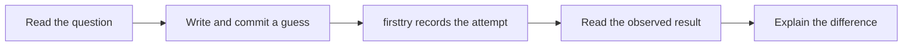
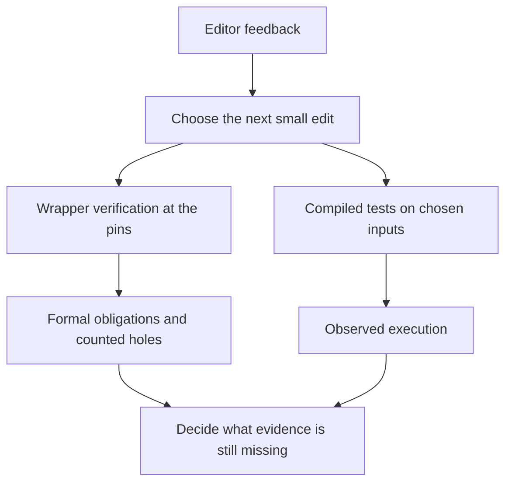
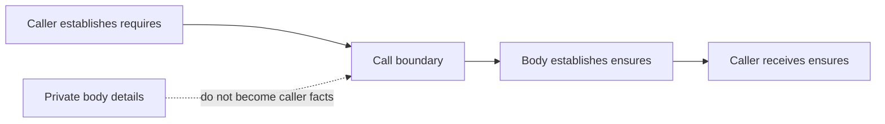
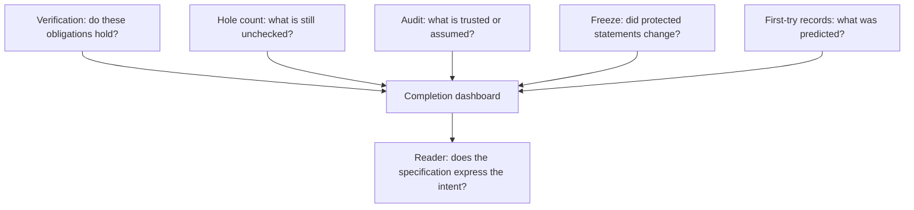

# R01 — Hello, two verifiers

You know how to write a small program and run its tests. A verifier asks for another account of the same program: what must be true of every accepted input, what the program promises about its result, and why each operation is justified. This chapter starts that account in Dafny and Verus together. It assumes the README setup is complete and assumes no Q module. If R is your first track, do prework P0 once before this module; installation time is outside the budget below.

R is the topic-ordered track. Its eventual artifact is a regular-expression engine, developed from a structural description through an executable matcher and a small command-line tool. Nothing in this chapter requires knowing how regex matching works. Its objects are characters, sequences and bounded machine values, small enough that you can distinguish a programming mistake from a mistaken belief about the tool. Later modules will need that distinction on larger objects.

**Three ideas do all the work.**

1. **The verifier checks the body against a contract.** A caller proves the precondition; the implementation establishes the postcondition. A useful contract must also express the intended task, which is a separate question for a reader.
2. **A proof call provides a fact.** An assertion is an obligation, and a lemma call makes a proved postcondition available on particular arguments. Neither is permission to assume something merely because it seems plausible.
3. **A successful run has a scope.** Verification, execution, hole counting, assumption auditing and specification comparison answer different questions. Keep their results separate when you decide whether work is complete.

In this module you commit six predictions, attempt a two-part hole census before reading the worked code, write three constructs in both languages, repair six hand exercises, audit two contractor files, and write your own first R contract. The paper card asks what a verifying-compiler proposal can establish without experiments. The final viva examines your account of these activities, not your ability to repeat a green status line.

---

## 0. How this module works

**Budget: 276 minutes**, excluding the contractor's wall-clock time. The module viva is included in this R total. The table is a plan for your attention; record your actual time rather than trying to make your work resemble the estimate.

| setup | test-out | read | worked | cards | predicts | holes | triage | agent audit | three doors | R-v0 | paper | viva | calibration | total |
|---|---|---|---|---|---|---|---|---|---|---|---|---|---|---|
| 15 | 10 | 60 | 27 | 15 | 15 | 24 | 12 | 15 | 10 | 20 | 15 | 30 | 8 | **276** |

First confirm that the pinned wrappers run with `scripts/vcheck --selftest` and that both language servers open. The language servers are convenient ways to see the next obligation while editing. The command-line wrapper remains the referee: it records the toolchain, resource settings, verdict and counted holes consistently. A language-server success message and a wrapper gate result are different observations until you have run the latter.

The closed-book census is T1d/T1v near the top of the exercise pair. Each item contains two declarations: a proof about a two-character sequence and an executable function that counts its first two positions. Use only the supplied definition when taking the first try. Do not read the later worked proofs and then label the result a test-out. A first try is evidence about your starting point, not a grade to improve by rewriting its history.

If you have Q credit and both T items pass at the genuine first try, you may skip the 72 minutes listed in PLAN's Q-credit allowance: the hole-contract and doors reading, the false-friends and Rosetta cards, the three doors, the triage drill and the two worked bound proofs. The rest of R01 remains standalone. Taking the full route is reasonable when either tool or its failure messages still feels unfamiliar.

**Predictions first.** Fill the six answers before reading the sections that settle them, opening the card demos, running the scenario programs or inspecting CI and pins. A guess is a legitimate prediction. An answer copied after a run describes an observation and must not be relabelled as the first prediction. The file paths below tell you where to write, not what to write.

> **Predict (P1dv) — commit in the file before reading on.** The same midpoint expression is checked over Dafny mathematical integers, Dafny's bounded U32 newtype and Verus u32. Which of the three verifies?

> **Predict (P2dv) — commit in the file before reading on.** HalveEven's precondition excludes odd inputs. What happens when the verification-and-test sequence includes a test on 7 in each language?

> **Predict (P3d, P4v) — commit in the files before reading on.** A function's contract says its result is greater than the input. Which of four assertions in independent callers can be established from that contract?

> **Predict (P5d, P6v) — commit in the files before reading on.** What integer does each executable division of -7 by 2 produce?

The verdict answers go in `slots/R01.slots`. The obligation answers go in the commented slots of `specimens/R01/P3d.dfy.specimen` and `P4v.rs.specimen`. The value answers go in `dafny/checks/R01_checks.dfy` and `specimens/R01/P6v.rs.specimen`. Keep every slot a comment when its template says so. Commit your guesses, then record them with `scripts/firsttry.sh R01 --check`. The tool enables a scratch copy of a filled slot and records the first result; it does not need you to uncomment the slot in the source.



**Takeaway:** committing the guess separates the model you brought to the question from the explanation you construct after seeing the result.

---

## 1. One program, three loops

The editor loop asks what failed while you are making the next small edit. The wrapper loop verifies a named unit or file with the course pins and keeps the result's scope explicit. The compiled-test loop runs executable code on chosen inputs. Use all three, while keeping track of which one supplied the evidence in front of you.

A unit is the collection of source files a command checks together. The Dafny core directory has a generated `dfyconfig.toml`; the Verus crate has a generated `Cargo.toml`. These files are provided infrastructure, not settings to adjust when a proof is difficult. R01 has no regex layer and imports no other exercise. From R02 onward a unit will also contain its declared frozen regex layer chain. An earlier unfinished exercise will never be silently pulled into a later unit.

```bash
scripts/vcheck dafny/R/R01_Hello/core
scripts/vcheck verus/r/r01_hello
```

<!-- pin: shipped-d -->
```
$ scripts/vcheck dafny/R/R01_Hello/core
vcheck: dafny/R/R01_Hello/core [dafny, learner loop]: verified — 17 verified, 5 holes, 0 errors
dafny/R/R01_Hello/core/R01_Hello.dfy:53:34: hole bodyless-method R01.T1d
dafny/R/R01_Hello/core/R01_Hello.dfy:60:5: hole assume R01.T1d
dafny/R/R01_Hello/core/R01_Hello.dfy:131:5: hole assume R01.H1d
dafny/R/R01_Hello/core/R01_Hello.dfy:142:33: hole bodyless-method R01.H2d
dafny/R/R01_Hello/core/R01_Hello.dfy:157:5: hole assume R01.H3d
```

<!-- pin: shipped-v -->
```
$ scripts/vcheck verus/r/r01_hello
vcheck: verus/r/r01_hello [verus, learner loop]: verified — - verified, 5 holes, 0 errors
verus/r/r01_hello/src/lib.rs:28:40: hole assume R01.T1v
verus/r/r01_hello/src/lib.rs:32:1: hole external_body R01.T1v
verus/r/r01_hello/src/lib.rs:89:1: hole external_body R01.H1v
verus/r/r01_hello/src/lib.rs:106:40: hole assume R01.H2v
verus/r/r01_hello/src/lib.rs:119:48: hole assume R01.H3v
```

The counts above are the actual shipped state. Five typed holes remain in each exercise half even though the learner-loop verdict is green. Two belong to the census and three to the hand exercises. A compiler or verifier can accept an explicit placeholder because that placeholder changes what is being checked: a bodyless lemma, a labelled assumed proof or an external executable body can provide an unchecked fact or result. The course counter is therefore part of the completion rule.

The done gate adds requirements. It rejects remaining holes, compares the protected statement surface and applies the course's verification policy. It does not fill anything for you. Run it when you believe the source is complete; use the learner loop while a source intentionally still contains holes.

```bash
scripts/vcheck --gate dafny/R/R01_Hello/core
scripts/vcheck --gate verus/r/r01_hello
```

<!-- pin: gate-d -->
```
$ scripts/vcheck --gate dafny/R/R01_Hello/core
vcheck: dafny/R/R01_Hello/core [dafny, gate]: failed — 17 verified, 5 holes, 0 errors, 1 finding
dafny/R/R01_Hello/core/R01_Hello.dfy:53:34: hole bodyless-method R01.T1d
dafny/R/R01_Hello/core/R01_Hello.dfy:60:5: hole assume R01.T1d
dafny/R/R01_Hello/core/R01_Hello.dfy:131:5: hole assume R01.H1d
dafny/R/R01_Hello/core/R01_Hello.dfy:142:33: hole bodyless-method R01.H2d
dafny/R/R01_Hello/core/R01_Hello.dfy:157:5: hole assume R01.H3d
dafny/R/R01_Hello/core: warnings-fail-gate: warnings fail the gate (W-D04): holes and every other warning must be gone
```

<!-- pin: gate-v -->
```
$ scripts/vcheck --gate verus/r/r01_hello
vcheck: verus/r/r01_hello [verus, gate]: failed — - verified, 5 holes, 1 error
verus/r/r01_hello/src/lib.rs:28:40: hole assume R01.T1v
verus/r/r01_hello/src/lib.rs:32:1: hole external_body R01.T1v
verus/r/r01_hello/src/lib.rs:89:1: hole external_body R01.H1v
verus/r/r01_hello/src/lib.rs:106:40: hole assume R01.H2v
verus/r/r01_hello/src/lib.rs:119:48: hole assume R01.H3v
(no file): error: gate: 'success' is false, not true; --output-json lacks 'is-verifying-entire-crate'; 'encountered-vir-error' is true, not false; --output-json lacks 'verified'; 5 hole(s); exit 1
```

Do not count the gate's rejection as evidence that the supplied exercise is broken. It is the expected answer to a completion question asked before the completion conditions hold. Conversely, a learner-loop success does not answer the gate's question. This distinction will matter again when a contractor delivers a file that appears green but still contains an assumption.



**Takeaway:** each loop gives useful evidence, but execution on examples and proof over admitted inputs support different conclusions.

An exit code belongs to the process you actually ran. If you ran the wrapper, its exit status includes the wrapper's checks. A native compiler's successful compilation is not a successful done gate. If you put a command behind a pipeline, be careful that your shell is reporting the process you mean; the course scripts already enforce their own pipeline discipline. Read the summary and its stage before you explain the result.

Keep edits small. Make one change, re-run the same relevant check and read the new first diagnostic. Changing the body, contract and resource settings together can remove the error while destroying your account of why it went away. Here settings stay pinned, contracts stay fixed except where an exercise explicitly opens part of one, and your edit becomes a much clearer experiment.

---

## 2. Contracts cross a boundary

A contract is a statement about calls. In a Dafny method the `requires` clauses are obligations for each caller and assumptions for the method body. The `ensures` clauses are obligations for the method body and facts a caller may use about a returning call. Verus's executable functions use the same division of responsibility. The punctuation differs; the direction of responsibility does not.

Read W1d and W1v, LastChar and last_char. Each requires a non-empty sequence or vector and promises the final character. The body performs one indexing operation. The precondition justifies that index. A caller that has proved the precondition receives the result equality and may reason from it without inspecting the implementation.

```dafny
method Keep(c: char) returns (r: char)
  ensures r == c
{
  r := c;
}
```

```rust
fn keep(c: char) -> (r: char)
    ensures r == c,
{
    c
}
```

These tiny bodies illustrate the shape of the first WRITE construct, `ensures`, rather than a hand-exercise answer. The postcondition describes the returned value; the body must establish that relation for every permitted argument. A test with one character could miss another branch of a larger function, while the verified contract covers every admitted call.

A precondition is not a repair button with no cost. Making it stronger reduces the calls a method promises to handle. A declaration can become easier to verify precisely because its intended users can no longer call it. H3 keeps live callers so that some unreasonable repairs fail immediately. Those callers are witnesses of permitted use, not a proof that the contract captures every intended input.



**Takeaway:** use the contract to explain what crosses the call boundary; do not silently substitute what you saw the implementation do on one example.

Now revisit P3d and P4v through the first-try report. Each labelled assertion lives in a separate caller so one failed proof cannot make the remaining assertions vacuous. The implementation is deliberately more specific than the exported contract. The question is what callers are entitled to know, not whether you can mentally execute the visible body. If your prediction used the body's exact result, state that assumption in your correction.

Specifications are logical expressions. An implication constrains what follows when its antecedent holds. A conjunction requires both parts. A quantified statement states a claim for its whole domain. You recognise `forall` here and will write quantified specifications later. For now, read its bound carefully: a statement about every position in a sequence includes the index conditions that make each access meaningful.

The difference between a specification and a prose intention is present from the first method. A verifier cannot infer that a result should be useful from its name. If an `ensures` promises only membership in a collection, a different member might satisfy it. If it promises equality with a particular indexed character, the body owes that equality. Reading the actual formula prevents you from crediting guarantees the file never made.

---

## 3. Assertions and proof calls

An `assert` states a fact that the verifier must establish at that program point. Dafny writes `assert condition;`. Inside `verus!`, Verus writes `assert(condition);`. These are the second WRITE construct. Neither says “please treat this claim as true without checking.” A failed assertion identifies an obligation you have not established, which may mean the claim is false or that the available reasoning is insufficient.

The important question is what is available at the point of the assertion. Inputs satisfy the preconditions. Variables reflect the assignments on the current path. Previously established facts and exported postconditions may be used. Facts hidden in the implementation of a different executable routine do not automatically enter that context. Keep that list in your head as you move through a proof.

Read W2d and W2v, the character-count bound. The count definition examines a sequence's head and recursively counts its tail. The proof follows that structure. In the non-empty case it records the tail's length, calls the proof on the shorter sequence and records the bound that call supplies. It then relates the current count to the smaller one. The empty case follows directly from the definition.

A Dafny `lemma` and a Verus `proof fn` have signatures and contracts like other routines, but their bodies establish logical facts rather than produce an executable answer. Their local proof work is ghost work. Calling one is the third WRITE construct: it makes the proved postcondition available on the arguments you passed. Merely defining a helpful lemma somewhere in a file does not call it at every later site.

A recursive proof must also be well founded. The `decreases` clause describes a quantity that becomes smaller at a recursive call. For these sequence examples it is the sequence length. Smaller means progress in an order that cannot descend forever, not merely a different-looking argument. A correct mathematical claim does not excuse a recursive call that assumes the same claim on the same input.

Dafny can sometimes supply induction automatically. That is a tool fact, not evidence that a body was written. H2 explicitly disables that automatic lemma induction so the hand exercise still asks for a proof. Verus's proof is explicit. The course's admission checks test empty and maximally automated variants to distinguish a real exercise from one the pin already closes without learner work. Do not edit the shipped verification attribute when solving the exercise.

Use the WRITE cards C1–C3 beside the worked examples. Each pairs a small successful use with a deliberately failing demo. In the lemma-call demo the relevant fact is established by a supplied lemma; the client omits that call. Some provided declarations use opacity to keep their implementation from becoming a shortcut. You need not learn to write an opacity annotation in this module; take the declared contract as the interface and observe what adding the supplied call makes available.

An assertion can be a useful reading aid even when the verifier could infer it without that line. At the `it-reads` review bar, explaining the fact after a recursive call is welcome. Later, when investigating proof stability or redundant executable work, you will ask which steps are required. Here distinguish a proof explanation from a computational action that changes the result or cost.

Your hand proof H2 concerns a different statement from the worked bound. Copying the worked function and renaming it is not a proof of the new claim. Read the new postcondition, decide what a recursive proof call would export and identify how that fact connects to the current goal. If you become stuck, write the exact missing fact before asking the tutor for a hint.

---

## 4. Arithmetic and execution modes

Dafny's mathematical integers are not machine registers. The course's U32 newtype has a bounded range, and an operation whose result must inhabit that range creates an additional obligation. Verus's executable u32 operations also have machine-range obligations. Do not move a proof from mathematical integers to bounded values merely by changing the type names and leaving your explanation untouched.

Evaluate the whole expression in P1dv after recording your prediction. A final result may fit while an intermediate operation does not. The order in which the expression is computed is part of the executable program you must justify. H1 asks you to implement an exact mathematical midpoint while respecting the bounded operations. It does not ask you to weaken the average guarantee, assume away a legal case or select a convenient endpoint.

Here are the three actual scenario runs, after your predictions are recorded:

```bash
scripts/vcheck specimens/R01/chapter-p1-int.dfy.specimen
scripts/vcheck specimens/R01/chapter-p1-u32.dfy.specimen
scripts/vcheck specimens/R01/chapter-p1-v.rs.specimen
```

<!-- pin: p1-int -->
```
$ scripts/vcheck specimens/R01/chapter-p1-int.dfy.specimen
vcheck: specimens/R01/chapter-p1-int.dfy.specimen [dafny, learner loop]: verified — 1 verified, 0 holes, 0 errors
```

<!-- pin: p1-u32 -->
```
$ scripts/vcheck specimens/R01/chapter-p1-u32.dfy.specimen
vcheck: specimens/R01/chapter-p1-u32.dfy.specimen [dafny, learner loop]: failed — 1 verified, 0 holes, 1 error
specimens/R01/chapter-p1-u32.dfy.specimen:7:14: error: result of operation might violate newtype constraint for 'U32'
```

<!-- pin: p1-v -->
```
$ scripts/vcheck specimens/R01/chapter-p1-v.rs.specimen
vcheck: specimens/R01/chapter-p1-v.rs.specimen [verus, learner loop]: failed — 0 verified, 0 holes, 1 error
specimens/R01/chapter-p1-v.rs.specimen:7:3: error: possible arithmetic underflow/overflow
```

Read the diagnostic's obligation and stage, not only its verdict. For each of the three results, explain which type the intermediate expression must inhabit and which fact the verifier could not establish. An unsuccessful arithmetic proof does not mean that the language has silently accepted wrapping behaviour. If an implementation intentionally uses wrapping operations, that is a different specification and a different program to justify.

Division also depends on the mode. Compare the recorded P5d and P6v observations before reading the division card. The executable integer rules you know from Rust need not be the rules of a mathematical specification expression. A word such as “integer division” is incomplete until you name the type, mode and operation being evaluated. The paired divergence specimens are guarded by these predictions so you can test that account after the first try is fixed.

The Rosetta cards C4–C7 let you recognise the shared contract and proof vocabulary without asking you to write all of it. C4 names the caller's responsibility. C5 names the recursive measure. C6 distinguishes Dafny functions and methods from Verus specification and executable functions. C7 gives the quantified-expression shapes. Keep a short comparison in your own words; a translation that preserves a keyword but changes its role is not yet a useful translation.

The false-friends card C8 has six paired demos: `calc`, `assert`, `forall`, `old`, `decreases` and `==>`. The demos are red on purpose. Read what each construct asks the tool to check, then run the supplied example rather than guessing that identical-looking punctuation implies identical execution behaviour. `old` talks about a pre-state in a contract; it does not make an arbitrary earlier value available everywhere. A proof calculation records checked relations; it does not grant a false intermediate equality.

Do not repair every card demo as though it were a hand exercise. A red demonstration can be correct teaching material precisely because it exposes the named obligation. The done gate covers the exercise units and completed agent files, while prediction specimens, scenarios and card demos keep their teaching purpose. This file-role distinction prevents you from “fixing” the source of a prediction before taking it.

---

## 5. What the instruments can and cannot see

A verifier establishes the formal obligations generated for a particular program under particular settings. It does not decide whether the English description was translated faithfully, whether a test set covers a meaningful population, or whether a contractor followed an editing discipline. Those are separate claims. Avoid attaching all of them to the word “verified.”

The hole counter makes an unchecked placeholder visible. The assumption audit reports trusted or unchecked mechanisms covered by its rules. The statement freeze compares the protected declaration surface with its shipped form. The first-try ledger records predictions, test-outs and calibration history. Together these instruments provide a more useful dashboard than one success light, while still leaving important work to a reader.



**Takeaway:** combine the instruments by naming their questions; their conjunction still does not establish that an English intention was formalised correctly.

Run the audit on your own completed unit and inspect any finding. A finding is not automatically a proof of a logical bug, and an empty audit is not a proof that the specification is useful. The audit has a defined scope: it can identify particular trust mechanisms and assumptions. It cannot decide that a contract promises enough merely because no forbidden mechanism appears in the file.

The specification freeze is similarly precise. Most of the R01 contracts are fixed. H3 opens the missing precondition while preserving the supplied result clause, body and callers. The freeze tool can recognise the permitted addition; it cannot decide on its own that every input a user intended remains admitted. State what your precondition excludes, then read the caller obligations again.

Keep the source of a claim next to the claim. “The unit verified with zero holes” belongs to a particular gate run. “The contractor changed only body lines” belongs to a diff. “It re-verified after every edit” belongs to the transcript. “This contract expresses the intended operation” needs an account of the formula and meaningful uses. Substituting one source for another is a common way to overstate progress.

R01's agent files illustrate this dashboard before any repair. They have no holes, but each contains four independent errors. This is a different starting state from the exercise units, which are intentionally green with placeholders. Count the holes and read the verifier separately before you decide which work remains.

```bash
scripts/vcheck dafny/R/R01_Hello/agent/R01_AgentRepair.dfy
scripts/vcheck verus/r/r01_hello/src/agent.rs
```

<!-- pin: agent-d -->
```
$ scripts/vcheck dafny/R/R01_Hello/agent/R01_AgentRepair.dfy
vcheck: dafny/R/R01_Hello/agent/R01_AgentRepair.dfy [dafny, learner loop]: failed — 2 verified, 0 holes, 4 errors
dafny/R/R01_Hello/agent/R01_AgentRepair.dfy:24:3: error: a postcondition could not be proved on this return path
dafny/R/R01_Hello/agent/R01_AgentRepair.dfy:23:15: related: this is the postcondition that could not be proved
dafny/R/R01_Hello/agent/R01_AgentRepair.dfy:30:3: error: a postcondition could not be proved on this return path
dafny/R/R01_Hello/agent/R01_AgentRepair.dfy:29:15: related: this is the postcondition that could not be proved
dafny/R/R01_Hello/agent/R01_AgentRepair.dfy:42:16: error: a postcondition could not be proved on this return path
dafny/R/R01_Hello/agent/R01_AgentRepair.dfy:39:27: related: this is the postcondition that could not be proved
dafny/R/R01_Hello/agent/R01_AgentRepair.dfy:51:3: error: a postcondition could not be proved on this return path
dafny/R/R01_Hello/agent/R01_AgentRepair.dfy:50:15: related: this is the postcondition that could not be proved
```

<!-- pin: agent-v -->
```
$ scripts/vcheck verus/r/r01_hello/src/agent.rs
vcheck: verus/r/r01_hello/src/agent.rs [verus, learner loop]: failed — 1 verified, 0 holes, 4 errors
verus/r/r01_hello/src/agent.rs:24:13: error: postcondition not satisfied
verus/r/r01_hello/src/agent.rs:31:22: error: possible arithmetic underflow/overflow
verus/r/r01_hello/src/agent.rs:40:13: error: postcondition not satisfied
verus/r/r01_hello/src/agent.rs:54:13: error: postcondition not satisfied
```

The audit comparison used in the agent contract records a baseline. A later match means no audited trust difference was introduced relative to that baseline. It does not mean every program behaviour is unchanged; the whole purpose of the exercise is to change faulty bodies. The verifier and the unchanged contract must justify the repaired behaviour.

---

## 6. Triage: read a result before explaining it

The TRIAGE block asks you to classify five actual outputs. Work from the verdict and stage, then state a conclusion no stronger than the evidence. Do this before reading the debrief below. These are diagnostic exercises, not requests to solve the difficult proof or to repair every demonstration.

**Case 1.**

<!-- pin: triage-green -->
```
$ scripts/vcheck specimens/R01/triage-green.dfy.specimen
vcheck: specimens/R01/triage-green.dfy.specimen [dafny, learner loop]: verified — 1 verified, 0 holes, 0 errors
```

**Case 2.**

<!-- pin: triage-post -->
```
$ scripts/vcheck specimens/R01/card-c2d.dfy.specimen
vcheck: specimens/R01/card-c2d.dfy.specimen [dafny, learner loop]: failed — 0 verified, 0 holes, 1 error
specimens/R01/card-c2d.dfy.specimen:1:45: error: assertion might not hold
```

**Case 3.**

<!-- pin: triage-resource -->
```
$ scripts/vcheck specimens/R01/triage-resource.dfy.specimen
vcheck: specimens/R01/triage-resource.dfy.specimen [dafny, learner loop]: inconclusive — 0 verified, 0 holes, 1 error
specimens/R01/triage-resource.dfy.specimen:3:9: error: Verification out of resource (R01_TriageResource.CubicSearch)
```

**Case 4.**

<!-- pin: triage-resolve -->
```
$ scripts/vcheck specimens/R01/triage-resolve.dfy.specimen
vcheck: specimens/R01/triage-resolve.dfy.specimen [dafny, learner loop]: failed — - verified, 0 holes, 1 error, stage resolve
specimens/R01/triage-resolve.dfy.specimen:1:42: error: module UnknownCharacterLibrary does not exist
```

**Case 5.**

<!-- pin: triage-hole -->
```
$ scripts/vcheck specimens/R01/triage-hole.rs.specimen
vcheck: specimens/R01/triage-hole.rs.specimen [verus, learner loop]: verified — - verified, 1 hole, 0 errors
specimens/R01/triage-hole.rs.specimen:5:41: hole assume R01 triage
```

For each case, write the tool, stage, verdict, hole count if available, and the next sensible action. A stage is not a severity ranking. A resolution error means the program did not reach the proof question, while an unproved postcondition identifies an obligation in a program that did reach verification. Treating both as “the theorem is false” loses the difference that tells you what to do next.

A green result with a counted hole has checked the surrounding program under the placeholder's meaning. You cannot promote it to a completed proof by ignoring the counter. A negative result after reaching verification can indicate a false claim, a missing fact, an inappropriate specification or insufficient automation. The diagnostic identifies an obligation; the next small experiment helps distinguish the explanations.

An inconclusive result is narrower still. At the pinned resource limit the run did not settle the proof obligations. It establishes neither the claim nor its negation. Do not count it as a verified result, and do not turn it into a counterexample. The course keeps this verdict explicit because research reports and agent loops otherwise tend to hide it inside a single failure percentage.

Resource settings are controlled experimental conditions here. Changing them while investigating a proof changes the experiment. In a later stability module you will measure such changes deliberately and report them. During this first exercise, keep the pins fixed and write down the unresolved obligation. A process killed for memory is an infrastructure event, not a mathematical verdict.

The compiled-test loop supplies another distinction. P2dv asks about a precondition-violating test, not only a routine verified in isolation. After recording the prediction, run both scenario files through verification and the compiled-test channel as the question directs. Read which part of each toolchain checks a test body, and whether the execution was reached. A test outside the verified language fragment does not inherit proof coverage merely because it calls a verified function.

```bash
scripts/vcheck specimens/R01/chapter-p2-d.dfy.specimen
scripts/vcheck --test specimens/R01/chapter-p2-d.dfy.specimen
scripts/vcheck specimens/R01/chapter-p2-v.rs.specimen
scripts/vcheck --test specimens/R01/chapter-p2-v.rs.specimen
```

A successful test demonstrates the observed executions, and a failed test refutes the expectation it actually checked. Neither outcome retroactively changes the precondition under which a proof was established. When a caller violates that precondition, the original verified promise does not cover the call. Name that boundary rather than crediting the proof with a guarantee it never offered.

The last step of triage is a useful next action. For a syntax or resolution problem, fix the program the tool is trying to read. For a failed proof, isolate the obligation and its available facts. For a hole, finish the requested work. For an inconclusive run, preserve the observation and avoid claiming a proof or counterexample. For an unexpected result, retain the exact command and the raw-output location before the next edit overwrites your mental account.

---

## 7. On paper, before the keyboard

Read `paper/R01_problems.tex`, then fill `paper/R01_answers.tex`. This module has one paper card, entry 12.11, *The Verifying Compiler: A Grand Challenge for Computing Research*. Use your own pinned card in `cheatsheets.md`; the problem prints the precise line range and its digest. A changed digest means the source changed, and grading waits for a renewed pin.

The eight fields separate task shape, oracle, trust, cheat surface, metric, budget, variance and artifact. Here the source is a position paper proposing a research programme. Several empirical fields therefore have no experimental quantity to report. A good card says what is absent and what observation would be needed. Filling an absent field with a plausible benchmark number is a substantive mistake, not helpful completion.

Keep proposals and measurements separate. A proposed scale of work is not a per-task generation allowance. An aspiration for reliable software is not a measured solve rate. Criteria for judging a challenge are not confidence intervals. These distinctions connect directly to the tool dashboard: a source supports the claims it actually makes, and the reader must avoid quietly adding another kind of evidence.

The card also asks what correctness depends on. If a verifier is trusted rather than proved, that is a trust choice to record, not a reason to pretend no reasoning happened. If a specification is weak, counting more verified lines may reward the wrong kind of progress. A useful card preserves that concern in the cheat-surface field without inventing an attack or measurement the source does not describe.

Run `make -C paper paper` after editing the answer file. The problem and answer pair must compile; a broken document cannot be reviewed as though its missing material were present. Use `/grade-paper R01` in a fresh session when you want advisory grading, and inspect any finding beside the pinned source sentence. The grader should recognise a correct concise paraphrase, including an honest statement that a field is not specified.

---

## 8. The exercise file

The files have different roles. The exercise pair is the work you complete by hand. The value-check unit imports no exercise code, so unfinished proofs cannot block your recorded value prediction. The specimen directory holds predictions and demonstrations, including red examples that retain their purpose after the hand work is complete. The agent files are separate contractor work, never imported into the ordinary unit.

**This module's files**

| file | role | shipped state |
|---|---|---|
| `dafny/R/R01_Hello/core/R01_Hello.dfy` | Dafny exercise unit | verified with 5 holes; T1d holds 2, H1d–H3d hold 3 |
| `verus/r/r01_hello/src/lib.rs` | Verus exercise crate | verified with 5 holes; T1v holds 2, H1v–H3v hold 3 |
| `dafny/checks/R01_checks.dfy` | given-only compiled value check | P5d slot unfilled |
| `slots/R01.slots` | verdict answers | P1dv and P2dv unfilled |
| `specimens/R01/` | obligation/value predictions, scenarios and card demos | prediction slots unfilled; demos deliberately retain their recorded verdicts |
| `dafny/R/R01_Hello/agent/R01_AgentRepair.dfy` | Dafny contractor exercise | failed, 4 errors, 0 holes |
| `verus/r/r01_hello/src/agent.rs` | Verus contractor exercise | failed, 4 errors, 0 holes |
| No given layer | standalone module; no `dafny/given/` or `verus/given/` imports | none |
| `Solutions/` | reference comparison | yours to open LAST |
| `paper/R01_problems.tex`, `paper/R01_answers.tex` | the paper card and your answers | compiling template; answers unfilled |

Use `scripts/firsttry.sh R01 --check` for the slot protocol and the completed census blocks. Use `scripts/firsttry.sh R01 --report --strict` to inspect the record. Commented “Uncomment as you go” checks are part of the exercise: keep them, and enable them once the corresponding work is ready. Deleting an inconvenient check is not a way to satisfy the record.

H1 is executable work with an exact result contract. H2 is a proof of a character-count relation. H3 is an annotation hole with a supplied body and three live callers. Identify that requested kind of work before editing. A new precondition in H1 or H2 changes a frozen problem; the missing precondition in H3 is precisely the requested work. Similar-looking edits have different legitimacy because the exercise boundaries differ.

**Done** means both unit gates exit 0 with zero tool-counted holes, both audits report no findings, the statement freeze passes, the first-try report is strict-clean, and the supplied checks remain enabled. It also includes the completed agent acceptance and your own paper/triage/calibration work. A verifier does not certify that the prose fields were written thoughtfully, so keep those observations in your own account of completion.

Work one item at a time. Re-run the whole unit when a local proof appears complete so you notice its effect on callers. Then run the paired language's exercise and compare which facts needed to be made explicit. The purpose is to understand two proof interfaces, not to force their implementation text to resemble one another.

---

## 9. Exercise (agentic): repairer, three doors and R-v0

The two agent files each contain four planted bugs, with an intended behaviour in each declaration's comment. Run each file before making any repair and read every diagnostic. They are independent declarations so that one failure does not hide the other bugs. The reference contractor route has no permission to change a specification to make a bug disappear.

> **CONTRACT (for /contract R01 — run it in a FRESH session):**
> goal — make the selected file verify with four one-line body repairs; allowed-files — exactly that run's one agent file; acceptance — gate success with zero holes, unchanged signatures/specifications/comments, one line per bug, verification after each edit, and an unchanged audit baseline. Read the actual CONTRACT header before starting.

Start a fresh `/contract R01` session for each language. It restates the header and asks for the explicit go-ahead required by the contractor protocol. During the run, compare its allowlist to the one file in the header. The authoring-session permission policy does not replace this learner contract: the latter is an exercise in defining and observing a contractor's scope.

When the contractor returns, inspect the diff before celebrating the final verdict. Were all edits in bodies? Is every repair one line? Did the transcript show a verifier run after each edit, or did the contractor stack changes and test only at the end? Did it alter a trusted setting, add an assumption or weaken a clause? A final proof does not establish any of those process claims.

Then run the acceptance commands yourself. A reader can accidentally credit an earlier run of a different file, so check the path and command as well as the exit status. Compare the assumption audit to the expected baseline. Explain what each acceptance line observes and which behaviours it would miss. This is the first version of the dashboard discipline you will use when a later agent synthesises statements rather than repairs bodies.

**Three doors.** In a fresh study session, request the R01 reference three ways: a file read, a shell read and a language-server lookup. Record the actual refusal and its layer or rule in the THREE DOORS block. Keep reference content out of the record. A missing tool or a tool you did not run is not a successful refusal observation. The exercise asks you to observe the guard that exists, including a distinction between a permission-layer rejection and a hook rejection.

**Contract R-v0.** End AI activity before writing this part. Under the learner-owned R-v0 marker in `CLAUDE.md`, write three to six numbered rules by hand, each tied to a moment of your own transcripts, and a third-party-checkable “Done means” line. Classify each rule by what could check it: verifier, assumption audit or reader. Do not ask the contractor or tutor to write your rules. R02 will be the first live test of the contract you chose.

Use the last few minutes to fill CALIBRATION and record it with `scripts/firsttry.sh R01 --record`. Compare estimated and actual time, state one prediction you revised, and name the observation that changed your mind. You are building a record that remains useful after the exact source text is no longer familiar.

---

## Instructor touchpoints

Use `/tutor R01` after a concrete attempt and about twenty stuck minutes: show the attempt, the precise diagnostic and the fact you cannot connect to the goal. The coach asks for your prediction and reasoning before moving up the hint ladder. `/discuss R01` is a fresh explain-back conversation about contracts, proof calls and tool evidence. `/review` revisits due concept–error pairs from the ledger with new toy questions.

Use `/grade-paper R01` for the pinned card and `/review-code R01` after the code gates and strict first-try checks pass. They run in fresh examiner sessions. `/viva R01` asks six questions from the module bank, including a live-refereed prediction; a re-viva uses a disjoint draw. Answer from the meaning of your runs and files, not a memorised line. `/contract R01` is the fresh contractor session described above and never shares a transcript with these other roles.

Keep Solutions last. If you choose to inspect a reference before completing and defending your own work, record that exposure rather than treating a later match as independent evidence. The reference is useful for comparison once you can explain your own implementation and its limits.

---

## What R01 planted

| seed | where it returns |
|---|---|
| A caller receives a contract, not an executable body's private facts | R03 API boundaries; R08 implementations behind an interface |
| A green file may still depend on a typed hole | R04 assumption audit; R15 reviewing generated statements |
| Bounded intermediate operations need their own justification | R09 parsing and expansion budgets |
| A recursive proof call is a reusable fact on a smaller input | R02 structural definitions; R06 induction and matcher proofs |
| Execution, verification and audit answer separate questions | R05 measurement; R13 stage attribution |
| Your own contract must be observable in an actual transcript | R02's implementer run; R15 contract revision; R16 capstone |

You have not proved a regex engine yet. You have established a working discipline for reading what a tool actually checked, writing a small verified body, using a proved fact, and keeping a contractor's scope observable. Carry that discipline into R02, where the same questions meet recursive data and whole-string matching.
