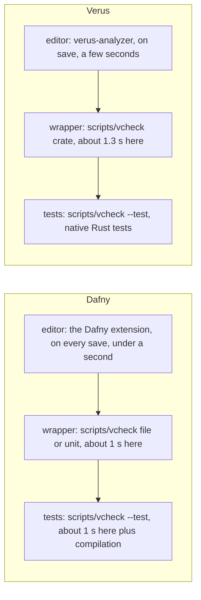
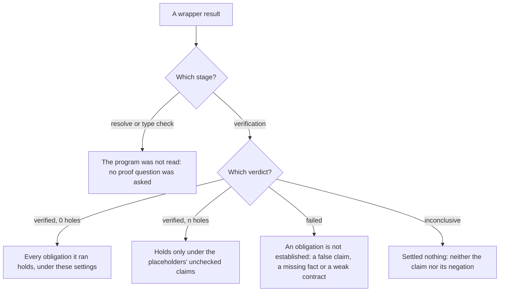

# R01 — Hello, two verifiers

You can already write a small program and run its tests. A verifier asks for a second account of the same program: what every accepted input satisfies, what the program promises about its result, and why each operation is justified on every input the account admits. This chapter starts that account in Dafny and Verus side by side, on characters, sequences and bounded machine integers. R is the topic-ordered track, and its eventual artifact is a regular-expression engine; nothing here needs regular expressions. The objects are small on purpose, so that you can tell a programming mistake from a mistaken belief about a tool. R is standalone: complete the README setup (and prework P0 if R is your first track); no Q module is assumed.

Every construct below appears first in a small example whose verifier output is printed directly under it, captured on the course pins. Read the source, say what you expect, then read the output. When your expectation and the output differ, the difference is the lesson.

**Three ideas do all the work.**

1. **The verifier checks a body against a contract.** A caller proves the precondition; the body may assume it and must establish the postcondition; the caller receives the postcondition and nothing else. Whether the contract says what you meant is a separate question, which only a reader can answer.
2. **An assertion is an obligation, and a lemma call supplies a fact.** `assert` asks the verifier to prove a claim at one program point. Calling a lemma (a `proof fn` in Verus) makes its proved postcondition available on the arguments you pass. Neither one is permission to assume anything.
3. **A result has a scope.** A verification verdict, a hole count, a compiled test, an assumption audit and a statement freeze each answer one question. *Done* means green with zero tool-counted holes and a clean audit, and the other instruments say what that leaves out.

---

## 0. How this module works

**Budget: 276 minutes**, including the module viva and excluding the contractor's wall time. These are planning estimates; record your own.

| setup | test-out | read | worked | cards | predictions | holes | triage | agent audit | three doors | R-v0 | paper | viva | calibration | total |
|---|---|---|---|---|---|---|---|---|---|---|---|---|---|---|
| 15 | 10 | 60 | 27 | 15 | 15 | 24 | 12 | 15 | 10 | 20 | 15 | 30 | 8 | **276** |

The hole minutes are 4 for each of the six paired holes, in either language. First run `scripts/vcheck --selftest`, which checks the pinned toolchains, and open both exercise files in their editors.

**Test-out first.** Before reading on, attempt T1, the hole census, closed book in both files. Each language's T1 holds two declarations whose bodies are holes of two different kinds: a two-character count lemma and an executable function that counts the first two positions of a sequence. Close both so that the census block reports no hole, use only the given `CountChar` / `count_char`, keep the commented census check commented, and record the attempt with `scripts/firsttry.sh R01 --check`. The tool enables the check in a scratch copy and keeps the first result. A later repair is useful practice, but it does not replace the first try.

**Q credit.** If you have finished Q and both T items pass at the genuine first try, you may skip 72 minutes: §5 and §11's doors (25), §6 and the Rosetta cards (15), the doors themselves (10), the triage drill (12) and the two worked bound proofs (10). Everything else stays.

**Predictions.** Commit the six answers below before running their scenarios, opening the card demos or reading the sections that settle them. The verdict answers go in `slots/R01.slots`, the obligation answers in the commented slots of `specimens/R01/P3d.dfy.specimen` and `specimens/R01/P4v.rs.specimen`, and the value answers in `dafny/checks/R01_checks.dfy` and `specimens/R01/P6v.rs.specimen`. Keep each slot commented, respect its printed answer form, then run `scripts/firsttry.sh R01 --check`. A guess is a legitimate prediction; an answer copied after a run is an observation, and the record keeps the two apart.

> **Predict (P1) — commit in the file before reading on.** The same midpoint body `m := (lo + hi) / 2` is checked under `requires lo <= hi` and `ensures lo <= m <= hi` three times: over Dafny's mathematical `int`, over the course's bounded Dafny `newtype U32`, and over Verus's `u32`. Which of the three verifies? Answer `D-int:<v> D-u32:<v> V:<v>`, each `v` one of `ok`, `fail`, `timeout`, `err:<stage>`.

> **Predict (P2) — commit in the file before reading on.** `HalveEven(n)` requires `n % 2 == 0`, ensures that twice its result is `n`, and returns `n / 2`. A test calls it on 7 and checks that twice the result is 7: a Dafny `@Test` method, and a Rust `#[test]` function outside `verus!`. What do `scripts/vcheck` and then `scripts/vcheck --test` report in each language? Answer `D:<v>,<t> V:<v>,<t>`, `v` as in P1 and `t` one of `passed`, `failed`, `not-run`.

> **Predict (P3) — commit in the file before reading on.** `NextUp(x)` requires `x < 100`, ensures `y > x`, and its body is `y := x + 1`. Four separate callers run `y := NextUp(5)` and assert [a] `y > 5`, [b] `y == 6`, [c] `y >= 6`, [d] `y < 1000`. Which labelled assertions fail in Dafny?

> **Predict (P4) — commit in the file before reading on.** The same four callers of Verus's `next_up` over `u32`. Which labelled assertions fail?

> **Predict (P5) — commit in the file before reading on.** In compiled Dafny, what integer is `(-7) / 2`?

> **Predict (P6) — commit in the file before reading on.** In a native compiled Rust test, what is `-7i32 / 2`?

### This module's files

| file | role | shipped state |
|---|---|---|
| `dafny/R/R01_Hello/core/R01_Hello.dfy` | prediction block, the census T1d, worked examples, cards, holes H1d–H3d | verified, 5 holes, 0 errors (T1d holds 2) |
| `verus/r/r01_hello/src/lib.rs` | the paired Verus file | verified, 5 holes, 0 errors (T1v holds 2) |
| `dafny/checks/R01_checks.dfy` | given-only compiled value check (P5) | verified, no hole; its slot unfilled |
| `slots/R01.slots` | the two verdict answers (P1, P2) | unfilled |
| `specimens/R01/` | prediction specimens, chapter scenarios, card demos, triage cases | slots unfilled; demos fail by design |
| `dafny/R/R01_Hello/agent/R01_AgentRepair.dfy` | the repairer's file | failed by design: 0 holes, 4 errors |
| `verus/r/r01_hello/src/agent.rs` | the paired repairer's file | failed by design: 0 holes, 4 errors |
| no given layer | R01 imports nothing: no `dafny/given/` or `verus/given/` file | — |
| `paper/R01_problems.tex`, `paper/R01_answers.tex` | the paper card and your answers | template compiles; answers unfilled |
| `Solutions/`, `paper/solutions/` | references | yours to open LAST, after your attempts, gates and review |

As shipped, both exercise files verify in the learner loop with their holes counted:

<!-- pin: shipped-d -->
```
$ scripts/vcheck dafny/R/R01_Hello/core
vcheck: dafny/R/R01_Hello/core [dafny, learner loop]: verified — 17 verified, 5 holes, 0 errors
dafny/R/R01_Hello/core/R01_Hello.dfy:54:34: hole bodyless-method R01.T1d
dafny/R/R01_Hello/core/R01_Hello.dfy:61:5: hole assume R01.T1d
dafny/R/R01_Hello/core/R01_Hello.dfy:148:5: hole assume R01.H1d
dafny/R/R01_Hello/core/R01_Hello.dfy:169:33: hole bodyless-method R01.H2d
dafny/R/R01_Hello/core/R01_Hello.dfy:192:5: hole assume R01.H3d
```

<!-- pin: shipped-v -->
```
$ scripts/vcheck verus/r/r01_hello
vcheck: verus/r/r01_hello [verus, learner loop]: verified — - verified, 5 holes, 0 errors
verus/r/r01_hello/src/lib.rs:35:40: hole assume R01.T1v
verus/r/r01_hello/src/lib.rs:39:1: hole external_body R01.T1v
verus/r/r01_hello/src/lib.rs:125:1: hole external_body R01.H1v
verus/r/r01_hello/src/lib.rs:156:40: hole assume R01.H2v
verus/r/r01_hello/src/lib.rs:180:44: hole assume R01.H3v
```

Green with five holes is not done. A hole is a typed placeholder that the tool counts; *done* is green with zero tool-counted holes. §5 says which forms count, what each one would let through, and the one form the counter does not see.

---

## 1. Three loops per tool

Each tool gives you three feedback loops, and each loop answers a narrower question than the next one out. The editor loop answers "what fails at the line I am editing"; the wrapper loop answers "does this file or unit verify at the course's pinned settings, and how many holes does it still hold"; the compiled-test loop answers "what did this code do on the inputs I ran". Keep track of which loop produced the evidence in front of you.



The wrapper times are R01's files on the course host; a module with harder proofs takes longer, and a first run after installation includes building `vstd`'s exports. The editor's latency depends on your machine and the extension's settings. Use whichever loop is fastest for the next small edit, and return to the wrapper before you believe a result.

### 1.1 The editor and the wrapper

The language servers (the Dafny extension and verus-analyzer) re-verify the file you are editing and underline the obligation that fails. They are the fastest loop and the least controlled: their solver settings, toolchain version and file set are whatever the editor chose. The wrapper `scripts/vcheck` runs the pinned toolchain with the pinned resource limits (Dafny `--resource-limit 5000000`, Verus `--rlimit 2`), counts holes, and prints one summary line before the locations. It is the referee: an editor's green tick and a wrapper verdict are two observations until you have run the wrapper.

Here is a first method and its Verus twin, each in a scratch file of its own. The Dafny method returns twice its argument over mathematical integers; the Verus function takes a `u32`, returns a `u64`, and widens before it multiplies:

```dafny
module R01_ChTwofold {
  method Twofold(x: int) returns (y: int)
    ensures y == x + x
  {
    y := 2 * x;
  }
}
```

<!-- pin: twofold-d -->
```
$ scripts/vcheck --module R01 twofold.dfy
vcheck: twofold.dfy [dafny, learner loop]: verified — 1 verified, 0 holes, 0 errors
```

```rust
use vstd::prelude::*;

verus! {

fn twofold(x: u32) -> (y: u64)
    ensures
        y == 2 * x,
{
    2 * (x as u64)
}

} // verus!
```

<!-- pin: twofold-v -->
```
$ scripts/vcheck --module R01 twofold.rs
vcheck: twofold.rs [verus, learner loop]: verified — 1 verified, 0 holes, 0 errors
```

Read the summary line from the left: the target, the language and the mode (`learner loop`), the verdict, then the counts. Dafny counts verification tasks, and so does Verus when its run reports a count; on the shipped files of §0, which hold holes, Verus prints `-` instead. `--module R01` runs a scratch file with R01's settings and layer chain (R01 has none), which is how every probe in this chapter and in the bank is run.

### 1.2 A unit, a file and the done gate

A *unit* is the set of files a command checks together. The Dafny core directory has a generated `dfyconfig.toml` and the Verus crate a generated `Cargo.toml`: provided infrastructure, never settings to adjust when a proof is hard. From R02 on, a unit also holds its declared frozen regex layers; an earlier unfinished exercise is never pulled into a later unit.

The learner loop (§0's two runs) verifies everything it can and counts the holes. The done gate asks the completion question, and on the shipped files its answer is no:

<!-- pin: gate-d -->
```
$ scripts/vcheck --gate dafny/R/R01_Hello/core
vcheck: dafny/R/R01_Hello/core [dafny, gate]: failed — 17 verified, 5 holes, 0 errors, 1 finding
dafny/R/R01_Hello/core/R01_Hello.dfy:54:34: hole bodyless-method R01.T1d
dafny/R/R01_Hello/core/R01_Hello.dfy:61:5: hole assume R01.T1d
dafny/R/R01_Hello/core/R01_Hello.dfy:148:5: hole assume R01.H1d
dafny/R/R01_Hello/core/R01_Hello.dfy:169:33: hole bodyless-method R01.H2d
dafny/R/R01_Hello/core/R01_Hello.dfy:192:5: hole assume R01.H3d
dafny/R/R01_Hello/core: warnings-fail-gate: warnings fail the gate (W-D04): holes and every other warning must be gone
```

<!-- pin: gate-v -->
```
$ scripts/vcheck --gate verus/r/r01_hello
vcheck: verus/r/r01_hello [verus, gate]: failed — - verified, 5 holes, 1 error
verus/r/r01_hello/src/lib.rs:35:40: hole assume R01.T1v
verus/r/r01_hello/src/lib.rs:39:1: hole external_body R01.T1v
verus/r/r01_hello/src/lib.rs:125:1: hole external_body R01.H1v
verus/r/r01_hello/src/lib.rs:156:40: hole assume R01.H2v
verus/r/r01_hello/src/lib.rs:180:44: hole assume R01.H3v
(no file): error: gate: 'success' is false, not true; --output-json lacks 'is-verifying-entire-crate'; 'encountered-vir-error' is true, not false; --output-json lacks 'verified'; 5 hole(s); exit 1
```

The gate refuses because the completion conditions do not hold yet, not because the files are broken: five holes remain, and in Dafny a hole is reported as a warning, which the gate does not accept. Conversely, a learner-loop `verified` does not answer the gate's question. Run the gate when you believe a unit is complete; use the learner loop while it intentionally holds holes.

An exit code belongs to the process you ran. `scripts/vcheck` exits 0 for `verified`, and its non-zero exits separate failure from refusal. If you put a command behind a pipe, make sure the status you read is the wrapper's. Keep edits small: change one thing, re-run the same check, and read the first new diagnostic. Changing the body, the contract and a setting together can make an error disappear while destroying your account of why.

### 1.3 The compiled-test loop

Verified code can also be compiled and run. `scripts/vcheck --test` builds a unit or file and runs its tests: Dafny's `@Test` methods, and Rust `#[test]` functions, which live outside `verus!` and are ordinary unverified Rust. Here is `Twofold` again with one test in each language, in two specimen files:

```dafny
module R01_ChTwofoldTest {
  method Twofold(x: int) returns (y: int)
    ensures y == x + x
  {
    y := 2 * x;
  }

  @Test
  method TwofoldOfThree()
  {
    var y := Twofold(3);
    expect y == 6;
  }
}
```

<!-- pin: twofold-test-d -->
```
$ scripts/vcheck --test specimens/R01/chapter-test-d.dfy.specimen
vcheck: specimens/R01/chapter-test-d.dfy.specimen [dafny, test]: verified — 1 passed, 0 failed
PASSED R01_ChTwofoldTest.TwofoldOfThree
```

```rust
use vstd::prelude::*;

verus! {

fn twofold(x: u32) -> (y: u64)
    ensures
        y == 2 * x,
{
    2 * (x as u64)
}

} // verus!

#[test]
fn twofold_of_three() {
    assert_eq!(twofold(3), 6);
}
```

<!-- pin: twofold-test-v -->
```
$ scripts/vcheck --test specimens/R01/chapter-test-v.rs.specimen
vcheck: specimens/R01/chapter-test-v.rs.specimen [verus, test]: verified — 1 passed, 0 failed
PASSED twofold_of_three
```

A passing test is evidence about the inputs it ran: here, one input. The `ensures` clause is evidence about every input, but only for what it states. The two kinds of evidence do not substitute for each other, and §4.3 shows what happens when a test calls a function outside its contract.

---

## 2. Contracts cross a boundary

A contract is a statement about calls. In a Dafny method, each `requires` clause is an obligation for every caller and an assumption for the body; each `ensures` clause is an obligation for the body and a fact the caller receives. A Verus `fn` divides the work the same way; only the punctuation differs (a comma ends each clause, and an `ensures` names its result in the signature, `-> (r: char)`).

### 2.1 `ensures`: what the body owes

The WRITE card C1 is the smallest contract there is: the result equals the argument.

```dafny
method KeepChar(c: char) returns (r: char)
  ensures r == c
{
  r := c;
}
```

```rust
pub fn keep_char(c: char) -> (r: char)
    ensures
        r == c,
{
    c
}
```

The card's demos keep the contract and change the body to return `'?'`:

```dafny
module R01_C1D {
  method Keep(c: char) returns (r: char)
    ensures r == c
  {
    r := '?';
  }
}
```

<!-- pin: c1d -->
```
$ scripts/vcheck specimens/R01/card-c1d.dfy.specimen
vcheck: specimens/R01/card-c1d.dfy.specimen [dafny, learner loop]: failed — 0 verified, 0 holes, 1 error
specimens/R01/card-c1d.dfy.specimen:4:3: error: a postcondition could not be proved on this return path
specimens/R01/card-c1d.dfy.specimen:3:15: related: this is the postcondition that could not be proved
```

```rust
fn keep(c: char) -> (r: char)
    ensures
        r == c,
{
    '?'
}
```

<!-- pin: c1v -->
```
$ scripts/vcheck specimens/R01/card-c1v.rs.specimen
vcheck: specimens/R01/card-c1v.rs.specimen [verus, learner loop]: failed — 0 verified, 0 holes, 1 error
specimens/R01/card-c1v.rs.specimen:7:9: error: postcondition not satisfied
```

Each tool names the postcondition that the return path does not establish. The body is wrong for every `c` except `'?'`, and the verifier needs no test input to say so: it reasons about all of them. A postcondition is also a promise about its own strength. If C1 had said only `ensures r == r`, the `'?'` body would verify, and so would every other body. The verifier checks the body against the contract you wrote, not against the one you meant; §8 returns to what a reader must still check.

### 2.2 `requires`: what the caller owes

The worked example W1 returns the last character of a non-empty sequence. Its precondition is what makes the index legal:

```dafny
method LastChar(s: seq<char>) returns (c: char)
  requires |s| > 0
  ensures c == s[|s| - 1]
{
  c := s[|s| - 1];
}
```

```rust
pub fn last_char(s: &Vec<char>) -> (c: char)
    requires
        s.len() > 0,
    ensures
        c == s@[s.len() - 1],
{
    s[s.len() - 1]
}
```

In Verus, `s@` is the vector's view: the mathematical sequence the `ensures` talks about. The executable `s[...]` indexes the vector. A precondition moves an obligation from the body to the caller. Here is a copy of W1 with a caller that cannot meet it:

```dafny
module R01_ChFinal {
  method Final(s: seq<char>) returns (c: char)
    requires |s| > 0
    ensures c == s[|s| - 1]
  {
    c := s[|s| - 1];
  }

  method FinalOfEmpty()
  {
    var c := Final([]);
  }
}
```

<!-- pin: final-d -->
```
$ scripts/vcheck --module R01 final.dfy
vcheck: final.dfy [dafny, learner loop]: failed — 2 verified, 0 holes, 1 error
final.dfy:11:19: error: a precondition for this call could not be proved
final.dfy:3:18: related: this is the precondition that could not be proved
```

```rust
use vstd::prelude::*;

verus! {

fn final_char(s: &Vec<char>) -> (c: char)
    requires
        s.len() > 0,
    ensures
        c == s@[s.len() - 1],
{
    s[s.len() - 1]
}

fn final_of_empty() {
    let v: Vec<char> = Vec::new();
    let c = final_char(&v);
}

} // verus!
```

<!-- pin: final-v -->
```
$ scripts/vcheck --module R01 final.rs
vcheck: final.rs [verus, learner loop]: failed — 1 verified, 0 holes, 1 error
final.rs:16:13: error: precondition not satisfied
```

The error is at the call, not in the body: the body was verified once, under its precondition, and every caller pays for that precondition at its own call site. Now delete the `requires` and keep everything else:

```dafny
module R01_ChFinalOpen {
  method Final(s: seq<char>) returns (c: char)
    ensures c == s[|s| - 1]
  {
    c := s[|s| - 1];
  }
}
```

<!-- pin: final-open-d -->
```
$ scripts/vcheck --module R01 final-open.dfy
vcheck: final-open.dfy [dafny, learner loop]: failed — 0 verified, 0 holes, 2 errors
final-open.dfy:3:19: error: index out of range
final-open.dfy:5:11: error: index out of range
```

```rust
use vstd::prelude::*;

verus! {

fn final_char(s: &Vec<char>) -> (c: char)
    ensures
        c == s@[s.len() - 1],
{
    s[s.len() - 1]
}

} // verus!
```

<!-- pin: final-open-v -->
```
$ scripts/vcheck --module R01 final-open.rs
vcheck: final-open.rs [verus, learner loop]: failed — 0 verified, 0 holes, 1 error
final-open.rs:9:7: error: possible arithmetic underflow/overflow
```

The same index is now the body's problem, and on an empty sequence it has no answer. Dafny reports the index out of range twice, in the postcondition and in the body; Verus stops one step earlier, at the subtraction `s.len() - 1`, which underflows a `usize` when the vector is empty. A precondition is a design decision with a price: making it stronger reduces the calls a routine promises to handle, and a routine can become easier to verify exactly because fewer callers may use it. That is why H3's annotation hole ships with three live callers: they are witnesses of permitted use, and a clause that excludes one of them fails at that caller. The Rosetta card C4 (`requires`) points at W1 and at H3's callers for this reason.

### 2.3 Callers see the contract, not the body

P3 and P4 ask what a caller may conclude from `NextUp`'s contract, `ensures y > x`, when the body happens to compute `x + 1`. Each labelled assertion sits in its own caller, so one failure cannot hide another. The Dafny specimen, with its four callers abbreviated to the one pattern they share:

```dafny
method NextUp(x: U32) returns (y: U32)
  requires x < 100
  ensures y > x
{
  y := x + 1;
}

method CaseB()
{
  var y := NextUp(5);
  assert y == 6;  // [b]
}
```

<!-- pin: obligation-d -->
```
$ scripts/vcheck specimens/R01/P3d.dfy.specimen
vcheck: specimens/R01/P3d.dfy.specimen [dafny, learner loop]: failed — 5 verified, 0 holes, 2 errors
specimens/R01/P3d.dfy.specimen:24:5: error: assertion might not hold
specimens/R01/P3d.dfy.specimen:36:5: error: assertion might not hold
```

```rust
fn next_up(x: u32) -> (y: u32)
    requires
        x < 100,
    ensures
        y > x,
{
    x + 1
}

fn case_b() {
    let y = next_up(5);
    assert(y == 6);  // [b]
}
```

<!-- pin: obligation-v -->
```
$ scripts/vcheck specimens/R01/P4v.rs.specimen
vcheck: specimens/R01/P4v.rs.specimen [verus, learner loop]: failed — 3 verified, 0 holes, 2 errors
specimens/R01/P4v.rs.specimen:25:12: error: assertion failed
specimens/R01/P4v.rs.specimen:35:12: error: assertion failed
```

The answer is `FAILS b d` in both languages. A caller knows `y > 5`, which over integers is the same as `y >= 6`, so [a] and [c] verify. It does not know `y == 6`: another body, `y := x + 7`, keeps the same contract. And `y < 1000` is not implied by `y > 5` at all. A method's body is opaque to its callers, and a Verus `fn`'s body is too: the caller works from the `ensures`, the only thing it may rely on when the body changes. (Dafny's `function`s differ: their bodies are visible to callers, which the Rosetta card C6 notes. R03 builds an API on exactly this boundary.)

If your prediction used the body's exact result, the correction is not "the verifier is weak". It is "the contract exported less than the body computed", and the remedy, when a caller needs more, is a stronger postcondition, which the body must then prove.

---

## 3. Assertions and proof calls

### 3.1 `assert` states an obligation

`assert P` asks the verifier to prove `P` at that program point from what it knows there: the preconditions, the assignments on the current path, earlier assertions and the postconditions of earlier calls. Dafny writes `assert P;`; inside `verus!`, Verus writes `assert(P);`. The WRITE card C2 proves a sequence fact by asserting it:

```dafny
lemma EmptyPrefix(s: seq<char>)
  ensures [] + s == s
{
  assert [] + s == s;
}
```

```rust
pub proof fn lemma_empty_prefix(s: Seq<char>)
    ensures
        Seq::<char>::empty() + s == s,
{
    assert(Seq::<char>::empty() + s =~= s);
}
```

The Verus version asserts the claim with `=~=`, extensional equality: two sequences are equal when they have the same length and the same element at every index. Verus proves `=~=` by comparing elements and then concludes `==`; plain `==` between two sequence expressions often needs that intermediate step stated. Dafny's sequence equality is extensional already.

The card's demos assert a claim about an arbitrary character:

```dafny
module R01_C2D {
  lemma EveryChar(c: char)
  {
    assert c == 'x';
  }
}
```

<!-- pin: c2d -->
```
$ scripts/vcheck specimens/R01/card-c2d.dfy.specimen
vcheck: specimens/R01/card-c2d.dfy.specimen [dafny, learner loop]: failed — 0 verified, 0 holes, 1 error
specimens/R01/card-c2d.dfy.specimen:4:5: error: assertion might not hold
```

```rust
proof fn every_char(c: char) {
    assert(c == 'x');
}
```

<!-- pin: c2v -->
```
$ scripts/vcheck specimens/R01/card-c2v.rs.specimen
vcheck: specimens/R01/card-c2v.rs.specimen [verus, learner loop]: failed — 0 verified, 0 holes, 1 error
specimens/R01/card-c2v.rs.specimen:6:12: error: assertion failed
```

An assertion is not an assignment or an assumption: nothing constrains `c`, so the claim must hold for every character, and it does not. A failed assertion means either that the claim is false at that point or that the verifier lacks a fact it needs; the next experiment tells the two apart. At this module's review bar (`it-reads`), an assertion that states what a recursive call just established is welcome even when the verifier could do without it: it makes the proof readable.

### 3.2 A lemma call exports a fact

A Dafny `lemma` and a Verus `proof fn` have contracts like any routine, but their bodies prove facts instead of computing values, and they are erased from the compiled program. Calling one is the third WRITE construct: the call makes the lemma's postcondition available on the arguments you pass, at that point. Defining a lemma does not make its fact available anywhere else.

The WRITE card C3 uses an `opaque` predicate, whose definition is hidden from every proof that does not `reveal` it, so that the fact must come through a lemma. You need not write opacity in R01; read it as "the definition is not visible here". The demo's client asserts the fact without calling the lemma:

```dafny
module R01_C3D {
  opaque predicate ShortWord(s: seq<char>)
  {
    |s| < 4
  }

  lemma EstablishShort()
    ensures ShortWord(['z'])
  {
    reveal ShortWord();
  }

  lemma ShortClient()
  {
    assert ShortWord(['z']);
  }
}
```

<!-- pin: c3d -->
```
$ scripts/vcheck specimens/R01/card-c3d.dfy.specimen
vcheck: specimens/R01/card-c3d.dfy.specimen [dafny, learner loop]: failed — 1 verified, 0 holes, 1 error
specimens/R01/card-c3d.dfy.specimen:15:5: error: assertion might not hold
```

```rust
#[verifier::opaque]
spec fn short_word(s: Seq<char>) -> bool {
    s.len() < 4
}

proof fn establish_short()
    ensures
        short_word(seq!['z']),
{
    reveal(short_word);
}

proof fn short_client() {
    assert(short_word(seq!['z']));
}
```

<!-- pin: c3v -->
```
$ scripts/vcheck specimens/R01/card-c3v.rs.specimen
vcheck: specimens/R01/card-c3v.rs.specimen [verus, learner loop]: failed — 1 verified, 0 holes, 1 error
specimens/R01/card-c3v.rs.specimen:18:12: error: assertion failed
```

`EstablishShort` verifies and `ShortClient` fails: a proved lemma sitting in the same file gives the client nothing until the client calls it. Add the call and the same assertion verifies:

```dafny
module R01_ChCall {
  opaque predicate ShortWord(s: seq<char>)
  {
    |s| < 4
  }

  lemma EstablishShort()
    ensures ShortWord(['z'])
  {
    reveal ShortWord();
  }

  lemma ShortClient()
  {
    EstablishShort();
    assert ShortWord(['z']);
  }
}
```

<!-- pin: call-d -->
```
$ scripts/vcheck --module R01 call.dfy
vcheck: call.dfy [dafny, learner loop]: verified — 2 verified, 0 holes, 0 errors
```

```rust
use vstd::prelude::*;

verus! {

#[verifier::opaque]
spec fn short_word(s: Seq<char>) -> bool {
    s.len() < 4
}

proof fn establish_short()
    ensures
        short_word(seq!['z']),
{
    reveal(short_word);
}

proof fn short_client() {
    establish_short();
    assert(short_word(seq!['z']));
}

} // verus!
```

<!-- pin: call-v -->
```
$ scripts/vcheck --module R01 call.rs
vcheck: call.rs [verus, learner loop]: verified — 2 verified, 0 holes, 0 errors
```

The card's in-file success, `CountWithinLength`, does the same with W2's lemma: it calls `CountCharBound(s, c)` and then returns a value whose bound the call established.

### 3.3 A recursive proof and its measure

The worked example W2 proves that a character occurs at most `|s|` times in `s`. The given `CountChar` looks at the head and counts the tail recursively; the proof follows that shape. In the non-empty case it calls itself on the tail, and the call's postcondition, the bound for the tail, is the fact the current case needs:

```dafny
lemma CountCharBound(s: seq<char>, c: char)
  ensures CountChar(s, c) <= |s|
  decreases |s|
{
  if |s| > 0 {
    assert |s[1..]| == |s| - 1;
    CountCharBound(s[1..], c);
    assert CountChar(s[1..], c) <= |s[1..]|;
    assert CountChar(s, c) <= 1 + CountChar(s[1..], c);
  }
}
```

```rust
pub proof fn lemma_count_char_bound(s: Seq<char>, c: char)
    ensures
        count_char(s, c) <= s.len(),
    decreases s.len(),
{
    if s.len() > 0 {
        assert(s.drop_first().len() == s.len() - 1);
        lemma_count_char_bound(s.drop_first(), c);
        assert(count_char(s.drop_first(), c) <= s.drop_first().len());
        assert(count_char(s, c) <= 1 + count_char(s.drop_first(), c));
    }
}
```

A recursive call of a lemma on a smaller argument is an induction hypothesis, and `decreases |s|` (Verus `decreases s.len()`) is the measure that makes using it legitimate: the verifier checks that the measure is smaller at the call, so the recursion cannot assume the claim for the input it is proving. Verus's `drop_first()` is Dafny's `s[1..]`. The assertions after the call are the reading aid of §3.1: each states a fact that is available at that point.

Here is the same pattern on a fresh function, `Dup`, which doubles every character, and a lemma about its length. First with an empty body, under the lever `{:induction false}`:

```dafny
module R01_ChDup {
  function Dup(s: seq<char>): seq<char>
    decreases |s|
  {
    if |s| == 0 then [] else [s[0], s[0]] + Dup(s[1..])
  }

  lemma {:induction false} DupLength(s: seq<char>)
    ensures |Dup(s)| == 2 * |s|
    decreases |s|
  {
  }
}
```

<!-- pin: dup-none-d -->
```
$ scripts/vcheck --module R01 dup-none.dfy
vcheck: dup-none.dfy [dafny, learner loop]: failed — 1 verified, 0 holes, 1 error
dup-none.dfy:11:3: error: a postcondition could not be proved on this return path
dup-none.dfy:9:22: related: this is the postcondition that could not be proved
```

The verifier unfolds `Dup(s)` once, which leaves `|Dup(s[1..])|` unknown. The recursive call supplies it:

```dafny
module R01_ChDup {
  function Dup(s: seq<char>): seq<char>
    decreases |s|
  {
    if |s| == 0 then [] else [s[0], s[0]] + Dup(s[1..])
  }

  lemma {:induction false} DupLength(s: seq<char>)
    ensures |Dup(s)| == 2 * |s|
    decreases |s|
  {
    if |s| > 0 {
      DupLength(s[1..]);
    }
  }
}
```

<!-- pin: dup-call-d -->
```
$ scripts/vcheck --module R01 dup-call.dfy
vcheck: dup-call.dfy [dafny, learner loop]: verified — 2 verified, 0 holes, 0 errors
```

Dafny can also supply such calls itself. R01's unit runs with Dafny's default automatic induction, and with the attribute removed the empty body verifies:

```dafny
module R01_ChDup {
  function Dup(s: seq<char>): seq<char>
    decreases |s|
  {
    if |s| == 0 then [] else [s[0], s[0]] + Dup(s[1..])
  }

  lemma DupLength(s: seq<char>)
    ensures |Dup(s)| == 2 * |s|
    decreases |s|
  {
  }
}
```

<!-- pin: dup-auto-d -->
```
$ scripts/vcheck --module R01 dup-auto.dfy
vcheck: dup-auto.dfy [dafny, learner loop]: verified — 2 verified, 0 holes, 0 errors
```

That is a tool fact, not evidence that anyone wrote a proof, and it is why H2d ships with `{:induction false}` printed on its declaration: the lever keeps the exercise yours. Do not edit a shipped verification attribute; the statement freeze checks the levers too. Verus never inducts on its own. Its empty body fails, and the same recursive call fixes it:

```rust
use vstd::prelude::*;

verus! {

spec fn dup(s: Seq<char>) -> Seq<char>
    decreases s.len(),
{
    if s.len() == 0 {
        Seq::<char>::empty()
    } else {
        seq![s[0], s[0]] + dup(s.drop_first())
    }
}

proof fn lemma_dup_length(s: Seq<char>)
    ensures
        dup(s).len() == 2 * s.len(),
    decreases s.len(),
{
}

} // verus!
```

<!-- pin: dup-none-v -->
```
$ scripts/vcheck --module R01 dup-none.rs
vcheck: dup-none.rs [verus, learner loop]: failed — 1 verified, 0 holes, 1 error
dup-none.rs:17:9: error: postcondition not satisfied
```

```rust
use vstd::prelude::*;

verus! {

spec fn dup(s: Seq<char>) -> Seq<char>
    decreases s.len(),
{
    if s.len() == 0 {
        Seq::<char>::empty()
    } else {
        seq![s[0], s[0]] + dup(s.drop_first())
    }
}

proof fn lemma_dup_length(s: Seq<char>)
    ensures
        dup(s).len() == 2 * s.len(),
    decreases s.len(),
{
    if s.len() > 0 {
        lemma_dup_length(s.drop_first());
    }
}

} // verus!
```

<!-- pin: dup-call-v -->
```
$ scripts/vcheck --module R01 dup-call.rs
vcheck: dup-call.rs [verus, learner loop]: verified — 2 verified, 0 holes, 0 errors
```

H2 asks the same move for a different statement, the count of a character in `s + t`. Copying W2 and renaming it is not a proof of the new claim: read the new postcondition, decide what a recursive call on a shorter `s` would export, and find the fact that connects `s + t` to that call. The Rosetta card C5 (`decreases`) names the measure in both languages.

---

## 4. Numbers have modes

### 4.1 Mathematical and bounded integers

Dafny's `int` and Verus's `int` are mathematical integers: they never overflow. Machine integers are bounded, and every executable operation on them owes the fact that its result fits. Dafny has no built-in 32-bit type; R01 declares one, `newtype U32 = x: int | 0 <= x < 0x1_0000_0000`, a new type whose values are the integers in that range, so every operation that produces a `U32` creates an obligation that its result is in range. Verus's `u32` is Rust's: an executable `+` on two `u32`s must be shown not to overflow. In both languages, `x as int` converts to the mathematical integer, and specification clauses are evaluated over `int` (Verus widens `lo + hi` in a spec to `int` by itself).

P1's three scenarios check the same midpoint body over the three types:

```dafny
module R01_P1Int {
  method Middle(lo: int, hi: int) returns (m: int)
    requires lo <= hi
    ensures lo <= m <= hi
  {
    m := (lo + hi) / 2;
  }
}
```

<!-- pin: p1-int -->
```
$ scripts/vcheck specimens/R01/chapter-p1-int.dfy.specimen
vcheck: specimens/R01/chapter-p1-int.dfy.specimen [dafny, learner loop]: verified — 1 verified, 0 holes, 0 errors
```

```dafny
module R01_P1U32 {
  newtype U32 = x: int | 0 <= x < 0x1_0000_0000

  method Middle(lo: U32, hi: U32) returns (m: U32)
    requires lo <= hi
    ensures lo <= m <= hi
  {
    m := (lo + hi) / 2;
  }
}
```

<!-- pin: p1-u32 -->
```
$ scripts/vcheck specimens/R01/chapter-p1-u32.dfy.specimen
vcheck: specimens/R01/chapter-p1-u32.dfy.specimen [dafny, learner loop]: failed — 1 verified, 0 holes, 1 error
specimens/R01/chapter-p1-u32.dfy.specimen:9:14: error: result of operation might violate newtype constraint for 'U32'
```

```rust
fn middle(lo: u32, hi: u32) -> (m: u32)
    requires
        lo <= hi,
    ensures
        lo <= m <= hi,
{
    (lo + hi) / 2
}
```

<!-- pin: p1-v -->
```
$ scripts/vcheck specimens/R01/chapter-p1-v.rs.specimen
vcheck: specimens/R01/chapter-p1-v.rs.specimen [verus, learner loop]: failed — 0 verified, 0 holes, 1 error
specimens/R01/chapter-p1-v.rs.specimen:12:5: error: possible arithmetic underflow/overflow
```

The answer is `D-int:ok D-u32:fail V:fail`. The result `(lo + hi) / 2` always fits; the intermediate `lo + hi` does not: with `lo = hi = 0xFFFF_FFFF` it is `0x1_FFFF_FFFE`. Both bounded versions fail at the addition, each with its own wording (Dafny: the result might violate the newtype's constraint; Verus: possible arithmetic overflow). Neither tool silently wraps. A program that wants wrapping arithmetic says so with a different operation, and that is a different specification to justify. Moving a proof from `int` to a bounded type by changing type names alone leaves its account of every operation unchecked.

An operation's obligation can also be met by a precondition. A difference of two `U32`s is a `U32` only when it is not negative:

```dafny
module R01_ChGapBetween {
  newtype U32 = x: int | 0 <= x < 0x1_0000_0000

  method GapBetween(a: U32, b: U32) returns (d: U32)
    ensures d as int == b as int - a as int
  {
    d := b - a;
  }
}
```

<!-- pin: gap-between-open-d -->
```
$ scripts/vcheck --module R01 gap-between-open.dfy
vcheck: gap-between-open.dfy [dafny, learner loop]: failed — 1 verified, 0 holes, 1 error
gap-between-open.dfy:7:12: error: result of operation might violate newtype constraint for 'U32'
```

```dafny
module R01_ChGapBetween {
  newtype U32 = x: int | 0 <= x < 0x1_0000_0000

  method GapBetween(a: U32, b: U32) returns (d: U32)
    requires a <= b
    ensures d as int == b as int - a as int
  {
    d := b - a;
  }
}
```

<!-- pin: gap-between-d -->
```
$ scripts/vcheck --module R01 gap-between.dfy
vcheck: gap-between.dfy [dafny, learner loop]: verified — 2 verified, 0 holes, 0 errors
```

```rust
use vstd::prelude::*;

verus! {

fn gap_between(a: u32, b: u32) -> (d: u32)
    ensures
        d as int == b as int - a as int,
{
    b - a
}

} // verus!
```

<!-- pin: gap-between-open-v -->
```
$ scripts/vcheck --module R01 gap-between-open.rs
vcheck: gap-between-open.rs [verus, learner loop]: failed — 0 verified, 0 holes, 1 error
gap-between-open.rs:9:5: error: possible arithmetic underflow/overflow
```

```rust
use vstd::prelude::*;

verus! {

fn gap_between(a: u32, b: u32) -> (d: u32)
    requires
        a <= b,
    ensures
        d as int == b as int - a as int,
{
    b - a
}

} // verus!
```

<!-- pin: gap-between-v -->
```
$ scripts/vcheck --module R01 gap-between.rs
vcheck: gap-between.rs [verus, learner loop]: verified — 1 verified, 0 holes, 0 errors
```

The subtraction's obligation is discharged by the precondition: the body spends a fact the caller paid for. H1 asks for an exact midpoint of two ordered `U32`s (two `u32`s in Verus) that keeps both its interval clause and its exact-average clause; H3 asks for the precondition that a naive mean of two values needs, with three live callers deciding how strong it may be. Both are about the obligations of each operation, not about the final result alone.

### 4.2 Division depends on the mode

"Integer division" is incomplete until you name the type and the mode. P5's observation, compiled Dafny on `int`:

```dafny
module R01_P5Observed {
  @Test
  method QuotientObserved()
  {
    expect (-7) / 2 == -4;
  }
}
```

<!-- pin: p5-d -->
```
$ scripts/vcheck --test specimens/R01/chapter-p5-d.dfy.specimen
vcheck: specimens/R01/chapter-p5-d.dfy.specimen [dafny, test]: verified — 1 passed, 0 failed
PASSED R01_P5Observed.QuotientObserved
```

P6's observation, a native Rust test on `i32`:

```rust
use vstd::prelude::*;

verus! {

fn quotient_value() -> i32 {
    -7i32 / 2
}

} // verus!

#[test]
fn quotient_observed() {
    assert_eq!(quotient_value(), -3);
}
```

<!-- pin: p6-v -->
```
$ scripts/vcheck --test specimens/R01/chapter-p6-v.rs.specimen
vcheck: specimens/R01/chapter-p6-v.rs.specimen [verus, test]: verified — 1 passed, 0 failed
PASSED quotient_observed
```

Dafny's `/` on `int` is Euclidean: the remainder is never negative, so `-7 = 2 · (-4) + 1` and the quotient is `-4`. Rust's `/` on `i32` truncates toward zero, so the quotient is `-3` and the remainder `-1`. The divergence card C9 shows the proof side. In Dafny the verifier reasons with the same Euclidean division the compiled code uses, so a proof that expects truncation fails:

```dafny
module R01_DivisionD {
  lemma Division()
  {
    assert (-7) / 2 == -3;
  }
}
```

<!-- pin: c9dv-d -->
```
$ scripts/vcheck specimens/R01/card-c9dv-d.dfy.specimen
vcheck: specimens/R01/card-c9dv-d.dfy.specimen [dafny, learner loop]: failed — 0 verified, 0 holes, 1 error
specimens/R01/card-c9dv-d.dfy.specimen:5:5: error: assertion might not hold
```

In Verus, executable `i32` division truncates and the verifier knows it, so an executable value asserted to be Euclidean fails:

```rust
fn division() {
    let q: i32 = -7i32 / 2;
    assert(q == -4);
}
```

<!-- pin: c9dv-v -->
```
$ scripts/vcheck specimens/R01/card-c9dv-v.rs.specimen
vcheck: specimens/R01/card-c9dv-v.rs.specimen [verus, learner loop]: failed — 0 verified, 0 holes, 1 error
specimens/R01/card-c9dv-v.rs.specimen:8:12: error: assertion failed
```

while Verus's specification division on `int` is Euclidean, like Dafny's:

```rust
use vstd::prelude::*;

verus! {

proof fn spec_division() {
    assert((-7int) / 2 == -4);
}

} // verus!
```

<!-- pin: spec-division-v -->
```
$ scripts/vcheck --module R01 spec-division.rs
vcheck: spec-division.rs [verus, learner loop]: verified — 1 verified, 0 holes, 0 errors
```

So the same text `-7 / 2` means `-4` in a Verus `spec` or `proof` expression on `int` and `-3` in an executable expression on `i32`. A proof about executable code is a proof about the operation the code performs; when a specification uses another operation, the gap between them is something you must state, not something the names settle.

### 4.3 A test runs code; a proof covers inputs

P2 asks what happens when a test calls a function outside its precondition. The Dafny scenario:

```dafny
module R01_P2D {
  method HalveEven(n: int) returns (m: int)
    requires n % 2 == 0
    ensures 2 * m == n
  {
    m := n / 2;
  }

  @Test
  method OddTest()
  {
    var m := HalveEven(7);
    expect 2 * m == 7;
  }
}
```

<!-- pin: p2-d -->
```
$ scripts/vcheck specimens/R01/chapter-p2-d.dfy.specimen
vcheck: specimens/R01/chapter-p2-d.dfy.specimen [dafny, learner loop]: failed — 2 verified, 0 holes, 1 error
specimens/R01/chapter-p2-d.dfy.specimen:13:23: error: a precondition for this call could not be proved
specimens/R01/chapter-p2-d.dfy.specimen:4:20: related: this is the precondition that could not be proved
```

<!-- pin: p2-d-test -->
```
$ scripts/vcheck --test specimens/R01/chapter-p2-d.dfy.specimen
vcheck: specimens/R01/chapter-p2-d.dfy.specimen [dafny, test]: failed — 0 passed, 0 failed, stage verify
specimens/R01/chapter-p2-d.dfy.specimen:13:23: error: a precondition for this call could not be proved
specimens/R01/chapter-p2-d.dfy.specimen:4:20: related: this is the precondition that could not be proved
```

The Verus scenario, with the test outside `verus!`:

```rust
use vstd::prelude::*;

verus! {

fn halve_even(n: u32) -> (m: u32)
    requires
        n % 2 == 0,
    ensures
        2 * m == n,
{
    n / 2
}

} // verus!

#[test]
fn odd_test() {
    assert_eq!(2 * halve_even(7), 7);
}
```

<!-- pin: p2-v -->
```
$ scripts/vcheck specimens/R01/chapter-p2-v.rs.specimen
vcheck: specimens/R01/chapter-p2-v.rs.specimen [verus, learner loop]: verified — 1 verified, 0 holes, 0 errors
```

<!-- pin: p2-v-test -->
```
$ scripts/vcheck --test specimens/R01/chapter-p2-v.rs.specimen
vcheck: specimens/R01/chapter-p2-v.rs.specimen [verus, test]: failed — 0 passed, 1 failed
FAILED odd_test
(no file): error: test odd_test failed
```

The answer is `D:fail,not-run V:ok,failed`. A Dafny `@Test` method is an ordinary method: the verifier checks it like any other, finds that the call `HalveEven(7)` cannot meet its precondition, and the test is never compiled or run. In Verus the test lives outside `verus!`, so it is unverified Rust: verification succeeds (the verified function is fine), and the native test then runs the call on 7, where `7 / 2` is `3`, twice `3` is `6`, and the assertion fails. Neither outcome says anything against `HalveEven`'s proof: the proof was established under its precondition, and a call that violates the precondition is not covered by the promise. Name that boundary instead of crediting the proof with a guarantee it never offered, or blaming it for a call it never admitted.

---

## 5. The hole contract

A hole is a typed placeholder: a construct the language accepts, which stands in for missing work, and which the course's wrapper counts. Each form lets a different unchecked claim through. A bodyless lemma asserts its postcondition with no proof; an `assume` makes the verifier accept everything after it on that path (`assume false` makes every later claim provable); an `external_body` function's contract is trusted with no check of its body; Verus's `admit()` closes the goal it stands in. Here are the forms in one scratch file per language, each standing for a claim, true or not:

```dafny
module R01_ChHoles {
  lemma Pending(x: int)
    ensures x + 0 == x

  method Stub(x: int) returns (y: int)
    ensures y == x
  {
    assume false;
  }

  lemma {:axiom} Trusted(x: int)
    ensures x + 1 == x
}
```

<!-- pin: holes-d -->
```
$ scripts/vcheck --module R01 holes.dfy
vcheck: holes.dfy [dafny, learner loop]: verified — 1 verified, 2 holes, 0 errors
holes.dfy:3:19: hole bodyless-method R01_ChHoles.Pending
holes.dfy:8:5: hole assume R01_ChHoles.Stub
```

```rust
use vstd::prelude::*;

verus! {

proof fn pending(x: int)
    ensures
        x + 0 == x,
{
    #[verifier::proof_note("pending")] assume(false);
}

#[verifier::external_body]
fn stub(x: u32) -> (y: u32)
    ensures
        y == x,
{
    unimplemented!()
}

proof fn trusted(x: int)
    ensures
        x + 1 == x,
{
    admit();
}

} // verus!
```

<!-- pin: holes-v -->
```
$ scripts/vcheck --module R01 holes.rs
vcheck: holes.rs [verus, learner loop]: verified — - verified, 3 holes, 0 errors
holes.rs:9:40: hole assume pending
holes.rs:13:1: hole external_body stub
holes.rs:24:5: hole admit trusted
```

Both files are green. Read the counts, not the verdict: Dafny counts two holes and Verus three. The Dafny `{:axiom}` lemma states something false (`x + 1 == x`) and is not counted: the attribute tells Dafny to trust the declaration, so Dafny issues no warning, and the counter reads warnings. Take the two counted holes out, keep the axiom, and use it:

```dafny
module R01_ChAxiomOnly {
  lemma {:axiom} Trusted(x: int)
    ensures x + 1 == x

  lemma Contradiction()
    ensures 1 == 0
  {
    Trusted(0);
  }
}
```

<!-- pin: axiom-gate-d -->
```
$ scripts/vcheck --gate --module R01 axiom-only.dfy
vcheck: axiom-only.dfy [dafny, gate]: verified — 1 verified, 0 holes, 0 errors
```

<!-- pin: axiom-audit-d -->
```
$ scripts/vaudit axiom-only.dfy
axiom-only.dfy:2: audit-axiom — Trusted: Declaration has explicit `{:axiom}` attribute
axiom-only.dfy:2: axiom-attribute — an {:axiom} declaration is an unproved assumption, silent in verify (Δ3, G1)
vaudit: axiom-only.dfy [dafny, learner]: 2 finding(s)
```

The done gate passes a file that proves `1 == 0` from a false trusted claim; the assumption audit reports the claim. That is why the course's done line has two halves, and why the audit is part of every module's *Done*: green with zero tool-counted holes is done only when the audit is clean too.

```mermaid
flowchart TD
  F["A hole form: bodyless lemma, assume, external_body, admit"] --> L["Learner loop: verified, n holes counted"]
  X["A trusted declaration: an axiom attribute"] --> A["Audit: one finding per assumed or trusted declaration"]
  F --> A
  L --> G["Done gate: refuses while any counted hole or warning remains"]
  G --> Done["Done: the gate passes and the audit is clean"]
  A --> Done
```



The census T1 asks you to close two of these forms in each language. A hole you replace must disappear, not move: renaming an assumption, pushing it into a helper or trading it for an attribute leaves the same unchecked claim in the file, and the audit reports it there.

---

## 6. Six false friends

Some constructs look the same in both languages, or look like something you know from ordinary programming, and mean something else. The false-friends card C8 has one paired demo per row, each red on purpose. Run them after your predictions are recorded and read what each construct asked the tool to check.

**Row 1, `calc`.** A calculation is a chain of relations, each step checked:

```dafny
module R01_FalseFriend1 {
  lemma CharChainDemo()
  {
    calc {
      5;
      == 6;
    }
  }
}
```

<!-- pin: c8-1-d -->
```
$ scripts/vcheck specimens/R01/card-c8dv-1-d.dfy.specimen
vcheck: specimens/R01/card-c8dv-1-d.dfy.specimen [dafny, learner loop]: failed — 0 verified, 0 holes, 1 error
specimens/R01/card-c8dv-1-d.dfy.specimen:6:10: error: the calculation step between the previous line and this line could not be proved
```

```rust
use vstd::calc_macro::*;

proof fn char_chain_demo() {
    calc! {
        (==)
        5int; {}
        6int;
    }
}
```

<!-- pin: c8-1-v -->
```
$ scripts/vcheck specimens/R01/card-c8dv-1-v.rs.specimen
vcheck: specimens/R01/card-c8dv-1-v.rs.specimen [verus, learner loop]: failed — 0 verified, 0 holes, 1 error
<scratch>/…:52:9: error: assertion failed
```

A `calc` records checked relations; writing a false step does not make it true. Dafny's `calc` is a statement of the language. Verus's `calc!` is a macro from `vstd::calc_macro`, imported by name; it names the relation first, `(==)`, then the terms, with a proof block `{}` for each step. Its failure is reported inside the macro's own source, not at your line: read the summary and the stage, then find the step yourself.

**Row 2, `assert`.** In Dafny and Verus an assertion is a proof obligation checked by the verifier for every input; Rust's `assert!` macro is a runtime check on the one execution that reaches it:

```dafny
module R01_FalseFriend2 {
  lemma Claim(c: char)
  {
    assert c == 'x';
  }
}
```

<!-- pin: c8-2-d -->
```
$ scripts/vcheck specimens/R01/card-c8dv-2-d.dfy.specimen
vcheck: specimens/R01/card-c8dv-2-d.dfy.specimen [dafny, learner loop]: failed — 0 verified, 0 holes, 1 error
specimens/R01/card-c8dv-2-d.dfy.specimen:4:5: error: assertion might not hold
```

```rust
proof fn claim(c: char) {
    assert(c == 'x');
}
```

<!-- pin: c8-2-v -->
```
$ scripts/vcheck specimens/R01/card-c8dv-2-v.rs.specimen
vcheck: specimens/R01/card-c8dv-2-v.rs.specimen [verus, learner loop]: failed — 0 verified, 0 holes, 1 error
specimens/R01/card-c8dv-2-v.rs.specimen:6:12: error: assertion failed
```

**Row 3, `forall`.** A `forall` statement (Dafny) or `assert forall … by` (Verus) proves a universal claim, and an empty body proves only what follows by itself:

```dafny
module R01_FalseFriend3 {
  lemma AllX(s: seq<char>)
  {
    forall i | 0 <= i < |s|
      ensures s[i] == 'x'
    {
    }
  }
}
```

<!-- pin: c8-3-d -->
```
$ scripts/vcheck specimens/R01/card-c8dv-3-d.dfy.specimen
vcheck: specimens/R01/card-c8dv-3-d.dfy.specimen [dafny, learner loop]: failed — 0 verified, 0 holes, 1 error
specimens/R01/card-c8dv-3-d.dfy.specimen:5:20: error: possible violation of postcondition of forall statement
```

```rust
proof fn all_x(s: Seq<char>) {
    assert forall|i: int| 0 <= i < s.len() implies s[i] == 'x' by {
    }
}
```

<!-- pin: c8-3-v -->
```
$ scripts/vcheck specimens/R01/card-c8dv-3-v.rs.specimen
vcheck: specimens/R01/card-c8dv-3-v.rs.specimen [verus, learner loop]: failed — 0 verified, 0 holes, 1 error
specimens/R01/card-c8dv-3-v.rs.specimen:6:52: error: assertion failed
```

It is not a loop that runs over the characters. The Rosetta card C7 shows the two spellings of a quantified formula, `forall i | 0 <= i < |s| :: s[i] == c` and `forall|i: int| 0 <= i < s.len() ==> s[i] == c`: read the bound before the body, because the index conditions are what make each access meaningful.

**Row 4, `old`.** `old(e)` in a postcondition is `e`'s value at the method's entry, about state the method may change; it is not a variable holding an arbitrary earlier value:

```dafny
module R01_FalseFriend4 {
  method CharCellAdvanceDemo(a: array<int>)
    requires a.Length > 0
    modifies a
    ensures a[0] == old(a[0]) + 1
  {
    a[0] := a[0] + 2;
  }
}
```

<!-- pin: c8-4-d -->
```
$ scripts/vcheck specimens/R01/card-c8dv-4-d.dfy.specimen
vcheck: specimens/R01/card-c8dv-4-d.dfy.specimen [dafny, learner loop]: failed — 1 verified, 0 holes, 1 error
specimens/R01/card-c8dv-4-d.dfy.specimen:6:3: error: a postcondition could not be proved on this return path
specimens/R01/card-c8dv-4-d.dfy.specimen:5:18: related: this is the postcondition that could not be proved
```

```rust
fn char_cell_advance_demo(x: &mut u32)
    requires
        *old(x) < 100,
    ensures
        *final(x) == *old(x) + 1,
{
    *x = *x + 2;
}
```

<!-- pin: c8-4-v -->
```
$ scripts/vcheck specimens/R01/card-c8dv-4-v.rs.specimen
vcheck: specimens/R01/card-c8dv-4-v.rs.specimen [verus, learner loop]: failed — 0 verified, 0 holes, 1 error
specimens/R01/card-c8dv-4-v.rs.specimen:9:9: error: postcondition not satisfied
```

Dafny's `modifies a` says which heap object the method may change; Verus states the same with the `&mut` parameter, and in a postcondition it makes you say which value of a mutable reference you mean: `*old(x)` at entry, `*final(x)` at return.

**Row 5, `decreases`.** A measure must get smaller at every recursive call; a definition that calls itself on the same argument is refused, whatever it would compute:

```dafny
module R01_FalseFriend5 {
  function CountDown(n: nat): nat
    decreases n
  {
    if n == 0 then 0 else 1 + CountDown(n)
  }
}
```

<!-- pin: c8-5-d -->
```
$ scripts/vcheck specimens/R01/card-c8dv-5-d.dfy.specimen
vcheck: specimens/R01/card-c8dv-5-d.dfy.specimen [dafny, learner loop]: failed — 0 verified, 0 holes, 1 error
specimens/R01/card-c8dv-5-d.dfy.specimen:5:40: error: decreases clause might not decrease
```

```rust
spec fn count_down(n: nat) -> nat
    decreases n,
{
    if n == 0 {
        0
    } else {
        1 + count_down(n)
    }
}
```

<!-- pin: c8-5-v -->
```
$ scripts/vcheck specimens/R01/card-c8dv-5-v.rs.specimen
vcheck: specimens/R01/card-c8dv-5-v.rs.specimen [verus, learner loop]: failed — 0 verified, 0 holes, 1 error
specimens/R01/card-c8dv-5-v.rs.specimen:11:13: error: could not prove termination
```

**Row 6, `==>`.** Implication is a formula, true when its left side is false; `true ==> false` is simply false. It is not an arrow of control flow:

```dafny
module R01_FalseFriend6 {
  lemma CharImplicationDemo()
  {
    assert true ==> false;
  }
}
```

<!-- pin: c8-6-d -->
```
$ scripts/vcheck specimens/R01/card-c8dv-6-d.dfy.specimen
vcheck: specimens/R01/card-c8dv-6-d.dfy.specimen [dafny, learner loop]: failed — 0 verified, 0 holes, 1 error
specimens/R01/card-c8dv-6-d.dfy.specimen:4:21: error: assertion might not hold
```

```rust
proof fn char_implication_demo() {
    assert(true ==> false);
}
```

<!-- pin: c8-6-v -->
```
$ scripts/vcheck specimens/R01/card-c8dv-6-v.rs.specimen
vcheck: specimens/R01/card-c8dv-6-v.rs.specimen [verus, learner loop]: failed — 0 verified, 0 holes, 1 error
specimens/R01/card-c8dv-6-v.rs.specimen:6:12: error: assertion failed
```

Do not repair the card demos as if they were exercises. A red demonstration is correct teaching material when its failure is the point, and the done gate covers the exercise units and completed agent files only. Keep a short comparison of the six rows in your own words; a translation that keeps a keyword but changes its role is not yet a translation.

---

## 7. Triage: read a result before explaining it

The TRIAGE block at the end of the Dafny exercise file asks you to classify five recorded outputs. For each, write the tool, the stage, the verdict, the hole count if there is one, what the result licenses, what it does not, and the next sensible action. Do it before reading the debrief after the cases.

**Case 1.**

```dafny
module R01_TriageGreen {
  method Echo(c: char) returns (r: char)
    ensures r == c
  {
    r := c;
  }
}
```

<!-- pin: triage-green -->
```
$ scripts/vcheck specimens/R01/triage-green.dfy.specimen
vcheck: specimens/R01/triage-green.dfy.specimen [dafny, learner loop]: verified — 1 verified, 0 holes, 0 errors
```

**Case 2.** C2's Dafny demo again.

<!-- pin: triage-post -->
```
$ scripts/vcheck specimens/R01/card-c2d.dfy.specimen
vcheck: specimens/R01/card-c2d.dfy.specimen [dafny, learner loop]: failed — 0 verified, 0 holes, 1 error
specimens/R01/card-c2d.dfy.specimen:4:5: error: assertion might not hold
```

**Case 3.**

```dafny
module R01_TriageResource {
  lemma CubicSearch(x: int, y: int, z: int)
    requires x > 0 && y > 0 && z > 0
    ensures x * x * x + y * y * y != z * z * z
  {
  }
}
```

<!-- pin: triage-resource -->
```
$ scripts/vcheck specimens/R01/triage-resource.dfy.specimen
vcheck: specimens/R01/triage-resource.dfy.specimen [dafny, learner loop]: inconclusive — 0 verified, 0 holes, 1 error
specimens/R01/triage-resource.dfy.specimen:3:9: error: Verification out of resource (R01_TriageResource.CubicSearch)
```

**Case 4.**

```dafny
module R01_TriageResolve {
  import opened UnknownCharacterLibrary
}
```

<!-- pin: triage-resolve -->
```
$ scripts/vcheck specimens/R01/triage-resolve.dfy.specimen
vcheck: specimens/R01/triage-resolve.dfy.specimen [dafny, learner loop]: failed — - verified, 0 holes, 1 error, stage resolve
specimens/R01/triage-resolve.dfy.specimen:2:17: error: module UnknownCharacterLibrary does not exist
```

**Case 5.**

```rust
proof fn pending_evidence()
    ensures
        false,
{
    #[verifier::proof_note("R01 triage")] assume(false);
}
```

<!-- pin: triage-hole -->
```
$ scripts/vcheck specimens/R01/triage-hole.rs.specimen
vcheck: specimens/R01/triage-hole.rs.specimen [verus, learner loop]: verified — - verified, 1 hole, 0 errors
specimens/R01/triage-hole.rs.specimen:9:43: hole assume R01 triage
```

The verdict ladder below is the order in which to read any of these results: the stage first, then the verdict, then the counts.



**Debrief.** Case 1 verified with zero holes: every obligation of that file holds at the pinned settings, which licenses nothing about any other file and nothing about whether `r == c` is what anyone wanted. Case 2 failed at verification with one error at an assertion: the claim is false for most characters, and the next action is to ask which fact was supposed to make it hold. Case 3 is `inconclusive`: the solver ran out of its pinned resource budget (a cubic equation over positive integers, a hard question by design). It establishes neither the claim nor its negation; do not count it as verified, and do not turn it into a counterexample. Case 4 failed at the resolve stage: the program was not read, so no proof question was asked; fix the program, not a proof. Case 5 is green with one counted hole: the surrounding file checked under the placeholder's meaning, and here the placeholder proves `false`, which would make anything provable. A green verdict with a hole cannot be promoted to a proof by ignoring the counter.

A stage is not a severity ranking, and "failed" covers different situations: a resolution error means the program did not reach the proof question, an unproved postcondition names an obligation in a program that did. Resource settings are controlled experimental conditions here; changing them while investigating changes the experiment. A process killed for memory (exit 137 or 143) is an infrastructure event, never a verdict. For an unexpected result, keep the exact command and the `raw output:` location before the next edit overwrites your account of it.

---

## 8. What the instruments can and cannot see

Each instrument answers one question, and a completion claim is the conjunction of their answers, each with its source. Run the audit on the shipped units:

<!-- pin: audit-d -->
```
$ scripts/vaudit dafny/R/R01_Hello/core
dafny/R/R01_Hello/core/R01_Hello.dfy:53: audit-bodyless-ghost — CountCharPair: Ghost declaration has no body and has an ensures clause
dafny/R/R01_Hello/core/R01_Hello.dfy:61: audit-assume — CountFirstTwo: Definition has `assume` statement in body
dafny/R/R01_Hello/core/R01_Hello.dfy:148: audit-assume — Midpoint: Definition has `assume` statement in body
dafny/R/R01_Hello/core/R01_Hello.dfy:168: audit-bodyless-ghost — CountCharAppend: Ghost declaration has no body and has an ensures clause
dafny/R/R01_Hello/core/R01_Hello.dfy:192: audit-assume — MeanOfTwo: Definition has `assume` statement in body
vaudit: dafny/R/R01_Hello/core [dafny, learner]: 5 finding(s)
```

<!-- pin: audit-v -->
```
$ scripts/vaudit verus/r/r01_hello
verus/r/r01_hello/src/lib.rs:35: hole-assume — an assume hole (in lemma_count_char_pair) not on the trust allowlist
verus/r/r01_hello/src/lib.rs:39: hole-external-body — an external_body hole (in count_first_two) not on the trust allowlist
verus/r/r01_hello/src/lib.rs:125: hole-external-body — an external_body hole (in midpoint) not on the trust allowlist
verus/r/r01_hello/src/lib.rs:156: hole-assume — an assume hole (in lemma_count_char_append) not on the trust allowlist
verus/r/r01_hello/src/lib.rs:180: hole-assume — an assume hole (in mean_of_two) not on the trust allowlist
vaudit: verus/r/r01_hello [verus, learner]: 5 finding(s)
```

Each hole is a finding; when you replace one, its finding must disappear. The statement freeze compares every given statement, contract, caller and lever with its shipped form. H3d and H3v leave exactly one clause open, the missing `requires`; the freeze accepts an added precondition there and nothing else:

<!-- pin: freeze -->
```
$ scripts/specfreeze --check R01
specfreeze: R01: 0 finding(s)
```

| instrument | what it establishes | what it cannot see |
|---|---|---|
| `scripts/vcheck <file>` (learner loop) | every obligation it ran verifies; the holes it counted | an `{:axiom}`; whether a statement says what you meant |
| `scripts/vcheck --gate` | verified, zero counted holes, no warning: the gate half of the done rule | the prose; a trusted declaration; how the work was produced |
| `scripts/vaudit` | every assumption and trusted declaration in your files | the solver, the toolchain, whether a contract is strong enough |
| `scripts/specfreeze --check R01` | given statements, contracts, callers and levers as shipped | whether a frozen statement is strong enough |
| `scripts/vcheck --test` | the sampled inputs ran and passed | every input not sampled; calls outside a contract |
| `scripts/firsttry.sh R01 --report --strict` | first tries recorded, checks kept, slots enabled | the quality of the reasoning behind an answer |
| a reader | whether the formulas express the task | — |

Keep the source of a claim next to the claim. "The unit verified with zero holes" belongs to a particular gate run; "the contractor changed only body lines" belongs to a diff; "it re-verified after every edit" belongs to a transcript; "this contract expresses the intended operation" needs a reader's account of the formula and its uses. Substituting one source for another is the commonest way to overstate progress, in a course record and in a research paper.

---

## 9. On paper, before the keyboard

Read `paper/R01_problems.tex`, then fill `paper/R01_answers.tex`. R01's written pair holds one card and no further problems: entry 12.11, Hoare's *The Verifying Compiler: A Grand Challenge for Computing Research* (2003). The problem prints the pinned line range and its digest; a changed digest means the source changed, and grading waits for a renewed pin.

The card's eight fields are task shape, oracle, trust, cheat surface, metric, budget, variance and artifact. The source is a position paper proposing a research programme, so several empirical fields have no experimental quantity to report. A good card says what is absent and what observation would supply it; filling an absent field with a plausible benchmark number is a substantive mistake, not helpful completion. Keep proposals and measurements apart: a proposed scale of work is not a per-task budget, and criteria for judging a challenge are not confidence intervals.

The card also asks what correctness depends on. A verifier that is trusted rather than proved is a trust choice to record. A weak specification lets a count of verified lines reward the wrong kind of progress: the paper's progress measure, verified lines times annotation level times verification level, says nothing about whether the annotations say enough. That is §8's last row, and R01's lens on the card is what a done gate certifies and what it leaves to a reader.

Run `make -C paper paper` after editing the answers file; a compiled file shows that it builds, not that its claims hold. `/grade-paper R01` runs in a fresh examiner session and grades against the rubric; inspect any finding beside the pinned source sentence.

---

## 10. The exercise file

The hand work is three paired holes after the worked examples and cards, plus the census T1 at the top. Keep every given statement, caller, check and lever; the freeze checks them.

| item | statement (Dafny · Verus) | minutes D / V | uses |
|---|---|---|---|
| T1 | `CountCharPair` and `CountFirstTwo` · `lemma_count_char_pair` and `count_first_two`: the census, two hole forms (closed book) | 5 / 5 | `ensures`, `assert`, lemma calls |
| H1 | `Midpoint` · `midpoint`: the exact midpoint of two ordered bounded values | 4 / 4 | `ensures` |
| H2 | `CountCharAppend` · `lemma_count_char_append`: a count over `s + t` is the sum of the counts | 4 / 4 | `assert`, a recursive lemma call |
| H3 | `MeanOfTwo` · `mean_of_two`: the missing `requires` of a naive mean (annotation hole) | 4 / 4 | `requires` |

Each hole's doc comment states the task and asks one guiding question; two hints follow it in the file. **The hint dial:** read the question, try, run the learner loop and read the diagnostic before you read `Hint(1)`; `Hint(2)` names the fact or construct to use, never the answer; `/tutor R01` comes after both. H1 is executable work with an exact result contract: in Verus, remove `external_body` and write the body. H2 is a proof; `{:induction false}` on H2d is part of the statement. H3 is an annotation hole: write the clause in the marked place and delete the labelled `assume`, keeping the body and the three callers. A new precondition on H1 or H2 changes a frozen problem; the precondition on H3 is precisely the requested work.

Each of T1, H1 and H2 has a commented use-site check under an `Uncomment as you go:` header (`CensusCheck`, `MidpointCheck`, `AppendCheck`, and their Verus twins); enable it when the work above it is ready. H3's live callers are its check. Deleting an inconvenient check is not a way to satisfy the record.

```bash
scripts/firsttry.sh R01 --check
scripts/vcheck --gate dafny/R/R01_Hello/core
scripts/vcheck --gate verus/r/r01_hello
scripts/vaudit dafny/R/R01_Hello/core
scripts/vaudit verus/r/r01_hello
scripts/specfreeze --check R01
scripts/firsttry.sh R01 --report --strict
```

**Done:** both unit gates exit 0 with zero tool-counted holes, both audits report no finding, `scripts/specfreeze --check R01` passes, and the strict report is clean with every shipped check enabled. The agent exercise, the three doors, contract R-v0, the triage drill, the paper card and the viva are further deliverables of the module.

Work one item at a time. Re-run the whole unit when a local proof seems complete, so you see its effect on the callers, then run the paired language's file and compare which facts each tool needed stated. The aim is to understand two proof interfaces, not to make the two texts look alike.

---

## 11. Exercise (agentic): repairer, three doors and R-v0

The agent files each contain four planted bugs, one per declaration under the headings `### Bug 1` to `### Bug 4`, with the intended behaviour in each doc comment. They have no holes; every bug produces one diagnostic, and every fix is one line. Run each file before any repair and read every message:

<!-- pin: agent-d -->
```
$ scripts/vcheck dafny/R/R01_Hello/agent/R01_AgentRepair.dfy
vcheck: dafny/R/R01_Hello/agent/R01_AgentRepair.dfy [dafny, learner loop]: failed — 2 verified, 0 holes, 4 errors
dafny/R/R01_Hello/agent/R01_AgentRepair.dfy:24:3: error: a postcondition could not be proved on this return path
dafny/R/R01_Hello/agent/R01_AgentRepair.dfy:23:15: related: this is the postcondition that could not be proved
dafny/R/R01_Hello/agent/R01_AgentRepair.dfy:32:3: error: a postcondition could not be proved on this return path
dafny/R/R01_Hello/agent/R01_AgentRepair.dfy:31:15: related: this is the postcondition that could not be proved
dafny/R/R01_Hello/agent/R01_AgentRepair.dfy:48:16: error: a postcondition could not be proved on this return path
dafny/R/R01_Hello/agent/R01_AgentRepair.dfy:45:27: related: this is the postcondition that could not be proved
dafny/R/R01_Hello/agent/R01_AgentRepair.dfy:57:3: error: a postcondition could not be proved on this return path
dafny/R/R01_Hello/agent/R01_AgentRepair.dfy:56:15: related: this is the postcondition that could not be proved
```

<!-- pin: agent-v -->
```
$ scripts/vcheck verus/r/r01_hello/src/agent.rs
vcheck: verus/r/r01_hello/src/agent.rs [verus, learner loop]: failed — 1 verified, 0 holes, 4 errors
verus/r/r01_hello/src/agent.rs:27:9: error: postcondition not satisfied
verus/r/r01_hello/src/agent.rs:39:9: error: possible arithmetic underflow/overflow
verus/r/r01_hello/src/agent.rs:59:9: error: postcondition not satisfied
verus/r/r01_hello/src/agent.rs:77:9: error: postcondition not satisfied
```

This is a different starting state from the exercise units, which are green with placeholders: here the verdict is red and the hole count is zero. Count the holes and read the verdict separately before you decide which work remains.

> **CONTRACT (for /contract R01 — run it in a FRESH session):**
> goal — make the selected file verify by repairing its four planted bugs, each with a one-line body edit; allowed-files — exactly that run's one agent file; acceptance — `scripts/vcheck --gate <file>` exits 0 and prints only the summary line; `git diff` changes only body lines; one line per bug; re-verify after every edit, never two edits between runs; zero holes and no new assumption or verification attribute; `scripts/vaudit --compare <baseline> <file>` reports no difference. Read the file's CONTRACT header before starting; it is the binding text.

**Steps.** (1) Before the run, write down which bug you expect to be hardest for the contractor, and why. (2) Run `/contract R01` in a fresh session per language; it restates the header and asks for your explicit go-ahead. (3) When it returns, inspect the diff before celebrating: were all edits in bodies, is each repair one line, did the transcript show a verifier run after each edit, did anything change a setting, add an assumption or weaken a clause? (4) Run the acceptance commands yourself, checking the path and command as well as the exit status. (5) Fill the TRANSCRIPT AUDIT block.

### What the dashboard can and cannot see

The audit comparison records a baseline: the trusted declarations each shipped agent file holds, which is none. On the shipped files it already agrees:

<!-- pin: agent-audit-d -->
```
$ scripts/vaudit --compare expected/R01_AgentRepair.audit dafny/R/R01_Hello/agent/R01_AgentRepair.dfy
vaudit: dafny/R/R01_Hello/agent/R01_AgentRepair.dfy: matches expected/R01_AgentRepair.audit (0 finding(s); 0 missing, 0 new)
```

<!-- pin: agent-audit-v -->
```
$ scripts/vaudit --compare expected/r01_hello_agent.audit verus/r/r01_hello/src/agent.rs
vaudit: verus/r/r01_hello/src/agent.rs: matches expected/r01_hello_agent.audit (0 finding(s); 0 missing, 0 new)
```

A match after the repair means no audited trust difference was introduced relative to that baseline; §5 showed why the CONTRACT needs this line beside the gate, which would pass a trusted declaration. A match does not mean the behaviour is unchanged: the point of the exercise is to change four bodies, and the verifier and the unchanged contracts must justify the repaired behaviour. The gate sees the final file and its holes; the diff sees which lines changed; only the transcript shows whether the contractor re-verified after each edit or stacked four edits and ran once. None of the three sees whether a doc comment's intent was what the contract formalised: a contractor that met a contract weaker than its prose would pass every acceptance line. That gap is R04's subject and R15's.

**Three doors.** In a fresh study session, ask the AI for the R01 reference three ways (a file read, a shell read and a language-server lookup) and record, in the THREE DOORS block at the end of the Dafny agent file, which guard layer refused each: a permission deny rule or a hook rule, with its id. Keep reference content out of the record. A tool you did not run is not an observed refusal.

**Contract R-v0.** End every AI session first. Under the learner-owned marker in `CLAUDE.md`, under `### R-v0 — R01`, write three to six numbered rules by hand, each tied to a moment of your own R01 transcripts, and a third-party-checkable "Done means" line (commands and the output each must show). Then classify each rule by what can check it: the verifier, the audit, or a reader. Do not ask a contractor or the tutor to write your rules. R02's contractor run is their first live test.

Use the last minutes to fill CALIBRATION and record it with `scripts/firsttry.sh R01 --record`: estimated against actual time, one prediction you revised, and the observation that changed your mind.

---

## Instructor touchpoints

- **`/tutor R01`** (long-lived, one session per module): after a concrete attempt and about twenty stuck minutes, with the exact diagnostic and the fact you cannot connect to the goal; it follows the hint dial and never writes a hole's body.
- **`/discuss R01`**: contracts at a call boundary, proof calls, and which loop produced which evidence.
- **`/review`**: when the banner says items are due; it revisits your ledger with fresh toy questions and does not erase a first try.
- **`/viva R01`** (fresh examiner session): six questions from the bank, at least one a live predict refereed by the verifier; the other draw is the re-viva.
- **`/grade-paper R01`** (fresh examiner session): after your card is written.
- **`/review-code R01`** (fresh examiner session) at the `it-reads` bar: readable bodies and proofs, one statement per line, no unused fact.
- **`/contract R01`** (fresh contractor session, per language): §11.
- **Solutions last:** compare with `Solutions/` and `paper/solutions/` only after your attempts, gates, review and viva. If you open a reference earlier, record the exposure instead of treating a later match as independent evidence.

---

## What R01 planted

| planted here | harvested in |
|---|---|
| the verifier checks the contract, not your intent | R04 (spec strength), R15 (statement review) |
| a run proves nothing about inputs it did not see | R02 (property tests), R15 (the escalation ladder) |
| a hole the tool does not count is not done (`{:axiom}`, the audit) | R04 (`expect` and assumptions), R13 (the trusted base) |
| callers receive a contract, not a body | R03 (API boundaries), R08 (implementations behind an interface) |
| every bounded operation owes its own range fact | R09 (parsing and expansion budgets) |
| a recursive lemma call is a hypothesis on a smaller input | R02 (structural induction), R06 (induction and matcher proofs) |
| verdicts, stages and the inconclusive result | R05 (measurement), R13 (stage attribution) |

You have not proved a regex engine yet. You have a working discipline for reading what a tool actually checked, writing a small verified body, using a proved fact, and keeping a contractor's scope observable. R02 brings the same questions to recursive data and whole-string matching.
