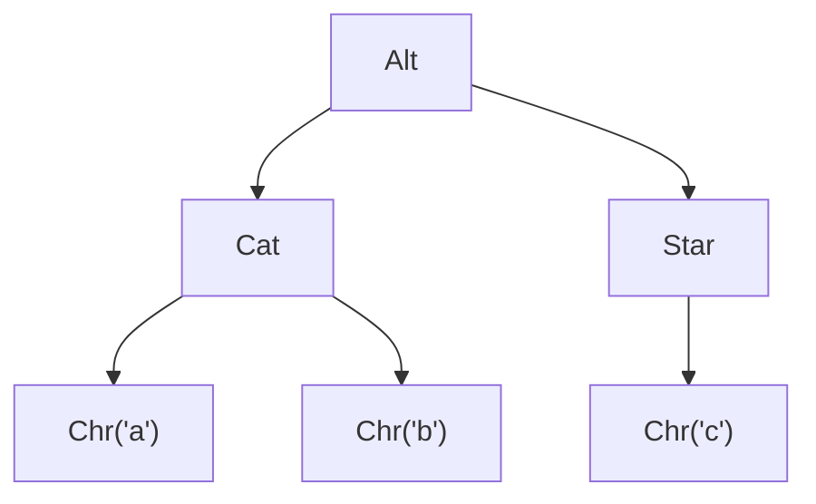
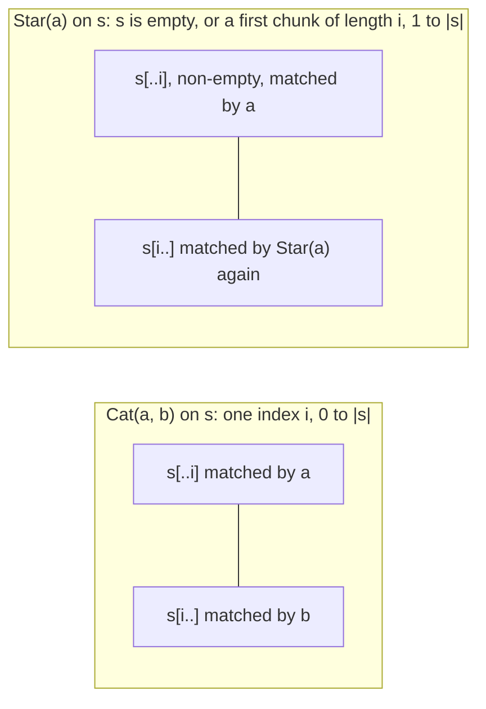
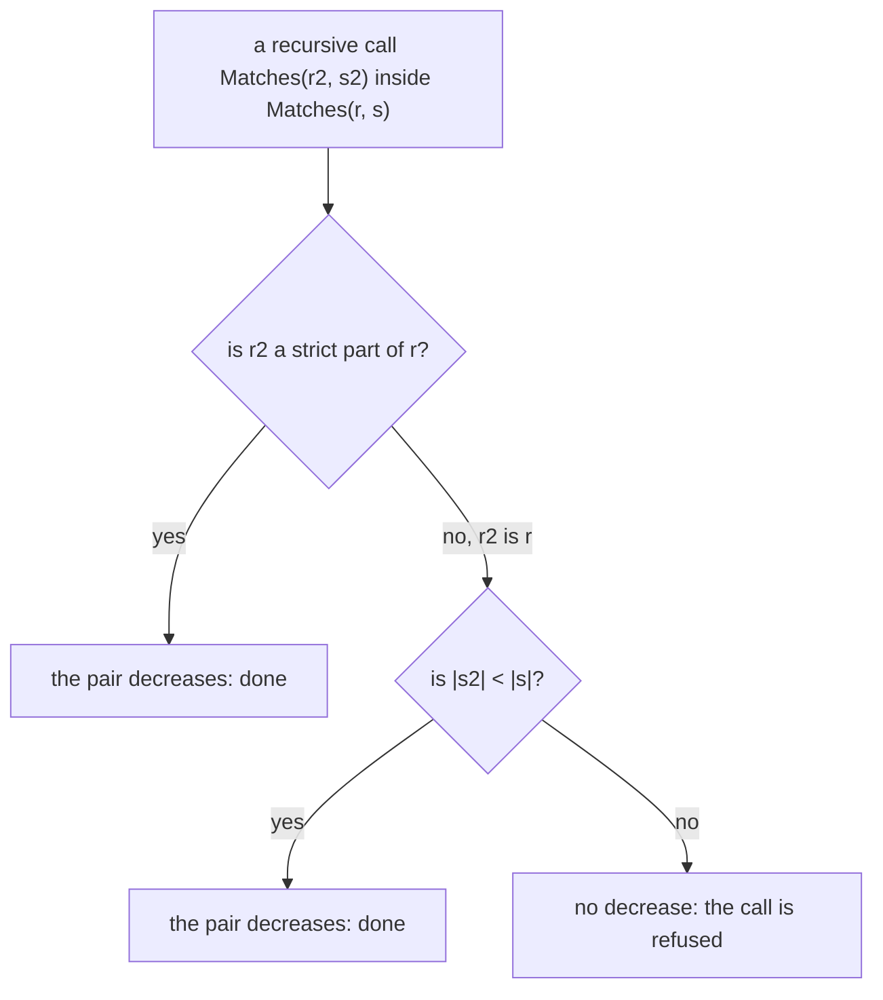

# R02 — Datatypes and recursion

R01 introduced the two tools on single functions: a contract, a body, and a verdict that says whether the body keeps the contract. R02 gives the track its running object. A regular expression is a small syntax tree, and the frozen layer A1 supplies it in both languages, with a whole-string meaning `Matches` and three structural functions over the tree (`Nullable`, `NodeCount`, `Backwards`). Every later R module builds on this tree, so this module is where its two accounts, the shape of the tree and the strings it means, are first connected by proof.

The connection is made with three tools you will use in every module after this one: a `match` over the constructors, a recursive call that is an induction hypothesis, and a witness for an existential. Each appears below in both languages, first in a small example whose verifier output is shown under it, then in the exercises. R is standalone: complete the README setup and R01; no Q file is needed.

**Three ideas do all the work.**

1. A constructor introduces a case and its fields. An exhaustive `match` covers every shape of the tree; each branch still owes the routine's result, and a case split by itself proves nothing about a child.
2. A recursive call is an interface on a smaller input. A call of the current lemma on a child puts the child's postcondition in scope: that is the induction hypothesis, and the measure is what makes using it legitimate.
3. The semantics is an existential over split points. A proof of a match names a split and discharges both sides at it; a proof that uses a match takes the split out (`choose` in Verus, `:|` in Dafny) and reasons about it.

---

## 0. How this module works

**Budget: 342 minutes**, including the module viva and excluding contractor wall time. These are planning estimates; record your own times.

| setup | test-out | read | worked | cards | predictions | holes | agent and first tests | paper | bench card | viva | calibration | total |
|---|---|---|---|---|---|---|---|---|---|---|---|---|
| 10 | 10 | 65 | 30 | 9 | 12 | 60 | 40 | 45 | 25 | 30 | 6 | **342** |

The hole minutes are 25 for Dafny (5 each) and 35 for Verus (7 each): the Verus half adds boxes, borrows and the explicit witness extraction.

**Test-out first.** Before reading on, attempt T1 closed book in both files: define `ChrCount` / `chr_count`, the number of `Chr` leaves of a regex, in the empty block that the prompt describes. Keep its check commented and record the attempt with `scripts/firsttry.sh R02 --check`; the tool enables the check in a scratch copy and keeps the first result. A later repair is useful, but it does not replace the first try.

**Predictions.** Commit the five answers below before running their scenarios or opening the specimens' expected outputs, the bank or the rubric. The obligation slots are in `specimens/R02/P1d.dfy.specimen` and `specimens/R02/P2v.rs.specimen`, the two verdicts in `slots/R02.slots` (switched on by the two `CHECK` lines of the Dafny file), and the value in `dafny/checks/R02_checks.dfy`. Respect each printed answer form. Then run `scripts/firsttry.sh R02 --check` again and keep its receipts.

> **Predict (P1) — commit in the file before reading on.** `specimens/R02/P1d.dfy.specimen` holds four lemmas with empty bodies about the given semantics: [a] `!Matches(Empty, s)` for every `s`; [b] `Matches(Star(r), [])` for every `r`; [c] `Matches(Cat(Eps, Chr('x')), ['x'])`; [d] `Matches(Star(Chr('x')), ['x', 'x'])`. Which labelled postconditions fail?

> **Predict (P2) — commit in the file before reading on.** `specimens/R02/P2v.rs.specimen` holds the same four claims for Verus's `matches`. Which labelled postconditions fail?

> **Predict (P3) — commit in the file before reading on.** Change A1's `Matches` in one place: in the `Star` case, the first chunk's bound `0 < i` (Verus `1 <= i`) becomes `0 <= i`, with the recursive calls and the measure unchanged. What does each language report? Answer `D:<v> V:<v>`, each `v` one of `ok`, `fail`, `timeout`, `err:<stage>`.

> **Predict (P4) — commit in the file before reading on.** Change only `Matches`' measure, from `decreases r, |s|` (Verus `decreases r, s.len()`) to `decreases r`. What does each language report? Same answer form as P3.

> **Predict (P5) — commit in the file before reading on.** The given-only check unit evaluates `Nullable(Cat(Star(Empty), Alt(Eps, Chr('a'))))` as compiled code. Which Boolean does it observe?

### This module's files

| file | role | shipped state |
|---|---|---|
| `dafny/R/R02_Datatypes/core/R02_Datatypes.dfy` | test-out, worked examples, cards, the five Dafny holes | verified, 5 holes, 0 errors; T1d empty with a commented check |
| `verus/r/r02_datatypes/src/lib.rs` | the paired Verus file | verified, 5 holes, 0 errors; T1v empty with a commented check |
| `dafny/checks/R02_checks.dfy` | given-only compiled value check | verified, no hole; P5d's slot unfilled |
| `dafny/R/R02_Datatypes/agent/R02_AgentImplement.dfy` | spec-first contractor exercise | failed by design: 3 holes, 6 errors (six failing checks) |
| `verus/r/r02_datatypes/src/agent.rs` | paired contractor exercise | failed by design: 6 holes, 10 errors (six failing checks) |
| `specimens/R02/`, `slots/R02.slots` | prediction specimens, chapter scenarios, card demos | slots unfilled; demos fail by design |
| `dafny/given/R/RG_A1_Re.dfy`, `verus/given/rg_re_a1/src/lib.rs` | the frozen A1 layer: definitions only | verified; no lemma supplied |
| `paper/R02_problems.tex`, `paper/R02_answers.tex` | written problems and your answers | template compiles; answers unfilled |
| `bench/local/r/README.md` | instructions for your first local bench card | you create the card |
| `Solutions/`, `paper/solutions/` | references | yours to open LAST, after your attempts, gates and review |

The exercise files run in the learner loop as shipped: the holes are counted, everything else verifies.

<!-- pin: shipped-d -->
```
$ scripts/vcheck dafny/R/R02_Datatypes/core
vcheck: dafny/R/R02_Datatypes/core [dafny, learner loop]: verified — 15 verified, 5 holes, 0 errors
dafny/R/R02_Datatypes/core/R02_Datatypes.dfy:174:25: hole bodyless-method R02.H1d
dafny/R/R02_Datatypes/core/R02_Datatypes.dfy:188:31: hole bodyless-method R02.H2d
dafny/R/R02_Datatypes/core/R02_Datatypes.dfy:201:36: hole bodyless-method R02.H3d
dafny/R/R02_Datatypes/core/R02_Datatypes.dfy:217:62: hole bodyless-method R02.H4d
dafny/R/R02_Datatypes/core/R02_Datatypes.dfy:235:5: hole assume R02.H5d
```

<!-- pin: shipped-v -->
```
$ scripts/vcheck verus/r/r02_datatypes
vcheck: verus/r/r02_datatypes [verus, learner loop]: verified — - verified, 5 holes, 0 errors
verus/r/r02_datatypes/src/lib.rs:176:40: hole assume R02.H1v
verus/r/r02_datatypes/src/lib.rs:194:40: hole assume R02.H2v
verus/r/r02_datatypes/src/lib.rs:210:40: hole assume R02.H3v
verus/r/r02_datatypes/src/lib.rs:226:40: hole assume R02.H4v
verus/r/r02_datatypes/src/lib.rs:242:1: hole external_body R02.H5v
```

---

## 1. Syntax trees have cases

### 1.1 The datatype

A1 declares the regex tree once per language. Dafny's `datatype` lists six constructors; each binary one carries two `Re` fields and `Star` carries one.

```dafny
datatype Re = Empty | Eps | Chr(c: char) | Alt(a: Re, b: Re) | Cat(a: Re, b: Re) | Star(r: Re)
```

Verus states the same tree as an `enum`. A recursive child sits in a `Box`, which owns one value on the heap: without the indirection the enum would contain a whole value of its own unbounded size.

```rust
pub enum Re {
    Empty,
    Eps,
    Chr(char),
    Alt(Box<Re>, Box<Re>),
    Cat(Box<Re>, Box<Re>),
    Star(Box<Re>),
}
```

`Empty` denotes the empty language, `Eps` the language holding only the empty string, `Chr(c)` the one-character string `c`, `Alt` a union, `Cat` a concatenation and `Star` iteration. The tree is always finite, even when its language is infinite: `Star(Chr('c'))` is two nodes. Here is the tree of `Alt(Cat(Chr('a'), Chr('b')), Star(Chr('c')))`, which matches `ab` and every string of `c`s:



Six nodes, three leaves, one star: every structural function in this module is a walk over a picture like this one, and the semantics in §2 is a statement about whole strings that the same picture does not show.

### 1.2 `match` covers the shapes; each branch owes a result

A `match` has one arm per constructor and binds the fields of the case it opens. The WRITE card C1 gives every outer constructor its own tag:

```dafny
function RegexOuterTag(r: Re): nat
{
  match r
  case Empty => 0
  case Eps => 1
  case Chr(_) => 2
  case Alt(_, _) => 3
  case Cat(_, _) => 4
  case Star(_) => 5
}
```

Coverage is checked before any proof is attempted. The card's demo specimen holds a `match` with the `Empty` arm only (after a copy of A1, so it runs alone):

```dafny
module R02_MatchDemo {
  import opened RG_A1_Re
  function RegexTag(r: Re): nat
  {
    match r
    case Empty => 0
  }
}
```

<!-- pin: c1d -->
```
$ scripts/vcheck specimens/R02/card-c1d.dfy.specimen
vcheck: specimens/R02/card-c1d.dfy.specimen [dafny, learner loop]: failed — 5 verified, 0 holes, 5 errors
specimens/R02/card-c1d.dfy.specimen:74:5: error: missing case in match expression: Alt(_, _)
specimens/R02/card-c1d.dfy.specimen:74:5: error: missing case in match expression: Cat(_, _)
specimens/R02/card-c1d.dfy.specimen:74:5: error: missing case in match expression: Chr(_)
specimens/R02/card-c1d.dfy.specimen:74:5: error: missing case in match expression: Eps
specimens/R02/card-c1d.dfy.specimen:74:5: error: missing case in match expression: Star(_)
```

The Verus demo makes the same mistake in an executable function over a borrowed tree:

```rust
fn regex_tag(r: &Re) -> u8 {
    match r {
        Re::Empty => 0,
    }
}
```

<!-- pin: c1v -->
```
$ scripts/vcheck specimens/R02/card-c1v.rs.specimen
vcheck: specimens/R02/card-c1v.rs.specimen [verus, learner loop]: failed — 0 verified, 0 holes, 1 error, stage resolve
specimens/R02/card-c1v.rs.specimen:132:11: error: non-exhaustive patterns: `&Re::Eps`, `&Re::Chr(_)`, `&Re::Alt(_, _)` and 2 more not covered
```

Read the stage, not just the word `failed`. Verus refuses the incomplete `match` at its Rust front end (`stage resolve`): no obligation reaches the solver. Dafny reports one error per missing constructor as part of its verification run, while the rest of the file still verifies. Either way the program is rejected for its shape. A covered branch with the wrong result is a different failure, which only a contract can catch.

### 1.3 A recursive function, and a recursive executable over a borrowed tree

The worked example W2 counts `Star` nodes twice: once as a spec function (the mathematical count) and once as executable code tied to it by its postcondition. Dafny's method binds each recursive result before combining them, because a method call is a statement:

```dafny
method StarCount(r: Re) returns (n: nat)
  ensures n == StarCountSpec(r)
  decreases r
{
  match r
  case Alt(a, b) =>
    var x := StarCount(a);
    var y := StarCount(b);
    n := x + y;
  case Cat(a, b) =>
    var x := StarCount(a);
    var y := StarCount(b);
    n := x + y;
  case Star(a) =>
    var x := StarCount(a);
    n := 1 + x;
  case _ =>
    n := 0;
}
```

Verus's version takes `&Re`. Matching on a reference binds references to the boxes, so `star_count(a)` borrows the child instead of moving it out; in the contract, `*r` is the value behind the reference. The result is a machine integer, so the contract carries a bound:

```rust
pub fn star_count(r: &Re) -> (n: u64)
    requires
        star_count_spec(*r) < 1000,
    ensures
        n == star_count_spec(*r),
    decreases r,
{
    match r {
        Re::Alt(a, b) => {
            let x = star_count(a);
            let y = star_count(b);
            x + y
        },
        // Cat as Alt; Star returns 1 + x; leaves return 0
        _ => 0,
    }
}
```

(The excerpt elides two arms; the file has all four.) The bound is not decoration. Here is W2v with its `requires` removed, run in R02's context:

```rust
use vstd::prelude::*;
use rg_re_a1::*;

verus! {

pub open spec fn star_count_spec(r: Re) -> nat
    decreases r,
{
    match r {
        Re::Alt(a, b) => star_count_spec(*a) + star_count_spec(*b),
        Re::Cat(a, b) => star_count_spec(*a) + star_count_spec(*b),
        Re::Star(a) => 1 + star_count_spec(*a),
        _ => 0,
    }
}

// W2v without its bound.
pub fn star_count(r: &Re) -> (n: u64)
    ensures
        n == star_count_spec(*r),
    decreases r,
{
    match r {
        Re::Alt(a, b) => {
            let x = star_count(a);
            let y = star_count(b);
            x + y
        },
        Re::Cat(a, b) => {
            let x = star_count(a);
            let y = star_count(b);
            x + y
        },
        Re::Star(a) => {
            let x = star_count(a);
            1 + x
        },
        _ => 0,
    }
}

} // verus!
```

<!-- pin: nobound-v -->
```
$ scripts/vcheck --module R02 star-count-unbounded.rs
vcheck: star-count-unbounded.rs [verus, learner loop]: failed — 1 verified, 0 holes, 3 errors
star-count-unbounded.rs:32:13: error: possible arithmetic underflow/overflow
star-count-unbounded.rs:36:13: error: possible arithmetic underflow/overflow
star-count-unbounded.rs:27:13: error: possible arithmetic underflow/overflow
```

Each `+` on `u64` is an obligation of its own. With the bound, each child's count is below 1,000 because the sum is, and each addition stays in range; without it, three additions can overflow, and the postcondition about the mathematical count is never reached. Dafny's `nat` has no such limit, which is why the Dafny method needs no bound.

### 1.4 `Box` and the final divergence card

The RECOGNISE card C6v isolates building a box (`boxed_regex(r)` returns `Box::new(r)`, with `*b == r` in its contract). The divergence card C7dv, the last item of the Dafny file, sets the two languages' child access side by side. Its Dafny demo matches on a value and claims something false about the child:

```dafny
module R02_BoxDemo {
  import opened RG_A1_Re
  lemma Child(r: Re)
  {
    match r
    case Star(a) =>
      assert a == r;
    case _ =>
  }
}
```

<!-- pin: c7dv-d -->
```
$ scripts/vcheck specimens/R02/card-c7dv-d.dfy.specimen
vcheck: specimens/R02/card-c7dv-d.dfy.specimen [dafny, learner loop]: failed — 5 verified, 0 holes, 1 error
specimens/R02/card-c7dv-d.dfy.specimen:76:7: error: assertion might not hold
```

The Verus demo makes a type error instead: inside `match r` on `&Re`, the bound `a` is a `&Box<Re>`, not an `Re`.

```rust
fn child(r: &Re) {
    match r {
        Re::Star(a) => {
            let value: Re = a;
        },
        _ => {},
    }
}
```

<!-- pin: c7dv-v -->
```
$ scripts/vcheck specimens/R02/card-c7dv-v.rs.specimen
vcheck: specimens/R02/card-c7dv-v.rs.specimen [verus, learner loop]: failed — 0 verified, 0 holes, 1 error, stage resolve
specimens/R02/card-c7dv-v.rs.specimen:134:29: error: mismatched types
```

Two columns, two stages: Dafny reaches the verifier and cannot prove a mathematical claim, which is in fact false (a child is never its parent); Verus stops at the Rust type checker (`stage resolve`). Neither says the other language's tree is different. They agree on what the tree means and differ on how a program may touch it.

---

## 2. A specification of whole strings

### 2.1 `Matches` by splits

A1's semantics says, for a regex and a whole string, whether the regex matches exactly that string. It is a `ghost predicate` in Dafny and a `spec fn` in Verus, so no executable code can call it (§2.5).

```dafny
ghost predicate Matches(r: Re, s: seq<char>)
  decreases r, |s|
{
  match r
  case Empty => false
  case Eps => s == []
  case Chr(c) => s == [c]
  case Alt(a, b) => Matches(a, s) || Matches(b, s)
  case Cat(a, b) => exists i | 0 <= i <= |s| :: Matches(a, s[..i]) && Matches(b, s[i..])
  case Star(a) => s == [] || exists i | 0 < i <= |s| :: Matches(a, s[..i]) && Matches(Star(a), s[i..])
}
```

Verus writes slices as `subrange` and states each existential's trigger on the prefix term: a quantified fact is used only when a term of the trigger's shape, `s.subrange(0, i)` for some `i`, appears in the proof.

```rust
Re::Cat(a, b) => exists|i: int|
    0 <= i <= s.len() && matches(*a, #[trigger] s.subrange(0, i)) && matches(
        *b,
        s.subrange(i, s.len() as int),
    ),
Re::Star(a) => s.len() == 0 || exists|i: int|
    1 <= i <= s.len() && matches(*a, #[trigger] s.subrange(0, i)) && matches(
        r,
        s.subrange(i, s.len() as int),
    ),
```

Every case is about the entire sequence it receives. `Chr(c)` does not mean "`c` occurs somewhere"; it means the string is exactly `[c]`. A `Cat` match is one index `i` with two claims at the same boundary: the left regex matches the whole prefix before `i`, and the right regex matches the whole suffix from `i`. A `Star` match is either the empty string or a **non-empty** first chunk matched by the body, followed by a match of the same star on the rest:



The non-empty first chunk is what lets the definition recurse on the same `Star(a)`: the rest is strictly shorter. §4 returns to it as a termination argument.

### 2.2 Introducing the existential: name the split

To prove a `Cat` match you offer one index and discharge both conjuncts at it. With nothing offered, neither tool finds one for `ab`:

```dafny
module R02_SplitBare {
  import opened RG_A1_Re

  lemma MatchesABBare()
    ensures Matches(Cat(Chr('a'), Chr('b')), ['a', 'b'])
  {
  }
}
```

<!-- pin: w1bare-d -->
```
$ scripts/vcheck --module R02 split-bare.dfy
vcheck: split-bare.dfy [dafny, learner loop]: failed — 5 verified, 0 holes, 1 error
split-bare.dfy:6:3: error: a postcondition could not be proved on this return path
split-bare.dfy:5:20: related: this is the postcondition that could not be proved
dafny/given/R/RG_A1_Re.dfy:21:23: related: this proposition could not be proved
```

```rust
use vstd::prelude::*;
use rg_re_a1::*;

verus! {

proof fn lemma_matches_ab_bare()
    ensures
        matches(Re::Cat(Box::new(Re::Chr('a')), Box::new(Re::Chr('b'))), seq!['a', 'b']),
{
}

} // verus!
```

<!-- pin: w1bare-v -->
```
$ scripts/vcheck --module R02 split-bare.rs
vcheck: split-bare.rs [verus, learner loop]: failed — 0 verified, 0 holes, 1 error
split-bare.rs:8:9: error: postcondition not satisfied
```

Dafny's `related` line points into A1, at the `Cat` case: the existential is the proposition left unproved. The worked example W1 supplies the candidate `i = 1` by stating what the two slices are, then each side's match, then the existential itself:

```dafny
lemma MatchesAB()
  ensures Matches(Cat(Chr('a'), Chr('b')), ['a', 'b'])
{
  assert ['a', 'b'][..1] == ['a'];
  assert ['a', 'b'][1..] == ['b'];
  assert Matches(Chr('a'), ['a', 'b'][..1]);
  assert Matches(Chr('b'), ['a', 'b'][1..]);
  assert exists i | 0 <= i <= 2 :: Matches(Chr('a'), ['a', 'b'][..i]) && Matches(Chr('b'), ['a', 'b'][i..]);
}
```

```rust
pub proof fn lemma_matches_ab()
    ensures matches(Re::Cat(Box::new(Re::Chr('a')), Box::new(Re::Chr('b'))), seq!['a', 'b']),
{
    let s = seq!['a', 'b'];
    assert(s.subrange(0, 1) =~= seq!['a']);
    assert(s.subrange(1, s.len() as int) =~= seq!['b']);
    assert(matches(Re::Chr('a'), s.subrange(0, 1)));
    assert(matches(Re::Chr('b'), s.subrange(1, s.len() as int)));
    assert(exists|i: int| 0 <= i <= s.len()
        && matches(Re::Chr('a'), #[trigger] s.subrange(0, i))
        && matches(Re::Chr('b'), s.subrange(i, s.len() as int)));
}
```

Verus's `=~=` is extensional equality of sequences: same length, same element at every index. A slice fact is the bridge between the candidate index and the constructor cases: once the solver knows `s.subrange(0, 1)` is `seq!['a']`, the `Chr` case applies; and the term `s.subrange(0, 1)` is exactly what the existential's trigger waits for. Both W1 files verify in the shipped units (§0).

The WRITE card C3 states the same move on a plain sequence: the precondition hands you a marked index `i`, and the existential is proved at that candidate. Its demo promises only a non-empty sequence, so there is no candidate to offer:

```dafny
lemma NamedChar(s: seq<char>)
  requires |s| > 0
{
  assert exists i :: 0 <= i < |s| && s[i] == '#';
}
```

<!-- pin: c3d -->
```
$ scripts/vcheck specimens/R02/card-c3d.dfy.specimen
vcheck: specimens/R02/card-c3d.dfy.specimen [dafny, learner loop]: failed — 0 verified, 0 holes, 1 error
specimens/R02/card-c3d.dfy.specimen:5:5: error: assertion might not hold
```

```rust
proof fn named_char(s: Seq<char>)
    requires
        s.len() > 0,
{
    assert(exists|i: int| 0 <= i < s.len() && s[i] == '#');
}
```

<!-- pin: c3v -->
```
$ scripts/vcheck specimens/R02/card-c3v.rs.specimen
vcheck: specimens/R02/card-c3v.rs.specimen [verus, learner loop]: failed — 0 verified, 0 holes, 1 error
specimens/R02/card-c3v.rs.specimen:7:12: error: assertion failed
```

The syntax of an existential does not make a witness appear: the claim is false for `['z']`, and no proof will find what the input does not hold.

**The answers to P1 and P2.** Each specimen lemma has an empty body, so the run shows which claims the definitions settle on their own:

<!-- pin: obligation-d -->
```
$ scripts/vcheck specimens/R02/P1d.dfy.specimen
vcheck: specimens/R02/P1d.dfy.specimen [dafny, learner loop]: failed — 7 verified, 0 holes, 2 errors
specimens/R02/P1d.dfy.specimen:83:3: error: a postcondition could not be proved on this return path
specimens/R02/P1d.dfy.specimen:82:20: related: this is the postcondition that could not be proved
specimens/R02/P1d.dfy.specimen:24:23: related: this proposition could not be proved
specimens/R02/P1d.dfy.specimen:86:3: error: a postcondition could not be proved on this return path
specimens/R02/P1d.dfy.specimen:85:20: related: this is the postcondition that could not be proved
specimens/R02/P1d.dfy.specimen:25:29: related: this proposition could not be proved
```

<!-- pin: obligation-v -->
```
$ scripts/vcheck specimens/R02/P2v.rs.specimen
vcheck: specimens/R02/P2v.rs.specimen [verus, learner loop]: failed — 9 verified, 0 holes, 2 errors
specimens/R02/P2v.rs.specimen:140:13: error: postcondition not satisfied
specimens/R02/P2v.rs.specimen:143:13: error: postcondition not satisfied
```

`FAILS c d` in both languages. [a] and [b] are one unfolding each: `Empty` matches nothing, and `Star` accepts the empty string by its first disjunct, whatever `r` is. [c] needs the split at 0 and [d] the first chunk of length 1, and an empty body names neither. The claims are true; the failures are about missing witnesses, not about the semantics. A false claim and an unproved true claim look the same in this output, which is why you read the obligation, not the verdict word.

### 2.3 Eliminating the existential: `choose` and `:|`

A hypothesis that a `Cat` matches gives you an existential to use rather than to prove. To reason about the split, you take one out and name it. Verus's `choose|i: int| P(i)` is a spec expression whose value satisfies `P` whenever some value does; Dafny's statement `var i :| P(i);` binds a local with the same promise (and makes you prove that one exists). Here is a fresh lemma, not an exercise: a match of `Cat(Chr('a'), r)` must start with `a`.

```rust
use vstd::prelude::*;
use rg_re_a1::*;

verus! {

proof fn lemma_starts_with_a(r: Re, s: Seq<char>)
    requires
        matches(Re::Cat(Box::new(Re::Chr('a')), Box::new(r)), s),
    ensures
        s.len() >= 1 && s[0] == 'a',
{
}

} // verus!
```

<!-- pin: take-bare-v -->
```
$ scripts/vcheck --module R02 take-bare.rs
vcheck: take-bare.rs [verus, learner loop]: failed — 0 verified, 0 holes, 1 error
take-bare.rs:10:9: error: postcondition not satisfied
```

With the split taken out, the `Chr` case tells us the prefix is one character long and equal to `a`, and the first character of `s` is the first character of that prefix:

```rust
use vstd::prelude::*;
use rg_re_a1::*;

verus! {

proof fn lemma_starts_with_a(r: Re, s: Seq<char>)
    requires
        matches(Re::Cat(Box::new(Re::Chr('a')), Box::new(r)), s),
    ensures
        s.len() >= 1 && s[0] == 'a',
{
    let i = choose|i: int|
        0 <= i <= s.len()
        && matches(Re::Chr('a'), #[trigger] s.subrange(0, i))
        && matches(r, s.subrange(i, s.len() as int));
    assert(s.subrange(0, i).len() == 1);
    assert(s[0] == s.subrange(0, i)[0]);
}

} // verus!
```

<!-- pin: take-v -->
```
$ scripts/vcheck --module R02 take.rs
vcheck: take.rs [verus, learner loop]: verified — 1 verified, 0 holes, 0 errors
```

The `choose` expression repeats the existential's body, trigger included, so the solver can connect it to the hypothesis. Dafny behaves differently on the same claim. It proves the bare version:

```dafny
module R02_TakeSplitBare {
  import opened RG_A1_Re

  lemma StartsWithABare(r: Re, s: seq<char>)
    requires Matches(Cat(Chr('a'), r), s)
    ensures |s| >= 1 && s[0] == 'a'
  {
  }
}
```

<!-- pin: take-bare-d -->
```
$ scripts/vcheck --module R02 take-bare.dfy
vcheck: take-bare.dfy [dafny, learner loop]: verified — 7 verified, 0 holes, 0 errors
```

Dafny's encoding of the hypothesis gave the solver the split here without help. In Verus the hypothesis is used only through its trigger, a term `s.subrange(0, i)`, and the bare proof offers none; the `choose` expression puts one in play. The explicit Dafny form is still the readable one, and the one to reach for when the automatic step does not happen:

```dafny
module R02_TakeSplit {
  import opened RG_A1_Re

  // From a match of Cat(Chr('a'), r), take the split out and read it.
  lemma StartsWithA(r: Re, s: seq<char>)
    requires Matches(Cat(Chr('a'), r), s)
    ensures |s| >= 1 && s[0] == 'a'
  {
    var i :| 0 <= i <= |s| && Matches(Chr('a'), s[..i]) && Matches(r, s[i..]);
    assert s[..i] == ['a'];
    assert s[0] == s[..i][0];
  }
}
```

<!-- pin: take-d -->
```
$ scripts/vcheck --module R02 take.dfy
vcheck: take.dfy [dafny, learner loop]: verified — 7 verified, 0 holes, 0 errors
```

H4 asks for both directions of a `Cat` fact: one introduces the existential (§2.2), the other eliminates it (this section). The two languages pose different statements here, on purpose. Verus's H4 is `Cat(Eps, r)`: its converse needs `choose` to take the split out, which is the move this section teaches. Dafny's solver closes the same `Eps` statement from a single slice fact, so the elimination would never be yours; Dafny's H4 is therefore a two-character append, `Cat(Cat(r, Chr(c)), Chr(d))` on `s + [c, d]`, where two splits must be named, one inside the other, before either direction goes through.

### 2.4 Two structural predicates: nullable and void

A1's `Nullable` is computed on the tree: `Eps` and `Star` are nullable, `Alt` when either child is, `Cat` when both are. It is convenient, and it is not the semantics: whether `Nullable(r)` and `Matches(r, [])` agree for every `r` is H1's theorem, proved by induction over the tree. The module's own `VoidSpec` / `void_spec` is a second structural predicate, "matches no string", which H5 implements:

```dafny
ghost predicate VoidSpec(r: Re)
  decreases r
{
  match r
  case Empty => true
  case Eps => false
  case Chr(_) => false
  case Alt(a, b) => VoidSpec(a) && VoidSpec(b)
  case Cat(a, b) => VoidSpec(a) || VoidSpec(b)
  case Star(_) => false
}
```

```rust
pub open spec fn void_spec(r: Re) -> bool
    decreases r,
{
    match r {
        Re::Empty => true,
        Re::Eps => false,
        Re::Chr(_) => false,
        Re::Alt(a, b) => void_spec(*a) && void_spec(*b),
        Re::Cat(a, b) => void_spec(*a) || void_spec(*b),
        Re::Star(_) => false,
    }
}
```

Voidness and nullability are different questions. `Star(Empty)` is nullable and not void: it matches the empty string and nothing else.

```dafny
module R02_NullableNotVoid {
  import opened RG_A1_Re

  // Star(Empty) accepts the empty string and nothing else.
  lemma StarEmptyFacts()
    ensures Nullable(Star(Empty))
    ensures Matches(Star(Empty), [])
    ensures !Matches(Star(Empty), ['x'])
  {
    assert ['x'][..1] == ['x'];
  }
}
```

<!-- pin: nullvoid-d -->
```
$ scripts/vcheck --module R02 star-empty.dfy
vcheck: star-empty.dfy [dafny, learner loop]: verified — 6 verified, 0 holes, 0 errors
```

The third claim is a rejection: every legal first chunk of `['x']` would have to be matched by `Empty`, and none is. A rejection covers every candidate; the slice fact names the only one there is.

**The answer to P5.** The check unit's expression, run as compiled code in a specimen of its own:

```dafny
@Test
method NullableValueObserved()
{
  var observed := Nullable(Cat(Star(Empty), Alt(Eps, Chr('a'))));
  expect observed;
}
```

<!-- pin: p5-d -->
```
$ scripts/vcheck --test specimens/R02/chapter-p5-d.dfy.specimen
vcheck: specimens/R02/chapter-p5-d.dfy.specimen [dafny, test]: verified — 1 passed, 0 failed
PASSED R02_P5Observed.NullableValueObserved
```

`true`: the `Cat` is nullable because both children are (`Star(_)` always; `Alt` through `Eps`). The test passed on this one input; it says nothing about any other regex, which is the difference between a compiled observation and H1's universal statement.

### 2.5 Ghost and compiled: why `Matches` is a spec

The semantics is ghost on purpose. An executable routine may not answer its own contract by calling it:

```dafny
module R02_GhostCall {
  import opened RG_A1_Re

  // Matches is a ghost predicate: compiled code may not call it.
  method AcceptsEmpty(r: Re) returns (b: bool)
    ensures b == Matches(r, [])
  {
    b := Matches(r, []);
  }
}
```

<!-- pin: ghost-d -->
```
$ scripts/vcheck --module R02 ghost-call.dfy
vcheck: ghost-call.dfy [dafny, learner loop]: failed — - verified, 0 holes, 1 error, stage resolve
ghost-call.dfy:8:17: error: a call to a ghost predicate is allowed only in specification contexts (consider declaring the predicate without the 'ghost' keyword)
```

```rust
use vstd::prelude::*;
use rg_re_a1::*;

verus! {

// matches is a spec fn: exec code may not call it.
fn accepts_empty(r: &Re) -> (b: bool)
    ensures
        b == matches(*r, Seq::<char>::empty()),
{
    matches(*r, Seq::<char>::empty())
}

} // verus!
```

<!-- pin: ghost-v -->
```
$ scripts/vcheck --module R02 ghost-call.rs
vcheck: ghost-call.rs [verus, learner loop]: failed — - verified, 0 holes, 1 error, stage resolve
ghost-call.rs:11:5: error: cannot call function `rg_re_a1::matches` with mode spec
```

This is a mode rule (the RECOGNISE card C5dv), not a claim that membership is uncomputable: R06 builds an executable matcher and proves it against this very predicate. It is also the subject of the paper card (§7): when a specification is itself computable, an implementation can quietly reuse it, and the proof then shows less than it seems to.

---

## 3. A recursive proof exports facts

A recursive call is an interface. It returns, for its smaller argument, exactly what its contract promises: a value satisfying the postcondition (W2), or for a lemma the postcondition itself. A lemma that calls itself on a child is a proof by structural induction: the call is the hypothesis, the arms without calls are the base cases, and `decreases r` makes the circle well-founded. The exercises H1–H3 are inductions of this kind, so here is one on a fresh statement: the number of stars is below the number of nodes. (The probe copies W2's spec function, because a probe sees the given layer and not your exercise file.)

```dafny
module R02_StarsBelowBare {
  import opened RG_A1_Re

  function StarCountSpec(r: Re): nat
    decreases r
  {
    match r
    case Alt(a, b) => StarCountSpec(a) + StarCountSpec(b)
    case Cat(a, b) => StarCountSpec(a) + StarCountSpec(b)
    case Star(a) => 1 + StarCountSpec(a)
    case _ => 0
  }

  lemma {:induction false} StarsBelowNodes(r: Re)
    ensures StarCountSpec(r) < NodeCount(r)
    decreases r
  {
  }
}
```

<!-- pin: ih-none-d -->
```
$ scripts/vcheck --module R02 stars-bare.dfy
vcheck: stars-bare.dfy [dafny, learner loop]: failed — 6 verified, 0 holes, 1 error
stars-bare.dfy:17:3: error: a postcondition could not be proved on this return path
stars-bare.dfy:15:30: related: this is the postcondition that could not be proved
```

An empty body knows the definitions and nothing about the children. With one call per recursive child, each branch has the children's facts, and the arithmetic follows (a leaf has 0 stars and 1 node; `Star(a)` adds one star and one node to `a`'s counts):

```dafny
module R02_StarsBelow {
  import opened RG_A1_Re

  function StarCountSpec(r: Re): nat
    decreases r
  {
    match r
    case Alt(a, b) => StarCountSpec(a) + StarCountSpec(b)
    case Cat(a, b) => StarCountSpec(a) + StarCountSpec(b)
    case Star(a) => 1 + StarCountSpec(a)
    case _ => 0
  }

  lemma {:induction false} StarsBelowNodes(r: Re)
    ensures StarCountSpec(r) < NodeCount(r)
    decreases r
  {
    match r
    case Alt(a, b) =>
      StarsBelowNodes(a);
      StarsBelowNodes(b);
    case Cat(a, b) =>
      StarsBelowNodes(a);
      StarsBelowNodes(b);
    case Star(a) =>
      StarsBelowNodes(a);
    case _ =>
  }
}
```

<!-- pin: ih-calls-d -->
```
$ scripts/vcheck --module R02 stars.dfy
vcheck: stars.dfy [dafny, learner loop]: verified — 7 verified, 0 holes, 0 errors
```

**Why the Dafny holes carry `{:induction false}`.** Dafny can attempt an induction itself: it assumes the statement for smaller arguments and tries the step. R02's unit runs with that default on, and the same lemma without the attribute verifies with an empty body:

```dafny
module R02_StarsBelowAuto {
  import opened RG_A1_Re

  function StarCountSpec(r: Re): nat
    decreases r
  {
    match r
    case Alt(a, b) => StarCountSpec(a) + StarCountSpec(b)
    case Cat(a, b) => StarCountSpec(a) + StarCountSpec(b)
    case Star(a) => 1 + StarCountSpec(a)
    case _ => 0
  }

  // No {:induction false}: Dafny may try an induction of its own.
  lemma StarsBelowNodes(r: Re)
    ensures StarCountSpec(r) < NodeCount(r)
    decreases r
  {
  }
}
```

<!-- pin: ih-auto-d -->
```
$ scripts/vcheck --module R02 stars-auto.dfy
vcheck: stars-auto.dfy [dafny, learner loop]: verified — 7 verified, 0 holes, 0 errors
```

A found induction is invisible: it is in no file, it rests on a heuristic, and it does not port to Verus, which never inducts for you. H1d, H2d and H3d ship `{:induction false}` so that every hypothesis in your proof is a call you wrote and can read; the freeze keeps the attribute (`scripts/specfreeze --check R02` reports its removal). From R03 on, the units turn automatic induction off for every lemma.

Verus, the same pair:

```rust
use vstd::prelude::*;
use rg_re_a1::*;

verus! {

spec fn star_count_spec(r: Re) -> nat
    decreases r,
{
    match r {
        Re::Alt(a, b) => star_count_spec(*a) + star_count_spec(*b),
        Re::Cat(a, b) => star_count_spec(*a) + star_count_spec(*b),
        Re::Star(a) => 1 + star_count_spec(*a),
        _ => 0,
    }
}

proof fn lemma_stars_below_nodes(r: Re)
    ensures
        star_count_spec(r) < node_count(r),
    decreases r,
{
}

} // verus!
```

<!-- pin: ih-none-v -->
```
$ scripts/vcheck --module R02 stars-bare.rs
vcheck: stars-bare.rs [verus, learner loop]: failed — 1 verified, 0 holes, 1 error
stars-bare.rs:19:9: error: postcondition not satisfied
```

```rust
use vstd::prelude::*;
use rg_re_a1::*;

verus! {

spec fn star_count_spec(r: Re) -> nat
    decreases r,
{
    match r {
        Re::Alt(a, b) => star_count_spec(*a) + star_count_spec(*b),
        Re::Cat(a, b) => star_count_spec(*a) + star_count_spec(*b),
        Re::Star(a) => 1 + star_count_spec(*a),
        _ => 0,
    }
}

proof fn lemma_stars_below_nodes(r: Re)
    ensures
        star_count_spec(r) < node_count(r),
    decreases r,
{
    match r {
        Re::Alt(a, b) => {
            lemma_stars_below_nodes(*a);
            lemma_stars_below_nodes(*b);
        },
        Re::Cat(a, b) => {
            lemma_stars_below_nodes(*a);
            lemma_stars_below_nodes(*b);
        },
        Re::Star(a) => {
            lemma_stars_below_nodes(*a);
        },
        _ => {},
    }
}

} // verus!
```

<!-- pin: ih-calls-v -->
```
$ scripts/vcheck --module R02 stars.rs
vcheck: stars.rs [verus, learner loop]: verified — 2 verified, 0 holes, 0 errors
```

The children are boxed, so the hypothesis for a child is a call on `*a`. The measure is what stops the shortcut of calling the lemma on its own argument:

```rust
use vstd::prelude::*;
use rg_re_a1::*;

verus! {

spec fn star_count_spec(r: Re) -> nat
    decreases r,
{
    match r {
        Re::Alt(a, b) => star_count_spec(*a) + star_count_spec(*b),
        Re::Cat(a, b) => star_count_spec(*a) + star_count_spec(*b),
        Re::Star(a) => 1 + star_count_spec(*a),
        _ => 0,
    }
}

proof fn lemma_stars_below_nodes(r: Re)
    ensures
        star_count_spec(r) < node_count(r),
    decreases r,
{
    lemma_stars_below_nodes(r);
}

} // verus!
```

<!-- pin: ih-self-v -->
```
$ scripts/vcheck --module R02 stars-self.rs
vcheck: stars-self.rs [verus, learner loop]: failed — 1 verified, 0 holes, 1 error
stars-self.rs:22:5: error: could not prove termination
```

**When a branch fails, write the inventory.** Before adding a line, write down four things: the constructor known in the branch, the recursive arguments, the facts the calls returned, and the exact result still owed. In an H2-style proof, a `Cat` branch knows `r` is `Cat(a, b)`, has (after two calls) both children's equations, and owes an equation about `Backwards(Cat(a, b))`, which is `Cat(Backwards(b), Backwards(a))`: the children swap, and the owed fact is about a sum, which does not care about the order. That inventory turns "the induction does not work" into a question a tutor (or you) can answer.

---

## 4. The measure belongs to the call

### 4.1 Structural and lexicographic measures

A `decreases` clause names a quantity that every recursive call must make strictly smaller in a well-founded order. For a datatype the order is structural: a child is smaller than the value that contains it. The WRITE card C2's `OuterStars` recurses only through `Star`, on the strict child:

```dafny
function OuterStars(r: Re): nat
  decreases r
{
  match r
  case Star(a) => 1 + OuterStars(a)
  case _ => 0
}
```

Its demo calls itself on the same argument. Declaring a measure does not supply a decrease:

```dafny
function VisitRegex(r: Re): nat
  decreases r
{
  VisitRegex(r)
}
```

<!-- pin: c2d -->
```
$ scripts/vcheck specimens/R02/card-c2d.dfy.specimen
vcheck: specimens/R02/card-c2d.dfy.specimen [dafny, learner loop]: failed — 5 verified, 0 holes, 1 error
specimens/R02/card-c2d.dfy.specimen:75:15: error: decreases clause might not decrease
```

```rust
spec fn visit_regex(r: Re) -> nat
    decreases r,
{
    visit_regex(r)
}
```

<!-- pin: c2v -->
```
$ scripts/vcheck specimens/R02/card-c2v.rs.specimen
vcheck: specimens/R02/card-c2v.rs.specimen [verus, learner loop]: failed — 7 verified, 0 holes, 1 error
specimens/R02/card-c2v.rs.specimen:134:5: error: could not prove termination
```

`Matches` needs more than structure. Its `Star` case calls itself on the **same** regex `Star(a)` with the rest of the string, so its measure is a pair `(r, |s|)`, compared lexicographically:



Read the `Star` case twice, once per call. `Matches(a, s[..i])` calls a strict child: the first coordinate settles it, whatever the slice's length. `Matches(Star(a), s[i..])` keeps the regex, so the second coordinate must drop, and it does because `i > 0`: the non-empty first chunk of §2.1 is the termination argument.

### 4.2 The answers to P3 and P4

The two specimens each change one thing. P3 lets the first chunk be empty (Dafny shown; Verus's line reads `0 <= i <= s.len()` in place of `1 <= i`):

```dafny
case Star(a) => s == [] || exists i | 0 <= i <= |s| :: Matches(a, s[..i]) && Matches(Star(a), s[i..])
```

<!-- pin: p3-d -->
```
$ scripts/vcheck specimens/R02/chapter-p3-d.dfy.specimen
vcheck: specimens/R02/chapter-p3-d.dfy.specimen [dafny, learner loop]: failed — 4 verified, 0 holes, 1 error
specimens/R02/chapter-p3-d.dfy.specimen:23:89: error: decreases clause might not decrease
```

<!-- pin: p3-v -->
```
$ scripts/vcheck specimens/R02/chapter-p3-v.rs.specimen
vcheck: specimens/R02/chapter-p3-v.rs.specimen [verus, learner loop]: failed — 6 verified, 0 holes, 1 error
specimens/R02/chapter-p3-v.rs.specimen:36:78: error: could not prove termination
```

P4 keeps the bound and drops the length from the measure:

```dafny
ghost predicate Matches(r: Re, s: seq<char>)
  decreases r
```

<!-- pin: p4-d -->
```
$ scripts/vcheck specimens/R02/chapter-p4-d.dfy.specimen
vcheck: specimens/R02/chapter-p4-d.dfy.specimen [dafny, learner loop]: failed — 4 verified, 0 holes, 1 error
specimens/R02/chapter-p4-d.dfy.specimen:23:88: error: decreases clause might not decrease
```

<!-- pin: p4-v -->
```
$ scripts/vcheck specimens/R02/chapter-p4-v.rs.specimen
vcheck: specimens/R02/chapter-p4-v.rs.specimen [verus, learner loop]: failed — 6 verified, 0 holes, 1 error
specimens/R02/chapter-p4-v.rs.specimen:36:78: error: could not prove termination
```

`D:fail V:fail` for both, and the location is the same call: the second recursive call of the `Star` case. In P3, `i = 0` gives the call `Matches(Star(a), s[0..])`, which is the original pair: no decrease. In P4 the measure no longer mentions the string, so a call that keeps `Star(a)` does not decrease, however much input it consumes. A failed termination proof says the definition has not justified itself; it does not say some execution loops. A few terminating sample runs would not justify it either.

### 4.3 An executable recursion owes its own measure

Verus checks the termination of every recursive function, executable ones included, and wants the measure written. W2v without its `decreases`:

```rust
use vstd::prelude::*;
use rg_re_a1::*;

verus! {

pub open spec fn star_count_spec(r: Re) -> nat
    decreases r,
{
    match r {
        Re::Alt(a, b) => star_count_spec(*a) + star_count_spec(*b),
        Re::Cat(a, b) => star_count_spec(*a) + star_count_spec(*b),
        Re::Star(a) => 1 + star_count_spec(*a),
        _ => 0,
    }
}

// W2v without its measure.
pub fn star_count(r: &Re) -> (n: u64)
    requires
        star_count_spec(*r) < 1000,
    ensures
        n == star_count_spec(*r),
{
    match r {
        Re::Alt(a, b) => {
            let x = star_count(a);
            let y = star_count(b);
            x + y
        },
        Re::Cat(a, b) => {
            let x = star_count(a);
            let y = star_count(b);
            x + y
        },
        Re::Star(a) => {
            let x = star_count(a);
            1 + x
        },
        _ => 0,
    }
}

} // verus!
```

<!-- pin: nomeasure-v -->
```
$ scripts/vcheck --module R02 star-count-unmeasured.rs
vcheck: star-count-unmeasured.rs [verus, learner loop]: failed — - verified, 0 holes, 1 error, stage resolve
star-count-unmeasured.rs:18:1: error: recursive function must have a decreases clause
```

H5v ships without its measure on purpose: writing it is part of the exercise. A `decreases r` on a function that takes `&Re` compares the values behind the references, and a borrowed child is smaller than its parent.

---

## 5. First tests: a sample is not a theorem

The RECOGNISE card C4dv shows the first rung of the escalation ladder: a native test. Dafny marks a test method with `@Test`; the method is verified like any other and then compiled and run by `scripts/vcheck --test`.

```dafny
@Test
method RegexSampleTest()
{
  expect !Nullable(Chr('z'));
}
```

<!-- pin: test-d -->
```
$ scripts/vcheck --test dafny/R/R02_Datatypes/core
vcheck: dafny/R/R02_Datatypes/core [dafny, test]: verified — 1 passed, 0 failed
PASSED R02_Datatypes.RegexSampleTest
```

Verus has no test attribute of its own: a test is ordinary Rust, a `#[test]` function **outside** `verus!`, compiled against the verified crate and run by the same command.

```rust
#[test]
fn regex_sample_test() {
    assert!(!rg_re_a1::is_nullable(&rg_re_a1::Re::Chr('z')));
}
```

<!-- pin: test-v -->
```
$ scripts/vcheck --test verus/r/r02_datatypes
vcheck: verus/r/r02_datatypes [verus, test]: verified — 1 passed, 0 failed
PASSED regex_sample_test
```

Both passed, on one regex. A test is cheap and concrete, and it can refute a wrong implementation that a weak contract would let through; it cannot establish a statement about every input. After the contractor round (§9) you write the first property tests: loops over a sample list that check relations between results (a nullable regex is never void; an `Alt` is void exactly when both children are). They sit on the ladder between single checks and proof.

| construct | Dafny | Verus | shown in |
|---|---|---|---|
| case analysis | `match r case Cat(a, b) => …` | `match r { Re::Cat(a, b) => …, }` | §1.2, C1 |
| recursive child | a field of type `Re` | `Box<Re>`; `*a` in specs, `a` borrowed in exec | §1.3, C6v, C7dv |
| measure | `decreases r` / `decreases r, \|s\|` | `decreases r,` / `decreases r, s.len(),` | §4, C2 |
| introduce an existential | assert the slices, then the claim | assert the subranges with `=~=`, then the claim | §2.2, W1, C3 |
| eliminate an existential | `var i :\| P(i);` (often automatic) | `let i = choose\|i: int\| P(i);` | §2.3 |
| induction hypothesis | a call `L(a);` on a child (`{:induction false}` shipped) | a call `lemma_l(*a);` on a boxed child | §3 |
| test | `@Test method`, `expect` | `#[test] fn` outside `verus!`, `assert!` | §5, C4dv |

---

## 6. What the instruments can and cannot see

Each instrument answers one question. The learner loop counts holes and verifies the rest; the gate adds the completion rule; the audit lists what is trusted; a native test runs code on samples. Run the gate on the shipped files and read why it refuses them:

<!-- pin: gate-d -->
```
$ scripts/vcheck --gate dafny/R/R02_Datatypes/core
vcheck: dafny/R/R02_Datatypes/core [dafny, gate]: failed — 15 verified, 5 holes, 0 errors, 1 finding
dafny/R/R02_Datatypes/core/R02_Datatypes.dfy:174:25: hole bodyless-method R02.H1d
dafny/R/R02_Datatypes/core/R02_Datatypes.dfy:188:31: hole bodyless-method R02.H2d
dafny/R/R02_Datatypes/core/R02_Datatypes.dfy:201:36: hole bodyless-method R02.H3d
dafny/R/R02_Datatypes/core/R02_Datatypes.dfy:217:62: hole bodyless-method R02.H4d
dafny/R/R02_Datatypes/core/R02_Datatypes.dfy:235:5: hole assume R02.H5d
dafny/R/R02_Datatypes/core: warnings-fail-gate: warnings fail the gate (W-D04): holes and every other warning must be gone
```

<!-- pin: gate-v -->
```
$ scripts/vcheck --gate verus/r/r02_datatypes
vcheck: verus/r/r02_datatypes [verus, gate]: failed — - verified, 5 holes, 1 error
verus/r/r02_datatypes/src/lib.rs:176:40: hole assume R02.H1v
verus/r/r02_datatypes/src/lib.rs:194:40: hole assume R02.H2v
verus/r/r02_datatypes/src/lib.rs:210:40: hole assume R02.H3v
verus/r/r02_datatypes/src/lib.rs:226:40: hole assume R02.H4v
verus/r/r02_datatypes/src/lib.rs:242:1: hole external_body R02.H5v
(no file): error: gate: 'success' is false, not true; --output-json lacks 'is-verifying-entire-crate'; 'encountered-vir-error' is true, not false; --output-json lacks 'verified'; 5 hole(s); exit 1
```

A bodyless Dafny lemma, a labelled Verus `assume` and an `external_body` function are different constructs, and each is a counted hole: green with zero tool-counted holes is done. T1 is not on this list: it ships as an empty block with no declaration, so there is nothing to count; `scripts/firsttry.sh R02 --report --strict` is what reports an unattempted test-out. The audit reports the escape hatches as findings:

<!-- pin: audit-d -->
```
$ scripts/vaudit dafny/R/R02_Datatypes/core
dafny/R/R02_Datatypes/core/R02_Datatypes.dfy:173: audit-bodyless-ghost — NullableCorrect: Ghost declaration has no body and has an ensures clause
dafny/R/R02_Datatypes/core/R02_Datatypes.dfy:187: audit-bodyless-ghost — NodeCountBackwards: Ghost declaration has no body and has an ensures clause
dafny/R/R02_Datatypes/core/R02_Datatypes.dfy:200: audit-bodyless-ghost — NullableBackwards: Ghost declaration has no body and has an ensures clause
dafny/R/R02_Datatypes/core/R02_Datatypes.dfy:216: audit-bodyless-ghost — CatTwoChrs: Ghost declaration has no body and has an ensures clause
dafny/R/R02_Datatypes/core/R02_Datatypes.dfy:235: audit-assume — IsVoid: Definition has `assume` statement in body
vaudit: dafny/R/R02_Datatypes/core [dafny, learner]: 5 finding(s)
```

<!-- pin: audit-v -->
```
$ scripts/vaudit verus/r/r02_datatypes
verus/r/r02_datatypes/src/lib.rs:176: hole-assume — an assume hole (in lemma_nullable_correct) not on the trust allowlist
verus/r/r02_datatypes/src/lib.rs:194: hole-assume — an assume hole (in lemma_node_count_backwards) not on the trust allowlist
verus/r/r02_datatypes/src/lib.rs:210: hole-assume — an assume hole (in lemma_nullable_backwards) not on the trust allowlist
verus/r/r02_datatypes/src/lib.rs:226: hole-assume — an assume hole (in lemma_cat_eps_left) not on the trust allowlist
verus/r/r02_datatypes/src/lib.rs:242: hole-external-body — an external_body hole (in is_void) not on the trust allowlist
vaudit: verus/r/r02_datatypes [verus, learner]: 5 finding(s)
```

When you replace a hole, its finding must disappear, not move: renaming an assumption, pushing it into a helper or trading it for an attribute leaves the same unchecked claim in the file.

| instrument | what it establishes | what it cannot see |
|---|---|---|
| `scripts/vcheck <file>` (learner loop) | every obligation it ran verifies; the holes it counted | whether a hole's statement is what you meant; the work outside the file |
| `scripts/vcheck --symbol` (fast channel) | one symbol's obligations, quickly | every other symbol, including the clients of the one you changed |
| `scripts/vcheck --gate` | verified, zero holes, no warning: the done rule for one target | the prose; how the delivery was produced |
| `scripts/vaudit` | the assumptions and trusted interfaces in your files | the layers, the libraries, the solver |
| `scripts/specfreeze --check R02` | every given statement, contract, client and lever is as shipped | whether a frozen statement is strong enough |
| `scripts/vcheck --test` | the sampled inputs ran and passed | every input not sampled |
| `scripts/firsttry.sh R02 --report --strict` | first tries recorded, checks kept, slots enabled | the quality of the reasoning behind an answer |

Retain the target, command, stage, verdict and counts of each result. None inherits the claims of another row; that discipline matters most in §9, where a delivery can pass six checks and still miss the prose it was hired to implement.

---

## 7. On paper, before the keyboard

The written track has three problems, fifteen minutes each, in `paper/R02_problems.tex`; answer in `paper/R02_answers.tex`, keeping its labels. Record all predictions first.

**Card 05.6 (CLEVER).** Fill the eight fields from the pinned source range, whose hash the problem prints: check the hash before you answer. Separate specification certification from implementation certification, and a compiled result from a proved one. Keep the denominator, stage and budget beside every figure, and say so when the source is silent (no uncertainty estimate, no licence). §2.5 is the connection: a specification that is itself computable can leak into the implementation it is meant to judge.

**Termination of `Matches`.** Use the actual pair from §4: for each recursive call in the `Star` case, name the called regex and string and the coordinate that decreases. Then say which obligation each of the two prediction mutations loses, from the definitions, not from a remembered verdict.

**Splits by hand.** For the problem's regex and strings, list every legal split index with its complete prefix and suffix, and decide each side. A positive answer needs one index with both sides; a rejection must cover every legal index.

Build the pair with `make -C paper paper`. A compiled answers file shows that it builds, not that its claims hold. `/grade-paper R02` runs in a fresh examiner session after you have written the answers.

**The first local bench card** (25 minutes) starts your own collection under `bench/local/r/`; follow its README. Choose a small problem of your own: not a renamed course hole. Write the statement and conventions first, then a stripped version, a complete solution that gates and audits clean, a positive witness that meets the preconditions, and negative checks that reject a plausible wrong implementation or statement. Keep the commands and the observed outputs beside the files.

---

## 8. The exercise file

The hand work is five paired holes, H1–H5, after the worked examples and cards in both exercise files. Keep the statements, the given code, the given client of H5 and the levers fixed; the freeze checks them. You may read A1, but importing A1b would hand you this module's answers (its header says to wait for R02's first tries).

| item | statement (Dafny · Verus) | minutes D / V | uses |
|---|---|---|---|
| T1 | `ChrCount` · `chr_count`: count the `Chr` leaves (closed book) | 5 / 5 | `match`, `decreases` |
| H1 | `NullableCorrect` · `lemma_nullable_correct`: `Nullable(r) <==> Matches(r, [])` | 5 / 7 | `match`, a split of `[]` |
| H2 | `NodeCountBackwards` · `lemma_node_count_backwards`: at least one node, and `Backwards` keeps the count | 5 / 7 | `match`, hypotheses |
| H3 | `NullableBackwards` · `lemma_nullable_backwards`: `Backwards` keeps nullability | 5 / 7 | `match`, hypotheses |
| H4 | `CatTwoChrs` · `lemma_cat_eps_left`: Dafny, `Cat(Cat(r, Chr(c)), Chr(d))` on `s + [c, d]` matches what `r` matches on `s`; Verus, `Cat(Eps, r)` matches what `r` matches | 5 / 7 | introduce and eliminate a split (two nested splits in Dafny) |
| H5 | `IsVoid` · `is_void`: compute `VoidSpec` / `void_spec` executably | 5 / 7 | `match`, recursion, `decreases` |

Each hole's doc comment states the task and asks one guiding question; two hints follow it in the file. **The hint dial:** read the question, try, run the learner loop, and read the diagnostic before you read `Hint(1)`; `Hint(2)` names the fact or construct to use, never the answer; `/tutor R02` comes after both. H5 has a given client (`IsVoidClient`, `is_void_client`) that asserts two results through the contract: it verifies now, and must still verify with your body. In Verus H5 you also remove `external_body` and write the measure (§4.3).

Use one meaningful edit per verification cycle. When a proof fails, write the inventory of §3 before guessing; a changed representation, a missing hypothesis and an unsafe machine operation need different repairs. Do not strengthen a precondition, remove a difficult case or delete a lever to get green: the freeze reports it.

**Slots.** A prediction slot is filled with your answer and stays commented until `--check` has recorded it; the tool enables it in a scratch copy. Afterwards, enable it in the file as the chapter's answer sections direct.

```bash
scripts/firsttry.sh R02 --check
scripts/vcheck --gate dafny/R/R02_Datatypes/core
scripts/vcheck --gate verus/r/r02_datatypes
scripts/vaudit dafny/R/R02_Datatypes/core
scripts/vaudit verus/r/r02_datatypes
scripts/specfreeze --check R02
scripts/firsttry.sh R02 --report --strict
```

**Done:** both units gate with zero tool-counted holes, both audits are clean, `scripts/specfreeze --check R02` reports 0 findings, and the strict report shows the test-outs and predictions recorded with every shipped check kept. The agent exercise, the property tests, the written pair, the bench card and the viva are further deliverables of the module.

---

## 9. Exercise (agentic): implementer versus checks

The agent files are spec-first. Each defines three quantities in prose: the alphabet of a regex (the characters in its `Chr` leaves), its star height (the deepest nesting of `Star` on any path) and the length of the shortest string it matches (zero, by convention, for a regex matching nothing, including a `Cat` with an impossible factor). The formal contracts say much less, on purpose. In Dafny each definition ships bodyless, with one partial `ensures`:

```dafny
/** Alphabet is the finite set of characters in Chr leaves. Empty and
    Eps contribute nothing; both binary constructors combine their children;
    Star retains every character of its body. The partial contract below
    checks just one constructor, not this whole prose contract. */
function Alphabet(r: Re): set<char>
  ensures r.Empty? ==> Alphabet(r) == {}
  decreases r
```

In Verus the definition is an `uninterp spec fn` (a declared function with no body, so nothing about its value is known), and the partial contract sits on a separate bound lemma whose body is a hole:

```rust
pub uninterp spec fn alphabet(r: Re) -> Set<char>
    decreases r,
;
pub proof fn lemma_alphabet_bound(r: Re)
    ensures r is Empty ==> alphabet(r) == Set::<char>::empty(),
    decreases r,
{
    #[verifier::proof_note("R02.A1v")] assume(false);
}
```

`StarHeight` promises only a bound by `NodeCount`, and `MinLen` only `MinLen(Eps) == 0`. Six checks, two per definition, fail over the holes:

<!-- pin: agent-d -->
```
$ scripts/vcheck dafny/R/R02_Datatypes/agent/R02_AgentImplement.dfy
vcheck: dafny/R/R02_Datatypes/agent/R02_AgentImplement.dfy [dafny, learner loop]: failed — 8 verified, 3 holes, 6 errors
dafny/R/R02_Datatypes/agent/R02_AgentImplement.dfy:25:22: hole bodyless-function R02.A1d
dafny/R/R02_Datatypes/agent/R02_AgentImplement.dfy:31:27: hole bodyless-function R02.A1d
dafny/R/R02_Datatypes/agent/R02_AgentImplement.dfy:39:20: hole bodyless-function R02.A1d
dafny/R/R02_Datatypes/agent/R02_AgentImplement.dfy:45:5: error: assertion might not hold
dafny/R/R02_Datatypes/agent/R02_AgentImplement.dfy:50:5: error: assertion might not hold
dafny/R/R02_Datatypes/agent/R02_AgentImplement.dfy:55:5: error: assertion might not hold
dafny/R/R02_Datatypes/agent/R02_AgentImplement.dfy:60:5: error: assertion might not hold
dafny/R/R02_Datatypes/agent/R02_AgentImplement.dfy:65:5: error: assertion might not hold
dafny/R/R02_Datatypes/agent/R02_AgentImplement.dfy:70:5: error: assertion might not hold
```

<!-- pin: agent-v -->
```
$ scripts/vcheck verus/r/r02_datatypes/src/agent.rs
vcheck: verus/r/r02_datatypes/src/agent.rs [verus, learner loop]: failed — - verified, 6 holes, 10 errors
verus/r/r02_datatypes/src/agent.rs:22:1: hole uninterp R02.A1v
verus/r/r02_datatypes/src/agent.rs:29:40: hole assume R02.A1v
verus/r/r02_datatypes/src/agent.rs:34:1: hole uninterp R02.A1v
verus/r/r02_datatypes/src/agent.rs:41:40: hole assume R02.A1v
verus/r/r02_datatypes/src/agent.rs:47:1: hole uninterp R02.A1v
verus/r/r02_datatypes/src/agent.rs:54:40: hole assume R02.A1v
verus/r/r02_datatypes/src/agent.rs:59:12: error: assertion failed
verus/r/r02_datatypes/src/agent.rs:65:12: error: assertion failed
verus/r/r02_datatypes/src/agent.rs:66:12: error: assertion failed
verus/r/r02_datatypes/src/agent.rs:72:12: error: assertion failed
verus/r/r02_datatypes/src/agent.rs:73:12: error: assertion failed
verus/r/r02_datatypes/src/agent.rs:80:12: error: assertion failed
verus/r/r02_datatypes/src/agent.rs:81:12: error: assertion failed
verus/r/r02_datatypes/src/agent.rs:87:12: error: assertion failed
verus/r/r02_datatypes/src/agent.rs:93:12: error: assertion failed
verus/r/r02_datatypes/src/agent.rs:94:12: error: assertion failed
```

In Verus several checks state intermediate facts, so there are more diagnostics than check functions; each failing assertion is part of one check, not an extra task.

> **CONTRACT (for /contract R02 — run it in a FRESH session):**
> goal — implement the three definitions according to their prose and pass all six checks; allowed-files — the one selected agent file; acceptance — between edits only the fast channel `scripts/vcheck --symbol <symbol> <file>`; exactly one full `scripts/vcheck --gate <file>` run, last, exit 0, summary line only; zero holes; `scripts/vaudit <file>` reports no finding; `git diff` changes only the three definition bodies and, in Verus, the three bound-lemma bodies; signatures, partial contracts, checks, prose and headings preserved. Read the file's CONTRACT header before starting; it is the binding text.

**Steps.** (1) Read the prose, the partial contracts and the six checks, and write down, before the run, one wrong implementation the checks would accept. (2) Run `/contract R02` in a fresh session per language, under your R-v0 rules. (3) Fill the LATENCY LOG from the transcript. (4) Write ADVERSARIAL CHECKS. (5) Write the FIRST PROPERTY TESTS beside your completed H5.

### What the dashboard can and cannot see

The contractor's per-edit instrument is the fast channel. On the shipped file it reports one symbol and still counts the file's holes:

<!-- pin: agent-fast-d -->
```
$ scripts/vcheck --symbol R02_AgentImplement.AlphabetLeafCheck dafny/R/R02_Datatypes/agent/R02_AgentImplement.dfy
vcheck: dafny/R/R02_Datatypes/agent/R02_AgentImplement.dfy [dafny, fast channel R02_AgentImplement.AlphabetLeafCheck]: failed — 0 verified, 3 holes, 1 error
dafny/R/R02_Datatypes/agent/R02_AgentImplement.dfy:25:22: hole bodyless-function R02.A1d
dafny/R/R02_Datatypes/agent/R02_AgentImplement.dfy:31:27: hole bodyless-function R02.A1d
dafny/R/R02_Datatypes/agent/R02_AgentImplement.dfy:39:20: hole bodyless-function R02.A1d
dafny/R/R02_Datatypes/agent/R02_AgentImplement.dfy:45:5: error: assertion might not hold
symbol R02_AgentImplement.AlphabetLeafCheck: failed
```

<!-- pin: agent-fast-v -->
```
$ scripts/vcheck --symbol alphabet_leaf_check verus/r/r02_datatypes/src/agent.rs
vcheck: verus/r/r02_datatypes/src/agent.rs [verus, fast channel alphabet_leaf_check]: failed — - verified, 6 holes, 1 error
verus/r/r02_datatypes/src/agent.rs:22:1: hole uninterp R02.A1v
verus/r/r02_datatypes/src/agent.rs:29:40: hole assume R02.A1v
verus/r/r02_datatypes/src/agent.rs:34:1: hole uninterp R02.A1v
verus/r/r02_datatypes/src/agent.rs:41:40: hole assume R02.A1v
verus/r/r02_datatypes/src/agent.rs:47:1: hole uninterp R02.A1v
verus/r/r02_datatypes/src/agent.rs:54:40: hole assume R02.A1v
verus/r/r02_datatypes/src/agent.rs:59:12: error: assertion failed
symbol alphabet_leaf_check: failed
```

The fast channel answers "does this check hold now", not "is the file done": a definition that meets its weak contract can leave a client check red, and only the selected symbol's result is in the output. The LATENCY LOG records, per entry, the selected symbol, the wall time, the channel, the exit and the transcript location, plus the final gate's position and its hole count and the audit's result. What the dashboard cannot see is the prose: a delivery can pass all six checks, gate clean and audit clean while one of its definitions contradicts its prose on an input no check uses, because nothing formal states that part of the prose. Wall times include start-up and compilation; compare them across languages only with that caveat.

**Adversarial checks** follow from the prose and are not implied by the six: for each, name the plausible wrong implementation it rejects, and check that the six shipped checks accept that implementation (else your check adds nothing). Do not edit a contract to make a wrong implementation legal.

**First property tests**, after your H5: a Dafny `@Test` method that loops over the agent file's sample list, and a Rust `#[test]` outside `verus!` that borrows each sample and calls `is_nullable` and your `is_void`. Test that a nullable regex is never void and that an `Alt` is void exactly when both children are; add one property of your own. Run `scripts/vcheck --test` on each exercise unit and record the result. A passing loop is evidence about those samples; the contract is evidence about every input but only for what it states. Your report says which instrument showed what.

---

## Instructor touchpoints

- **`/tutor R02`** (long-lived, one session per module): after an attempt, with the exact diagnostic and the fact you believe should establish it; it follows the hint dial and never writes a hole's body.
- **`/discuss R02`**: the difference between the tree, its semantics and a run's evidence; the measure pair; `choose` versus `:|`.
- **`/review`**: when the banner says items are due; it revisits your ledger and does not erase a first try.
- **`/viva R02`** (fresh examiner session): six questions from the bank, at least one a live predict refereed by the verifier; the other draw is the re-viva.
- **`/grade-paper R02`** (fresh examiner session): after your answers are written.
- **`/review-code R02`** (fresh examiner session) at the `it-reads` bar: readable proofs, one statement per line, no unused hypothesis.
- **`/contract R02`** (fresh contractor session, per language): §9.
- **Solutions last:** compare with `Solutions/` and `paper/solutions/` only after your attempts, gates, review and viva; then finish CALIBRATION and record it with `scripts/firsttry.sh R02 --record`.

---

## What R02 planted

| planted here | harvested in |
|---|---|
| the empty string and its one split | R04 (anchoring witnesses), R10 (normal forms), R15 (Lab β's oracles) |
| the split existential: introduce with a witness, eliminate with `choose` / `:|` | R05 (slicing facts), R14 (triggers on split existentials) |
| the termination pair `(r, \|s\|)` and the non-empty first chunk | R06 (lemma measures), R14 (fuel on `Matches`) |
| a recursive call as an induction hypothesis; `{:induction false}` | R06 (structural and string induction), and every R lemma after it |
| `Matches` is a spec, not code | R06 (an executable matcher proved against it), R08 (refinement) |
| weak contracts and finite checks can miss stronger prose | R04 (spec strength), R12 (evaluation), R15 (statement review) |
| a sample is not a theorem | R15's escalation ladder (property tests, then proof) |

R03 moves the representation boundary: a character-class API whose clients see only its contracts. Keep this module's facts and observations in your own record; later units import their frozen layer chain, so a later proof never depends on whether your R02 file is finished.
