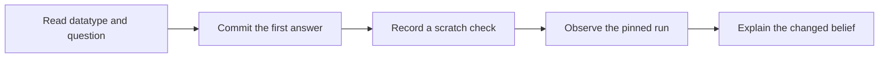
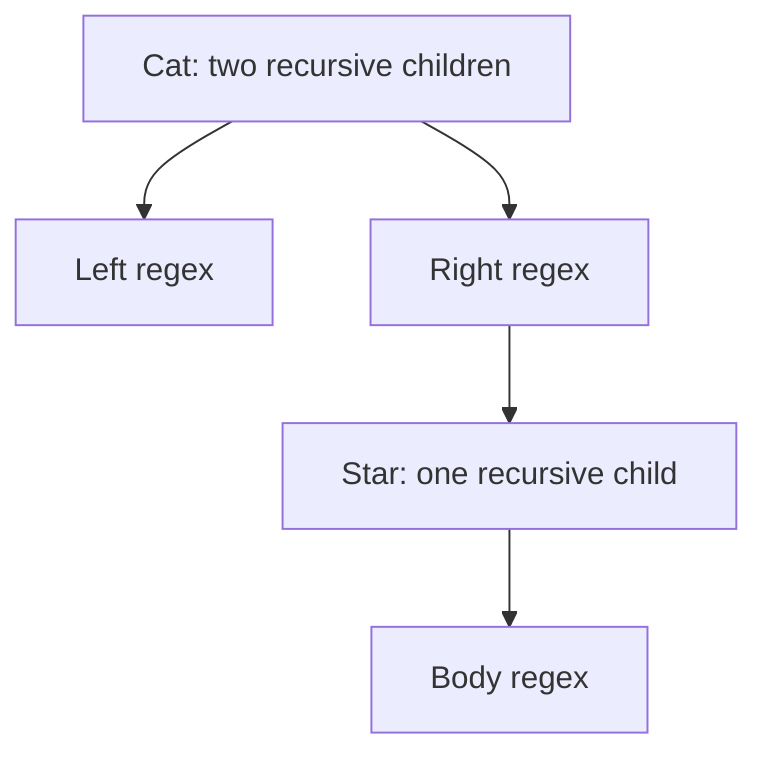
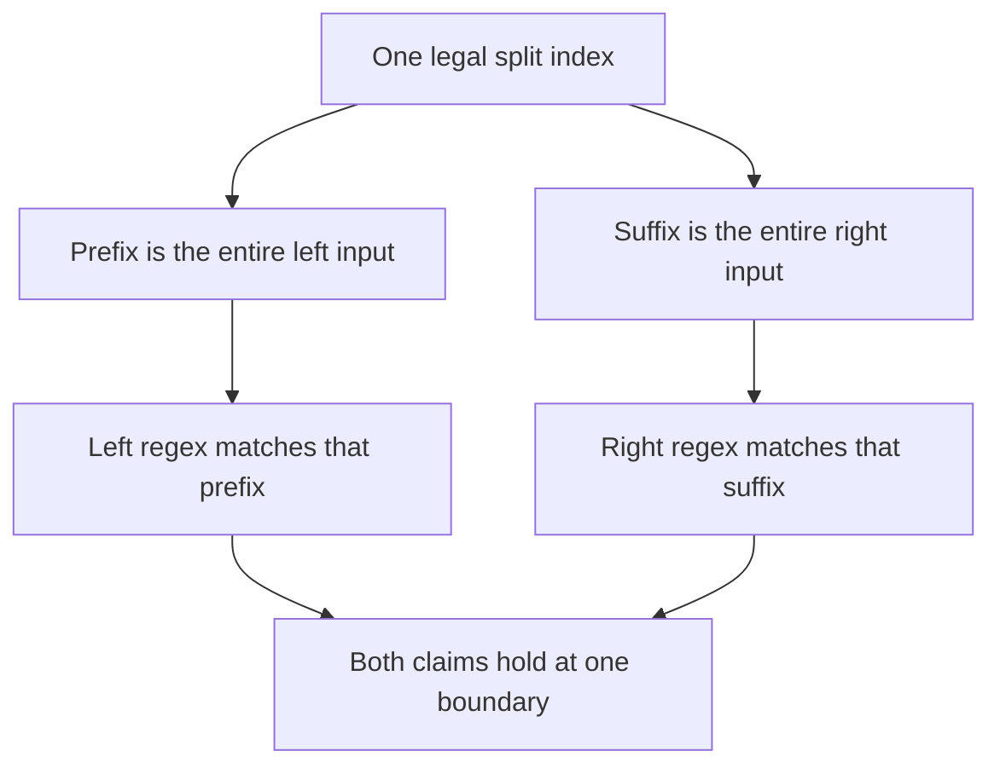
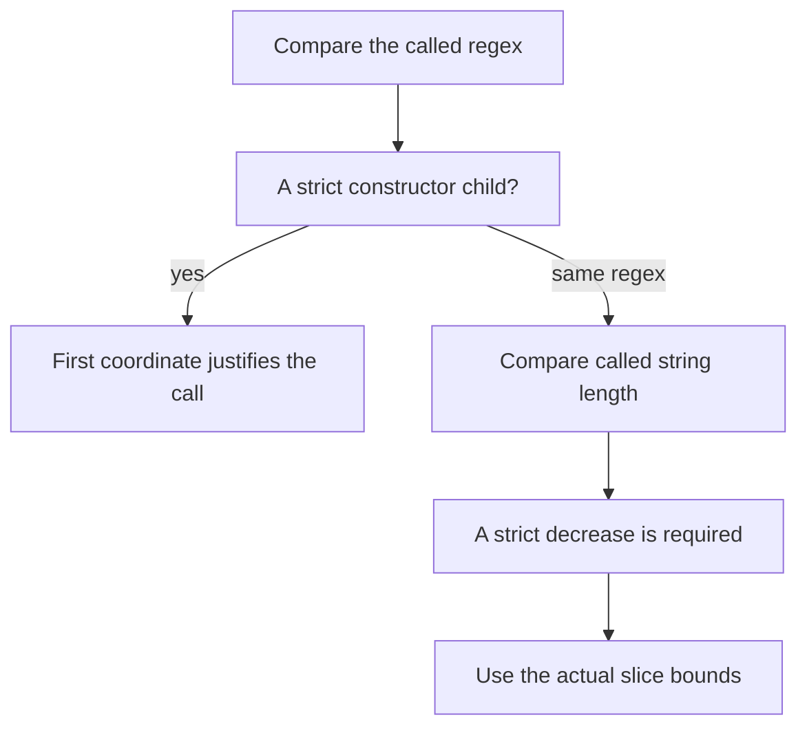

# R02 — Datatypes and recursion

A regular expression is a small syntax tree. Its constructors tell you what
can be inspected, which recursive children exist, and which cases an
implementation must cover. They do not, by themselves, tell you what the tree
means. This module develops that second account alongside the first: a
structural program over a regex and a specification of the whole strings it
matches. You will keep the accounts connected without confusing a successful
sample with a theorem about every input.

R is standalone. Complete the README setup and R01's introduction to the two
tools; no Q file is needed here. The frozen A1 layer supplies the datatype and
definitions. It supplies no lemma solving a hand exercise. Your R01 files are
not imported, and the later A1b facts remain closed. When you finish, you will
have exercised the same reasoning in Dafny's value-oriented datatype syntax
and Verus's recursive enum with owned boxes and borrowed executable inputs.

**Three ideas do all the work.**

1. A constructor introduces a case and its fields. An exhaustive match covers
   the possible shapes; each branch still owes the routine's intended result.
2. A recursive call is an interface on a smaller input. Its result or
   postcondition is useful only after the call's preconditions and decrease
   obligations have been established.
3. A semantic claim has a specific quantifier and scope. A split witness,
   a proved contract, a compiled sample and an agent's finite checks establish
   different things, even when their displays all look reassuring.

---

## 0. How this module works

**Budget: 342 minutes**, including the module viva and excluding contractor
wall time. Record actual time and keep observations separate from predictions.
The allowance covers a first encounter with the regex spine in both languages;
it is not a target to reproduce in your latency log.

| setup | test-out | read | worked | cards | predictions | holes | agent and first tests | paper | bench card | viva | calibration | total |
|---|---|---|---|---|---|---|---|---|---|---|---|---|
| 10 | 10 | 65 | 30 | 9 | 12 | 60 | 40 | 45 | 25 | 30 | 6 | **342** |

Take the closed-book T1d/T1v attempt before reading the worked examples. Write
the requested `ChrCount`/`chr_count` definition in its empty block, using the
A1 datatype declaration and the prompt. The block supplies one commented
check. Keep it commented for your first prediction of that check's result,
then record the attempt using `scripts/firsttry.sh R02 --check`. The tool
enables a scratch copy. A later repair is useful learning, but it must not
replace the record of the initial attempt.

The five predictions are separate from the two code test-outs. Guessing is
allowed. Inspect the questions and slot templates, commit the answers, and
record them before running the associated programs or opening expected
outputs, card demos, CI logs, the bank or the rubric. Several supplied
definitions are needed to understand a question; their presence is not
permission to run the question before you have committed a prediction.

> **Predict (P1d, P2v) — commit in the files before reading on.** Four empty-bodied proofs ask about the given whole-string semantics. Which labelled postconditions fail in each language?

> **Predict (P3dv) — commit in the file before reading on.** The Star split allows an empty first chunk instead of requiring a nonempty one. What verification result do you predict in each language?

> **Predict (P4dv) — commit in the file before reading on.** The semantics keeps the regex component of its termination measure and drops the input-length component. What result do you predict?

> **Predict (P5d) — commit in the file before reading on.** What Boolean will the compiled nullable check in the given-only Dafny check unit observe?

The obligation slots are in `specimens/R02/P1d.dfy.specimen` and
`specimens/R02/P2v.rs.specimen`. The two verdict lines are in
`slots/R02.slots`; the value slot is in `dafny/checks/R02_checks.dfy`.
Respect the printed answer form, including the language labels. Keep a
filled comment slot commented until the first attempt has been recorded.
Afterward, enable it when the chapter asks you to observe the result.

The first diagram separates preparation, observation and the explanation you
write after seeing the evidence.



**Takeaway:** a recorded prediction preserves a claim about what you believed
before the run. A correct explanation written afterward is a different achievement.

---

## 1. Syntax trees have cases

The A1 regex datatype has six constructors: `Empty`, `Eps`, `Chr`, `Alt`,
`Cat` and `Star`. `Empty` describes an empty language. `Eps` describes the
language containing the empty string. `Chr` carries one character. `Alt` and
`Cat` carry two regex children, while `Star` carries one. The syntax tree is
finite, even when the language it describes is infinite. A repeated language
does not require a cyclic value in the datatype.

Dafny declares this sum of possibilities with `datatype Re = ...`. A case
such as `Cat(a, b)` binds two values of type `Re`. The type of the expression
does not become a different datatype inside the branch; the branch simply
knows which constructor was used and can refer to its fields. An omitted
constructor is a coverage problem before there can be a proof of the full
implementation. An included constructor with the wrong result is a different
problem. Keep both questions visible while reading a match.

Verus uses an `enum`, with `Box<Re>` around recursive children. A box owns a
value behind a pointer-sized representation; without indirection the recursive
enum would require a value containing another complete value of the same
unbounded size. A specification can describe the mathematical contents of a
box. Executable code must additionally respect ownership and borrowing. This
representation difference changes the expressions you write, but not which
regex cases exist or what the resulting language should mean.

Consider the supplied `StarCount`/`star_count` worked example. It counts Star
constructors in the syntax, rather than strings in the language. The input
`Star(Empty)` is a finite tree with a Star constructor; counting syntax does
not require enumerating its language. More generally, a measurement of a
representation and a measurement of its meaning need not agree. Give a name
to the quantity before choosing a recursion that appears to calculate it.

This diagram shows one constructor with two children and a nested constructor
with one child. The labels are shapes, not an implementation of a hand exercise.



**Takeaway:** the constructor declaration determines which children are
available. A case split does not establish an unmentioned fact about a child.

In the live C1 cards, `RegexOuterTag`/`regex_outer_tag` returns a different
tag for every outer constructor. Read every arm, then inspect the failure
demo only after predictions are recorded. It omits cases. Attribute the
result to the stage reported by the wrapper; do not describe every rejected
program as an SMT failure. The tool may reject an incomplete program before
the solver receives any obligation at all.

```bash
scripts/vcheck specimens/R02/card-c1d.dfy.specimen
scripts/vcheck specimens/R02/card-c1v.rs.specimen
```

A second distinction matters in the Verus worked example. `star_count`
receives `&Re`. Matching a borrowed `Re::Cat(a, b)` binds borrowed boxes;
the recursive executable calls borrow their contents rather than taking
ownership of the entire input. In the contract, `*r` names the specification
value described by the reference. Reading that value in ghost reasoning
does not mean executable Rust may move arbitrary owned children out of a
borrowed input. Follow the type at each program point instead of counting
stars in the source spelling of a dereference.

The C6v card's `boxed_regex` routine isolates creating a box. The final C7dv
card compares matching on a Dafny value with borrowing a Rust recursive enum.
Its paired demos intentionally make different mistakes. Compare the native
type error with the failed mathematical claim, rather than inferring that
one language has proved a stronger algorithm. A type checker and a verifier
can reject different statements while agreeing on the representation's meaning.

---

## 2. A specification of whole strings

The given `Matches`/`matches` definition gives the semantics of a regex and
one entire input string. Each case is a statement about the complete sequence
it receives. A `Chr` case does not mean that the desired character occurs
somewhere in that sequence. An `Eps` case does not consume an arbitrary
prefix and leave the rest implicit. Being explicit about the whole input is
what makes the concatenation case compositional.

For concatenation, the semantics asks for a legal split index. The left
regex receives the prefix up to that index and the right regex receives the
remaining suffix. Both obligations must hold at the same chosen index.
Showing that the left side matches some prefix and the right side matches
some suffix is insufficient if they overlap, leave a gap or use incompatible
boundaries. The slice equations are part of the proof, not decorative notation.

The worked W1 pair names a split for the concatenation of two character
regexes on their two-character input. It first relates each slice to the
corresponding one-character sequence, then establishes the constructor
claims and the existential. Read the facts in that order. The program has
not found a witness by running a search procedure: it has established a
logical claim using a particular candidate whose obligations are visible.

The boundary diagram separates the single candidate index from the two
claims it must support.



**Takeaway:** an existential match needs one boundary with every required
property. Rejecting the match requires more than rejecting the first boundary tried.

`Nullable`/`nullable` is a separate structural predicate supplied by A1. It
is convenient to calculate over the regex tree, but convenience alone does
not connect it to `Matches`. The hand exercise asks you to prove that
connection. Keep the structural definition and the semantic statement side
by side. A solver's ability to unfold a definition in one small example is
not yet an argument for the general equivalence over every constructor.

`VoidSpec`/`void_spec`, supplied in this module, states another structural
property: the regex matches no string. That differs from accepting an empty
string. The executable H5 routine must implement the predicate it actually
names. Similar-looking words in the English description do not license
substituting a different Boolean specification. Before coding, describe one
input on which the two ideas differ and identify the definitions that settle it.

The semantics is ghost in Dafny and a spec function in Verus. The executable
routine cannot close its implementation obligation by calling ghost
`Matches`. This is a mode restriction of the supplied interface. It does not
say that regex membership is mathematically undecidable or that no executable
matcher could ever implement the relation. Later modules will construct one.
Distinguish a specification deliberately kept out of executable code from a
claim about whether the underlying problem is computable.

After your obligation predictions are recorded, enable the two specimen
slots and compare the actual postcondition diagnostics to your chosen labels.
Each case has its own proof, so a failure in one case cannot justify or hide
another. Explain a successful case by the available definition and a failed
case by the obligation not established. Do not infer from a failed proof
that the claimed match is false; the formal statement and the proof attempt
are different objects.

<!-- pin: obligation-d -->
```
$ scripts/vcheck specimens/R02/P1d.dfy.specimen
vcheck: specimens/R02/P1d.dfy.specimen [dafny, learner loop]: failed — 7 verified, 0 holes, 2 errors
specimens/R02/P1d.dfy.specimen:83:3: error: a postcondition could not be proved on this return path
specimens/R02/P1d.dfy.specimen:82:20: related: this is the postcondition that could not be proved
specimens/R02/P1d.dfy.specimen:24:23: related: this proposition could not be proved
specimens/R02/P1d.dfy.specimen:86:3: error: a postcondition could not be proved on this return path
specimens/R02/P1d.dfy.specimen:85:20: related: this is the postcondition that could not be proved
specimens/R02/P1d.dfy.specimen:25:29: related: this proposition could not be proved
```

<!-- pin: obligation-v -->
```
$ scripts/vcheck specimens/R02/P2v.rs.specimen
vcheck: specimens/R02/P2v.rs.specimen [verus, learner loop]: failed — 9 verified, 0 holes, 2 errors
specimens/R02/P2v.rs.specimen:140:13: error: postcondition not satisfied
specimens/R02/P2v.rs.specimen:143:13: error: postcondition not satisfied
```

The outputs above are observations of these specimen proofs on the pinned
toolchain. A different proof may establish a true statement that this attempt
failed to prove. That distinction will matter when a contractor treats the
first failed check as a reason to weaken the statement it was hired to satisfy.

---

## 3. Recursive programs export facts

The worked `StarCount` example makes the recursive interface visible. Its
specification function says which mathematical count is intended, while the
method or executable function calculates a value. The contract connects those
accounts. A recursive call on a child returns a value satisfying the same
contract for that child; the current branch combines the returned values.
Tracing a result on one tree is useful, but verification needs the branch
argument for arbitrary children satisfying the recursive contracts.

In Dafny, a method call producing a result is a statement. The worked code
binds each recursive result to a local before combining the two. In the
Verus version, executable calls can appear as expressions, and the match
borrows the child boxes. Read the postcondition after each call in either
syntax. It connects a concrete result to the specification on the smaller
input; it does not reveal the executable function's implementation to a caller.

The Verus worked example also requires the mathematical count to be below
its stated bound. An executable `u64` is not an unbounded natural number.
The sum of the recursive mathematical counts constrains each child count
and the final arithmetic operation. Follow both obligations: the child call
must be admitted, and the executable addition must be safe. A proof that a
mathematical expression has the intended value would be incomplete if the
machine operation could overflow before producing that value.

The C2 cards' `OuterStars`/`outer_stars` definition gives a smaller example
of structural recursion. Only one constructor recurses, using its strict
child. The measure names the argument being compared. In the failure demos,
the call retains that same argument. Compare the actual arguments, not
whether the source contains a subtraction sign or whether the author
described the routine as recursive. A source-level intention cannot supply
the strict order required by the verifier.

A proof function uses the same interface discipline. Its body establishes
the postcondition, and another proof receives the instantiated postcondition
when it makes an admitted call. A recursive proof is therefore a way of
making an induction hypothesis available on a smaller case. Naming a useful
lemma earlier in a file is not equivalent to calling it. Likewise, calling
the current lemma on unchanged arguments cannot justify the current goal;
the decrease obligation prevents that circular account.

When a branch fails, write down four things before adding a new assertion:
the constructor known in that branch, the recursive arguments, the facts
returned by existing calls, and the exact result still owed. This short
inventory separates a missing fact from a mistaken specification or an
unadmitted call. It also makes a tutor question precise: “this recursive
postcondition does not establish this current goal” is more informative than
“the induction does not work.” Keep the inventory in your own words and
update it after a meaningful tool observation.

The hand lemmas in this module use explicit bodies rather than a request to
search for a magic automation setting. Some Dafny declarations carry the
provided `{:induction false}` attribute. Keep it: their purpose is to make
the recursive argument part of your work. A successful empty proof in a
different configuration would answer a question about that configuration,
not complete this exercise under its frozen statement and options.

---

## 4. The measure belongs to the call

Structural recursion is an especially convenient case of well-founded
recursion. A child is smaller because it is a component of a finite
constructor value. The current result can depend on results for those
children without depending on itself. That argument must be made for every
recursive call, including calls that do not have the visually obvious
shape of a direct recursive descent through the datatype.

The given semantics uses a pair: the regex and the length of the current
string. It is a lexicographic order, not a requirement that both coordinates
strictly decrease on every call. Compare the first coordinate first. If it
strictly decreases, that settles the comparison. If it is unchanged, the
second must provide the strict decrease. A bound keeping an index legal
and a bound making a call smaller are related but distinct obligations.

Read the Star case twice, once for each recursive call. Identify the regex
passed to the call and the actual slice passed as its string argument.
Write the resulting measure pair before comparing it to the current one.
This prevents a common confusion: a call that consumes input may keep the
same regex, while a call on a strict regex child may receive a slice whose
length is not what justified the comparison.

The diagram describes the order of questions used to justify a call.



**Takeaway:** the source must justify each call's actual measure. A general
description of how recursion should progress cannot replace that comparison.

Now run the two mutations after their verdict predictions are recorded.
Each scenario changes one feature of the provided definition. Read the
diagnostic at the recursive call rather than changing more features until
something happens to verify. The point of a controlled mutation is that a
difference in the result has a specific candidate explanation.

<!-- pin: p3-d -->
```
$ scripts/vcheck specimens/R02/chapter-p3-d.dfy.specimen
vcheck: specimens/R02/chapter-p3-d.dfy.specimen [dafny, learner loop]: failed — 4 verified, 0 holes, 1 error
specimens/R02/chapter-p3-d.dfy.specimen:23:89: error: decreases clause might not decrease
```

<!-- pin: p3-v -->
```
$ scripts/vcheck specimens/R02/chapter-p3-v.rs.specimen
vcheck: specimens/R02/chapter-p3-v.rs.specimen [verus, learner loop]: failed — 6 verified, 0 holes, 1 error
specimens/R02/chapter-p3-v.rs.specimen:36:78: error: could not prove termination
```

<!-- pin: p4-d -->
```
$ scripts/vcheck specimens/R02/chapter-p4-d.dfy.specimen
vcheck: specimens/R02/chapter-p4-d.dfy.specimen [dafny, learner loop]: failed — 4 verified, 0 holes, 1 error
specimens/R02/chapter-p4-d.dfy.specimen:23:88: error: decreases clause might not decrease
```

<!-- pin: p4-v -->
```
$ scripts/vcheck specimens/R02/chapter-p4-v.rs.specimen
vcheck: specimens/R02/chapter-p4-v.rs.specimen [verus, learner loop]: failed — 6 verified, 0 holes, 1 error
specimens/R02/chapter-p4-v.rs.specimen:36:78: error: could not prove termination
```

Explain each observed failure using the changed measure or bound, then
restore the supplied definitions. A failed termination proof does not mean
that every concrete execution diverges. It means this recursive definition
has not established the required well-founded account. Conversely, a few
terminating sample executions cannot establish a definition for every
accepted input. The formal obligation and a runtime experiment answer
different quantified questions.

On paper, the most useful sentence often names the pair at one call and
the inequality that is missing. In a tool run, the most useful evidence is
the diagnostic's exact location and stage. Combine them without inventing
either: a remembered theorem about regexes is not a captured tool result,
and a failing source line is not yet an explanation of the mathematical
condition it needs. Keep that distinction in your first local bench card.

---

## 5. Write the construct, name its obligation

Three constructs are WRITE cards here: datatype matching, termination
measures and existential witnesses. You should be able to introduce each
one in both languages. Reading a supplied use is a useful first step, but
the checked uses in your test-out and hand exercises require you to choose
the construct at a point where it resolves an obligation.

For a datatype match, start with the constructor list and bind fields with
names that identify their role. Separate the branch's known shape from
facts that would need another proof. A match on a binary constructor gives
two children, not a relationship between their meanings. Before adding
recursion, check that the base cases agree with the specification; a
perfect induction on the wrong base values computes the wrong function.

For `decreases`, name the mathematical quantity being compared at each
call. Distinguish a value's type bounds from a strict decrease. A natural
number cannot be negative, but a recursive call using the same natural
number is not justified by non-negativity. A slice can be in range while
failing to shorten the input. When two parameters interact, write the
called pair explicitly and compare it in the declared order.

For an existential, say which candidate is being offered and discharge
every conjunct for it. The C3 live cards supply a known index pointing to
a marked character. Their preconditions are evidence about that candidate.
The failure demos promise only a nonempty sequence; they do not promise
that the marked character exists at all. The syntax of an existential
does not make a missing witness appear in the input.

```bash
scripts/vcheck specimens/R02/card-c2d.dfy.specimen
scripts/vcheck specimens/R02/card-c2v.rs.specimen
scripts/vcheck specimens/R02/card-c3d.dfy.specimen
scripts/vcheck specimens/R02/card-c3v.rs.specimen
```

Do not copy a diagnostic between these examples. A termination failure,
a coverage rejection and a false assertion have different obligations and
may fail at different stages. Explain the command's actual result, then
describe a repair at the level of its missing fact. Merely adding a
quantifier, a match or a measure does not establish that the chosen formula
is true or that the chosen order is well founded.

The recognition cards carry a smaller promise. Recognise `@Test` and
`#[test]`, ghost predicates and spec functions, and the role of `Box` in a
recursive Rust enum. You may read their provided uses without memorising
an advanced library API. In particular, a native test outside `verus!`
has not acquired a universal proof merely because the same file also
contains verified functions. Keep its observation attached to its actual
sample inputs.

As you finish a paired exercise, compare the argument rather than the
punctuation. Identify the corresponding constructor, recursive call,
measure and exported fact. State one representation detail that changes
and one logical obligation that remains. This comparison is the skill the
two languages are meant to build; a word-for-word transliteration can
leave ownership, machine bounds or ghost execution unexplained.

---

## 6. What the instruments can and cannot see

Run the supplied exercise units in the learner loop. Their typed
placeholders allow the surrounding examples and statements to be checked
while work remains. A bodyless Dafny lemma, a labelled Verus assumption and
an external executable body are not equivalent source constructs, but each
is a counted hole under this course's completion rule.

<!-- pin: shipped-d -->
```
$ scripts/vcheck dafny/R/R02_Datatypes/core
vcheck: dafny/R/R02_Datatypes/core [dafny, learner loop]: verified — 14 verified, 5 holes, 0 errors
dafny/R/R02_Datatypes/core/R02_Datatypes.dfy:93:25: hole bodyless-method R02.H1d
dafny/R/R02_Datatypes/core/R02_Datatypes.dfy:101:31: hole bodyless-method R02.H2d
dafny/R/R02_Datatypes/core/R02_Datatypes.dfy:109:36: hole bodyless-method R02.H3d
dafny/R/R02_Datatypes/core/R02_Datatypes.dfy:117:37: hole bodyless-method R02.H4d
dafny/R/R02_Datatypes/core/R02_Datatypes.dfy:126:5: hole assume R02.H5d
```

<!-- pin: shipped-v -->
```
$ scripts/vcheck verus/r/r02_datatypes
vcheck: verus/r/r02_datatypes [verus, learner loop]: verified — - verified, 5 holes, 0 errors
verus/r/r02_datatypes/src/lib.rs:93:40: hole assume R02.H1v
verus/r/r02_datatypes/src/lib.rs:104:40: hole assume R02.H2v
verus/r/r02_datatypes/src/lib.rs:115:40: hole assume R02.H3v
verus/r/r02_datatypes/src/lib.rs:125:40: hole assume R02.H4v
verus/r/r02_datatypes/src/lib.rs:132:1: hole external_body R02.H5v
```

The five holes in each language belong to H1 through H5. T1 starts as an
empty block with its check commented. There is no declaration there for a
typed-placeholder counter to count. The first-try workflow separately
requires your code test-out, preserves its original attempt and checks that
the supplied use-site check remains present. A zero-hole run is therefore
necessary but does not replace the complete module workflow.

The gate adds completion and policy checks to the native verification
result. It does not prove an English statement that the contract never
expressed, and it does not establish that a contractor followed its allowed
editing process. Try the gate on the shipped files and read the reason it
refuses to call them complete. Keep using the learner loop for ordinary
edits; use the gate when you believe the requested work is finished.

<!-- pin: gate-d -->
```
$ scripts/vcheck --gate dafny/R/R02_Datatypes/core
vcheck: dafny/R/R02_Datatypes/core [dafny, gate]: failed — 14 verified, 5 holes, 0 errors, 1 finding
dafny/R/R02_Datatypes/core/R02_Datatypes.dfy:93:25: hole bodyless-method R02.H1d
dafny/R/R02_Datatypes/core/R02_Datatypes.dfy:101:31: hole bodyless-method R02.H2d
dafny/R/R02_Datatypes/core/R02_Datatypes.dfy:109:36: hole bodyless-method R02.H3d
dafny/R/R02_Datatypes/core/R02_Datatypes.dfy:117:37: hole bodyless-method R02.H4d
dafny/R/R02_Datatypes/core/R02_Datatypes.dfy:126:5: hole assume R02.H5d
dafny/R/R02_Datatypes/core: warnings-fail-gate: warnings fail the gate (W-D04): holes and every other warning must be gone
```

<!-- pin: gate-v -->
```
$ scripts/vcheck --gate verus/r/r02_datatypes
vcheck: verus/r/r02_datatypes [verus, gate]: failed — - verified, 5 holes, 1 error
verus/r/r02_datatypes/src/lib.rs:93:40: hole assume R02.H1v
verus/r/r02_datatypes/src/lib.rs:104:40: hole assume R02.H2v
verus/r/r02_datatypes/src/lib.rs:115:40: hole assume R02.H3v
verus/r/r02_datatypes/src/lib.rs:125:40: hole assume R02.H4v
verus/r/r02_datatypes/src/lib.rs:132:1: hole external_body R02.H5v
(no file): error: gate: 'success' is false, not true; --output-json lacks 'is-verifying-entire-crate'; 'encountered-vir-error' is true, not false; --output-json lacks 'verified'; 5 hole(s); exit 1
```

An assumption audit is another instrument. It reports assumptions and
trusted interfaces relevant to the checked program. When you replace a
hole with a proof or executable implementation, check that the corresponding
escape hatch disappears. Do not rename it, move it into a helper or trade
it for a verification attribute. A different syntactic mechanism that
admits the same unchecked claim has not completed the work.

<!-- pin: audit-d -->
```
$ scripts/vaudit dafny/R/R02_Datatypes/core
dafny/R/R02_Datatypes/core/R02_Datatypes.dfy:92: audit-bodyless-ghost — NullableCorrect: Ghost declaration has no body and has an ensures clause
dafny/R/R02_Datatypes/core/R02_Datatypes.dfy:100: audit-bodyless-ghost — NodeCountBackwards: Ghost declaration has no body and has an ensures clause
dafny/R/R02_Datatypes/core/R02_Datatypes.dfy:108: audit-bodyless-ghost — NullableBackwards: Ghost declaration has no body and has an ensures clause
dafny/R/R02_Datatypes/core/R02_Datatypes.dfy:116: audit-bodyless-ghost — CatEpsLeft: Ghost declaration has no body and has an ensures clause
dafny/R/R02_Datatypes/core/R02_Datatypes.dfy:126: audit-assume — IsVoid: Definition has `assume` statement in body
vaudit: dafny/R/R02_Datatypes/core [dafny, learner]: 5 finding(s)
```

<!-- pin: audit-v -->
```
$ scripts/vaudit verus/r/r02_datatypes
verus/r/r02_datatypes/src/lib.rs:93: hole-assume — an assume hole (in lemma_nullable_correct) not on the trust allowlist
verus/r/r02_datatypes/src/lib.rs:104: hole-assume — an assume hole (in lemma_node_count_backwards) not on the trust allowlist
verus/r/r02_datatypes/src/lib.rs:115: hole-assume — an assume hole (in lemma_nullable_backwards) not on the trust allowlist
verus/r/r02_datatypes/src/lib.rs:125: hole-assume — an assume hole (in lemma_cat_eps_left) not on the trust allowlist
verus/r/r02_datatypes/src/lib.rs:132: hole-external-body — an external_body hole (in is_void) not on the trust allowlist
vaudit: verus/r/r02_datatypes [verus, learner]: 5 finding(s)
```

The given-only P5 check observes compiled Dafny code. Once its first try
is recorded, enable its `expect` and run the native test. That observation
is about this expression on this input, not a replacement for the general
nullable-correctness lemma. R01's distinction between verification and
execution still applies even when the datatype's cases make one example
easy to evaluate by hand.

```bash
scripts/vcheck --test dafny/checks/R02_checks.dfy
```

For every result, retain the target path, command, stage, verdict and
relevant count. A fast-channel success has a selected-symbol scope; a full
gate concerns the deliverable as a whole; an audit concerns trust; a native
test concerns execution on its sample. None should silently inherit the
claims of another row. This discipline becomes especially useful when the
agent's final implementation passes six tests while still failing the
stronger prose you meant it to satisfy.

---

## 7. On paper, before the keyboard

The written track has three problems, fifteen minutes each. Record all
predictions first, then work in `paper/R02_answers.tex`, keeping its answer
labels. The first problem is the eight-field card for the pinned CLEVER
summary. The other two ask you to justify termination and enumerate concrete
split cases. The written account should name the values and obligations
that an informal explanation can otherwise slide past.

For the card, separate the task from the oracle used to judge a result.
Writing a specification, certifying its faithfulness, compiling an
implementation and proving its correctness are different achievements.
Retain the denominator, stage and time allowance beside a reported figure.
An impressive number in one column does not automatically answer a question
about another. If the pinned range does not report an uncertainty estimate,
release checksum or licence, say so and identify the missing evidence.

The source range and its hash are printed in the problem. Check that source
before answering; do not silently substitute a changed summary or a result
from a different model. This is a small reproduction habit: a reader should
be able to identify which text supports your claim. The card is about what
that historical source reports, not a measurement of the agents available
to you today. The grader evaluates fidelity to the pinned source.

For the termination problem, compare the actual measure at each recursive
call. A general sentence saying that a definition is recursive leaves the
main argument unstated. For the split problem, write each complete prefix
and suffix next to its index. In a rejection argument, account for every
legal index. The proof becomes much easier to inspect when a claimed slice
equality can be checked independently of the constructor reasoning around it.

Build the pair with the ordinary learner paper target. A compiled answer
document establishes that the document builds; it does not establish its
claims. `/grade-paper R02` belongs in a fresh examiner session after you
have written the answers. Keep the reference closed until the module's
review and comparison step.

```bash
make -C paper paper
```

The separate 25-minute bench-card task starts your own `bench/local/r`
collection. Follow that directory's README. Choose a small new problem you
can explain and verify; do not rename a course hole or copy its reference.
Write a statement and input convention first. Preserve a stripped version,
a complete solution, a positive witness and negative checks that distinguish
a plausible wrong result. Keep the native commands and observed outcomes
beside the files, including the toolchain and resource context.

This first card is learner work, not an automatically admitted benchmark
task. Its value is the connection between an intended statement, a verified
delivery and tests of possible misspecification. A green proof against a
weak statement is not enough. Ask what an unhelpful implementation could
exploit, whether the witness actually satisfies the preconditions, and
whether a negative check tests the claimed behaviour rather than an
unrelated syntax error. Later modules will turn these questions into a
more systematic evaluation apparatus; the original evidence should remain
inspectable when that happens.

---

## 8. The exercise file

The hand work is a paired sequence, H1 through H5, in the two exercise
files. Keep the statements, given code and supplied callers fixed. Preserve
the given layer boundary. You may inspect A1, but importing A1b would supply
facts this module asks you to prove. Passing a native tool after changing
the task or importing its later solution would answer a different question.

**This module's files**

| file | role | shipped state |
|---|---|---|
| `dafny/R/R02_Datatypes/core/R02_Datatypes.dfy` | Dafny exercises, worked examples and cards | verified with 5 holes; T1d starts empty with a commented check |
| `verus/r/r02_datatypes/src/lib.rs` | paired Verus exercises and examples | verified with 5 holes; T1v starts empty with a commented check |
| `dafny/checks/R02_checks.dfy` | given-only compiled value check | no holes; P5d slot unfilled |
| `specimens/R02/` | two obligation predictions, controlled scenarios and failure demos | prediction slots unfilled; demos retain their recorded behaviour |
| `slots/R02.slots` | verdict answers | P3dv and P4dv unfilled |
| `dafny/R/R02_Datatypes/agent/R02_AgentImplement.dfy` | spec-first contractor exercise | 3 holes and 6 errors across the six failing checks |
| `verus/r/r02_datatypes/src/agent.rs` | paired spec-first contractor exercise | 6 holes and 10 errors across the six failing checks |
| `dafny/given/R/RG_A1_Re.dfy`, `verus/given/rg_re_a1/src/lib.rs` | frozen A1 layer | provided definitions; no module lemma supplied |
| `paper/R02_problems.tex`, `paper/R02_answers.tex` | written problems and learner answers | compiling template; answers unfilled |
| `bench/local/r/README.md` | instructions for the first local card | learner creates the five card artifacts |
| `Solutions/`, `paper/solutions/` | reference material | LAST, after your attempts, gates, review and comparison step |

H1 connects a structural predicate to the whole-string semantics. H2
relates the node count of a regex and its backwards form, and H3 relates
nullability across that transformation. H4 concerns concatenation with an
empty-string expression. H5 implements the supplied voidness predicate.
Read each actual signature before starting; these descriptions are
orientation, not substitutes for the formulas in the files.

For each proof, identify the recursive hypotheses or witness obligations
your statement requires. For executable code, identify the returned value,
the specification it must equal and the allowed recursive inputs. In
Verus H5, the termination measure is part of your implementation work.
Do not remove a difficult branch or strengthen an input restriction to
avoid an intended case. The tool can only verify the task you leave it.

Use one meaningful edit per verification cycle while learning the proof.
When a step changes the result, keep a short explanation of the obligation
it established. If a proof fails, read the reported stage and location
before guessing at an automation problem. A changed representation, a
missing recursive fact and an invalid arithmetic operation require
different repairs. A fresh `/tutor R02` request should include your attempt
and the exact diagnostic you are trying to understand.

After completing T1 and the predictions, retain their supplied checks and
enable the relevant switches. The completion commands concern the whole
module, not only whichever proof last looked green in the editor.

```bash
scripts/firsttry.sh R02 --check
scripts/vcheck --gate dafny/R/R02_Datatypes/core
scripts/vcheck --gate verus/r/r02_datatypes
scripts/vaudit dafny/R/R02_Datatypes/core
scripts/vaudit verus/r/r02_datatypes
scripts/specfreeze --check R02
scripts/firsttry.sh R02 --report --strict
```

**Done:** the completed units gate with zero tool-counted holes, their
audits are clean, the frozen statement check passes, and the strict report
shows recorded test-outs and predictions with every supplied check kept.
The agent, written work, property tests, local card and viva are additional
deliverables. A green hand exercise is an important part of completion;
it does not silently complete those other activities.

---

## 9. Exercise (agentic): implementer versus checks

The agent files are spec-first. Dafny ships three bodyless definitions;
Verus ships three abstract spec definitions and one partial-contract proof
hole for each. The prose says what the three quantities should mean. The
formal contracts and six supplied checks deliberately say less. Read all
three accounts before hiring the implementer, and keep their differences
visible when judging the result.

> **CONTRACT (for /contract R02 — run it in a FRESH session):**
> goal — implement the three definitions according to their prose and pass all six checks; allowed-files — the one selected agent file; acceptance — preserve signatures, partial contracts, checks and comments, edit only the permitted definition and bound-proof bodies, use the fast channel while editing, and run exactly one full gate last with zero holes. The assumption audit must be clean. Read the actual header before starting; the abstract Verus declarations may become definitions as it permits.

Use a fresh `/contract R02` session for each language. Apply the R-v0 rules
you wrote after R01. During editing, the contractor can select both a
definition and a relevant check symbol. A success for the definition's weak
partial contract need not make its client checks pass. This is a reason to
choose the next fast-channel question carefully, not permission to weaken
the client or silently spend another full gate.

```bash
scripts/vcheck --symbol R02_AgentImplement.AlphabetLeafCheck dafny/R/R02_Datatypes/agent/R02_AgentImplement.dfy
scripts/vcheck --symbol alphabet_leaf_check verus/r/r02_datatypes/src/agent.rs
```

The shipped full-file results make the initial state explicit. In the
Verus file, several checks have intermediate assertions, so the number of
diagnostics differs from the number of check functions. Do not infer an
extra task from each message or hide a failing function by deleting its
intermediate facts.

<!-- pin: agent-d -->
```
$ scripts/vcheck dafny/R/R02_Datatypes/agent/R02_AgentImplement.dfy
vcheck: dafny/R/R02_Datatypes/agent/R02_AgentImplement.dfy [dafny, learner loop]: failed — 8 verified, 3 holes, 6 errors
dafny/R/R02_Datatypes/agent/R02_AgentImplement.dfy:25:22: hole bodyless-function R02.A1d
dafny/R/R02_Datatypes/agent/R02_AgentImplement.dfy:31:27: hole bodyless-function R02.A1d
dafny/R/R02_Datatypes/agent/R02_AgentImplement.dfy:39:20: hole bodyless-function R02.A1d
dafny/R/R02_Datatypes/agent/R02_AgentImplement.dfy:43:31: error: assertion might not hold
dafny/R/R02_Datatypes/agent/R02_AgentImplement.dfy:44:31: error: assertion might not hold
dafny/R/R02_Datatypes/agent/R02_AgentImplement.dfy:45:33: error: assertion might not hold
dafny/R/R02_Datatypes/agent/R02_AgentImplement.dfy:46:33: error: assertion might not hold
dafny/R/R02_Datatypes/agent/R02_AgentImplement.dfy:47:29: error: assertion might not hold
dafny/R/R02_Datatypes/agent/R02_AgentImplement.dfy:48:29: error: assertion might not hold
```

<!-- pin: agent-v -->
```
$ scripts/vcheck verus/r/r02_datatypes/src/agent.rs
vcheck: verus/r/r02_datatypes/src/agent.rs [verus, learner loop]: failed — - verified, 6 holes, 10 errors
verus/r/r02_datatypes/src/agent.rs:22:1: hole uninterp R02.A1v
verus/r/r02_datatypes/src/agent.rs:29:40: hole assume R02.A1v
verus/r/r02_datatypes/src/agent.rs:34:1: hole uninterp R02.A1v
verus/r/r02_datatypes/src/agent.rs:41:40: hole assume R02.A1v
verus/r/r02_datatypes/src/agent.rs:47:1: hole uninterp R02.A1v
verus/r/r02_datatypes/src/agent.rs:54:40: hole assume R02.A1v
verus/r/r02_datatypes/src/agent.rs:59:12: error: assertion failed
verus/r/r02_datatypes/src/agent.rs:63:12: error: assertion failed
verus/r/r02_datatypes/src/agent.rs:63:46: error: assertion failed
verus/r/r02_datatypes/src/agent.rs:67:34: error: assertion failed
verus/r/r02_datatypes/src/agent.rs:68:12: error: assertion failed
verus/r/r02_datatypes/src/agent.rs:72:12: error: assertion failed
verus/r/r02_datatypes/src/agent.rs:72:41: error: assertion failed
verus/r/r02_datatypes/src/agent.rs:75:40: error: assertion failed
verus/r/r02_datatypes/src/agent.rs:78:12: error: assertion failed
verus/r/r02_datatypes/src/agent.rs:78:37: error: assertion failed
```

After the run, inspect the diff and transcript. Which symbols were checked
after each edit? Did the contractor use exactly one full gate, at the end,
or use full-file feedback to repair mistakes and then report only the last
success? Did it preserve the prose and partial contracts? A final verified
artifact cannot establish these process properties on its own. Keep the
recorded evidence even when the delivery is useful but the process violated
one of your rules.

**Dashboard.** Fill the LATENCY LOG from actual commands and observations.
For each entry, record the selected symbol, wall time, channel, exit and
transcript location. Add a row giving the final full gate's position and
its remaining-hole count, and a row for the trust audit. Compare the two
languages and discuss what was measured: elapsed tool time can include
startup, compilation and verification. Do not interpret a difference as a
model-quality effect without controlling those other costs.

The next work is yours. Write adversarial checks that follow from the
prose but are not implied by the supplied examples. Explain a plausible
wrong implementation each new check would reject. A new example is not
automatically adversarial: it must distinguish something the existing
suite leaves open. Avoid a contract edit that makes a wrong implementation
legitimate. The aim is a better observation of the original task.

Add the first native property tests beside the completed hand exercise
implementations, as the agent file's follow-up specifies. Use the given
sample collection and loop over its regex values. In Dafny, write an
`@Test` method. In Rust, place `#[test]` outside `verus!`; borrow values when
calling the executable routines. Check a relationship between results on
related inputs, then add one property of your own. Preserve the original
six agent checks and keep the manual follow-up outside the contractor's
one-file editing authority.

```bash
scripts/vcheck --test dafny/R/R02_Datatypes/core
scripts/vcheck --test verus/r/r02_datatypes
```

Passing a sample loop and proving a contract are different evidence. The
former can expose a concrete behavioural mistake that a weak contract
never mentioned; it cannot establish a universal statement. The latter
can cover every admitted input while expressing less than the prose.
Your report should say what each instrument checked and what remains a
reader's judgement about intent. That distinction is the result of this
exercise, even when the contractor's first delivery already looks green.

---

## Instructor touchpoints

Use `/tutor R02` after an attempt with the exact diagnostic and the fact you
believe should establish it. Use `/discuss R02` for the distinction between
a structural definition, its semantics and the evidence in a run.
`/review R02` revisits your ledger and earlier R01 connections; it does not
erase the first attempt. The bank's viva draws contain six questions each,
including a verifier-refereed prediction, with a disjoint draw for re-viva.

Run `/viva R02`, `/grade-paper R02` and `/review-code R02` in separate fresh
examiner sessions. `/contract R02` is a different posture in a fresh session
with the selected file's actual allowlist. Your role remains to inspect
the artifact and transcript afterward. The instructor can examine your
reasoning about these records without becoming the author of your answers.

Only compare with `Solutions` and the written reference LAST, after your
attempts, completion checks and review. Treat a reference difference as a
question about an obligation, style choice or statement, not evidence that
every differing line of your solution is wrong. Finish CALIBRATION and
record it with `scripts/firsttry.sh R02 --record`: retain actual time, one
changed prediction and the observation that changed it.

---

## What R02 planted

| planted here | where it will be harvested |
|---|---|
| Syntax and whole-string semantics are separate accounts | R03's representation and API contracts |
| A recursive call exports a proved fact on a smaller input | R04's structural program-logic proofs and R06's derivative correctness |
| A split witness must satisfy every slice obligation | R05's quantifier practice and later matcher proofs |
| Weak contracts and finite checks can miss stronger prose | R12's evaluation and R15's specification experiments |
| Fast-channel, full-gate, audit and native-test observations have different scope | later contractor dashboards and the R16 trust report |
| A learner-authored card retains its statement, witness and negative checks | the local R benchmark collection and later lab admission |

The next module changes the representation boundary. Keep this module's
facts and observations in your own record; later units import their frozen
layer chain rather than depending on whether your current exercise file is
finished. That independence supports a clean account of what each later
proof has actually assumed.
