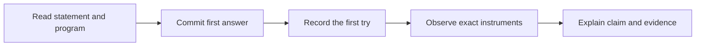
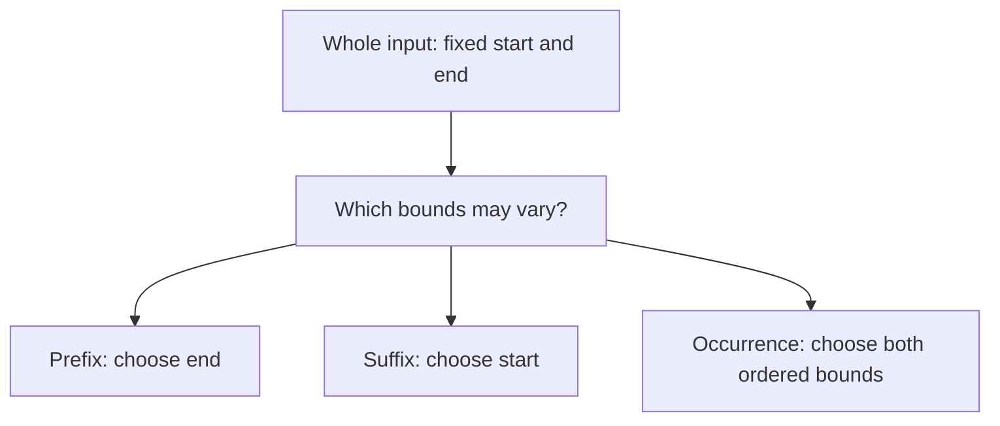
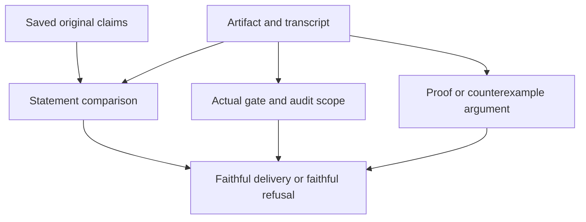

# R04 — Specs as logic

A specification is a logical claim about a program. Choosing that claim is
part of the work. A successful proof can establish exactly the written
postcondition while leaving a behaviour the user expected unspecified. A
failed proof can expose a missing argument, an incorrect program or a false
claim. This module gives those possibilities different names and asks you
to keep their evidence separate.

The running object is a regex and the complete strings it matches. You will
add the notion of an occurrence in a substring, distinguish it from a prefix
or suffix, and write small proofs using arbitrary variables and justified
witnesses. The distinction matters for a search API: returning whether the
whole input matches answers a different question from finding a match
somewhere inside it. A Boolean result does not make those questions equivalent.

R is standalone. Use R01/R02 and the declared A1 layer; no Q file, earlier
learner implementation or later A1b fact is imported. R04's logical work does
not require a completed R03 implementation. The given definitions are the
starting point, and the worked examples show the relevant proof syntax in
both languages. Your own definition and proofs must still establish the
particular statements in the exercise.

**Three ideas do all the work.**

1. A quantifier says which values a claim covers. Universal introduction
   reasons about an arbitrary value; existential elimination uses one value
   justified by an existing premise. Each carries its own bounds and facts.
2. A contract's direction and semantic object determine what it promises.
   Equivalence, one-way implication, a whole match and a substring occurrence
   cannot be substituted for one another without an argument.
3. Verification, runtime checks, an assumption audit and a statement review
   observe different claims. When an agent is asked to prove a false statement,
   a faithful counterexample report is useful work; a weakened green statement
   is a different deliverable.

## 0. How this module works

**Budget: 360 minutes**, including the viva and excluding contractor wall time.
Keep your actual time and correction separately from this allowance.

| setup | test-out | read | worked | cards | predictions | holes | audit drill | agent review | paper | bench card | viva | calibration | total |
|---|---|---|---|---|---|---|---|---|---|---|---|---|---|
| 10 | 10 | 60 | 30 | 8 | 15 | 70 | 20 | 30 | 45 | 25 | 30 | 7 | **360** |

Attempt T1d/T1v closed book before reading the worked examples. The statement
asks for an existential claim, so the task is not finished by declaring a
value whose relationship to the claim remains unexplained. Write your first
attempt using the datatype and prompt. The first-try tool records completed
code test-outs after the module's predictions have been recorded. A later
repair remains worthwhile; it must not replace the initial record.

Inspect the six prediction prompts and their exact programs now. P1d, P2dv
and P6dv have switches in the main Dafny exercise, P5d in its standalone RuntimePositive
delivery specimen, and P3d/P4v in their obligation specimens. Verdict answers
live in `slots/R04.slots`; obligation answers use the printed comment slots.
Commit the filled answers with their switches disabled, then run
`scripts/firsttry.sh R04 --check`. Only afterward enable the switches, run
scenarios or inspect expected outputs, the audit drill, cards, bank, rubric
or CI. Do not let an observed result become an invented first prediction.

> **Predict (P1) — commit in the file before reading on.** RuntimePositive has a positive-result postcondition and an expect on its input outside a test. What verification verdict do you predict for the program as written?

> **Predict (P2) — commit in the file before reading on.** For the printed regex and string, which of the four proposed Find postconditions force a true Boolean? Keep the whole-string, occurrence, implication and suffix formulas distinct.

> **Predict (P3) — commit in the file before reading on.** Which labelled empty-bodied Dafny proofs establish their claims about the given occurrence semantics, and which fail?

> **Predict (P4) — commit in the file before reading on.** Predict the failing labels of the corresponding Verus proofs. Do not assume a language comparison decides an unrun proof obligation.

> **Predict (P5) — commit in the file before reading on.** Predict the gate exit and assumption-audit finding count of the RuntimePositive delivery. Use the exact two-number answer form.

> **Predict (P6) — commit in the file before reading on.** FindNone returns false for every input and is checked against each proposed postcondition separately. Which contracts verify in each language?

A verdict slot needs the printed language labels where requested. An obligation
slot starts with `FAILS` and uses the actual case labels. Read what the question
asks: a result being permitted, being required and being observed on one run
are different propositions. Keep explanatory prose in your notes and the
machine-readable answer in its slot.



**This module's files**

| path | role and shipped state |
|---|---|
| `dafny/R/R04_Specs/core/R04_Specs.dfy` | hand exercise: verified, 6 holes, 0 errors, including T1d |
| `verus/r/r04_specs/src/lib.rs` | hand exercise: verified, 6 holes, 0 errors, including T1v |
| `specimens/R04/` and `slots/R04.slots` | six unfilled predictions, demos and guarded audit deliveries |
| `dafny/R/R04_Specs/agent/R04_AgentProver.dfy` | agent: verified, 3 holes, 0 errors; RED at the gate; faithful refusal is a separate outcome |
| `verus/r/r04_specs/src/agent.rs` | agent: verified, 3 holes, 0 errors; agent: verified, 3 holes, 0 errors; the analogous audited-prover task |
| `dafny/given/R/RG_A1_Re.dfy`, `verus/given/rg_re_a1/src/lib.rs` | provided A1 definitions only; no earlier learner proof imported |
| `paper/R04_problems.tex`, `paper/R04_answers.tex` | three written problems and your answer template |
| `bench/local/r/` | your third local card, five artifacts and actual evidence |
| `Solutions/` | your reference and author analysis, yours to open LAST |

**Takeaway:** preserve what you predicted, then explain the observation's
scope. The formal exercises, written reasoning, audit and refusal review are
related work with different completion evidence.

---

## 1. Give every semantic question its own formula

`Matches(r,s)` is a whole-string relation. Every constructor receives an
entire sequence and has to account for all of it. An occurrence adds two
location bounds and passes one complete substring to that same relation.
This does not change the meaning of `Matches`; it changes which sequence it
receives and how that sequence is selected.

The given `Occurs` asks for indices i and j with zero no greater than i,
i no greater than j, and j no greater than the input length. It then asks
whether `s[i..j]` matches. Equal endpoints are allowed. A regex accepting an
empty string can therefore have an empty occurrence even when the surrounding
input is nonempty. A substring with zero length is a sequence, not the
absence of a candidate. Carry the endpoint convention into every example.

A prefix question fixes the start at zero and chooses an end. A suffix
question chooses a start and fixes the end at the input length. An arbitrary
substring question chooses both. A whole-string question fixes both. Drawing
these endpoints before writing quantifiers helps avoid a misleading formula
that silently answers a different API question. The difference survives even
when two formulas happen to agree on a particular input.



For a positive existential claim, give a legal choice and show the semantic
fact about its entire slice. A familiar-looking character inside that slice
is insufficient. For a negative existential claim, one failed candidate
rejects only that candidate. You need an argument covering every permitted
choice, or a contradiction from an arbitrary assumed satisfying witness.
The chosen proof style should make that scope visible.

This is where the P3/P4 observations become useful. After recording the first
tries, enable the labelled obligation checks and run their exact specimens.
Explain each result using the formula's scope and the facts established by
the empty proof. A failed proof may need a witness or a quantified argument;
it does not, by itself, provide a semantic counterexample. Conversely, one
successful empty proof does not license a rule that every existential goal
will be solved without a written witness.

<!-- pin: obligation-d -->
```
$ scripts/vcheck specimens/R04/P3d.dfy.specimen
vcheck: specimens/R04/P3d.dfy.specimen [dafny, learner loop]: failed — 6 verified, 0 holes, 4 errors
specimens/R04/P3d.dfy.specimen:76:48: error: a postcondition could not be proved on this return path
specimens/R04/P3d.dfy.specimen:76:27: related: this is the postcondition that could not be proved
specimens/R04/P3d.dfy.specimen:75:48: related: this proposition could not be proved
specimens/R04/P3d.dfy.specimen:77:47: error: a postcondition could not be proved on this return path
specimens/R04/P3d.dfy.specimen:77:39: related: this is the postcondition that could not be proved
specimens/R04/P3d.dfy.specimen:75:48: related: this proposition could not be proved
specimens/R04/P3d.dfy.specimen:78:48: error: a postcondition could not be proved on this return path
specimens/R04/P3d.dfy.specimen:78:26: related: this is the postcondition that could not be proved
specimens/R04/P3d.dfy.specimen:79:43: error: a postcondition could not be proved on this return path
specimens/R04/P3d.dfy.specimen:79:27: related: this is the postcondition that could not be proved
specimens/R04/P3d.dfy.specimen:75:48: related: this proposition could not be proved
```

<!-- pin: obligation-v -->
```
$ scripts/vcheck specimens/R04/P4v.rs.specimen
vcheck: specimens/R04/P4v.rs.specimen [verus, learner loop]: failed — 8 verified, 0 holes, 3 errors
specimens/R04/P4v.rs.specimen:131:27: error: postcondition not satisfied
specimens/R04/P4v.rs.specimen:132:39: error: postcondition not satisfied
specimens/R04/P4v.rs.specimen:134:27: error: postcondition not satisfied
```

The native tool reports the actual obligation and location. The slot checker
compares your predicted failing labels with that observation. Your explanation
should go further: identify the claim, its legal bounds and the missing or
available reasoning. Preserve the original specimen when testing a variant,
so the recorded first try remains about the original input.

**Takeaway:** name the selected sequence and its bounds before interpreting
a match. Positive and negative existential claims require different scopes
of evidence, even when they use the same semantic definition.

---

## 2. Arbitrary variables and justified witnesses

The first worked example proves that every whole-string Eps match has an
empty input. The universal statement is the goal, so its proof fixes an
arbitrary sequence satisfying the antecedent. It then uses the given Eps
definition. Nothing about the choice depends on a convenient concrete string.
Read the variable as an arbitrary member of the stated range, not as a sample
that the author selected because it made the proof easy.

In Dafny the worked proof uses a `forall` statement. Its range condition
states what is assumed about the arbitrary value; its `ensures` states the
fact to establish for that value. In Verus the worked proof uses an `assert
forall` proof. The exact implication form and proof scope matter. In a proof
using `implies`, the antecedent is available inside its body. A formula
containing `==>` does not by itself grant every intermediate assertion the
same scoped hypotheses. Keep this distinction with the actual syntax.

The second worked example begins with an existential premise inside a
concatenation match. It obtains a split index satisfying all the definition's
conjuncts: both bounds and both semantic facts. Dafny's `:|` and Verus's
`choose` select a value justified by that premise. They do not permit an
unproved assumption that a desired witness exists. If the premise cannot
establish a witness, the choice itself has a proof obligation.

For the worked concatenation with a first Chr component, the selected prefix
must be a one-character sequence. The split bound places that prefix inside
the whole input. Together those facts establish the input-length claim.
Notice how the argument retains the relationship between the witness, slice
and enclosing sequence. Merely naming an integer would not connect those
three objects.

A useful proof note lists the witness and every fact it brings into scope.
When a later assertion fails, check which fact it actually needs and whether
that fact is among the retained conjuncts. Do not change a bound from strict
to non-strict because both look like indexing conditions. The difference can
admit an empty slice or exclude a needed endpoint, changing the semantics.

The following fragments are the provided worked proofs, in the exercise's A1
context. Read the introduced variable or chosen witness and then locate each
fact used by the final claim. These are complete given examples, rather than
templates containing an unreviewed assumption.

```dafny
lemma EpsOnlyEmpty()
  ensures forall s :: Matches(Eps,s) ==> s == []
{
  forall s | Matches(Eps,s) ensures s == [] { }
}
lemma CatChrNonEmpty(b: Re, s: seq<char>)
  requires Matches(Cat(Chr('x'),b),s)
  ensures |s| >= 1
{
  var i :| 0 <= i <= |s| && Matches(Chr('x'),s[..i]) && Matches(b,s[i..]);
  assert s[..i] == ['x'];
}
```

```rust
pub proof fn lemma_eps_only_empty()
    ensures forall|s: Seq<char>| matches(Re::Eps,s) ==> s.len() == 0,
{
    assert forall|s: Seq<char>| matches(Re::Eps,s) implies s.len() == 0 by { }
}
pub proof fn lemma_cat_chr_nonempty(b: Re, s: Seq<char>)
    requires matches(Re::Cat(Box::new(Re::Chr('x')),Box::new(b)),s),
    ensures s.len() >= 1,
{
    let i=choose|i: int| 0 <= i <= s.len()
        && matches(Re::Chr('x'),#[trigger] s.subrange(0,i))
        && matches(b,s.subrange(i,s.len() as int));
    assert(s.subrange(0,i).len() == 1);
}
```

The two WRITE-card demos isolate mistakes in these proof forms. Inspect them
after the predictions. One asks for a universal property of an arbitrary integer sequence that does
not follow; the other asserts facts about a chosen value without a premise
guaranteeing that a satisfying witness exists. Read the stage and obligation, then give a mathematical account of
why that particular claim lacks the required support.

<!-- pin: forall-d -->
```
$ scripts/vcheck specimens/R04/card-c1d.dfy.specimen
vcheck: specimens/R04/card-c1d.dfy.specimen [dafny, learner loop]: failed — 0 verified, 0 holes, 1 error
specimens/R04/card-c1d.dfy.specimen:2:25: warning: Could not find a trigger for this quantifier. Without a trigger, the quantifier may cause brittle verification. To silence this warning, add an explicit trigger using the {:trigger} attribute. For more information, see the section on quantifier instantiation rules in the reference manual.
specimens/R04/card-c1d.dfy.specimen:2:49: error: a postcondition could not be proved on this return path
specimens/R04/card-c1d.dfy.specimen:2:25: related: this is the postcondition that could not be proved
```

<!-- pin: forall-v -->
```
$ scripts/vcheck specimens/R04/card-c1v.rs.specimen
vcheck: specimens/R04/card-c1v.rs.specimen [verus, learner loop]: failed — 0 verified, 0 holes, 1 error
specimens/R04/card-c1v.rs.specimen:4:13: error: postcondition not satisfied
```

<!-- pin: choose-d -->
```
$ scripts/vcheck specimens/R04/card-c2d.dfy.specimen
vcheck: specimens/R04/card-c2d.dfy.specimen [dafny, learner loop]: failed — 0 verified, 0 holes, 1 error
specimens/R04/card-c2d.dfy.specimen:3:16: error: cannot establish the existence of LHS values that satisfy the such-that predicate
```

<!-- pin: choose-v -->
```
$ scripts/vcheck specimens/R04/card-c2v.rs.specimen
vcheck: specimens/R04/card-c2v.rs.specimen [verus, learner loop]: failed — 0 verified, 0 holes, 1 error
specimens/R04/card-c2v.rs.specimen:5:12: error: assertion failed
```

**Takeaway:** universal introduction chooses nothing special, while
existential elimination depends on an existing existence argument. Retain the
bounds and semantic facts that make either proof step legitimate.

---

## 3. A Boolean needs both its directions

A search routine's result has two possible values. The contract should say
what each value means. If it states only that a true result implies an
occurrence, it can rule out an unjustified positive while permitting a
routine to miss every genuine occurrence. The false result makes that
implication true without establishing that no occurrence exists. This is a
property of the formula, not an accusation about a particular implementation.

An equivalence expresses both directions. A true result must correspond to
the semantic property, and the property must force a true result. It is still
necessary to choose the right property: equivalence to a whole-string match
answers a different question from equivalence to an arbitrary substring
occurrence. A strong, completely proved contract can faithfully specify the
wrong API question.

Separate three questions when reading the P2 family. What values of b are
allowed by the contract on this particular input? Does the contract force
one of them? Does that relationship capture the intended operation for every
input? A formula can agree with the intended result on the displayed pair
and still differ on another pair. Keep a concrete witness or counterexample
for the claimed distinction rather than relying on the names of the formulas.

The P6 family provides a different observation: the implementation always
returns false and the contracts are checked separately. Read each result as
a universal implementation claim about all its permitted inputs. It is not
the same question as deciding what a contract forces on P2's fixed regex and
string. A constant implementation that verifies tells you something about
what that particular postcondition demands; it does not establish that the
postcondition captures the intended search behaviour.

<!-- pin: p6-d -->
```
$ scripts/vcheck specimens/R04/chapter-p6-d.dfy.specimen
vcheck: specimens/R04/chapter-p6-d.dfy.specimen [dafny, learner loop]: failed — 8 verified, 0 holes, 3 errors
specimens/R04/chapter-p6-d.dfy.specimen:76:3: error: a postcondition could not be proved on this return path
specimens/R04/chapter-p6-d.dfy.specimen:75:15: related: this is the postcondition that could not be proved
specimens/R04/chapter-p6-d.dfy.specimen:79:3: error: a postcondition could not be proved on this return path
specimens/R04/chapter-p6-d.dfy.specimen:78:15: related: this is the postcondition that could not be proved
specimens/R04/chapter-p6-d.dfy.specimen:85:3: error: a postcondition could not be proved on this return path
specimens/R04/chapter-p6-d.dfy.specimen:84:15: related: this is the postcondition that could not be proved
```

<!-- pin: p6-v -->
```
$ scripts/vcheck specimens/R04/chapter-p6-v.rs.specimen
vcheck: specimens/R04/chapter-p6-v.rs.specimen [verus, learner loop]: failed — 8 verified, 0 holes, 3 errors
specimens/R04/chapter-p6-v.rs.specimen:130:13: error: postcondition not satisfied
specimens/R04/chapter-p6-v.rs.specimen:133:13: error: postcondition not satisfied
specimens/R04/chapter-p6-v.rs.specimen:139:13: error: postcondition not satisfied
```

A failed contract check should come with a formal obligation or counterexample
argument. If you propose a regex and input, show the semantic fact about the
complete slice and then evaluate the Boolean relation. Do not label a case
a counterexample merely because it looks unlike an example in the chapter.
A counterexample must satisfy the routine's preconditions and violate its
specific promised conclusion.

The weak-contract example is also a warning about finite checks. A test suite
might contain only negative inputs, on which an always-false search result
looks appropriate. Adding a positive case can reject that implementation,
but the new suite remains finite. Verification gives a quantified guarantee
against the written contract, while statement review asks whether that
contract expresses the intended behaviour. Each activity has a useful scope.

**Takeaway:** identify what each Boolean outcome means and which inputs the
formula covers. A verified one-way promise or a verified different semantic
question does not become the intended equivalence by implication.

---

## 4. On paper, before the keyboard

Complete the three problems in `paper/R04_problems.tex` and keep their labels
in `paper/R04_answers.tex`. Allow forty-five minutes. The written track asks
you to make the claim and argument explicit before relying on a proof script's
successful display. A compiled answer document is necessary for the written
workflow, but its build is not a grade for the reasoning it contains.

B1 is card12.5, on faithfulness in logical formalization. Use the exact pinned
source range and hash printed in the problem. Its tasks, models, run count,
retry budget and pipeline stages are part of the reported evidence. Distinguish
a valid derivation from a correct definite answer and a faithful translation.
The formal checker receives assumptions; it does not independently discover
whether those assumptions express the original natural-language premises.

The split pipeline in the card freezes an earlier formalization before a
later proving stage. A diff can expose edits to those axioms. An unchanged
mistranslation can survive that check because the error entered before the
freeze. This gives two different review questions: was the intended boundary
preserved, and was that boundary faithful to begin with? Keep both questions
when interpreting a compilation rate or a successful proof.

Fill all eight fields in your own words. Every numerical claim needs its
source and original scope. A denominator from one stage is not a denominator
for another. If the excerpt has no common token budget, cost, immutable
revision or uncertainty estimate, say so. Do not fill an evidence gap with
a remembered number from a different study. A material contradiction in one
field remains a problem even when the other seven fields are fluent.

B2 returns to contracts with a different regex/input pair from P2. List every
permitted Boolean, not just the value you prefer. Show the relevant occurrence
or all candidate suffixes, then classify the relationship in general. One
pair's agreement cannot establish universal equivalence. The paper problem
asks you to explain why a formula captures a particular question, not to
quote a verifier outcome from a prediction you have already observed.

B3 derives a weakest precondition by working backwards through assignments
and a conditional. Start from the actual desired postcondition. Replace the
assigned variable by the expression that will be assigned to it. For a branch,
retain the guard on one path and its negation on the other. The join assertion
states what the continuation needs, and both paths must establish it.

Do not confuse a sufficient input restriction with the weakest precondition.
A proposed restriction can make an argument easy while excluding inputs the
program handles correctly. To assess necessity, examine an input outside
that restriction and the exact branch it takes. The mathematical integer
model is part of B3's statement. Bounded arithmetic would add obligations
about addition, negation and multiplication that are absent from an unbounded
integer calculation.

Use your paper argument to guide a later verifier probe if a claim is disputed.
Keep the same assignments, guards and arithmetic model. A probe that silently
changes them answers a different question. Record the actual command and
result before describing a verifier check as evidence in a written dispute.

**Takeaway:** write the quantifiers, substitutions and evidence scope. A
proof checker supports a precise formal claim, while the paper argument makes
that claim and its relationship to intent available for review.

---

## 5. The exercise file

The slot protocol is `scripts/firsttry.sh R04 --check`: record all six predictions
before running their scenarios, then enable the recorded switches.

**Done:** both hand gates have zero holes, audits and source freeze are clean,
the strict firsttry report passes, and the paper/audit/agent/bench-card work
and viva are reviewed. A faithful agent refusal is recorded as such.

The pair has six holes in each language: T1 and H1 through H5. The source
verifies in the learner loop with those typed placeholders, allowing you to
work incrementally. A green result in that state is unfinished. The native
gate requires zero counted holes and the declared contracted work to run.
Use the shipped captures as baselines rather than as your final completion
record.

<!-- pin: shipped-d -->
```
$ scripts/vcheck dafny/R/R04_Specs/core
vcheck: dafny/R/R04_Specs/core [dafny, learner loop]: verified — 9 verified, 6 holes, 0 errors
dafny/R/R04_Specs/core/R04_Specs.dfy:21:13: hole bodyless-method R04.T1d
dafny/R/R04_Specs/core/R04_Specs.dfy:65:20: hole bodyless-method R04.H1d
dafny/R/R04_Specs/core/R04_Specs.dfy:71:13: hole bodyless-method R04.H2d
dafny/R/R04_Specs/core/R04_Specs.dfy:77:37: hole bodyless-method R04.H3d
dafny/R/R04_Specs/core/R04_Specs.dfy:86:13: hole bodyless-function R04.H4d
dafny/R/R04_Specs/core/R04_Specs.dfy:97:13: hole bodyless-method R04.H5d
```

<!-- pin: shipped-v -->
```
$ scripts/vcheck verus/r/r04_specs
vcheck: verus/r/r04_specs [verus, learner loop]: verified — - verified, 6 holes, 0 errors
verus/r/r04_specs/src/lib.rs:19:38: hole assume R04.T1v
verus/r/r04_specs/src/lib.rs:47:38: hole assume R04.H1v
verus/r/r04_specs/src/lib.rs:54:38: hole assume R04.H2v
verus/r/r04_specs/src/lib.rs:62:38: hole assume R04.H3v
verus/r/r04_specs/src/lib.rs:68:1: hole uninterp R04.H4v
verus/r/r04_specs/src/lib.rs:78:38: hole assume R04.H5v
```

T1 is your closed-book attempt at an existential semantic claim. Retain the
first completed attempt even if it fails. The point is to observe what you
can reconstruct before the examples, not to manufacture a perfect initial
record after reading them. When reviewing it later, identify the chosen
value, why it is legal and the facts that connect it to the statement.

H1 asks for a concrete whole-string match. Use the actual constructor
semantics to account for the whole input. A drawing may help you organise
substrings, but every proposed boundary still needs its bounds and semantic
facts. The proof must establish the printed complete claim, rather than
merely exhibit some character that occurs in the string.

H2 asks for a negative match claim. One unsuccessful split does not cover
all possible splits. Decide whether you will reason about an arbitrary legal
index or derive a contradiction from an assumed satisfying witness. Make
that scope explicit. If the contradiction depends on a length or a particular
character, connect it to the selected slice rather than asserting the desired
rejection directly.

H3 distinguishes complete matching from finding a character in a larger
input. Its two conjuncts need the exact claims as printed. Do not replace a
whole-string statement with an occurrence statement because the latter is
easier to visualise. This is a small example of a faithful specification:
the mathematical object and its selected input both belong to the claim.

H4 starts from prose and leaves the definition body open. The supplied
checks cover a positive case, a negative case and the empty-prefix boundary.
Keep all three, enabling them as you go. A definition that answers a whole
match or an arbitrary-substring question can agree with one of those examples
while answering the wrong general question. Read the prose and the quantified
scope together before accepting a definition because one example verifies.

The Dafny declaration has a benign `ensures true` solely to make the missing
definition a tool-counted hole. It supplies no semantic relationship. The
learner's definition is the work, with the given checks and statement review
as discriminating evidence. Verus uses the printed uninterpreted spec
placeholder before its definition is supplied. In neither language does an
abstract name establish the intended meaning by itself.

H5 asks you to distinguish a mutant implementation from the intended semantic
operation. A useful witness must make their Boolean results disagree under
the exact definitions. State that disagreement and justify both sides.
A counterexample is an argument about a particular allowed input, not a
passing test of an unrelated routine or a renamed expected answer.

Keep supplied statements and checks fixed. Work within A1 and the pinned
options; R04's Dafny lemma induction is manual, so write any necessary
recursive proof call explicitly. Do not add resource attributes or assumptions
to bypass a difficult obligation. After each substantial edit, localise the
first meaningful failure, then finish with the full gate, audit, freeze and
strict firsttry report.

**Takeaway:** the hand work practices choosing witnesses, reasoning about
all candidates and expressing the intended scope. Complete the exact claim,
then preserve enough evidence to explain what made it hold or fail.

---

## 6. What the instruments can and cannot see

The twenty-minute audit drill compares three supplied deliveries after P5d's
first try has been recorded. One has an ordinary justified assertion. One
uses the RuntimePositive runtime expectation. The third is a Verus assumption delivery.
Run the actual commands and record each exit, counted hole and audit finding.
Do not infer the instruments' behaviour from a reassuring comment or a green
editor underline. The relevant evidence is the pinned run over the file you
are discussing.

Start with P1's program. Its `expect` is a runtime check, and the example puts
it outside a test. The verifier's treatment and the assumption audit's finding
are separate observations. After recording P5, run both the gate and audit on
the P5 delivery. Preserve both results even when they answer different
questions. Explaining the difference is the purpose of the example.

<!-- pin: p1-d -->
```
$ scripts/vcheck specimens/R04/chapter-p1-d.dfy.specimen
vcheck: specimens/R04/chapter-p1-d.dfy.specimen [dafny, learner loop]: verified — 1 verified, 0 holes, 0 errors
```

<!-- pin: p5-gate -->
```
$ scripts/vcheck --gate specimens/R04/P5d.dfy.specimen
vcheck: specimens/R04/P5d.dfy.specimen [dafny, gate]: verified — 1 verified, 0 holes, 0 errors
```

<!-- pin: p5-audit -->
```
$ scripts/vaudit specimens/R04/P5d.dfy.specimen
specimens/R04/P5d.dfy.specimen:8: expect-outside-test — `expect` outside a {:test}/@Test method is assumed by the verifier (Δ3, G11)
vaudit: specimens/R04/P5d.dfy.specimen [dafny, learner]: 1 finding(s)
```

A runtime check can reject an execution that violates its condition. That
fact is different from establishing a condition for every permitted call by
a static proof. It also does not show that the program's postcondition
captures the user's intended operation. Keep these three claims separate:
what the runtime does on a failing condition, what the verifier accepts and
what the formal statement means.

The course disallows treating an unreviewed runtime expectation outside tests
as a completed proof of its condition. The audit identifies the relevant
location even when the native verification result is green. Do not erase the
audit row because another command exited zero. A review record can contain a
verification success and a substantive trust finding without contradiction;
the observations concern different properties of the artifact.

The Verus assumption delivery makes a different trust step. An assumed fact
can support a later assertion, while the counted assumption remains a hole
and the audit reports it. Its gate result therefore differs from a completed
zero-hole proof. Inspect the exact summary and location. The instruments do
not become interchangeable simply because both can identify unfinished work
in some examples.

<!-- pin: audit-clean -->
```
$ scripts/vaudit specimens/R04/audit-clean-d.dfy.specimen
vaudit: specimens/R04/audit-clean-d.dfy.specimen [dafny, learner]: 0 finding(s)
```

<!-- pin: audit-assume-gate -->
```
$ scripts/vcheck --gate specimens/R04/audit-assume-v.rs.specimen
vcheck: specimens/R04/audit-assume-v.rs.specimen [verus, gate]: failed — - verified, 1 hole, 1 error
specimens/R04/audit-assume-v.rs.specimen:4:46: hole assume claimed_positive
(no file): error: gate: 'success' is false, not true; --output-json lacks 'is-verifying-entire-crate'; 'encountered-vir-error' is true, not false; --output-json lacks 'verified'; 1 hole(s); exit 1
```

<!-- pin: audit-assume-audit -->
```
$ scripts/vaudit specimens/R04/audit-assume-v.rs.specimen
specimens/R04/audit-assume-v.rs.specimen:4: hole-assume — an assume hole (in claimed_positive) not on the trust allowlist
vaudit: specimens/R04/audit-assume-v.rs.specimen [verus, learner]: 1 finding(s)
```

Write one row per delivery in the `AUDIT` block: the claimed statement, gate
exit and scope, counted holes, audit findings, and the remaining human
question. A clean audit does not establish natural-language faithfulness.
A successful gate does not establish that a choice of preconditions is useful
or nonvacuous. A faithful statement can still have an unfinished body. Name
the particular remaining question rather than labelling every limitation
with the single word “trust”.

There is a practical review order. First establish that you ran the intended
file and pinned toolchain. Then identify whether it reached parsing,
resolution, verification or a later stage. Next read the formal claim and
remaining holes. Finally examine the audit and intended behaviour. An
interpretation that jumps from a parse failure directly to a semantic
counterexample skips the very claim that would have to be checked.

When using a small probe, retain the disputed boundary or assumption. A probe
that removes the runtime expectation or changes a postcondition is a useful
variant only if you say what changed. It does not reproduce the original
observation. Keep command, input state and conclusion together so a future
review can distinguish the original delivery from your repair experiment.

**Takeaway:** instruments report facts about particular artifacts and scopes.
Record the gate and audit together, then explain which trust or intent claim
still needs a human argument.

---

## 7. Exercise (agentic): Audited prover

> **CONTRACT (for /contract R04 — run it in a FRESH session):**
> goal: prove the three original statements; if one cannot hold, stop and report its counterexample without weakening it.
> allowed-files: the active language's `dafny/R/R04_Specs/agent/R04_AgentProver.dfy` or `verus/r/r04_specs/src/agent.rs`, exactly as its file header lists.
> acceptance: a complete proof delivery needs its full zero-hole native gate, clean audit and unchanged-snapshot check; a faithful refusal retains the claim and reports the concrete counterexample and unproved work, never a successful full-file proof delivery.

The agent is asked to prove three supplied statements over the occurrence
semantics. It receives fixed statements and hole bodies, rather than being
free to invent an easier specification. The goal is a faithful response to
the request. Sometimes that response is a proof; sometimes the request itself
cannot hold and the response must be a concrete counterexample report.
A request written in a lemma declaration is not automatically a theorem.

Before `/contract R04`, save the original allowed file outside the delivery
as a snapshot and record its hash. Read its CONTRACT block, exact file scope
and acceptance conditions. Follow the contractor workflow in CLAUDE.md and
keep the transcript. The source statements and their preconditions are the
comparison boundary. A later description of what the contractor thinks they
said cannot replace the saved original.

During the run, require evidence for claims about the verifier. A complete
proof delivery needs the full native gate with zero counted holes and clean
audit, plus an unchanged-snapshot check. The gate does not accept a symbol
filter. Do not invent a partial gate command to make a report look complete.
A learner-loop success on an individual obligation may be useful feedback,
but its scope is different from the final gate.

If a supplied statement cannot hold, the contractor must stop and report its
unchanged claim with a concrete counterexample. It must not add a precondition,
weaken a postcondition, insert an assumption or claim that a remaining hole
has been proved. The report distinguishes what was established, what remains
unproved and why the original task cannot be completed as requested. This
refusal is not a successful zero-hole proof delivery, and should never be
recorded as one.

The original agent files have three typed holes each. The source learner-loop
captures below are a baseline, not evidence that their requested claims have
been proved. A faithful stop can leave that formal task uncompleted. The
learner then audits the statement, proposed counterexample and actual scope
of any work, rather than requiring an impossible request to become a green
full-file artifact.

<!-- pin: agent-d -->
```
$ scripts/vcheck dafny/R/R04_Specs/agent/R04_AgentProver.dfy
vcheck: dafny/R/R04_Specs/agent/R04_AgentProver.dfy [dafny, learner loop]: verified — 6 verified, 3 holes, 0 errors
dafny/R/R04_Specs/agent/R04_AgentProver.dfy:26:19: hole bodyless-method R04.A1d
dafny/R/R04_Specs/agent/R04_AgentProver.dfy:31:19: hole bodyless-method R04.A1d
dafny/R/R04_Specs/agent/R04_AgentProver.dfy:37:19: hole bodyless-method R04.A1d
```

<!-- pin: agent-v -->
```
$ scripts/vcheck verus/r/r04_specs/src/agent.rs
vcheck: verus/r/r04_specs/src/agent.rs [verus, learner loop]: verified — - verified, 3 holes, 0 errors
verus/r/r04_specs/src/agent.rs:26:38: hole assume R04.A1v
verus/r/r04_specs/src/agent.rs:31:38: hole assume R04.A1v
verus/r/r04_specs/src/agent.rs:37:38: hole assume R04.A1v
```

A counterexample must satisfy every stated precondition and violate the
stated conclusion. For a claim involving occurrences, that includes the
selected substring bounds and its complete match. For a claim asserting
that an occurrence is impossible, the report must show why no permitted
witness establishes it, not merely that one attempted index fails. Keep the
actual formula in view when deciding what sort of witness or argument is
required.

Your thirty-minute `AUDIT DEBRIEF` asks what the contractor actually did with
the difficult claim. Compare the original and delivered declarations. Read
the proof and explicit assumptions. Check commands against their claimed
scope. Record a refusal as a refusal and a failed attempt as a failed attempt.
Do not reward an attractive success narrative that changes the mathematical
question along the way.

There is also a distinction between an analysis and a delivery. An analysis
might prove some true statements and prove a counterexample theorem about
another statement. That can be correct mathematical work. Replacing the
original requested declaration with that counterexample theorem changes the
formal task, so the unchanged-snapshot check must reject it as a delivery.
The correctness of the analysis does not make that substitution an unchanged
implementation. Both observations can be true and useful.



Fill the dashboard with the goal, file scope, proved and unproved claims,
actual gate/audit/freeze observations, counterexample, transcript and
correction. If no live contractor session runs, record that limitation. A
scripted author proof, a reference file or a prepared fixture is not the
missing transcript. It establishes only the corresponding author control.
Your own review should remain identifiable as your work after the contractor
has stopped.

**Takeaway:** preserve the requested statement and accept only evidence with
the scope claimed. A faithful counterexample report can be the right outcome
of an impossible proof request; weakening that request is a different task.

---

## 8. Your third bench card and completion record

The third local R bench card takes twenty-five minutes. Choose a fresh small
logical task within A1 and the pinned settings, keeping the five artifacts
listed in `bench/local/r/README.md`: statement, stripped problem, completed
solution, positive witness and negative checks. Do not rename a hand exercise
or parallel problem and call it an independent benchmark. The object and
claim should be identifiable as your own small task.

A specification card needs an explicit intended relationship, not only a
function name and a pleasant example. State the allowed inputs, selected
sequence or semantic object, quantifier bounds and desired output. If the
claim uses a one-way implication, say what its other Boolean outcome leaves
open. If an empty input or empty slice is permitted, include that convention
in the statement rather than letting a later check decide it accidentally.

The stripped task keeps the statement fixed while removing the work you
intend a solver to supply. Its completed solution needs a successful native
gate and assumption audit. The positive witness establishes that the input
conditions are satisfiable and connects the concrete instance to the intended
claim. A negative check should reject a plausible mistaken implementation
or statement, with an explanation of what distinguishes it.

Choose the cheapest relevant observation. A concrete counterexample can
refute a universal claim without constructing its entire implementation.
A syntax failure, however, does not refute the well-formed mathematical
claim you intended to test. Record the stage before interpreting the result.
If a negative check depends on an implementation detail rather than the
published statement, identify that dependency rather than calling it a
universal contract test.

Keep the original version when revising the card. Explain why a statement
was weak, over-restrictive or about a different semantic question, and what
the replacement changes. A repaired card is useful, while an erased first
version makes it harder to assess what you learned. Your card remains a
local learning artifact; later lab admission has separate review, format
and pre-registration requirements.

Formal completion of the hand work uses the full gates on both generated
units, clean audits, `scripts/specfreeze --check R04`, and
`scripts/firsttry.sh R04 --report --strict`. Keep all supplied checks enabled
and every first attempt identifiable. The original agent task has a conditional
refusal outcome, so its report must describe that outcome faithfully rather
than demand an impossible full-file proof success. The paper build, audit
debrief, bench card and viva are additional work with their own evidence.

Record seven minutes of calibration at the end: estimate, actual time,
correction and the observation that supports it. A useful correction names
a precise mistaken belief, such as confusing a chosen index with a justified
witness, or assuming a one-way Boolean contract rules out missed positives.
Keep the smallest example or failed obligation that would help you reconstruct
the distinction in a later review.

If a tool or task is blocked, record the actual command and remaining claim.
Do not invent a run, replace a missing model transcript with an author control,
or silently weaken the task. A clear limitation is part of a trustworthy
record. It lets a future reviewer distinguish mathematical progress from
workflow progress and decide what evidence still needs to be collected.

**Takeaway:** make your small task and completion record reproducible. State
the exact claim, retain its first version and connect each conclusion to the
observation that supports it.

---

## Instructor touchpoints

Use `/discuss R04` for questions about logic, quantifier scope and the meaning
of a specification. Bring the actual formula and your own explanation of it.
A useful discussion begins with a claim that could be checked or refuted,
rather than a request for a proof body. The instructor can ask for an arbitrary
case, a proposed witness or a counterexample without completing the course
hole for you.

Use `/tutor R04` when a hand attempt is stuck. Describe the obligation and
what you have already established. Keep the distinction between a missing
witness and a false goal visible. The tutor's hint ladder starts low and
preserves your next reasoning step. It does not obtain a reference proof or
turn an observed answer into an unrecorded prediction.

The code review examines legibility, witness bounds, proof scope and
faithfulness to the printed statements at the `it-reads` bar. A substantive
claim that a step is unnecessary needs a relevant deletion experiment,
not a preference for a different proof style. The paper grade uses the
rubric's dimensions and the learner's lines; a correctly compiled document
can still contain an incorrect weakest-precondition argument.

The viva draws six questions from the bank, including a verifier-refereed
prediction. Explain your answer before its observation and keep actual drift
separate from an error in reasoning. The alternate draw is used for a
re-viva. A discussion session and an examination have different roles; follow
the fresh-session rules rather than treating prior coaching as independent
examiner evidence.

Use `/review R04` for scheduled conceptual recall and `/viva R04` for the
fresh-session examination. `/grade-paper R04` and `/review-code R04` review
your written and formal artifacts at the stated rubric bar. `/contract R04`
is the separate contractor role. The reference under `Solutions/` is yours
to open LAST; the instructor does not read it.

The contractor exercise is a separate role. Review its artifact and transcript
after it stops; do not let an instructor silently become its prover. If a
live session has not run, that absence belongs in the record. Native author
controls, prepared fixtures and scripted study checks cannot supply a missing
coaching, examination or contractor transcript.

---

## What R04 planted

| seed from this module | later use in R |
|---|---|
| a proof establishes a written claim, with a particular scope | R05 localises obligations and compares feedback |
| explicit quantifier witnesses, bounds and arbitrary cases | R06 develops a larger semantic proof |
| occurrence, prefix, suffix and whole-string questions differ | later matcher and search specifications retain their intended boundaries |
| the audit and the gate expose different trust facts | R07/R13 examine libraries and the trusted base |
| a faithful statement stays fixed under an agent's attempts | later R lab tasks freeze their oracles and claims |
| a counterexample report can be the right response to a false request | later audits distinguish refusal from fabricated success |
| a finite sample and a universal guarantee have different evidence | later benchmark reports retain their measurement scope |

Do not read ahead into later given layers to complete an early exercise.
Those layers deliberately re-supply facts and implementations for later
work. Here the purpose is to discover and justify the needed reasoning under
A1. The table names future uses; it is not an invitation to import a later
answer into your current file.

---

## 9. Final divergence card: runtime checks and proof obligations

Read this final card only after recording P1d and P5d. Its paired demos compare
the runtime-expectation delivery with a Verus assumption delivery. Inspect the
printed programs, the native results and the audit observations from the
drill. A familiar keyword or a successful assertion does not determine which
kind of evidence has been obtained.

<!-- pin: divergence-d -->
```
$ scripts/vcheck --gate specimens/R04/card-c5dv-d.dfy.specimen
vcheck: specimens/R04/card-c5dv-d.dfy.specimen [dafny, gate]: verified — 1 verified, 0 holes, 0 errors
```

<!-- pin: divergence-v -->
```
$ scripts/vcheck --gate specimens/R04/card-c5dv-v.rs.specimen
vcheck: specimens/R04/card-c5dv-v.rs.specimen [verus, gate]: failed — - verified, 1 hole, 1 error
specimens/R04/card-c5dv-v.rs.specimen:4:46: hole assume claimed_positive
(no file): error: gate: 'success' is false, not true; --output-json lacks 'is-verifying-entire-crate'; 'encountered-vir-error' is true, not false; --output-json lacks 'verified'; 1 hole(s); exit 1
```

Dafny's runtime expectation can support a later verification step while
remaining an audit finding outside tests. Verus's assumption remains a counted
hole and an audit finding. The native gate, hole count and audit therefore
need to be retained separately. The difference concerns these mechanisms
and course instruments; it is not a claim that one language generally proves
more intended behaviour than the other.

Both examples still need a statement review. A program can satisfy an
unhelpful postcondition without implementing the user's intended operation.
An audit can identify an assumption without deciding whether the surrounding
natural-language request was translated faithfully. Keep the formal statement,
implementation, explicit trust and intent judgement as separate parts of the
argument, then explain how the observations connect them.

Return to the first predictions and your initial T1 attempt. Which correction
concerned a quantifier's scope? Which concerned a Boolean direction, an
instrument's responsibility or the truth of a requested claim? Record a small
example that distinguishes the corrected account from the old one. That is
more useful future evidence than a broad claim that a green verifier display
means the entire task is done.
