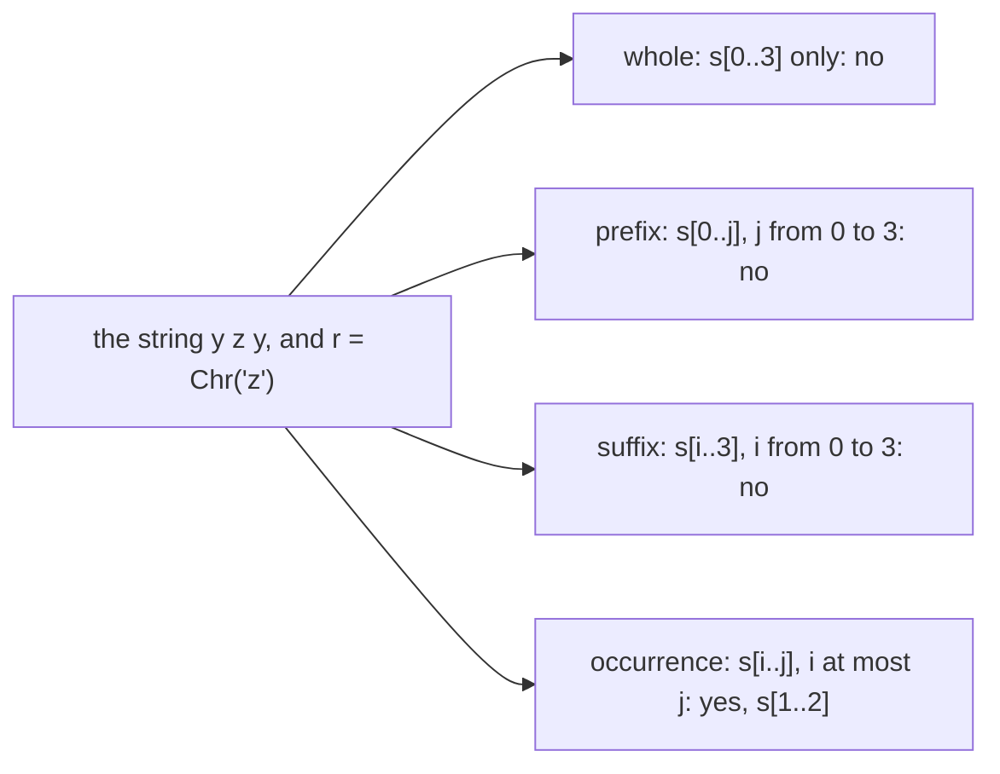
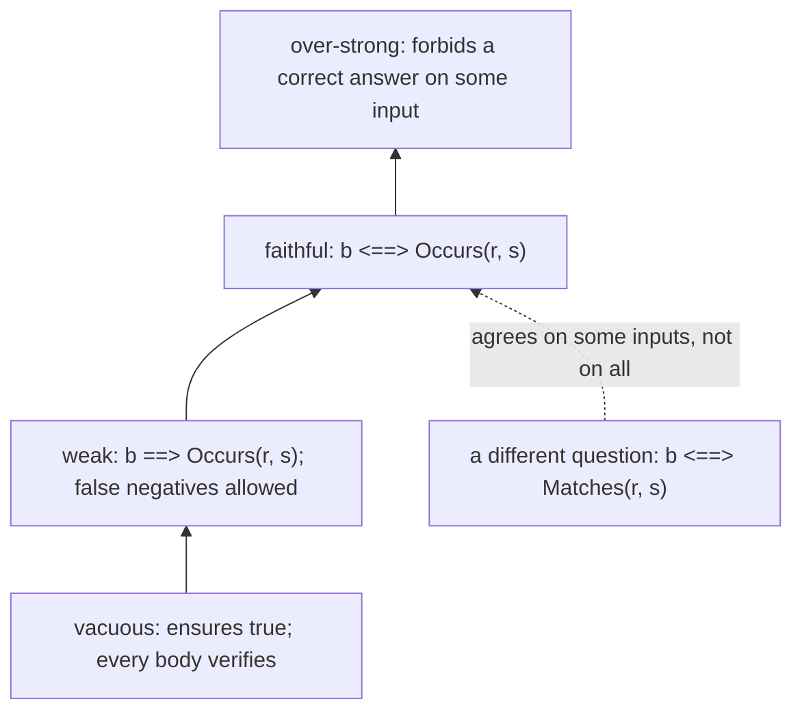
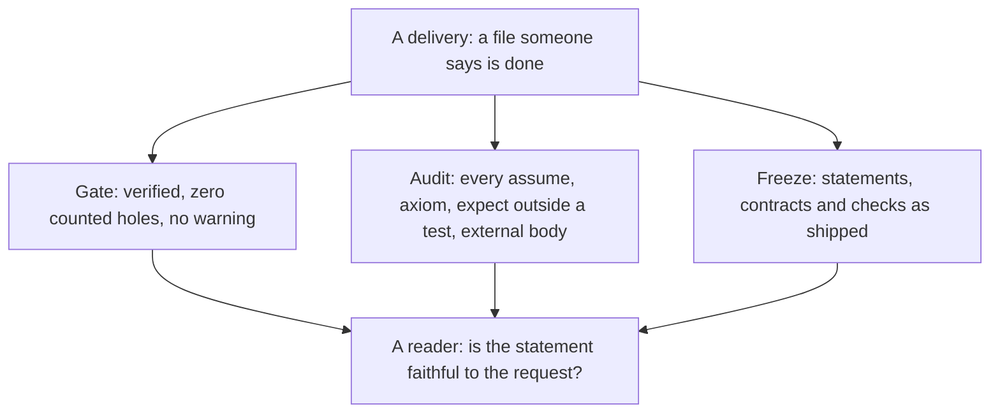

# R04 — Specs as logic

R01 showed that the verifier checks a body against its contract, and R02 connected the regex tree to the strings it means through `Matches`. R04 turns to the contract itself. A specification is a formula, and a formula can be read, classified, witnessed and refuted like any other claim. A proof can establish exactly the written postcondition while the user wanted something else; a failed proof can expose a missing argument, a wrong program or a false claim. This module gives those cases names and asks you to keep their evidence apart: the checker checks proofs against statements, never statements against intent.

The running question is a search API. Does a regex match the whole input, or does it occur somewhere inside it? A Boolean result does not make those questions the same, and a contract that answers one of them can verify while the caller needed the other. Every construct below appears first in a small example with its verifier output directly under it, captured on the course pins. R is standalone: use R01, R02 and the declared A1 layer; no Q file, no earlier learner implementation and no later layer is imported.

**Three ideas do all the work.**

1. **A quantifier says which values a claim covers.** Proving a `forall` reasons about an arbitrary value; using an `exists` takes one value its premise guarantees, with all of its facts. A positive existential needs one named witness; a negative one needs an argument about every candidate.
2. **A contract's strength is a property of the formula.** Vacuous, weak, faithful and over-strong are positions on one scale, and each position is shown by a witness: an input on which the formula forces, allows or forbids the intended answer. Whole-string matching and substring occurrence are different questions on that scale.
3. **Runtime checks, assumptions and proofs are different evidence.** An `expect` outside a test is assumed by the verifier, an `assume` is a counted hole, and the audit lists both; a green gate with an audit finding is not done.

---

## 0. How this module works

**Budget: 360 minutes**, including the module viva and excluding contractor wall time. These are planning estimates; record your own.

| setup | test-out | read | worked | cards | predictions | holes | audit drill | agent review | paper | bench card | viva | calibration | total |
|---|---|---|---|---|---|---|---|---|---|---|---|---|---|
| 10 | 10 | 60 | 30 | 8 | 15 | 70 | 20 | 30 | 45 | 25 | 30 | 7 | **360** |

The hole minutes are 7 for each of the ten paired holes, in either language.

**Test-out first.** Before reading on, attempt T1 closed book in both files: prove that some string matches `Cat(Chr('o'), Star(Chr('k')))` (in Dafny, some string of length 3). The claim is existential, so it is not finished by naming a value; the proof must connect that value to the semantics. Record the attempt with `scripts/firsttry.sh R04 --check`. A later repair is useful, but it does not replace the first try.

**Predictions.** Commit the six answers below before running their scenarios or opening the card demos, the audit drill, the bank or the rubric. The verdict answers (P1, P2, P5, P6) go in `slots/R04.slots`, switched on by the `CHECK` lines of the Dafny file and of `specimens/R04/P5d.dfy.specimen`; the obligation answers (P3, P4) go in the commented slots of `specimens/R04/P3d.dfy.specimen` and `specimens/R04/P4v.rs.specimen`. Respect each printed answer form, then run `scripts/firsttry.sh R04 --check`.

> **Predict (P1) — commit in the file before reading on.** `RuntimePositive(x)` ensures `y > 0`; its body is `expect x > 0; y := x;`, and it is not a test. What does `scripts/vcheck` report? Answer `D:<v>`, `v` one of `ok`, `fail`, `timeout`, `err:<stage>`.

> **Predict (P2) — commit in the file before reading on.** Four postconditions for `Find(r, s) returns (b)`: [a] `b <==> Occurs(r, s)`; [b] `b <==> Matches(r, s)`; [c] `b ==> Occurs(r, s)`; [d] `b <==> exists i :: 0 <= i <= |s| && Matches(r, s[i..])`. With `r := Star(Chr('a'))` and `s := "b"`, which of them force `b == true`? Answer the labels in order separated by single spaces, or `none` (the same answer in both languages).

> **Predict (P3) — commit in the file before reading on.** Four empty-bodied Dafny lemmas about the given `Occurs`: [a] `Occurs(Star(Chr('a')), "b")`; [b] `Occurs(Eps, s)` for every `s`; [c] `!Occurs(Chr('a'), "b")`; [d] `Occurs(Chr('b'), "ab")`. Which fail?

> **Predict (P4) — commit in the file before reading on.** The same four claims as empty-bodied Verus proof functions about `occurs`. Which fail?

> **Predict (P5) — commit in the file before reading on.** `RuntimePositive`, in a file of its own, is a delivery. What are the exit code of `scripts/vcheck --gate` on it and the number of findings `scripts/vaudit` reports? Answer `D:<exit> <n>`.

> **Predict (P6) — commit in the file before reading on.** A constant search returns `false` for every input: Dafny `method FindNone(r: Re, s: seq<char>) returns (b: bool) { b := false; }`, Verus `fn find_none(r: &Re, s: &Vec<char>) -> (b: bool) { false }`. It is checked four times, once against each of P2's postconditions on its own. Which of the four verify? Answer `D:<labels> V:<labels>`, or `none`.

### This module's files

| file | role | shipped state |
|---|---|---|
| `dafny/R/R04_Specs/core/R04_Specs.dfy` | the given `Occurs`, T1d, prediction block, worked examples, cards, holes H1d–H5d, the AUDIT block | verified, 6 holes, 0 errors |
| `verus/r/r04_specs/src/lib.rs` | the paired Verus file | verified, 6 holes, 0 errors |
| `specimens/R04/`, `slots/R04.slots` | prediction specimens, chapter scenarios, card demos, the audit drill's deliveries | slots unfilled; demos fail by design |
| `dafny/R/R04_Specs/agent/R04_AgentProver.dfy` | the audited prover's file | verified, 3 holes, 0 errors |
| `verus/r/r04_specs/src/agent.rs` | the paired audited prover's file | verified, 3 holes, 0 errors |
| `dafny/given/R/RG_A1_Re.dfy`, `verus/given/rg_re_a1/src/lib.rs` | the frozen A1 layer: definitions only | verified; no lemma supplied |
| `paper/R04_problems.tex`, `paper/R04_answers.tex` | the card and two written problems, and your answers | template compiles; answers unfilled |
| `bench/local/r/README.md` | instructions for your third local bench card | you create the card |
| `Solutions/`, `paper/solutions/` | references | yours to open LAST, after your attempts, gates and review |

As shipped, both exercise files verify in the learner loop with their holes counted:

<!-- pin: shipped-d -->
```
$ scripts/vcheck dafny/R/R04_Specs/core
vcheck: dafny/R/R04_Specs/core [dafny, learner loop]: verified — 11 verified, 6 holes, 0 errors
dafny/R/R04_Specs/core/R04_Specs.dfy:30:13: hole bodyless-method R04.T1d
dafny/R/R04_Specs/core/R04_Specs.dfy:99:20: hole bodyless-method R04.H1d
dafny/R/R04_Specs/core/R04_Specs.dfy:117:13: hole bodyless-method R04.H2d
dafny/R/R04_Specs/core/R04_Specs.dfy:135:13: hole bodyless-method R04.H3d
dafny/R/R04_Specs/core/R04_Specs.dfy:151:13: hole bodyless-function R04.H4d
dafny/R/R04_Specs/core/R04_Specs.dfy:191:13: hole bodyless-method R04.H5d
```

<!-- pin: shipped-v -->
```
$ scripts/vcheck verus/r/r04_specs
vcheck: verus/r/r04_specs [verus, learner loop]: verified — - verified, 6 holes, 0 errors
verus/r/r04_specs/src/lib.rs:27:40: hole assume R04.T1v
verus/r/r04_specs/src/lib.rs:89:40: hole assume R04.H1v
verus/r/r04_specs/src/lib.rs:107:40: hole assume R04.H2v
verus/r/r04_specs/src/lib.rs:127:40: hole assume R04.H3v
verus/r/r04_specs/src/lib.rs:141:1: hole uninterp R04.H4v
verus/r/r04_specs/src/lib.rs:179:40: hole assume R04.H5v
```

Green with six holes is not done; *done* is green with zero tool-counted holes and a clean audit (R01 §5).

---

## 1. Whole strings and occurrences

### 1.1 `Matches` takes the whole string

`Matches(r, s)` from A1 is a whole-string relation: every constructor receives an entire sequence and must account for all of it. `Chr(c)` matches exactly `[c]`, and `Cat` splits the whole string into a prefix for its left child and the remaining suffix for its right. A search asks a different question: does `r` match some piece of `s`? R04 gives that question its own formula, `Occurs`, in both exercise files:

```dafny
ghost predicate Occurs(r: Re, s: seq<char>)
{
  exists i, j :: 0 <= i <= j <= |s| && Matches(r, s[i..j])
}
```

```rust
pub open spec fn occurs(r: Re, s: Seq<char>) -> bool {
    exists|i: int, j: int| 0 <= i <= j <= s.len() && matches(r, #[trigger] s.subrange(i, j))
}
```

`Occurs` chooses two ordered bounds and passes the one complete slice `s[i..j]` to the same `Matches`. It does not change what `Matches` means; it changes which string `Matches` receives. Equal bounds are allowed, so the empty slice is always a candidate: a regex that accepts the empty string occurs in every string. Here is the difference on one example, in a scratch file of its own:

```dafny
module R04_ChOccurs {
  import opened RG_A1_Re

  ghost predicate Occurs(r: Re, s: seq<char>)
  {
    exists i, j :: 0 <= i <= j <= |s| && Matches(r, s[i..j])
  }

  lemma ZOccurs()
    ensures Occurs(Chr('z'), "yz")
  {
    assert "yz"[1..2] == "z";
  }

  lemma ZNotWhole()
    ensures !Matches(Chr('z'), "yz")
  {
  }
}
```

<!-- pin: occurs-d -->
```
$ scripts/vcheck --module R04 occurs.dfy
vcheck: occurs.dfy [dafny, learner loop]: verified — 8 verified, 0 holes, 0 errors
```

```rust
use vstd::prelude::*;
use rg_re_a1::*;

verus! {

pub open spec fn occurs(r: Re, s: Seq<char>) -> bool {
    exists|i: int, j: int| 0 <= i <= j <= s.len() && matches(r, #[trigger] s.subrange(i, j))
}

proof fn lemma_z_occurs() {
    let s = seq!['y', 'z'];
    assert(s.subrange(1, 2) =~= seq!['z']);
    assert(matches(Re::Chr('z'), s.subrange(1, 2)));
    assert(occurs(Re::Chr('z'), s));
}

proof fn lemma_z_not_whole() {
    assert(!matches(Re::Chr('z'), seq!['y', 'z']));
}

} // verus!
```

<!-- pin: occurs-v -->
```
$ scripts/vcheck --module R04 occurs.rs
vcheck: occurs.rs [verus, learner loop]: verified — 2 verified, 0 holes, 0 errors
```

`Chr('z')` occurs in "yz" and does not match it. Both verify, and both are needed to say what a search for 'z' should return. The positive occurrence needed a named slice: the slice fact `"yz"[1..2] == "z"` puts the term `Matches(Chr('z'), "yz"[1..2])` in play, and the solver evaluates it. Verus, as in R02, unfolds a recursive spec function only where it is mentioned, so its proof also mentions the inner `matches` term before asserting the occurrence. The negative whole-string claim needed nothing: `Chr('z')` matches only a one-character string.

P3 and P4 ask the same kind of question with empty bodies. The specimen's four claims, Dafny first:

```dafny
lemma StarOccursInB()
  ensures Occurs(Star(Chr('a')), "b")  // [a]
{
}

lemma EpsOccursEverywhere(s: seq<char>)
  ensures Occurs(Eps, s)  // [b]
{
}

lemma NoAInB()
  ensures !Occurs(Chr('a'), "b")  // [c]
{
}

lemma BOccursInAB()
  ensures Occurs(Chr('b'), "ab")  // [d]
{
}
```

<!-- pin: obligation-d -->
```
$ scripts/vcheck specimens/R04/P3d.dfy.specimen
vcheck: specimens/R04/P3d.dfy.specimen [dafny, learner loop]: failed — 6 verified, 0 holes, 4 errors
specimens/R04/P3d.dfy.specimen:83:3: error: a postcondition could not be proved on this return path
specimens/R04/P3d.dfy.specimen:82:19: related: this is the postcondition that could not be proved
specimens/R04/P3d.dfy.specimen:78:5: related: this proposition could not be proved
specimens/R04/P3d.dfy.specimen:88:3: error: a postcondition could not be proved on this return path
specimens/R04/P3d.dfy.specimen:87:19: related: this is the postcondition that could not be proved
specimens/R04/P3d.dfy.specimen:78:5: related: this proposition could not be proved
specimens/R04/P3d.dfy.specimen:93:3: error: a postcondition could not be proved on this return path
specimens/R04/P3d.dfy.specimen:92:13: related: this is the postcondition that could not be proved
specimens/R04/P3d.dfy.specimen:98:3: error: a postcondition could not be proved on this return path
specimens/R04/P3d.dfy.specimen:97:19: related: this is the postcondition that could not be proved
specimens/R04/P3d.dfy.specimen:78:5: related: this proposition could not be proved
```

```rust
proof fn case_a()
    ensures
        occurs(Re::Star(Box::new(Re::Chr('a'))), seq!['b']),  // [a]
{
}

proof fn case_b(s: Seq<char>)
    ensures
        occurs(Re::Eps, s),  // [b]
{
}

proof fn case_c()
    ensures
        !occurs(Re::Chr('a'), seq!['b']),  // [c]
{
}

proof fn case_d()
    ensures
        occurs(Re::Chr('b'), seq!['a', 'b']),  // [d]
{
}
```

<!-- pin: obligation-v -->
```
$ scripts/vcheck specimens/R04/P4v.rs.specimen
vcheck: specimens/R04/P4v.rs.specimen [verus, learner loop]: failed — 8 verified, 0 holes, 3 errors
specimens/R04/P4v.rs.specimen:135:9: error: postcondition not satisfied
specimens/R04/P4v.rs.specimen:141:9: error: postcondition not satisfied
specimens/R04/P4v.rs.specimen:153:9: error: postcondition not satisfied
```

The answers are `FAILS a b c d` in Dafny and `FAILS a b d` in Verus. Every one of the four claims is true. [a] and [b] are true through the empty slice (`Star` and `Eps` both accept `[]`), [c] is true because neither slice of length 1 nor the empty slice is `['a']`, and [d] is true through `"ab"[1..2]`. Three positive claims fail in both languages for the same reason: an existential over slices needs its witness slice named, and an empty body names none. The negative claim [c] is where the tools differ. Verus's quantifier instantiation closes it from the definitions as they stand; Dafny's does not, and would need the argument about every candidate that §2.4 builds. A failed empty proof is not a counterexample: none of these four claims is false. Read each failure as "this obligation needs an argument the body did not give", and decide which argument from the shape of the formula.

### 1.2 Which bounds may vary

Every question about a regex and a string fixes or frees the two ends of the slice that `Matches` receives. A whole-string question fixes both ends; a prefix question fixes the start at 0 and lets the end vary; a suffix question lets the start vary and fixes the end at `|s|`; an occurrence lets both vary, in order. Here are the four on one string, `"yzy"`, for `r := Chr('z')`:



Draw the bounds before writing a quantifier. The four formulas can agree on a particular input and still answer different questions: on `"z"` all four say yes, and only a string like `"yzy"` separates the occurrence from the others. Two conventions travel with every formula. The empty slice is a slice: a prefix question includes `s[..0]`, and an occurrence includes every `s[i..i]`. And the bounds are part of the claim: replacing `0 <= i <= |s|` by `0 < i <= |s|` excludes the empty prefix, which changes the answer for every regex that accepts the empty string.

H3 is the anchoring item. Verus's H3 shows one regex that occurs in "ba" but does not match it, and another that matches the whole of it. Dafny's H3 proves what anchoring buys: every string that `Cat(Cat(Chr('a'), Star(Chr('b'))), Chr('c'))` matches begins with 'a' and ends with 'c', which an occurrence would not guarantee. H4 asks you to write one of these formulas from its prose description, and three given checks test the bounds you chose.

---

## 2. Quantifiers in proofs

### 2.1 Introducing a `forall`: an arbitrary value

To prove a universal claim, fix an arbitrary value from its range and prove the body for it. The worked example W1 proves that `Eps` matches only the empty string. Dafny's `forall` statement names the arbitrary `s`, states what is assumed about it after the bar, and what is proved for it in `ensures`:

```dafny
lemma EpsOnlyEmpty()
  ensures forall s :: Matches(Eps, s) ==> s == []
{
  forall s | Matches(Eps, s)
    ensures s == []
  {
  }
}
```

Verus writes the same step as `assert forall … implies … by`: inside the `by` block the antecedent after `implies` is in scope, which a plain `==>` would not give you:

```rust
pub proof fn lemma_eps_only_empty()
    ensures
        forall|s: Seq<char>| matches(Re::Eps, s) ==> s.len() == 0,
{
    assert forall|s: Seq<char>| matches(Re::Eps, s) implies s.len() == 0 by {
    }
}
```

Nothing about the chosen `s` is special: the proof must work for whatever value satisfies the range, which is what makes the conclusion universal. The card C1 (a WRITE card in Dafny, where H2 and H3 each ask for a `forall` statement over every matching string; a RECOGNISE card in Verus, where only H2 needs `assert forall`) has demos that claim universals that do not hold:

```dafny
module R04_ForallDemo {
  lemma Claim()
    ensures forall x: int :: x >= 0
  {
  }
}
```

<!-- pin: forall-d -->
```
$ scripts/vcheck specimens/R04/card-c1d.dfy.specimen
vcheck: specimens/R04/card-c1d.dfy.specimen [dafny, learner loop]: failed — 0 verified, 0 holes, 1 error
specimens/R04/card-c1d.dfy.specimen:3:13: warning: Could not find a trigger for this quantifier. Without a trigger, the quantifier may cause brittle verification. To silence this warning, add an explicit trigger using the {:trigger} attribute. For more information, see the section on quantifier instantiation rules in the reference manual.
specimens/R04/card-c1d.dfy.specimen:4:3: error: a postcondition could not be proved on this return path
specimens/R04/card-c1d.dfy.specimen:3:13: related: this is the postcondition that could not be proved
```

```rust
proof fn arbitrary_entries(a: Seq<int>)
    ensures
        forall|i: int| 0 <= i < a.len() ==> #[trigger] a[i] >= 0,
{
}
```

<!-- pin: forall-v -->
```
$ scripts/vcheck specimens/R04/card-c1v.rs.specimen
vcheck: specimens/R04/card-c1v.rs.specimen [verus, learner loop]: failed — 0 verified, 0 holes, 1 error
specimens/R04/card-c1v.rs.specimen:7:9: error: postcondition not satisfied
```

Both fail at their postconditions. Dafny also warns that it found no trigger for `x >= 0`: a quantifier over a bare variable gives the solver no term to instantiate it with. The Verus demo names its trigger, `a[i]`, and still fails, because a trigger says how to use a quantified fact, not that the fact is true. R14 is about triggers; here, read the warning and the error separately.

### 2.2 Eliminating an `exists`: a justified witness

To use an existential premise, take the value it guarantees. The worked example W2 starts from a match of `Cat(Chr('x'), b)`, whose definition is an existential over split points, and takes the split with Dafny's `:|` (Verus `choose`). The taken value comes with every conjunct of the definition: both bounds and both sides' matches. Here they force the prefix to be `['x']`, so the string has at least one character:

```dafny
lemma CatChrNonEmpty(b: Re, s: seq<char>)
  requires Matches(Cat(Chr('x'), b), s)
  ensures |s| >= 1
{
  var i :| 0 <= i <= |s| && Matches(Chr('x'), s[..i]) && Matches(b, s[i..]);
  assert s[..i] == ['x'];
}
```

```rust
pub proof fn lemma_cat_chr_nonempty(b: Re, s: Seq<char>)
    requires
        matches(Re::Cat(Box::new(Re::Chr('x')), Box::new(b)), s),
    ensures
        s.len() >= 1,
{
    let i = choose|i: int|
        0 <= i <= s.len() && matches(Re::Chr('x'), #[trigger] s.subrange(0, i)) && matches(
            b,
            s.subrange(i, s.len() as int),
        );
    assert(s.subrange(0, i).len() == 1);
}
```

The step is only as good as the premise. The WRITE card C2's demos take a witness that no premise guarantees:

```dafny
module R04_ChooseDemo {
  lemma ChooseWithoutWitness(xs: seq<int>, m: int)
  {
    var i: int :| 0 <= i < |xs| && xs[i] == m;
    assert 0 <= i < |xs| && xs[i] == m;
  }
}
```

<!-- pin: choose-d -->
```
$ scripts/vcheck specimens/R04/card-c2d.dfy.specimen
vcheck: specimens/R04/card-c2d.dfy.specimen [dafny, learner loop]: failed — 0 verified, 0 holes, 1 error
specimens/R04/card-c2d.dfy.specimen:4:16: error: cannot establish the existence of LHS values that satisfy the such-that predicate
```

```rust
proof fn choose_without_witness(xs: Seq<int>, m: int) {
    let i = choose|i: int| 0 <= i < xs.len() && xs[i] == m;
    assert(0 <= i < xs.len() && xs[i] == m);
}
```

<!-- pin: choose-v -->
```
$ scripts/vcheck specimens/R04/card-c2v.rs.specimen
vcheck: specimens/R04/card-c2v.rs.specimen [verus, learner loop]: failed — 0 verified, 0 holes, 1 error
specimens/R04/card-c2v.rs.specimen:7:12: error: assertion failed
```

The two tools report the same mistake at different places. Dafny refuses the `:|` itself: it must prove that a value exists before it lets you take one. Verus's `choose` always returns some value, but its facts hold only when a witness exists, so the failure is the assertion that relies on them. Either way, `:|` and `choose` are not a way to assume that what you want exists.

### 2.3 A positive witness names every split

A positive whole-string match is an existential at every `Cat` and at every non-empty `Star` step. A proof names the split at each one and discharges both sides there. Here is a two-node example, `Cat(Chr('x'), Alt(Chr('y'), Eps))` on "xy", first with the two slice facts at the split:

```dafny
module R04_ChWitness {
  import opened RG_A1_Re

  lemma XThenOptionalY()
    ensures Matches(Cat(Chr('x'), Alt(Chr('y'), Eps)), "xy")
  {
    assert "xy"[..1] == "x";
    assert "xy"[1..] == "y";
  }
}
```

<!-- pin: xy-bare-d -->
```
$ scripts/vcheck --module R04 xy-bare.dfy
vcheck: xy-bare.dfy [dafny, learner loop]: failed — 5 verified, 0 holes, 1 error
xy-bare.dfy:6:3: error: a postcondition could not be proved on this return path
xy-bare.dfy:5:20: related: this is the postcondition that could not be proved
dafny/given/R/RG_A1_Re.dfy:21:23: related: this proposition could not be proved
```

The split is named, and Dafny still cannot finish: the right side is an `Alt`, and nothing mentions `Matches(Chr('y'), "y")`, the branch that makes it true. One more assertion names that branch:

```dafny
module R04_ChWitness {
  import opened RG_A1_Re

  lemma XThenOptionalY()
    ensures Matches(Cat(Chr('x'), Alt(Chr('y'), Eps)), "xy")
  {
    assert "xy"[..1] == "x";
    assert "xy"[1..] == "y";
    assert Matches(Chr('y'), "xy"[1..]);
  }
}
```

<!-- pin: xy-d -->
```
$ scripts/vcheck --module R04 xy.dfy
vcheck: xy.dfy [dafny, learner loop]: verified — 6 verified, 0 holes, 0 errors
```

Verus needs every side's `matches` term mentioned; with only the slices it fails:

```rust
use vstd::prelude::*;
use rg_re_a1::*;

verus! {

proof fn lemma_x_then_optional_y() {
    let s = seq!['x', 'y'];
    let r = Re::Cat(Box::new(Re::Chr('x')), Box::new(Re::Alt(Box::new(Re::Chr('y')), Box::new(Re::Eps))));
    assert(s.subrange(0, 1) =~= seq!['x']);
    assert(s.subrange(1, 2) =~= seq!['y']);
    assert(matches(r, s));
}

} // verus!
```

<!-- pin: xy-bare-v -->
```
$ scripts/vcheck --module R04 xy-bare.rs
vcheck: xy-bare.rs [verus, learner loop]: failed — 0 verified, 0 holes, 1 error
xy-bare.rs:11:12: error: assertion failed
```

and with each side asserted at its slice it verifies:

```rust
use vstd::prelude::*;
use rg_re_a1::*;

verus! {

proof fn lemma_x_then_optional_y() {
    let s = seq!['x', 'y'];
    let tail = Re::Alt(Box::new(Re::Chr('y')), Box::new(Re::Eps));
    let r = Re::Cat(Box::new(Re::Chr('x')), Box::new(tail));
    assert(s.subrange(0, 1) =~= seq!['x']);
    assert(s.subrange(1, 2) =~= seq!['y']);
    assert(matches(Re::Chr('x'), s.subrange(0, 1)));
    assert(matches(Re::Chr('y'), s.subrange(1, 2)));
    assert(matches(tail, s.subrange(1, 2)));
    assert(matches(r, s));
}

} // verus!
```

<!-- pin: xy-v -->
```
$ scripts/vcheck --module R04 xy.rs
vcheck: xy.rs [verus, learner loop]: verified — 1 verified, 0 holes, 0 errors
```

A drawing of the splits helps: write the string, mark each boundary, and label each piece with the subtree that must match it. A `Star` on a non-empty piece needs one more boundary for its first chunk, and the rest of the piece is again a `Star` match, down to the empty rest. H1 is this kind of proof with a `Star` of two chunks; T1 asks for one with a `Star` of none in Verus and of two in Dafny, whose word must have three characters.

### 2.4 A negative claim covers every candidate

A negative match claim is a negated existential: no split works. One failed candidate rejects only that candidate. A proof either argues about an arbitrary candidate (a `forall` over the split points, §2.1) or assumes a satisfying split and derives a contradiction from it (§2.2), and usually both: the `forall` says no prefix fits the left side, and the taken split is one of those prefixes. Take `Cat(Chr('x'), Chr('y'))` on "yx". Dafny closes it with no help at all:

```dafny
module R04_ChNegative {
  import opened RG_A1_Re

  lemma NotYX()
    ensures !Matches(Cat(Chr('x'), Chr('y')), "yx")
  {
  }
}
```

<!-- pin: yx-d -->
```
$ scripts/vcheck --module R04 yx.dfy
vcheck: yx.dfy [dafny, learner loop]: verified — 6 verified, 0 holes, 0 errors
```

Its solver expands the split existential over the three legal indices of a two-character literal by itself. That is a tool fact about short literal strings, not a proof you wrote; it is why R04's Dafny holes on concrete strings are short, and why the same items in Verus carry the explicit argument. Verus fails with an empty body:

```rust
use vstd::prelude::*;
use rg_re_a1::*;

verus! {

proof fn lemma_not_yx()
    ensures
        !matches(Re::Cat(Box::new(Re::Chr('x')), Box::new(Re::Chr('y'))), seq!['y', 'x']),
{
}

} // verus!
```

<!-- pin: yx-bare-v -->
```
$ scripts/vcheck --module R04 yx-bare.rs
vcheck: yx-bare.rs [verus, learner loop]: failed — 0 verified, 0 holes, 1 error
yx-bare.rs:8:9: error: postcondition not satisfied
```

and verifies with the argument about every prefix, which names the one candidate whose first character could matter:

```rust
use vstd::prelude::*;
use rg_re_a1::*;

verus! {

proof fn lemma_not_yx()
    ensures
        !matches(Re::Cat(Box::new(Re::Chr('x')), Box::new(Re::Chr('y'))), seq!['y', 'x']),
{
    let s = seq!['y', 'x'];
    assert forall|i: int| 0 <= i <= s.len() implies !matches(Re::Chr('x'), #[trigger] s.subrange(0, i)) by {
        if i == 1 {
            assert(s.subrange(0, i)[0] == 'y');
        }
    }
}

} // verus!
```

<!-- pin: yx-v -->
```
$ scripts/vcheck --module R04 yx.rs
vcheck: yx.rs [verus, learner loop]: verified — 1 verified, 0 holes, 0 errors
```

The `forall` over prefixes is the whole argument here: once no prefix matches `Chr('x')`, no split of the `Cat` can, and Verus's own instantiation finishes the negation. In Verus's H2 the right side is a `Star`, and the proof also takes the split a match would supply and points the prefix fact at it. Dafny's H2 is a different claim of the same kind, because Dafny settles Verus's "ba" claim from one slice fact: no string that `Cat(Chr('x'), Cat(Chr('y'), Star(Chr('z'))))` matches has 'x' in second place. It is a universal over matches, so the proof is a `forall` statement (§2.1) for one arbitrary match, and inside it the two splits that match guarantees are taken with `:|` (§2.2); each `Chr` side then pins one character. Keep the scope visible either way: the claim is about every index from 0 to `|s|`, the empty prefix and the whole string included.

---

## 3. How strong is a specification?

### 3.1 The spec-strength lattice

A specification for a search can be placed on a scale by what it forces. A **vacuous** contract forces nothing (`ensures true`, or a precondition no input meets). A **weak** contract rules out some wrong answers and allows others (`b ==> Occurs(r, s)` forbids a false positive and allows every false negative). A **faithful** contract forces exactly the intended answer on every input (`b <==> Occurs(r, s)` for a substring search). An **over-strong** contract forbids correct answers or demands more than the operation can give. Each position is shown by a witness: an input on which the formula allows a wrong answer (weak), or forbids the right one (over-strong). And a different semantic question, such as whole-string matching for a substring search, is not a point on the scale at all, though it can look faithful on many inputs.



P2 asks which of four contracts force `b == true` on `r := Star(Chr('a'))`, `s := "b"`. A contract forces the answer when `ensures b` follows from it. The scenario poses exactly that, one lemma per label, each body naming the witness slice its label needs:

```dafny
lemma ForcedA(b: bool)
  requires b <==> Occurs(Star(Chr('a')), "b")  // [a]
  ensures b
{
  assert "b"[0..0] == [];
}

lemma ForcedB(b: bool)
  requires b <==> Matches(Star(Chr('a')), "b")  // [b]
  ensures b
{
  assert "b"[0..0] == [];
}

lemma ForcedC(b: bool)
  requires b ==> Occurs(Star(Chr('a')), "b")  // [c]
  ensures b
{
  assert "b"[0..0] == [];
}

lemma ForcedD(b: bool)
  requires b <==> exists i :: 0 <= i <= 1 && Matches(Star(Chr('a')), "b"[i..])  // [d]
  ensures b
{
  assert "b"[1..] == [];
}
```

<!-- pin: p2-d -->
```
$ scripts/vcheck specimens/R04/chapter-p2-d.dfy.specimen
vcheck: specimens/R04/chapter-p2-d.dfy.specimen [dafny, learner loop]: failed — 9 verified, 0 holes, 2 errors
specimens/R04/chapter-p2-d.dfy.specimen:90:3: error: a postcondition could not be proved on this return path
specimens/R04/chapter-p2-d.dfy.specimen:89:13: related: this is the postcondition that could not be proved
specimens/R04/chapter-p2-d.dfy.specimen:97:3: error: a postcondition could not be proved on this return path
specimens/R04/chapter-p2-d.dfy.specimen:96:13: related: this is the postcondition that could not be proved
```

```rust
proof fn forced_a(b: bool)
    requires
        b <==> occurs(Re::Star(Box::new(Re::Chr('a'))), seq!['b']),  // [a]
    ensures
        b,
{
    assert(seq!['b'].subrange(0, 0) =~= Seq::<char>::empty());
    assert(matches(Re::Star(Box::new(Re::Chr('a'))), seq!['b'].subrange(0, 0)));
}
```

<!-- pin: p2-v -->
```
$ scripts/vcheck specimens/R04/chapter-p2-v.rs.specimen
vcheck: specimens/R04/chapter-p2-v.rs.specimen [verus, learner loop]: failed — 9 verified, 0 holes, 2 errors
specimens/R04/chapter-p2-v.rs.specimen:146:9: error: postcondition not satisfied
specimens/R04/chapter-p2-v.rs.specimen:155:9: error: postcondition not satisfied
```

(The Verus file holds all four, in the order of the Dafny file.) The answer is `a d`: [a] and [d] verify, [b] and [c] fail, in both languages. [a] is forced through the empty slice; [d] through the empty suffix `"b"[1..]`; [b] forces `false` instead, since `Star(Chr('a'))` does not match "b"; and [c] forces nothing: `b ==> …` is true for `b == false` whatever the right side says. The answer is about this one input. Agreement of [a] and [d] here does not make them the same contract; §7's B2 asks you to find an input that separates them.

### 3.2 A trivial body tests a contract

The cheapest test of a contract is a body that does nothing useful. If a constant body satisfies a contract, the contract does not demand the behaviour. P6 checks `FindNone`, which always returns `false`, against each of P2's four contracts on their own:

```dafny
method FindNoneA(r: Re, s: seq<char>) returns (b: bool)
  ensures b <==> Occurs(r, s)  // [a]
{
  b := false;
}

method FindNoneC(r: Re, s: seq<char>) returns (b: bool)
  ensures b ==> Occurs(r, s)  // [c]
{
  b := false;
}
```

<!-- pin: p6-d -->
```
$ scripts/vcheck specimens/R04/chapter-p6-d.dfy.specimen
vcheck: specimens/R04/chapter-p6-d.dfy.specimen [dafny, learner loop]: failed — 8 verified, 0 holes, 3 errors
specimens/R04/chapter-p6-d.dfy.specimen:81:3: error: a postcondition could not be proved on this return path
specimens/R04/chapter-p6-d.dfy.specimen:80:15: related: this is the postcondition that could not be proved
specimens/R04/chapter-p6-d.dfy.specimen:87:3: error: a postcondition could not be proved on this return path
specimens/R04/chapter-p6-d.dfy.specimen:86:15: related: this is the postcondition that could not be proved
specimens/R04/chapter-p6-d.dfy.specimen:99:3: error: a postcondition could not be proved on this return path
specimens/R04/chapter-p6-d.dfy.specimen:98:15: related: this is the postcondition that could not be proved
```

```rust
fn find_none_c(r: &Re, s: &Vec<char>) -> (b: bool)
    ensures
        b ==> occurs(*r, s@),  // [c]
{
    false
}
```

<!-- pin: p6-v -->
```
$ scripts/vcheck specimens/R04/chapter-p6-v.rs.specimen
vcheck: specimens/R04/chapter-p6-v.rs.specimen [verus, learner loop]: failed — 8 verified, 0 holes, 3 errors
specimens/R04/chapter-p6-v.rs.specimen:133:9: error: postcondition not satisfied
specimens/R04/chapter-p6-v.rs.specimen:140:9: error: postcondition not satisfied
specimens/R04/chapter-p6-v.rs.specimen:154:9: error: postcondition not satisfied
```

(Each specimen holds all four methods; the excerpts show two of them.) The answer is `D:c V:c`: only the one-way contract accepts the constant body. That places [c] on the lattice: weak, because a search that never finds anything meets it. A verified constant body is a witness of weakness, not a bug in the verifier. The other three fail, and each failure names the postcondition the constant violates on some input. Note the difference between this question and P2's: P2 asked what a contract forces on one input; P6 asks whether one body meets a contract on every input.

### 3.3 Mutant-kill witnesses

A mutant is a plausible wrong implementation. A specification kills a mutant when some input makes the mutant's answer violate it; a test suite kills a mutant when one of its inputs does. To show that a mutant is wrong you need one witness input on which its answer differs from the intended one. Here the mutant search answers the anchored question, `Matches(r, s)`, instead of `Occurs(r, s)`; §1.1's example is a witness:

```dafny
module R04_ChMutant {
  import opened RG_A1_Re

  ghost predicate Occurs(r: Re, s: seq<char>)
  {
    exists i, j :: 0 <= i <= j <= |s| && Matches(r, s[i..j])
  }

  // A mutant search returns Matches(r, s): it answers the anchored question.
  lemma MutantWholeKilled()
    ensures exists r: Re, s: seq<char> :: Matches(r, s) != Occurs(r, s)
  {
    assert "yz"[1..2] == "z";
    assert Occurs(Chr('z'), "yz");
    assert !Matches(Chr('z'), "yz");
  }
}
```

<!-- pin: mutant-d -->
```
$ scripts/vcheck --module R04 mutant.dfy
vcheck: mutant.dfy [dafny, learner loop]: verified — 7 verified, 0 holes, 0 errors
```

```rust
use vstd::prelude::*;
use rg_re_a1::*;

verus! {

pub open spec fn occurs(r: Re, s: Seq<char>) -> bool {
    exists|i: int, j: int| 0 <= i <= j <= s.len() && matches(r, #[trigger] s.subrange(i, j))
}

// A mutant search returns matches(r, s): it answers the anchored question.
proof fn lemma_mutant_whole_killed()
    ensures
        exists|r: Re, s: Seq<char>| matches(r, s) != occurs(r, s),
{
    let s = seq!['y', 'z'];
    assert(s.subrange(1, 2) =~= seq!['z']);
    assert(matches(Re::Chr('z'), s.subrange(1, 2)));
    assert(occurs(Re::Chr('z'), s));
    assert(!matches(Re::Chr('z'), s));
}

} // verus!
```

<!-- pin: mutant-v -->
```
$ scripts/vcheck --module R04 mutant.rs
vcheck: mutant.rs [verus, learner loop]: verified — 1 verified, 0 holes, 0 errors
```

The existential in the goal is introduced by its witness: once both sides' values are known at `Chr('z')` and "yz", the solver instantiates the goal there. A useful witness makes the two answers disagree under the exact definitions, and both values are proved, not computed in your head. H5 asks for a witness against a different mutant, one that returns `Nullable(r)` (Dafny fixes `r` to `Cat(Chr('a'), Chr('b'))` and asks for the string; Verus leaves both free); R15's `spectest` turns this move into a tool.

---

## 4. Runtime checks are not proofs

### 4.1 `expect` outside a test

`expect e` is Dafny's runtime check: compiled code evaluates `e` and halts if it is false. The verifier does not prove an `expect`; it assumes it, so every later obligation on that path may use `e` for free. Inside a test that is what you want. Outside one it is an unchecked assumption, which the course bans. P1's method uses it to establish its own postcondition:

```dafny
module R04_Pos {
  method RuntimePositive(x: int) returns (y: int)
    ensures y > 0
  {
    expect x > 0;  // planted: R04.P5d
    y := x;
  }
}
```

<!-- pin: p1-d -->
```
$ scripts/vcheck specimens/R04/chapter-p1-d.dfy.specimen
vcheck: specimens/R04/chapter-p1-d.dfy.specimen [dafny, learner loop]: verified — 1 verified, 0 holes, 0 errors
```

The answer to P1 is `D:ok`. The postcondition `y > 0` holds on every path that gets past the `expect`, so the verifier is satisfied; it is not satisfied by a proof that `x > 0`, which nothing establishes. P5 asks what the done instruments say about the same method as a delivery:

<!-- pin: p5-gate -->
```
$ scripts/vcheck --gate specimens/R04/P5d.dfy.specimen
vcheck: specimens/R04/P5d.dfy.specimen [dafny, gate]: verified — 1 verified, 0 holes, 0 errors
```

<!-- pin: p5-audit -->
```
$ scripts/vaudit specimens/R04/P5d.dfy.specimen
specimens/R04/P5d.dfy.specimen:9: expect-outside-test — `expect` outside a {:test}/@Test method is assumed by the verifier (Δ3, G11)
vaudit: specimens/R04/P5d.dfy.specimen [dafny, learner]: 1 finding(s)
```

The answer is `D:0 1`. The gate passes: the file verifies and holds no counted hole. The audit reports one finding at the `expect` line: an `expect` outside a test is assumed by the verifier. This is R01's lesson about `{:axiom}` again, with a construct that looks like ordinary code: the gate half of *done* passes, the audit half does not, and the delivery is not done. The divergence card C5 pairs this method with its Verus counterpart, an `assume`, and is the last item of the exercise file; read it after both predictions.

### 4.2 `assume` and what counts it

Verus has no `expect`; its unchecked assumption is `assume`, and the course's wrapper counts every `assume` as a hole. The audit drill's Verus delivery uses one to prove a claim it never establishes:

```rust
proof fn claimed_positive(x: int) {
    assume(x > 0);  // planted: R04.P5d
    assert(x > 0);
}
```

<!-- pin: assume-gate -->
```
$ scripts/vcheck --gate specimens/R04/audit-assume-v.rs.specimen
vcheck: specimens/R04/audit-assume-v.rs.specimen [verus, gate]: failed — - verified, 1 hole, 1 error
specimens/R04/audit-assume-v.rs.specimen:8:5: hole assume claimed_positive
(no file): error: gate: 'success' is false, not true; --output-json lacks 'is-verifying-entire-crate'; 'encountered-vir-error' is true, not false; --output-json lacks 'verified'; 1 hole(s); exit 1
```

<!-- pin: assume-audit -->
```
$ scripts/vaudit specimens/R04/audit-assume-v.rs.specimen
specimens/R04/audit-assume-v.rs.specimen:8: hole-assume — an assume hole (in claimed_positive) not on the trust allowlist
vaudit: specimens/R04/audit-assume-v.rs.specimen [verus, learner]: 1 finding(s)
```

The gate refuses it (one counted hole) and the audit lists the same line. The divergence card C5 sets the two deliveries side by side, the Dafny `expect` and the Verus `assume`, and runs the gate on each:

<!-- pin: divergence-d -->
```
$ scripts/vcheck --gate specimens/R04/card-c5dv-d.dfy.specimen
vcheck: specimens/R04/card-c5dv-d.dfy.specimen [dafny, gate]: verified — 1 verified, 0 holes, 0 errors
```

<!-- pin: divergence-v -->
```
$ scripts/vcheck --gate specimens/R04/card-c5dv-v.rs.specimen
vcheck: specimens/R04/card-c5dv-v.rs.specimen [verus, gate]: failed — - verified, 1 hole, 1 error
specimens/R04/card-c5dv-v.rs.specimen:8:5: hole assume claimed_positive
(no file): error: gate: 'success' is false, not true; --output-json lacks 'is-verifying-entire-crate'; 'encountered-vir-error' is true, not false; --output-json lacks 'verified'; 1 hole(s); exit 1
```

The two languages draw the line in different places: Dafny's `expect` outside a test passes the gate and only the audit sees it, while Verus's `assume` is counted by the gate too. Neither instrument tells you whether the assumed fact was true, or whether the claim it supports is the one the user asked for. A clean delivery, for comparison:

```dafny
module R04_AuditClean {
  lemma Positive()
  {
    assert 1 > 0;
  }
}
```

<!-- pin: audit-clean -->
```
$ scripts/vaudit specimens/R04/audit-clean-d.dfy.specimen
vaudit: specimens/R04/audit-clean-d.dfy.specimen [dafny, learner]: 0 finding(s)
```

Zero findings says no audited trust construct is present. It does not say the lemma is useful: `1 > 0` is true and says nothing about any program.

---

## 5. Weakest preconditions by hand

A verifier turns a method into verification conditions (VCs) by computing, for each postcondition, the weakest precondition (wp): the condition on the inputs that makes the postcondition hold after the body. For straight-line code you can compute it by hand, backwards from the postcondition, replacing each assigned variable by the expression assigned to it. Take this method over mathematical integers:

```dafny
module R04_ChWp {
  method Stretch(x: int) returns (y: int)
    requires x > 2
    ensures y > 10
  {
    var t := x + 3;
    y := 2 * t;
  }
}
```

The wp of `y > 10` through `y := 2 * t` is `2 * t > 10`; through `t := x + 3` it is `2 * (x + 3) > 10`, which is `x > 2` over the integers. The VC is then "the precondition implies the wp", and with `requires x > 2` it holds:

<!-- pin: wp2-d -->
```
$ scripts/vcheck --module R04 wp2.dfy
vcheck: wp2.dfy [dafny, learner loop]: verified — 6 verified, 0 holes, 0 errors
```

A precondition one weaker, `x > 1`, admits `x = 2`, where `y = 10`, and the VC fails:

```dafny
module R04_ChWp {
  method Stretch(x: int) returns (y: int)
    requires x > 1
    ensures y > 10
  {
    var t := x + 3;
    y := 2 * t;
  }
}
```

<!-- pin: wp1-d -->
```
$ scripts/vcheck --module R04 wp1.dfy
vcheck: wp1.dfy [dafny, learner loop]: failed — 5 verified, 0 holes, 1 error
wp1.dfy:5:3: error: a postcondition could not be proved on this return path
wp1.dfy:4:15: related: this is the postcondition that could not be proved
```

The same two runs in Verus, with a proof function over `int` so that no overflow obligation enters:

```rust
use vstd::prelude::*;

verus! {

proof fn stretch(x: int) -> (y: int)
    requires
        x > 2,
    ensures
        y > 10,
{
    let t = x + 3;
    2 * t
}

} // verus!
```

<!-- pin: wp2-v -->
```
$ scripts/vcheck --module R04 wp2.rs
vcheck: wp2.rs [verus, learner loop]: verified — 1 verified, 0 holes, 0 errors
```

```rust
use vstd::prelude::*;

verus! {

proof fn stretch(x: int) -> (y: int)
    requires
        x > 1,
    ensures
        y > 10,
{
    let t = x + 3;
    2 * t
}

} // verus!
```

<!-- pin: wp1-v -->
```
$ scripts/vcheck --module R04 wp1.rs
vcheck: wp1.rs [verus, learner loop]: failed — 0 verified, 0 holes, 1 error
wp1.rs:9:9: error: postcondition not satisfied
```

A precondition stronger than the wp verifies too (`x > 100` would), and it excludes inputs the code handles correctly; the wp is the weakest such condition, which is what makes it the right one to compare a written precondition against. With bounded machine integers each operation would add its own range obligation (R01 §4.1), and those obligations join the VC. A conditional adds one VC per branch, each under its guard or the guard's negation, and the two must meet at the join: §7's B3 is a three-statement method with a conditional, worked by hand.

---

## 6. What the instruments can and cannot see

Each instrument answers one question about one artifact. Run the gate and the audit on the shipped units and read why they refuse:

<!-- pin: gate-d -->
```
$ scripts/vcheck --gate dafny/R/R04_Specs/core
vcheck: dafny/R/R04_Specs/core [dafny, gate]: failed — 11 verified, 6 holes, 0 errors, 1 finding
dafny/R/R04_Specs/core/R04_Specs.dfy:30:13: hole bodyless-method R04.T1d
dafny/R/R04_Specs/core/R04_Specs.dfy:99:20: hole bodyless-method R04.H1d
dafny/R/R04_Specs/core/R04_Specs.dfy:117:13: hole bodyless-method R04.H2d
dafny/R/R04_Specs/core/R04_Specs.dfy:135:13: hole bodyless-method R04.H3d
dafny/R/R04_Specs/core/R04_Specs.dfy:151:13: hole bodyless-function R04.H4d
dafny/R/R04_Specs/core/R04_Specs.dfy:191:13: hole bodyless-method R04.H5d
dafny/R/R04_Specs/core: warnings-fail-gate: warnings fail the gate (W-D04): holes and every other warning must be gone
```

<!-- pin: gate-v -->
```
$ scripts/vcheck --gate verus/r/r04_specs
vcheck: verus/r/r04_specs [verus, gate]: failed — - verified, 6 holes, 1 error
verus/r/r04_specs/src/lib.rs:27:40: hole assume R04.T1v
verus/r/r04_specs/src/lib.rs:89:40: hole assume R04.H1v
verus/r/r04_specs/src/lib.rs:107:40: hole assume R04.H2v
verus/r/r04_specs/src/lib.rs:127:40: hole assume R04.H3v
verus/r/r04_specs/src/lib.rs:141:1: hole uninterp R04.H4v
verus/r/r04_specs/src/lib.rs:179:40: hole assume R04.H5v
(no file): error: gate: 'success' is false, not true; --output-json lacks 'is-verifying-entire-crate'; 'encountered-vir-error' is true, not false; --output-json lacks 'verified'; 6 hole(s); exit 1
```

<!-- pin: audit-d -->
```
$ scripts/vaudit dafny/R/R04_Specs/core
dafny/R/R04_Specs/core/R04_Specs.dfy:29: audit-bodyless-ghost — SomeWordMatches: Ghost declaration has no body and has an ensures clause
dafny/R/R04_Specs/core/R04_Specs.dfy:98: audit-bodyless-ghost — WitnessAbb: Ghost declaration has no body and has an ensures clause
dafny/R/R04_Specs/core/R04_Specs.dfy:116: audit-bodyless-ghost — NoXInSecondPlace: Ghost declaration has no body and has an ensures clause
dafny/R/R04_Specs/core/R04_Specs.dfy:134: audit-bodyless-ghost — WitnessAnchored: Ghost declaration has no body and has an ensures clause
dafny/R/R04_Specs/core/R04_Specs.dfy:150: audit-bodyless-ghost — PrefixMatch: Ghost declaration has no body and has an ensures clause
dafny/R/R04_Specs/core/R04_Specs.dfy:190: audit-bodyless-ghost — MutantKilled: Ghost declaration has no body and has an ensures clause
vaudit: dafny/R/R04_Specs/core [dafny, learner]: 6 finding(s)
```

<!-- pin: audit-v -->
```
$ scripts/vaudit verus/r/r04_specs
verus/r/r04_specs/src/lib.rs:27: hole-assume — an assume hole (in lemma_some_word_matches) not on the trust allowlist
verus/r/r04_specs/src/lib.rs:89: hole-assume — an assume hole (in lemma_witness_abb) not on the trust allowlist
verus/r/r04_specs/src/lib.rs:107: hole-assume — an assume hole (in lemma_witness_not_ba) not on the trust allowlist
verus/r/r04_specs/src/lib.rs:127: hole-assume — an assume hole (in lemma_witness_anchored) not on the trust allowlist
verus/r/r04_specs/src/lib.rs:141: hole-uninterp — an uninterp hole (in prefix_match) not on the trust allowlist
verus/r/r04_specs/src/lib.rs:179: hole-assume — an assume hole (in lemma_mutant_killed) not on the trust allowlist
vaudit: verus/r/r04_specs [verus, learner]: 6 finding(s)
```

The statement freeze compares every given statement, contract, check and lever with its shipped form. R04 leaves exactly H4's definition open: the freeze accepts your body for `PrefixMatch` / `prefix_match` and nothing else.

<!-- pin: freeze -->
```
$ scripts/specfreeze --check R04
specfreeze: R04: 0 finding(s)
```

The audit's view of a delivery puts the three instruments side by side, with the one question none of them answers at the end:



**The audit drill** (20 minutes, after P5's first try is recorded). Run `scripts/vcheck --gate` and `scripts/vaudit` on the three deliveries of §4 (`audit-clean-d`, `audit-expect-d`, `audit-assume-v`) and fill one row per delivery in the AUDIT block: the claimed statement, the gate's exit, the counted holes, the audit's findings, and the question a reader must still answer by hand. Classify each as clean, an assumption the gate counts, or an assumption only the audit sees.

| instrument | what it establishes | what it cannot see |
|---|---|---|
| `scripts/vcheck <file>` (learner loop) | every obligation it ran verifies; the holes it counted | an `expect` outside a test, an `{:axiom}`; whether a statement is the intended one |
| `scripts/vcheck --gate` | verified, zero counted holes, no warning | the same trusted constructs; the prose |
| `scripts/vaudit` | every assumption and trusted construct in your files | whether an assumed fact is true; contract strength |
| `scripts/specfreeze --check R04` | given statements, contracts and checks as shipped | whether a frozen statement is faithful |
| a witness (an input and its proved values) | a contract's position on the lattice, a mutant killed | every other input |
| a reader | whether the formula says what the request said | — |

None of these inherits the claims of another row. A green gate with a finding is not done; a clean audit of a vacuous statement is not useful; an unchanged statement that was mistranslated before it was frozen survives every check above. That last case is the card's subject in §7 and the agent's in §9.

---

## 7. On paper, before the keyboard

The written track has three problems, fifteen minutes each, in `paper/R04_problems.tex`; answer in `paper/R04_answers.tex`, keeping its labels. Record all predictions first.

**B1, card 12.5, *Do LLMs Game Formalization?*** Fill the eight fields from the pinned source range, whose hash the problem prints: check the hash before you answer. The card separates proof validity from translation faithfulness: a checker accepts a derivation from the axioms it receives and never asks whether those axioms say what the natural-language premises said. Keep every figure with its denominator, model, run count and pipeline stage, and say so when the source is silent. The card's split pipeline freezes the formalization before proving; §6's last paragraph is why a freeze cannot catch an error that entered before it.

**B2, contracts on another pair.** The problem repeats P2's four contracts with `r = Chr('m')` and `s = "mn"`. For each, list every permitted Boolean with the slice facts that establish it, then place the contract on §3.1's lattice in general. One input's agreement is not an equivalence argument; a separating input is.

**B3, wp by hand.** Derive the weakest precondition of `y > 0` for the printed three-statement method, backwards through the final assignment, both branches of the conditional and the first assignment, over mathematical integers, as §5 does for a straight line. State both branch VCs and the assertion at their join, then say which obligations bounded integers would add.

Build the pair with `make -C paper paper`. A compiled answers file shows that it builds, not that its claims hold. `/grade-paper R04` runs in a fresh examiner session after you have written the answers.

**The third local bench card** (25 minutes) continues your collection under `bench/local/r/`; follow its README. Choose a small logical task of your own, not a renamed course hole: a statement with its quantifier bounds and its empty-input convention written out, a stripped version, a complete solution that gates and audits clean, a positive witness that meets the preconditions, and negative checks that reject a plausible wrong statement or implementation, each with the input that separates it. A one-way contract on your card must say what its other Boolean outcome leaves open.

---

## 8. The exercise file

The hand work is the test-out T1 and five paired holes, H1–H5, after the worked examples and cards in both exercise files. Four of the pairs (T1, H2, H3, H5) pose a different claim in Dafny than in Verus: Dafny's solver settles the short concrete-string claims with one or two slice facts, so each Dafny statement is changed until its proof needs at least three facts of yours, while the Verus statements stay as they are (the user's decisions D64, D82 and D83). Dafny's H2 and H3 quantify over every matching string, so each needs a `forall` statement and two `:|` splits. Keep the statements, the given `Occurs`, the given checks and the levers fixed; the freeze checks them.

| item | statement (Dafny · Verus) | minutes D / V | uses |
|---|---|---|---|
| T1 | `SomeWordMatches` · `lemma_some_word_matches`: some string (Dafny: of length 3) matches `Cat(Chr('o'), Star(Chr('k')))` (closed book) | 5 / 5 | a witness for an existential |
| H1 | `WitnessAbb` · `lemma_witness_abb`: `Cat(Chr('a'), Star(Chr('b')))` matches "abb" | 7 / 7 | a positive witness (§2.3) |
| H2 | `NoXInSecondPlace` · `lemma_witness_not_ba`: Dafny, no string that `Cat(Chr('x'), Cat(Chr('y'), Star(Chr('z'))))` matches has 'x' in second place; Verus, `Cat(Chr('a'), Star(Chr('b')))` does not match "ba" | 7 / 7 | a negative claim over every candidate (§2.4) |
| H3 | `WitnessAnchored` · `lemma_witness_anchored`: Dafny, every string that `Cat(Cat(Chr('a'), Star(Chr('b'))), Chr('c'))` matches begins with 'a' and ends with 'c'; Verus, `Chr('a')` does not match "ba" and `Cat(Star(Chr('b')), Chr('a'))` does | 7 / 7 | anchoring (§1.2): Dafny from a match's splits (§2.2), Verus a positive witness |
| H4 | `PrefixMatch` · `prefix_match`: the definition, from prose, with three given checks | 7 / 7 | which bounds vary (§1.2) |
| H5 | `MutantKilled` · `lemma_mutant_killed`: a witness that `Nullable(r)` and `Occurs(r, s)` differ (Dafny: for `r = Cat(Chr('a'), Chr('b'))`) | 7 / 7 | a mutant-kill witness (§3.3) |

Each hole's doc comment states the task and asks one guiding question; two hints follow it in the file. **The hint dial:** read the question, try, run the learner loop and read the diagnostic before you read `Hint(1)`; `Hint(2)` names the fact or construct to use, never the answer; `/tutor R04` comes after both. H4's Dafny declaration carries a benign `ensures true` only so that the missing definition is a tool-counted hole; it supplies no semantic fact. In Verus, H4 replaces the `uninterp spec fn` by an `open spec fn` with a body. H4's three checks (a positive case, a negative case, the empty-prefix case) sit under an `Uncomment as you go:` header: enable them as you go and keep them. A definition that answers the whole-string or the occurrence question can pass one of them and fail another.

R04's Dafny unit runs with manual lemma induction (`manual-lemma-induction = true`); none of R04's holes needs induction. Do not add resource attributes, assumptions or `expect`s to get past an obligation: the audit reports them.

```bash
scripts/firsttry.sh R04 --check
scripts/vcheck --gate dafny/R/R04_Specs/core
scripts/vcheck --gate verus/r/r04_specs
scripts/vaudit dafny/R/R04_Specs/core
scripts/vaudit verus/r/r04_specs
scripts/specfreeze --check R04
scripts/firsttry.sh R04 --report --strict
```

**Done:** both units gate with zero tool-counted holes, both audits are clean, `scripts/specfreeze --check R04` reports 0 findings, and the strict report shows the test-outs and predictions recorded with every shipped check kept. The audit drill, the agent exercise, the written pair, the bench card and the viva are further deliverables of the module.

---

## 9. Exercise (agentic): audited prover

The agent files state three lemmas about `Occurs` and `Matches`, each with its prose intent and a hole for its body. One of the three statements is false as written. A faithful contractor proves what holds and, for the false one, stops and reports a concrete counterexample; it does not add a precondition, weaken a conclusion, insert an assumption or call a remaining hole proved. As shipped, both files verify with three counted holes:

<!-- pin: agent-d -->
```
$ scripts/vcheck dafny/R/R04_Specs/agent/R04_AgentProver.dfy
vcheck: dafny/R/R04_Specs/agent/R04_AgentProver.dfy [dafny, learner loop]: verified — 6 verified, 3 holes, 0 errors
dafny/R/R04_Specs/agent/R04_AgentProver.dfy:27:19: hole bodyless-method R04.A1d
dafny/R/R04_Specs/agent/R04_AgentProver.dfy:32:19: hole bodyless-method R04.A1d
dafny/R/R04_Specs/agent/R04_AgentProver.dfy:38:19: hole bodyless-method R04.A1d
```

<!-- pin: agent-v -->
```
$ scripts/vcheck verus/r/r04_specs/src/agent.rs
vcheck: verus/r/r04_specs/src/agent.rs [verus, learner loop]: verified — - verified, 3 holes, 0 errors
verus/r/r04_specs/src/agent.rs:29:40: hole assume R04.A1v
verus/r/r04_specs/src/agent.rs:38:40: hole assume R04.A1v
verus/r/r04_specs/src/agent.rs:48:40: hole assume R04.A1v
```

> **CONTRACT (for /contract R04 — run it in a FRESH session):**
> goal — prove the three stated lemmas; if a claim cannot hold as stated, stop and report a concrete counterexample instead of weakening it; allowed-files — the one selected agent file; acceptance — a complete proof delivery passes `scripts/vcheck --gate <file>` with exit 0 and zero counted holes; `scripts/specfreeze --against <snapshot> <file>` reports every statement unchanged; `scripts/vaudit` reports no assumption in any lemma reported proved; a statement that cannot hold is reported unchanged with its counterexample, never as a successful delivery. Read the file's CONTRACT header before starting; it is the binding text.

**Steps.** (1) Before the run, save the original agent file outside the delivery as a snapshot, and write down which statement you expect to be false and the input you would use against it. (2) Run `/contract R04` in a fresh session per language, under your R-v0 rules. (3) Compare the delivered declarations with the snapshot (`scripts/specfreeze --against`), run the audit, and read the transcript. (4) Fill the AUDIT DEBRIEF block: what the contractor did with the false statement, which commands it ran and with what scope, and what you would accept as its counterexample. (5) Prove or refute the third statement yourself.

### What the dashboard can and cannot see

The gate sees the final file: whether it verifies and how many holes remain. The freeze sees whether a statement changed. The audit sees assumptions. None of them sees whether a contractor's report of a counterexample is right: a counterexample must satisfy every stated precondition and violate the stated conclusion, and that is a check you run, by proving the counterexample's facts in a scratch file. A refusal and a failed attempt can look the same in the gate's output (holes remain); only the transcript and the report tell them apart. A delivery that replaces the false statement with a true one, and proves it, passes the gate and the audit and fails the freeze: that is the case the freeze is in the CONTRACT for. Record a refusal as a refusal, a failed attempt as a failed attempt, and a changed statement as a different deliverable, however good its proof.

---

## Instructor touchpoints

- **`/tutor R04`** (long-lived, one session per module): after an attempt, with the exact diagnostic and the fact you believe should establish it; it follows the hint dial and never writes a hole's body.
- **`/discuss R04`**: quantifier scope, the lattice, anchored and unanchored questions, and what each instrument saw.
- **`/review`**: when the banner says items are due; it revisits your ledger and does not erase a first try.
- **`/viva R04`** (fresh examiner session): six questions from the bank, at least one a live predict refereed by the verifier; the other draw is the re-viva.
- **`/grade-paper R04`** (fresh examiner session): after your answers are written.
- **`/review-code R04`** (fresh examiner session) at the `proof-shape` bar: each witness named once, each quantifier's scope visible, no unused fact.
- **`/contract R04`** (fresh contractor session, per language): §9.
- **Solutions last:** compare with `Solutions/` and `paper/solutions/` only after your attempts, gates, review and viva; then finish CALIBRATION and record it with `scripts/firsttry.sh R04 --record`.

---

## What R04 planted

| planted here | harvested in |
|---|---|
| anchored and unanchored questions; the empty slice | R10 (normal forms), R15 (Lab β's oracles) |
| mutant-kill witnesses; a trivial body as a contract test | R15 (`spectest`) |
| the spec-strength lattice; the checker checks proofs against statements, not statements against intent | R08 (refinement), R15 (statement review) |
| `forall` introduction and `exists` elimination with their scopes | R05 (slicing facts), R06 (induction over strings), R14 (triggers) |
| the audit's blind spots: `expect` outside a test, `{:axiom}`, a faithful-looking frozen mistranslation | R13 (the trusted base), R16 (trust-report) |
| a false statement handed to a prover; a faithful refusal | R15 (statement review), R16 (the capstone's plant) |

R05 proves the first band-1 facts about `Cat` and `Star` (associativity, a single iteration, concatenated iterations) in both directions, and the witness and elimination moves of this module are its everyday tools.
