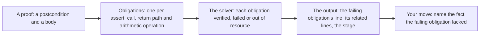
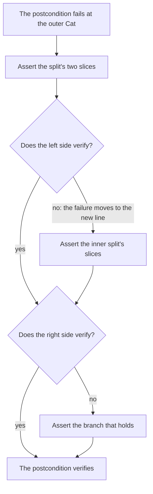

# R05 — No goal state

R02 and R04 gave you the proof moves of this track: a split named by its slices, an existential taken apart with `:|` or `choose`, a claim covering every candidate. Neither verifier shows you a goal state while you make them. There is no window listing the hypotheses and the remaining goal, as an interactive prover has; there is a failing line, sometimes a related line, and a verdict. R05 installs the habits that replace the goal window: read exactly which obligation failed and which definition it reached into, bisect a long failure into a short one, keep a fact's scope small with `assert … by`, isolate obligations so that one failure cannot hide another, use the fast channel while editing and the full gate once, and treat the time and work a proof costs as a measurement with a spread, not a constant.

Every construct below appears first in a small example whose verifier output is printed directly under it, captured on the course pins. R is standalone: use R01, R02, R04 and the declared A1 layer; Python enters the track here, in `harness/r/fvh_r/variance.py`.

**Three ideas do all the work.**

1. **A failure names an obligation, not a goal.** The error line, its related lines and the stage tell you which formula could not be established and which definition the solver was unfolding; the missing fact is yours to find, by adding one assertion at a time.
2. **Scope is a tool.** `assert … by` proves a claim from a local block and exports only the claim; isolation runs each assertion or function in its own solver context. Both make a failure smaller and its cause easier to read.
3. **A run is a sample.** The pinned solver's work count is reproducible for an unchanged input at the pinned seed; the wall time of the same run is not. A measurement needs its population, its sample size and its interval, and an interval about a mean is not a promise about the next run.

---

## 0. How this module works

**Budget: 402 minutes**, including the module viva and excluding contractor wall time. These are planning estimates; record your own.

| setup | read | worked | cards | predictions | holes | Python | variance log | latency log | agent | paper | bench card | viva | calibration | total |
|---|---|---|---|---|---|---|---|---|---|---|---|---|---|---|
| 10 | 65 | 30 | 6 | 12 | 72 | 35 | 30 | 15 | 25 | 45 | 20 | 30 | 7 | **402** |

The hole minutes are 8 for each of H1–H3 and 12 for H4, in either language; the two Python holes are 12 each.

**Predictions.** Commit the four answers below before running their scenarios or opening the card demos, the bank or the rubric. The obligation answers go in the commented slots of `specimens/R05/P1d.dfy.specimen` and `specimens/R05/P2v.rs.specimen`; the two verdicts in `slots/R05.slots`, switched on by the `CHECK` lines of the Dafny file. Respect each printed answer form, then run `scripts/firsttry.sh R05 --check`.

> **Predict (P1) — commit in the file before reading on.** `specimens/R05/P1d.dfy.specimen` holds five labelled asserts about slices of a sequence `s` with `0 <= i <= j <= |s|`: [a] `s[..i] + s[i..j] == s`; [b] `s[j..] == []`; [c] `s[..j][..i] == s[..i]`; [d] `s[i..][..j - i] == s[i..j]`; [e] `s[..i] == []`. No lemma is called. Which fail?

> **Predict (P2) — commit in the file before reading on.** `specimens/R05/P2v.rs.specimen` holds the same five claims over `subrange`, each stated with `=~=`. Which fail?

> **Predict (P3) — commit in the file before reading on.** Ten runs of `scripts/vcheck --json --measures`, one after another, on one verified file (W1 copied into a file of its own; the pinned seed; nothing changed between runs). Across the ten documents, is the `resource_count` field always the same, and is `wall_s`? Answer `D:<same|varies>,<same|varies> V:<same|varies>,<same|varies>`, resource count first.

> **Predict (P4) — commit in the file before reading on.** A file holds two lemmas, the first correct and the second with a false `assert`. What verdict does `scripts/vcheck --symbol` report on the first (Dafny `R05_NoGoalState.First`, Verus `first`)? Answer `D:<v> V:<v>`.

### This module's files

| file | role | shipped state |
|---|---|---|
| `dafny/R/R05_NoGoalState/core/R05_NoGoalState.dfy` | prediction block, worked examples, cards, holes H1d–H4d, the logs block | verified, 4 holes, 0 errors |
| `verus/r/r05_no_goal_state/src/lib.rs` | the paired Verus file | verified, 4 holes, 0 errors |
| `harness/r/fvh_r/variance.py` | the variance log's parser and summary (Python) | 2 holes; its frozen acceptance tests fail as shipped |
| `specimens/R05/`, `slots/R05.slots` | prediction specimens, the fast-channel and timing scenarios, card demos | slots unfilled; demos fail by design |
| `dafny/R/R05_NoGoalState/agent/R05_AgentObligation.dfy` | the obligation prover's file | verified, 2 holes, 0 errors |
| `verus/r/r05_no_goal_state/src/agent.rs` | the paired obligation prover's file | verified, 2 holes, 0 errors |
| `dafny/given/R/RG_A1_Re.dfy`, `verus/given/rg_re_a1/src/lib.rs` | the frozen A1 layer: definitions only | verified; no lemma supplied |
| `paper/R05_problems.tex`, `paper/R05_answers.tex` | the card and two written problems, and your answers | template compiles; answers unfilled |
| `bench/local/r/README.md` | instructions for your fourth local bench card | you create the card |
| `Solutions/`, `paper/solutions/` | references | yours to open LAST, after your attempts, gates and review |

As shipped, the exercise files verify in the learner loop with their holes counted, and the Python file's tests fail at its two holes:

<!-- pin: shipped-d -->
```
$ scripts/vcheck dafny/R/R05_NoGoalState/core
vcheck: dafny/R/R05_NoGoalState/core [dafny, learner loop]: verified — 20 verified, 4 holes, 0 errors
dafny/R/R05_NoGoalState/core/R05_NoGoalState.dfy:87:20: hole bodyless-method R05.H1d
dafny/R/R05_NoGoalState/core/R05_NoGoalState.dfy:103:20: hole bodyless-method R05.H2d
dafny/R/R05_NoGoalState/core/R05_NoGoalState.dfy:117:20: hole bodyless-method R05.H3d
dafny/R/R05_NoGoalState/core/R05_NoGoalState.dfy:139:5: hole assume R05.H4d
```

<!-- pin: shipped-v -->
```
$ scripts/vcheck verus/r/r05_no_goal_state
vcheck: verus/r/r05_no_goal_state [verus, learner loop]: verified — - verified, 4 holes, 0 errors
verus/r/r05_no_goal_state/src/lib.rs:83:40: hole assume R05.H1v
verus/r/r05_no_goal_state/src/lib.rs:101:40: hole assume R05.H2v
verus/r/r05_no_goal_state/src/lib.rs:119:40: hole assume R05.H3v
verus/r/r05_no_goal_state/src/lib.rs:143:40: hole assume R05.H4v
```

<!-- pin: python-shipped -->
```
$ scripts/vcheck harness/r/fvh_r/variance.py
vcheck: harness/r/fvh_r/variance.py [python, learner loop]: failed — 0 passed, 38 failed, 2 holes
harness/r/fvh_r/variance.py:47:1: hole raise-not-implemented R05.H1py
harness/r/fvh_r/variance.py:62:1: hole raise-not-implemented R05.H2py
harness/tests/r/test_variance.py:25: error: tests/r/test_variance.py::test_rows_preserve_order_verdict_null_and_extra_fields: NotImplementedError: R05.H1py
...
```

The excerpt keeps the summary, the two holes and the first test failure; the other 37 failures also stop at `NotImplementedError` from one of the two holes.

---

## 1. Obligations without a goal window

### 1.1 What a failure names

Take a fact that needs two splits named, `Cat(Cat(Chr('o'), Chr('k')), Alt(Chr('x'), Chr('y')))` matching "oky", with an empty body:

```dafny
module R05_ChBisect {
  import opened RG_A1_Re

  lemma OkThenXOrY()
    ensures Matches(Cat(Cat(Chr('o'), Chr('k')), Alt(Chr('x'), Chr('y'))), "oky")
  {
  }
}
```

<!-- pin: bis-0-d -->
```
$ scripts/vcheck --module R05 bis-0.dfy
vcheck: bis-0.dfy [dafny, learner loop]: failed — 5 verified, 0 holes, 1 error
bis-0.dfy:6:3: error: a postcondition could not be proved on this return path
bis-0.dfy:5:20: related: this is the postcondition that could not be proved
dafny/given/R/RG_A1_Re.dfy:21:23: related: this proposition could not be proved
```

Read the three lines from the top. The error is the return path of `OkThenXOrY`: the postcondition was not established when the body ended. The first related line points at the postcondition itself. The second points into A1: line 21 of `RG_A1_Re.dfy` is the `Cat` case of `Matches`, the existential over split points. That is the closest thing to a goal state you get: the solver unfolded `Matches` at the outer `Cat` and could not find a split that makes both sides hold. It does not say which split, or which side failed; that is what you find out next, one fact at a time. Verus reports the same situation with less: the failing `assert` and its line.

```rust
use vstd::prelude::*;
use rg_re_a1::*;

verus! {

proof fn lemma_ok_then_x_or_y() {
    let ok = Re::Cat(Box::new(Re::Chr('o')), Box::new(Re::Chr('k')));
    let xy = Re::Alt(Box::new(Re::Chr('x')), Box::new(Re::Chr('y')));
    let s = seq!['o', 'k', 'y'];
    assert(s.subrange(0, 2) =~= seq!['o', 'k']);
    assert(s.subrange(2, 3) =~= seq!['y']);
    assert(matches(Re::Cat(Box::new(ok), Box::new(xy)), s));
}

} // verus!
```

<!-- pin: bis-0-v -->
```
$ scripts/vcheck --module R05 bis-0.rs
vcheck: bis-0.rs [verus, learner loop]: failed — 0 verified, 0 holes, 1 error
bis-0.rs:12:12: error: assertion failed
```

The subranges of the split are stated and the assertion still fails: Verus unfolds `matches` only where it is mentioned (R02 §2.2), and neither side's `matches` term is. The message names the assertion, and the assertion is yours to break into smaller ones.



Every `assert`, every call's precondition, every return path's postcondition and every bounded operation is a separate obligation, with its own line in the output when it fails. Learning to see a proof as that list, rather than as one statement that is either proved or not, is the first half of working without a goal window.

### 1.2 The slice chain

The facts that most often go missing in this track are slice facts: what a slice of a slice is, and how two slices recombine. P1 and P2 ask which of five such facts the solvers know without help. The Dafny specimen's chain:

```dafny
lemma SliceChainR05(s: seq<char>, i: int, j: int)
  requires 0 <= i <= j <= |s|
{
  assert s[..i] + s[i..j] == s;  // [a]
  assert s[j..] == [];  // [b]
  assert s[..j][..i] == s[..i];  // [c]
  assert s[i..][..j - i] == s[i..j];  // [d]
  assert s[..i] == [];  // [e]
}
```

<!-- pin: obligation-d -->
```
$ scripts/vcheck specimens/R05/P1d.dfy.specimen
vcheck: specimens/R05/P1d.dfy.specimen [dafny, learner loop]: failed — 0 verified, 0 holes, 2 errors
specimens/R05/P1d.dfy.specimen:8:5: error: assertion might not hold
specimens/R05/P1d.dfy.specimen:12:5: error: assertion might not hold
```

```rust
pub proof fn lemma_slice_chain_r05(s: Seq<char>, i: int, j: int)
    requires
        0 <= i <= j <= s.len(),
{
    assert(s.subrange(0, i) + s.subrange(i, j) =~= s);  // [a]
    assert(s.subrange(j, s.len() as int) =~= Seq::<char>::empty());  // [b]
    assert(s.subrange(0, j).subrange(0, i) =~= s.subrange(0, i));  // [c]
    assert(s.subrange(i, s.len() as int).subrange(0, j - i) =~= s.subrange(i, j));  // [d]
    assert(s.subrange(0, i) =~= Seq::<char>::empty());  // [e]
}
```

<!-- pin: obligation-v -->
```
$ scripts/vcheck specimens/R05/P2v.rs.specimen
vcheck: specimens/R05/P2v.rs.specimen [verus, learner loop]: failed — 0 verified, 0 holes, 2 errors
specimens/R05/P2v.rs.specimen:12:12: error: assertion failed
specimens/R05/P2v.rs.specimen:16:12: error: assertion failed
```

The answer is `FAILS a e` in both languages. [c] and [d] are true for every legal `i` and `j`, and both solvers prove them: a slice of a slice is a slice, with the indices added. [a] and [e] are false in general: [a] is missing the tail `s[j..]` (it holds only when `j == |s|`), and [e] says the head is empty, which the precondition does not imply. One counterexample (`s = "abc"`, `i = 1`, `j = 2`) refutes both.

[b] is the instructive one. It is false in general too (`s[j..]` is empty only when `j == |s|`), and yet it verifies. A verifier reports a failed assertion and then *assumes* it for the rest of the path, so that one error does not cascade into many. After [a] fails, the solver knows `s[..i] + s[i..j] == s`, which forces `j == |s|`, and [b] follows. So an assertion that verifies after an earlier failure has verified *under that failure*: in a bisection, fix or remove the first failure before you trust anything after it. The two true facts, [c] and [d], are the ones the holes of this module need over and over: when a proof about a split fails, the first question is which slice of which string you have stated, and which you have assumed.

---

## 2. Bisection

### 2.1 Bisect a failing proof

Bisection finds a missing fact without a goal window. Assert an intermediate claim; if the failure moves to your new line, the claim itself is the next thing to establish; if the old failure persists while your line verifies, the gap is after it. Repeat until each failing line is one step. Here is §1.1's lemma, one fact at a time. First the outer split's two slices:

```dafny
module R05_ChBisect {
  import opened RG_A1_Re

  lemma OkThenXOrY()
    ensures Matches(Cat(Cat(Chr('o'), Chr('k')), Alt(Chr('x'), Chr('y'))), "oky")
  {
    assert "oky"[..2] == "ok";
    assert "oky"[2..] == "y";
  }
}
```

<!-- pin: bis-1-d -->
```
$ scripts/vcheck --module R05 bis-1.dfy
vcheck: bis-1.dfy [dafny, learner loop]: failed — 5 verified, 0 holes, 1 error
bis-1.dfy:6:3: error: a postcondition could not be proved on this return path
bis-1.dfy:5:20: related: this is the postcondition that could not be proved
dafny/given/R/RG_A1_Re.dfy:21:23: related: this proposition could not be proved
```

Both slice facts verify (no error names their lines; they are true, so §1.2's caution about facts after a failure does not arise), and the postcondition still fails at the same `Cat` case. So the split is not the problem; one of its sides is. Assert the left side:

```dafny
module R05_ChBisect {
  import opened RG_A1_Re

  lemma OkThenXOrY()
    ensures Matches(Cat(Cat(Chr('o'), Chr('k')), Alt(Chr('x'), Chr('y'))), "oky")
  {
    assert "oky"[..2] == "ok";
    assert "oky"[2..] == "y";
    assert Matches(Cat(Chr('o'), Chr('k')), "ok");
  }
}
```

<!-- pin: bis-2-d -->
```
$ scripts/vcheck --module R05 bis-2.dfy
vcheck: bis-2.dfy [dafny, learner loop]: failed — 5 verified, 0 holes, 2 errors
bis-2.dfy:6:3: error: a postcondition could not be proved on this return path
bis-2.dfy:5:20: related: this is the postcondition that could not be proved
dafny/given/R/RG_A1_Re.dfy:21:23: related: this proposition could not be proved
bis-2.dfy:9:19: error: assertion might not hold
dafny/given/R/RG_A1_Re.dfy:21:23: related: this proposition could not be proved
```

Now there are two errors, and the new one is on the line you added (line 9), again reaching into the `Cat` case: the left side is itself a `Cat` whose split nobody named. The failure moved inward. Name that split:

```dafny
module R05_ChBisect {
  import opened RG_A1_Re

  lemma OkThenXOrY()
    ensures Matches(Cat(Cat(Chr('o'), Chr('k')), Alt(Chr('x'), Chr('y'))), "oky")
  {
    assert "oky"[..2] == "ok";
    assert "oky"[2..] == "y";
    assert "ok"[..1] == "o";
    assert "ok"[1..] == "k";
    assert Matches(Cat(Chr('o'), Chr('k')), "ok");
  }
}
```

<!-- pin: bis-3-d -->
```
$ scripts/vcheck --module R05 bis-3.dfy
vcheck: bis-3.dfy [dafny, learner loop]: failed — 5 verified, 0 holes, 1 error
bis-3.dfy:6:3: error: a postcondition could not be proved on this return path
bis-3.dfy:5:20: related: this is the postcondition that could not be proved
dafny/given/R/RG_A1_Re.dfy:21:23: related: this proposition could not be proved
```

The inner assertion verifies; the postcondition still fails. Only the right side is left, the `Alt`, and one more line names the branch that holds:

```dafny
module R05_ChBisect {
  import opened RG_A1_Re

  lemma OkThenXOrY()
    ensures Matches(Cat(Cat(Chr('o'), Chr('k')), Alt(Chr('x'), Chr('y'))), "oky")
  {
    assert "oky"[..2] == "ok";
    assert "oky"[2..] == "y";
    assert "ok"[..1] == "o";
    assert "ok"[1..] == "k";
    assert Matches(Cat(Chr('o'), Chr('k')), "ok");
    assert Matches(Chr('y'), "y");
  }
}
```

<!-- pin: bis-4-d -->
```
$ scripts/vcheck --module R05 bis-4.dfy
vcheck: bis-4.dfy [dafny, learner loop]: verified — 6 verified, 0 holes, 0 errors
```

Four runs, each a small question with a definite answer. The Verus version needs every side's `matches` mentioned, as §1.1 found; its bisection ends here:

```rust
use vstd::prelude::*;
use rg_re_a1::*;

verus! {

proof fn lemma_ok_then_x_or_y() {
    let ok = Re::Cat(Box::new(Re::Chr('o')), Box::new(Re::Chr('k')));
    let xy = Re::Alt(Box::new(Re::Chr('x')), Box::new(Re::Chr('y')));
    let s = seq!['o', 'k', 'y'];
    let w = seq!['o', 'k'];
    assert(s.subrange(0, 2) =~= w);
    assert(s.subrange(2, 3) =~= seq!['y']);
    assert(w.subrange(0, 1) =~= seq!['o']);
    assert(w.subrange(1, 2) =~= seq!['k']);
    assert(matches(Re::Chr('o'), w.subrange(0, 1)));
    assert(matches(Re::Chr('k'), w.subrange(1, 2)));
    assert(matches(ok, s.subrange(0, 2)));
    assert(matches(Re::Chr('y'), s.subrange(2, 3)));
    assert(matches(xy, s.subrange(2, 3)));
    assert(matches(Re::Cat(Box::new(ok), Box::new(xy)), s));
}

} // verus!
```

<!-- pin: bis-4-v -->
```
$ scripts/vcheck --module R05 bis-4.rs
vcheck: bis-4.rs [verus, learner loop]: verified — 1 verified, 0 holes, 0 errors
```

The Dafny bisection as a tree: each question is one run, and each answer picks the next fact to assert.



A cheaper probe than a new assertion is `assert false;` at a point: if the error moves to it, everything before it verified and the gap is after it. Remove it before you go on; a forgotten `assert false` that verifies means the code after it is unreachable, which is its own bug.

### 2.2 Facts per line

When a proof verifies, each line still has a reason to be there or not. The worked example W1 relates a suffix of `s` to its first element and the rest, with one fact per line:

```dafny
lemma SliceBridge(s: seq<char>, i: int)
  requires 0 <= i < |s|
  ensures s[i..] == [s[i]] + s[i + 1..]
{
  var tail := s[i..];
  assert |tail| > 0;
  assert tail[0] == s[i];
  assert tail[1..] == s[i + 1..];
  assert tail == [tail[0]] + tail[1..];
  assert s[i..] == [s[i]] + s[i + 1..];
}
```

```rust
pub proof fn lemma_slice_bridge(s: Seq<char>, i: int)
    requires
        0 <= i < s.len(),
    ensures
        s.subrange(i, s.len() as int) == seq![s[i]] + s.subrange(i + 1, s.len() as int),
{
    let tail = s.subrange(i, s.len() as int);
    assert(tail.len() > 0);
    assert(tail[0] == s[i]);
    assert(tail.drop_first() =~= s.subrange(i + 1, s.len() as int));
    assert(tail =~= seq![tail[0]] + tail.drop_first());
    assert(s.subrange(i, s.len() as int) == seq![s[i]] + s.subrange(i + 1, s.len() as int));
}
```

The `var` (Verus `let`) is a binding, not a fact: it names `s[i..]` so that later lines can talk about it. Each `assert` is an obligation discharged at its line and a fact for every later one. Some of these lines may be unnecessary for the solver; a deletion experiment in a scratch copy tells you which, and §8's written problem B2 asks you to separate that solver observation from the logical dependency. At this module's bar (`proof-shape`), keep the lines a reader needs to follow the argument, and delete the ones that neither the solver nor a reader uses.

---

## 3. Scope and isolation

### 3.1 `assert … by` keeps its facts local

`assert P by { … }` proves `P` from the block and makes only `P` available afterwards; whatever the block establishes or reveals stays inside it. The card C1 (WRITE in Dafny, RECOGNISE in Verus; see the end of this section) has demos that put a false fact inside the block:

```dafny
module R05_AssertScopeCard {
  lemma ScopeR05(n: int)
  {
    assert n + 2 > n by {
      assert false;
    }
  }
}
```

<!-- pin: assert-by-d -->
```
$ scripts/vcheck specimens/R05/card-c1d.dfy.specimen
vcheck: specimens/R05/card-c1d.dfy.specimen [dafny, learner loop]: failed — 0 verified, 0 holes, 1 error
specimens/R05/card-c1d.dfy.specimen:5:7: error: assertion might not hold
```

```rust
pub proof fn lemma_scope_r05(n: int) {
    assert(n + 2 > n) by {
        assert(false);
    }
}
```

<!-- pin: assert-by-v -->
```
$ scripts/vcheck specimens/R05/card-c1v.rs.specimen
vcheck: specimens/R05/card-c1v.rs.specimen [verus, learner loop]: failed — 0 verified, 0 holes, 1 error
specimens/R05/card-c1v.rs.specimen:7:16: error: assertion failed
```

The block's own obligations are checked: `assert false` fails inside it, so a `by` block is not a place to hide an assumption. The other half of the rule, that a fact established inside stays inside, shows with an opaque definition revealed only in the block:

```dafny
module R05_ChByLocal {
  opaque function Five(): int
  {
    5
  }

  lemma ByIsLocal()
  {
    assert Five() > 0 by {
      reveal Five();
    }
    assert Five() == 5;
  }
}
```

<!-- pin: by-local-d -->
```
$ scripts/vcheck --module R05 by-local.dfy
vcheck: by-local.dfy [dafny, learner loop]: failed — 5 verified, 0 holes, 1 error
by-local.dfy:12:5: error: assertion might not hold
```

```rust
use vstd::prelude::*;

verus! {

#[verifier::opaque]
spec fn five() -> int {
    5
}

proof fn by_is_local() {
    assert(five() > 0) by {
        reveal(five);
    }
    assert(five() == 5);
}

} // verus!
```

<!-- pin: by-local-v -->
```
$ scripts/vcheck --module R05 by-local.rs
vcheck: by-local.rs [verus, learner loop]: failed — 0 verified, 0 holes, 1 error
by-local.rs:14:12: error: assertion failed
```

The `by` assertion verifies, and the assertion after it fails: the reveal did its work inside the block and nowhere else. That is the point of the construct. A proof whose facts are scoped to where they are needed gives the solver fewer facts to search everywhere else, and a failure inside a block is a failure about that block's claim only. R05 measured that cost on its own holes: Dafny's reference proof of H2 runs out of resource at the pinned limit when its one `by` block is written as a plain `assert`, while every other R05 proof, and every shortest proof found, verifies without one. So the construct is WRITE in Dafny, where H2 uses it, and RECOGNISE in Verus, where no hole needs it (the user's decision D85).

### 3.2 Isolating obligations

By default a verifier may check several obligations of one declaration in one solver run, so one hard or false obligation can slow or obscure the others. Dafny's `@IsolateAssertions` gives each assertion its own run; Verus's `#[verifier::spinoff_prover]` gives a function its own solver process; `scripts/vcheck --isolate` applies the same split to a whole run. The RECOGNISE cards C2 and C3 have one true and one false assertion each:

```dafny
module R05_IsolationCard {
  @IsolateAssertions
  lemma IsolateR05(n: int)
  {
    assert n + 1 > n;
    assert n == 0;
  }
}
```

<!-- pin: isolate-d -->
```
$ scripts/vcheck specimens/R05/card-c2d.dfy.specimen
vcheck: specimens/R05/card-c2d.dfy.specimen [dafny, learner loop]: failed — 1 verified, 0 holes, 1 error
specimens/R05/card-c2d.dfy.specimen:6:5: error: assertion might not hold
```

```rust
#[verifier::spinoff_prover]
pub proof fn lemma_spinoff_r05(n: int) {
    assert(n + 1 > n);
    assert(n == 0);
}
```

<!-- pin: spinoff-v -->
```
$ scripts/vcheck specimens/R05/card-c3v.rs.specimen
vcheck: specimens/R05/card-c3v.rs.specimen [verus, learner loop]: failed — 0 verified, 0 holes, 1 error
specimens/R05/card-c3v.rs.specimen:8:12: error: assertion failed
```

Each names exactly the false assertion. Isolation changes how the obligations are checked, never which: an isolated proof proves the same claims, and a claim that needed a fact established by an earlier assertion still gets it, because assertions earlier on the path remain facts. Use isolation to diagnose (which obligation is slow, which fails). H1 and H4 carry the attribute as a given lever; neither proof needs it to verify, which is why the constructs are RECOGNISE in R05 (D85). W2 shows both constructs on a small lemma:

```dafny
@IsolateAssertions
lemma ScopedArithmetic(n: int)
  requires n >= 0
  ensures n + 3 > n
{
  assert n + 1 > n by {
    assert 1 > 0;
  }
  assert n + 3 > n;
}
```

```rust
#[verifier::spinoff_prover]
pub proof fn lemma_scoped_arithmetic(n: int)
    requires
        n >= 0,
    ensures
        n + 3 > n,
{
    assert(n + 1 > n) by {
        assert(1 > 0);
    }
    assert(n + 3 > n);
}
```

---

## 4. The fast channel and the final gate

### 4.1 One symbol, one file, one gate

`scripts/vcheck --symbol <name> <file>` verifies one declaration and reports on it alone; it is the per-edit loop for a proof in a large file. P4's scenario holds a correct lemma and a false one:

```dafny
module R05_NoGoalState {
  lemma First(n: int)
    ensures n + 1 > n
  {
  }

  lemma Second()
  {
    assert false;
  }
}
```

<!-- pin: fast-d -->
```
$ scripts/vcheck --symbol R05_NoGoalState.First specimens/R05/fast-channel-d.dfy.specimen
vcheck: specimens/R05/fast-channel-d.dfy.specimen [dafny, fast channel R05_NoGoalState.First]: verified — 1 verified, 0 holes, 0 errors
symbol R05_NoGoalState.First: verified
```

```rust
pub proof fn first(n: int)
    ensures
        n + 1 > n,
{
}

pub proof fn second() {
    assert(false);
}
```

<!-- pin: fast-v -->
```
$ scripts/vcheck --symbol first specimens/R05/fast-channel-v.rs.specimen
vcheck: specimens/R05/fast-channel-v.rs.specimen [verus, fast channel first]: verified — 1 verified, 0 holes, 0 errors
symbol first: verified
```

The answer is `D:ok V:ok`: the selected symbol verifies, and the fast channel says nothing about `Second`. The same file in the ordinary learner loop:

<!-- pin: whole-d -->
```
$ scripts/vcheck specimens/R05/fast-channel-d.dfy.specimen
vcheck: specimens/R05/fast-channel-d.dfy.specimen [dafny, learner loop]: failed — 1 verified, 0 holes, 1 error
specimens/R05/fast-channel-d.dfy.specimen:10:5: error: assertion might not hold
```

<!-- pin: whole-v -->
```
$ scripts/vcheck specimens/R05/fast-channel-v.rs.specimen
vcheck: specimens/R05/fast-channel-v.rs.specimen [verus, learner loop]: failed — 1 verified, 0 holes, 1 error
specimens/R05/fast-channel-v.rs.specimen:13:12: error: assertion failed
```

Both fail, at `Second`'s assertion. A fast-channel `verified` is a statement about one symbol under the file's other declarations as given; it is never a statement about the file. Dafny qualifies the symbol by its module (`R05_NoGoalState.First`); Verus takes the function's name. A "symbol not found" result is a tooling error to fix, not a quick pass. The gate refuses a symbol filter: it checks the whole unit, requires zero counted holes, and is the only verdict a delivery is judged by.

### 4.2 The latency ladder

Each loop costs time, and the cheaper ones see less. On the course host, for R05's small scenario files, the fast channel and the whole-file loop each take about one to two seconds (§6.1's ten runs: about 1.0 s in Dafny, 1.7 s in Verus), and the gate the same plus its completion checks; on a module with heavy proofs the gap opens to minutes, which is when the fast channel pays for itself. Measure on your own proofs: the LATENCY block asks for several fast-channel and gate timings on one finished proof, with the commands, the order you ran them in (a warm cache makes a second run faster), and what the clock includes (process start-up, compilation, the solver).


Do not report one small timing divided by one large one as a speedup: two single runs have no spread, and the ratio of two noisy numbers is noisier than either. The obligation prover's contract (§10) makes the ladder a rule: fast channel only between edits, exactly one gate, last.

---

## 5. Resource limits and verdict kinds

The course pins how much work each solver may do: Dafny's `--resource-limit 5000000`, Verus's `--rlimit 2`. These bound solver *work*, not wall time or memory. An obligation that exhausts its budget is neither proved nor refuted, and the wrapper reports `inconclusive`. The Rosetta card C4 names the per-declaration overrides, Dafny's `{:resource_limit N}` and Verus's `#[verifier::rlimit(N)]`. Here is §1.1's kind of proof, complete and correct, under a deliberately tiny budget:

```dafny
module R05_ChBudget {
  import opened RG_A1_Re

  lemma {:resource_limit 1000} TinyBudget(s: seq<char>)
    requires Matches(Cat(Chr('q'), Star(Chr('r'))), s)
    ensures |s| >= 1 && s[0] == 'q'
  {
    var i :| 0 <= i <= |s| && Matches(Chr('q'), s[..i]) && Matches(Star(Chr('r')), s[i..]);
    assert s[..i] == ['q'];
    assert s[0] == s[..i][0];
  }
}
```

<!-- pin: rlimit-d -->
```
$ scripts/vcheck --module R05 rlimit.dfy
vcheck: rlimit.dfy [dafny, learner loop]: inconclusive — 5 verified, 0 holes, 1 error
rlimit.dfy:4:32: error: Verification out of resource (R05_ChBudget.TinyBudget)
```

```rust
use vstd::prelude::*;
use rg_re_a1::*;

verus! {

#[verifier::rlimit(0.001)]
proof fn lemma_tiny_budget(s: Seq<char>)
    requires
        matches(Re::Cat(Box::new(Re::Chr('q')), Box::new(Re::Star(Box::new(Re::Chr('r'))))), s),
    ensures
        s.len() >= 1 && s[0] == 'q',
{
    let i = choose|i: int|
        0 <= i <= s.len() && matches(Re::Chr('q'), #[trigger] s.subrange(0, i)) && matches(
            Re::Star(Box::new(Re::Chr('r'))),
            s.subrange(i, s.len() as int),
        );
    assert(s.subrange(0, i).len() == 1);
    assert(s.subrange(0, i)[0] == 'q');
}

} // verus!
```

<!-- pin: rlimit-v -->
```
$ scripts/vcheck --module R05 rlimit.rs
vcheck: rlimit.rs [verus, learner loop]: inconclusive — 0 verified, 0 holes, 1 error
rlimit.rs:7:7: error: function body check: Resource limit (rlimit) exceeded; consider rerunning with --profile for more details
```

Both are `inconclusive`: the summary word says so, and the message is an out-of-resource report, not a failed assertion. The same proofs verify at the course's limits. So an inconclusive result tells you about the budget and the solver's search, not about the claim; the course's response is to make the proof cheaper (a missing fact, an isolated obligation), never to raise the limit, which the done gate does not accept and the freeze reports. A process killed for memory (exit 137 or 143) is not a verdict of any kind.

| verdict | the obligations | licenses |
|---|---|---|
| `verified` | every obligation that ran holds | the file's claims, at these settings, with its counted holes |
| `failed` | at least one obligation is not established, or a stage refused the program | a fact is missing, a claim is false, or the program is ill-formed: read which |
| `inconclusive` | at least one ran out of its budget, none failed | nothing about the claim; something about the cost |
| killed | the process was stopped | nothing at all |

---

## 6. Measuring repeated runs

### 6.1 Ten runs of one proof

`scripts/vcheck --json --measures` prints one JSON document per run, with the usual verdict and counts plus `resource_count` (the solver's work, in the tool's own unit) and `wall_s` (the elapsed seconds of this invocation). P3 asks which of the two repeats over ten runs of the unchanged W1 copy. The timing specimens verify:

<!-- pin: timing-d -->
```
$ scripts/vcheck specimens/R05/timing-d.dfy.specimen
vcheck: specimens/R05/timing-d.dfy.specimen [dafny, learner loop]: verified — 2 verified, 0 holes, 0 errors
```

<!-- pin: timing-v -->
```
$ scripts/vcheck specimens/R05/timing-v.rs.specimen
vcheck: specimens/R05/timing-v.rs.specimen [verus, learner loop]: verified — 1 verified, 0 holes, 0 errors
```

and the author's ten runs of each, recorded on the course host with the two fields taken from each run's JSON document, are:

<!-- pin: runs10-d -->
```
$ for n in 1 2 3 4 5 6 7 8 9 10; do scripts/vcheck --json --measures specimens/R05/timing-d.dfy.specimen; done
run  1: verdict verified, resource_count 136772, wall_s 0.922
run  2: verdict verified, resource_count 136772, wall_s 0.979
run  3: verdict verified, resource_count 136772, wall_s 0.971
run  4: verdict verified, resource_count 136772, wall_s 0.975
run  5: verdict verified, resource_count 136772, wall_s 1.024
run  6: verdict verified, resource_count 136772, wall_s 0.998
run  7: verdict verified, resource_count 136772, wall_s 0.978
run  8: verdict verified, resource_count 136772, wall_s 0.918
run  9: verdict verified, resource_count 136772, wall_s 0.984
run 10: verdict verified, resource_count 136772, wall_s 0.979
```

<!-- pin: runs10-v -->
```
$ for n in 1 2 3 4 5 6 7 8 9 10; do scripts/vcheck --json --measures specimens/R05/timing-v.rs.specimen; done
run  1: verdict verified, resource_count 38681, wall_s 1.731
run  2: verdict verified, resource_count 38681, wall_s 1.686
run  3: verdict verified, resource_count 38681, wall_s 1.751
run  4: verdict verified, resource_count 38681, wall_s 1.744
run  5: verdict verified, resource_count 38681, wall_s 1.734
run  6: verdict verified, resource_count 38681, wall_s 1.741
run  7: verdict verified, resource_count 38681, wall_s 1.744
run  8: verdict verified, resource_count 38681, wall_s 1.783
run  9: verdict verified, resource_count 38681, wall_s 1.75
run 10: verdict verified, resource_count 38681, wall_s 1.754
```

The answer is `D:same,varies V:same,varies`. At the pinned seed and options, the solver performs the same search on the same input, so its work count is a property of the proof; the wall time is a property of the run, and moves with host load, caches and scheduling. The divergence card C5 is the same observation on a trivial lemma in each language:

```dafny
module R05_RepeatedTimingCard {
  lemma TimingIdentityR05(n: int)
    ensures n + 2 > n
  {
  }
}
```

<!-- pin: divergence-d -->
```
$ scripts/vcheck specimens/R05/card-c5dv-d.dfy.specimen
vcheck: specimens/R05/card-c5dv-d.dfy.specimen [dafny, learner loop]: verified — 1 verified, 0 holes, 0 errors
```

<!-- pin: divergence-v -->
```
$ scripts/vcheck specimens/R05/card-c5dv-v.rs.specimen
vcheck: specimens/R05/card-c5dv-v.rs.specimen [verus, learner loop]: verified — 1 verified, 0 holes, 0 errors
```

Two cautions. A different seed, option, input or toolchain is a different experiment: a resource count does not transfer across that boundary, and R14 measures how much it moves when the seed changes. And "the same over ten runs" is an observation about ten runs, not a theorem; the course records it with its sample.

### 6.2 The variance log in Python

The variance log is ten runs of `scripts/vcheck --json --measures` on your finished H1d and ten on H1v, appended one document per line to `research/r05/variance.jsonl`, then summarised by the two Python holes in `harness/r/fvh_r/variance.py`. `runs_from_log` (H1py) parses the log into `TimingRun` rows, keeping every row and its verdict in order and refusing a malformed line with its one-based number; `variance_summary` (H2py) computes, for one numeric field, the number of runs, the mean, the coefficient of variation (CV, the sample standard deviation divided by the mean) and a 95 % bootstrap interval of the mean, by composing the standard library's `statistics.fmean` and `statistics.stdev` with the frozen `fvh.stats.bootstrap_ci`. A bootstrap interval resamples the observed values with replacement many times, takes the mean of each resample, and reports the central 95 % of those means. The frozen acceptance tests (`harness/tests/r/test_variance.py`) run through the wrapper, and as shipped they fail at the two holes (§0). The file's docstring is the contract: `null` means unavailable and is never zero, a Boolean is not a measurement, an empty file gives `[]`, and a failed run is kept, not dropped.

### 6.3 What an interval licenses

A 95 % bootstrap interval of the mean of ten timings estimates where the mean of this process's timings lies, under the assumption that the ten runs are independent draws from one distribution. It is not an interval for the next run (individual runs spread wider than their mean does), not a promise that 95 % of future runs fall inside it, and not evidence that the proof is correct. Ten consecutive runs on one host are also correlated: a warm cache or a background job moves several of them together, which makes the interval narrower than it should be. The five-line note in `research/r05/NOTES.md` states n, the interval, the field, the selection rule if you dropped anything, and one sentence on what the interval does and does not license. R07's pass@k, R12's Lab α and R14's seed sweeps build on this vocabulary.

---

## 7. What the instruments can and cannot see

Run the gate and the audit on the shipped units and read why they refuse:

<!-- pin: gate-d -->
```
$ scripts/vcheck --gate dafny/R/R05_NoGoalState/core
vcheck: dafny/R/R05_NoGoalState/core [dafny, gate]: failed — 20 verified, 4 holes, 0 errors, 1 finding
dafny/R/R05_NoGoalState/core/R05_NoGoalState.dfy:87:20: hole bodyless-method R05.H1d
dafny/R/R05_NoGoalState/core/R05_NoGoalState.dfy:103:20: hole bodyless-method R05.H2d
dafny/R/R05_NoGoalState/core/R05_NoGoalState.dfy:117:20: hole bodyless-method R05.H3d
dafny/R/R05_NoGoalState/core/R05_NoGoalState.dfy:139:5: hole assume R05.H4d
dafny/R/R05_NoGoalState/core: warnings-fail-gate: warnings fail the gate (W-D04): holes and every other warning must be gone
```

<!-- pin: gate-v -->
```
$ scripts/vcheck --gate verus/r/r05_no_goal_state
vcheck: verus/r/r05_no_goal_state [verus, gate]: failed — - verified, 4 holes, 1 error
verus/r/r05_no_goal_state/src/lib.rs:83:40: hole assume R05.H1v
verus/r/r05_no_goal_state/src/lib.rs:101:40: hole assume R05.H2v
verus/r/r05_no_goal_state/src/lib.rs:119:40: hole assume R05.H3v
verus/r/r05_no_goal_state/src/lib.rs:143:40: hole assume R05.H4v
(no file): error: gate: 'success' is false, not true; --output-json lacks 'is-verifying-entire-crate'; 'encountered-vir-error' is true, not false; --output-json lacks 'verified'; 4 hole(s); exit 1
```

<!-- pin: audit-d -->
```
$ scripts/vaudit dafny/R/R05_NoGoalState/core
dafny/R/R05_NoGoalState/core/R05_NoGoalState.dfy:85: audit-bodyless-ghost — CatAssocLR: Ghost declaration has no body and has an ensures clause
dafny/R/R05_NoGoalState/core/R05_NoGoalState.dfy:101: audit-bodyless-ghost — CatAssocRL: Ghost declaration has no body and has an ensures clause
dafny/R/R05_NoGoalState/core/R05_NoGoalState.dfy:115: audit-bodyless-ghost — StarThrice: Ghost declaration has no body and has an ensures clause
dafny/R/R05_NoGoalState/core/R05_NoGoalState.dfy:139: audit-assume — StarConcat: Definition has `assume` statement in body
vaudit: dafny/R/R05_NoGoalState/core [dafny, learner]: 4 finding(s)
```

<!-- pin: audit-v -->
```
$ scripts/vaudit verus/r/r05_no_goal_state
verus/r/r05_no_goal_state/src/lib.rs:83: hole-assume — an assume hole (in lemma_cat_assoc_lr) not on the trust allowlist
verus/r/r05_no_goal_state/src/lib.rs:101: hole-assume — an assume hole (in lemma_cat_assoc_rl) not on the trust allowlist
verus/r/r05_no_goal_state/src/lib.rs:119: hole-assume — an assume hole (in lemma_star_thrice) not on the trust allowlist
verus/r/r05_no_goal_state/src/lib.rs:143: hole-assume — an assume hole (in lemma_star_concat) not on the trust allowlist
vaudit: verus/r/r05_no_goal_state [verus, learner]: 4 finding(s)
```

The statement freeze checks the statements, H4's given skeleton (its case split, its choice of the first chunk and its measure) and the levers, including `@IsolateAssertions` and `#[verifier::spinoff_prover]`:

<!-- pin: freeze -->
```
$ scripts/specfreeze --check R05
specfreeze: R05: 0 finding(s)
```

| instrument | what it establishes | what it cannot see |
|---|---|---|
| a failing line and its related lines | which obligation failed and which definition it reached | the missing fact; the goal |
| `scripts/vcheck --symbol` (fast channel) | one symbol's obligations | every other symbol of the file |
| `scripts/vcheck --isolate`, `@IsolateAssertions`, `spinoff_prover` | each obligation's own verdict and cost | nothing new about which claims hold |
| `scripts/vcheck --gate` | the whole unit verified, zero counted holes, no warning | the prose; how many edits it took |
| `scripts/vcheck --json --measures` | one run's verdict, work count and wall time | the next run's wall time |
| a bootstrap interval | the uncertainty of a sample's mean | the next run; correlation between runs; correctness |
| `scripts/vaudit`, `scripts/specfreeze --check R05` | assumptions; unchanged statements, skeleton and levers | whether a fact you added was needed |

A measurement and a proof are different kinds of evidence. The gate's verdict holds for every input of the stated claims; a timing summary holds for the runs you made, under the conditions you held fixed. Keep the two in separate sentences of every report.

---

## 8. On paper, before the keyboard

The written track has three problems, fifteen minutes each, in `paper/R05_problems.tex`; answer in `paper/R05_answers.tex`, keeping its labels. Record all predictions first.

**B1, card 06.3, *Agentic Proof Automation: A Case Study*.** Fill the eight fields from the pinned source range, whose hash the problem prints. The paper's agents run the edit, compile, refine loop on compiler feedback alone: the loop of §2, with an agent in your place. Keep its success figures with their task denominator and assistance policy; say so when the source gives no cost breakdown or variance, and do not substitute the number of checks run for a budget.

**B2, facts per line.** For the printed five-line proof, give the fact each line introduces, why it is justified, and which later line uses it; separate the binding from the asserted facts, as §2.2 does. Then say what a deletion experiment could show (that the solver did not need a line) and what it could not (that the argument does not depend on it), and what is available after an `assert … by` block (§3.1).

**B3, first intervals by hand.** For the printed five timings, compute the mean, the sample standard deviation and the CV; then the means of the five prescribed resamples and their 2.5th and 97.5th percentiles by the printed interpolation rule. Five resamples are a teaching calculation, not `fvh.stats`'s default budget. Then correct the printed claim about "the next run" with §6.3's distinction.

Build the pair with `make -C paper paper`. A compiled answers file shows that it builds, not that its claims hold. `/grade-paper R05` runs in a fresh examiner session after you have written the answers.

**The fourth local bench card** (20 minutes) continues your collection under `bench/local/r/`; follow its README. Choose a small proof of your own that needs at least two facts a solver lacks, so that its stripped version is a bisection exercise; keep the commands and outputs of your own bisection beside the five artifacts.

---

## 9. The exercise file

The hand work is four paired holes and two Python holes. Keep the statements, H4's given skeleton, the levers and the frozen tests fixed; the freeze checks them.

| item | statement (Dafny · Verus) | minutes D / V | uses |
|---|---|---|---|
| H1 | `CatAssocLR` · `lemma_cat_assoc_lr`: a match of `Cat(Cat(a, b), c)` is a match of `Cat(a, Cat(b, c))` | 8 / 8 | two splits taken and one built (isolation given) |
| H2 | `CatAssocRL` · `lemma_cat_assoc_rl`: the converse | 8 / 8 | the index shift; in Dafny, an `assert … by` that keeps the proof within budget (§3.1) |
| H3 | `StarThrice` · `lemma_star_thrice`: if `a` matches `u`, `Star(a)` matches `u + u + u` | 8 / 8 | one match as each chunk of a star, built from the back |
| H4 | `StarConcat` · `lemma_star_concat`: two star matches concatenate (bisect and repair) | 12 / 12 | bisection, the recursive call, slice facts about `u + v` |
| H1py | `runs_from_log`: parse the variance log | 12 | the docstring's row schema |
| H2py | `variance_summary`: n, mean, CV, a bootstrap interval | 12 | `statistics`, `fvh.stats.bootstrap_ci` |

Each hole's doc comment states the task and asks one guiding question; two hints follow it in the file. **The hint dial:** read the question, try, run the fast channel or the learner loop and read the diagnostic before you read `Hint(1)`; `Hint(2)` names the fact or construct to use, never the answer; `/tutor R05` comes after both. H4 is an annotation hole: its case split, its choice of the first chunk and its measure are given and frozen, and you add the recursive call and the facts in the marked places only. R05's Dafny unit runs with manual lemma induction, so the call you add is its only induction hypothesis (the user's decision D84 left it to you, so that H4 asks at least three lines of you in both languages). Do not raise a resource limit or add an assumption to get past an obligation.

```bash
scripts/firsttry.sh R05 --check
scripts/vcheck --symbol R05_NoGoalState.CatAssocLR dafny/R/R05_NoGoalState/core/R05_NoGoalState.dfy
scripts/vcheck --gate dafny/R/R05_NoGoalState/core
scripts/vcheck --gate verus/r/r05_no_goal_state
scripts/vcheck --gate harness/r/fvh_r/variance.py
scripts/vaudit dafny/R/R05_NoGoalState/core
scripts/vaudit verus/r/r05_no_goal_state
scripts/specfreeze --check R05
scripts/firsttry.sh R05 --report --strict
```

**Done:** both units and the Python file gate with zero tool-counted holes, both audits are clean, `scripts/specfreeze --check R05` reports 0 findings, and the strict report shows the predictions recorded with every shipped check kept. The variance log and its note, the LATENCY block, the agent exercise, the written pair, the bench card and the viva are further deliverables of the module.

---

## 10. Exercise (agentic): obligation prover

The agent files state two lemmas about `Star` and `Cat` that need helper facts the contractor must find without a goal view, verifying against A1 alone (no call into your exercise file). The contract restricts the loop to the fast channel between edits and one final gate. As shipped, both files verify with their two holes counted:

<!-- pin: agent-d -->
```
$ scripts/vcheck dafny/R/R05_NoGoalState/agent/R05_AgentObligation.dfy
vcheck: dafny/R/R05_NoGoalState/agent/R05_AgentObligation.dfy [dafny, learner loop]: verified — 5 verified, 2 holes, 0 errors
dafny/R/R05_NoGoalState/agent/R05_AgentObligation.dfy:23:20: hole bodyless-method R05.A1d
dafny/R/R05_NoGoalState/agent/R05_AgentObligation.dfy:27:20: hole bodyless-method R05.A1d
```

<!-- pin: agent-v -->
```
$ scripts/vcheck verus/r/r05_no_goal_state/src/agent.rs
vcheck: verus/r/r05_no_goal_state/src/agent.rs [verus, learner loop]: verified — - verified, 2 holes, 0 errors
verus/r/r05_no_goal_state/src/agent.rs:25:40: hole assume R05.A1v
verus/r/r05_no_goal_state/src/agent.rs:34:40: hole assume R05.A1v
```

> **CONTRACT (for /contract R05 — run it in a FRESH session):**
> goal — prove both supplied lemmas, preserving every statement; allowed-files — the one selected agent file; acceptance — per edit only the fast channel `scripts/vcheck --symbol <name> <file>`, recording each command, verdict and elapsed time; exactly one full `scripts/vcheck --gate <file>` run, last, exit 0 with zero counted holes; `scripts/vaudit <file>` reports no finding; `scripts/specfreeze --against <snapshot> <file>` reports no statement change; no assumption, weakened guarantee, strengthened input or filtered final verification; stop and report if the final gate fails. Read the file's CONTRACT header before starting; it is the binding text.

**Steps.** (1) Save the original agent file outside the delivery as a snapshot. (2) Run `/contract R05` in a fresh session per language, under your R-v0 rules. (3) From the transcript, count fast-channel calls and failed obligations per lemma, and note what the contractor added: assertions, helper lemmas. (4) For each addition, delete it in a scratch copy and re-run: was it needed? (5) Fill the OBLIGATION LOG block, with the one final gate's command, exit and time.

### What the dashboard can and cannot see

The final gate sees the delivered file: verified or not, holes or not. It cannot see how the contractor got there: whether every intermediate run was the fast channel, whether a second gate was spent and hidden, or whether an added helper was needed. Those are properties of the transcript, which only you read. A fast-channel `verified` in the transcript is evidence about one symbol at one moment, and a sequence of them is not a gate. If the contractor's one gate fails, the honest report is an unfinished delivery within the budget, not a second gate run: the contract makes the gate's cost part of the experiment, and the OBLIGATION LOG is where that cost is recorded.

---

## Instructor touchpoints

- **`/tutor R05`** (long-lived, one session per module): after an attempt, with the exact diagnostic and the facts you have already asserted; it follows the hint dial and never writes a hole's body.
- **`/discuss R05`**: reading an obligation, bisection, scope, and what a measurement licenses.
- **`/review`**: when the banner says items are due; it revisits your ledger and does not erase a first try.
- **`/viva R05`** (fresh examiner session): six questions from the bank, at least one a live predict refereed by the verifier; the other draw is the re-viva.
- **`/grade-paper R05`** (fresh examiner session): after your answers are written.
- **`/review-code R05`** (fresh examiner session) at the `proof-shape` bar: one fact per line, scopes as small as the proof allows, no fact neither the solver nor a reader uses.
- **`/contract R05`** (fresh contractor session, per language): §10.
- **Solutions last:** compare with `Solutions/` and `paper/solutions/` only after your attempts, gates, review and viva; then finish CALIBRATION and record it with `scripts/firsttry.sh R05 --record`.

---

## What R05 planted

| planted here | harvested in |
|---|---|
| obligations as data: the failing line, its related lines, the stage | R12 (the obligation extractor) |
| bisection, one fact per line | R06 (loop invariants found by bisection), every later proof |
| `assert … by` scope and isolation | R14 (proof splitting, matching loops) |
| the fast channel against the gate; the latency ladder | R12 (the verifier loop's cost), R15 |
| a resource count is reproducible at a pinned seed; a wall time is a sample | R14 (seed sweeps, CV), R12 (Lab α's budget axis) |
| a bootstrap interval of a mean, and what it does not license | R07 (pass@k and `EVAL.md` R-v0), R12 (Lab α's statistics) |

R06 brings induction to strings and regexes: lemmas whose recursive calls you write, loops whose invariants you find, and the first checkpoint.
