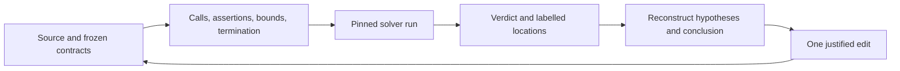
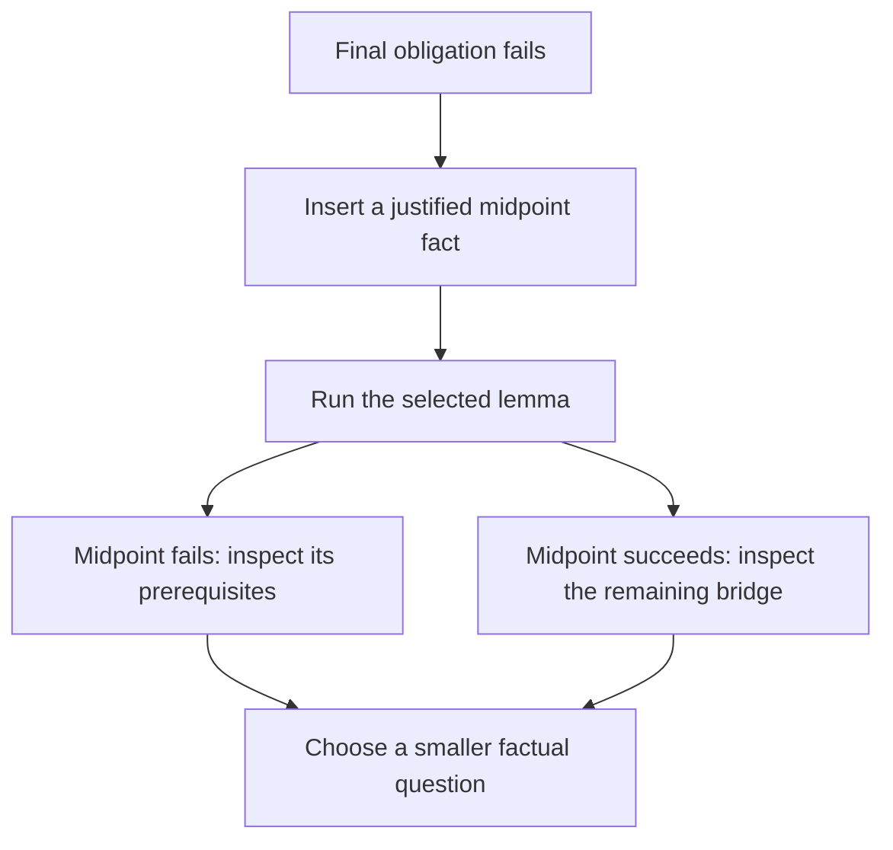

# R05 — No goal state

Three ideas do all the work:

1. An error identifies an obligation that the current proof did not establish. Reconstruct its assumptions and conclusion from the program; the message does not supply an interactive goal state.
2. A small, selected verification run is useful feedback during an edit. Completion needs the complete, unfiltered gate and an assumption audit against unchanged statements.
3. Solver work and elapsed time describe a particular experiment. Repeated measurements and a stated sampling procedure make their uncertainty visible; a single fast run does not establish a performance advantage.

## 0. How this module works

R05 takes 402 minutes: setup 10, reading 65, worked examples and WRITE cards 30, other cards 6, predictions 12, eight formal holes 72, Python 35, variance log 30, latency log 15, agent 25, written work 45, bench card 20, viva 30 and calibration 7. These are planning estimates; record your actual times. There is no test-out or Q-credit waiver here. The measurement work introduces Python in the R track, even if you already used Python in Q.

Use only frozen A1. Earlier learner solutions are not dependencies: an unfinished R02 or parked R03 does not change the code this module verifies. A1b contains later re-supplied facts and is outside this module's layer. Do not import it to finish these holes. Keep proofs you develop here in the files that own them.

**This module's files** are listed below. A typed hole can produce a green learner-loop result; the gate still rejects it. The Python acceptance suite also rejects its two unfinished functions.

| path | role and shipping state |
|---|---|
| `dafny/R/R05_NoGoalState/core/R05_NoGoalState.dfy` | exercise: verified, 4 holes, 0 errors |
| `verus/r/r05_no_goal_state/src/lib.rs` | exercise: verified, 4 holes, 0 errors |
| `harness/r/fvh_r/variance.py` | learner Python: 2 holes; acceptance deliberately fails until completed |
| `dafny/R/R05_NoGoalState/agent/R05_AgentObligation.dfy` | agent: verified, 2 holes, 0 errors; RED at the gate |
| `verus/r/r05_no_goal_state/src/agent.rs` | agent: verified, 2 holes, 0 errors; RED at the gate |
| `specimens/R05/` and `slots/R05.slots` | four predictions, their exact run scenarios and card demonstrations |
| `harness/tests/r/test_variance.py` | frozen acceptance tests; read after prediction commitment, never edit |
| `research/r05/variance.jsonl`, `research/r05/NOTES.md` | your measured runs and interpretation; create them during the exercise |
| `dafny/given/R/RG_A1_Re.dfy`, `verus/given/rg_re_a1` | frozen datatype and matching semantics, no earlier learner proofs |
| `paper/R05_problems.tex`, `paper/R05_answers.tex` | three written problems and your answers |
| `Solutions/`, `paper/solutions/` | reference twins and written solutions — LAST, after your completed attempt and review |

Keep all prediction switches disabled while you commit answers. P1d and P2v are the two specimen headers; P3dv and P4dv use `slots/R05.slots`. Answer every one, then run `scripts/firsttry.sh R05 --check`. Only afterward enable `FAILS` and `CHECK`. A second run can help you learn, but it cannot replace the first recorded attempt. The prediction specimens contain assertions intended to fail; repairing them would change the question.

> **Predict (P1) — commit in the file before reading on.** In the Dafny slice specimen, five labelled assertions follow one another under the printed index bounds. Which labels fail? Include only labels the pinned verifier reports, in increasing label order, or `none`.

> **Predict (P2) — commit in the file before reading on.** The Verus specimen expresses the paired chain with `subrange` and sequence extensional equality. Which labels fail? Commit separately from P1d before comparing the outputs.

> **Predict (P3) — commit in the file before reading on.** Run the unchanged W1 copy ten times sequentially with the pinned seed and `--json --measures`. Across the ten documents, is `resource_count` always the same, and is `wall_s`? Use `D:<same|varies>,<same|varies> V:<same|varies>,<same|varies>`, with resource count first.

> **Predict (P4) — commit in the file before reading on.** Each fast-channel specimen contains a correct first lemma and a second lemma with a false assertion. Predict `--symbol R05_NoGoalState.First` in Dafny and `--symbol first` in Verus. Use `D:<v> V:<v>`; the question is about the named-symbol run.

Start with the shipping state so that later changes have an observable baseline. The output fences in this chapter are captures of the exact commands shown, under the course pin. Their hole counts describe the source as shipped, not your later completed file.

<!-- pin: shipped-d -->
```
$ scripts/vcheck dafny/R/R05_NoGoalState/core
vcheck: dafny/R/R05_NoGoalState/core [dafny, learner loop]: verified — 35 verified, 4 holes, 0 errors
dafny/R/R05_NoGoalState/core/R05_NoGoalState.dfy:57:20: hole bodyless-method R05.H1d
dafny/R/R05_NoGoalState/core/R05_NoGoalState.dfy:64:20: hole bodyless-method R05.H2d
dafny/R/R05_NoGoalState/core/R05_NoGoalState.dfy:70:20: hole bodyless-method R05.H3d
dafny/R/R05_NoGoalState/core/R05_NoGoalState.dfy:81:5: hole assume R05.H4d
```

<!-- pin: shipped-v -->
```
$ scripts/vcheck verus/r/r05_no_goal_state
vcheck: verus/r/r05_no_goal_state [verus, learner loop]: verified — - verified, 4 holes, 0 errors
verus/r/r05_no_goal_state/src/lib.rs:47:38: hole assume R05.H1v
verus/r/r05_no_goal_state/src/lib.rs:56:38: hole assume R05.H2v
verus/r/r05_no_goal_state/src/lib.rs:64:38: hole assume R05.H3v
verus/r/r05_no_goal_state/src/lib.rs:76:40: hole assume R05.H4v
```

---

## 1. Read an obligation without a goal window

A verifier translates a declaration into verification conditions. The conditions cover its postconditions, the preconditions of calls, the validity of expressions, assertions and termination. A diagnostic gives a source location and some classification of the failed check. It usually leaves you to reconstruct the hypotheses that were in scope there. Start by writing a two-column note: what is available, and what is owed. Copy the actual expressions and their types. Replacing a sequence equality with an informal claim about “the same part” often hides precisely the index relation that is missing.

For a postcondition failure, the conclusion comes from the declaration's `ensures`. Its potential hypotheses include the declaration's `requires`, facts established by earlier statements, branch guards, and contracts of called lemmas. For a call failure, the conclusion is the callee's precondition after substituting its actual arguments. A successful call can then make the callee's postcondition available. The proof of that callee still needs its own complete verification. A call to a bodyless lemma can look useful while leaving a counted hole elsewhere in the unit.

Write down bounds before manipulating a slice. An expression such as `s[i..j]` is meaningful only with its required endpoint ordering. An assertion about slices can generate a range obligation in addition to an equality obligation. A message on the assertion's line does not tell you that the equality was the only problem. Inspect related diagnostic locations and classify every reported obligation before choosing a repair. In Verus, distinguish a sequence's mathematical length from a machine integer used by executable code; an `int` endpoint inside a proof has a different range story from an unchecked conversion in a program.

The first diagram separates the source you wrote, the conditions generated from it and the observations you get back.



The arrow back to the source represents an edit and a new run. It is not a hidden proof state that the solver maintains for you between runs. Preserve the command and output that motivated the edit so you can later distinguish a real repair from an unrelated outcome change.

A failed verification establishes that the current attempt did not discharge the obligation within that run's settings. It does not generally prove that the mathematical claim is false. A counterexample to a universal claim needs a concrete allowed input and a checked contradiction of its conclusion. Conversely, increasing a resource limit until a proof succeeds says nothing about whether the original statement described your intended program. These are separate questions, with different evidence.

Do not infer a proof search trace from the order of messages. The tool may batch conditions, isolate assertions or report related locations alongside a primary failure. The same failed obligation can have several useful locations. Count failed obligations only under a defined convention in your log, and preserve the raw output so another reader can check that convention. A source-line count is especially misleading when several assertions occupy one line or a macro expands into several checks.

After your first tries are recorded, run the two prediction specimens. A failed assertion can become an assumption for later verification conditions. Consequently the reported label set is not simply a list of every proposition that would be false when considered independently under the initial precondition. To investigate a surprising later label, copy the specimen into scratch, keep its index bounds, and remove or replace an earlier assertion in that copy. Do not change the committed prediction source to make the expected labels fit your intuition.

<!-- pin: obligation-d -->
```
$ scripts/vcheck specimens/R05/P1d.dfy.specimen
vcheck: specimens/R05/P1d.dfy.specimen [dafny, learner loop]: failed — 0 verified, 0 holes, 2 errors
specimens/R05/P1d.dfy.specimen:8:5: error: assertion might not hold
specimens/R05/P1d.dfy.specimen:12:5: error: assertion might not hold
```

<!-- pin: obligation-v -->
```
$ scripts/vcheck specimens/R05/P2v.rs.specimen
vcheck: specimens/R05/P2v.rs.specimen [verus, learner loop]: failed — 0 verified, 0 holes, 2 errors
specimens/R05/P2v.rs.specimen:9:12: error: assertion failed
specimens/R05/P2v.rs.specimen:13:12: error: assertion failed
```

Use the observations to explain the relationship between assertions, rather than memorising the letters. For each reported location, name its conclusion and the assumptions that preceded it. For one location that was not reported, explain whether its fact follows from the original bounds, earlier established facts, or an earlier failed assertion carried into the subsequent condition. This is a local explanation of this chain; it does not license a general rule that unreported assertions were all proved from sound earlier code.

---

## 2. Bisection turns a large failure into a small question

W1 proves a short sequence decomposition with an assertion after each step. Read its five assertions as a chain of facts. First the selected suffix is nonempty; then its first element is identified; then its remaining suffix is identified; then the head and tail are reassembled; finally the names are substituted back into the advertised equality. No regex semantics is involved. This lets you inspect a complete slicing argument without being handed either direction of concatenation associativity.

Ask what an assertion is doing before adding another one. It might record a bound, instantiate a quantified fact, identify two sequence expressions extensionally, expose a definition, or package a conclusion for a later call. “The solver needs this” describes an observation, not the reason the proposition is true. The reason should fit on a short line beside the assertion: a precondition, an index calculation, a constructor equation or a lemma's postcondition. If you cannot supply that reason, stop before trying to make the solver accept the statement.

For a long straight-line proof, start with a statement about the intended intermediate state near the middle. If it fails, focus on the earlier half; if it succeeds but the final target still fails, focus on the later half. This strategy assumes that the midpoint assertion is itself the right fact to connect the two parts. Choosing a proposition unrelated to the target can produce a perfectly verified midpoint and leave the original problem unchanged. State why the proposed midpoint would help the remaining proof before using the run to direct your next edit.

Here is the diagnostic decision structure. Each split asks whether a particular intermediate fact was established.



This diagram describes an investigation, not a proof rule. Both halves can contain problems. After each repair, verify the whole lemma again and eventually verify the complete unit. Keep the original failure and the edit that removed it so that a later regression can be traced to a specific changed fact.

Bisection also applies to a branch. Put the condition you expect to hold at the join into words, then check whether each branch establishes it under its actual guard. An assertion before a recursive call and one after it answer different questions. The first might justify the call's arguments; the second might relate the callee's result to the caller's desired conclusion. Placing all assertions at the end makes those responsibilities harder to see and can hide an earlier missing range fact behind a later postcondition failure.

H4 is an annotation exercise: its branch, witness selection, recursive call and decreasing measure are given. Keep that structure. Replace its single typed placeholder with true annotations and locate the missing bridge using short runs. Do not replace the supplied proof with a call to a later given-layer theorem, add a precondition that excludes the difficult branch, or delete its recursive step. The exercise is about discovering and stating the facts that connect the given steps. Your final explanation should say which obligation each added fact addresses.

Once the proof works, use a scratch copy for deletion experiments. Remove one proposed fact, rerun the same selected lemma with the same settings, and record whether the obligation returns. Restore the fact before testing another deletion so the experiment has a single changed variable. Several facts can be jointly redundant even when deleting either one individually appears harmless, and a solver may establish a fact in several ways. Report what your experiment shows, with its scope, instead of claiming to have found the unique minimal proof.

Temporary assertions can remain in a readable proof when they state meaningful steps. Remove accidental debris: duplicate bounds with no explanatory role, names that encode the last error message rather than the mathematical object, and assertions you cannot justify. At the proof-shape review bar, each recursive call should have an intelligible argument and each helper should have a contract that another reader can use without reading its implementation.

---

## 3. Local proof scope and isolation

An `assert … by` block makes a local proof of one proposition. Within it, you may introduce temporary names or intermediate facts. The asserted proposition is available afterward; the internal scaffolding is local. If a later step needs an internal fact, either state it as the asserted conclusion or prove the needed fact where it belongs. Expanding every assertion into a long block is not the goal. Use scope to make the interface between steps explicit.

W2 demonstrates the paired syntax with a small integer argument. In Dafny, write `assert P by { ... }`; in Verus, write `assert(P) by { ... }`. Follow the actual punctuation in the given files. An error inside such a block is an obligation of that block, even when the outer proposition is mathematically easy. The WRITE card deliberately contains a bad local assertion. Explain why proving the outer arithmetic claim does not excuse the unjustified local step.

<!-- pin: assert-by-d -->
```
$ scripts/vcheck specimens/R05/card-c1d.dfy.specimen
vcheck: specimens/R05/card-c1d.dfy.specimen [dafny, learner loop]: failed — 0 verified, 0 holes, 1 error
specimens/R05/card-c1d.dfy.specimen:3:25: error: assertion might not hold
```

<!-- pin: assert-by-v -->
```
$ scripts/vcheck specimens/R05/card-c1v.rs.specimen
vcheck: specimens/R05/card-c1v.rs.specimen [verus, learner loop]: failed — 0 verified, 0 holes, 1 error
specimens/R05/card-c1v.rs.specimen:4:33: error: assertion failed
```

Keep the distinction between proof scope and definition visibility. A proof block's closing brace does not turn an opaque definition into a revealed one everywhere, and opening a definition is not a substitute for proving a quantified property of it. Similarly, introducing a chosen witness gives a particular value satisfying its predicate; it does not establish the predicate for an arbitrary value that happens to have the same type. Use explicit names for the sequence, its endpoints and any chosen decomposition so that scope errors are visible in the prose account of the proof.

For Dafny, `@IsolateAssertions` asks the verifier to separate assertion batches. For Verus, `#[verifier::spinoff_prover]` places the annotated proof in a separate prover context. These mechanisms are related diagnostic tools, but they are not identical transformations with identical timing behavior. Use `scripts/vcheck --isolate` when the wrapper's diagnostic mode is appropriate, and preserve the command in your record. Ordinary gate runs still use the pinned acceptance route.

<!-- pin: isolate-d -->
```
$ scripts/vcheck specimens/R05/card-c2d.dfy.specimen
vcheck: specimens/R05/card-c2d.dfy.specimen [dafny, learner loop]: failed — 1 verified, 0 holes, 1 error
specimens/R05/card-c2d.dfy.specimen:5:5: error: assertion might not hold
```

<!-- pin: spinoff-v -->
```
$ scripts/vcheck specimens/R05/card-c3v.rs.specimen
vcheck: specimens/R05/card-c3v.rs.specimen [verus, learner loop]: failed — 0 verified, 0 holes, 1 error
specimens/R05/card-c3v.rs.specimen:6:12: error: assertion failed
```

Isolation changes how conditions are packaged and which accumulated solver context they encounter. A proof can therefore have a different resource profile after adding an isolation annotation without any change to its mathematical statement. Compare settings explicitly when discussing that difference. Never compare an isolated fast-channel measurement to an unisolated whole-file measurement and describe the result as the cost of the same experiment.

C4 is recognition vocabulary: Dafny's `{:resource_limit ...}` and Verus's `#[verifier::rlimit(...)]` express solver-work budgets. The course wrapper owns the acceptance limits and pinned seeds. Recognising these forms lets you interpret a source or a paper, not silently change the course gate. An exhausted budget is a verdict with a resource explanation; it is not a counterexample. A memory kill is recorded as `killed(memory)`, not as a failed theorem, and a bounded wall-clock stop is not a proof either.

When a local run becomes unstable, first preserve the source and command. Check whether you changed a declaration's scope, introduced a new quantified expression, changed a trigger-bearing term, or moved a proof across an isolation boundary. You are not yet being asked to tune triggers or fuel in this module. A small reproducible example and an accurate description of the failure are useful progress. A changed limit without a saved baseline makes that investigation much harder to reproduce.

---

## 4. The fast channel and the final gate

The fast channel selects a named symbol for feedback. It is useful while editing a single lemma because the rest of a large file need not be reverified on every attempt. Its success is a statement about the selected work, under the supplied declarations and current settings. It leaves the unselected work outside that observation. The prediction scenario makes that scope visible with two lemmas in one file.

<!-- pin: fast-d -->
```
$ scripts/vcheck --symbol R05_NoGoalState.First specimens/R05/fast-channel-d.dfy.specimen
vcheck: specimens/R05/fast-channel-d.dfy.specimen [dafny, fast channel R05_NoGoalState.First]: verified — 1 verified, 0 holes, 0 errors
symbol R05_NoGoalState.First: verified
```

<!-- pin: fast-v -->
```
$ scripts/vcheck --symbol first specimens/R05/fast-channel-v.rs.specimen
vcheck: specimens/R05/fast-channel-v.rs.specimen [verus, fast channel first]: verified — 1 verified, 0 holes, 0 errors
symbol first: verified
```

Now compare the ordinary whole-file learner loop on those same bytes. Preserve the second lemma and the selected first lemma; changing either between the runs would invalidate the comparison.

<!-- pin: whole-d -->
```
$ scripts/vcheck specimens/R05/fast-channel-d.dfy.specimen
vcheck: specimens/R05/fast-channel-d.dfy.specimen [dafny, learner loop]: failed — 1 verified, 0 holes, 1 error
specimens/R05/fast-channel-d.dfy.specimen:4:20: error: assertion might not hold
```

<!-- pin: whole-v -->
```
$ scripts/vcheck specimens/R05/fast-channel-v.rs.specimen
vcheck: specimens/R05/fast-channel-v.rs.specimen [verus, learner loop]: failed — 1 verified, 0 holes, 1 error
specimens/R05/fast-channel-v.rs.specimen:5:32: error: assertion failed
```

For your own edits, use the declaration's qualified name, not a guessed file stem. In Dafny the module qualification is part of the symbol name. In Verus the wrapper accepts the function symbol that belongs to the selected verification target. A “symbol not found” or resolution failure is a tooling result to fix, not a successful quick check. Read the verdict's stage before treating a command as evidence about a proof obligation.

The latency ladder shows the progressively broader observations you might make while developing a proof.


Each step adds a different kind of evidence. Later steps can reveal work that an earlier one never attempted. A green editor, a successful selected proof and a completed module are consequently distinct milestones, and your log should retain the exact command behind each one.

The final gate refuses a symbol filter. It checks the complete unit, requires zero tool-counted holes and checks the module's required verification coverage. Do not remove a difficult file from the unit, replace a body with an assumption, or interpret an earlier selected success as permission to skip the gate. Run the audit as well: native proof acceptance and the assumption audit inspect different parts of the trust story. A frozen-statement check protects the question you were supposed to answer while those proofs were developed.

For the latency exercise, choose one finished proof and keep its bytes fixed. Record several named-symbol timings and the corresponding whole-file gate timings. State whether setup, imports and process startup are included in the clock. Record which command ran first because cache and host-load effects can depend on order. Do not report one arbitrary small timing divided by one arbitrary large timing as a stable speedup. State the measured sample, the command scopes and what remains uncontrolled.

The contractor task imposes a particular workflow: per edit, named-symbol runs only, followed by exactly one final full gate as the last native verification call. Its call discipline is a property of the transcript, not something a zero-hole final file can prove. The learner reviews that discipline afterward. If the final gate fails, the required outcome is an honest unfinished report within the agreed budget; an extra undocumented gate would change the experiment.

---

## 5. Measure repeated runs with a defined sample

After recording P3dv, open the timing specimens, which are copies of W1 with no learner hole. Use the pinned seed and unchanged code for ten sequential runs per language. `scripts/vcheck --json --measures` emits the usual structured result plus `resource_count` and `wall_s`. Resource count describes the solver work reported by the pinned tool. Wall time describes elapsed time spent by this wrapper invocation. Their units differ; dividing one by the other does not produce a universal measure of proof difficulty.

<!-- pin: timing-d -->
```
$ scripts/vcheck specimens/R05/timing-d.dfy.specimen
vcheck: specimens/R05/timing-d.dfy.specimen [dafny, learner loop]: verified — 2 verified, 0 holes, 0 errors
```

<!-- pin: timing-v -->
```
$ scripts/vcheck specimens/R05/timing-v.rs.specimen
vcheck: specimens/R05/timing-v.rs.specimen [verus, learner loop]: verified — 1 verified, 0 holes, 0 errors
```

The fences above verify the exact timing targets without quoting a host-dependent duration. Perform the repeated measurement yourself after your first try. The author captures used ten complete runs of each target, not a remembered claim about solver determinism. At the pin, repeated solver resource counts and changing elapsed durations describe those particular experiments. A different input, seed, option set or verifier version is a different experiment; do not transfer a numeric resource count across that boundary.

Later, repeat the procedure on your completed H1 proofs. Save each JSON document as one line in `research/r05/variance.jsonl`, or use separate labelled files while retaining the required combined record. A JSON document's `lang` and `target` fields let you stratify the combined log. Keep the fields the wrapper emits, including the verdict. Do not remove slow or failed runs because they make an average look worse. If you intentionally analyse only successful runs, retain the full log and name that selection rule in the note.

The frozen acceptance contract defines `TimingRun` and `Summary`. `runs_from_log` preserves row order and the verdict; it accepts extra wrapper fields so a document need not be hand-transcribed into a smaller schema. It rejects a malformed line with a one-based line number. Returning only the prefix before a bad row would silently turn a parsing problem into a changed sample size. Treat an empty file explicitly and let an inability to open the file remain an I/O error. A parser is not permitted to invent measurements to fill a broken record.

`resource_count` may be null when that quantity is unavailable. Preserve null. Zero says that a numeric measurement of zero was reported; null says that the measurement is absent. A summary that requires the field cannot silently substitute one for the other. Booleans also require care in Python because `bool` is an `int` subclass: `True` is not a valid wall-time observation. Reject nonfinite values and negative values before performing any statistics. A syntactically valid JSON number is not by itself a valid measurement under the declared experiment.

`variance_summary` accepts either `wall_s` or `resource_count`. It needs at least two observations because it uses the sample standard deviation. Compute the mean with `statistics.fmean`, the standard deviation with `statistics.stdev`, and their ratio for the coefficient of variation. All-zero measurements use the contract's explicit CV 0 convention. Do not borrow a convention for some other field without stating it. In particular, a missing count is still not an all-zero sample.

Use `fvh.stats.bootstrap_ci` for the interval. The frozen core owns the estimator and its resampling implementation; your function composes it with the mean and the required seed. A fixed resampling seed makes the interval computation reproducible for an identical input vector. It does not make the original timing data a controlled sample or remove correlations between consecutive runs. Acceptance tests check that the core function was called, not merely that a few familiar numbers were printed.

The interval estimates uncertainty about the sampled mean under the assumptions of the resampling procedure. It is not a prediction interval for the next verifier invocation, a guarantee that 95 percent of future runs fit between its endpoints, or proof that the code is correct. Ten runs are a small sample. Host contention, warmup and correlated measurements can remain important. State those limits in the five-line note even when the arithmetic is accurate.

Use your log to distinguish two questions. “How variable were the observed timings of this fixed proof?” has this module's repeated-run data behind it. “Will a new proof be faster under a different workflow?” changes the population of tasks and needs a task-comparison design. The next R modules build on that distinction. A narrow experiment is valuable when its scope is explicit; making the conclusion broader than the sample erases that value.

---

## 6. On paper, before the keyboard

Complete all three problems in `paper/R05_problems.tex` and `paper/R05_answers.tex`. The first is card 06.3, *Agentic Proof Automation: A Case Study*. Fill the eight card fields: Task shape, Oracle, Trust, Cheat surface, Metric, Budget, Variance and Artifact. The printed local source range has a checksum. Use that exact source and state what it does not supply. A missing cost breakdown should remain missing; the total number of checks is not a substitute for dollars, tokens or time.

Keep the study's task denominator and assistance policy attached to its success figure. A result from expert-guided proof engineering in one evolving development is evidence about that setup. It does not directly estimate success on an unseen collection of isolated Dafny or Verus theorems. The chapter's compiler-feedback loop is a useful connection, but translating between proof assistants and evaluation populations requires a new argument. Your card should make that gap visible instead of replacing the original task with this course's task.

The second problem asks what each line of a short proof contributes. For each line, give the fact made available, its justification and the later obligation it supports. Separate a definition introduced by a local binding from a proposition checked by an assertion. State which hypotheses remain in scope at each point. If you think a line can be removed, distinguish the mathematical dependency from a solver observation; a deletion experiment in scratch can provide the latter. Do the written reconstruction before using the verifier as a referee.

The third problem uses five supplied timings and five prescribed bootstrap resamples. Calculate the mean, sample standard deviation and CV by hand. Then calculate each resample's mean and the specified interpolated percentile endpoints. Five hand resamples are a teaching calculation, not the core's default Monte Carlo budget and not a new estimator implementation. Write down the interpolation positions so another reader can reproduce your endpoints without guessing the quantile convention.

Finally classify the stated interpretation of that interval. An accurate pair of endpoints can accompany an invalid claim about the next run. Correct both the arithmetic and the inferential statement. Keep a difference between rounding an intermediate value and changing the procedure: report enough precision to check the calculation, and give the formula when a decimal approximation would hide the distinction between sample and population standard deviation.

Build the written PDFs with `make -C paper R05_problems.pdf R05_answers.pdf`. A successful build checks typesetting. `/grade-paper R05` reviews reasoning and source fidelity in a fresh session; it does not obtain a grading authority from the PDF build. Live model calibration remains deferred author validation debt under D45. Local fixture compilation and arithmetic checks have their own narrower evidence.

---

## 7. The exercise file

Record all four first tries with `scripts/firsttry.sh R05 --check` before enabling predictions. H1 and H2 are the two directions of concatenation associativity; prove each exact statement in its own file. Do not call a later layer's equivalence to hide the work. H3 embeds one matching word in the star language. H4 keeps its supplied proof skeleton and asks you to supply facts. The Python pair parses the log and composes statistics. Develop these as separate obligations with a short record of the facts each one needed.

During proof development, use named-symbol verification for feedback, complete-unit verification for scope, and scratch copies for counterfactual deletion tests. Preserve signatures, preconditions, postconditions and measures. Keep helper contracts small enough that a reader can name the job they do. Do not turn a specification that was hard to prove into a weaker one and call that a repair. If you suspect an exercise statement is false, report a concrete counterexample through `/discuss R05` with the actual frozen statement and your native evidence.

For the Python pair, run `scripts/vcheck harness/r/fvh_r/variance.py` while editing and the gate when finished. The acceptance tests are frozen course infrastructure. Do not change the tests to accommodate a parser that drops rows, a summary that treats null as zero or a second implementation of bootstrap resampling. Read the contract and choose data structures that preserve its distinctions. Confirm that the original two typed placeholders are gone by the tool's syntax-tree hole count, not by a text search for a familiar exception name.

<!-- pin: python-shipped -->
```
$ scripts/vcheck harness/r/fvh_r/variance.py
vcheck: harness/r/fvh_r/variance.py [python, learner loop]: failed — 0 passed, 38 failed, 2 holes
harness/r/fvh_r/variance.py:47:1: hole raise-not-implemented R05.H1py
harness/r/fvh_r/variance.py:56:1: hole raise-not-implemented R05.H2py
harness/tests/r/test_variance.py:25: error: tests/r/test_variance.py::test_rows_preserve_order_verdict_null_and_extra_fields: NotImplementedError: R05.H1py
harness/tests/r/test_variance.py:28: error: tests/r/test_variance.py::test_empty_and_missing_file: NotImplementedError: R05.H1py
harness/tests/r/test_variance.py:35: error: tests/r/test_variance.py::test_malformed_line_fails_with_line_number_not_partial_results[]: NotImplementedError: R05.H1py
harness/tests/r/test_variance.py:35: error: tests/r/test_variance.py::test_malformed_line_fails_with_line_number_not_partial_results[not-json]: NotImplementedError: R05.H1py
harness/tests/r/test_variance.py:35: error: tests/r/test_variance.py::test_malformed_line_fails_with_line_number_not_partial_results[[]]: NotImplementedError: R05.H1py
harness/tests/r/test_variance.py:35: error: tests/r/test_variance.py::test_malformed_line_fails_with_line_number_not_partial_results[null]: NotImplementedError: R05.H1py
harness/tests/r/test_variance.py:35: error: tests/r/test_variance.py::test_malformed_line_fails_with_line_number_not_partial_results[{}]: NotImplementedError: R05.H1py
harness/tests/r/test_variance.py:35: error: tests/r/test_variance.py::test_malformed_line_fails_with_line_number_not_partial_results[{"wall_s": true, "resource_count": 29, "verdict": "verified", "lang": "dafny"}]: NotImplementedError: R05.H1py
harness/tests/r/test_variance.py:35: error: tests/r/test_variance.py::test_malformed_line_fails_with_line_number_not_partial_results[{"wall_s": -1, "resource_count": 29, "verdict": "verified", "lang": "dafny"}]: NotImplementedError: R05.H1py
harness/tests/r/test_variance.py:35: error: tests/r/test_variance.py::test_malformed_line_fails_with_line_number_not_partial_results[{"wall_s": null, "resource_count": 29, "verdict": "verified", "lang": "dafny"}]: NotImplementedError: R05.H1py
harness/tests/r/test_variance.py:35: error: tests/r/test_variance.py::test_malformed_line_fails_with_line_number_not_partial_results[{"wall_s": "2", "resource_count": 29, "verdict": "verified", "lang": "dafny"}]: NotImplementedError: R05.H1py
harness/tests/r/test_variance.py:35: error: tests/r/test_variance.py::test_malformed_line_fails_with_line_number_not_partial_results[{"wall_s": NaN, "resource_count": 29, "verdict": "verified", "lang": "dafny"}]: NotImplementedError: R05.H1py
harness/tests/r/test_variance.py:35: error: tests/r/test_variance.py::test_malformed_line_fails_with_line_number_not_partial_results[{"wall_s": Infinity, "resource_count": 29, "verdict": "verified", "lang": "dafny"}]: NotImplementedError: R05.H1py
harness/tests/r/test_variance.py:35: error: tests/r/test_variance.py::test_malformed_line_fails_with_line_number_not_partial_results[{"wall_s": 1.25, "resource_count": false, "verdict": "verified", "lang": "dafny"}]: NotImplementedError: R05.H1py
harness/tests/r/test_variance.py:35: error: tests/r/test_variance.py::test_malformed_line_fails_with_line_number_not_partial_results[{"wall_s": 1.25, "resource_count": -1, "verdict": "verified", "lang": "dafny"}]: NotImplementedError: R05.H1py
harness/tests/r/test_variance.py:35: error: tests/r/test_variance.py::test_malformed_line_fails_with_line_number_not_partial_results[{"wall_s": 1.25, "resource_count": "9", "verdict": "verified", "lang": "dafny"}]: NotImplementedError: R05.H1py
harness/tests/r/test_variance.py:35: error: tests/r/test_variance.py::test_malformed_line_fails_with_line_number_not_partial_results[{"wall_s": 1.25, "resource_count": NaN, "verdict": "verified", "lang": "dafny"}]: NotImplementedError: R05.H1py
harness/tests/r/test_variance.py:35: error: tests/r/test_variance.py::test_malformed_line_fails_with_line_number_not_partial_results[{"wall_s": 1.25, "resource_count": 29, "verdict": "ok", "lang": "dafny"}]: NotImplementedError: R05.H1py
harness/tests/r/test_variance.py:35: error: tests/r/test_variance.py::test_malformed_line_fails_with_line_number_not_partial_results[{"wall_s": 1.25, "resource_count": 29, "verdict": [], "lang": "dafny"}]: NotImplementedError: R05.H1py
harness/tests/r/test_variance.py:35: error: tests/r/test_variance.py::test_malformed_line_fails_with_line_number_not_partial_results[{"wall_s": 1, "verdict": "verified"}]: NotImplementedError: R05.H1py
harness/tests/r/test_variance.py:39: error: tests/r/test_variance.py::test_every_wrapper_verdict_is_retained[verified]: NotImplementedError: R05.H1py
harness/tests/r/test_variance.py:39: error: tests/r/test_variance.py::test_every_wrapper_verdict_is_retained[failed]: NotImplementedError: R05.H1py
harness/tests/r/test_variance.py:39: error: tests/r/test_variance.py::test_every_wrapper_verdict_is_retained[inconclusive]: NotImplementedError: R05.H1py
harness/tests/r/test_variance.py:39: error: tests/r/test_variance.py::test_every_wrapper_verdict_is_retained[refused]: NotImplementedError: R05.H1py
harness/tests/r/test_variance.py:39: error: tests/r/test_variance.py::test_every_wrapper_verdict_is_retained[killed(memory)]: NotImplementedError: R05.H1py
harness/tests/r/test_variance.py:39: error: tests/r/test_variance.py::test_every_wrapper_verdict_is_retained[error]: NotImplementedError: R05.H1py
harness/tests/r/test_variance.py:48: error: tests/r/test_variance.py::test_summary_composes_frozen_bootstrap_and_sample_statistics: NotImplementedError: R05.H2py
harness/tests/r/test_variance.py:58: error: tests/r/test_variance.py::test_real_bootstrap_matches_core_and_is_seeded: NotImplementedError: R05.H2py
harness/tests/r/test_variance.py:65: error: tests/r/test_variance.py::test_zero_and_constant_samples: NotImplementedError: R05.H2py
harness/tests/r/test_variance.py:71: error: tests/r/test_variance.py::test_summary_rejects_insufficient_unknown_or_invalid_measurements[runs0-wall_s]: NotImplementedError: R05.H2py
harness/tests/r/test_variance.py:71: error: tests/r/test_variance.py::test_summary_rejects_insufficient_unknown_or_invalid_measurements[runs1-wall_s]: NotImplementedError: R05.H2py
harness/tests/r/test_variance.py:71: error: tests/r/test_variance.py::test_summary_rejects_insufficient_unknown_or_invalid_measurements[runs2-verdict]: NotImplementedError: R05.H2py
harness/tests/r/test_variance.py:71: error: tests/r/test_variance.py::test_summary_rejects_insufficient_unknown_or_invalid_measurements[runs3-resource_count]: NotImplementedError: R05.H2py
harness/tests/r/test_variance.py:71: error: tests/r/test_variance.py::test_summary_rejects_insufficient_unknown_or_invalid_measurements[runs4-wall_s]: NotImplementedError: R05.H2py
harness/tests/r/test_variance.py:71: error: tests/r/test_variance.py::test_summary_rejects_insufficient_unknown_or_invalid_measurements[runs5-wall_s]: NotImplementedError: R05.H2py
harness/tests/r/test_variance.py:71: error: tests/r/test_variance.py::test_summary_rejects_insufficient_unknown_or_invalid_measurements[runs6-wall_s]: NotImplementedError: R05.H2py
harness/tests/r/test_variance.py:71: error: tests/r/test_variance.py::test_summary_rejects_insufficient_unknown_or_invalid_measurements[runs7-wall_s]: NotImplementedError: R05.H2py
harness/tests/r/test_variance.py:71: error: tests/r/test_variance.py::test_summary_rejects_insufficient_unknown_or_invalid_measurements[runs8-wall_s]: NotImplementedError: R05.H2py
```

Create the variance log from ten finished-H1 runs in each language. Keep experiments comparable, label the language and command scope, and summarise each numeric field within a stated group. The parser preserves extra wrapper fields so the original JSON can remain the audit trail, but `TimingRun` intentionally exposes only the fields needed for these two functions. Use the original documents to select a group before summarising; do not pretend the reduced record can reconstruct task identity that it does not contain.

Write a five-line interpretation in `research/r05/NOTES.md`: sample definition and n; mean and interval; CV; what is controlled and uncontrolled; what the evidence licenses about another run. Add the `LATENCY` block with your selected-versus-gate measurements. The fifth line should be a scoped claim another reader can challenge using the saved documents. “Faster” without a comparator, sample and command does not meet that bar.

Make the fourth bench card under `bench/local/r/` according to its README. Choose a local item appropriate to this stage without importing a learner solution into its task. Record source provenance, layer, contract and acceptance commands. A bench card is an evaluation artifact with a known task boundary. Keep any answer separated from the task and outside what a contractor is allowed to read. Reuse of a mathematical theme does not justify copying an earlier protected reference into a public benchmark prompt.

**Done** means both hand units and the learner Python gate exit 0 with zero counted holes, their audits are clean, `scripts/specfreeze --check R05` passes, every prediction has a first-try record and `scripts/firsttry.sh R05 --report --strict` passes. Also complete the two measurement notes, written problems, agent review, fourth bench card, viva and calibration. The deliberately failing prediction/card specimens are not proof deliveries to repair, and a clean native gate does not grade your measurement interpretation or paper card.

---

## 8. Exercise (agentic): obligation prover

> **CONTRACT (for /contract R05 — run it in a FRESH session):** Prove both lemmas in the selected module-owned agent file, preserving its statements. Per edit use only the pinned named-symbol fast channel. Make exactly one full unfiltered gate run as the last native verification call; delivery requires exit 0 and zero holes, a clean audit and an unchanged-statement snapshot comparison. Record commands, verdicts, elapsed times and the final result. If the final gate fails, report the unfinished work within the agreed budget.

Save an original snapshot before starting the fresh contractor session. The agent file imports only A1 and has two holes. It cannot call the proofs in the hand exercise. It may develop helpers inside its allowlisted file, provided their statements are legitimate and their proofs are part of the final gate. The two goals concern appending a chunk to a starred word and collapsing a concatenation of starred words. Their contracts, rather than remembered proofs from this chapter, define the task.

<!-- pin: agent-d -->
```
$ scripts/vcheck dafny/R/R05_NoGoalState/agent/R05_AgentObligation.dfy
vcheck: dafny/R/R05_NoGoalState/agent/R05_AgentObligation.dfy [dafny, learner loop]: verified — 5 verified, 2 holes, 0 errors
dafny/R/R05_NoGoalState/agent/R05_AgentObligation.dfy:23:20: hole bodyless-method R05.A1d
dafny/R/R05_NoGoalState/agent/R05_AgentObligation.dfy:27:20: hole bodyless-method R05.A1d
```

<!-- pin: agent-v -->
```
$ scripts/vcheck verus/r/r05_no_goal_state/src/agent.rs
vcheck: verus/r/r05_no_goal_state/src/agent.rs [verus, learner loop]: verified — - verified, 2 holes, 0 errors
verus/r/r05_no_goal_state/src/agent.rs:22:38: hole assume R05.A1v
verus/r/r05_no_goal_state/src/agent.rs:27:38: hole assume R05.A1v
```

Review the transcript as an experiment. Count named-symbol calls and failed obligations per requested lemma under your declared counting convention. Identify each added assertion or helper and test its necessity in an independent scratch copy after the contract run. These post-run investigations are your review, not extra hidden attempts by the contractor under its one-final-gate budget. Preserve that boundary when recording total calls and latency.

Fill `OBLIGATION LOG` with the requested theorem, observed failing obligation, proposed fact, next command, outcome and eventual use in the proof. Include unsuccessful approaches that explain a meaningful change of direction. You need not transcribe every repeated compiler line, but retain the transcript so a reviewer can check whether a selected success was presented as a whole-file success or whether an extra final gate was omitted from the call count.

Inspect the diff before reading the agent's narrative of success. A new precondition, changed match expression, assumed fact or unverified helper can invalidate the intended delivery even when a local check is green. Run the audit and frozen-statement comparison with the saved snapshot. Then check the final gate's scope and zero-hole count. Neither a plausible explanation nor a fast average command time replaces those artifacts. Live contractor transcripts are deferred author validation; your learner run, when you perform it, must produce its own evidence.

---

## 9. What the instruments can and cannot see

The pinned verifier observes discharged obligations under its formal semantics and settings. Its hole counter distinguishes typed placeholders from finished code. The full gate also checks scope and required verification coverage. The audit looks for the course's assumption and trust hazards; it does not establish that a statistical interpretation is valid. The freeze comparison protects the printed contracts while allowing legitimate proof development. It does not know whether you described the right real-world experiment in a note.

Python acceptance checks the declared log schema, preservation of records, numerical conventions and composition of the frozen bootstrap. It uses fixed fixtures rather than running 20 solvers during a unit test. A parser passing those tests does not certify that your actual log was generated honestly or that two task groups were comparable. Retain the original JSON documents and commands. A reviewer can then examine provenance and grouping decisions that are intentionally outside the function's reduced `TimingRun` representation.

A successful strict report establishes completion of its machine-checkable slots and records. Human review still assesses facts-per-line reasoning, proof shape, source fidelity, the interval's interpretation and compliance with the contractor's call discipline. Use the right instrument for the disputed claim. If a disagreement is formal, reproduce it in scratch through the pinned wrapper. If it is about a performance comparison, identify the sample and the procedure before asking for another solver run.

### Final divergence card: fixed settings and repeated time

Open C5 only after the recorded P3dv first try. Its paired specimens hold the code fixed; use them to discuss what a repeated work counter and a changing duration do and do not establish. The sidecars remain sealed until the prediction has been recorded. The chapter captures below are ordinary verification observations; your timing experiment requires the explicit measurement flag and saved JSON documents.

<!-- pin: divergence-d -->
```
$ scripts/vcheck specimens/R05/card-c5dv-d.dfy.specimen
vcheck: specimens/R05/card-c5dv-d.dfy.specimen [dafny, learner loop]: verified — 1 verified, 0 holes, 0 errors
```

<!-- pin: divergence-v -->
```
$ scripts/vcheck specimens/R05/card-c5dv-v.rs.specimen
vcheck: specimens/R05/card-c5dv-v.rs.specimen [verus, learner loop]: verified — 1 verified, 0 holes, 0 errors
```

When reporting a difference, state the input, seed, options, target scope and host conditions you actually controlled. Resource units belong to the pinned solver/tool interface; they are not interchangeable between Dafny and Verus. Wall time includes effects beyond solver work. A fixed resampling seed controls your interval calculation, whereas the pinned solver seed controls a verification run. Keep those two seeds named separately in the notebook.

---

## Instructor touchpoints

Use `/tutor R05` after a focused 20-minute attempt with your hypotheses/conclusion note and one reproducible command. Use `/discuss R05` to compare interpretations after predictions, `/review R05` for a spaced reconstruction, `/review-code R05` for proof shape and data handling, `/grade-paper R05` for written arguments and the card, `/viva R05` for a fresh six-question draw, and `/contract R05` only for the selected agent file in a fresh session. Coach, examiner and contractor histories remain separate. Keep Solutions LAST, after your completed attempt and the relevant review.

Bring a precise question to each conversation: which call precondition you cannot establish, which assertion depends on an earlier failure, which measured population your interval describes, or which transcript command broke the agreed discipline. A short question anchored to actual code and a saved run is easier to referee than “the solver is confused.” Finish calibration with your original confidence, the observation and the specific habit you will change on the next module.

---

## What R05 planted

| habit or observation | where it is used later |
|---|---|
| obligations as data with a defined counting rule | R12's obligation extractor and evaluation records |
| preserved sample definitions, variance and bootstrap scope | R07's library race, R12's Lab α and R14's controlled sweeps |
| selected feedback followed by complete acceptance | every later proof workflow and the capstone gate |
| helper contracts that expose the bridge between proof steps | R06's induction, later refinement and simulation arguments |
| honest accounting of assisted proof engineering | later contractor comparisons and research cards |

You also harvested R02's split semantics. The present proofs manipulate those splits while keeping every endpoint and recursive premise visible. R06 will re-supply selected band-1 facts through A1b; your unfinished learner file will still never become another module's dependency.
