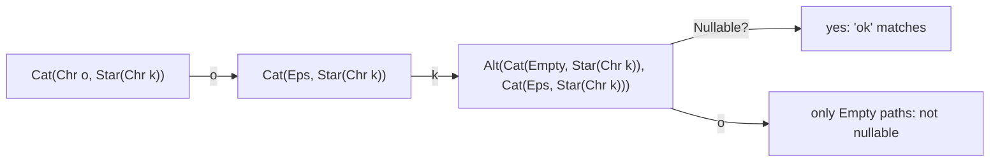
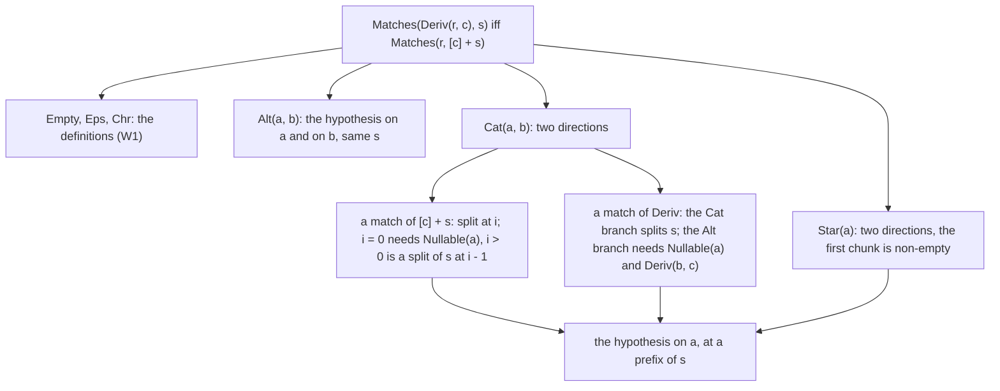
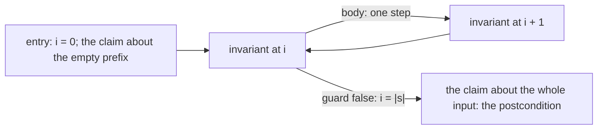

# R06 — Induction and loops

R02 proved facts about one split at a time; R04 and R05 proved claims about every split and learned to read a failure without a goal window. R06 proves claims about every regex and every string at once. The tool is induction, and in a verifier induction has two everyday forms: a lemma that calls itself on a smaller argument, and a loop whose invariant survives each step. Both are the same argument. The induction hypothesis is a recursive call (or an invariant at the top of the loop body), the measure says why the call is smaller (or why the loop stops), and the base case is where the recursion (or the loop) ends.

The module's subject is the Brzozowski derivative. `Deriv(r, c)` is a regex that matches exactly the rest of every word that `r` matches after the character `c`. Your flagship proof, H1, shows that this holds for every constructor, including the two cases where it is easy to get wrong: a `Cat` whose left side is nullable, and a `Star`. A matcher built from it, H2, takes one derivative per input character and then asks whether the result accepts the empty word; its loop invariant is the induction hypothesis of an induction on the number of characters read. The module also refutes a plausible false claim about `Star`, repairs it with the weakest hypothesis that makes it true, and proves the repair.

Every construct below appears first in a small example whose verifier output is printed directly under it, captured on the course pins. R is standalone: use R01–R05, the declared A1 layer, and A1b, which R06 declares.

**Three ideas do all the work.**

1. **A recursive call is an induction hypothesis with exact arguments.** Before the call, say which argument is smaller under the measure, and check that the theorem you are calling quantifies over the arguments you pass. The measure is part of the proof, not a formality.
2. **A loop invariant is an induction hypothesis about a state.** It must hold on entry, survive one step, and, together with the negated guard, give the postcondition at exit. Each of the three is a separate obligation, and the verifier reports which one failed.
3. **Refute before you repair.** A claim that resists proof may be false. Find a counterexample, then add the weakest hypothesis that excludes it, and prove the claim under that hypothesis, no stronger.

---

## 0. How this module works

**Budget: 462 minutes**, including the module viva and excluding contractor wall time. These are planning estimates; record your own.

| setup | test-out | read | worked + cards | other cards | predictions | flagship | matcher loop | refute → repair → prove | checkpoint | agent | paper | bench card | viva | calibration | total |
|---|---|---|---|---|---|---|---|---|---|---|---|---|---|---|---|
| 8 | 10 | 60 | 30 | 6 | 14 | 128 | 24 | 34 | 22 | 22 | 45 | 20 | 30 | 9 | **462** |

The flagship is 60 minutes in Dafny and 68 in Verus; the matcher loop 12 per language; H3 5 and H4 12 per language; the test-out T1 5 per language; each checkpoint item 5.5.

**Before reading:** do T1 in both languages, closed book. It asks for a `while` loop with a postcondition about every element of a sequence; record the first try with `scripts/firsttry.sh R06 --check`. A clean first try is your evidence for skimming §3.

**Predictions.** Commit the six answers below before running their scenarios or opening the card demos, the bank or the rubric. P1d's answer goes in the `expect` slot of `dafny/checks/R06_checks.dfy`; P2v's in its specimen; P4d and P5v in their specimens' `FAILS` slots; P3dv and P6dv in `slots/R06.slots`, switched on by the `CHECK` lines of the Dafny file. Respect each printed answer form, then run `scripts/firsttry.sh R06 --check`.

> **Predict (P1) — commit in the file before reading on.** For the pattern `Cat(Star(Chr('a')), Chr('b'))`, what term does `Deriv(pattern, 'a')` produce under the given definition? Answer in A1's constructor syntax with no spaces, the term itself, not a call to `Deriv`.

> **Predict (P2) — commit in the file before reading on.** In Verus, take the derivative of the same pattern by `'a'` and then by `'b'`, and ask `nullable` of the result. `true` or `false`?

> **Predict (P3) — commit in the file before reading on.** `StarRepeat(r, s)` proves that `Star(Chr('a'))` matches every all-`'a'` word by calling itself on `s[1..]` with `r` unchanged. Under the measure [x] `decreases r` and under [y] `decreases |s|` (Verus: `decreases r` / `decreases s.len()`), does each version verify? Answer `D:<x>,<y> V:<x>,<y>` with `ok` or `fail`.

> **Predict (P4) — commit in the file before reading on.** `specimens/R06/P4d.dfy.specimen` sums the node counts of a sequence of regexes with the one-directional invariant `n >= i` (and the bounds). Four labelled assertions: [a] `n >= i` before the loop; [b] `n >= i` at the end of the body; [c] `n >= |rs|` after the loop; [d] `n == |rs|` after the loop. Which fail?

> **Predict (P5) — commit in the file before reading on.** `specimens/R06/P5v.rs.specimen` is the same loop over a vector, with `n` a ghost counter. Which of [a]–[d] fail?

> **Predict (P6) — commit in the file before reading on.** A proposed shortcut for stars, `Matches(Star(a), [c] + s) <==> Matches(Star(Deriv(a, c)), s)`, is attempted with a proof that applies derivative correctness to every prefix of `s`. What verdict does the attempt receive in each language? Answer `D:<v> V:<v>`.

### This module's files

| file | role | shipped state |
|---|---|---|
| `dafny/R/R06_Induction/core/R06_Induction.dfy` | the given `Deriv`, T1, the prediction block, worked examples, cards, holes H1–H4 | verified, 5 holes, 0 errors |
| `verus/r/r06_induction/src/lib.rs` | the paired Verus file, with the proved executable `deriv_exec` | verified, 5 holes, 0 errors |
| `dafny/checks/R06_checks.dfy` | P1d's value check | verified; its slot unfilled |
| `dafny/R/R06_Induction/exit/R06_Checkpoint.dfy`, `verus/r/r06_induction/src/exit.rs` | the closed-book checkpoint, 2 items per language | verified, 2 holes each; keep closed until the attempt |
| `dafny/R/R06_Induction/agent/R06_AgentDecomposer.dfy`, `verus/r/r06_induction/src/agent.rs` | the decomposer's files: one top statement each | verified, 1 hole each |
| `specimens/R06/`, `slots/R06.slots` | prediction specimens, the measure pair, card demos | slots unfilled; demos fail by design |
| `dafny/given/R/RG_A1b_Facts.dfy`, `verus/given/rg_re_a1b` | the frozen A1b layer: R02's and R05's band-1 facts, re-supplied | verified; their contracts are yours to use |
| `paper/R06_problems.tex`, `paper/R06_answers.tex` | the card and two written problems, the flagship's `Cat` case first | template compiles; answers unfilled |
| `Solutions/`, `paper/solutions/` | references | yours to open LAST, after your attempts, gates and review |

As shipped, the exercise files verify in the learner loop with their holes counted:

<!-- pin: shipped-d -->
```
$ scripts/vcheck dafny/R/R06_Induction/core
vcheck: dafny/R/R06_Induction/core [dafny, learner loop]: verified — 18 verified, 5 holes, 0 errors
dafny/R/R06_Induction/core/R06_Induction.dfy:40:5: hole assume R06.T1d
dafny/R/R06_Induction/core/R06_Induction.dfy:104:37: hole bodyless-method R06.H1d
dafny/R/R06_Induction/core/R06_Induction.dfy:122:5: hole assume R06.H2d
dafny/R/R06_Induction/core/R06_Induction.dfy:147:13: hole bodyless-method R06.H3d
dafny/R/R06_Induction/core/R06_Induction.dfy:158:33: hole bodyless-method R06.H4d
```

<!-- pin: shipped-v -->
```
$ scripts/vcheck verus/r/r06_induction
vcheck: verus/r/r06_induction [verus, learner loop]: verified — - verified, 5 holes, 0 errors
verus/r/r06_induction/src/lib.rs:65:1: hole external_body R06.T1v
verus/r/r06_induction/src/lib.rs:124:40: hole assume R06.H1v
verus/r/r06_induction/src/lib.rs:145:44: hole assume R06.H2v
verus/r/r06_induction/src/lib.rs:175:40: hole assume R06.H3v
verus/r/r06_induction/src/lib.rs:191:40: hole assume R06.H4v
```

The check unit verifies too; its one test waits for your P1 answer:

<!-- pin: checks-d -->
```
$ scripts/vcheck dafny/checks/R06_checks.dfy
vcheck: dafny/checks/R06_checks.dfy [dafny, learner loop]: verified — 12 verified, 0 holes, 0 errors
```

---

## 1. The derivative

### 1.1 One character at a time

The derivative of `r` by `c` is a regex for "what is left of `r` after `c`". The given definition follows the datatype:

```dafny
function Deriv(r: Re, c: char): Re
  decreases r
{
  match r
  case Empty => Empty
  case Eps => Empty
  case Chr(d) => if c == d then Eps else Empty
  case Alt(a, b) => Alt(Deriv(a, c), Deriv(b, c))
  case Cat(a, b) =>
    if Nullable(a) then Alt(Cat(Deriv(a, c), b), Deriv(b, c)) else Cat(Deriv(a, c), b)
  case Star(a) => Cat(Deriv(a, c), Star(a))
}
```

Read the two hard cases slowly. For `Cat(a, b)`, the first character comes from `a`, unless `a` can match the empty word, in which case it may come from `b` instead: hence the `Alt` guarded by `Nullable(a)`. For `Star(a)`, the first character starts a chunk of `a`, and after that chunk the star continues. The result of `Deriv` is a regex, a syntax tree, not a Boolean; it is never simplified (`Cat(Eps, x)` stays as it is). Verus states the same definition as `pub open spec fn deriv(r: Re, c: char) -> Re`, and the given `deriv_exec(r: &Re, c: char) -> (out: Re)` computes it, with `ensures out == deriv(*r, c)`.

A word is consumed by taking one derivative per character. Here is `Cat(Chr('o'), Star(Chr('k')))` reading "ok", then one character too many:

```dafny
module R06_ChWalk {
  import opened RG_A1_Re

  function Deriv(r: Re, c: char): Re
    decreases r
  {
    match r
    case Empty => Empty
    case Eps => Empty
    case Chr(d) => if c == d then Eps else Empty
    case Alt(a, b) => Alt(Deriv(a, c), Deriv(b, c))
    case Cat(a, b) =>
      if Nullable(a) then Alt(Cat(Deriv(a, c), b), Deriv(b, c)) else Cat(Deriv(a, c), b)
    case Star(a) => Cat(Deriv(a, c), Star(a))
  }

  lemma WalkOk()
  {
    var r := Cat(Chr('o'), Star(Chr('k')));
    var r1 := Deriv(r, 'o');
    var r2 := Deriv(r1, 'k');
    assert r1 == Cat(Eps, Star(Chr('k')));
    assert r2 == Alt(Cat(Empty, Star(Chr('k'))), Cat(Eps, Star(Chr('k'))));
    assert Nullable(r2);
    assert !Nullable(Deriv(r2, 'o'));
  }
}
```

<!-- pin: walk-d -->
```
$ scripts/vcheck --module R06 walk.dfy
vcheck: walk.dfy [dafny, learner loop]: verified — 13 verified, 0 holes, 0 errors
```

After "o" the regex is `Cat(Eps, Star(Chr('k')))`: the `o` has been used, the stars remain. After "k" the left side `Eps` is nullable, so the `Cat` case produces an `Alt`, and its right branch has consumed the `k`. The result is nullable, so "ok" is in the language. One more `'o'` turns everything into combinations of `Empty`, which is not nullable. The diagram is that walk:



The takeaway: matching a word is a sequence of derivatives and one `Nullable` test, and every intermediate regex is an ordinary value you can name, assert about, and carry through a loop. That is what makes H2's loop provable: its state is a regex, and its invariant can say what that regex means. Notice also that the terms grow. Nothing in `Deriv` removes an `Empty` branch or an `Eps` prefix, so a long word produces a large regex even when the language it denotes is simple. R10 builds smart constructors that keep the terms small; here the size does not matter, because every proof in this module is about what a term matches, not about its shape.

### 1.2 Two values to predict

P1 asks for one derivative of `Cat(Star(Chr('a')), Chr('b'))`. `Star(Chr('a'))` is nullable, so the `Cat` case takes its `Alt` branch: the left part is `Cat(Deriv(Star(Chr('a')), 'a'), Chr('b'))`, and `Deriv(Star(Chr('a')), 'a')` is `Cat(Eps, Star(Chr('a')))`; the right part is `Deriv(Chr('b'), 'a')`, which is `Empty`:

```dafny
module R06_ChP1 {
  import opened RG_A1_Re

  function Deriv(r: Re, c: char): Re
    decreases r
  {
    match r
    case Empty => Empty
    case Eps => Empty
    case Chr(d) => if c == d then Eps else Empty
    case Alt(a, b) => Alt(Deriv(a, c), Deriv(b, c))
    case Cat(a, b) =>
      if Nullable(a) then Alt(Cat(Deriv(a, c), b), Deriv(b, c)) else Cat(Deriv(a, c), b)
    case Star(a) => Cat(Deriv(a, c), Star(a))
  }

  lemma P1Value()
  {
    var pattern := Cat(Star(Chr('a')), Chr('b'));
    assert Deriv(pattern, 'a') == Alt(Cat(Cat(Eps, Star(Chr('a'))), Chr('b')), Empty);
  }
}
```

<!-- pin: p1-d -->
```
$ scripts/vcheck --module R06 p1.dfy
vcheck: p1.dfy [dafny, learner loop]: verified — 13 verified, 0 holes, 0 errors
```

The answer is `Alt(Cat(Cat(Eps,Star(Chr('a'))),Chr('b')),Empty)`. The `Empty` branch is not dropped, and `Cat(Eps, …)` is not simplified: the value is the term the function builds, which is a different question from the language it denotes.

P2 takes a second derivative, by `'b'`, of that term. The `Alt` distributes; in its left branch, `Cat(Cat(Eps, Star(Chr('a'))), Chr('b'))` has a nullable left side (both `Eps` and the star are nullable), so its derivative includes `Deriv(Chr('b'), 'b')`, which is `Eps`. One `Eps` branch makes the whole `Alt` nullable. Verus evaluates the closed expression by computation:

```rust
use vstd::prelude::*;
use rg_re_a1::*;

verus! {

pub open spec fn deriv(r: Re, c: char) -> Re
    decreases r,
{
    match r {
        Re::Empty => Re::Empty,
        Re::Eps => Re::Empty,
        Re::Chr(d) => if c == d { Re::Eps } else { Re::Empty },
        Re::Alt(a, b) => Re::Alt(Box::new(deriv(*a, c)), Box::new(deriv(*b, c))),
        Re::Cat(a, b) => if nullable(*a) {
            Re::Alt(Box::new(Re::Cat(Box::new(deriv(*a, c)), b)), Box::new(deriv(*b, c)))
        } else {
            Re::Cat(Box::new(deriv(*a, c)), b)
        },
        Re::Star(a) => Re::Cat(Box::new(deriv(*a, c)), Box::new(Re::Star(a))),
    }
}

proof fn p2_value() {
    assert(nullable(deriv(deriv(Re::Cat(Box::new(Re::Star(Box::new(Re::Chr('a')))), Box::new(Re::Chr('b'))), 'a'), 'b')) == true) by (compute_only);
}

} // verus!
```

<!-- pin: p2-v -->
```
$ scripts/vcheck --module R06 p2.rs
vcheck: p2.rs [verus, learner loop]: verified — 2 verified, 0 holes, 0 errors
```

The answer is `true`: "ab" is in the language of `Star(Chr('a'))` followed by `b`. `by (compute_only)` asks Verus to evaluate the expression rather than reason about it; it works only on closed expressions like this one, and it is a computation, not a proof about every input.

---

## 2. Lemmas are induction

### 2.1 A measure says why the call is smaller

A recursive lemma is an induction proof: its body may call the lemma itself, and each call gives the postcondition for the arguments of that call. The verifier accepts a call only if a declared measure is smaller at the call than at entry. P3's lemma proves that `Star(Chr('a'))` matches every word made of `'a'`s by calling itself on the tail:

```dafny
lemma StarRepeat(r: Re, s: seq<char>)
  requires r == Star(Chr('a'))
  requires forall k :: 0 <= k < |s| ==> s[k] == 'a'
  ensures Matches(r, s)
  decreases r
{
  if s != [] {
    forall k | 0 <= k < |s[1..]| ensures s[1..][k] == 'a' {
      assert s[1..][k] == s[k + 1];
    }
    StarRepeat(r, s[1..]);
    assert s[..1] == ['a'];
    assert Matches(Chr('a'), s[..1]);
  }
}
```

<!-- pin: measure-x-d -->
```
$ scripts/vcheck specimens/R06/measure-x-d.dfy.specimen
vcheck: specimens/R06/measure-x-d.dfy.specimen [dafny, learner loop]: failed — 6 verified, 0 holes, 1 error
specimens/R06/measure-x-d.dfy.specimen:83:17: error: decreases clause might not decrease
```

The same file with `decreases |s|`:

<!-- pin: measure-y-d -->
```
$ scripts/vcheck specimens/R06/measure-y-d.dfy.specimen
vcheck: specimens/R06/measure-y-d.dfy.specimen [dafny, learner loop]: verified — 7 verified, 0 holes, 0 errors
```

```rust
proof fn lemma_star_repeat(r: Re, s: Seq<char>)
    requires
        r == Re::Star(Box::new(Re::Chr('a'))),
        forall|k: int| 0 <= k < s.len() ==> #[trigger] s[k] == 'a',
    ensures
        matches(r, s),
    decreases r,
{
    if s.len() > 0 {
        let tail = s.subrange(1, s.len() as int);
        assert forall|k: int| 0 <= k < tail.len() implies #[trigger] tail[k] == 'a' by {
            assert(tail[k] == s[k + 1]);
        }
        lemma_star_repeat(r, tail);
        assert(s.subrange(0, 1) =~= seq!['a']);
        assert(matches(Re::Chr('a'), s.subrange(0, 1)));
    }
}
```

<!-- pin: measure-x-v -->
```
$ scripts/vcheck specimens/R06/measure-x-v.rs.specimen
vcheck: specimens/R06/measure-x-v.rs.specimen [verus, learner loop]: failed — 0 verified, 0 holes, 1 error
specimens/R06/measure-x-v.rs.specimen:18:9: error: could not prove termination
```

<!-- pin: measure-y-v -->
```
$ scripts/vcheck specimens/R06/measure-y-v.rs.specimen
vcheck: specimens/R06/measure-y-v.rs.specimen [verus, learner loop]: verified — 1 verified, 0 holes, 0 errors
```

The answer is `D:fail,ok V:fail,ok`. The call passes `r` unchanged, so a measure on `r` does not decrease; the word does get shorter, so a measure on its length does. The proof is the same in both versions; only the claim about why the recursion stops differs. A regex is a perfectly good measure when the call goes to a sub-regex, as `Deriv`'s own definition does; it is the call, not the type, that decides.

The WRITE card C3 is the same mistake with nothing else in the way: the call shrinks `n`, the measure names `k`.

```dafny
module R06_LemmaMeasureCard {
  lemma DescendR06(n: nat, k: nat)
    decreases k
  {
    if n > 0 {
      DescendR06(n - 1, k);
    }
  }
}
```

<!-- pin: lemma-measure-d -->
```
$ scripts/vcheck specimens/R06/card-c3d.dfy.specimen
vcheck: specimens/R06/card-c3d.dfy.specimen [dafny, learner loop]: failed — 0 verified, 0 holes, 1 error
specimens/R06/card-c3d.dfy.specimen:7:17: error: decreases clause might not decrease
```

```rust
proof fn descend_r06(n: nat, k: nat)
    decreases k,
{
    if n > 0 {
        descend_r06((n - 1) as nat, k);
    }
}
```

<!-- pin: lemma-measure-v -->
```
$ scripts/vcheck specimens/R06/card-c3v.rs.specimen
vcheck: specimens/R06/card-c3v.rs.specimen [verus, learner loop]: failed — 0 verified, 0 holes, 1 error
specimens/R06/card-c3v.rs.specimen:8:9: error: could not prove termination
```

Verus requires a `decreases` clause on every recursive proof function; Dafny supplies a default (the parameters, in order, compared lexicographically) when you write none. The default is a guess about your recursion, made before Dafny has seen a single call. When your calls make the first parameter smaller, it is right; when they do not, Dafny reports that it cannot prove termination and asks for a clause. The flagship and the checkpoint ask you to write the measure, and to say which argument decreases at every call.

### 2.2 `{:induction false}`: you write every hypothesis

Dafny can try induction on a lemma by itself: under its default setting it may add the induction hypothesis for you (a fact the Q track owns, recorded in the RECOGNISE card C5). R06's units turn that off (`--manual-lemma-induction`), and the flagship and checkpoint carry `{:induction false}` as well, so that every induction hypothesis in your proof is a call you wrote. The WRITE card C4 shows what happens when nobody writes it:

```dafny
module R06_ManualCallCard {
  ghost function StampR06(s: seq<int>): seq<int>
    decreases |s|
  {
    if s == [] then [] else [s[0]] + StampR06(s[1..])
  }
  lemma {:induction false} StampIdentityR06(s: seq<int>)
    ensures StampR06(s) == s
  {
  }
}
```

<!-- pin: induction-false-d -->
```
$ scripts/vcheck specimens/R06/card-c4d.dfy.specimen
vcheck: specimens/R06/card-c4d.dfy.specimen [dafny, learner loop]: failed — 1 verified, 0 holes, 1 error
specimens/R06/card-c4d.dfy.specimen:8:3: error: a postcondition could not be proved on this return path
specimens/R06/card-c4d.dfy.specimen:7:25: related: this is the postcondition that could not be proved
```

The claim is true; its proof is an induction that nobody performed. The repair is the call `StampIdentityR06(s[1..])` for a non-empty `s`, plus the fact that `s` is its head followed by its tail: the induction hypothesis, and the bridge from the hypothesis to this case.

### 2.3 The base cases, worked

W1 is the derivative theorem for the three constructors with no sub-regex. It needs no recursion, only the definitions:

```dafny
lemma DerivBase(r: Re, c: char, s: seq<char>)
  requires r.Empty? || r.Eps? || r.Chr?
  ensures Matches(Deriv(r, c), s) <==> Matches(r, [c] + s)
{
  if r.Chr? {
    var w := [c] + s;
    if w == [r.c] {
      assert w[1..] == s;
      assert w[0] == c;
    }
    if s == [] {
      assert w == [c];
    }
  }
}
```

For `Empty` and `Eps` both sides are false (`[c] + s` is never empty). For `Chr(d)`, both sides say "`c` is `d` and `s` is empty"; the two `if` blocks give the solver the slice facts that connect `[c] + s == [d]` to that statement, one direction each. Verus's `lemma_deriv_base` needs only the first character named, `(seq![c] + s)[0] == c`, because its `matches` on `Chr` already compares lengths.

### 2.4 The flagship's shape

H1 is the derivative theorem for every constructor: `Matches(Deriv(r, c), s) <==> Matches(r, [c] + s)`. Before the keyboard, write its decomposition (the paper problem B2 asks for its `Cat` case in full):



Three things make the proof work, and each is a habit from earlier modules. The split a match supplies is taken with `:|` or `choose` (R04 §2.2). A split of `[c] + s` at a position `i > 0` is a split of `s` at `i - 1`, which is a pair of slice facts (R02, R05 §1.2). And `Nullable(a)` is related to `Matches(a, [])` by A1b's `NullableCorrect`, the band-1 fact R02 proved and A1b now supplies. The induction hypothesis is used on `a` at a *prefix* of `s`, which is why the theorem must quantify over the word: a version that fixed `s` would not give you the call you need. Do not narrow the statement to dodge the hard cases; the freeze checks it. Its parameters come in the order `(c, s, r)`, so Dafny's default measure (which would start with `c`) does not fit your calls: write the measure yourself, as §2.1 describes. From R07 on, the A2 layer re-supplies the same theorem with the regex first, `DerivCorrect(r, c, s)` (Verus `lemma_deriv_correct(r, c, s)`).

---

## 3. Loops are induction

### 3.1 The invariant is the hypothesis

A `while` loop with an invariant is an induction on the number of iterations. The invariant is the statement about iteration `i`; it must hold before the first iteration (the base case), it must hold again after the body whenever it held before (the step), and when the loop exits, the invariant and the negated guard together must give what the code after the loop needs. W2 is the pattern on the simplest possible claim:

```dafny
method AllSame(s: seq<char>, c: char) returns (b: bool)
  ensures b <==> forall j :: 0 <= j < |s| ==> s[j] == c
{
  b := true;
  var i := 0;
  while i < |s|
    invariant 0 <= i <= |s|
    invariant b <==> forall j :: 0 <= j < i ==> s[j] == c
    decreases |s| - i
  {
    b := b && s[i] == c;
    i := i + 1;
  }
}
```

```rust
pub fn all_same(s: &Vec<char>, c: char) -> (b: bool)
    ensures
        b == (forall|j: int| 0 <= j < s.len() ==> #[trigger] s@[j] == c),
{
    let mut b = true;
    let mut i: usize = 0;
    while i < s.len()
        invariant
            i <= s.len(),
            b == (forall|j: int| 0 <= j < i ==> #[trigger] s@[j] == c),
        decreases s.len() - i,
    {
        b = b && s[i] == c;
        i = i + 1;
    }
    b
}
```

The second invariant is the postcondition with `|s|` replaced by `i`: "the answer so far is correct for the prefix read so far". At exit `i == |s|`, and the substitution gives the postcondition. The `decreases` clause is the loop's measure, as for a recursive lemma. The diagram reads the loop as the induction it is:



The WRITE card C2 has a loop with no invariant at all:

```dafny
module R06_InvariantCard {
  method CountToR06(n: nat) returns (i: nat)
    ensures i == n
  {
    i := 0;
    while i < n
      decreases n - i
    {
      i := i + 1;
    }
  }
}
```

<!-- pin: invariant-d -->
```
$ scripts/vcheck specimens/R06/card-c2d.dfy.specimen
vcheck: specimens/R06/card-c2d.dfy.specimen [dafny, learner loop]: failed — 0 verified, 0 holes, 1 error
specimens/R06/card-c2d.dfy.specimen:5:3: error: a postcondition could not be proved on this return path
specimens/R06/card-c2d.dfy.specimen:4:15: related: this is the postcondition that could not be proved
```

```rust
fn count_to_r06(n: u64) -> (i: u64)
    ensures
        i == n,
{
    let mut i: u64 = 0;
    while i < n
        decreases n - i,
    {
        i = i + 1;
    }
    i
}
```

<!-- pin: invariant-v -->
```
$ scripts/vcheck specimens/R06/card-c2v.rs.specimen
vcheck: specimens/R06/card-c2v.rs.specimen [verus, learner loop]: failed — 1 verified, 0 holes, 1 error
specimens/R06/card-c2v.rs.specimen:6:9: error: postcondition not satisfied
```

At exit the verifier knows only the negated guard, `i >= n`, and nothing about `i` beyond its type: the loop forgets everything the invariant does not say. `invariant i <= n` is the missing fact; with it, `i >= n` gives `i == n`.

### 3.2 One direction is not two

P4 and P5 sum the node counts of a sequence of regexes, with an invariant that says only one thing: `n` is at least the number of regexes visited, because every regex has at least one node.

```dafny
lemma OneWayCountR06(rs: seq<Re>)
{
  var n := 0;
  var i := 0;
  assert n >= i; // [a]
  while i < |rs|
    invariant 0 <= i <= |rs|
    invariant n >= i
    decreases |rs| - i
  {
    n := n + NodeCount(rs[i]);
    i := i + 1;
    assert n >= i; // [b]
  }
  assert n >= |rs|; // [c]
  assert n == |rs|; // [d]
}
```

<!-- pin: loop-d -->
```
$ scripts/vcheck specimens/R06/P4d.dfy.specimen
vcheck: specimens/R06/P4d.dfy.specimen [dafny, learner loop]: failed — 5 verified, 0 holes, 1 error
specimens/R06/P4d.dfy.specimen:93:5: error: assertion might not hold
```

```rust
fn one_way_count_r06(rs: &Vec<Re>) {
    let ghost mut n: int = 0;
    let mut i: usize = 0;
    assert(n >= i); // [a]
    while i < rs.len()
        invariant
            i <= rs.len(),
            n >= i,
        decreases rs.len() - i,
    {
        proof {
            n = n + node_count(rs@[i as int]);
        }
        i = i + 1;
        assert(n >= i); // [b]
    }
    assert(n >= rs.len()); // [c]
    assert(n == rs.len()); // [d]
}
```

<!-- pin: loop-v -->
```
$ scripts/vcheck specimens/R06/P5v.rs.specimen
vcheck: specimens/R06/P5v.rs.specimen [verus, learner loop]: failed — 8 verified, 0 holes, 1 error
specimens/R06/P5v.rs.specimen:146:12: error: assertion failed
```

The answer is `FAILS d` in both languages. [a] holds at entry (0 ≥ 0), [b] holds after each step because the solver unfolds `NodeCount` once and sees that every case is at least 1, and [c] is the invariant at exit. [d] is false whenever some regex has more than one node; the invariant never claimed it, so the verifier cannot prove it, and the code computed something the annotation did not describe. An invariant gives you exactly what it says, in the direction it says it. The matcher of H2 needs an equivalence for the same reason: at the end it must turn a fact about the current regex into a fact about the original one, both ways.

### 3.3 The matcher loop

H2's method keeps the original regex `r` and input `s`, and a current regex `cur` that has read the prefix `s[..i]`:

```dafny
method DerivMatch(r: Re, s: seq<char>) returns (b: bool)
  ensures b == Matches(r, s)
```

Its loop, its measure and the proof call in its body are given; you write the invariant and the facts that connect it. The invariant relates three things: the current regex, the unread suffix, and the original question. At exit the unread suffix is empty, and a regex matches the empty word exactly when it is nullable, which is A1b's `NullableCorrect` again. The body's given call is derivative correctness at the current regex, the next character and the rest of the input; it states a fact about `[s[i]] + s[i + 1..]`, and your invariant talks about `s[i..]`. Saying that those are the same sequence is a slice fact of the kind R05 bisected. If an obligation fails, ask which of the three it is: entry, preservation, or exit. Entry failures are about the initial values (`cur` is `r`, `i` is 0, the unread suffix is all of `s`); preservation failures are about one step (what the given call says, and how it relates to the next suffix); exit failures are about the last state (an empty suffix and the `Nullable` test). Each has a different missing fact, and none of them is fixed by changing the loop.

---

## 4. `calc`, recognised

A `calc` block states a chain of expressions with a relation between neighbours and a proof of each step. It is a way to *write* an argument as a sequence of equal (or implied) expressions, and it is often the clearest way to present one. It is never the only way: every chain can be written as the assertions of its steps. R06 asks you to recognise it, not to use it (the user's decision D86: no R06 hole needs a chain). The RECOGNISE card C1 puts a false fact inside a step:

```dafny
module R06_CalcCard {
  lemma CalcBridgeR06(n: int) {
    calc {
      n + 1;
      == {
        assert false;
      }
      n + 1;
    }
  }
}
```

<!-- pin: calc-d -->
```
$ scripts/vcheck specimens/R06/card-c1d.dfy.specimen
vcheck: specimens/R06/card-c1d.dfy.specimen [dafny, learner loop]: failed — 0 verified, 0 holes, 1 error
specimens/R06/card-c1d.dfy.specimen:6:9: error: assertion might not hold
```

```rust
proof fn calc_bridge_r06(n: int) {
    calc! {
        (==) n + 1;
        {
            assert(false);
        }
        n + 1;
    }
}
```

<!-- pin: calc-v -->
```
$ scripts/vcheck specimens/R06/card-c1v.rs.specimen
vcheck: specimens/R06/card-c1v.rs.specimen [verus, learner loop]: failed — 0 verified, 0 holes, 1 error
specimens/R06/card-c1v.rs.specimen:8:20: error: assertion failed
```

The step block's own obligations are checked, so a chain cannot hide an assumption, exactly like R05's `assert … by`. Two warnings for reading other people's proofs. A chain with one step and the whole proof inside its block is a proof written as a block, not a calculation; it explains nothing a plain sequence of assertions would not. And a chain whose first and last expressions are equal for an unrelated reason still owes a proof of every step.

---

## 5. Refute, repair, prove

### 5.1 A counterexample is a proof too

A claim that resists every proof may be false, and a verifier cannot tell you which. When a universal claim fails, try to refute it: give values that satisfy its hypotheses and violate its conclusion, and prove that they do. A refutation is a proof of an existential, so it has R04's shape (a witness and the facts about it). Here is a plausible false claim about `Nullable` and its refutation:

```dafny
module R06_ChRefute {
  import opened RG_A1_Re

  lemma NullableCatRefuted()
    ensures exists a: Re, b: Re :: Nullable(Cat(a, b)) != Nullable(a)
  {
    var a := Eps;
    var b := Chr('x');
    assert Nullable(a);
    assert !Nullable(Cat(a, b));
  }

  lemma NullableCatRepaired(a: Re, b: Re)
    requires Nullable(b)
    ensures Nullable(Cat(a, b)) == Nullable(a)
  {
  }
}
```

<!-- pin: refute-d -->
```
$ scripts/vcheck --module R06 refute.dfy
vcheck: refute.dfy [dafny, learner loop]: verified — 13 verified, 0 holes, 0 errors
```

```rust
use vstd::prelude::*;
use rg_re_a1::*;

verus! {

proof fn lemma_nullable_cat_refuted()
    ensures
        exists|a: Re, b: Re| nullable(Re::Cat(Box::new(a), Box::new(b))) != nullable(a),
{
    let a = Re::Eps;
    let b = Re::Chr('x');
    assert(nullable(a));
    assert(!nullable(b));
    assert(!nullable(Re::Cat(Box::new(a), Box::new(b))));
}

proof fn lemma_nullable_cat_repaired(a: Re, b: Re)
    requires
        nullable(b),
    ensures
        nullable(Re::Cat(Box::new(a), Box::new(b))) == nullable(a),
{
}

} // verus!
```

<!-- pin: refute-v -->
```
$ scripts/vcheck --module R06 refute.rs
vcheck: refute.rs [verus, learner loop]: verified — 2 verified, 0 holes, 0 errors
```

### 5.2 The weakest repair

The repair `requires Nullable(b)` is the weakest one: it excludes exactly the inputs where the claim fails. `requires b == Eps` would also verify, and it would be wrong as a repair, because it throws away every nullable `b` that is not `Eps` (`Star(Chr('x'))`, for one) on which the claim is true. `requires false` would verify too, vacuously. The verifier checks that your repaired claim follows from your hypothesis; it cannot check that you excluded nothing more than you had to. That half is an argument you write: for sufficiency, prove the claim under the hypothesis; for necessity, show that every input the hypothesis excludes is a counterexample (here: if `b` is not nullable, `Cat(Eps, b)` is not nullable while `Eps` is).

H3 and H4 are this pair for a claim about `Star`: H3 refutes the unconditional unfolding `Matches(Star(a), s) <==> Matches(Cat(a, Star(a)), s)`, and H4 adds the weakest `requires` under which it holds and proves it. H4's `requires` is the one field of its statement the freeze leaves open (Δ160); the postcondition stays as printed. A refutation's witness is short by nature (the user's decision D88 records H3 as an exception to the three-fact bar, judged by its empty-body gate); the work is in finding it.

### 5.3 A shortcut that does not hold

P6's shortcut moves a derivative inside a star: `Matches(Star(a), [c] + s) <==> Matches(Star(Deriv(a, c)), s)`. The attempt below applies derivative correctness to every prefix of `s`; the flagship's statement stands in for your H1, as a hole, so the file does not contain its proof:

```dafny
module R06_ChShortcut {
  import opened RG_A1_Re

  function Deriv(r: Re, c: char): Re
    decreases r
  {
    match r
    case Empty => Empty
    case Eps => Empty
    case Chr(d) => if c == d then Eps else Empty
    case Alt(a, b) => Alt(Deriv(a, c), Deriv(b, c))
    case Cat(a, b) =>
      if Nullable(a) then Alt(Cat(Deriv(a, c), b), Deriv(b, c)) else Cat(Deriv(a, c), b)
    case Star(a) => Cat(Deriv(a, c), Star(a))
  }

  // The flagship's statement, standing in for your H1 (a hole here).
  lemma DerivCorrect(c: char, s: seq<char>, r: Re)
    ensures Matches(Deriv(r, c), s) <==> Matches(r, [c] + s)

  lemma StarShortcut(a: Re, c: char, s: seq<char>)
    ensures Matches(Star(a), [c] + s) <==> Matches(Star(Deriv(a, c)), s)
  {
    forall i | 0 <= i <= |s|
      ensures Matches(Deriv(a, c), s[..i]) <==> Matches(a, [c] + s[..i])
    {
      DerivCorrect(c, s[..i], a);
    }
  }
}
```

<!-- pin: p6-d -->
```
$ scripts/vcheck --module R06 shortcut.dfy
vcheck: shortcut.dfy [dafny, learner loop]: failed — 12 verified, 1 hole, 1 error
shortcut.dfy:19:37: hole bodyless-method R06_ChShortcut.DerivCorrect
shortcut.dfy:23:3: error: a postcondition could not be proved on this return path
shortcut.dfy:22:39: related: this is the postcondition that could not be proved
```

The answer is `D:fail V:fail`, and the failure is not a missing fact: the claim is false. The derivative applies to the *first* character of the star's first chunk only; after that chunk, the star continues with `a`, not with `Deriv(a, c)`. A counterexample is `a = Chr('c')` and `s = "c"`: `Star(Chr('c'))` matches "cc", but `Star(Deriv(Chr('c'), 'c'))` is `Star(Eps)`, which matches only the empty word (each chunk of a star must be non-empty, and `Eps` matches no non-empty chunk):

```dafny
module R06_ChShortcutCex {
  import opened RG_A1_Re

  lemma ShortcutFails()
    ensures Matches(Star(Chr('c')), ['c', 'c'])
    ensures !Matches(Star(Eps), ['c'])
  {
    var w := ['c', 'c'];
    assert w[..1] == ['c'];
    assert w[1..] == ['c'];
    assert w[1..][..1] == ['c'];
    assert w[1..][1..] == [];
  }
}
```

<!-- pin: p6-cex-d -->
```
$ scripts/vcheck --module R06 shortcut-cex.dfy
vcheck: shortcut-cex.dfy [dafny, learner loop]: verified — 12 verified, 0 holes, 0 errors
```

A failed proof attempt is evidence that something is missing, never evidence that a claim is false; the counterexample is. Keep the two in separate sentences of every report.

---

## 6. What the instruments can and cannot see

Run the gate and the audit on the shipped units and read why they refuse:

<!-- pin: gate-d -->
```
$ scripts/vcheck --gate dafny/R/R06_Induction/core
vcheck: dafny/R/R06_Induction/core [dafny, gate]: failed — 18 verified, 5 holes, 0 errors, 1 finding
dafny/R/R06_Induction/core/R06_Induction.dfy:40:5: hole assume R06.T1d
dafny/R/R06_Induction/core/R06_Induction.dfy:104:37: hole bodyless-method R06.H1d
dafny/R/R06_Induction/core/R06_Induction.dfy:122:5: hole assume R06.H2d
dafny/R/R06_Induction/core/R06_Induction.dfy:147:13: hole bodyless-method R06.H3d
dafny/R/R06_Induction/core/R06_Induction.dfy:158:33: hole bodyless-method R06.H4d
dafny/R/R06_Induction/core: warnings-fail-gate: warnings fail the gate (W-D04): holes and every other warning must be gone
```

<!-- pin: gate-v -->
```
$ scripts/vcheck --gate verus/r/r06_induction
vcheck: verus/r/r06_induction [verus, gate]: failed — - verified, 5 holes, 1 error
verus/r/r06_induction/src/lib.rs:65:1: hole external_body R06.T1v
verus/r/r06_induction/src/lib.rs:124:40: hole assume R06.H1v
verus/r/r06_induction/src/lib.rs:145:44: hole assume R06.H2v
verus/r/r06_induction/src/lib.rs:175:40: hole assume R06.H3v
verus/r/r06_induction/src/lib.rs:191:40: hole assume R06.H4v
(no file): error: gate: 'success' is false, not true; --output-json lacks 'is-verifying-entire-crate'; 'encountered-vir-error' is true, not false; --output-json lacks 'verified'; 5 hole(s); exit 1
```

<!-- pin: audit-d -->
```
$ scripts/vaudit dafny/R/R06_Induction/core
dafny/R/R06_Induction/core/R06_Induction.dfy:40: audit-assume — AllNullable: Definition has `assume` statement in body
dafny/R/R06_Induction/core/R06_Induction.dfy:103: audit-bodyless-ghost — DerivCorrect: Ghost declaration has no body and has an ensures clause
dafny/R/R06_Induction/core/R06_Induction.dfy:122: audit-assume — DerivMatch: Definition has `assume` statement in body
dafny/R/R06_Induction/core/R06_Induction.dfy:146: audit-bodyless-ghost — StarUnfoldRefuted: Ghost declaration has no body and has an ensures clause
dafny/R/R06_Induction/core/R06_Induction.dfy:157: audit-bodyless-ghost — StarUnfold: Ghost declaration has no body and has an ensures clause
vaudit: dafny/R/R06_Induction/core [dafny, learner]: 5 finding(s)
```

<!-- pin: audit-v -->
```
$ scripts/vaudit verus/r/r06_induction
verus/r/r06_induction/src/lib.rs:65: hole-external-body — an external_body hole (in all_nullable) not on the trust allowlist
verus/r/r06_induction/src/lib.rs:124: hole-assume — an assume hole (in lemma_deriv_correct) not on the trust allowlist
verus/r/r06_induction/src/lib.rs:145: hole-assume — an assume hole (in deriv_match) not on the trust allowlist
verus/r/r06_induction/src/lib.rs:175: hole-assume — an assume hole (in lemma_star_unfold_refuted) not on the trust allowlist
verus/r/r06_induction/src/lib.rs:191: hole-assume — an assume hole (in lemma_star_unfold) not on the trust allowlist
vaudit: verus/r/r06_induction [verus, learner]: 5 finding(s)
```

The statement freeze checks the statements, H2's given loop, measure and proof call, and the attributes, with H4's `requires` the one open field:

<!-- pin: freeze -->
```
$ scripts/specfreeze --check R06
specfreeze: R06: 0 finding(s)
```

| instrument | what it establishes | what it cannot see |
|---|---|---|
| a termination error at a call | that the declared measure does not decrease there | whether another measure would |
| an invariant's failing obligation | which of entry, preservation and exit failed | which fact you should add |
| `scripts/vcheck --gate` | the whole unit verified, zero counted holes, no warning | whether H4's hypothesis is the weakest |
| `scripts/vaudit`, `scripts/specfreeze --check R06` | assumptions; unchanged statements, skeleton and levers | whether a helper you added was needed |
| a refutation lemma | that the claim is false | how to repair it |

---

## 7. On paper, before the keyboard

The written track has three problems in `paper/R06_problems.tex`; answer in `paper/R06_answers.tex`, keeping its labels. Record all predictions first.

**B1, card 03.4, *AutoSpec*.** Fill the eight fields from the pinned source range. The study's loop generates candidate annotations, keeps only those the verifier accepts, and iterates: §2's and §3's hand work, with a generator in your place. Keep its success figures with their denominator and exclusions, and keep "annotations the verifier accepted" separate from "annotations adequate for the target".

**B2, the flagship's `Cat` case.** Both directions, before any keyboard proof. Introduce the split with its bounds, separate the case `i == 0` from `i > 0`, relate each slice to the arguments of the induction hypothesis, and name the fact that connects `Nullable(a)` to a match of the empty word. Do not assume `a` is not nullable to shorten the argument.

**B3, the matcher's invariant as an induction.** Entry, step and exit, as in §3.1, with the actual state substituted at each. Then say which obligation fails if the invariant keeps only one direction (§3.2).

Build the pair with `make -C paper paper`. A compiled answers file shows that it builds, not that its claims hold. `/grade-paper R06` runs in a fresh examiner session after you have written the answers.

**The fifth local bench card** (20 minutes): a stripped copy of one of your finished R06 lemmas under `bench/local/r/`, labelled course-derived, with its provenance; follow its README.

---

## 8. The exercise file

The hand work is the test-out T1 and four paired holes, after the worked examples and cards in both files. Keep the statements, H2's given loop, the attributes and the given `Deriv` fixed; the freeze checks them.

| item | statement (Dafny · Verus) | minutes D / V | uses |
|---|---|---|---|
| T1 | `AllNullable` · `all_nullable`: a `while` loop deciding whether every regex of a sequence is nullable (closed book) | 5 / 5 | an invariant (§3.1) |
| H1 | `DerivCorrect` · `lemma_deriv_correct`: `Deriv(r, c)` matches `s` exactly when `r` matches `[c] + s` | 60 / 68 | your measure (§2.1), every hypothesis a call (§2.2), splits (§2.4) |
| H2 | `DerivMatch` · `deriv_match`: the matcher loop | 12 / 12 | the invariant as hypothesis (§3), slice facts |
| H3 | `StarUnfoldRefuted` · `lemma_star_unfold_refuted`: the unconditional unfolding of `Star` fails | 5 / 5 | a counterexample (§5.1) |
| H4 | `StarUnfold` · `lemma_star_unfold`: the unfolding, under the weakest `requires` you add | 12 / 12 | the weakest repair (§5.2) |

Each hole's doc comment states the task and asks one guiding question; two hints follow it in the file. **The hint dial:** read the question, try, run the learner loop and read the diagnostic before you read `Hint(1)`; `Hint(2)` names the fact or construct to use, never the answer; `/tutor R06` comes after both. Do not raise a resource limit, add an assumption, or narrow a statement to get past an obligation.

```bash
scripts/firsttry.sh R06 --check
scripts/vcheck dafny/R/R06_Induction/core
scripts/vcheck --gate dafny/R/R06_Induction/core
scripts/vcheck --gate verus/r/r06_induction
scripts/vaudit dafny/R/R06_Induction/core
scripts/vaudit verus/r/r06_induction
scripts/specfreeze --check R06
scripts/firsttry.sh R06 --report --strict
```

**Done:** both units gate with zero tool-counted holes, both audits are clean, `scripts/specfreeze --check R06` reports 0 findings, and the strict report shows the predictions and T1 recorded. The checkpoint, the agent exercise, the written problems, the bench card, the viva and calibration are further deliverables of the module.

---

## 9. Exercise (agentic): decomposer

The agent files state one top statement each, the reversal theorem: `Backwards(r)` matches `BackwardsStr(s)` exactly when `r` matches `s`. Nothing else is given; A1 and A1b are in scope. The contractor must decompose: introduce each helper lemma first as a hole (its statement, no proof), keep the file green with only leaf holes, and prove the helpers afterwards. As shipped, both files verify with their one hole:

<!-- pin: agent-d -->
```
$ scripts/vcheck dafny/R/R06_Induction/agent/R06_AgentDecomposer.dfy
vcheck: dafny/R/R06_Induction/agent/R06_AgentDecomposer.dfy [dafny, learner loop]: verified — 11 verified, 1 hole, 0 errors
dafny/R/R06_Induction/agent/R06_AgentDecomposer.dfy:20:52: hole bodyless-method R06.A1d
```

<!-- pin: agent-v -->
```
$ scripts/vcheck verus/r/r06_induction/src/agent.rs
vcheck: verus/r/r06_induction/src/agent.rs [verus, learner loop]: verified — - verified, 1 hole, 0 errors
verus/r/r06_induction/src/agent.rs:25:40: hole assume R06.A1v
```

> **CONTRACT (for /contract R06 — run it in a FRESH session):** goal — prove the one supplied top statement by decomposition, preserving its contract; allowed-files — the one selected agent file; acceptance — every new helper is first added as a hole and the file re-run green with only leaf holes before any helper is proved; after every edit `scripts/vcheck <file>` shows no error; the final `scripts/vcheck --gate <file>` exits 0 with zero counted holes; `scripts/specfreeze --against <snapshot> <file>` reports no statement change; `scripts/vaudit <file>` reports no finding. Read the file's CONTRACT header before starting; it is the binding text.

**Steps.** (1) Save the original agent file outside the delivery as a snapshot. (2) Run `/contract R06` in a fresh session per language, under your R-v0 rules. (3) Draw the delivered decomposition tree in the `DECOMPOSITION` block: each helper, who calls it, and whether it was needed (delete it in a scratch copy and re-run). (4) Mark any step of the transcript that was not green.

### What the dashboard can and cannot see

The final gate sees the delivered file. It cannot see whether each helper appeared as a hole before it was proved, whether every intermediate edit was green, or whether a helper was needed: those are properties of the transcript and of your deletion tests. A green file with leaf holes is a checked plan, not a proof of the leaves.

### Final divergence card: calculation syntax

Open C6 after recording the predictions. The two files state one arithmetic chain; compare where each language puts the relation, the expressions and the step proof:

```dafny
module R06_CalcSyntaxCard {
  lemma ShiftR06(n: int)
    ensures n + 2 == 2 + n
  {
    calc {
      n + 2;
      == {
      }
      2 + n;
    }
  }
}
```

<!-- pin: divergence-d -->
```
$ scripts/vcheck specimens/R06/card-c6dv-d.dfy.specimen
vcheck: specimens/R06/card-c6dv-d.dfy.specimen [dafny, learner loop]: verified — 1 verified, 0 holes, 0 errors
```

```rust
proof fn shift_r06(n: int)
    ensures
        n + 2 == 2 + n,
{
    calc! {
        (==) n + 2;
        {
        }
        2 + n;
    }
}
```

<!-- pin: divergence-v -->
```
$ scripts/vcheck specimens/R06/card-c6dv-v.rs.specimen
vcheck: specimens/R06/card-c6dv-v.rs.specimen [verus, learner loop]: verified — 1 verified, 0 holes, 0 errors
```

Dafny writes the relation between the expressions it relates; Verus's `calc!` names the relation once, at the top, and puts each step's proof block between the expressions. The meaning is the same.

---

## Exit (closed book, 22 minutes)

Keep the checkpoint files closed until this attempt; close the chapter, the bank and your earlier files. Four unseen items, two per language, with complete given definitions and fixed statements: a lemma whose measure you write, and a loop whose invariant you write, in each language. The threshold is **at least 3/4 with at least 1 per language**. As shipped, each checkpoint file verifies with its two holes:

<!-- pin: exit-d -->
```
$ scripts/vcheck dafny/R/R06_Induction/exit/R06_Checkpoint.dfy
vcheck: dafny/R/R06_Induction/exit/R06_Checkpoint.dfy [dafny, learner loop]: verified — 15 verified, 2 holes, 0 errors
dafny/R/R06_Induction/exit/R06_Checkpoint.dfy:35:30: hole bodyless-method R06.X1d
dafny/R/R06_Induction/exit/R06_Checkpoint.dfy:44:5: hole assume R06.X2d
```

<!-- pin: exit-v -->
```
$ scripts/vcheck verus/r/r06_induction/src/exit.rs
vcheck: verus/r/r06_induction/src/exit.rs [verus, learner loop]: verified — - verified, 2 holes, 0 errors
verus/r/r06_induction/src/exit.rs:92:40: hole assume R06.X1v
verus/r/r06_induction/src/exit.rs:101:1: hole external_body R06.X2v
```

Record `scripts/firsttry.sh R06 --exit`. Keep the first exit record, including an honest failure; a later repair is learning evidence, not the closed-book attempt.

---

## Instructor touchpoints

- **`/tutor R06`** (long-lived, one session per module): after an attempt, with the exact diagnostic and the hypothesis you were trying to use; it follows the hint dial and never writes a hole's body.
- **`/discuss R06`**: measures, invariants as hypotheses, and what a weakest repair is.
- **`/review`**: when the banner says items are due.
- **`/viva R06`** (fresh examiner session): six questions from the bank, at least one a live predict refereed by the verifier.
- **`/grade-paper R06`** (fresh examiner session): after your answers are written.
- **`/review-code R06`** (fresh examiner session) at the `proof-shape` bar: each recursive call's argument named, each invariant's role clear, no line neither the solver nor a reader uses.
- **`/contract R06`** (fresh contractor session, per language): §9.
- **Solutions last:** compare with `Solutions/` and `paper/solutions/` only after your attempts, gates, review and viva; then finish CALIBRATION and record it with `scripts/firsttry.sh R06 --record`.

---

## What R06 planted

| planted here | harvested in |
|---|---|
| derivative blow-up (the terms of §1.1 never shrink) | R10 (smart constructors and normal forms) |
| the derivative matcher as an implementation of a specification | R08 (the `Matcher` refinement), R16 (a second implementation) |
| "generalize the invariant" | R16 (the simulation generalized over the continuation) |
| a measure chosen for the calls you make | R14 (fuel and termination of `Matches`) |
| refute, then the weakest repair | R15 (statement review) |

R06 harvests R02's termination pair (lemma measures) and R02's and R05's lemmas, which A1b now re-supplies. R07 asks what a library costs.
