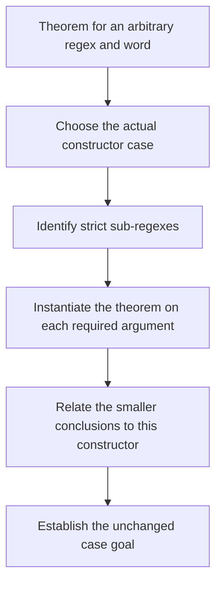
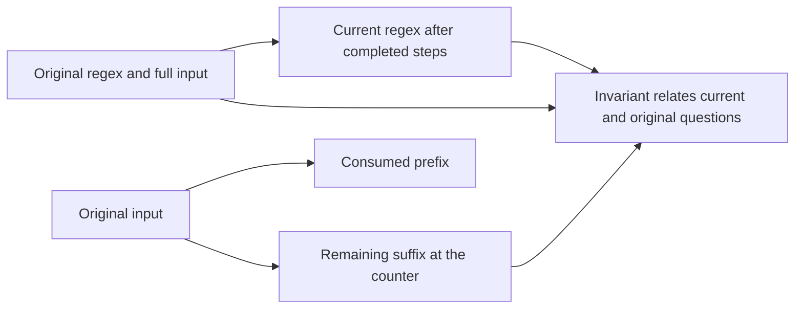
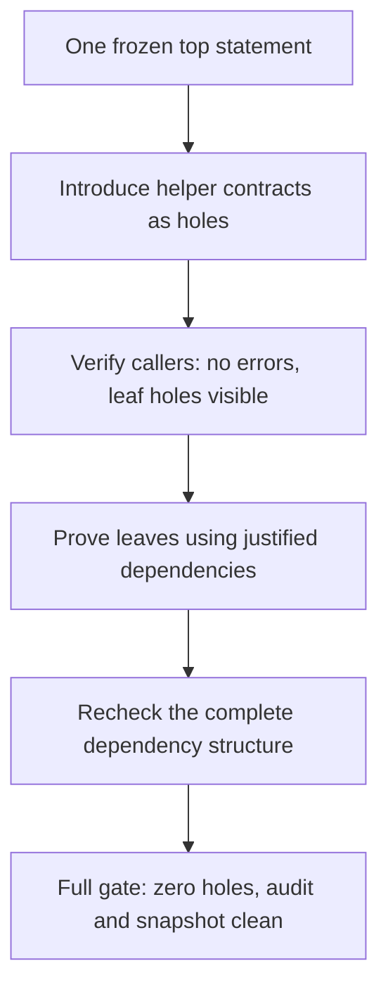

# R06 — Induction and loops

Three ideas do all the work:

1. An induction hypothesis has exact parameters. Before a recursive call, state why that call is smaller and why the hypothesis covers the arguments you are about to use.
2. A loop invariant is an induction hypothesis about an intermediate execution state. It must be true initially, survive a step and supply enough information at the end.
3. Decomposition exposes proof obligations through helper contracts. A green file with leaf holes is an intermediate plan; a finished delivery needs every leaf proved and a complete zero-hole gate.

## 0. How this module works

Allow 462 minutes: setup 8, closed-book test-out 10, reading 60, worked examples and WRITE cards 30, other cards 6, predictions 14, flagship 128, matcher annotations 24, refute/repair pair 34, checkpoint 22, decomposer 22, written work 45, fifth bench card 20, viva 30 and calibration 9. The flagship allocation is 60 minutes in Dafny and 68 in Verus. These are planning estimates; record your actual work and the uncertainty in your original estimate.

Begin with T1 in both languages, closed book. Implement the printed Boolean contract with a while loop before reading the worked loop. A successful first try can justify skipping the recap under the course's test-out rules. An observed success after reading the example cannot replace that record. This module's first checkpoint comes later; keep its files closed until that attempt.

R06 declares A1b, the layer of selected band-1 facts. It depends on the frozen A1/A1b chain, never your earlier learner files. A2 is a later layer and is not imported here. The derivative definition and its Verus executable adapter are complete given code inside this module; their correctness theorem is your flagship. Keep that distinction clear when you see a function with a familiar name in a later given layer.

**This module's files** separate hand work, prediction scenarios, unseen checkpoint work and the contractor task. Green source with typed holes is not a completed proof.

| path | role and shipping state |
|---|---|
| `dafny/R/R06_Induction/core/R06_Induction.dfy` | hand exercise: verified, 5 holes, 0 errors, including T1d |
| `verus/r/r06_induction/src/lib.rs` | hand exercise: verified, 5 holes, 0 errors, including T1v |
| `dafny/checks/R06_checks.dfy` | check unit: verified, no hole, 0 errors; P1d's value slot is unfilled |
| `dafny/R/R06_Induction/exit/R06_Checkpoint.dfy` | closed-book exit: verified, 2 holes, 0 errors |
| `verus/r/r06_induction/src/exit.rs` | closed-book exit: verified, 2 holes, 0 errors |
| `dafny/R/R06_Induction/agent/R06_AgentDecomposer.dfy` | agent: verified, 1 hole, 0 errors; RED at the gate |
| `verus/r/r06_induction/src/agent.rs` | agent: verified, 1 hole, 0 errors; RED at the gate |
| `specimens/R06/`, `slots/R06.slots` | P2v, P4d, P5v scenarios, two verdict slots and guarded card demonstrations |
| `dafny/given/R/RG_A1b_Facts.dfy`, `verus/given/rg_re_a1b` | frozen given facts, complete; read their contracts, not an earlier learner solution |
| `paper/R06_problems.tex`, `paper/R06_answers.tex` | AutoSpec card, flagship Cat case and loop-IH argument |
| `Solutions/`, `paper/solutions/` | completed twins and written solutions — LAST, after your attempt and review |

Commit all six predictions before running their scenarios or opening the later card material. P1d is the constructor term in the check unit. P2v is the Boolean in its compute-only specimen. P4d and P5v ask for failure labels. P3dv and P6dv use `slots/R06.slots`. Record the first tries with `scripts/firsttry.sh R06 --check`, then enable the switches. Preserve the questions and their index labels when investigating a surprising result in scratch.

> **Predict (P1) — commit in the file before reading on.** The named pattern is `Cat(Star(Chr('a')),Chr('b'))`. What exact constructor term does its derivative by `'a'` produce under the given definition? Use A1 constructor syntax with no spaces, not a call to the function being evaluated.

> **Predict (P2) — commit in the file before reading on.** In the paired Verus scenario, take derivatives of that pattern by `'a'` and then `'b'`, and test nullable. Commit the Boolean literal before enabling the closed compute-only assertion.

> **Predict (P3) — commit in the file before reading on.** StarRepeat proves the printed all-`'a'` word claim and recursively calls itself on the tail while keeping its regex argument fixed. Compare measure [x], the regex, with measure [y], the word length. Use `D:<x>,<y> V:<x>,<y>` with `ok`, `fail` or the actual inconclusive verdict when appropriate.

> **Predict (P4) — commit in the file before reading on.** The Dafny specimen supplies derivative correctness as an explicit premise and carries a one-directional semantic invariant. Which labelled entry, preservation and final assertions fail? Commit the actual verifier label set, not the set of mathematical claims you think the intended execution ought to satisfy.

> **Predict (P5) — commit in the file before reading on.** The Verus specimen runs the paired loop over a vector with the same supplied derivative relation and one-directional invariant. Which labels fail? Inspect its printed bounds and exact assertion directions before committing.

> **Predict (P6) — commit in the file before reading on.** A proposed shortcut states `Matches(Star(a),[c]+s) <==> Matches(Star(Deriv(a,c)),s)`, using the valid derivative-correctness theorem on every prefix it needs. What verdict does the proof attempt receive in each language? Use `D:<v> V:<v>` for the claim as written.

The first source captures establish what is unfinished. Their zero-error observations do not erase the holes or fill a prediction slot. The full gate rejects these source files until the learner work is complete.

<!-- pin: shipped-d -->
```
$ scripts/vcheck dafny/R/R06_Induction/core
vcheck: dafny/R/R06_Induction/core [dafny, learner loop]: verified — 18 verified, 5 holes, 0 errors
dafny/R/R06_Induction/core/R06_Induction.dfy:37:5: hole assume R06.T1d
dafny/R/R06_Induction/core/R06_Induction.dfy:85:35: hole bodyless-method R06.H1d
dafny/R/R06_Induction/core/R06_Induction.dfy:94:5: hole assume R06.H2d
dafny/R/R06_Induction/core/R06_Induction.dfy:112:13: hole bodyless-method R06.H3d
dafny/R/R06_Induction/core/R06_Induction.dfy:119:32: hole bodyless-method R06.H4d
```

<!-- pin: shipped-v -->
```
$ scripts/vcheck verus/r/r06_induction
vcheck: verus/r/r06_induction [verus, learner loop]: verified — - verified, 5 holes, 0 errors
verus/r/r06_induction/src/lib.rs:63:1: hole external_body R06.T1v
verus/r/r06_induction/src/lib.rs:101:38: hole assume R06.H1v
verus/r/r06_induction/src/lib.rs:109:48: hole assume R06.H2v
verus/r/r06_induction/src/lib.rs:130:38: hole assume R06.H3v
verus/r/r06_induction/src/lib.rs:138:38: hole assume R06.H4v
```

---

## 1. Read the given layer and the derivative definition

A1b re-supplies selected facts only after the modules that originally posed them. Its contracts cover nullable correctness, the left and right empty-word identities for concatenation, concatenation associativity, embedding one word in a star and joining two starred words. Read each contract with its parameters and hypotheses. A fact about one arbitrary regex and sequence does not become a fact about a different slice merely because the variable names look similar.

Re-supplying facts in a frozen layer has a practical purpose. R06's verification cannot depend on whether your earlier learner file was finished, whether its proof happened to be accepted under a different editing history, or what helper names you chose there. The layer is a complete given dependency. Your task is to choose a relevant fact and instantiate it correctly. It is not to open a reference folder and transplant a previous answer.

The given `Deriv` follows the regex datatype. Read its definition directly. The result is another regex, not a Boolean answer about the original input. On a literal it distinguishes the consumed character; on alternatives it follows the operands; the concatenation branch consults nullable; the star branch produces a concatenation. Its output is a syntax tree under the printed constructors. Do not simplify that tree using an unstated normalization rule while filling a value slot.

For example, two regex terms can describe the same language while differing as datatype values. A value prediction asks for the term that the function actually constructs. A later proof about matching semantics may justify replacing a term with another language-equivalent term, but that does not change what the original executable definition returns. Keep structural equality, semantic equivalence and a Boolean match result as separate questions in your notes.

The Verus `deriv` is an open specification function. Its complete executable adapter, `deriv_exec`, is tied to it by an equality postcondition and works on borrowed input. Read both interfaces. The adapter's contract lets a proof relate a returned executable regex to its specification value. It does not establish the matching theorem you are asked to prove. A function correctly implementing a specification of a derivative tree and a theorem relating that tree to language semantics are distinct obligations.

P1d uses a named pattern before its expect check. That keeps the computed expression distinct from the literal answer. Do not put a call to `Deriv` on the answer side and describe the resulting equality as a prediction. P2v's expression is closed for computation; a logical fact about a variable elsewhere in a proof is a different sort of evidence from evaluating a closed expression. The two native routes remain the pinned runtime test and the given compute-only check.

After the first tries are recorded, examine the measure variants. Each pair keeps the proof claim and recursive call fixed and changes the declared decreasing quantity. Compare the call's actual arguments with the caller's measure, rather than deciding from the variable's type alone. A datatype is a legitimate well-founded object in a suitable recursion, but that observation does not establish that a particular call makes that object smaller.

<!-- pin: measure-x-d -->
```
$ scripts/vcheck specimens/R06/measure-x-d.dfy.specimen
vcheck: specimens/R06/measure-x-d.dfy.specimen [dafny, learner loop]: failed — 6 verified, 0 holes, 1 error
specimens/R06/measure-x-d.dfy.specimen:83:17: error: decreases clause might not decrease
```

<!-- pin: measure-y-d -->
```
$ scripts/vcheck specimens/R06/measure-y-d.dfy.specimen
vcheck: specimens/R06/measure-y-d.dfy.specimen [dafny, learner loop]: verified — 7 verified, 0 holes, 0 errors
```

<!-- pin: measure-x-v -->
```
$ scripts/vcheck specimens/R06/measure-x-v.rs.specimen
vcheck: specimens/R06/measure-x-v.rs.specimen [verus, learner loop]: failed — 0 verified, 0 holes, 1 error
specimens/R06/measure-x-v.rs.specimen:16:9: error: could not prove termination
```

<!-- pin: measure-y-v -->
```
$ scripts/vcheck specimens/R06/measure-y-v.rs.specimen
vcheck: specimens/R06/measure-y-v.rs.specimen [verus, learner loop]: verified — 1 verified, 0 holes, 0 errors
```

The captures concern those exact files at the pin. Explain each verdict by naming the comparison required at the recursive call. “It recurses on a smaller input” is incomplete when there are several inputs and the measure selects only some of them. If a run stops before verification, repair the scenario before treating its output as an answer about termination.

---

## 2. Write the induction hypothesis before the call

W1 works the derivative theorem's base cases. Its precondition restricts the input regex to the nonrecursive constructors. Use it to practise reading the goal and the given function definitions without taking credit for the recursive cases. For a literal regex, the proof must relate the first character and remaining word to the literal match condition. A proof about an arbitrary constructor cannot silently use that literal-specific argument without first establishing the relevant constructor case.

In a recursive proof, write the theorem's quantified parameters and then the exact induction hypothesis you get for a proposed recursive call. If the recursive call changes a word argument, the hypothesis must cover that new word. If it changes a regex argument as well, check that the theorem quantified over that argument instead of fixing it too early. A proof can fail because the hypothesis is too specialised even when the intended mathematical theorem is correct.

Structural induction follows the datatype's constructors. For an alternative or concatenation, the operands are strict sub-regexes. For a star, its body is a strict sub-regex. Those are facts about structure, not facts about the lengths of words those regexes might match. A regex can match arbitrarily long words, and a word can be empty while its regex has a large syntax tree. Choose a measure for the recursive calls you actually make.

The diagram shows the relationship between a constructor case and the hypotheses available on its smaller components.



The bridge is the work of the case. Having an induction hypothesis does not identify the right slice or create a legal semantic witness automatically. Before invoking it, retain the bounds and equalities that make its arguments the ones needed by the outer constructor.

H1 is the flagship. It covers every constructor, including concatenations with nullable operands and stars. State a mathematical plan before entering the edit loop. The given functions tell you what the two sides mean; your proof must connect those meanings. Do not replace the statement with a star-free version or add a precondition excluding a difficult constructor. The printed theorem is general, and the completed proof must remain general.

`{:induction false}` is explicit in the Dafny flagship. The unit also pins manual lemma induction. You therefore write the calls that implement your induction argument. The lesson is not that Dafny never performs automatic induction; C5 states that default capability as a fact. Here the chosen configuration makes the proof's recursive dependencies inspectable. In Verus, write the proof function's measure and justify the same recursive reasoning explicitly.

C3 isolates a bad measure on a small recursive call, with no regex semantics involved. Diagnose its decreasing comparison before changing its mathematical task. C4 separates a constructor-style recursive definition from the proof of a property of all its inputs. Expanding a definition a few times is not a substitute for a general induction hypothesis.

<!-- pin: lemma-measure-d -->
```
$ scripts/vcheck specimens/R06/card-c3d.dfy.specimen
vcheck: specimens/R06/card-c3d.dfy.specimen [dafny, learner loop]: failed — 0 verified, 0 holes, 1 error
specimens/R06/card-c3d.dfy.specimen:5:26: error: decreases clause might not decrease
```

<!-- pin: lemma-measure-v -->
```
$ scripts/vcheck specimens/R06/card-c3v.rs.specimen
vcheck: specimens/R06/card-c3v.rs.specimen [verus, learner loop]: failed — 0 verified, 0 holes, 1 error
specimens/R06/card-c3v.rs.specimen:6:14: error: could not prove termination
```

<!-- pin: induction-false-d -->
```
$ scripts/vcheck specimens/R06/card-c4d.dfy.specimen
vcheck: specimens/R06/card-c4d.dfy.specimen [dafny, learner loop]: failed — 1 verified, 0 holes, 1 error
specimens/R06/card-c4d.dfy.specimen:8:3: error: a postcondition could not be proved on this return path
specimens/R06/card-c4d.dfy.specimen:7:25: related: this is the postcondition that could not be proved
```

Use the error to find the missing argument. An unjustified recursive call and a false postcondition are different failures. A mathematically terminating program can have a declared measure that does not establish its termination. Changing the measure is appropriate only when the new measure really decreases on every path that makes a recursive call.

---

## 3. Calc chains expose the bridge between expressions

A calc chain names a sequence of expressions and justifies each relation between neighbours. Read the relation as part of the claim. An equality chain and an implication chain do different work. Every step needs a reason under the hypotheses in scope at that point, even if the first and last expressions happen to be equal for some unrelated reason.

In Dafny the expressions appear in `calc { ... }`, with a relation and optional hint block between adjacent expressions. In Verus, `calc!` prints its relation and uses proof blocks for the bridges. Copy the punctuation from the given cards while learning the syntax. After that, explain the mathematics independently of the macro: what are the two adjacent expressions, what relation is owed, and which fact makes the step valid?

The first cards deliberately put an unjustified assertion inside a bridge. A true outer equality does not make every local proof step valid. The verifier checks the intermediate obligation as well. This is the same scope discipline you practised with `assert … by` in R05, now organised as a chain rather than an isolated assertion.

<!-- pin: calc-d -->
```
$ scripts/vcheck specimens/R06/card-c1d.dfy.specimen
vcheck: specimens/R06/card-c1d.dfy.specimen [dafny, learner loop]: failed — 0 verified, 0 holes, 1 error
specimens/R06/card-c1d.dfy.specimen:3:22: error: assertion might not hold
```

<!-- pin: calc-v -->
```
$ scripts/vcheck specimens/R06/card-c1v.rs.specimen
vcheck: specimens/R06/card-c1v.rs.specimen [verus, learner loop]: failed — 0 verified, 0 holes, 1 error
specimens/R06/card-c1v.rs.specimen:5:32: error: assertion failed
```

A useful chain exposes a change of representation or a semantic connection. A chain with many identical lines can satisfy a superficial syntax requirement while explaining nothing. Conversely, a single enormous hint block can hide all the significant reasoning behind one step. At the proof-shape review bar, choose intermediate expressions that let a reader follow the argument, and give helper contracts that make their uses clear.

The flagship and repaired unfolding statement ask you to use calc. Plan the expressions before filling the hint blocks. Each hint may establish local facts, select a witness or call an already justified lemma; it must still prove its advertised bridge. Keep witness bounds beside their use. When a slice changes endpoints, state which equality relates it to the expression in the next line of the chain.

Avoid treating calculation syntax as an instruction to simplify every expression eagerly. A constructor form may be exactly what another lemma's contract expects. Rewriting it away can make the intended application harder to see. Record the semantic object that should remain fixed across the chain, then choose the syntactic forms that expose the hypotheses you have available.

The final paired card returns to calc syntax after the substantive work. Its arithmetic example is small enough to read without a solver. Use it to compare the two surface forms and the placement of bridge proofs. The native result supplies a check of that example; it does not certify that every calc chain with similar punctuation is a proof.

---

## 4. A loop invariant is an induction hypothesis

W2 implements a simple all-same-character test. Its invariant relates the Boolean accumulator to the portion already visited, while its bounds explain which index can be read next. Interpret the counter as the induction parameter: before the first step, after one step and after an arbitrary number of completed steps. The loop body is the induction step, and leaving the loop is where that intermediate claim must meet the method's advertised postcondition.

Keep establishment, preservation and use separate. An invariant can be true at entry and preserved forever while being too weak to establish the result. It can also describe the intended final result but be false initially. The fact that a program's informal purpose sounds right does not discharge any of these three obligations. Write the actual entry state and guard rather than reasoning only about the state you hope to reach.

For the matcher, distinguish the original regex from the current one and the original input from the remaining suffix. Advancing the counter changes which suffix is being described. Replacing the current regex changes which language is being described. A meaningful invariant connects those changes; a list of index bounds alone does not supply the semantic relationship.

This diagram identifies the three objects that must remain related while a matcher consumes input.



The invariant is the relation, not simply one of the boxes. It should tell you how a conclusion about the current state contributes to the original question. At exit, substitute the actual counter and remaining input before choosing the fact needed to connect the final executable test to that question.

After your predictions, inspect P4d and P5v. They deliberately supply the valid derivative relation as an explicit premise, so their verdict does not depend on whether you have already completed H1. The printed loop uses that step relation and carries only one direction of the proposed semantic connection. The generic slice identities are given; the specimen contains no nullable-based final implementation proof. Its purpose is to test what the printed invariant establishes.

<!-- pin: loop-d -->
```
$ scripts/vcheck specimens/R06/P4d.dfy.specimen
vcheck: specimens/R06/P4d.dfy.specimen [dafny, learner loop]: failed — 6 verified, 0 holes, 5 errors
specimens/R06/P4d.dfy.specimen:106:39: error: assertion might not hold
specimens/R06/P4d.dfy.specimen:17:19: related: this proposition could not be proved
specimens/R06/P4d.dfy.specimen:106:39: error: assertion might not hold
specimens/R06/P4d.dfy.specimen:18:19: related: this proposition could not be proved
specimens/R06/P4d.dfy.specimen:106:39: error: assertion might not hold
specimens/R06/P4d.dfy.specimen:19:22: related: this proposition could not be proved
specimens/R06/P4d.dfy.specimen:106:39: error: assertion might not hold
specimens/R06/P4d.dfy.specimen:20:37: related: this proposition could not be proved
specimens/R06/P4d.dfy.specimen:106:39: error: assertion might not hold
specimens/R06/P4d.dfy.specimen:21:23: related: this proposition could not be proved
```

<!-- pin: loop-v -->
```
$ scripts/vcheck specimens/R06/P5v.rs.specimen
vcheck: specimens/R06/P5v.rs.specimen [verus, learner loop]: failed — 9 verified, 0 holes, 2 errors
specimens/R06/P5v.rs.specimen:173:5: error: while loop: Resource limit (rlimit) exceeded; consider rerunning with --profile for more details
specimens/R06/P5v.rs.specimen:185:12: error: assertion failed
```

Explain the reported labels by direction. A fact that takes an original match forward through execution has a different role from a fact that takes a final positive result back to the original match. An equivalence postcondition needs both. Do not say that a missing direction was established just because the real program was designed to compute an equivalent derivative at every step; the loop proof uses the invariant you actually supplied.

C2 removes regex semantics entirely and asks for an exact final counter. Its deliberately incomplete invariant situation makes the gap between a loop guard and a postcondition visible. Knowing that the guard is false at exit gives a relation between the counter and the bound. It does not automatically preserve every relation that held when the counter was initialised.

<!-- pin: invariant-d -->
```
$ scripts/vcheck specimens/R06/card-c2d.dfy.specimen
vcheck: specimens/R06/card-c2d.dfy.specimen [dafny, learner loop]: failed — 0 verified, 0 holes, 1 error
specimens/R06/card-c2d.dfy.specimen:5:3: error: a postcondition could not be proved on this return path
specimens/R06/card-c2d.dfy.specimen:4:15: related: this is the postcondition that could not be proved
```

<!-- pin: invariant-v -->
```
$ scripts/vcheck specimens/R06/card-c2v.rs.specimen
vcheck: specimens/R06/card-c2v.rs.specimen [verus, learner loop]: failed — 1 verified, 0 holes, 1 error
specimens/R06/card-c2v.rs.specimen:5:13: error: postcondition not satisfied
```

Verus also checks machine arithmetic. A mathematical quantity that fits initially may need to remain available in a loop invariant to justify a later executable addition or call. Preserve immutable input facts when the loop-body context needs them, and distinguish that bookkeeping from the functional invariant that explains the result. A range proof for the counter alone does not establish the accumulator's meaning.

H2 retains the loop, decreasing quantity and supplied correctness call. Add the invariants and connecting proof facts; do not replace the body with a different algorithm. For a disputed fact, identify whether it proves entry, justifies a call, establishes the next iteration's invariant or bridges the final state to the postcondition. R05's assertion-bisection habit is useful here, provided each inserted assertion is itself true and relevant.

---

## 5. Refute a statement, then repair its domain faithfully

H3 asks for a counterexample to the printed unconditional unfolding relationship. A counterexample is an allowed input where the claimed equivalence fails. It needs both sides checked under the actual matching semantics, not merely an unsuccessful attempt to prove the original relationship. Distinguish a semantic refutation from a timeout, a missing trigger and a malformed proof program.

Start from the constructor definition and its conventions. Check boundary cases, including repetition conventions and empty slices, as possible tests of a universal statement. A hypothesis that was silently assumed in a familiar paper proof can be absent from the formal statement. Record that gap explicitly before trying to fill a typed hole with a proof that cannot exist as stated.

H4 keeps the same result statement but opens its requires clause for repair. It asks for the weakest sufficient hypothesis: the largest domain on which the unchanged claim holds. Giving a sufficient condition establishes one part of that task. You also need to explain why inputs outside your proposed domain cannot be admitted without making the claim false. “The verifier accepted my version” describes a conditional proof, not automatically a proof that you chose the intended domain.

A stronger precondition can remove legitimate cases. For an unrelated array-access example, requiring several elements might make an access safe even when a single element would suffice. A proof under that stronger requirement does not establish that the excluded one-element input was invalid. Requiring an impossible condition makes a postcondition vacuous. These are domain questions, and the frozen result statement does not answer them for you.

Use sufficiency and necessity as two separate written checks. For sufficiency, assume your proposed condition and prove the exact original relationship. For necessity, negate the condition and show why the relationship fails. If you compare two proposed conditions, ask which allowed inputs one excludes that the other admits, and test a concrete disputed input. A small collection of examples can refute a proposed minimality claim; passing those examples alone does not prove global minimality.

The open freeze field is narrow: it permits adding the requested requires clause. It does not open the parameters, postcondition or entire signature. Do not change the relationship to fit a convenient implementation, add a trusted helper or make a body disappear from verification. The audit and complete gate still apply to the repaired theorem and every helper it uses.

P6 makes a different statement about a derivative shortcut for stars. The validity of the ordinary derivative-correctness helper does not license every algebraic transformation involving star. Name the input word to which each invocation of the helper applies. A fact about one consumed character and a chosen remainder is not automatically a fact about iterating a different regex constructor over that remainder.

The author capture uses the actual complete correctness proof when checking that proposed shortcut; the helper's proof is kept out of the public prediction specimen so it does not hand you the flagship solution. Once H1 is complete, you can reproduce the shortcut attempt in your own scratch file with the stated prefix calls. Keep the attempted statement, native verdict and any separate concrete counterexample as distinct evidence. A failed native proof attempt alone is not a proof of falsity.

Discuss the three activities in their proper order: refute the false general claim, identify a faithful repaired domain, then prove the repaired claim. Weakening an assertion during proof development without recording why it was wrong obscures the first activity. Strengthening a precondition until the proof becomes easy can obscure the second. A rigorous repair preserves both the formal statement you intend to keep and the behavioral scope you intend to support.

---

## 6. On paper, before the keyboard

Complete `paper/R06_problems.tex` in `paper/R06_answers.tex`. B1 is card03.4, AutoSpec. Use the exact local source range and hash printed in the problem. Fill all eight fields in your own words. The study's generate, validate, prune and iterate loop connects to this module's helper and invariant work, but its target programs, annotation language and oracle remain its own setting.

Distinguish annotations accepted by the reported validation procedure from annotations adequate to prove the supplied target assertion. A pile of individually acceptable annotations may still fail to connect the target to the code. Conversely, a target established under a changed or insufficient specification does not establish a different intended requirement. Your card should preserve what the source actually claims and what it leaves trusted.

Keep the dataset denominator and the X509 exclusion attached to aggregate figures. A count of successful functions and a whole-project account of manual work are not directly comparable time measurements. The five-iteration bound is an algorithm budget, not a complete token or dollar budget. Do not manufacture missing variance estimates or artifact pins merely because the card has a field for them.

B2 is the flagship Cat case on paper and comes before its keyboard proof. State both directions. Introduce the semantic witness with its legal bounds, distinguish its boundary cases and relate the selected slices to the arguments of the induction hypotheses. Identify the declared fact that connects the derivative branch test to the semantic situation. Do not assume away nullable operands to make the argument shorter.

Write the hypotheses before using them. In particular, a statement for an arbitrary sequence can be instantiated on a slice, whereas a theorem proved only for one fixed sequence cannot automatically be reused that way. State the measure independently of the prose “by induction.” Then check every recursive application against the measure and the theorem's quantified arguments. The written proof should be understandable before any solver-specific assertion is added.

B3 reads the matcher invariant as induction on the number of completed iterations. Give entry, preservation and exit arguments. At entry, substitute the initial regex and counter. For preservation, use the exact next character and remaining suffix. At exit, identify the actual state before connecting the final executable test to semantics. Explain which obligation disappears if you keep only one implication.

Build the written pair with `make -C paper R06_problems.pdf R06_answers.pdf`. A successful PDF build checks typesetting, not proof validity or source fidelity. Use `/grade-paper R06` in a fresh examiner session after completing the arguments. Preserve your initial paper proof when the native implementation later suggests a correction; that comparison is part of learning to separate a mathematical idea from the solver's presentation requirements.

---

## 7. The exercise file

After the closed-book T1 attempts and all six prediction commitments, record `scripts/firsttry.sh R06 --check`. Enable the prediction checks only afterward. H1 is the full derivative theorem, with a measure of your choice. H2 keeps the given matcher algorithm and asks for annotations. H3 supplies a semantic refutation. H4 repairs only the allowed hypothesis field and proves the exact relationship under the intended weakest domain.

Keep the given derivative and executable adapter unchanged. A mismatch between them is a different task from proving the flagship theorem. Similarly, replacing the matcher by a direct executable call to the ghost matching predicate would change the exercise and violate the ghost/exec boundary. Use the provided interfaces and establish the relationships their contracts require.

For each recursive case in H1, save a short note naming the induction hypothesis and the argument that makes the call smaller. For each annotation in H2, save its role: entry, preservation, bounds, call prerequisite or final bridge. For H3 retain the checked witness and the two sides of the refuted claim. For H4 include both the sufficiency argument and the necessity/domain argument. Those notes support a proof-shape review without turning a compiler transcript into the whole explanation.

Use a focused native check while working on a declaration, then run the complete unit gate. A successful selected run leaves other work outside its scope. Do not delete a difficult unit, suppress verification of a helper or add an assumption to make a final count look clean. If a proposed statement is unprovable, preserve it and report the concrete issue; the course's typed holes make unfinished work visible rather than make it true.

The shipping Verus checkpoint uses an external-body marker for one retained executable loop. That marker is a typed placeholder, never finished trust. Completion removes it and supplies the annotations needed by the original code. Its complete given counting support remains fixed. Do not move the placeholder onto another declaration or leave an unimplemented function elsewhere in the file to keep the visible loop green.

Create the fifth bench card from a stripped version of one of your completed R06 lemmas, as requested here. Label it **course-derived**, retain its original module and source provenance, and keep the solution separated from the stripped task. It is a useful reconstruction artifact, not an independent unseen benchmark claim. Later admission to a lab pool has its own provenance and leakage rules; this card receives no automatic admission.

**Done** means the hand units, checkpoint files and selected agent delivery pass their complete native gates with zero holes, their audits are clean, frozen statements and the agent snapshot comparison pass, all predictions and T1 attempts have first-try records, and `scripts/firsttry.sh R06 --report --strict` passes. Also complete the closed-book exit threshold, paper, decomposition review, fifth bench card, viva and calibration. The deliberately failing prediction/card specimens are observations to explain, not proof deliveries to repair.

---

## 8. Exercise (agentic): decompose into green leaf obligations

> **CONTRACT (for /contract R06 — run it in a FRESH session):** Prove the one supplied top statement in the selected agent file by decomposition, preserving its contract. First add each new helper as a typed hole and rerun green with only leaf holes before proving a helper. After every edit the pinned learner loop must show no error. Final delivery needs a complete zero-hole gate, clean audit and unchanged top-statement snapshot comparison. Retain the transcript and the delivered dependency tree.

Save the original snapshot before starting. The file contains one statement and no helper skeleton. A1/A1b are available; your hand exercise is not an allowed dependency. New helper statements belong in the same allowlisted file. Their contracts must be strong enough to serve their callers and eventually provable themselves. A helpful-sounding name does not establish either property.

<!-- pin: agent-d -->
```
$ scripts/vcheck dafny/R/R06_Induction/agent/R06_AgentDecomposer.dfy
vcheck: dafny/R/R06_Induction/agent/R06_AgentDecomposer.dfy [dafny, learner loop]: verified — 11 verified, 1 hole, 0 errors
dafny/R/R06_Induction/agent/R06_AgentDecomposer.dfy:20:52: hole bodyless-method R06.A1d
```

<!-- pin: agent-v -->
```
$ scripts/vcheck verus/r/r06_induction/src/agent.rs
vcheck: verus/r/r06_induction/src/agent.rs [verus, learner loop]: verified — - verified, 1 hole, 0 errors
verus/r/r06_induction/src/agent.rs:23:38: hole assume R06.A1v
```

A green leaf stage is a check of the decomposition's interfaces while some proofs remain typed holes. It can reveal that a caller's desired conclusion does not follow from the helper contract, or that the caller cannot establish the helper's precondition. It does not establish that an unproved helper contract is true. Final acceptance closes that gap by proving every leaf in the complete file.

The diagram separates helper planning from final proof acceptance.



A decomposition can change as evidence arrives, but every changed interface needs another caller check. The final gate verifies the actual delivered file, including helpers the top statement may not call directly. Do not interpret green while holes remain as permission to skip those proofs or hide a helper outside the verification scope.

Review the transcript after the run. Draw helper nodes and caller edges in `DECOMPOSITION`. Mark the step when each helper first appeared as a hole and the native observation at that stage. If an edit was not green, record what failed instead of reconstructing an idealised sequence afterward. A final correct proof and compliance with the requested development discipline are different claims.

Test necessity in an independent scratch copy after the contractor run. Delete one helper or step while preserving the others and record the same-scope observation. A helper may make the argument easier to read even when the solver can discharge the goal without it, and two helpers can overlap. Remove needless scaffolding from a finished proof, but do not claim a unique minimal decomposition from a few individual deletion tests.

Inspect the final diff, not only the agent's narrative. Check the original top statement, every newly introduced hypothesis, the full gate's target and the hole count. The audit looks for assumptions and trust hazards; the snapshot comparison protects the top contract. Neither substitutes for reading the decomposition and verifying that its contracts express the mathematical work they are supposed to do.

---

## 9. What the instruments can and cannot see

The native verifier checks the formal obligations generated from the current declarations, hypotheses and code. The hole counter makes typed placeholders visible. The gate requires the complete verification scope and zero holes. The audit checks the course's assumption and trust hazards, while freeze protects the designated statement boundaries. Each observation has a scope; preserve its actual command and verdict.

For H4, the gate proves the relationship under the requires clause you wrote. It cannot, by that success alone, establish that you admitted every valid input. The weakest-domain requirement therefore has a separate fidelity review. Use explicit examples to refute stronger proposals and a necessity argument to establish the reference domain. An impossible precondition may give a vacuous conditional theorem and still fail the exercise's intended task.

The staged decomposer checks caller/helper interfaces, not a live agent's reasoning process. A green stage with leaf holes still contains unproved claims. A zero-hole final gate establishes the closed formal proof under the toolchain and given layer; the transcript is needed to assess the requested per-edit discipline and the human review is needed to assess proof shape and relevance.

A successful checkpoint record describes that first closed-book attempt. It is not replaced by a later solved copy. A compiled written document is not a graded proof. A course-derived bench card is not automatically an independent evaluation task. These boundaries let you keep useful evidence without making a broader claim than it supports.

### Final divergence card: calculation syntax and step hints

Open C6 after recording the predictions. Compare the position of the relation, intermediate expressions and proof blocks in the two languages. The small arithmetic claims have the same intended meaning, but punctuation and macro structure differ. State the mathematical bridge first, then read its language-specific presentation.

<!-- pin: divergence-d -->
```
$ scripts/vcheck specimens/R06/card-c6dv-d.dfy.specimen
vcheck: specimens/R06/card-c6dv-d.dfy.specimen [dafny, learner loop]: verified — 1 verified, 0 holes, 0 errors
```

<!-- pin: divergence-v -->
```
$ scripts/vcheck specimens/R06/card-c6dv-v.rs.specimen
vcheck: specimens/R06/card-c6dv-v.rs.specimen [verus, learner loop]: verified — 1 verified, 0 holes, 0 errors
```

The native captures referee these exact examples. If a new chain fails, classify the failure before changing it: syntax, expression typing, an unjustified bridge, an unmet call precondition or a resource limit. Adding more lines to a calculation does not resolve an invalid step merely by making the proof longer.

---

## Exit (closed book, 22 minutes)

Keep the checkpoint files closed until this attempt. Close the chapter, bank, plans, worked examples and earlier learner solutions. The checkpoint contains four unseen items, two in each language, with complete given definitions and fixed statements. Work only on the designated learner regions and preserve the supplied code and contracts.

Record `scripts/firsttry.sh R06 --exit`. The threshold is **at least 3/4 with at least 1 per language**. Keep the first exit record, including an honest failure. A later repair is useful learning evidence, but it does not become the original closed-book attempt. Review the failed obligation only after the window closes, and state whether the issue was the mathematical induction, a scope/bounds fact or an implementation mistake.

Do not use the checkpoint as a file-discovery exercise before the timed attempt. Its statement files are deliberately separate from the hand work so that the task tests transfer. The given definitions are available during the attempt; a previous learner proof or an open reference solution is not. If tooling prevents the run from reaching verification, preserve the command and stage rather than inventing an exit result.

---

## Instructor touchpoints

Use `/tutor R06` after a focused attempt with an explicit hypothesis and obligation. Use `/discuss R06` after predictions to compare mathematical interpretations, `/review R06` for a later reconstruction, `/review-code R06` for induction parameters, invariants and helper contracts, and `/grade-paper R06` for the written arguments and card. `/viva R06` is a fresh examiner session after the module work; `/contract R06` is a separate fresh contractor session for the selected agent file. Keep coaching, grading and contractor histories separate, and keep Solutions LAST after the completed attempt and review.

Bring a small reproducible question: which argument makes a call smaller, which semantic direction is missing, which hypothesis is too strong, or which caller cannot use a proposed helper. During the closed-book exit, keep instructor material closed. Afterward, finish calibration with your original estimate and confidence, the observed obstacle and the specific change you will make to the next proof plan.

---

## What R06 planted

| habit or artifact | where it is used later |
|---|---|
| the derivative matcher as an implementation of a specification | later refinement and a second matcher implementation |
| explicit induction hypotheses and justified recursive arguments | simulation and compiler-correctness proofs |
| helper contracts checked before leaf proofs | later decomposition and contractor review |
| invariant strength separated from code intent | later parser, arena and VM loops |
| a faithful domain repair rather than a convenient restriction | later specification review and trust analysis |
| a course-derived card with honest provenance | later benchmark admission and leakage review |

You harvested R02's split semantics and termination vocabulary and R05's obligation-reading habit. The newly declared A1b layer re-supplies selected earlier facts, so the next modules can build on a stable interface without depending on your learner files. Preserve that separation when extending the course artifact or constructing a local benchmark task.
