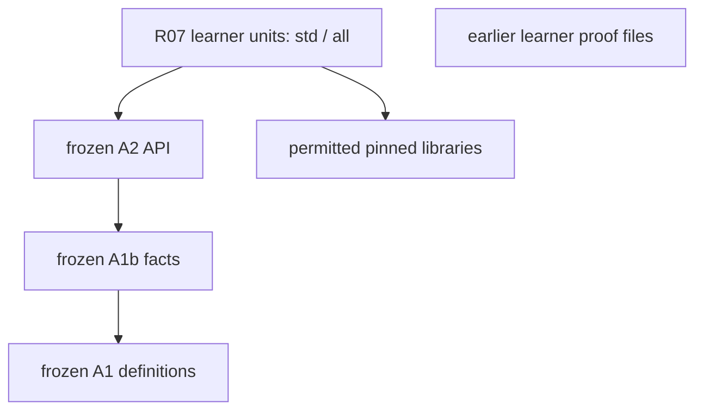
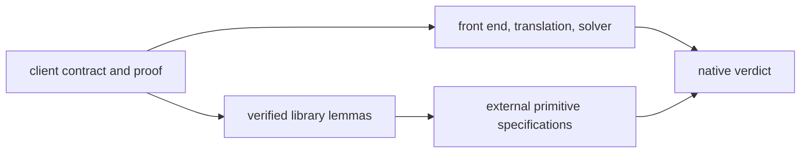

# R07 — Libraries: what they cost

Three ideas do all the work:

1. A library call contributes the exact theorem in its contract. Finding a promising name is the start of the proof: instantiate its parameters, discharge its preconditions and connect its conclusion to your target.
2. Automation has a scope and a cost. An explicit call makes one instance visible; a broadcast allows the solver to discover instances. Read the named-call version before widening that search.
3. A retrieval experiment needs its own evidence. Complete native reference proofs establish that the tasks are solvable, while matched agent attempts establish what happened under the two declared retrieval allowances.

## 0. How this module works

Allow 360 minutes: setup 10, closed-book test-out 10, reading 60, worked examples and WRITE cards 30, other cards 6, predictions 15, hand holes 62, mismatch lab 20, trust audit 20, pass@k by hand 15, EVAL R-v0 15, retriever follow-up 25, paper card 15, sixth bench card 20, viva 30 and calibration 7. Agent wall time is separate from this study allocation. These are planning estimates. Record actual work, interruptions and confidence instead of changing an original estimate after seeing the proof.

Start with T1 in both languages, closed book. The statement concerns the number of distinct characters observed in a sample. Attempt the proof using your present understanding of the pinned library interface. Record that first try before reading the worked example or a completed proof. A genuine test-out can earn the course's recap credit; an observed result after reading does not become a closed-book result. There is no checkpoint in R07.

This module declares A2, the complete frozen character-class and derivative-matcher API. The given chain includes A1 and A1b. It does not import an earlier learner file, and your library work does not depend on repairing someone else's earlier exercise. Read the supplied contracts at this layer. Familiar mathematical names may now be complete infrastructure, while the hand files ask different questions about samples, alphabets and batches.

The library boundary changes here. Dafny's hand unit is `std`, with standard libraries enabled through its generated project. The Verus hand file uses the `all` import tier for library lemmas beyond the prelude. This permission belongs to the module's declared paths and their checked dependency graph. It does not retroactively widen an earlier module, and it does not authorise a local solver option or a private dependency added to a project file.

**This module's files** keep hand work, prediction scenarios, given infrastructure and the retrieval task separate.

| path | role and shipping state |
|---|---|
| `dafny/R/R07_Libraries/std/R07_Libraries.dfy` | hand work: verified, 4 holes, 0 errors, including T1d |
| `verus/r/r07_libraries/src/lib.rs` | hand work: verified, 6 holes, 0 errors, including T1v |
| `dafny/checks/R07_checks.dfy` | given-only value check: verified, no holes or errors; P1d's value is unfilled |
| `dafny/R/R07_Libraries/agent/R07_AgentRetriever.dfy` | retriever task: verified, 2 holes, 0 errors; unfinished at the gate |
| `verus/r/r07_libraries/src/agent.rs` | retriever task: verified, 2 holes, 0 errors; unfinished at the gate |
| `specimens/R07/`, `slots/R07.slots` | value, obligation and guarded verdict scenarios; library cards |
| `dafny/given/R/RG_A2_Deriv.dfy`, `verus/given/rg_re_a2/` | complete frozen class and matcher API |
| `paper/R07_problems.tex`, `paper/R07_answers.tex` | Rango paper card; all eight fields are required |
| `research/EVAL.md` | shared learner-written evaluation rules; add the R-v0 section by hand |
| `Solutions/`, `paper/solutions/` | completed references — LAST, after your attempt and review |

Commit all five predictions before running their scenarios or opening the later demonstrations. P1d is a string-literal value in the check unit; P2v is a numeral in the concrete scalar-filter specimen. P4v asks for failure labels. P3dv and P5dv use the separate slot file. Run `scripts/firsttry.sh R07 --check`, preserve the original receipts, then enable the corresponding checks. Do not edit labels, erase a question or replace a failed prediction with an observed answer.

> **Predict (P1) — commit in the file before reading on.** The Dafny check prints a concrete class and sample and filters using the complete executable membership API. What exact string remains? Supply a string literal, rather than a call to the filter or class lookup.

> **Predict (P2) — commit in the file before reading on.** The Verus specimen filters a concrete sequence of Unicode scalar values. What numeral is the resulting sequence length? Commit the numeral before enabling its closed compute-only assertion.

> **Predict (P3) — commit in the file before reading on.** Compare the two complete filter-size scenarios [x] and [y], retaining the relation each printed contract actually asks for. Use `D:<x>,<y> V:<x>,<y>` and the actual native verdict vocabulary. Do not infer a theorem from an informal expectation that filtering usually removes something.

> **Predict (P4) — commit in the file before reading on.** Three labelled library calls use the same original sample and index. Which obligations fail under the printed preconditions? Commit the label set before running. Keep an input index distinct from an index into the filtered output.

> **Predict (P5) — commit in the file before reading on.** The batch scenarios supply a bound for every sample and ask whether the printed different bound follows. Read every quantified premise and conclusion. Commit `D:<v> V:<v>` before investigating a concrete counterexample.

After the first-try record, the following source runs establish the learner-loop baseline. Their counted holes are intentional typed placeholders; they are not a completion certificate.

<!-- pin: shipped-d -->
```
$ scripts/vcheck dafny/R/R07_Libraries/std
vcheck: dafny/R/R07_Libraries/std [dafny, learner loop]: verified — 39 verified, 4 holes, 0 errors
dafny/R/R07_Libraries/std/R07_Libraries.dfy:25:27: hole bodyless-method R07.T1d
dafny/R/R07_Libraries/std/R07_Libraries.dfy:72:88: hole bodyless-method R07.H1d
dafny/R/R07_Libraries/std/R07_Libraries.dfy:87:66: hole bodyless-method R07.H2d
dafny/R/R07_Libraries/std/R07_Libraries.dfy:103:33: hole bodyless-method R07.H3d
```

<!-- pin: shipped-v -->
```
$ scripts/vcheck verus/r/r07_libraries
vcheck: verus/r/r07_libraries [verus, learner loop]: verified — - verified, 6 holes, 0 errors
verus/r/r07_libraries/src/lib.rs:29:40: hole assume R07.T1v
verus/r/r07_libraries/src/lib.rs:97:40: hole assume R07.H1v
verus/r/r07_libraries/src/lib.rs:114:40: hole assume R07.H2v
verus/r/r07_libraries/src/lib.rs:135:40: hole assume R07.H3v
verus/r/r07_libraries/src/lib.rs:152:40: hole assume R07.H4v
verus/r/r07_libraries/src/lib.rs:173:40: hole assume R07.H5v
```

<!-- pin: checks-d -->
```
$ scripts/vcheck dafny/checks/R07_checks.dfy
vcheck: dafny/checks/R07_checks.dfy [dafny, learner loop]: verified — 34 verified, 0 holes, 0 errors
```

After the first-try record, the two value predictions are settled by runs. P1's check filters `"cab?"` by the class `ClassRange('a', 'c')`: the filter keeps, in order, every character the class contains, so the answer is `"cab"`, and `?` is dropped. The check unit's own test runs only once your answer is in its slot, so the lemma below states the same value, one step per character. `Std.Collections.Seq.Filter` is opaque, and `reveal S.Filter();` lets the solver unfold it; `ClassMember`'s contract (`b == InClass(cc, c)`) and `ClassRange`'s (`InClass(r, c) <==> lo <= c <= hi`) decide each character:

```dafny
module R07_ChP1 {
  import opened RG_A2_Deriv
  import S = Std.Collections.Seq

  // P1's scenario with its answer: the filter keeps the class's characters, in order.
  lemma P1Value()
  {
    var cc := ClassRange('a', 'c');
    var keep := c => ClassMember(cc, c);
    reveal S.Filter();
    assert keep('c') && keep('a') && keep('b') && !keep('?');
    assert "cab?" == ['c'] + "ab?";
    assert "ab?" == ['a'] + "b?";
    assert "b?" == ['b'] + "?";
    assert "?" == ['?'] + "";
    assert S.Filter(keep, "?") == "";
    assert S.Filter(keep, "b?") == "b";
    assert S.Filter(keep, "ab?") == "ab";
    assert S.Filter(keep, "cab?") == "cab";
  }
}
```

<!-- pin: p1-d -->
```
$ scripts/vcheck --module R07 p1.dfy
vcheck: p1.dfy [dafny, learner loop]: verified — 35 verified, 0 holes, 0 errors
```

P2 counts the `'β'`s of `seq!['β', 'a', 'β', 'b']`: two. `by (compute_only)` evaluates the closed expression; the `reveal_with_fuel` gives `filter` enough unfoldings for a four-element sequence.

```rust
use vstd::prelude::*;
use vstd::seq_lib::*;

verus! {

proof fn p2_value() {
    reveal_with_fuel(Seq::filter, 5);
    assert(seq!['β', 'a', 'β', 'b'].filter(|c: char| c == 'β').len() == 2) by (compute_only);
}

} // verus!
```

<!-- pin: p2-v -->
```
$ scripts/vcheck --module R07 p2.rs
vcheck: p2.rs [verus, learner loop]: verified — 1 verified, 0 holes, 0 errors
```

The answers are `"cab"` and `2`. Both are values of closed expressions; neither is a lemma about every sample, which is what the holes ask for.

---

## 1. Read the library as a collection of contracts

A sample is an ordered sequence of observations. An observed alphabet is the collection of distinct characters that occur in that sample. A character class describes a permitted set of characters, independently of which ones happened to occur. These three objects answer different questions. A filter produces another sequence; converting that sequence to a set changes what multiplicity information is available. A batch is a sequence of samples, so its outer length counts samples while an inner length counts observations in one sample.

Keep those types visible on paper before searching. Write the target operation, its argument types and its result type. Then write the relation you need. A theorem about membership may contribute a witness but leave a cardinality argument open. A theorem about one sample may need a further statement before it applies to a whole batch. Two functions whose names both contain flatten can have different recursive definitions and different associated lemmas. The interface, rather than an approximate English description, decides how a call fits.

W1 is a small example of reading a named fact. Open its declaration and the called library lemma. Bind the sequence argument and state which conclusion enters the caller's context. Check whether any precondition remains, including a condition about a callback's domain. The fact concerns a finite observed alphabet and its empty case. Explain why it does not by itself settle every cardinality question about every character collection.

W2 uses the class API without inspecting its range vector. The executable call returns a Boolean tied to the semantic membership contract. Your proof can use that relationship while the implementation stays private. A valid class representation is useful infrastructure, but a membership client should rely on the public clause it actually receives. Do not smuggle a private range invariant into the argument because the implementation happens to look sorted when you read it.

A function parameter is another interface. A library filter can accept a callback whose application has its own requirements and reads. For the pure membership predicates in these tasks, establish that the callback is defined for each required input. More general callbacks can make the library's preconditions substantial. A call that typechecks still owes those obligations. When diagnosis reaches a failed library precondition, instantiate that exact requirement at the supplied arguments before changing any unrelated proof code.

The working loop is short: identify the target, find a candidate declaration, instantiate it, check the requirements, call it and inspect the remaining obligation. If the last step remains red, compare the obtained and desired statements. You may need a slice equality, a finite-set conversion or an extensional equality. That gap belongs in the proof; it is not evidence that the library call was ignored. Conversely, a successful call can prove a different useful fact without supplying the fact you wanted.

Retain a source path and version for every unfamiliar symbol. A search result copied from a different library release can have a different parameter order, renamed method, stronger requirement or different return relation. The pinned local declaration is the authority for this course run. Online documentation can help locate it, but review the actual installed interface before presenting the call as a checked proof step.

```mermaid
flowchart LR
    target["typed target relation"] --> search["find candidate declaration"]
    search --> instance["bind parameters and requirements"]
    instance --> call["named library call"]
    call --> bridge["justify remaining bridge"]
    bridge --> gate["whole-file gate and audit"]
```

The search is complete only when the named contract supplies the target relation and the full-file instruments accept its checked scope.

### WRITE cards: explicit calls and qualified names

Complete C1d and C1v with an explicit named call and its actual arguments. The compact specimens deliberately leave the step absent. They isolate calling syntax and contract instantiation; leave the mathematical statement fixed. Before running, say which clause the call contributes. After running, retain the native result and explain the scope of the checked declaration.

```dafny
module R07_ExplicitCard {
  import S = Std.Collections.Seq
  // item: R07.C1d write:library-call
  // WRITE: instantiate the named empty-alphabet lemma; leave the contract fixed.
  lemma EmptyAlphabetCardR07(xs: seq<char>)
    ensures |S.ToSet(xs)| == 0 <==> |xs| == 0
  {
  }
}
```

<!-- pin: explicit-d -->
```
$ scripts/vcheck specimens/R07/card-c1d.dfy.specimen
vcheck: specimens/R07/card-c1d.dfy.specimen [dafny, learner loop]: failed — 0 verified, 0 holes, 1 error
specimens/R07/card-c1d.dfy.specimen:7:3: error: a postcondition could not be proved on this return path
specimens/R07/card-c1d.dfy.specimen:6:32: related: this is the postcondition that could not be proved
```

```rust
use vstd::prelude::*;
use vstd::seq_lib::*;
verus! {
// item: R07.C1v write:library-call
// WRITE: instantiate the named empty-alphabet lemma.
proof fn empty_alphabet_card_r07(xs: Seq<char>)
    ensures
        xs.to_set().len() == 0 <==> xs.len() == 0,
{}
}
```

<!-- pin: explicit-v -->
```
$ scripts/vcheck specimens/R07/card-c1v.rs.specimen
vcheck: specimens/R07/card-c1v.rs.specimen [verus, learner loop]: failed — 0 verified, 0 holes, 1 error
specimens/R07/card-c1v.rs.specimen:8:9: error: postcondition not satisfied
```

C3d asks for a qualified set-library fact and a reproducible search note. Write the namespace exactly and record which rung found it. The note is provenance for your choice, not a mathematical premise. A correct proof should still consist of checked code and justified library contracts when the note is removed.

```dafny
module R07_SearchCard {
  import Sets = Std.Collections.Set
  // item: R07.C3d write:library-call
  // WRITE: name the qualified library fact; record the source-search rung.
  lemma SameObservedAlphabetR07(a: set<char>, b: set<char>)
    requires a <= b && |a| == |b|
    ensures a == b
  {
  }
}
```

<!-- pin: search-d -->
```
$ scripts/vcheck specimens/R07/card-c3d.dfy.specimen
vcheck: specimens/R07/card-c3d.dfy.specimen [dafny, learner loop]: failed — 0 verified, 0 holes, 1 error
specimens/R07/card-c3d.dfy.specimen:8:3: error: a postcondition could not be proved on this return path
specimens/R07/card-c3d.dfy.specimen:7:15: related: this is the postcondition that could not be proved
```

---

## 2. Search, name and then scope automation

Use a search ladder that leaves a trail. Start from the operation and type in the goal. Inspect completion or symbol navigation if it is available. Search the pinned source for the operation's identifier and nearby ensures clauses. Use documentation to understand conventions and links between operations. If a model suggests a symbol, treat that suggestion as a candidate search result and check its existence and signature locally. A remembered name is also a candidate, with memory as its recorded rung.

Each successful search should end with a named call in the proof and a short found-by note. Use the contract's prescribed rung labels for a retriever delivery. Do not disguise a model lookup as a source search, or a remembered symbol as an independent retrieval success. If the desired theorem does not exist, record that result, reconsider the interface and decide whether the task permits a helper. The R07 retriever contract restricts bodies to library calls, so inventing a proof helper changes that task's method even when the helper is correct.

Broad search results need interpretation. A library file can contain an exported method, an internal proof, a broadcast group and an example whose syntax belongs to a documentation block. Search output alone does not tell you which names a client can call. Read the declaration in context: visibility, generic parameters, method receiver, requirements and the definition it characterises. If a familiar helper is private, do not copy its implementation into the learner file to simulate a public interface.

A named call supplies a particular instance. Broadcast permits the verifier to instantiate a declared broadcast theorem when matching terms appear. This can make a concise client proof possible, but the proof now depends on which facts are enabled in that scope and which trigger matches occur. The mathematical contract remains the same. An extra group can also change the solver's work, interactions with other facts and memory use. A larger enabled set is not a guarantee of a faster or more stable verification run.

Follow the hand-first rule. Read and run the named-call version of the card before writing its scoped-broadcast version. State which requirement is available and which target term should trigger the desired instance. Keep the enabling line inside the proof where it is needed. When the proof fails, return to the explicit instance as a diagnostic control. This lets you distinguish an unavailable theorem from a scope or matching problem without changing the target statement.

C2v presents the explicit filter-map origin argument and then asks for one scoped broadcast. C3v repeats the discipline for a different step relation and adds the qualified-source search note. The examples concern character observations and their optional mappings. Read the exact output-origin or prefix statement; do not substitute a theorem about an ordinary filter because the names look related.

```rust
use vstd::prelude::*;
use vstd::seq_lib::*;
verus! {
// GIVEN: understand this explicit call before the scoped broadcast version.
proof fn filter_map_origin_named_r07(xs: Seq<char>, f: spec_fn(char) -> Option<char>, out: char)
    requires
        xs.filter_map(f).contains(out),
    ensures
        exists|c: char| xs.contains(c) && f(c) == Some(out),
{
    xs.lemma_filter_map_contains(f, out);
}
// item: R07.C2v write:broadcast-use
// WRITE: a single qualified broadcast use, scoped only to this proof.
proof fn filter_map_origin_scoped_r07(xs: Seq<char>, f: spec_fn(char) -> Option<char>, out: char)
    requires
        xs.filter_map(f).contains(out),
    ensures
        exists|c: char| xs.contains(c) && f(c) == Some(out),
{}
}
```

<!-- pin: scoped-origin-v -->
```
$ scripts/vcheck specimens/R07/card-c2v.rs.specimen
vcheck: specimens/R07/card-c2v.rs.specimen [verus, learner loop]: failed — 1 verified, 0 holes, 1 error
specimens/R07/card-c2v.rs.specimen:19:9: error: postcondition not satisfied
```

```rust
use vstd::prelude::*;
use vstd::seq_lib::*;
verus! {
// GIVEN: the explicit instantiation, before scoped automation.
proof fn filter_map_step_named_r07(xs: Seq<char>, f: spec_fn(char) -> Option<char>, i: int)
    requires
        0 <= i < xs.len(),
    ensures
        xs[..i + 1].filter_map(f) == xs[..i].filter_map(f) + (match f(xs[i]) { Some(c) => seq![c], None => Seq::empty() }),
{
    xs.lemma_filter_map_take_succ(f, i);
}
// item: R07.C3v write:broadcast-use
// WRITE: locate the qualified symbol, record found-by, and scope its broadcast.
proof fn filter_map_step_scoped_r07(xs: Seq<char>, f: spec_fn(char) -> Option<char>, i: int)
    requires
        0 <= i < xs.len(),
    ensures
        xs[..i + 1].filter_map(f) == xs[..i].filter_map(f) + (match f(xs[i]) { Some(c) => seq![c], None => Seq::empty() }),
{}
}
```

<!-- pin: scoped-step-v -->
```
$ scripts/vcheck specimens/R07/card-c3v.rs.specimen
vcheck: specimens/R07/card-c3v.rs.specimen [verus, learner loop]: failed — 1 verified, 0 holes, 1 error
specimens/R07/card-c3v.rs.specimen:19:9: error: postcondition not satisfied
```

H4 and H5 ask for a `broadcast use` where it is the smallest proof, not merely an allowed one (the user's decision D91). Each states W3's or W4's fact for every element at once: `forall|out: char| xs.filter_map(f).contains(out) ==> …` and `forall|i: int| 0 <= i < xs.len() ==> …`. A named call proves one instance; covering the quantifier with named calls needs an `assert forall … by { call }`, while a scoped `broadcast use` of the same lemma lets the solver instantiate it at every element the goal mentions. The empty body fails, the named-call version is longer, and the one-line broadcast verifies (§8 records the probes). The scope stays the proof's body: the broadcast does not leak into the rest of the file.

Your review should be able to reconstruct the proof without running a search engine. It should find the called symbol, its pinned source and the reason its requirements hold. For automation, add the group or broadcast symbol and its scope. Avoid a sentence such as the solver knows all sequence facts: it hides the very boundary you need when a proof breaks after an import change.

---

## 3. Follow the import graph and the collection type

The registry assigns an import tier to a file. A checker follows the dependency graph, because moving a prohibited library import into a helper does not remove that dependency. A source that names only a small API can still reach a broader library transitively. Read the generated project and crate dependencies as part of the exercise's environment, while keeping those frozen files unchanged in learner work.

Dafny's standard library switch belongs to the std verification unit. A source file that uses Std must be checked in the environment that provides it; copying the file into an unrelated project can change resolution and available assumptions. Verus has a similar practical boundary between prelude use and importing additional lemma libraries. The all tier permits the intended library work here. It is not permission to alter the verifier executable, add trusted specifications or turn a proof failure into an accepted warning.



Use the type boundary as carefully as the import boundary. Dafny offers finite set and potentially infinite-set forms. Verus likewise distinguishes Set and ISet. At this pin, ISet does have a len method returning nat. A nonnegativity fact can therefore verify from the return type alone. That observation does not establish finiteness or a useful cardinality law for an arbitrary collection. Read each theorem's actual requirements.

The class API's semantic view uses ISet. A finite observed alphabet produced from a sample can instead use Set. Do not replace the declared view with a convenient type and forget the relationship to the original claim. When a library size theorem asks for finite(), establish that fact from the available interface or identify it as missing. Mathematical knowledge of a bounded character universe does not automatically supply a library proof about the semantic view.

C4 compares a finite Dafny set insertion with an ISet insertion theorem in Verus. The first contract uses the finite-set interface. The second call needs the library's explicit finiteness premise; the source supplies only nonmembership. Inspect the actual unmet requirement and native stage. This is a comparison of printed collection interfaces, not a claim that one language lacks finite cardinality or that ISet has no length operation.

```dafny
// after: R07.P3dv
module R07_FiniteAlphabetCard {
  // item: R07.C4dv diverge:r07-collections
  // This finite-set insertion law has no separate finiteness premise.
  lemma FiniteObservedInsertR07(s: set<char>, c: char)
    requires c !in s
    ensures |s+{c}| == |s|+1
  {
  }
}
```

<!-- pin: collection-d -->
```
$ scripts/vcheck specimens/R07/card-c4dv-d.dfy.specimen
vcheck: specimens/R07/card-c4dv-d.dfy.specimen [dafny, learner loop]: verified — 1 verified, 0 holes, 0 errors
```

```rust
// after: R07.P3dv
use vstd::prelude::*;
verus! {
// ISet has len() at this pin; its useful size laws require finite().
proof fn class_insert_count_r07(s: ISet<char>, c: char)
    requires
        !s.contains(c),
    ensures
        s.insert(c).len() == s.len() + 1,
{
    vstd::iset::lemma_iset_insert_len(s, c);
}
}
```

<!-- pin: collection-v -->
```
$ scripts/vcheck specimens/R07/card-c4dv-v.rs.specimen
vcheck: specimens/R07/card-c4dv-v.rs.specimen [verus, learner loop]: failed — 0 verified, 0 holes, 1 error
specimens/R07/card-c4dv-v.rs.specimen:11:5: error: precondition not satisfied
```

This distinction matters during H2. Read the filtered object, the finite observed alphabet and the duplicate-free predicate separately. When proving an equivalence, identify both directions before searching. A theorem that proves one direction is useful but does not silently establish its converse. Keep your completed statement fixed and let the full gate check the entire requested relationship.

During H3, identify the outer sample count, the supplied bound and the flattened observation count. Name each type and each quantified domain. If a library theorem characterises a different flattening definition, decide what bridge is required and find its contract. Do not replace the requested expression with the one that the first search result happens to mention.

---

## 4. Toolchain mismatch: preserve the stage

A verification result has an environment: source, project, verifier, bundled libraries and solver. The course pins that environment so that a repeated command means a repeatable check. C5 is a recognition card for reading that provenance. Locate the documented tool versions and the checks the wrapper performs. Keep an artifact digest distinct from a human-readable version string: the same label on different bytes is not an identity check.

For the lab, begin with these read-only identity checks and the provided small class-membership controls. Keep each output and its exit status. The public probe files are complete given code, separate from your hand holes.

```bash
scripts/get_toolchain.sh dafny --check
scripts/get_toolchain.sh verus --check
rustc --version
rustup run 1.98.1-x86_64-unknown-linux-gnu rustc --version
scripts/vcheck --gate specimens/R07/toolchain-d.dfy.specimen
scripts/vcheck --gate specimens/R07/toolchain-v.rs.specimen
scripts/vcheck --brittleness --solvers specimens/R07/toolchain-d.dfy.specimen
```

The solver sweep uses the two supported bundled Dafny solvers through the wrapper. It checks this small complete control under the declared configurations; it is not a proof about every solver version. Compare the host compiler identity with the exact compiler named by the Verus pin. Then repeat the Verus control with `RUSTUP_TOOLCHAIN=stable` before the command. Read the launcher's documented pinning and retain which compiler it actually uses; a requested environment setting need not change that compiler.

Finally, try the interface-level refusal control below. The nonexistent path is only an argument; do not create it, replace an installed solver or edit a frozen project. Record whether refusal happened before any verification. This control tests the wrapper boundary, not native behaviour after an actually mismatched compiler or solver was installed.

```bash
scripts/vcheck specimens/R07/toolchain-d.dfy.specimen -- --solver-path /tmp/r07-no-course-solver
```

```dafny
module R07_ToolchainControl {
  lemma ClassPairControlR07(c: char)
    ensures (c in {'a', 'b'}) <==> (c == 'a' || c == 'b')
  {
  }
}
```

<!-- pin: toolchain-d -->
```
$ scripts/vcheck specimens/R07/toolchain-d.dfy.specimen
vcheck: specimens/R07/toolchain-d.dfy.specimen [dafny, learner loop]: verified — 1 verified, 0 holes, 0 errors
```

```rust
use vstd::prelude::*;
verus! {
proof fn class_pair_control_r07(c: char)
    ensures
        set!['a', 'b'].contains(c) <==> (c == 'a' || c == 'b'),
{}
}
```

<!-- pin: toolchain-v -->
```
$ scripts/vcheck specimens/R07/toolchain-v.rs.specimen
vcheck: specimens/R07/toolchain-v.rs.specimen [verus, learner loop]: verified — 1 verified, 0 holes, 0 errors
```

The mismatch lab uses disposable controls and retains the refusal or failure before attempting to interpret a theorem result. Never edit the installed toolchain, change a frozen project or replace its solver as a learner repair. Start by checking the genuine pinned setup through the documented toolchain check. Save the command, reported identity and result. If installation is missing or inconsistent, fix setup through the course's installation route before counting proof attempts.

Next inspect the mismatch control specified for the activity and classify the last completed stage. A wrapper can reject an impermissible option before invoking any verifier. A digest check can refuse a changed artifact before translation. A native tool can reject a dependency or compiler mismatch before checking an obligation. These observations differ, so record the actual one. A generic nonzero exit code does not identify a false theorem.

Compare Dafny's and Verus's documented environment constraints. Verus is tied closely to an exact Rust compiler and its verifier libraries; a host rustc with a nearby version is not evidence of compatibility. Dafny's translation and solver pipeline likewise depend on the installed pins. Consult the recorded local observations and VERSIONS rather than extrapolating from how a different release behaved on a different machine.

Your lab record has four parts: the unchanged baseline identity, the disposable mismatch control, the first failing stage and the unchanged identity after the control. Retain diagnostic text privately when it contains a prediction answer or a protected path. Keep tool/setup failures in the cost ledger, with any exclusion governed by rules fixed before the comparison. A failed environment should never disappear because dropping it makes a success rate look cleaner.

If your proposed control would require changing a protected file, stop that control and use a disposable author-provided artifact or an interface-level refusal instead. State which boundary you actually tested. The purpose is to learn how an experiment separates setup from proof checking. It does not require you to weaken the wrapper's environment checks or run an unpinned solver against course work.

---

## 5. Audit the trust surface

A library lemma with a verified body is part of a checked development. It is still interpreted by the toolchain, using the contracts and external specifications available to that development. An external specification can describe a primitive operation without a body verified in the same language. A trusted compiler or translator connects the front-end program with the obligations checked by the solver. The audit must keep these categories distinct.



Choose one called library theorem and trace its statement, body and dependencies in the pinned source. Identify which proof step is checked and which external contract it uses. Then inspect the client's native gate and audit. A clean client audit establishes the absence of findings in that run's checked scope; it does not certify a different theorem or eliminate the compiler and solver from the trusted base.

Write down what an imported theorem promises. If it refers to a collection view, retain the view relation. If it uses a callback, retain its domain conditions. If it returns a bound, retain the bound's quantified range. A proof can be valid under all these contracts and still model the wrong external requirement. The library audit and the specification-fidelity review answer related questions, with different evidence.

Avoid two shortcuts. Calling every library fact an axiom erases the distinction between a checked proof and an external specification. Calling every green result assumption-free erases the toolchain and imported specification boundary. Instead, name the particular theorem, native scope and remaining trust. If an audit reports a finding, inspect its kind and location rather than classifying it from a remembered list of suspicious words.

The class API illustrates why encapsulation is useful in an audit. The client can check that its membership call establishes the advertised semantic relationship while the class implementation maintains its representation invariant privately. The implementation still needs its own gate and audit. Reopening that representation in every client makes dependencies harder to review, and a private field fact copied into prose has no force unless the formal interface supplies it.

Complete the trust activity with an evidence table of your own: item inspected, proved body or external contract, source identity, native command, observation and remaining trust. Keep a separate column for a reader's judgement about modelling intent. This table becomes a useful precursor to the later TRUST work, while the formal trust ledger remains a learner-written artifact at its designated module.

---

## 6. Calculate pass@k at the task level

For one fixed task, suppose there are n completed attempts under the declared sampling procedure and c accepted deliveries. The unbiased pass@k estimator used by the frozen harness is `1 - C(n-c,k)/C(n,k)` for `1 <= k <= n`. It estimates success when selecting k attempts from that task's sample without replacement. When fewer than k failures exist, every such selection contains a success. Keep the estimator's domain and its sampling interpretation visible.

Work the following **synthetic worksheet** by hand. These numbers are teaching inputs, not measurements of the course agents. For a first task, use n=5 and c=2. For a second task, use n=5 and c=4. Calculate pass@1 and pass@2 separately for each task. Write the number of all selections and all-failure selections before reducing the fractions. Only then take an equally weighted mean across the two tasks, if that is the declared task-level summary.

Check the arithmetic by importing the existing `fvh.stats.pass_at_k` function in the frozen harness environment. Do not implement another estimator in a learner file, paste a different numerical approximation into the codebase or replace the exact combinations with a formula remembered from another setting. The exercise is about choosing the unit, inputs and interpretation; the statistics implementation is already infrastructure.

Now compare that task-level calculation with pooling the ten attempts into one invented task. Explain why pooling changes the question. It gives attempt weighting and combines success counts across different targets before applying a nonlinear estimator. The task-level mean instead preserves the declared weighting of targets. Equal n in this tiny table is convenient for arithmetic, but does not make the two estimands identical.

Try an invalid request with k larger than n and preserve the frozen function's rejection. Decide in advance what a real report will do when some tasks have too few attempts for a requested k. Silently clipping k produces a mixed metric. Silently removing those tasks can produce a selected population. A report needs the requested budget, the achieved sample sizes, the eligible task count and the declared treatment of incomplete tasks.

Keep acceptance separate from execution. An attempt can time out, truncate, fail setup, produce a statement-changing delivery or fail an audit. Your protocol must say which of those consumes an attempt and how it enters the success count and cost ledger. Do not infer correctness from an agent's own claimed verdict. Use the same frozen acceptance pipeline for both arms and record any tool failure that prevents judgement.

The estimator alone does not supply an uncertainty interval. For a comparison, identify the unit that was sampled and the dependence you created by pairing tasks and repeating attempts. Preserve language strata and task pairs when your declared analysis requires them. Use the existing frozen statistical tools for a justified design; do not label a variation across library symbols as a confidence interval. A tiny course demonstration should make a suitably narrow claim.

Finally, explain what changed between pass@1 and pass@2: the allowed number of sampled opportunities, with a fixed task and declared procedure. A higher-budget estimate does not mean an individual proof became more faithful or an arm became cheaper. Keep correctness, coverage, compute and search allowance as separate reported quantities so the reader can understand the practical tradeoff.

---

## 7. On paper, before the keyboard

Write the R-v0 section of `research/EVAL.md` yourself, by hand. It is the shared evaluation-rules document, so add the R section without replacing another track's section or weakening an existing rule. The chapter supplies questions; it does not write a report in your voice. State each rule with the observation that taught it and the command, record or reader check that can test it later.

Cover the claim and its population, the task and attempt units, acceptance criteria, metric and estimator, requested budgets, achieved n, exclusions and failures, uncertainty, costs, and disclosure. Name retrieval eligibility and session separation explicitly. An experiment can be reproducible at the command level while comparing unequal contexts; both the formal pipeline and the supplied information need documentation. Retain model and tool versions separately because either can change the observed result.

Use the synthetic worksheet as a check of interpretation, clearly labelled synthetic. If the race has no live observations yet, leave its rate and winner unmeasured. If only one arm ran, retain that arm's descriptive records and explain why a paired comparison is unavailable. If some tasks or languages are missing, preserve the denominator and the reason. A blank empirical result with clear evidence boundaries is more useful than a precise number attached to an unperformed experiment.

The written pair contains card 06.5, Rango, and only that card. Fill Task shape, Oracle, Trust, Cheat surface, Metric, Budget, Variance and Artifact from its pinned source range. Each field receives its own assessment; the card's score is the minimum. Copying a headline percentage into every field loses the distinctions that make an evaluation interpretable.

Keep the paper's population and checking pipeline intact. Rango is about Coq project theorems and per-step retrieval of finished proofs and lemma statements. A completed proof accepted by that environment is the oracle described in the source. Its benchmark, subsets and ablations have different denominators, contexts and budgets. A statement about one ablation's relative gain should not become a percentage-point gain over every benchmark theorem.

Describe the actual retrieval bank. Earlier proofs in a file and available dependencies differ from unrestricted access to a target's completion. Project-separated training and a file-wise split make different information available. When discussing contamination or generalisation, identify which split and subset supplied the result. Do not infer a new guarantee merely because a test project has a familiar name.

The card should also retain missing evidence. A local summary can identify a paper, tool version and released corpus while omitting an immutable implementation revision or a full cost ledger. State what you can pin and what remains unavailable in that excerpt. The course's library tasks, toolchains, model and retrieval allowance then need their own evidence before the paper can motivate a claim about this race.

---

## 8. The exercise file

Complete H1 through H3 in both hand files and the two additional Verus scope holes after the predictions, worked examples and written preparation. For H1, write the sample-prefix relation and the filtered-prefix relation with their bounds. For H2, draw both arrows of the equivalence between the duplicate-free property and the exact observed-alphabet count. For H3, name the batch's outer length, inner bound and flattening expression before choosing a library theorem. These plans identify what must be proved while leaving the library search to you.

Work through the pinned wrapper in short edits. After each call, read the actual remaining obligation. If a boundary expression is ill formed, establish its bound before using it in a later equation. If an extensional equality is missing, identify which sequence or set relation the target needs. If a proof uses a broader group, retain that scope and justify it during review. Do not lower the problem by changing a frozen clause or raising a resource limit.

After recording and enabling the prediction switches, retain the native scenario observations for your debrief. Explain each one from the printed context. When a result contradicts your guess, isolate the relation or index domain that your interpretation changed. Do not turn a single failed run into an assertion that no valid proof exists, and do not turn a successful contract check into a claim about an unmodelled external requirement.

```dafny
// after: R07.P3dv
module R07_PredictFilterx {
  import S = Std.Collections.Seq
  lemma FilterSizeR07(allowed: set<char>, xs: seq<char>)
    ensures |S.Filter(c => c in allowed, xs)| == |xs|
  {
  }
}
```

<!-- pin: filter-x-d -->
```
$ scripts/vcheck specimens/R07/filter-size-x-d.dfy.specimen
vcheck: specimens/R07/filter-size-x-d.dfy.specimen [dafny, learner loop]: failed — 1 verified, 0 holes, 1 error
specimens/R07/filter-size-x-d.dfy.specimen:6:3: error: a postcondition could not be proved on this return path
specimens/R07/filter-size-x-d.dfy.specimen:5:47: related: this is the postcondition that could not be proved
```

```dafny
// after: R07.P3dv
module R07_PredictFiltery {
  import S = Std.Collections.Seq
  lemma FilterSizeR07(allowed: set<char>, xs: seq<char>)
    ensures |S.Filter(c => c in allowed, xs)| <= |xs|
  {
  }
}
```

<!-- pin: filter-y-d -->
```
$ scripts/vcheck specimens/R07/filter-size-y-d.dfy.specimen
vcheck: specimens/R07/filter-size-y-d.dfy.specimen [dafny, learner loop]: verified — 2 verified, 0 holes, 0 errors
```

```rust
// after: R07.P3dv
use vstd::prelude::*;
use vstd::seq_lib::*;
verus! {
proof fn filter_size_r07(allowed: ISet<char>, xs: Seq<char>)
    ensures
        xs.filter(|c: char| allowed.contains(c)).len() == xs.len(),
{
}
}
```

<!-- pin: filter-x-v -->
```
$ scripts/vcheck specimens/R07/filter-size-x-v.rs.specimen
vcheck: specimens/R07/filter-size-x-v.rs.specimen [verus, learner loop]: failed — 0 verified, 0 holes, 1 error
specimens/R07/filter-size-x-v.rs.specimen:7:9: error: postcondition not satisfied
```

```rust
// after: R07.P3dv
use vstd::prelude::*;
use vstd::seq_lib::*;
verus! {
proof fn filter_size_r07(allowed: ISet<char>, xs: Seq<char>)
    ensures
        xs.filter(|c: char| allowed.contains(c)).len() <= xs.len(),
{
}
}
```

<!-- pin: filter-y-v -->
```
$ scripts/vcheck specimens/R07/filter-size-y-v.rs.specimen
vcheck: specimens/R07/filter-size-y-v.rs.specimen [verus, learner loop]: verified — 1 verified, 0 holes, 0 errors
```

```dafny
// after: R07.P5dv
module R07_PredictBatch {
  lemma BatchCountAsBoundR07(blocks: seq<seq<char>>, limit: nat)
    requires forall i :: 0 <= i < |blocks| ==> |blocks[i]| <= limit
    ensures forall i :: 0 <= i < |blocks| ==> |blocks[i]| <= |blocks|
  {
  }
}
```

<!-- pin: batch-d -->
```
$ scripts/vcheck specimens/R07/batch-bound-d.dfy.specimen
vcheck: specimens/R07/batch-bound-d.dfy.specimen [dafny, learner loop]: failed — 1 verified, 0 holes, 1 error
specimens/R07/batch-bound-d.dfy.specimen:6:3: error: a postcondition could not be proved on this return path
specimens/R07/batch-bound-d.dfy.specimen:5:13: related: this is the postcondition that could not be proved
```

```rust
// after: R07.P5dv
use vstd::prelude::*;
verus! {
proof fn batch_count_as_bound_r07(blocks: Seq<Seq<char>>, limit: nat)
    requires
        forall|i: int| 0 <= i < blocks.len() ==> (#[trigger] blocks[i]).len() <= limit,
    ensures
        forall|i: int| 0 <= i < blocks.len() ==> (#[trigger] blocks[i]).len() <= blocks.len(),
{
}
}
```

<!-- pin: batch-v -->
```
$ scripts/vcheck specimens/R07/batch-bound-v.rs.specimen
vcheck: specimens/R07/batch-bound-v.rs.specimen [verus, learner loop]: failed — 0 verified, 0 holes, 1 error
specimens/R07/batch-bound-v.rs.specimen:8:9: error: postcondition not satisfied
```

P4's three calls share one sample and one index. Each library lemma has its own precondition, and the index `i` is an index of `xs`, not of the filtered sequence:

```rust
use vstd::prelude::*;
use vstd::seq_lib::*;
verus! {
// item: R07.P4v obligation
// Commit labels before enabling the switch.
// SLOT: FAILS ???
proof fn filtered_indices_r07(xs: Seq<char>, i: int)
    requires
        0 <= i < xs.len(),
{
    xs.lemma_filter_contains(|c: char| c == 'x', i); // [a]
    xs.lemma_filter_pred(|c: char| c == 'x', i); // [b]
    xs.lemma_filter_len(|c: char| c == 'x'); // [c]
}
}
```

<!-- pin: p4-v -->
```
$ scripts/vcheck specimens/R07/P4v.rs.specimen
vcheck: specimens/R07/P4v.rs.specimen [verus, learner loop]: failed — 0 verified, 0 holes, 2 errors
specimens/R07/P4v.rs.specimen:12:5: error: precondition not satisfied
specimens/R07/P4v.rs.specimen:11:5: error: precondition not satisfied
```

The answer is `FAILS a b`. [a] `lemma_filter_contains` requires the predicate to hold at `xs[i]`, which nothing establishes; [b] `lemma_filter_pred` requires `i` to be an index of the *filtered* sequence, and an index of `xs` need not be one; [c] `lemma_filter_len` has no precondition (the filter is never longer than its input). Read a library lemma's `requires` before calling it, and keep an input index separate from an index into the output.

### The named-call gate

R07's holes are short by design: each reference is one or two named library calls, and the skill is the search, not the length of the proof. The user's decision D90 replaces the three-fact bar for these holes with the **named-call gate**. A hole marked `// gate: named-calls` passes when its body is a sequence of named library calls, each with a `// found-by:` note naming the rung that found it (`ide`, `grep`, `docs`, `source`, `llm` or `memory`), and the gate shows that every call is needed: the empty body fails (the empty-body gate), and the body with any one call removed fails. The reference records one such removal per call, and `scripts/firsttry.sh R07 --empty-body` runs each of them. Your own delivery is judged the same way: keep the found-by notes, and expect a reviewer to delete each call and re-run.

| item | statement (Dafny · Verus) | minutes D / V | the named calls |
|---|---|---|---|
| T1 | `ObservedAlphabetBound` · `lemma_observed_alphabet_bound`: the observed alphabet is no larger than the sample (closed book) | 5 / 5 | one cardinality lemma |
| H1 | `FilteredSamplePrefix` · `lemma_filtered_sample_prefix`: filtering keeps prefixes | 8 / 6 | Dafny: a split of `ys` and the filter-concat lemma; Verus: the monotonicity lemma |
| H2 | `FilteredAlphabetExact` · `lemma_filtered_alphabet_exact`: no duplicates exactly when the set is as large as the sequence | 11 / 7 | one lemma per direction |
| H3 | `SampleBatchBound` · `lemma_sample_batch_bound`: a batch flattens to at most `|blocks| * limit` | 12 / 8 | the bound, and the bridge between the two flattenings |
| H4v | `filter_map_origins_scoped`: every output of a `filter_map` comes from an input (Verus) | — / 5 | one scoped `broadcast use` |
| H5v | `filter_map_steps_scoped`: every one-element extension of a `filter_map` (Verus) | — / 5 | one scoped `broadcast use` |

Done means every required proof is complete, all five predictions and T1 first tries are recorded, the written card and reviews are complete, and the actual full gates and audits pass. Run `scripts/firsttry.sh R07 --check` before enabling the prediction switches.

### What the instruments can and cannot see

Run the gate and the audit on the shipped units and read why they refuse:

<!-- pin: gate-d -->
```
$ scripts/vcheck --gate dafny/R/R07_Libraries/std
vcheck: dafny/R/R07_Libraries/std [dafny, gate]: failed — 39 verified, 4 holes, 0 errors, 1 finding
dafny/R/R07_Libraries/std/R07_Libraries.dfy:25:27: hole bodyless-method R07.T1d
dafny/R/R07_Libraries/std/R07_Libraries.dfy:72:88: hole bodyless-method R07.H1d
dafny/R/R07_Libraries/std/R07_Libraries.dfy:87:66: hole bodyless-method R07.H2d
dafny/R/R07_Libraries/std/R07_Libraries.dfy:103:33: hole bodyless-method R07.H3d
dafny/R/R07_Libraries/std: warnings-fail-gate: warnings fail the gate (W-D04): holes and every other warning must be gone
```

<!-- pin: gate-v -->
```
$ scripts/vcheck --gate verus/r/r07_libraries
vcheck: verus/r/r07_libraries [verus, gate]: failed — - verified, 6 holes, 1 error
verus/r/r07_libraries/src/lib.rs:29:40: hole assume R07.T1v
verus/r/r07_libraries/src/lib.rs:97:40: hole assume R07.H1v
verus/r/r07_libraries/src/lib.rs:114:40: hole assume R07.H2v
verus/r/r07_libraries/src/lib.rs:135:40: hole assume R07.H3v
verus/r/r07_libraries/src/lib.rs:152:40: hole assume R07.H4v
verus/r/r07_libraries/src/lib.rs:173:40: hole assume R07.H5v
(no file): error: gate: 'success' is false, not true; --output-json lacks 'is-verifying-entire-crate'; 'encountered-vir-error' is true, not false; --output-json lacks 'verified'; 6 hole(s); exit 1
```

<!-- pin: audit-d -->
```
$ scripts/vaudit dafny/R/R07_Libraries/std
dafny/R/R07_Libraries/std/R07_Libraries.dfy:24: audit-bodyless-ghost — ObservedAlphabetBound: Ghost declaration has no body and has an ensures clause
dafny/R/R07_Libraries/std/R07_Libraries.dfy:70: audit-bodyless-ghost — FilteredSamplePrefix: Ghost declaration has no body and has an ensures clause
dafny/R/R07_Libraries/std/R07_Libraries.dfy:86: audit-bodyless-ghost — FilteredAlphabetExact: Ghost declaration has no body and has an ensures clause
dafny/R/R07_Libraries/std/R07_Libraries.dfy:101: audit-bodyless-ghost — SampleBatchBound: Ghost declaration has no body and has an ensures clause
vaudit: dafny/R/R07_Libraries/std [dafny, learner]: 4 finding(s)
```

<!-- pin: audit-v -->
```
$ scripts/vaudit verus/r/r07_libraries
verus/r/r07_libraries/src/lib.rs:29: hole-assume — an assume hole (in lemma_observed_alphabet_bound) not on the trust allowlist
verus/r/r07_libraries/src/lib.rs:97: hole-assume — an assume hole (in lemma_filtered_sample_prefix) not on the trust allowlist
verus/r/r07_libraries/src/lib.rs:114: hole-assume — an assume hole (in lemma_filtered_alphabet_exact) not on the trust allowlist
verus/r/r07_libraries/src/lib.rs:135: hole-assume — an assume hole (in lemma_sample_batch_bound) not on the trust allowlist
verus/r/r07_libraries/src/lib.rs:152: hole-assume — an assume hole (in filter_map_origins_scoped) not on the trust allowlist
verus/r/r07_libraries/src/lib.rs:173: hole-assume — an assume hole (in filter_map_steps_scoped) not on the trust allowlist
vaudit: verus/r/r07_libraries [verus, learner]: 6 finding(s)
```

<!-- pin: freeze -->
```
$ scripts/specfreeze --check R07
specfreeze: R07: 0 finding(s)
```


Use the completion instruments on the whole files: `scripts/vcheck --gate dafny/R/R07_Libraries/std`, `scripts/vcheck --gate verus/r/r07_libraries`, `scripts/vaudit` on those same targets, `scripts/specfreeze --check R07`, and `scripts/firsttry.sh R07 --report --strict`. Check the given-only value unit after its switch is enabled, and apply the agent contract's gate, audit and saved snapshot to each selected delivery. Preserve commands and scope with their results.

The sixth benchmark card strips one of your own completed R07 library goals. Save the original statement, completed answer, stripped task, source module and provenance. Label it course-derived. Run the stripped and completed controls under the pins and keep the observations. This reconstruction task is useful practice, but familiarity with your own proof does not make it an independent unseen benchmark for a later experiment.

Review the final proof for library conventions. Every called name should resolve to the pinned interface, every requirement should be justified, and every type conversion should preserve the target relationship. Search notes should be reproducible. Broadcast scope should be deliberate. An audit finding should have a specific interpretation, while an absence of findings should stay attached to its actual run. Keep these explanations short enough that another reader can locate the corresponding step.

Finish calibration with the initial estimate, actual time, most expensive search or proof detour, and the next change you will try. Distinguish time spent understanding a contract from time spent waiting for the verifier, fixing setup or collecting experimental records. Those costs suggest different improvements. A faster search is useful only when the resulting proof and its claimed scope remain clear.

---

## 9. Exercise (agentic): a matched retriever race

> **CONTRACT (for /contract R07 — run it in a FRESH session):** Complete the same two frozen library goals under the predeclared retrieval allowance. Edit only the selected agent file. Retain named library calls, justified requirements and found-by notes. Final delivery needs the full-file zero-hole gate, clean audit and saved-snapshot comparison. Keep arm contexts separate and retain all failures and costs.

The agent files contain two frozen library goals about batches of class ranges. Save an original snapshot before either run. Both arms receive identical tasks, formal statements and acceptance checks. Declare the retrieval allowance before the first attempt, along with the model and tool identity, attempt limit, time and token budgets, stopping rule and what counts as a completed delivery. A later successful proof cannot repair an earlier undeclared comparison.

Use fresh sessions. The no-retrieval arm receives the permitted printed interface and its own session history. The retrieval arm may inspect the pinned public library source under the contract's allowance. Neither arm may open protected completions. Keep their worktrees, transcripts and caches separate enough that a proof discovered in one does not become hidden assistance in the other. If a leak occurs, retain the event as a protocol deviation and apply the policy fixed before the run.

The contractor edits only the selected agent file. Its contract requires named library calls with arguments and a found-by note for each call. Read those rules before starting. A mathematically correct helper proof can still violate this particular method restriction. The task tests finding and instantiating existing library facts, so adding a private theorem, asserting the desired result or enabling a broad group changes what the trial measured.

The supplied goals concern class-range batches, not the concrete samples used for the predictions. The exact collection and flattening interfaces are part of the task. A retrieval result should be checked against the original snapshot, because changing a collection type or weakening a postcondition can make the code green while answering a different question. The same freeze, gate and audit apply to both arms.

<!-- pin: agent-d -->
```
$ scripts/vcheck dafny/R/R07_Libraries/agent/R07_AgentRetriever.dfy
vcheck: dafny/R/R07_Libraries/agent/R07_AgentRetriever.dfy [dafny, learner loop]: verified — 35 verified, 2 holes, 0 errors
dafny/R/R07_Libraries/agent/R07_AgentRetriever.dfy:23:37: hole bodyless-method R07.A1d
dafny/R/R07_Libraries/agent/R07_AgentRetriever.dfy:28:41: hole bodyless-method R07.A2d
```

<!-- pin: agent-v -->
```
$ scripts/vcheck verus/r/r07_libraries/src/agent.rs
vcheck: verus/r/r07_libraries/src/agent.rs [verus, learner loop]: verified — - verified, 2 holes, 0 errors
verus/r/r07_libraries/src/agent.rs:28:5: hole assume R07.A1v
verus/r/r07_libraries/src/agent.rs:39:5: hole assume R07.A2v
```

A local author reference establishes that a task has a completion under the pins. It does not supply an agent success probability, a search speedup or an experimental winner. If live runs are deferred, record that they are deferred. You can still inspect task scope, test the acceptance pipeline and practise calculations on an explicitly synthetic table. Label those activities so that a later reader can tell which observations came from a model trial.

For each actual attempt, retain the original task hash, arm, session identity, model settings, supplied context, allowed search, elapsed time, token counts, native commands and final judgement. Keep failed and truncated attempts. Record verifier work separately from model generation work when the tools expose both. Search can improve a proof while costing extra source reads or tokens, so a fair report should not hide that cost behind a single accepted-delivery count.

At close-out, run the full-file gate, audit and snapshot comparison on the delivered file. A selected-symbol success is useful feedback but does not establish the full delivery. A grep match for verified or a successful ordinary build likewise has a narrower scope. If the contractor reports a blocker, retain the original claim, the evidence it could produce and the missing condition, rather than quietly substituting a different task.

Spend the follow-up drawing a small evidence table. For each goal and arm, name the searched or remembered symbol, the instantiated requirements, the native result, the cost and any protocol deviation. Review a difference at that level before aggregating rates. A story about why retrieval should help is a hypothesis; the paired records are the observations used to evaluate it.

---

## Instructor touchpoints

Use `/tutor R07` after a focused attempt with the target, candidate contract and missing bridge. Use `/discuss R07` after the predictions for modelling and experimental-design questions, `/review R07` for later reconstruction, `/review-code R07` for library conventions, and `/grade-paper R07` for the eight-field card. `/viva R07` is a fresh examiner session. Each `/contract R07` race arm is a fresh contractor session with its own declared context; keep coaching, grading and contractor histories separate.

Bring concrete evidence: a library declaration, an instantiated precondition, a type mismatch, a saved search step, a native command or one row of the attempt table. Keep Solutions LAST, after your attempt and review. Deferred model validation remains a recorded follow-up; it does not become a completed session because the native author references pass.

---

## What R07 planted

| habit or artifact | where it is used later |
|---|---|
| a named library call with justified requirements | abstraction, smart constructors and proof maintenance |
| deliberate automation and import scopes | later performance diagnosis and trust analysis |
| finite observations separated from a semantic class view | compiler, parser and specification-oracle work |
| matched tasks, costs and information allowances | later verifier-loop and evaluation labs |
| per-task pass@k and honest denominators | later budget curves and reported agent coverage |
| learner-written EVAL R-v0 rules | later pre-registration and final reports |
| a course-derived sixth card with provenance | later benchmark admission and contamination review |

You harvested R05's obligation and variance vocabulary and R06's discipline of checking complete statements. The frozen A2 interface lets later modules use the class and derivative matcher without importing learner proof files. Preserve that boundary as the artifact grows, and keep every experimental conclusion tied to the observations that actually support it.
