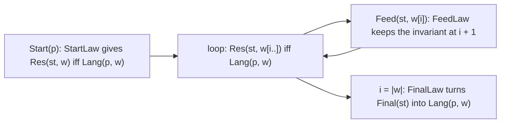
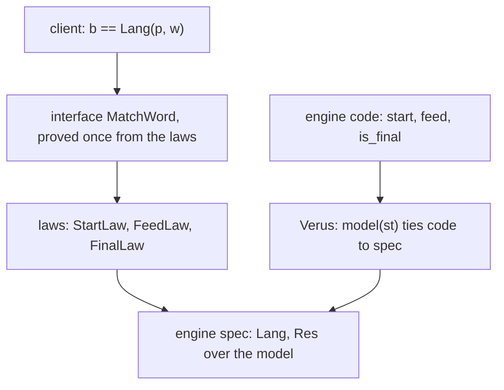
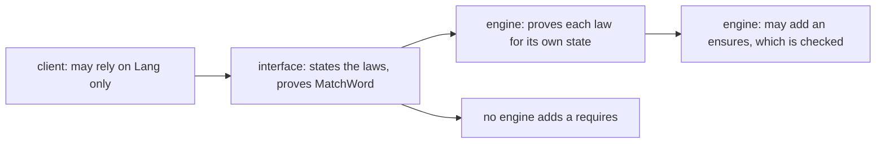

# R08 — Abstraction

Three ideas do all the work:

1. An interface is a set of obligations. A2's step-matcher interface proves its run loop once, from three laws; every engine that refines it owes exactly those three laws for its own pattern, state and language, and nothing else.
2. The laws are semantic. They relate what an engine computes (its start state, its step, its final test) to what its language means, so a refinement can fail for a reason no type checker sees: a step that loses a word, or a language that is not the one its client needs.
3. Opacity is a scope. An opaque definition stays out of every proof that does not reveal it, so each proof that needs it says so, in one place, and the rest of the engine stays small for the solver.

## 0. How this module works

Allow 354 minutes: setup 10, reading 60, worked example and WRITE cards 30, other cards 7, predictions 15, hand holes 110, refinement lab 10, agent follow-up 25, written work 30, seventh bench card 20, viva 30 and calibration 7. The four hand holes take 55 minutes in each language: H1 15, H2 15, H3 15 and H4 10. These are planning estimates; record your own times.

R08 is standalone. It declares layer A2, which re-supplies the regex semantics (A1), the band-1 facts (A1b), the derivative matcher and the character-class API, and, new in this module, the step-matcher interface: `dafny/given/R/RG_A2_MatcherStatement.dfy` (Dafny, the abstract module `RG_A2_StepMatcher`, a frozen statement file whose digest the registry pins) and `rg_re_a2::step_matcher` (Verus, the trait `StepMatcher` and the generic `match_word`). No earlier learner file is imported.

You build three engines for that interface. The derivative engine is worked (W1). The other two you write yourself, as refinements of the interface (Dafny) and implementations of the trait (Verus): the range-star engine (H1) matches words whose every character lies in one of a list of ranges, through one A2 class built at the start; the alternative-set engine (H4) keeps a list of alternatives as its state, and H2 and H3 are the lemmas its laws rest on. Each engine's parts (its state type, its model and its steps) are given over concrete types; your refinement maps the interface onto them and proves the three laws. A fourth engine, a pruning engine with a planted semantic fault, is the agent exercise.

**This module's files** separate the hand work, the predictions, the given interface and the agent task.

| path | role and shipping state |
|---|---|
| `dafny/R/R08_Abstraction/std/R08_Abstraction.dfy` | hand work: verified, 4 holes, 0 errors |
| `verus/r/r08_abstraction/src/lib.rs` | hand work: verified, 4 holes, 0 errors |
| `dafny/checks/R08_checks.dfy` | given-only value check: verified, no holes; P1d's value is unfilled |
| `dafny/R/R08_Abstraction/agent/R08_AgentInfra.dfy` | semantic debugger: failed, 0 holes, 1 error (a real postcondition failure) |
| `verus/r/r08_abstraction/src/agent.rs` | semantic debugger: failed, 0 holes, 1 error (a real postcondition failure) |
| `specimens/R08/`, `slots/R08.slots` | prediction scenarios, chapter demonstrations and the WRITE cards |
| `dafny/given/R/RG_A2_MatcherStatement.dfy`, `verus/given/rg_re_a2/src/step_matcher.rs` | the given step-matcher interface: no engine, no assumed proof |
| `paper/R08_problems.tex`, `paper/R08_answers.tex` | card 06.7 and the refinement-obligations problem |
| `Solutions/`, `paper/solutions/` | completed references — LAST, after your attempt and review |

Commit all five predictions before you run their scenarios or read the sections that answer them. P1d is a natural number in the check unit, P2v a natural number in `specimens/R08/P2v.rs.specimen`, P4v a set of failing labels in `specimens/R08/P4v.rs.specimen`; P3dv and P5dv are verdicts in `slots/R08.slots`, switched on by the two `CHECK` lines of the Dafny hand file. Then run `scripts/firsttry.sh R08 --check` and keep its receipts: a later run does not replace a first try.

> **Predict (P1) — commit in the file before reading on.** The alternative-set engine's state `[Cat(Chr('a'), Chr('b')), Star(Chr('a'))]` reads the character `'b'`. Neither alternative can match anything after that. How many alternatives does the next state hold?

> **Predict (P2) — commit in the file before reading on.** The same engine's state `seq![Re::Eps, Re::Chr('a')]` reads the character `'a'`. How many alternatives does the next state hold?

> **Predict (P3) — commit in the file before reading on.** Two specimens prove an interface law by calling the same law on a shorter argument: inside a Dafny refinement of `RG_A2_StepMatcher`, and inside a Verus trait implementation. Both state `decreases`. Does each verify? Answer `D:<verified|failed> V:<verified|failed>`.

> **Predict (P4) — commit in the file before reading on.** The derivative engine again, with its `res` closed inside its own module. Outside that module, a proof calls one law, at the character `'x'`, and then asserts four claims [a]–[d]. Which claims fail?

> **Predict (P5) — commit in the file before reading on.** A complete engine, verified, whose language is `Matches(Backwards(p), w)`. Client [x] promises `Matches(p, w)`, client [y] promises `Matches(Backwards(p), w)`; each only returns the engine's `MatchWord`. Which clients verify? Answer `D:<x>,<y> V:<x>,<y>`.

The shipped files run in the learner loop: the holes are counted, the rest verifies, and the gate rejects the files until every hole is gone.

<!-- pin: shipped-d -->
```
$ scripts/vcheck dafny/R/R08_Abstraction/std
vcheck: dafny/R/R08_Abstraction/std [dafny, learner loop]: verified — 46 verified, 4 holes, 0 errors
dafny/R/R08_Abstraction/std/R08_Abstraction.dfy:241:44: hole bodyless-method R08.H1d
dafny/R/R08_Abstraction/std/R08_Abstraction.dfy:283:37: hole bodyless-method R08.H2d
dafny/R/R08_Abstraction/std/R08_Abstraction.dfy:299:39: hole bodyless-method R08.H3d
dafny/R/R08_Abstraction/std/R08_Abstraction.dfy:332:29: hole bodyless-method R08.H4d
```

<!-- pin: shipped-v -->
```
$ scripts/vcheck verus/r/r08_abstraction
vcheck: verus/r/r08_abstraction [verus, learner loop]: verified — - verified, 4 holes, 0 errors
verus/r/r08_abstraction/src/lib.rs:383:40: hole assume R08.H1v
verus/r/r08_abstraction/src/lib.rs:415:40: hole assume R08.H2v
verus/r/r08_abstraction/src/lib.rs:434:40: hole assume R08.H3v
verus/r/r08_abstraction/src/lib.rs:464:40: hole assume R08.H4v
```

<!-- pin: checks-d -->
```
$ scripts/vcheck dafny/checks/R08_checks.dfy
vcheck: dafny/checks/R08_checks.dfy [dafny, learner loop]: verified — 36 verified, 0 holes, 0 errors
```

---

## 1. The step-matcher interface

A matcher reads a word left to right. Whatever it keeps between characters is its state; whatever it does with a character is its step; and at the end it answers yes or no from the state alone. The interface names those three operations, and two meanings: `Lang(p, w)`, the language the engine claims for its pattern, and `Res(st, w)`, the words a state still accepts. The run loop is written once, in the interface, and proved once, from three laws that every engine must supply.

```dafny
abstract module RG_A2_StepMatcher {
  type Pattern
  type Config

  // The engine's language: the meaning every client of MatchWord relies on.
  ghost predicate Lang(p: Pattern, w: seq<char>)

  // The words a state still accepts.
  ghost predicate Res(st: Config, w: seq<char>)

  function Start(p: Pattern): Config
  function Feed(st: Config, c: char): Config
  predicate Final(st: Config)

  lemma StartLaw(p: Pattern, w: seq<char>)
    ensures Res(Start(p), w) <==> Lang(p, w)

  lemma FeedLaw(st: Config, c: char, w: seq<char>)
    ensures Res(Feed(st, c), w) <==> Res(st, [c] + w)

  lemma FinalLaw(st: Config)
    ensures Final(st) <==> Res(st, [])
```

`Config` is the type of an engine's state, its configuration between two characters (the word *state* is taken by another track's spine, so the course's interface does not use it as a name). The loop's invariant is `Res(st, w[i..]) <==> Lang(p, w)`: the current state accepts the unread rest of the word exactly when the pattern accepts the whole word. StartLaw makes it true before the loop, FeedLaw keeps it true across one character, and FinalLaw turns it into the answer once the word is used up. Read `MatchWord`'s body in the given file and find each law's call: those three calls are the whole proof, and they mention no engine.



The diagram is the loop's proof: each arrow is one law call, so an engine that proves the three laws inherits a verified `MatchWord` without reading it.

Verus states the same interface as a trait, with one difference you will meet in every engine: the executable state and the thing the laws talk about are separate types. A `Vec<Re>` cannot be built inside a spec function, so the trait has an associated `Model`, a spec function `model(st)`, and its laws are stated over models. The executable functions are tied to their specs by their `ensures`.

```rust
pub trait StepMatcher {
    type Pattern;
    /// The executable state.
    type Config;
    /// The state's spec model: what the laws talk about.
    type Model;

    spec fn lang(p: Self::Pattern, w: Seq<char>) -> bool;
    spec fn model(st: Self::Config) -> Self::Model;
    spec fn res(m: Self::Model, w: Seq<char>) -> bool;
    spec fn start_spec(p: Self::Pattern) -> Self::Model;
    spec fn feed_spec(m: Self::Model, c: char) -> Self::Model;
    spec fn final_spec(m: Self::Model) -> bool;

    fn feed(st: Self::Config, c: char) -> (r: Self::Config)
        ensures
            Self::model(r) == Self::feed_spec(Self::model(st), c),
    ;

    proof fn lemma_feed_law(m: Self::Model, c: char, w: Seq<char>)
        ensures
            Self::res(Self::feed_spec(m, c), w) == Self::res(m, seq![c] + w),
    ;
}
```

(The excerpt leaves out `start`, `is_final` and the other two laws, which have the same shape.) The generic `match_word::<M>` is the Verus run loop: one function, generic over the engine, with the same invariant over `M::res(M::model(st), …)`. Both given files verify on their own, before any engine exists:

<!-- pin: given-d -->
```
$ scripts/vcheck --gate dafny/given/R/RG_A2_MatcherStatement.dfy
vcheck: dafny/given/R/RG_A2_MatcherStatement.dfy [dafny, gate]: verified — 34 verified, 0 holes, 0 errors
```

<!-- pin: given-v -->
```
$ scripts/vcheck --gate verus/given/rg_re_a2
vcheck: verus/given/rg_re_a2 [verus, gate]: verified — 27 verified, 0 holes, 0 errors
```

C3d is the recognise card for this section: an abstract module is a module with bodiless declarations that no program runs directly. Dafny verifies `MatchWord` against the bodiless lemmas' statements, as if they were proved; a refinement makes them proved, one engine at a time. A file in the learner loop that holds an abstract module of its own would hide its bodiless members from the hole count, which is why the course's lint refuses one outside a given statement file.

---

## 2. The worked engine: derivatives (W1)

The derivative engine is the matcher of R06 put behind the interface. Its pattern and its state are both regexes; a step is A2's `Deriv`; a state is final when it is nullable. Each law is one call to a layer lemma.

```dafny
module R08_DerivEngine refines RG_A2_StepMatcher {
  import opened RG_A1_Re
  import B = RG_A1b_Facts
  import A2 = RG_A2_Deriv

  type Pattern = Re
  type Config = Re

  ghost predicate Lang(p: Pattern, w: seq<char>)
  {
    Matches(p, w)
  }

  ghost predicate Res(st: Config, w: seq<char>)
  {
    Matches(st, w)
  }

  function Start(p: Pattern): Config
  {
    p
  }

  function Feed(st: Config, c: char): Config
  {
    A2.Deriv(st, c)
  }

  predicate Final(st: Config)
  {
    Nullable(st)
  }

  lemma StartLaw(p: Pattern, w: seq<char>)
  {
  }

  lemma FeedLaw(st: Config, c: char, w: seq<char>)
  {
    A2.DerivCorrect(st, c, w);
  }

  lemma FinalLaw(st: Config)
  {
    B.NullableCorrect(st);
  }
}
```

Three things to notice. The refining lemmas repeat only their signatures: their `ensures` are inherited, so `FeedLaw` here must prove `Res(Feed(st, c), w) <==> Res(st, [c] + w)` with this module's `Res` and `Feed` substituted. `StartLaw` has an empty body because, with `Start(p) = p` and `Res = Lang = Matches`, its statement is a tautology. And `MatchWord` is not here at all: the module inherits it, verified, and a client calls `R08_DerivEngine.MatchWord(r, w)` with the postcondition `b == Matches(r, w)`.

The Verus engine is the same with the model as the identity (`type Model = Re`, `model(st) = st`) and the executable functions calling A2's `deriv_exec` and A1's `is_nullable`:

```rust
impl StepMatcher for DerivEngine {
    type Pattern = Re;
    type Config = Re;
    type Model = Re;

    open spec fn lang(p: Re, w: Seq<char>) -> bool {
        matches(p, w)
    }

    open spec fn feed_spec(m: Re, c: char) -> Re {
        deriv(m, c)
    }

    fn feed(st: Re, c: char) -> (r: Re) {
        deriv_exec(&st, c)
    }

    proof fn lemma_feed_law(m: Re, c: char, w: Seq<char>) {
        lemma_deriv_correct(m, c, w);
    }
}
```

(The excerpt shows four of the implementation's twelve items; the file has them all.) What happens when a law is not discharged? Drop `FinalLaw`'s call and the engine still resolves, but its refinement obligation fails, and the diagnostic points at the interface's statement, because that is where the obligation was written:

```dafny
module R08_DemoNoFinal refines RG_A2_StepMatcher {
  import opened RG_A1_Re
  import A2 = RG_A2_Deriv

  type Pattern = Re
  type Config = Re

  ghost predicate Lang(p: Pattern, w: seq<char>) { Matches(p, w) }
  ghost predicate Res(st: Config, w: seq<char>) { Matches(st, w) }
  function Start(p: Pattern): Config { p }
  function Feed(st: Config, c: char): Config { A2.Deriv(st, c) }
  predicate Final(st: Config) { Nullable(st) }
  lemma StartLaw(p: Pattern, w: seq<char>) { }
  lemma FeedLaw(st: Config, c: char, w: seq<char>) { A2.DerivCorrect(st, c, w); }
  lemma FinalLaw(st: Config) { }
}
```

<!-- pin: nofinal-d -->
```
$ scripts/vcheck --module R08 probe.dfy
vcheck: probe.dfy [dafny, learner loop]: failed — 36 verified, 0 holes, 1 error
probe.dfy:15:30: error: a postcondition could not be proved on this return path
dafny/given/R/RG_A2_MatcherStatement.dfy:37:23: related: this is the postcondition that could not be proved
```

Read the two locations: the return path of the engine's `FinalLaw` (line 15 of the scratch file) and the postcondition it failed, which is line 37 of the given file. The solver does not know that `Nullable` and `Matches(st, [])` agree; A1b's `NullableCorrect` says so, and that call is the whole law.

The refinement square puts the pieces together. The interface's side is what clients see: `MatchWord` returns `Lang(p, w)`. The engine's side is what runs: `Start`, `Feed`, `Final` over the engine's state. The laws are the vertical edges, and in Verus the model function sits between the executable state and the laws.



A refinement can fail at any edge of the square, and only one of them is about code: the laws are statements about meanings.

---

## 3. What a refinement inherits, and what it may add

A refinement keeps every contract the interface states. It gives bodies to bodiless declarations and may add declarations of its own; it may not change what the interface promises its clients. Two directions follow, in both languages, and C4dv is the card that states them as facts.

**A precondition is never added.** A client of the interface calls `MatchWord` with any pattern and any word; a refinement that demanded more would break that client. Dafny refuses at resolution:

```dafny
module R08_DemoTighter refines RG_A2_StepMatcher {
  import opened RG_A1_Re
  import B = RG_A1b_Facts
  import A2 = RG_A2_Deriv

  type Pattern = Re
  type Config = Re

  ghost predicate Lang(p: Pattern, w: seq<char>) { Matches(p, w) }
  ghost predicate Res(st: Config, w: seq<char>) { Matches(st, w) }
  function Start(p: Pattern): Config { p }
  function Feed(st: Config, c: char): Config { A2.Deriv(st, c) }
  predicate Final(st: Config) { Nullable(st) }
  lemma StartLaw(p: Pattern, w: seq<char>) { }
  lemma FeedLaw(st: Config, c: char, w: seq<char>) { A2.DerivCorrect(st, c, w); }
  lemma FinalLaw(st: Config) { B.NullableCorrect(st); }

  method MatchWord(p: Pattern, w: seq<char>) returns (b: bool)
    requires w != []
}
```

<!-- pin: requires-d -->
```
$ scripts/vcheck --module R08 demo-requires-d.dfy
vcheck: demo-requires-d.dfy [dafny, learner loop]: failed — - verified, 0 holes, 1 error, stage resolve
demo-requires-d.dfy:20:16: error: a refining method is not allowed to add preconditions
```

and so does Verus, for any `requires` on a trait method's implementation:

```rust
    fn feed(st: Re, c: char) -> (r: Re)
        requires
            c != '\n',
    {
        deriv_exec(&st, c)
    }
```

<!-- pin: requires-v -->
```
$ scripts/vcheck specimens/R08/demo-requires-v.rs.specimen
vcheck: specimens/R08/demo-requires-v.rs.specimen [verus, learner loop]: failed — - verified, 0 holes, 1 error, stage resolve
specimens/R08/demo-requires-v.rs.specimen:45:5: error: trait method implementation cannot declare requires clauses; these can only be inherited from the trait declaration
```

(The Verus scratch file is the whole derivative engine with this `feed`; the pinned command shows its path.) **A postcondition may be added, and it is checked.** Dafny re-verifies the inherited body of `MatchWord` against an `ensures` a refinement adds; this one claims that a match needs a non-empty word, which is false for every nullable pattern, so the inherited body fails it:

```dafny
module R08_DemoStronger refines RG_A2_StepMatcher {
  import opened RG_A1_Re
  import B = RG_A1b_Facts
  import A2 = RG_A2_Deriv

  type Pattern = Re
  type Config = Re

  ghost predicate Lang(p: Pattern, w: seq<char>) { Matches(p, w) }
  ghost predicate Res(st: Config, w: seq<char>) { Matches(st, w) }
  function Start(p: Pattern): Config { p }
  function Feed(st: Config, c: char): Config { A2.Deriv(st, c) }
  predicate Final(st: Config) { Nullable(st) }
  lemma StartLaw(p: Pattern, w: seq<char>) { }
  lemma FeedLaw(st: Config, c: char, w: seq<char>) { A2.DerivCorrect(st, c, w); }
  lemma FinalLaw(st: Config) { B.NullableCorrect(st); }

  method MatchWord(p: Pattern, w: seq<char>) returns (b: bool)
    ensures b ==> w != []
}
```

<!-- pin: ensures-d -->
```
$ scripts/vcheck --module R08 demo-ensures-d.dfy
vcheck: demo-ensures-d.dfy [dafny, learner loop]: failed — 37 verified, 0 holes, 1 error
dafny/given/R/RG_A2_MatcherStatement.dfy:42:3: error: a postcondition could not be proved on this return path
demo-ensures-d.dfy:21:21: related: this is the postcondition that could not be proved
```

A Verus implementation may add an `ensures` to a trait method too. Its body is checked against it, and a caller that knows the concrete engine can use it; a caller through the trait (as `match_word::<M>` is) sees only the trait's.

```rust
    fn feed(st: Re, c: char) -> (r: Re)
        ensures
            r == deriv(st, c),
    {
        deriv_exec(&st, c)
    }
```

<!-- pin: ensures-v -->
```
$ scripts/vcheck specimens/R08/demo-ensures-v.rs.specimen
vcheck: specimens/R08/demo-ensures-v.rs.specimen [verus, learner loop]: verified — 6 verified, 0 holes, 0 errors
```

The obligations run in one direction each, and the diagram says who owes what to whom:



Now P3. *Commit your prediction first.* The two specimens, verbatim, after the line that seals them:

```dafny
module R08_LengthEngine refines RG_A2_StepMatcher {
  type Pattern = nat
  type Config = int

  // Given: w has exactly n characters, by recursion on n.
  ghost predicate LengthIs(n: nat, w: seq<char>)
  {
    if n == 0 then w == [] else w != [] && LengthIs(n - 1, w[1..])
  }

  ghost predicate Lang(p: Pattern, w: seq<char>)
  {
    LengthIs(p, w)
  }

  ghost predicate Res(st: Config, w: seq<char>)
  {
    |w| == st
  }

  function Start(p: Pattern): Config
  {
    p
  }

  function Feed(st: Config, c: char): Config
  {
    st - 1
  }

  predicate Final(st: Config)
  {
    st == 0
  }

  lemma StartLaw(p: Pattern, w: seq<char>)
    decreases p
  {
    if p > 0 && w != [] {
      StartLaw(p - 1, w[1..]);
    }
  }

  lemma FeedLaw(st: Config, c: char, w: seq<char>)
  {
  }

  lemma FinalLaw(st: Config)
  {
  }
}
```

<!-- pin: recurse-d -->
```
$ scripts/vcheck --module R08 P3d.dfy
vcheck: P3d.dfy [dafny, learner loop]: failed — - verified, 0 holes, 1 error, stage resolve
P3d.dfy:41:15: error: decreases clause on refining method not supported, unless the refined method was specified with 'decreases *'
```

```rust
impl SumLaw for SumList {
    open spec fn summed(b: Seq<nat>) -> int {
        sum_of(b)
    }

    proof fn lemma_summed_nonneg(b: Seq<nat>)
        decreases b.len(),
    {
        if b.len() > 0 {
            Self::lemma_summed_nonneg(b.drop_first());
        }
    }
}
```

<!-- pin: recurse-v -->
```
$ scripts/vcheck specimens/R08/P3v.rs.specimen
vcheck: specimens/R08/P3v.rs.specimen [verus, learner loop]: verified — 2 verified, 0 holes, 0 errors
```

`D:failed V:verified`. Dafny refuses at resolution: a refining lemma may not state a decreases clause of its own, because it inherits the interface's. The inherited clause is Dafny's default, the tuple of the lemma's parameters, and in the interface the parameters of type `Pattern` and `Config` are abstract, so they carry no order there; only a parameter of a concrete type, like the word, can make a recursive call decrease. Delete the `decreases p` line and the same engine verifies, because its recursive call also shortens `w`:

```dafny
module R08_LengthEngineDefault refines RG_A2_StepMatcher {
  type Pattern = nat
  type Config = int

  ghost predicate LengthIs(n: nat, w: seq<char>)
  {
    if n == 0 then w == [] else w != [] && LengthIs(n - 1, w[1..])
  }

  ghost predicate Lang(p: Pattern, w: seq<char>) { LengthIs(p, w) }
  ghost predicate Res(st: Config, w: seq<char>) { |w| == st }
  function Start(p: Pattern): Config { p }
  function Feed(st: Config, c: char): Config { st - 1 }
  predicate Final(st: Config) { st == 0 }

  lemma StartLaw(p: Pattern, w: seq<char>)
  {
    if p > 0 && w != [] {
      StartLaw(p - 1, w[1..]);
    }
  }

  lemma FeedLaw(st: Config, c: char, w: seq<char>) { }
  lemma FinalLaw(st: Config) { }
}
```

<!-- pin: recurse-default-d -->
```
$ scripts/vcheck --module R08 probe.dfy
vcheck: probe.dfy [dafny, learner loop]: verified — 38 verified, 0 holes, 0 errors
```

A law that recurses on the state with the word unchanged has no such luck. This engine keeps a list of regexes, and both its `Feed` and its `FeedLaw` recurse on `st[1..]` (the other two laws are left as holes, so that only termination is in question):

```dafny
module R08_ListRecursion refines RG_A2_StepMatcher {
  import opened RG_A1_Re
  import A2 = RG_A2_Deriv

  type Pattern = Re
  type Config = seq<Re>

  ghost predicate SomeMatch(st: seq<Re>, w: seq<char>) { exists i | 0 <= i < |st| :: Matches(st[i], w) }
  ghost predicate Lang(p: Pattern, w: seq<char>) { Matches(p, w) }
  ghost predicate Res(st: Config, w: seq<char>) { SomeMatch(st, w) }
  function Start(p: Pattern): Config { [p] }
  function Feed(st: Config, c: char): Config
  {
    if st == [] then [] else [A2.Deriv(st[0], c)] + Feed(st[1..], c)
  }
  predicate Final(st: Config) { false }
  lemma StartLaw(p: Pattern, w: seq<char>) { assume false; }
  lemma FeedLaw(st: Config, c: char, w: seq<char>)
  {
    if st != [] {
      FeedLaw(st[1..], c, w);
    }
    assume false;
  }
  lemma FinalLaw(st: Config) { assume false; }
}
```

<!-- pin: recurse-state-d -->
```
$ scripts/vcheck --module R08 probe.dfy
vcheck: probe.dfy [dafny, learner loop]: failed — 37 verified, 3 holes, 2 errors
probe.dfy:17:46: hole assume R08_ListRecursion.StartLaw
probe.dfy:23:5: hole assume R08_ListRecursion.FeedLaw
probe.dfy:25:32: hole assume R08_ListRecursion.FinalLaw
probe.dfy:14:57: error: decreases clause might not decrease
probe.dfy:21:14: error: decreases clause might not decrease
```

Both recursive calls fail their termination check, the function's and the lemma's, and the three `assume false` lines are counted as holes, as they would be in your file. Verus checks termination per function, so an implementation's proof fn states its own `decreases` and recurses as any proof fn does. This is why every engine in your hand file proves the fact a law needs in a lemma of its own (`RangesClassLaw`, `AltFeedLaw`, `AltFinalLaw`), an ordinary lemma with an ordinary decreases clause, and why the refinement's law is then one call. The Verus file uses the same shape for parallelism, although Verus would not need it.

---

## 4. A refinement you write: the range-star engine (H1)

The range-star engine matches the words whose every character lies in one of a list of character ranges: the pattern `[('a', 'c'), ('x', 'z')]` is the regex `[a-cx-z]*`. Its language speaks of ranges; its state speaks of one A2 class, built at the start with `ClassRange` and `ClassUnion`, after which a step is one `ClassMember` test. The abstraction is the point of the engine: the client sees ranges, the engine runs on a class whose representation A2 hides, and the start law is the bridge.

The engine's parts are given, in a plain module over concrete types (`R08_RangeStarParts`): the state, the language, the model and the steps.

```dafny
  datatype StarState = StarState(alive: bool, cls: A2.CharClass)

  // Given: c lies in one of the ranges.
  ghost predicate InSomeRange(rs: seq<(char, char)>, c: char)
  {
    exists j | 0 <= j < |rs| :: rs[j].0 <= c <= rs[j].1
  }

  // Given: the class of all the ranges, built with A2's class API.
  function RangesClass(rs: seq<(char, char)>): (cls: A2.CharClass)
    ensures A2.ClassValid(cls)
  {
    if rs == [] then A2.ClassEmpty() else A2.ClassUnion(A2.ClassRange(rs[0].0, rs[0].1), RangesClass(rs[1..]))
  }

  // Given: the engine's language, its model of a state, and its steps.
  ghost predicate RangesLang(rs: seq<(char, char)>, w: seq<char>)
  {
    forall i | 0 <= i < |w| :: InSomeRange(rs, w[i])
  }

  ghost predicate StarRes(st: StarState, w: seq<char>)
  {
    st.alive && forall i | 0 <= i < |w| :: A2.InClass(st.cls, w[i])
  }
```

`StarStart(rs)` is `StarState(true, RangesClass(rs))`, `StarFeed` keeps the state when the character is a member and kills it otherwise, and `StarFinal(st)` is `st.alive`. None of these is an engine yet: nothing connects them to `MatchWord`. **H1d** is that connection. You write the module `R08_RangeStarEngine refines RG_A2_StepMatcher`: its two types, its five definitions (each the given part of the same role), and a body for each of the three laws. A refining declaration restates its signature only; the `ensures` of a law is the interface's, inherited, and the law's body must prove it with the engine's definitions substituted.

The `refines` clause is what makes such a module an engine. Here is the parity engine of §6, every declaration in place, but without `refines`, and a client that calls `MatchWord`:

```dafny
module R08_ParityPlain {
  type Pattern = bool
  type Config = bool

  ghost predicate Lang(p: Pattern, w: seq<char>) { (|w| % 2 == 0) == p }
  ghost predicate Res(st: Config, w: seq<char>) { (|w| % 2 == 0) == st }
  function Start(p: Pattern): Config { p }
  function Feed(st: Config, c: char): Config { !st }
  predicate Final(st: Config) { st }
  lemma StartLaw(p: Pattern, w: seq<char>) { }
  lemma FeedLaw(st: Config, c: char, w: seq<char>) { }
  lemma FinalLaw(st: Config) { }
}

module R08_ParityClient {
  import E = R08_ParityPlain

  method EvenLength(w: seq<char>) returns (b: bool)
    ensures b == (|w| % 2 == 0)
  {
    b := E.MatchWord(true, w);
  }
}
```

<!-- pin: plain-d -->
```
$ scripts/vcheck --module R08 probe.dfy
vcheck: probe.dfy [dafny, learner loop]: failed — - verified, 0 holes, 1 error, stage resolve
probe.dfy:21:12: error: unresolved identifier: MatchWord
```

The declarations are only names until the module refines the interface: `MatchWord`, its loop and its contract come from `RG_A2_StepMatcher`, and the laws are the obligations that the loop's proof rests on. Add `refines RG_A2_StepMatcher` and the same module is an engine whose laws are checked and whose `MatchWord` the client may call:

```dafny
module R08_ParityRefining refines RG_A2_StepMatcher {
  type Pattern = bool
  type Config = bool

  ghost predicate Lang(p: Pattern, w: seq<char>) { (|w| % 2 == 0) == p }
  ghost predicate Res(st: Config, w: seq<char>) { (|w| % 2 == 0) == st }
  function Start(p: Pattern): Config { p }
  function Feed(st: Config, c: char): Config { !st }
  predicate Final(st: Config) { st }
  lemma StartLaw(p: Pattern, w: seq<char>) { }
  lemma FeedLaw(st: Config, c: char, w: seq<char>) { }
  lemma FinalLaw(st: Config) { }
}

module R08_ParityClient {
  import E = R08_ParityRefining

  method EvenLength(w: seq<char>) returns (b: bool)
    ensures b == (|w| % 2 == 0)
  {
    b := E.MatchWord(true, w);
  }
}
```

<!-- pin: refining-d -->
```
$ scripts/vcheck --module R08 probe.dfy
vcheck: probe.dfy [dafny, learner loop]: verified — 41 verified, 0 holes, 0 errors
```

The hand file ships H1's client the same way, commented under `Uncomment as you go:`: `MatchRanges(rs, w)` promises `RangesLang(rs, w)` and returns `E.MatchWord(rs, w)`. Uncommented before your refinement exists, it does not resolve; uncommented after it, it verifies only if your `Lang` is the ranges' language. The first-try record runs it either way.

Of the three laws, `FinalLaw` holds as stated once the definitions are in place, and `FeedLaw` needs two facts about `[c] + w` (its first character, and its index `i + 1` as `w`'s index `i`). `StartLaw` is the one with content: `Res(Start(p), w)` says every character of `w` is in the class, `Lang(p, w)` says every character is in some range, and the two agree exactly when the class holds the characters of the ranges and nothing else. That fact is H1's lemma, `RangesClassLaw(rs, c)`, shipped as a statement in its own module before the refinement; your `StartLaw` applies it to every character.

`RangesClass` states `ensures A2.ClassValid(cls)` for a reason of A2's: `ClassUnion` requires both of its arguments to be valid. `ClassRange` and `ClassEmpty` return valid classes, and the `ensures` carries validity up the recursion for every caller. (Dafny could find it without the `ensures`, by unfolding the recursive call one level; the Verus `ranges_class` below is an executable function, which a caller sees only through its contract, so there the `ensures cls.valid()` is required.)

The Verus engine cannot state H1 over the class itself: A2's Verus class API is executable, with view contracts (`class_union`'s `ensures u@ == self@.union(other@)`), and has no spec function that builds a class. So the Verus model is the view: `Model = (bool, ISet<char>)`, the given `star_model(st)` is `(st.alive, st.cls@)`, and the start model is a spec-level set built range by range.

```rust
pub open spec fn ranges_set(rs: Seq<(char, char)>) -> ISet<char>
    decreases rs.len(),
{
    if rs.len() == 0 {
        ISet::empty()
    } else {
        ISet::new(|c: char| rs[0].0 <= c && c <= rs[0].1).union(ranges_set(rs.drop_first()))
    }
}

pub open spec fn star_start_spec(rs: Seq<(char, char)>) -> (bool, ISet<char>) {
    (true, ranges_set(rs))
}

pub fn star_start(p: Vec<(char, char)>) -> (st: StarState)
    ensures
        star_model(st) == star_start_spec(p@),
```

**H1v** is the mirror: `impl StepMatcher for RangeStarEngine`, with its three types, its six spec functions and three executable functions (each the given part of the same role), and the three law bodies. A trait implementation, like a refining module, restates signatures only: the trait's `ensures` on `start`, `feed`, `is_final` and the laws are inherited, and the given `star_start`, `star_feed` and `star_is_final` promise exactly what the trait asks of the executable three. Without the implementation, the client is refused at the trait bound; a struct and a client are all this specimen holds:

```rust
pub struct ParityEngine;

// A client that needs `impl StepMatcher for ParityEngine`, which is not here.
pub fn even_length(w: &Vec<char>) -> (b: bool)
    ensures
        b == (w@.len() % 2 == 0),
{
    match_word::<ParityEngine>(true, w)
}
```

<!-- pin: noimpl-v -->
```
$ scripts/vcheck specimens/R08/demo-noimpl-v.rs.specimen
vcheck: specimens/R08/demo-noimpl-v.rs.specimen [verus, learner loop]: failed — 0 verified, 0 holes, 2 errors, stage resolve
specimens/R08/demo-noimpl-v.rs.specimen:14:18: error: the trait bound `ParityEngine: rg_re_a2::step_matcher::StepMatcher` is not satisfied
specimens/R08/demo-noimpl-v.rs.specimen:14:32: error: the trait bound `ParityEngine: rg_re_a2::step_matcher::StepMatcher` is not satisfied
```

H1v's lemma, `lemma_ranges_set_law(rs, c)`, proves that `ranges_set(rs)` holds exactly the characters of the ranges, and the start law applies it at every index of `w` inside an `assert forall`. C5dv is this divergence: Dafny's state is its own model, because a Dafny function can build the class; a Verus engine with an executable class states its laws over the class's view, and `model` is the abstraction function of the square.

Both H1 lemmas are inductions over the list with an existential to move: a range `j` of `rs[1..]` is range `j + 1` of `rs`. Neither verifier finds the shifted witness on its own, and Dafny's file says `{:induction false}` because, with default induction on, Dafny proves `RangesClassLaw` unaided; the shipped lever is part of the task.

Now P4. *Commit your prediction first.* The specimen's engine lives in `mod engine`, with `closed spec fn res`; the proof below it is outside that module:

```rust
proof fn claims_after_one_law(m: Re, w: Seq<char>) {
    SealedDeriv::lemma_feed_law(m, 'x', w);
    assert(SealedDeriv::res(deriv(m, 'x'), w) == SealedDeriv::res(m, seq!['x'] + w));  // [a]
    assert(SealedDeriv::res(m, seq!['x'] + w) == matches(m, seq!['x'] + w));  // [b]
    assert(SealedDeriv::res(deriv(m, 'y'), w) == SealedDeriv::res(m, seq!['y'] + w));  // [c]
    assert(SealedDeriv::lang(m, w) == matches(m, w));  // [d]
}
```

<!-- pin: claims-v -->
```
$ scripts/vcheck specimens/R08/P4v.rs.specimen
vcheck: specimens/R08/P4v.rs.specimen [verus, learner loop]: failed — 6 verified, 0 holes, 2 errors
specimens/R08/P4v.rs.specimen:82:12: error: assertion failed
specimens/R08/P4v.rs.specimen:83:12: error: assertion failed
```

`FAILS b c`. [a] is the law's `ensures` at `'x'`, with the open `feed_spec` unfolded to `deriv(m, 'x')`. [d] holds because `lang` is open: its body is visible wherever the engine is. [b] needs the body of `res`, which is closed outside `engine`; and [c] is the law at `'y'`, which nothing called. A law gives exactly its instances; a closed body gives nothing beyond them. C3v, the recognise card, is the visibility half of this: an `open spec fn` in an implementation shows its body to any caller that names the engine, a `closed` one only inside its module, and a caller through the trait sees neither.

---

## 5. The alternative-set engine's parts and lemmas (H2, H3)

The third engine keeps the alternatives of a pattern apart. Its state is a list of regexes, read as their union: the state accepts `w` when some alternative does. It starts from the pattern's top-level alternatives, and a step takes the derivative of each and splits the results again.

```dafny
  // Given: split the top-level Alt nodes, drop the literal Empty parts.
  function Parts(r: Re): seq<Re>
  {
    match r
    case Empty => []
    case Alt(a, b) => Parts(a) + Parts(b)
    case _ => [r]
  }

  // Given: some alternative of the list matches w.
  ghost predicate AnyMatches(st: seq<Re>, w: seq<char>)
  {
    exists i | 0 <= i < |st| :: Matches(st[i], w)
  }

  // Given: the derivative of every alternative, split again.
  function FeedAll(st: seq<Re>, c: char): seq<Re>
  {
    if st == [] then [] else Parts(A2.Deriv(st[0], c)) + FeedAll(st[1..], c)
  }

  // Given: the engine's model, opaque. (The opacity sits on a predicate
  // outside the refinement: Dafny does not make a refining declaration
  // opaque.)
  opaque ghost predicate AltRes(st: seq<Re>, w: seq<char>)
  {
    AnyMatches(st, w)
  }
```

These live in the plain module `R08_AltSetParts`, with `AnyNullable` (some alternative is nullable). H2 and H3 are lemmas about them, in a second plain module, `R08_AltSetLaws`; the refinement that turns the parts into an engine is H4 (§6), and its laws call H2 and H3.

`Parts` drops only the literal `Empty` and splits only top-level `Alt`s. Everything else stays, whatever it can still match. P1 and P2 ask what that means after one step. *Commit both predictions first.*

```dafny
  lemma StateAfterB()
    ensures FeedAll([Cat(Chr('a'), Chr('b')), Star(Chr('a'))], 'b')
            == [Cat(Empty, Chr('b')), Cat(Empty, Star(Chr('a')))]
  {
  }
```

<!-- pin: p1-d -->
```
$ scripts/vcheck --module R08 demo-p1-d.dfy
vcheck: demo-p1-d.dfy [dafny, learner loop]: verified — 37 verified, 0 holes, 0 errors
```

P1's answer is 2. `Deriv(Cat(Chr('a'), Chr('b')), 'b')` is `Cat(Empty, Chr('b'))`: a dead regex, but not the literal `Empty`, so `Parts` keeps it, and the same holds for the starred alternative. The state is syntactic; what it means is `Res`. A state of two dead alternatives accepts nothing, and the laws are about that meaning, not about the list's length. (A real engine would prune dead parts; the agent's engine tries, and that is where its fault is.)

```rust
proof fn state_after_a() {
    assert(feed_all_p2(seq![Re::Eps, Re::Chr('a')], 'a').len() == 1) by (compute_only);
    assert(feed_all_p2(seq![Re::Eps, Re::Chr('a')], 'a')[0] is Eps) by (compute_only);
}
```

<!-- pin: p2-v -->
```
$ scripts/vcheck specimens/R08/demo-p2-v.rs.specimen
vcheck: specimens/R08/demo-p2-v.rs.specimen [verus, learner loop]: verified — 3 verified, 0 holes, 0 errors
```

P2's answer is 1. `deriv(Re::Eps, 'a')` is `Re::Empty`, which `parts` drops; `deriv(Re::Chr('a'), 'a')` is `Re::Eps`, a part of its own. The two answers together are the rule `Parts` follows: the literal `Empty` disappears, every other dead regex stays. `by (compute_only)` asks Verus to evaluate the assertion by running the spec functions on these values, without the solver; the Dafny check shows the same with a lemma whose empty body the solver closes by unfolding.

The engine's start law will need one fact about `Parts`: splitting a pattern keeps its language. That is **H2**, `PartsLaw(r, w)` / `lemma_parts_law(r, w)`: `AnyMatches(Parts(r), w) <==> Matches(r, w)`. The `Alt` case is where the work is. A matching part of `a` sits at its own index of `Parts(a) + Parts(b)`; a matching part of `b` sits `|Parts(a)|` places later; and an index of the concatenation is in one half or the other. The solver can do the arithmetic once you name the index; it does not invent the index.

The step law will rest on **H3**, `AltFeedLaw(st, c, w)` / `lemma_alt_feed_law(m, c, w)`: `AltRes(FeedAll(st, c), w) <==> AltRes(st, [c] + w)`, by induction on the list. This is the module's flagship obligation, and the reason the engine needs H2: the stepped list is `head + tail`, where `head = Parts(Deriv(st[0], c))`. H2 and A2's `DerivCorrect` together say what a part of `head` matches; the induction hypothesis says what a part of `tail` matches; and the two directions of the `<==>` each move one witness index across `head + tail` and across `st[0]` / `st[1..]`. Write the four witness moves down before you write the proof.

The Verus engine has the same definitions over `Seq<Re>` (`parts`, `any_matches`, `feed_all`, `any_nullable`), an executable state `Vec<Re>` whose model is its view `st@`, and given executable steps proved against the spec ones, ready for the implementation to call:

```rust
#[verifier::opaque]
pub open spec fn alt_res(m: Seq<Re>, w: Seq<char>) -> bool {
    any_matches(m, w)
}

pub fn parts_exec(r: &Re) -> (out: Vec<Re>)
    ensures
        out@ == parts(*r),

pub fn alt_feed(st: Vec<Re>, c: char) -> (out: Vec<Re>)
    ensures
        out@ == feed_all(st@, c),

pub fn alt_is_final(st: &Vec<Re>) -> (b: bool)
    ensures
        b == any_nullable(st@),
```

---

## 6. Opacity, and the second refinement you write (H4)

The alternative-set engine's model is opaque. Its body is an existential over `Matches`, and `Matches` is recursive with existentials of its own; left transparent, it would sit in the context of every proof that can see it, including the laws that only pass it on and the client code, and offer the solver instances it never needs. Opaque, `AltRes` (Verus `alt_res`) is a name with no meaning until a proof says `reveal AltRes();` (Dafny) or `reveal(alt_res);` (Verus). The reveal lasts to the end of the proof that contains it.

Why a predicate of the engine's own, and not `opaque` on `Res` itself? Because Dafny does not make a refining declaration opaque. In this parity engine `Res` is declared `opaque`, no proof reveals it, and every law still verifies, which it could not if `Res` were hidden:

```dafny
module R08_ParityRefined refines RG_A2_StepMatcher {
  type Pattern = bool
  type Config = bool

  ghost predicate Lang(p: Pattern, w: seq<char>) { (|w| % 2 == 0) == p }
  opaque ghost predicate Res(st: Config, w: seq<char>) { (|w| % 2 == 0) == st }
  function Start(p: Pattern): Config { p }
  function Feed(st: Config, c: char): Config { !st }
  predicate Final(st: Config) { st }
  lemma StartLaw(p: Pattern, w: seq<char>) { }
  lemma FeedLaw(st: Config, c: char, w: seq<char>) { }
  lemma FinalLaw(st: Config) { }
}
```

<!-- pin: opaque-refined-d -->
```
$ scripts/vcheck --module R08 probe.dfy
vcheck: probe.dfy [dafny, learner loop]: verified — 39 verified, 0 holes, 0 errors
```

Move the opacity to a predicate the engine declares itself, `EvenAs`, with `Res` defined as it, and the same empty laws fail, one error per law, each at the interface's statement:

```dafny
module R08_ParityOwn refines RG_A2_StepMatcher {
  type Pattern = bool
  type Config = bool

  ghost predicate Lang(p: Pattern, w: seq<char>) { (|w| % 2 == 0) == p }
  opaque ghost predicate EvenAs(st: bool, w: seq<char>) { (|w| % 2 == 0) == st }
  ghost predicate Res(st: Config, w: seq<char>) { EvenAs(st, w) }
  function Start(p: Pattern): Config { p }
  function Feed(st: Config, c: char): Config { !st }
  predicate Final(st: Config) { st }
  lemma StartLaw(p: Pattern, w: seq<char>) { }
  lemma FeedLaw(st: Config, c: char, w: seq<char>) { }
  lemma FinalLaw(st: Config) { }
}
```

<!-- pin: opaque-own-d -->
```
$ scripts/vcheck --module R08 probe.dfy
vcheck: probe.dfy [dafny, learner loop]: failed — 36 verified, 0 holes, 3 errors
probe.dfy:11:44: error: a postcondition could not be proved on this return path
dafny/given/R/RG_A2_MatcherStatement.dfy:29:30: related: this is the postcondition that could not be proved
probe.dfy:12:52: error: a postcondition could not be proved on this return path
dafny/given/R/RG_A2_MatcherStatement.dfy:33:33: related: this is the postcondition that could not be proved
probe.dfy:13:30: error: a postcondition could not be proved on this return path
dafny/given/R/RG_A2_MatcherStatement.dfy:37:23: related: this is the postcondition that could not be proved
```

Verus honours `#[verifier::opaque]` on an implementation's spec fn too, but the engine uses the free `alt_res` in both languages, so that the two files read alike and the reveal is a plain `reveal(alt_res)`.

C2d and C2v are the WRITE cards: a small opaque predicate and a lemma that needs one reveal. As shipped, the lemma's body is empty, and the failure is what opacity looks like from the outside: the statement is true, the definition says so, and the solver cannot see the definition.

```dafny
module R08_RevealCard {
 opaque ghost predicate PairedWordR08(c:char,w:seq<char>) { w == [c,c] }
 // item: R08.C2d write:reveal
 // WRITE: one local reveal; keep the definition opaque to other clients.
 lemma {:induction false} OpenDouble(c:char,w:seq<char>)
  ensures PairedWordR08(c,w) <==> w == [c,c]
 {}
}
```

<!-- pin: reveal-d -->
```
$ scripts/vcheck specimens/R08/card-c2d.dfy.specimen
vcheck: specimens/R08/card-c2d.dfy.specimen [dafny, learner loop]: failed — 0 verified, 0 holes, 1 error
specimens/R08/card-c2d.dfy.specimen:7:2: error: a postcondition could not be proved on this return path
specimens/R08/card-c2d.dfy.specimen:6:30: related: this is the postcondition that could not be proved
```

```rust
#[verifier::opaque]
pub open spec fn paired_word_r08(c:char,w:Seq<char>)->bool { w == seq![c,c] }
// item: R08.C2v write:reveal
// WRITE: one local reveal; retain the opaque boundary.
proof fn open_double(c:char,w:Seq<char>)
 ensures paired_word_r08(c,w) == (w == seq![c,c]),
{}
```

<!-- pin: reveal-v -->
```
$ scripts/vcheck specimens/R08/card-c2v.rs.specimen
vcheck: specimens/R08/card-c2v.rs.specimen [verus, learner loop]: failed — 0 verified, 0 holes, 1 error
specimens/R08/card-c2v.rs.specimen:8:10: error: postcondition not satisfied
```

Both report the lemma's postcondition, and neither says why: an opaque definition looks exactly like a definition that does not imply the statement. That is the cost of opacity, and the reason a reveal belongs next to the proof that needs it, where a reader can see it.

**H4** is the alternative-set engine itself. You write `R08_AltSetEngine refines RG_A2_StepMatcher` (Verus: `impl StepMatcher for AltSetEngine`): `Pattern = Re`, `Config = seq<Re>` (Verus `Vec<Re>`, with `Model = Seq<Re>`), and the definitions are the parts of §5: `Lang` is `Matches`, `Res` the opaque `AltRes`, `Start` is `Parts`, `Feed` is `FeedAll`, `Final` is `AnyNullable`. Each law rests on one lemma. The step law calls H3, whose statement is already over `AltRes`, so it needs no reveal. The start law's goal is `AltRes(Parts(p), w) <==> Matches(p, w)` and H2 speaks of `AnyMatches`, so it reveals `AltRes` and calls H2. The final law rests on H4's own lemma, `AltFinalLaw(st)` / `lemma_alt_final_law(m)`: a list is final (some alternative is nullable) exactly when it accepts the empty word, an induction with A1b's `NullableCorrect` per element, with the reveal inside it.

Why a separate lemma, and not the induction in `FinalLaw` itself? Because a law inherited from the interface takes its measure from the interface's parameters, and there `Config` is an abstract type with no order: a refining lemma may not state its own `decreases` (P3, §3), and recursion on the state alone does not decrease. So the induction lives in a lemma of the engine's own, with its own `decreases |st|`, and the law calls it.

The lesson is the scope: each reveal is in the one proof that needs it. A `reveal` at the top of the module is not possible in Dafny (a reveal is a statement inside a proof), and adding one to every proof that does not need it would undo what the opacity bought. H3 needs the reveal too; H2 does not, because it is stated over the transparent `AnyMatches`. H4's client, `MatchAlternatives(r, w)` (Verus `match_alt`), ships commented like H1's and promises `Matches(r, w)`.

---

## 7. A semantic refinement failure

Every check so far asked whether an engine meets the interface. None asked whether the engine's language is the one its client wanted. The interface leaves `Lang` to the engine; that is its job, and also its gap. P5 shows it. *Commit your prediction first.* The engine, from `specimens/R08/P5x-d.dfy.specimen`, with client [x]:

```dafny
module R08_BackEnginex refines RG_A2_StepMatcher {
  import opened RG_A1_Re
  import B = RG_A1b_Facts
  import A2 = RG_A2_Deriv

  type Pattern = Re
  type Config = Re

  ghost predicate Lang(p: Pattern, w: seq<char>)
  {
    Matches(Backwards(p), w)
  }

  ghost predicate Res(st: Config, w: seq<char>)
  {
    Matches(st, w)
  }

  function Start(p: Pattern): Config
  {
    Backwards(p)
  }

  function Feed(st: Config, c: char): Config
  {
    A2.Deriv(st, c)
  }

  predicate Final(st: Config)
  {
    Nullable(st)
  }

  lemma StartLaw(p: Pattern, w: seq<char>)
  {
  }

  lemma FeedLaw(st: Config, c: char, w: seq<char>)
  {
    A2.DerivCorrect(st, c, w);
  }

  lemma FinalLaw(st: Config)
  {
    B.NullableCorrect(st);
  }
}

module R08_BackClientx {
  import opened RG_A1_Re
  import E = R08_BackEnginex

  // Client [x]: it only returns the engine's MatchWord.
  method ClientBackx(p: Re, w: seq<char>) returns (b: bool)
    ensures b == Matches(p, w)
  {
    b := E.MatchWord(p, w);
  }
}
```

The Verus specimens hold the same engine as an implementation of `StepMatcher` (with an executable `backwards_exec` for `start`) and the same two clients; client [x] is

```rust
    open spec fn lang(p: Re, w: Seq<char>) -> bool {
        matches(backwards(p), w)
    }

// Client [x]: it only returns the engine's match_word.
pub fn client_back_x(p: Re, w: &Vec<char>) -> (b: bool)
    ensures
        b == matches(p, w@),
{
    match_word::<BackEngine>(p, w)
}
```

and client [y] differs only in its `ensures`, `b == matches(backwards(p), w@)`. The four runs, Dafny [x] and [y], then Verus [x] and [y]:

<!-- pin: back-x-d -->
```
$ scripts/vcheck --module R08 P5x-d.dfy
vcheck: P5x-d.dfy [dafny, learner loop]: failed — 37 verified, 0 holes, 1 error
P5x-d.dfy:58:3: error: a postcondition could not be proved on this return path
P5x-d.dfy:57:15: related: this is the postcondition that could not be proved
```

<!-- pin: back-y-d -->
```
$ scripts/vcheck --module R08 P5y-d.dfy
vcheck: P5y-d.dfy [dafny, learner loop]: verified — 38 verified, 0 holes, 0 errors
```

<!-- pin: back-x-v -->
```
$ scripts/vcheck specimens/R08/P5x-v.rs.specimen
vcheck: specimens/R08/P5x-v.rs.specimen [verus, learner loop]: failed — 7 verified, 0 holes, 1 error
specimens/R08/P5x-v.rs.specimen:85:9: error: postcondition not satisfied
```

<!-- pin: back-y-v -->
```
$ scripts/vcheck specimens/R08/P5y-v.rs.specimen
vcheck: specimens/R08/P5y-v.rs.specimen [verus, learner loop]: verified — 8 verified, 0 holes, 0 errors
```

`D:failed,verified V:failed,verified`. Each failure is at the client's postcondition, the one obligation that compares the engine's promise with something outside the engine. The engine is correct: it is a derivative matcher run on `Backwards(p)`, its laws hold, and it verifies in both languages. Client [x] fails because `Matches(Backwards(p), w)` is not `Matches(p, w)` (R06's theorem relates it to `Matches(p, BackwardsStr(w))` instead); client [y], which asks for what the engine promises, verifies. Neither verdict says anything about the engine's code. The failure is at the binding: which language the engine claims. A reviewer who reads only the gate's summary line for the engine sees a verified refinement; a reviewer who reads `Lang` sees that it is the wrong one for client [x]. The interface cannot help: `Lang` is a parameter of the interface precisely so that an engine for a different notation (a reversed regex, a list of ranges, a class word) can say what it matches. What fixes the meaning is the client, or the task statement that the client stands for, and in this course the task statement is frozen by `scripts/specfreeze` and checked against the delivery.

That is the kind of failure this module's agent task contains, from the other side. The agent's engine claims the right language, `Matches(p, w)`; its step prunes the derivative (drops the alternatives that cannot match, and duplicates); and somewhere a rule of the pruning is wrong, so a law that the engine's proof relies on is false. A delivery that repairs the code verifies. A delivery that changes `Lang` until the engine is consistent also verifies, and proves a different task: the snapshot comparison is the instrument that tells them apart (§11).

---

## 8. Refinement lab

Spend 10 minutes on one table for the three engines and the agent's (you wrote two of the engines in H1 and H4, so most rows are ones you have already discharged): one row per obligation. For each row write the obligation as stated (the interface's law, with this engine's definitions substituted), the side that discharges it (interface, engine, given helper, layer lemma), the instrument that checks it (resolution, verification, specification freeze), and the edit that would break it without changing a line of the interface.

| engine | obligation | discharged by | checked by | breaks if |
|---|---|---|---|---|
| derivative | `FeedLaw`: `Matches(Deriv(st, c), w) <==> Matches(st, [c] + w)` | A2's `DerivCorrect` | verification | `Feed` stops being `Deriv` |
| … | … | … | … | … |

Fill the derivative engine's three rows first, then the range-star engine's, where the start law carries the work; then the alternative-set engine's, where the start law's row depends on H2 and the step law's on H3; then the pruning engine's, where one row is false. Add two rows that are not laws: `MatchWord`'s own postcondition (discharged once, by the interface, from the laws) and a client's postcondition (discharged by `MatchWord`'s, if and only if the engine's `Lang` is what the client needs). Mark the rows whose failure the verifier reports at a location in the given file rather than in yours, and say why.

The lab's second half is the directions. For one engine, name the refinement you would like to make (a stronger `ensures` on `MatchWord`, a `requires` on a word's alphabet), predict what each language does with it, and check the prediction against §3's outputs. The table, not a summary, is what you bring to `/review R08`.

---

## 9. On paper, before the keyboard

Open `paper/R08_problems.tex` and answer in `paper/R08_answers.tex`; allow 15 minutes per problem. **B1** is card 06.7, *QED at Large* (Ringer et al., the survey of proof engineering): fill its eight fields from the pinned local source, and keep the survey's systems, corpora and metrics apart, since a set of cited numbers from different studies is not one measurement. Connect information hiding and refinement to proof maintenance in the way the survey does, and say which of its observations are about systems like the course's verifiers and which are not.

**B2** is the refinement-obligations problem: for a given refinement of the step-matcher interface, list every obligation, state it with the engine's definitions substituted, and name the side that discharges it; then, for an engine whose step is wrong on one concrete word, give the pattern, the word, the law that fails and the obligation in which the verifier reports it, and explain why a changed `Lang` that makes the engine consistent does not deliver the original task. Write it before you use the verifier on any part of it: the problem is graded on the argument, and `/grade-paper R08` scores it.

---

## 10. The exercise file

Run `scripts/firsttry.sh R08 --check` once your five predictions are committed, then work the holes in order. **H1** is the range-star engine: the refinement `R08_RangeStarEngine refines RG_A2_StepMatcher` / `impl StepMatcher for RangeStarEngine`, and the class fact its start law rests on (`RangesClassLaw` / `lemma_ranges_set_law`). **H2** (`PartsLaw` / `lemma_parts_law`) and **H3** (`AltFeedLaw` / `lemma_alt_feed_law`) are the alternative-set engine's start and step facts. **H4** is the alternative-set engine itself: the refinement `R08_AltSetEngine refines RG_A2_StepMatcher` / `impl StepMatcher for AltSetEngine`, and the final fact (`AltFinalLaw` / `lemma_alt_final_law`). Prove each lemma first, then write its refinement after it, where the file says `Your refinement (H1), here`, and uncomment the engine's client check below it. Each hole has a prompt with a guiding question and two hints under it; the second hint names the fact or the layer lemma, never the proof. WRITE cards C1d (`specimens/R08/card-c1d.dfy.specimen`, the star engine's two laws), C1v, C2d and C2v are short; do them when the construct is new to you.

The holes use what the sections above showed: H1 the refinement itself, its start law and an existential witness (§4); H2 and H3 the alternative-set definitions and the index arithmetic of a concatenation (§5); H3 and H4 the scoped reveal, and H4 the second refinement (§6). WRITE `refines` (Dafny) and `trait-spec` (Verus) are used by H1 and H4, the two items whose module or implementation you write; `reveal` by H3 and H4.

Done = `scripts/vcheck --gate dafny/R/R08_Abstraction/std` and `scripts/vcheck --gate verus/r/r08_abstraction` print only their summary lines and exit 0, `scripts/vaudit` on both reports no finding, `scripts/specfreeze --check R08` reports none, AND `scripts/firsttry.sh R08 --report --strict` exits 0. The gate runs the whole unit; a hole that verifies only under a selected symbol, or a file whose statements changed, is not done.

### What the instruments can and cannot see

The gate sees whether the engines meet the interface: each law, each `ensures`, every hole. It cannot see whether an engine's `Lang` is the language you meant, which is why P5's verified engine is useless to client [x], and why the agent task has a specification freeze in its acceptance. `scripts/specfreeze` sees whether the statements and definitions of a file are the ones it was shipped with; it cannot see whether those statements are right. `scripts/vaudit` sees assumptions, axioms and escape hatches in your files; it does not audit the given interface, whose statement the registry pins by digest. A first-try record sees what you predicted before the tool told you; it does not grade the reason. None of them sees the refinement lab's table, which `/review R08` reads.

---

## 11. Exercise (agentic): find the semantic fault

The agent files hold a fourth engine: Config = Re, and each step is `Prune(Deriv(st, c))`, where `Prune` simplifies a regex's alternatives (it drops impossible ones and duplicates) and promises to keep the language. The engine claims the language `Matches(p, w)`. In Dafny, `Prune` is a function whose `ensures` is that promise, and the three laws are each one call or none; in Verus the model of a state is the language it accepts (`words_of(st)`, a set of words), the laws hold by definition, and what must be proved is that the executable `start` and `feed` keep the language, which rests on `prune_exec`'s promise. Both files reach the verifier with zero holes and fail at one real postcondition:

<!-- pin: agent-d -->
```
$ scripts/vcheck dafny/R/R08_Abstraction/agent/R08_AgentInfra.dfy
vcheck: dafny/R/R08_Abstraction/agent/R08_AgentInfra.dfy [dafny, learner loop]: failed — 37 verified, 0 holes, 1 error
dafny/R/R08_Abstraction/agent/R08_AgentInfra.dfy:77:38: error: a postcondition could not be proved on this return path
dafny/R/R08_Abstraction/agent/R08_AgentInfra.dfy:72:13: related: this is the postcondition that could not be proved
```

<!-- pin: agent-v -->
```
$ scripts/vcheck verus/r/r08_abstraction/src/agent.rs
vcheck: verus/r/r08_abstraction/src/agent.rs [verus, learner loop]: failed — 7 verified, 0 holes, 1 error
verus/r/r08_abstraction/src/agent.rs:124:9: error: postcondition not satisfied
```

The question the contract asks is the one this module is about: is the proof wrong, or the engine? Find a concrete regex and word on which `Prune` changes the language before you let anyone edit anything. The faithful repair changes the pruning rule and leaves `Lang`, `Res`, the interface and every `ensures` as shipped; a delivery that edits `Lang` (or `Res`, or the model) until the engine is consistent verifies a different task. `scripts/specfreeze --check R08` tells them apart: it compares every statement of the file with the shipped one, and a definition's body is part of its statement, except `Prune`'s body in Dafny, which the module's freeze pin lists as the part the repair may change (in Verus the rule lives in the executable `prune_exec`, whose body is never a statement).

> **CONTRACT (for /contract R08 — run it in a FRESH session):** Repair the pruning engine in one agent file so that it honours the interface's laws for its original language. Save the original snapshot and its native diagnostic before the first edit. Edit only the pruning rule (Dafny `Prune`'s body, Verus `prune_exec`'s) and the bodies of lemmas and proof blocks; keep the interface, the types, `Lang`, `Res`, the model and every `requires` and `ensures`. After every edit run `scripts/vcheck` on the file and keep the stage, holes and diagnostics. Done: `scripts/vcheck --gate` exits 0 with zero holes over the whole file, `scripts/vaudit` reports no finding, `scripts/specfreeze --check R08` reports no finding, and the delivery names a concrete pattern and word on which the original promise of `Prune` fails.

The allowed paths are `dafny/R/R08_Abstraction/agent/R08_AgentInfra.dfy` and `verus/r/r08_abstraction/src/agent.rs`, one per run; the in-file CONTRACT block is the acceptance list. Review the delivery with the refinement lab's table: which row was false, which edit made it true, and whether that edit is in the engine or in its meaning. Live contractor sessions remain recorded validation debt (D45, now run in the separate validation lane under D47); the author controls show that the plant fails as described and that a body-only repair passes the gate, the audit and the freeze, not how an agent behaves.

---

## 12. Seventh bench card and calibration

Make the seventh bench card from one of your own completed engines: strip one law's proof (or H3's) from a copy, keep the interface, the engine's definitions and the statement, and record the source commit, the path, what was stripped and what remains. Label the card course-derived and disclose that you have seen its completion; a renamed copy is not an unseen task. Config the allowed context, the budget, the first-attempt rule and the acceptance instruments (the gate, the audit and the freeze) before any solver runs on it.

Use the last seven minutes on calibration: for each prediction, your confidence against the outcome. Which one turned on a definition you had not read (P1, P2), which on a tool rule (P3, P4), which on a meaning (P5)? Record one correction and one confirmed reason; keep the first tries as they are.

---

## Instructor touchpoints

Use `/tutor R08` while you work the holes and the lab (it gives one hint rung at a time and reads your attempt first), and `/discuss R08` for the boundary between an engine that is wrong and an engine that means something else. Use `/review R08` after your own attempt, with the refinement lab's table. `/viva R08` runs in a fresh examiner session; the bank has two disjoint six-question draws, each with a live prediction refereed by the verifier. `/grade-paper R08` scores B1 and B2; `/review-code R08` reads your engines against the library-conventions bar (contracts stated plainly, opacity scoped, given helpers used as given). `/contract R08` runs the agent exercise in a fresh contractor session with the allowlist of §11. Keep coach, examiner and contractor sessions apart, and open `Solutions/` and `paper/solutions/` last, after your attempt and its review.

---

## What R08 planted

| seed | later harvest |
|---|---|
| the step-matcher interface with its three laws | R11's certifying matcher and R16's virtual machine refine the same interface; their laws are R16's emitter obligations |
| an engine's language as its semantic binding (P5) | R15's statement review: a verified statement that is not the task |
| a scoped reveal of an opaque model | R13's solver-context forensics and R14's isolation items |
| a false lemma inside a complete proof (the agent) | R13's fake greens and R16's trust report: the defect is in what was proved |
| the alternative-set state | R11's derivative certificates and Lab α's hint-site forms over regex lemmas |
| card 06.7 on proof maintenance | R16's capstone review of what changes when an interface changes |
