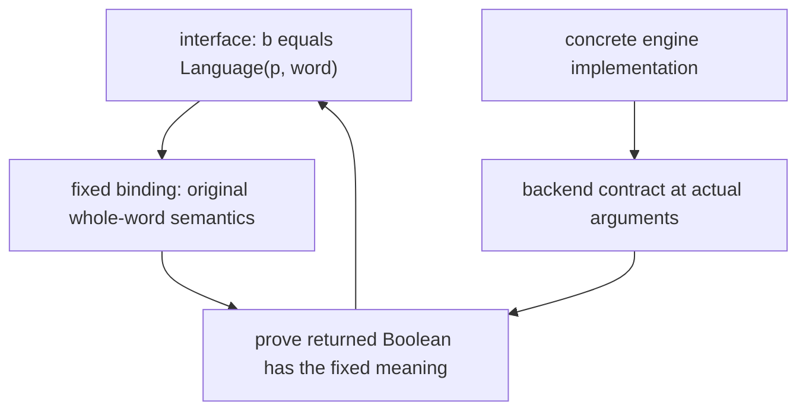
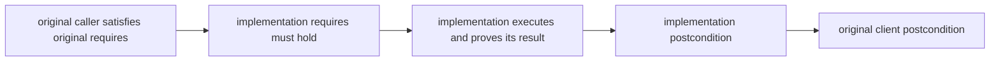
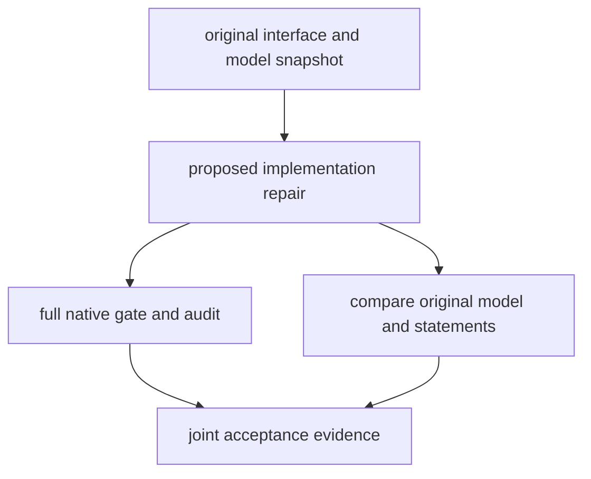

# R08 — Abstraction

Three ideas do all the work:

1. An interface promises a result relation. A concrete engine supplies a mathematical model and an implementation that must establish that relation for the original inputs.
2. Opacity controls which existing definitions a proof may unfold. A local reveal exposes the supplied definition within that scope; it does not change the definition or permit a different target.
3. Verification follows the model that was actually written. Preserve the intended binding, its input domain and its source snapshot when repairing a semantic failure.

## 0. How this module works

Allow 354 minutes: setup 10, reading 60, worked examples and WRITE cards 30, other cards 7, predictions 15, hand holes 90, refinement lab 30, agent follow-up 25, written work 30, seventh bench card 20, viva 30 and calibration 7. The four hand items total 45 minutes in each language. These are planning estimates, not observed completion times. Record your actual work and interruptions separately. There is no test-out or checkpoint in this module.

R08 is standalone. Its declared A2 layer re-supplies the regex semantics, derivative correctness, executable matcher and character-class API, together with A1/A1b. The matcher interface is also provided. You do not import an earlier learner exercise or its solution. A previous proof attempt can inform your understanding, but it is not an undeclared dependency in this module's generated project.

The Dafny abstract matcher lives in `dafny/given/R/RG_A2_MatcherStatement.dfy`. Its path and digest are frozen. It declares an abstract pattern type, a language predicate and an executable method whose result agrees with that predicate. It contains no matching implementation. The Verus counterpart is `rg_re_a2::word_matcher::WordMatcher`, with a spec method and an executable method contract. Every concrete engine still owes its implementation proof.

The two supplied concrete model bindings are intentionally fixed. The derivative engine uses the original whole-word regex semantics. The class engine uses the language of exactly one-character words whose character belongs to the class. Words of every other length remain legal inputs; they are not removed through a stronger precondition. Later engines can share the same provided interface while supplying their own independently proved representation and implementation.

**This module's files** separate the fixed infrastructure, hand implementation, predictions and semantic debugging task.

| path | role and shipping state |
|---|---|
| `dafny/R/R08_Abstraction/std/R08_Abstraction.dfy` | hand work: verified, 4 holes, 0 errors |
| `verus/r/r08_abstraction/src/lib.rs` | hand work: verified, 4 holes, 0 errors |
| `dafny/checks/R08_checks.dfy` | given-only value prediction: verified, 0 holes, 0 errors |
| `dafny/R/R08_Abstraction/agent/R08_AgentInfra.dfy` | semantic debugger: failed, 0 holes, 1 error; postcondition failure |
| `verus/r/r08_abstraction/src/agent.rs` | semantic debugger: failed, 0 holes, 1 error in this file; trait and implementation postcondition diagnostics |
| `specimens/R08/`, `slots/R08.slots` | compact cards and guarded value, obligation and verdict scenarios |
| `dafny/given/R/RG_A2_MatcherStatement.dfy`, `verus/given/rg_re_a2/src/word_matcher.rs` | provided fixed interface; no assumed concrete implementation |
| `paper/R08_problems.tex`, `paper/R08_answers.tex` | survey card and abstraction-square proof |
| `Solutions/`, `paper/solutions/` | completed references — LAST, after your attempt and review |

Commit all five predictions before enabling a slot, running its specimen or reading the later explanation. P1d and P2v take Boolean literals. P4v takes a set of failing labels. P3dv and P5dv use `slots/R08.slots`; the switches are in the Dafny hand file. Run `scripts/firsttry.sh R08 --check` and retain the original receipts. Observed results do not replace an earlier prediction.

> **Predict (P1) — commit in the file before reading on.** Read the complete literal-character refinement and the exact word passed to it. What Boolean does the check obtain? Commit a Boolean literal in the value slot before running the check.

> **Predict (P2) — commit in the file before reading on.** Read the complete Verus literal model and the concrete scalar sequence. What Boolean does this receiver's model assign to that word? Commit a Boolean literal before enabling the closed compute-only check.

> **Predict (P3) — commit in the file before reading on.** The two complete scenarios use the same executable test but different language bindings: whole-word and shortened-word. Commit `D:<x>,<y> V:<x>,<y>` for the actual printed contracts. Keep model meaning separate from your preferred matching intent.

> **Predict (P4) — commit in the file before reading on.** Two literal receivers are present, but the execution calls only one. Which labelled claims are justified by that call and the printed word condition, and which fail? Commit the failing label set before evaluation.

> **Predict (P5) — commit in the file before reading on.** Compare two complete definitions of a one-character language. Retain the exact length test and guarded index. Does the supplied equivalence proof verify in each language? Commit `D:<v> V:<v>` before running the scenarios.

The following captures show the learner-loop baseline. The counted placeholders make the hand files usable for local progress, while the full gate continues to reject incomplete work.

<!-- pin: shipped-d -->
```
$ scripts/vcheck dafny/R/R08_Abstraction/std
vcheck: dafny/R/R08_Abstraction/std [dafny, learner loop]: verified — 38 verified, 4 holes, 0 errors
dafny/R/R08_Abstraction/std/R08_Abstraction.dfy:42:4: hole assume R08.H1d
dafny/R/R08_Abstraction/std/R08_Abstraction.dfy:53:4: hole assume R08.H2d
dafny/R/R08_Abstraction/std/R08_Abstraction.dfy:64:30: hole bodyless-method R08.H3d
dafny/R/R08_Abstraction/std/R08_Abstraction.dfy:70:36: hole bodyless-method R08.H4d
```

<!-- pin: shipped-v -->
```
$ scripts/vcheck verus/r/r08_abstraction
vcheck: verus/r/r08_abstraction [verus, learner loop]: verified — - verified, 4 holes, 0 errors
verus/r/r08_abstraction/src/lib.rs:39:2: hole external_body R08.H1v
verus/r/r08_abstraction/src/lib.rs:50:2: hole external_body R08.H2v
verus/r/r08_abstraction/src/lib.rs:63:38: hole assume R08.H3v
verus/r/r08_abstraction/src/lib.rs:69:38: hole assume R08.H4v
```

<!-- pin: checks-d -->
```
$ scripts/vcheck dafny/checks/R08_checks.dfy
vcheck: dafny/checks/R08_checks.dfy [dafny, learner loop]: verified — 35 verified, 0 holes, 0 errors
```

---

## 1. A language is part of the interface

A matcher can be described by a Boolean relation between a pattern and a word. The relation says which words the pattern accepts. The executable method returns a Boolean and promises that its result agrees with that relation. This description has deliberately omitted the representation and algorithm. A derivative matcher, a certified transition system or a later virtual machine can implement the same abstract shape while using different data internally.

There are nevertheless two distinct kinds of freedom. An abstract interface parameter permits a concrete implementation to supply a type and model. A particular exercise can then fix those choices and ask you to implement them. Once the derivative engine's model is bound to whole-word regex matching, its task is no longer free to choose an easier language. The abstract interface's parametric nature does not reopen a concrete model that the original task has already fixed.

Write four entries before touching a body: the original input domain, the supplied semantic binding, the implementation you intend to write and the backend contract you will use. A method name containing match is not a fifth premise. The backend contributes its postcondition instantiated at its actual arguments. If those arguments differ from the interface inputs, a further proof must connect the relations. A similar name or an intended interpretation does not supply that connection.

The abstraction square separates the representation choice from the implementation obligation. Follow each arrow with a sentence stating what establishes it.



The implementation must connect the actual backend result to the original model; the name of the shared interface does not establish that connection automatically.

The provided Dafny abstract module is a specification parameter. Its method declaration is not an executable body silently accepted as a finished engine. A concrete refinement supplies the pattern type, the mathematical language predicate and an implementation satisfying the method promise. The provided file is frozen because changing that promise would move the acceptance boundary for every client. This module's source guard and statement digest keep it outside learner repair scope.

In Verus, the trait similarly describes a relationship between a receiver's spec method and its executable result. The implementation binds that spec method to the concrete receiver's mathematical data. Two receivers can implement the same trait and recognise different languages. Calling one receiver establishes a fact about that receiver's model. Transferring the result to another receiver requires a proved relation between their models on the input in question.

Do not confuse interface conformance with an assertion that every implementation is interchangeable for every pattern. Interchangeability depends on the chosen abstract values and model relation. A generic client can use the trait promise without inspecting the concrete engine, but it obtains the particular engine's promised language. Whether that language is the intended regex language remains a matter of the concrete binding and the task specification.

---

## 2. Read the worked implementation and its client

W1d supplies a complete literal-character refinement. Its pattern is one character and its model is a word equal to the singleton containing that character. Read its concrete type, model definition and method postcondition in that order. Then compare the executable Boolean with the model. The body is short because the chosen language has a direct executable test, not because the interface proof was waived.

W1v provides the same style of engine as a trait implementation. Its executable length and index tests establish a relation to the sequence view. The explicit proof step relates the concrete vector view to the singleton sequence when the test holds. That bridge illustrates why a plausible runtime test can still need a proof fact: the checker reasons through the available contracts, views and equality rules, rather than through an informal picture of the vector.

W2d is a client of the complete literal module. W2v is a generic client of any receiver implementing the provided trait. Each calls the method and uses its actual postcondition. Trace the receiver and argument through the call. State exactly which equality the caller learns. The client need not repeat the backend implementation, and it receives no unstated theorem about a different receiver or a shortened word.

For each worked example, mark one line that fixes meaning and one line that establishes execution. These lines play different roles in maintenance. Refactoring the implementation while preserving the model and contract can be a legitimate repair. Editing the model to describe a buggy implementation changes the task. A review should name which kind of change was made before interpreting the verifier result.

Complete C1d and C1v on a separate double-character language. Their compact programs isolate implementing a fixed model under a printed contract. Keep the binding and method promise intact. Read the native failure when the body is omitted; it can include definite assignment or result-type obligations in addition to the semantic promise. An omitted return expression is not evidence that a proposed mathematical theorem is false.

This Dafny card imports the provided layer. Copy it to a real `.dfy`
file, then run `scripts/vcheck --module R08 <copy.dfy>` from the repository.
The following capture uses that source in a fresh scratch copy with the same
module context; the manifest pins the card and its provided dependencies.

<!-- pin: refinement-d -->
```
$ scripts/vcheck --module R08 card-c1d.dfy
vcheck: card-c1d.dfy [dafny, learner loop]: failed — 33 verified, 0 holes, 2 errors
card-c1d.dfy:8:2: error: a postcondition could not be proved on this return path
dafny/given/R/RG_A2_MatcherStatement.dfy:9:13: related: this is the postcondition that could not be proved
card-c1d.dfy:8:3: error: out-parameter 'b', which is subject to definite-assignment rules, might be uninitialized at this return point
```

<!-- pin: trait-v -->
```
$ scripts/vcheck specimens/R08/card-c1v.rs.specimen
vcheck: specimens/R08/card-c1v.rs.specimen [verus, learner loop]: failed — 0 verified, 0 holes, 1 error, stage resolve
specimens/R08/card-c1v.rs.specimen:12:53: error: mismatched types
```

These cards teach the implementation boundary. They are not permission to change the interface or replace its semantics with a different predicate. In the hand file, H1 and H2 each use that same boundary for a separate model and backend. Explain the fixed obligations before filling either body.

C3d recognises the provided abstract module and its role. C3v recognises the model-binding spec method of a trait implementation. Recognition means you can locate and explain the construct when reading. It does not add that construct to a broad permission to rewrite frozen statements. The WRITE and recognition lists are deliberately separate from edit scope.

---

## 3. Refinement preserves original callers

A refinement is judged against the original interface. If the original precondition admits an input, the implementation must admit it too. In logical form, the original precondition implies the implementation precondition. A weaker implementation requirement can permit more inputs while retaining all original callers. A stronger requirement can exclude a caller that the original interface promised to handle.

For results, the implementation must establish at least the original promise on the original domain. A stronger result relation can contribute more information, but its conclusion must still imply the original postcondition. Replacing an equality by a weaker implication can lose one of the directions a client relies on. Keep the domain and result directions visible instead of memorising the words weaker and stronger without their callers.

C4dv presents these directions as facts to explain under the actual language rules. The hand files do not ask you to rediscover another track's legality prediction. In Dafny, read the obligations generated by the concrete refinement and the inherited statement. In Verus, read the trait promise that the implementation must discharge, together with its explicit implementation contract. Similar design intent does not mean the two languages expose identical diagnostics or refinement syntax.

The direction diagram follows an original caller through admission to its promised result. Use one example input to test each implication.



Every original caller must reach the original promise; narrowing the domain to hide a difficult case breaks that path.

The class engine is a useful domain check. Its model covers every input word but accepts only words of length one with class membership. An implementation is responsible for words of length zero, one, two and larger lengths. Adding a precondition that the word has length one would remove the other cases rather than implement the original model. Keep legal indexing separate from legal admission: a guard inside an implementation can establish an index bound while preserving the full input domain.

For a review, record the original requirement, the proposed implementation requirement and the relevant implication. Then do the same for result relations. When a proposal adds a requirement, name an original input that it excludes, or prove that none exists. When a proposal changes a postcondition, name the information a client loses, or prove the changed promise still implies the original. The exact relation matters more than the number of visible clauses.

---

## 4. Opacity and a local reveal

An opaque predicate has a fixed body, but the solver does not unfold it freely in every client. This separates a definition's meaning from the facts automatically available in a proof. The body still determines the predicate. A failed proof caused by opacity does not mean the definition is arbitrary, and a reveal does not let you choose a new meaning.

H3 relates a supplied opaque whole-word alias to its underlying semantics. H4 uses a supplied opaque residual model and the A2 derivative-correctness interface. Read each frozen body before planning the proof. Identify which equality follows by exposing the alias and which connection must come from an existing theorem. A local reveal can expose the wrapper; it does not replace the theorem relating a derivative to the original prefixed word.

C2d and C2v isolate revealing a different opaque double-character model. Fill the compact proof while leaving its definition and opacity annotation intact. Run before and after, retain both results and point to the exact scope in which the body became available. Removing opacity from the declaration changes the interface seen by all clients and also changes a frozen declaration in this task.

<!-- pin: reveal-d -->
```
$ scripts/vcheck specimens/R08/card-c2d.dfy.specimen
vcheck: specimens/R08/card-c2d.dfy.specimen [dafny, learner loop]: failed — 0 verified, 0 holes, 1 error
specimens/R08/card-c2d.dfy.specimen:7:2: error: a postcondition could not be proved on this return path
specimens/R08/card-c2d.dfy.specimen:6:30: related: this is the postcondition that could not be proved
```

<!-- pin: reveal-v -->
```
$ scripts/vcheck specimens/R08/card-c2v.rs.specimen
vcheck: specimens/R08/card-c2v.rs.specimen [verus, learner loop]: failed — 0 verified, 0 holes, 1 error
specimens/R08/card-c2v.rs.specimen:8:10: error: postcondition not satisfied
```

Keep the reveal local to the proof that needs it. A global transparency change can make a proof appear easier while widening the solver context and coupling unrelated clients to a representation. That is a maintenance choice with consequences; it is not the repair requested by these fixed exercises. After a local proof, describe what a later client may still rely on without unfolding the model.

The two languages spell the construct differently, so read the complete native card rather than transferring punctuation from memory. Preserve whether a declaration is spec, ghost, proof or executable. A mathematical definition does not become an executable implementation merely because its body is visible to a proof. Likewise, an execution method's contract remains a proof obligation even if every spec definition in it is transparent.

---

## 5. Compare verification with intended meaning

P3 holds one executable test constant and varies its language binding. Read the two definitions literally. One describes an entire one-character word. The other describes a two-character word whose first character is the chosen literal, which is the corresponding shortened-word test for that literal language. The purpose is to compare the relation the program proves with the relation the task intended.

<!-- pin: model-x-d -->
```
$ scripts/vcheck specimens/R08/model-x-d.dfy.specimen
vcheck: specimens/R08/model-x-d.dfy.specimen [dafny, learner loop]: failed — 0 verified, 0 holes, 1 error
specimens/R08/model-x-d.dfy.specimen:6:2: error: a postcondition could not be proved on this return path
specimens/R08/model-x-d.dfy.specimen:5:13: related: this is the postcondition that could not be proved
```

<!-- pin: model-y-d -->
```
$ scripts/vcheck specimens/R08/model-y-d.dfy.specimen
vcheck: specimens/R08/model-y-d.dfy.specimen [dafny, learner loop]: verified — 2 verified, 0 holes, 0 errors
```

<!-- pin: model-x-v -->
```
$ scripts/vcheck specimens/R08/model-x-v.rs.specimen
vcheck: specimens/R08/model-x-v.rs.specimen [verus, learner loop]: failed — 0 verified, 0 holes, 2 errors
specimens/R08/model-x-v.rs.specimen:6:67: error: postcondition not satisfied
specimens/R08/model-x-v.rs.specimen:12:11: error: postcondition not satisfied
```

<!-- pin: model-y-v -->
```
$ scripts/vcheck specimens/R08/model-y-v.rs.specimen
vcheck: specimens/R08/model-y-v.rs.specimen [verus, learner loop]: verified — 1 verified, 0 holes, 0 errors
```

A native result belongs to the particular printed model. Retain both the model and implementation with that result. The separate fixed agent task binds its language to original whole-word semantics. A different specimen's verified model is not permission to substitute that model into the agent delivery.

P4 asks about receivers. The labelled claims follow a specific call and a supplied concrete word condition. Bind the call's receiver first, then instantiate the returned relation. For each later assertion, state whether it uses that same receiver, needs an equality between models or follows from the concrete input condition. A true-sounding statement about a different receiver is still a separate obligation.

P5 concerns equivalent descriptions rather than a changed language. The exact sequence-length test makes the index legal, and extensional equality connects the character test to the singleton sequence. Preserve all those conditions while comparing definitions. Equivalent semantic bindings can support the same client meaning, but a claimed equivalence must itself be established. The source snapshot remains the declared edit boundary even when a proposed replacement happens to be equivalent.

<!-- pin: same-d -->
```
$ scripts/vcheck specimens/R08/same-model-d.dfy.specimen
vcheck: specimens/R08/same-model-d.dfy.specimen [dafny, learner loop]: verified — 2 verified, 0 holes, 0 errors
```

<!-- pin: same-v -->
```
$ scripts/vcheck specimens/R08/same-model-v.rs.specimen
vcheck: specimens/R08/same-model-v.rs.specimen [verus, learner loop]: verified — 1 verified, 0 holes, 0 errors
```

C5dv asks you to explain why a model substitution can verify while failing the original task. Use a distinguishing input, not a general accusation that formal methods can prove anything. The checker has verified the relation it was given, subject to its actual pipeline and assumptions. The acceptance error occurs when a reviewer treats that different relation as evidence for the original one.

---

## 6. Refinement lab

Spend 30 minutes producing a compact obligation table for the two hand engines and the semantic debugger. Each row names the original input domain, the fixed language definition, the actual backend inputs, the backend promise, the bridge required and the instrument that checks the proposed change. Include a row for the class engine's non-singleton cases. This table is your evidence for what the abstraction boundary actually means.

Start from the source before edits. Save a snapshot and retain its path. In a separate scratch copy, compare a legitimate implementation-only repair with a proposed model change. Keep the original source available so the comparison can identify what changed. A native gate on the modified program answers whether that modified program meets its current checked obligations. The snapshot comparison answers whether it preserved the original statement and model.

Record stage, verdict, holes and checked scope for each native run. Parse, resolve and type errors report different failures from a verify-stage postcondition error. A resource-limited result is not a counterexample or a decisive theorem rejection. If a run stops before the semantic obligation, record the wiring problem and fix it before drawing a conclusion about that obligation.

Draw an explicit path through both the native and fidelity instruments. A delivery needs the original semantic target as well as a verified implementation.



The two checks answer different questions, and an original-task delivery must satisfy both.

Explain one possible failure at each stage. An uninitialised result is a language obligation, an unsupported method is a resolution problem, a missing proof can produce a verification error, and a changed semantic definition can fail snapshot comparison despite a green gate. Preserve the actual diagnostics that distinguish them. Do not recast every red result as a mathematical counterexample or every green result as a complete task acceptance.

---

## 7. On paper, before the keyboard

Open `paper/R08_problems.tex` and work in `paper/R08_answers.tex`. B1 is card 06.7, QED at Large, and B2 is the abstraction-square proof. Allow fifteen minutes each. The card source is pinned by exact local line range and digest in the problem. A mismatch requires an author re-pin; do not fill a changed source from a remembered summary.

B1 describes a survey of proof engineering. Keep its heterogeneous systems, corpora, metrics and historical scope visible. A collection of cited percentages is not one experiment with a common task population. Distinguish a proof-object checking kernel, tactic search and a complete accepted proof. Mark unavailable common runtime, cost and repeated-run uncertainty as unavailable rather than inventing a budget that makes the card look complete.

Complete all eight fields: Task shape, Oracle, Trust, Cheat surface, Metric, Budget, Variance and Artifact. The card grade is the minimum of the eight field grades. A polished account of automation does not compensate for an unsupported trust or metric claim. Connect information hiding and refinement to maintenance while preserving what the survey did and did not measure about these course tasks.

B2 asks you to label the square's obligations and distinguish original-word and shortened-word semantics on a concrete input. State the pattern, word and both outcomes. Include the precondition and postcondition directions with their original domain. Explain how a different model can make a different task green and why it fails the preserved original snapshot. A local reveal belongs in the explanation as a controlled exposure of an existing definition.

After writing, identify one claim that a native probe could dispute and one claim that needs a source or fidelity review. This separates a formal obligation from a statement about the experiment or intended task. Grade only the evidence you produced. Locally compiled gold and flawed fixtures support author validation; they are not completed live grading sessions.

---

## 8. The exercise file

Run `scripts/firsttry.sh R08 --check` before enabling any prediction switch. Done means the four hand items in each language are complete, all five predictions have first-try records, the written work and lab are reviewed, and the full native gates, audits and original statement checks pass. Preserve the actual commands and scope, including failed attempts. A learner-loop success with counted holes is progress rather than completion.

H1d/H1v implement the derivative engine using the supplied A2 interface under the fixed regex model. H2d/H2v implement the class engine's whole one-character-word language. H3d/H3v relate the opaque whole-word alias to its fixed definition. H4d/H4v connect the opaque residual model to the original prefixed-word relation. Read the named item and contract in your file; the supplied type/model definitions are part of the task, not extra implementation space.

The hand files have two WRITE constructs per language. Dafny writes refinement implementations and local reveals. Verus writes trait-spec implementations and local reveals. Each has two actual hand uses. Complete the compact cards first when you need syntax help, then return to the full statement. A card's smaller model is a syntax exercise; copying its result test into a different language binding does not solve the new semantic obligation.

Use `scripts/vcheck --gate dafny/R/R08_Abstraction/std` and `scripts/vcheck --gate verus/r/r08_abstraction` on the whole units. Run `scripts/vaudit` on the same targets, `scripts/specfreeze --check R08`, and `scripts/firsttry.sh R08 --report --strict`. Recheck the given-only value unit after enabling its value expectation. Do not stop at a selected goal, an IDE squiggle disappearing or a single successful library call.

### What the instruments can and cannot see

The native gate checks the current program through its pinned toolchain and rejects counted placeholders. The audit checks forbidden assumptions and escape hatches. Specification freeze compares the protected statement and semantic definitions. First-try records preserve what was committed before feedback. Each contributes evidence; none establishes an unmeasured agent success rate or proves that an informal requirement was faithfully translated merely because the file is green.

Inspect the checked scope in the output. A standalone specimen can test one claim, while the completed agent contract demands the whole file. Preserve tool/setup and resource failures in cost logs without silently assigning them a theorem verdict. When a fixed semantic binding is disputed, use the original snapshot and a concrete distinguishing case alongside the native result.

---

## 9. Exercise (agentic): repair the semantic boundary

The agent files contain a complete implementation with a planted semantic defect, rather than a hole to fill. The fixed model promises whole-word matching, while the implementation delegates using a shortened word. The supplied Verus prefix-copy adapter is complete and checked; it is not the learner's repair target. Both original files reach native verification with zero holes and genuine failed postcondition obligations.

<!-- pin: agent-d -->
```
$ scripts/vcheck dafny/R/R08_Abstraction/agent/R08_AgentInfra.dfy
vcheck: dafny/R/R08_Abstraction/agent/R08_AgentInfra.dfy [dafny, learner loop]: failed — 33 verified, 0 holes, 1 error
dafny/R/R08_Abstraction/agent/R08_AgentInfra.dfy:22:2: error: a postcondition could not be proved on this return path
dafny/given/R/RG_A2_MatcherStatement.dfy:9:13: related: this is the postcondition that could not be proved
```

<!-- pin: agent-v -->
```
$ scripts/vcheck verus/r/r08_abstraction/src/agent.rs
vcheck: verus/r/r08_abstraction/src/agent.rs [verus, learner loop]: failed — 2 verified, 0 holes, 2 errors
verus/r/r08_abstraction/src/agent.rs:39:11: error: postcondition not satisfied
verus/given/rg_re_a2/src/word_matcher.rs:7:11: error: postcondition not satisfied
```

Save the original snapshot before editing. Select the language and its own allowed file, then give the agent the contract in a fresh session. Retain the original diagnostic, every edit and its actual verification result. The task is to repair the implementation while keeping its interface, semantic binding, original requirements and promised result. Changing the model to describe the shortened word is a different task, even if that different task verifies.

> **CONTRACT (for /contract R08 — run it in a FRESH session):** Repair the implementation so it honours the original whole-word model. Edit only the selected agent file's implementation body. Preserve the provided interface, concrete type, semantic definitions and all original contracts. Save the original snapshot and retain every native stage and failure. Final delivery needs the full-file zero-hole gate, clean audit and original snapshot comparison, together with an explanation of the semantic defect.

The allowed paths are `dafny/R/R08_Abstraction/agent/R08_AgentInfra.dfy` and `verus/r/r08_abstraction/src/agent.rs`, selected independently for their own runs. Read the in-file acceptance block. Do not change the given matcher, a dependency, generated configuration or another learner file. A repair outside scope cannot be accepted merely because its new tree verifies.

During review, ask what postcondition the actual backend call establishes and how the final result relates to the original input. Retain any failed attempt to repair the wrong layer. Then apply the snapshot comparison to the final delivery. A native success coupled with a model-change rejection is useful evidence of the distinction between formal verification and task fidelity; it is not a successful repair.

Live contractor transcripts and model grading remain recorded deferred validation debt under the build instruction. The native author controls establish that the semantic plant and faithful repair behave as specified. They do not invent a live agent attempt, cost measurement or success rate. When you conduct an actual run, record its real protocol, budget and observations.

---

## 10. Seventh bench card and calibration

Make the seventh bench card by stripping a completed abstraction goal of your own. Keep the original interface, semantic model and statement. Record the source commit, exact path, stripping method and remaining implementation or proof task. Label its provenance as course-derived and disclose your prior exposure to the completion. Renaming the goal does not make it unseen.

Before running a solver, state the allowed context, budget, first-attempt rule and acceptance instruments. Include both verification and preserved-statement fidelity. Retain failed attempts and their costs. A successful reference proof establishes that the task is solvable under the declared tools; it does not estimate a solver's chance of finding that proof. Separate those two kinds of evidence in the card and any later evaluation table.

Use the final seven minutes to compare confidence with outcomes. Which prediction depended on a receiver identity? Which depended on a model definition? Which proof needed an opacity fact rather than a different target? Record a concrete next action for one error and a supporting observation for one confident answer. Keep original first tries intact while adding later understanding.

---

## Instructor touchpoints

Use `/tutor R08` for the model and obligation table, and `/discuss R08` for the boundary between changed implementation and changed semantics. Use `/review R08` after your independent attempt to audit the original domain, receiver and snapshot. Use `/viva R08` in a fresh examiner session; the bank has two disjoint six-question draws with a verifier-refereed live prediction in each. A re-viva uses the other draw rather than reciting answers from the first.

Use `/grade-paper R08` for the eight-field survey card and abstraction-square argument. Use `/review-code R08` for fixed model bindings, backend preconditions, local reveal scope and full-file acceptance. Use `/contract R08` only in a fresh contractor session with the selected in-file allowlist and original snapshot. Keep coach, examiner and contractor contexts separate. Solutions last: consult `Solutions/` and `paper/solutions/` only after your own attempt and the appropriate review.

The instructor can ask for a fresh native scratch probe when a formal claim is disputed. The instructor cannot replace the original target or fill your learner file outside the stated contractor boundary. A discussion of the intended model remains necessary even when a different program verifies. Live calibration and contractor outcomes must be reported from actual runs, not inferred from author fixtures.

---

## What R08 planted

| seed | later harvest |
|---|---|
| fixed model and provided matcher interface | R11's certifying engine and R16's virtual-machine engine can share an interface without importing a learner solution |
| original-domain obligations | R09's port fidelity and later specification reviews preserve legal callers and result meaning |
| local reveal of an unchanged definition | R13's solver-context forensics distinguishes visibility from semantic mutation |
| semantic failure with zero holes | R15's independent fidelity oracles and R-v1 contract distinguish accepted proof from accepted task |
| saved original model snapshot | later agent deliveries retain evidence about which statement they actually proved |
| source-bounded survey card | later benchmark claims keep populations, budgets, trust and missing evidence visible |
