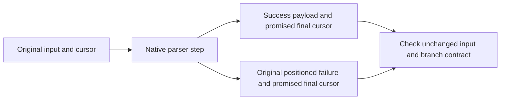
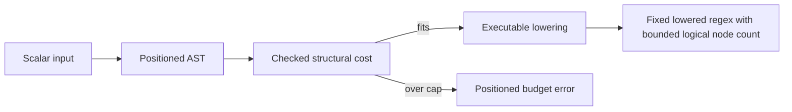
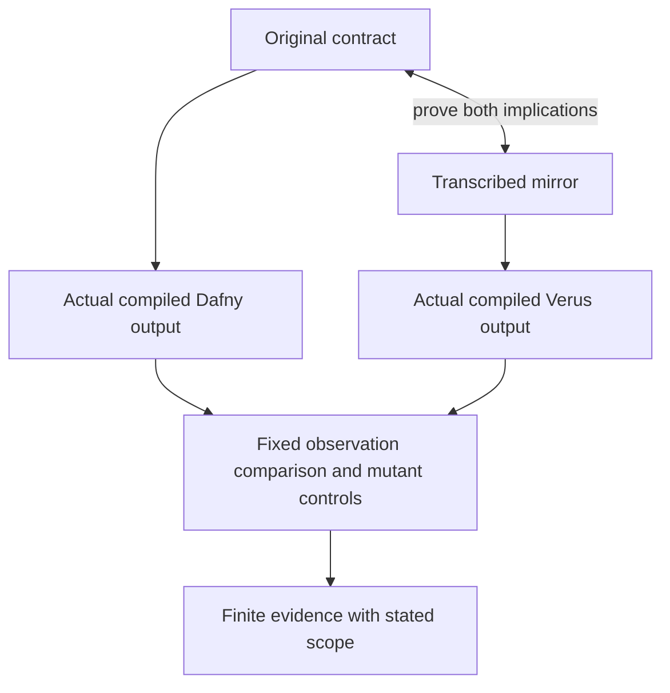

# R09 — Effects

A parser changes two things at once: it produces a value or an error, and it
moves through an input. A faithful port must preserve both. This module adds
native failure propagation, old-state promises and a bounded expansion check
to the standalone regex track. Its infrastructure comes from frozen A1, A1b,
A2 and A3. It imports no earlier learner implementation.

Three ideas do all the work:

1. A parser result includes its original source position and promised state.
2. A bounded implementation checks arithmetic before expanding a syntax tree.
3. Mirror proofs and finite compiled agreement provide different evidence.

## 0. How this module works

Allow 444 minutes: setup8, test-out10, reading60, worked examples30, other
cards8, predictions15, hand work110, port audit60, divergence lab25, agent
follow-up25, written work35, bench card20, viva30 and calibration8. The H holes
are50minutes in Dafny and60in Verus; the two five-minute test-outs are
budgeted separately.
These are estimates; log actual work, interruptions and failed attempts. Keep
prediction receipts before revealing explanations or running their checks.
Live model, contractor and grading validation remains recorded D45 debt. A
native author reference is useful local evidence and is not a model result.

**This module's files** include the following native source and validation inputs.

| artifact | purpose |
|---|---|
| `dafny/given/R/RG_A3_Syntax.dfy`, `verus/given/rg_re_a3/` | positioned AST, grammar predicates, result forms and fixed lowering definitions |
| `dafny/R/R09_Effects/std/R09_Effects.dfy`, `verus/r/r09_effects/src/lib.rs` | 6 holes each; complete checking/lowering infrastructure |
| `dafny/checks/R09_checks.dfy`, `specimens/R09/`, `slots/R09.slots` | no hole in the check file; five predictions and compact syntax cards |
| `dafny/R/R09_Effects/agent/R09_AgentRefactor.dfy`, `verus/r/r09_effects/src/agent.rs` | 0 + 1 holes, 0 errors; complete escaped-atom baseline and typed port |
| `paper/R09_problems.tex`, `paper/R09_answers.tex` | paper card06.11 and a written fidelity argument |
| `tools/R09/check_port.py`, `tools/R09/port_cases.json` | supplied compiled escaped-atom observations; reads only the specified sources |
| `bench/local/r/` | your eighth, explicitly course-derived bench card |
| `Solutions/` | reference twins; read LAST, after the attempts and original receipts |

The grammar admits literals, escapes, groups, alternation, concatenation,
classes, and postfix star, plus, optional and finite counted repetitions.
Bounds are individual characters from `0` through `9`. Neither a digit-run
parser nor an open upper count is silently added. Classes use the printed
below-0xD800 domain; other literal characters can be Unicode scalars outside
that domain. Every position is a scalar index, not a UTF8 byte offset.

Commit all five predictions before continuing. P1d and P2v take numerals;
P4v takes the failing label set; P3dv and P5dv take ordered native verdicts
through `slots/R09.slots` and the switches in the Dafny hand file. Use
`scripts/firsttry.sh R09 --check` to retain the first committed observation.
Changing a prediction after seeing output does not replace its first try.

> **Predict (P1) — commit in the file before reading on.** The complete single-bound helper
> receives a nondigit and an explicit source position. Which numeral reaches
> the value slot? Read the returned branch rather than assuming every result
> contains a digit value.

> **Predict (P2) — commit in the file before reading on.** The Verus bound model receives a
> nondigit after a non-BMP first scalar. Which numeral does the error-position
> expression yield? Keep scalar length distinct from encoded byte length.

> **Predict (P3) — commit in the file before reading on.** Both complete product-fit
> scenarios promise a mathematical comparison over bounded input values.
> Predict `D:<x>,<y> V:<x>,<y>` for direct bounded multiplication and guarded
> division. A mathematically sensible result does not make every executable
> intermediate representable.

> **Predict (P4) — commit in the file before reading on.** The complete toy operation moves
> a mutable cursor twice while retaining its input. Which labelled assertions
> follow from the printed initial state and operation contracts? Commit the
> failing label set before running the native obligation check.

> **Predict (P5) — commit in the file before reading on.** Compare the two complete error
> adapters under the original equality promise. One preserves the original
> result, while the other rewrites a failure position. Commit
> `D:<x>,<y> V:<x>,<y>` for the actual statements, including arbitrary errors.

The captures below report learner-loop scope and counted placeholders. They
are regenerated by the pinned wrappers; the full gate still requires zero
holes. A failure to resolve a file is different from a failed proof.

<!-- pin: shipped-d -->
```
$ scripts/vcheck dafny/R/R09_Effects/std
vcheck: dafny/R/R09_Effects/std [dafny, learner loop]: verified — 340 verified, 6 holes, 0 errors
dafny/R/R09_Effects/std/R09_Effects.dfy:144:4: hole assume R09.H1d
dafny/R/R09_Effects/std/R09_Effects.dfy:152:4: hole assume R09.H2d
dafny/R/R09_Effects/std/R09_Effects.dfy:262:4: hole assume R09.H3d
dafny/R/R09_Effects/std/R09_Effects.dfy:552:43: hole bodyless-method R09.H4d
dafny/R/R09_Effects/std/R09_Effects.dfy:586:4: hole assume R09.T1d
dafny/R/R09_Effects/std/R09_Effects.dfy:599:4: hole assume R09.H5d
```

<!-- pin: shipped-v -->
```
$ scripts/vcheck verus/r/r09_effects
vcheck: verus/r/r09_effects [verus, learner loop]: verified — - verified, 6 holes, 0 errors
verus/r/r09_effects/src/lib.rs:183:1: hole external_body R09.H1v
verus/r/r09_effects/src/lib.rs:194:1: hole external_body R09.H2v
verus/r/r09_effects/src/lib.rs:334:1: hole external_body R09.H3v
verus/r/r09_effects/src/lib.rs:714:38: hole assume R09.H4v
verus/r/r09_effects/src/lib.rs:730:1: hole external_body R09.T1v
verus/r/r09_effects/src/lib.rs:743:1: hole external_body R09.H5v
```

<!-- pin: checks-d -->
```
$ scripts/vcheck dafny/checks/R09_checks.dfy
vcheck: dafny/checks/R09_checks.dfy [dafny, learner loop]: verified — 54 verified, 0 holes, 0 errors
```

---

## 1. Values, failure and state are one statement

Start with a tiny step. Before it runs, a cursor refers to an input and a
position. After it runs, either the returned character came from the specified
input position, or a positioned error explains why the step could not produce
one. The statement also says what happened to the cursor in each case. These
are independent obligations: returning the right character does not establish
the final position, and returning an in-range error does not establish the
right failure location.

Consider two valid designs for an error branch. A consuming reader may advance
before discovering that a character is not a digit. A transactional wrapper
may leave the cursor unchanged when a counted suffix is malformed. Either can
be useful, but changing between them changes behavior. T1 and H5 deliberately
print different state promises. Read their original postconditions rather
than generalizing a personal rule that all failures should roll back or all
reads should consume input.



Dafny's `modifies cur` permits updates to that object's fields. It does not
prove that a particular field was updated, and it does not prove that the
input was preserved. The old-input equality is a real promise because the
input field is mutable. Replacing it with a constant would remove a meaningful
obligation and produce misleading uses of `old`.

In Verus a mutable borrow grants temporary access to the object. `old(cur)`
and `final(cur)` identify the state at entry and at the end of the operation.
The input vector's mathematical view appears in the equality. A field access
in a postcondition must refer to the intended state explicitly; otherwise a
claim about the original text can accidentally be read as a claim about its
replacement. The borrow discipline and a functional postcondition answer
different questions and both must hold.

Read W1 in each language before attempting T1. The complete single-bound
recognizer maps an accepted character to its numerical value and a rejected
character to its supplied position. Its character-domain test, payload and
error location are already established. Your cursor wrapper must use that
contract on the actual original character, retain the specified mutation,
and discharge its own enclosing statement on both branches.

This is where native failure propagation becomes useful. In Dafny the
provided result datatype supplies `IsFailure`, `PropagateFailure` and
`Extract`. The `:-` form uses that protocol to leave the current method on a
failure or bind a successful value. In Rust, `?` performs the corresponding
control-flow step for the actual `Result` type and compatible conversion.
Neither notation allows escaping the enclosing postcondition. An early-return
branch is still a branch of the function being verified.

Complete card C1 before the cursor test-out. It has a fresh result-equality
statement, so the only interesting issue is preserving the original failure
rather than inventing a replacement. Card C2 isolates old-state mutation
without a parser. Explain which permission enables the update and which
postcondition requires it. Then close the worked examples and attempt T1 in
both languages. Keep the original attempt even if you need to reopen W1.

---

## 2. A positioned AST is observable data

A parser that accepts the same set of strings can still be an unfaithful port.
The downstream pipeline receives a syntax tree, nested spans and class data,
not just a success flag. Moving an alternative's right child, merging source
spans indiscriminately or returning a noncanonical class vector can affect
later diagnostics and expansion cost even when a language-level description
looks similar.

A3 gives the syntax, the fixed `Lower` model and the well-formedness relation.
Each syntax node carries a half-open scalar span. Child spans nest in the
parent and preserve the printed source order. The well-formedness predicate
makes these constraints precise. It does not itself characterize which tree
is the parser's correct output for every possible input string.

The canonical class vector is part of this AST representation. A class node
holds A2's class, whose ranges are pairs of u32 code points, sorted and
separated by at least one code, so adjacent ranges merge. A3 and the checker
read the interval vector through A2's read-only accessor (`ClassRanges` in
Dafny, `ranges` in Verus); the representation stays private, so a class is
still built only through A2's API. Reading the actual vector lets the checker
reason about the intervals that will be lowered. Comparing only the
represented character set would hide redundant or reordered ranges and could
hide a different cost.

Read W3 together with the parser's literal-fragment guarantee. Ordinary
literal strings must succeed, have full-source bounds, and match their own
lowered result. The sized guarantee adds the exact logical tree size of that
literal lowering. Those promises prevent the complete frontend from becoming
an always-error implementation while satisfying only conditional safety.
They do not silently become a general grammar theorem for alternatives,
classes and counted forms.

For H1, retain the finite-count success-completeness clause as well as the
conditional success and failure bounds. A malformed suffix must not cause an
out-of-bounds read. A well-shaped permitted suffix must produce the specified
node and end position. An implementation that rejects everything would
satisfy the first concern and fail the second. Check every guard against the
next index actually read; truncated inputs distinguish guards that appear
interchangeable on long examples.

H2 has a similar split. It maintains class validity, the below-surrogate class
domain and the accumulator while making progress toward a closing delimiter.
A2's insertion keeps a listing bound when the inserted range lies below it
(`ClassBelow` in Dafny, `ranges_below` in Verus), and its accessor lemma states
validity through the listing.
The completion clause identifies a class body for which success is required.
It is not sufficient to stop anywhere with a valid but unrelated class. On a
range, check the relationship between endpoints and the next source position;
on an escaped item, keep the consumed width separate from the character's
numeric value.

Unicode makes careless tests visible. A non-BMP literal is one scalar in the
input sequence and several bytes in UTF8. A class endpoint above the printed
class domain must be rejected at the prescribed scalar position even if the
same character is legal as an ordinary literal. An escaped closing delimiter
is data in one context and syntax in another. Preserve these distinctions in
both the model and the compiled test record.

---

## 3. Bound the expansion before constructing it

The surface syntax can be small while its expanded regex is large. Repeating
a repeated expression multiplies a logical size, and class ranges expand
into alternatives. The frontend therefore computes a structural size over
the AST before allocating the expanded regex. Performing expansion and then
checking the resulting size defeats the purpose of this boundary.

The size model counts logical tree nodes. A shared immutable Dafny value can
represent a logical subtree in more than one place; Rust's boxed output may
copy it. The theorem about logical size does not promise equal peak memory,
stack depth or allocation counts. Describe those resource questions separately
if you later measure them. A precise bound on one resource should not acquire
an unsupported interpretation as a bound on every resource.



Read W2's complete bounded-addition helper first. Its contract states the
meaning of both outcomes. A successful cost equals the mathematical sum and
fits the cap. A rejection establishes that the mathematical sum exceeds the
cap. The guards precede each potentially unsafe subtraction or addition.
This is a small example of separating a mathematical expression in a contract
from the bounded operations that implement its decision.

H3 applies that discipline to finite repetition. Count the fixed-copy branch,
the optional-copy branch and their outer concatenation using the actual
representation. Use the printed mathematical cost rather than a guessed
estimate based only on the number of copied children. The structural checker
relies on this exact accepted/rejected relation. A conservative reject-all
checker would be safe in one sense and violate its complete rejection promise.

Derive the zero-count case before designing the multiplication guard. If no
copies are requested, the child need not be expanded at all. Its own cost may
be enormous, and computing or rejecting it prematurely changes the result.
A positive upper count has a different argument: the parent's cost cannot
hide a child that already exceeds the cap. The checker uses that fact before
recursing with the available bound.

For a positive multiplier, division by that multiplier can establish whether
a later product fits in the remaining space. Division is not free of proof
obligations: establish that its divisor is positive and justify the relation
between quotient comparison and mathematical product comparison. The worked
arithmetic helpers make that connection explicit. Moving multiplication in
front of its guard is an executable change even when the final mathematical
predicate is identical.

P3 now has a useful interpretation after your receipt is fixed. The direct
product scenario fails its native bounded-evaluation obligation; the guarded
one verifies. Dafny's fresh bounded newtype and Rust's `u32` are both part of
the scenario, while the specification's product is mathematical. The supplied
quotient helper is a proof of that relationship, not an added assumption and
not permission to raise the verifier's resource limit.

---

## 4. Compose a repetition proof from worked interfaces

H4 is a semantic proof, separate from the executable budget decision. The
claim ranges over an arbitrary regex, lower and upper counts, and an input
word. In particular, the regex may accept the empty word. An argument that
identifies the number of copies by the consumed length would fail for such a
nullable operand.

Read W4's module-local helpers. The copy-joining helper relates adjacent copy
blocks to a block with the summed count. The optional-copy helper relates a
finite optional representation to an existential count within its bound.
Their complete implementations are worked material in this module. They are
not newly trusted declarations in A3 and do not import an earlier learner
proof.

Before writing the final proof, name the witness and slice boundary needed
for each direction. When a concatenation matches, its semantics gives a
boundary splitting the word. When an existential count is given, the proof
must construct the corresponding matching representation. These directions
use related arithmetic but different witnesses. An existential assertion
that merely repeats the final conclusion does not establish its witness.

Keep the optional count relative to the original lower count, and distinguish
a count from a source cursor. Both are naturals here, but they describe
different things. The proof statement is about the fixed lowering structure;
changing that structure to make one direction easier changes the target.
After the proof verifies, retain a local explanation of which helper contract
justifies each semantic step.

H5 returns to state. It wraps the counted parser under a mutable cursor and
promises that a failed parse preserves its original position. A successful
parse commits the returned position and tree. The original input stays fixed
on both paths. Compare this printed transaction with T1's consuming read.
The propagation notation is the same kind of construct; the surrounding
state contract determines what must happen before it can return.

P4's two calls establish the final toy position stated by their contracts;
the failing label is `b`. P5's identity adapter verifies and the adapter that
replaces a failure index does not. P1's numeral is2 and P2's is1: those checks
use explicit source locations and scalar length, rather than deriving a new
failure policy from the input's encoding. These explanations follow the
prediction boxes so the original first attempt can remain meaningful.

---

## 5. A port needs an observation relation

Run `python3 tools/R09/check_frontend.py` on your completed hand files and retain its fixed corpus and source hashes. The sixty-minute port audit starts with an observation format, not a claim
that the languages should behave similarly. Write down success with the
complete positioned AST, actual canonical class intervals and lowered result;
or failure with its exact scalar position. Include the input and old/final
cursor when auditing a mutable adapter. Keep the budget cap as an explicit
input to the frontend observation.

Transcribe the contract independently and prove both implication directions
between the original and mirror under that same domain. Read the complete `R09_ParserMirror` and `parse_relative_mirror_r09` demonstrations. They establish both implications and apply the result to the actual parser contract. Label the result
relative to the mirror. If both descriptions accidentally admit the same
wrong error policy, the implication can still verify. It establishes a
relationship between two statements; it does not discover whether either
statement expresses the intended grammar.



The module's construction checks include290predeclared parser cases and297
predeclared capped-frontend cases in actual compiled Python/Rust execution.
They compare nested spans and raw canonical intervals, not externally repaired
class vectors. Frontend size expectations come from an independent arithmetic
interpretation of recorded ASTs and hand-built new cap cases. Exact source
identity matters: a prior prototype result does not automatically describe a
subsequently edited delivery.

Those finite checks are deliberately separate from native proofs. Three
paired parser mutations can preserve the formal safety/completion guarantees
while changing an escaped literal, a class endpoint or a failure position.
The compiled corpus detects them, with matching failing case identities across
the languages. A mutation of the required counted-success model instead
fails native verification. Record the phase at which each control fails.
A resolve error in a malformed mutation is not a semantic counterexample.

For your audit, preserve the fixed inputs before editing. Include literals,
escapes, non-ASCII and non-BMP scalars, empty and overlapping classes, exact
class-domain boundaries, truncations at every finite-count punctuation,
reversed bounds and nested operators. Include zero and exact caps, a large
positive repetition rejected before expansion, and its unused child under a
zero count. Compare failure indices after nonempty prefixes so an incorrect
replacement with zero cannot hide.

Use the real compilation routes through the pinned wrappers. Retain the
native stage and the actual compiled test results, source digests, runtime
language and complete case set. If a driver exhausts proof resources before
compilation, fix the driver structure without silently changing its corpus
or interpreting the resource result as a grammar failure. Splitting independent
cases into independent tests can change the proof burden while preserving the
predeclared observations.

Finish with a short evidence table in your own report: native properties,
mirror-relative properties, finite runtime observations, unresolved semantic
claims and deferred actor measurements. Do not merge them into a single
"verified port" label. A future full grammar theorem would require a semantic
parser specification and proof beyond the safety and literal guarantees
supplied here.

---

## 6. Overflow and encoding divergence lab

Allow25minutes. Work on copies of the printed compact specimens; keep the
original versions and statements. Contrast a mathematical product with the
bounded intermediate that evaluates it. Name a concrete full-domain input
that requires the guard, record the actual native failure and then test the
guarded case without relaxing a precondition or changing the cap relation.
If a proof needs a quotient lemma, retain the lemma's checked statement and
body instead of recording that the solver somehow knew the result.

For encoding, use a scalar sequence containing a non-BMP character before a
malformed suffix. Write its scalar positions and UTF8 byte offsets on paper,
then compare the actual positioned output. Ordinary literals and class items
have different printed domains. Demonstrate that rejecting a class endpoint
outside the class domain does not imply rejecting that scalar everywhere.
Keep error kind, failure position and consumed position distinct in the log.

Finally examine the provided UTF8 conversion used internally by executable
range lowering. Its proof discharges the pinned library contract for the
particular encoded scalar before using the library operation. It introduces
no new trusted axiom. This later library boundary does not waive an earlier
module's import restriction or make an unavailable earlier primitive suddenly
part of that earlier task. Audit the actual allowed dependencies at the
current boundary.

---

## 7. On paper, before the keyboard

B1 reads card06.11 on PUMPKIN Pi. Its symbolic type-equivalence repair provides
a useful contrast: a supplied equivalence and kernel checking delimit what
transport establishes. Suggested tactic scripts and checked transformed terms
are distinct artifacts. The excerpt reports qualitative repair categories
without timing data. Do not invent speedups, sampling budgets or repeated-run
variance because the surrounding course also discusses agents.

B2 asks for the positioned observation relation, both mirror implications,
independent compiled controls and the bounded expansion argument. State the
limits of each kind of evidence. Include a success-completeness condition so
an always-error program cannot satisfy the whole task. Explain the zero-copy
case without appealing to an allocation that should never occur. Build your
answers with the paper Makefile and retain the unfilled template separately.

---

## 8. The exercise file

Run `scripts/firsttry.sh R09 --check` before enabling any prediction switch.
Use whole-unit `scripts/vcheck --gate` and `scripts/vaudit` on both hand units,
`scripts/specfreeze --check R09`, and `scripts/firsttry.sh R09 --report --strict`.

Done means the six typed tasks in both languages are complete and their full gates, audits and statement checks pass. Complete all six typed tasks in both languages. Record genuine first tries
for all five predictions and the closed-book test-outs. Run the whole module
gates and assumption audits, then the original statement/model comparison.
A selected-symbol success is useful feedback and does not accept the entire
unit. Counted placeholders are progress markers rather than completed proofs.

### What the instruments can and cannot see

The native gate counts placeholders and checks the current program. The audit
checks trust escapes; source freeze protects the original statement and model.
A successful selected goal does not accept the entire delivery. First-try
records preserve the original prediction rather than its later correction.

Your eighth bench card strips one of your own completed effects goals. Keep
the original module, source revision, statement, complete/stripped pair,
positive witness and negative semantic controls. Label it course-derived and
previously exposed. Changing a filename does not create an unseen benchmark,
and this reconstruction card receives no automatic admission to a later pool.
The author supplies instructions, not a learner's claimed artifact or outcome.

The viva draws six questions from the effects bank, including a fresh native
prediction. A later draw uses a disjoint set. Explain failure propagation,
old-state promises, scalar units, bounded evaluation and evidence scope in
your own terms. When a claim is disputed, reproduce the smallest relevant
native or compiled observation without changing the original statement.
Keep the output stage, checked scope and missing evidence visible.

Preserve unsuccessful attempts. Syntax/type failures, verify-stage failures,
resource exhaustion and runtime disagreements have different meanings. Report
costs for them all without turning one category into another. A final clean
local result does not erase an earlier failure, establish a general grammar
theorem or fill a deferred live-validation record.

---

## 9. Exercise (agentic): port the escaped-atom effect

The agent exercise supplies a complete Dafny escaped-atom cursor operation and
a typed Verus port hole. Its model, mirror, signatures, mutation promises and
error positions are fixed. This deliberately smaller target is independent
of H1's counted parser and H2's class-body implementation. It supplies a fresh
setting for effects without publishing either of those exercise completions.

> **CONTRACT (for /contract R09 — run it in a FRESH session):** Preserve the
> original escaped-atom model, mirror, inputs, errors and old/final state;
> edit only the allowed implementation body, retain the original snapshot and
> failed native result, and require complete gates, audits and the fixed
> compiled scalar-position harness. Live actor validation remains D45 debt.

Read the CONTRACT block before editing. Snapshot the original source and keep
the first native result. A completed port must satisfy the full-file gate and
audit, preserve the original model under source comparison and pass `python3 tools/R09/check_port.py`, the fixed
scalar-position harness. The mirror lemma is explicitly relative to the
mirror. Actual compiled observations decide the listed finite cases, including
a trailing escape, an escaped non-BMP scalar and an escape after a prefix.
Changing the model to permit a different failure position does not repair the
original task even if the changed program verifies.

Use `/contract R09` only within an available, budgeted actor session. Current
D45 validation debt remains recorded; do not invent a transcript, measured
success or winner when that session has not happened. You can complete and
review the local port while preserving that distinction. A native reference
check is not a substitute for an actor's attempt, cost log or acceptance.

---

## Captured compact scenarios

These native captures show the complete source controls and incomplete WRITE
cards. The first-try machinery checks the two slot-bearing specimens separately.

<!-- pin: agent-d -->
```
$ scripts/vcheck dafny/R/R09_Effects/agent/R09_AgentRefactor.dfy
vcheck: dafny/R/R09_Effects/agent/R09_AgentRefactor.dfy [dafny, learner loop]: verified — 58 verified, 0 holes, 0 errors
```

<!-- pin: agent-v -->
```
$ scripts/vcheck verus/r/r09_effects/src/agent.rs
vcheck: verus/r/r09_effects/src/agent.rs [verus, learner loop]: verified — - verified, 1 hole, 0 errors
verus/r/r09_effects/src/agent.rs:32:1: hole external_body R09.A1v
```

This Dafny card imports the provided layer. Copy it to a real `.dfy`
file, then run `scripts/vcheck --module R09 <copy.dfy>` from the repository.
The following capture uses that source in a fresh scratch copy with the same
module context; the manifest pins the card and its provided dependencies.

<!-- pin: card-c1d -->
```
$ scripts/vcheck --module R09 card-c1d.dfy
vcheck: card-c1d.dfy [dafny, learner loop]: failed — 51 verified, 0 holes, 1 error
card-c1d.dfy:7:2: error: a postcondition could not be proved on this return path
card-c1d.dfy:6:14: related: this is the postcondition that could not be proved
```

<!-- pin: card-c1v -->
```
$ scripts/vcheck specimens/R09/card-c1v.rs.specimen
vcheck: specimens/R09/card-c1v.rs.specimen [verus, learner loop]: failed — 0 verified, 0 holes, 1 error
specimens/R09/card-c1v.rs.specimen:6:10: error: postcondition not satisfied
```

<!-- pin: card-c2d -->
```
$ scripts/vcheck specimens/R09/card-c2d.dfy.specimen
vcheck: specimens/R09/card-c2d.dfy.specimen [dafny, learner loop]: failed — 1 verified, 0 holes, 1 error
specimens/R09/card-c2d.dfy.specimen:9:2: error: a postcondition could not be proved on this return path
specimens/R09/card-c2d.dfy.specimen:8:44: related: this is the postcondition that could not be proved
```

<!-- pin: card-c2v -->
```
$ scripts/vcheck specimens/R09/card-c2v.rs.specimen
vcheck: specimens/R09/card-c2v.rs.specimen [verus, learner loop]: failed — 0 verified, 0 holes, 1 error
specimens/R09/card-c2v.rs.specimen:8:43: error: postcondition not satisfied
```

<!-- pin: error-x-d -->
```
$ scripts/vcheck specimens/R09/error-x-d.dfy.specimen
vcheck: specimens/R09/error-x-d.dfy.specimen [dafny, learner loop]: verified — 1 verified, 0 holes, 0 errors
```

<!-- pin: error-x-v -->
```
$ scripts/vcheck specimens/R09/error-x-v.rs.specimen
vcheck: specimens/R09/error-x-v.rs.specimen [verus, learner loop]: verified — 1 verified, 0 holes, 0 errors
```

<!-- pin: error-y-d -->
```
$ scripts/vcheck specimens/R09/error-y-d.dfy.specimen
vcheck: specimens/R09/error-y-d.dfy.specimen [dafny, learner loop]: failed — 0 verified, 0 holes, 1 error
specimens/R09/error-y-d.dfy.specimen:6:2: error: a postcondition could not be proved on this return path
specimens/R09/error-y-d.dfy.specimen:5:14: related: this is the postcondition that could not be proved
```

<!-- pin: error-y-v -->
```
$ scripts/vcheck specimens/R09/error-y-v.rs.specimen
vcheck: specimens/R09/error-y-v.rs.specimen [verus, learner loop]: failed — 0 verified, 0 holes, 1 error
specimens/R09/error-y-v.rs.specimen:5:10: error: postcondition not satisfied
```

<!-- pin: product-x-d -->
```
$ scripts/vcheck specimens/R09/product-x-d.dfy.specimen
vcheck: specimens/R09/product-x-d.dfy.specimen [dafny, learner loop]: failed — 1 verified, 0 holes, 1 error
specimens/R09/product-x-d.dfy.specimen:6:31: error: result of operation might violate newtype constraint for 'FitU32R09'
```

<!-- pin: product-x-v -->
```
$ scripts/vcheck specimens/R09/product-x-v.rs.specimen
vcheck: specimens/R09/product-x-v.rs.specimen [verus, learner loop]: failed — 3 verified, 0 holes, 1 error
specimens/R09/product-x-v.rs.specimen:25:19: error: possible arithmetic underflow/overflow
```

<!-- pin: product-y-d -->
```
$ scripts/vcheck specimens/R09/product-y-d.dfy.specimen
vcheck: specimens/R09/product-y-d.dfy.specimen [dafny, learner loop]: verified — 16 verified, 0 holes, 0 errors
```

<!-- pin: product-y-v -->
```
$ scripts/vcheck specimens/R09/product-y-v.rs.specimen
vcheck: specimens/R09/product-y-v.rs.specimen [verus, learner loop]: verified — 4 verified, 0 holes, 0 errors
```


---

## Instructor touchpoints

Use `/tutor R09` for a legal next step, `/discuss R09` for the observation
relation, `/review R09` for a disputed concept, `/viva R09` for a committed
six-question draw, `/grade-paper R09` for the written pair and `/review-code
R09` for full native evidence and the original snapshot. `/contract R09`
requires a fresh, available actor session under the printed contract. The
instructor never fills a withheld hand body or reads a later layer on a
learner's behalf. Solutions are reference-class and read last. A deferred
live session has no measured grade, contractor outcome or actor cost.

---

## What R09 planted

| seed | harvest |
|---|---|
| Branch-specific state and exact failures | later imperative and concurrent reasoning under unchanged statements |
| Guarded bounded expansion and zero-copy behavior | certifying frontends with explicit resource meanings |
| Mirror-relative implications and fixed compiled controls | evaluations that distinguish specification fidelity from local proof success |
| Course-derived exposed bench provenance | honest reconstruction tasks and later admission reviews |
