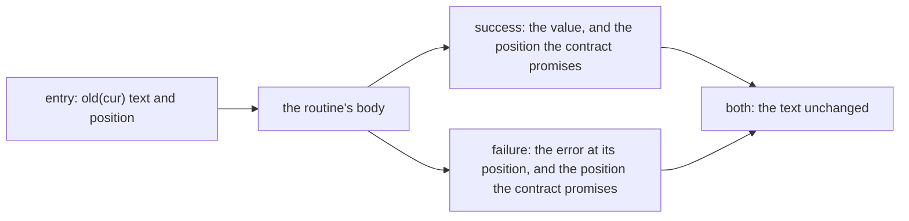
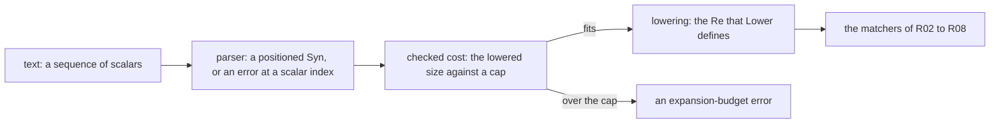
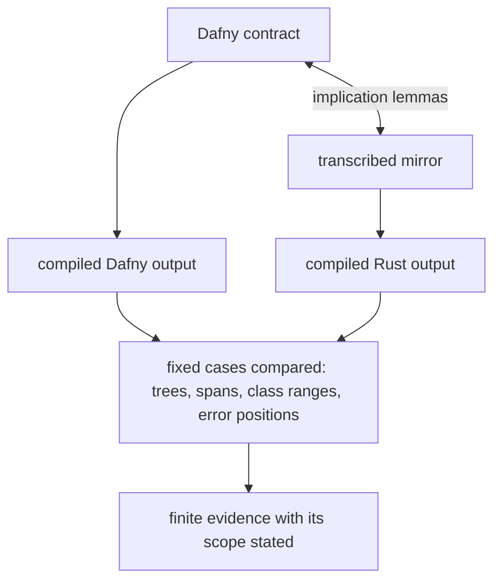

# R09 — Effects

R02 to R08 built the regex track's pure core: a syntax tree, its whole-string meaning, derivatives, a matcher behind an interface. Every function there returned one value and changed nothing. A parser is different. It reads an input that someone else owns, moves through it, and either produces a positioned syntax tree or stops with an error whose position the user will read. R09 adds those two effects, failure and state, to the track, together with a bound on how large the parsed pattern may become once its counted repetitions are expanded.

Everything here sits on the frozen layers A1, A1b, A2 and A3. A3 supplies the positioned syntax, the lowering of syntax to `Re` and the parser's specification predicates; it supplies no parser and no lowering proof, which are this module's work. R is standalone: you need the README setup and R01 to R08's habits, no Q file.

**Three ideas do all the work.**

1. A result is a value or a positioned error, and a failure is a return path. Dafny's `:-` and Rust's `?` leave a routine early with the callee's error unchanged; every postcondition must hold on that path too, including the ones about state.
2. A routine that changes state has two states to talk about. `old(...)` names the state at entry; `modifies` (Dafny) and `&mut` (Verus) grant the permission to write, and only the body establishes what was written. Whether a failure consumes input or rolls back is a promise in the contract, not a habit.
3. Arithmetic on the cost of an expansion is checked before the expansion exists, and a port is audited by observation. The size of a counted repetition is compared with a cap without any machine integer overflowing; a transcribed mirror with implication lemmas is evidence relative to the mirror, and compiled differential runs are separate, finite evidence.

---

## 0. How this module works

**Budget: 444 minutes**, including the module viva and excluding contractor wall time. These are planning estimates; record your own times, interruptions and failed attempts.

| setup | test-out | read | worked | cards | predictions | holes | port audit | divergence lab | agent | paper | bench card | viva | calibration | total |
|---|---|---|---|---|---|---|---|---|---|---|---|---|---|---|
| 8 | 10 | 60 | 30 | 8 | 15 | 110 | 60 | 25 | 25 | 35 | 20 | 30 | 8 | **444** |

The hole minutes are 50 for Dafny (H1 12, H2 9, H3 8, H4 14, H5 7) and 60 for Verus (15, 12, 9, 16, 8): the Verus half adds moves into boxed nodes, the `&mut` discipline and explicit `choose`. The two 5-minute test-outs are counted separately.

**Test-out first.** Before reading on, attempt T1 closed book in both files. It is the first item of each exercise file: read one counted bound at a cursor, move the cursor one scalar on, and propagate the given reader's failure (W1 sits directly above it). Keep its check, under `Uncomment as you go:` below the hints, commented, and record the attempt with `scripts/firsttry.sh R09 --check`; the tool enables the check in a scratch copy and keeps the first result. A later repair is useful, but it does not replace the first try.

**Predictions.** Commit the five answers below before running their scenarios or opening the specimens' expected outputs, the bank or the rubric. The value slots are in `dafny/checks/R09_checks.dfy` (P1) and `specimens/R09/P2v.rs.specimen` (P2), the obligation slot in `specimens/R09/P4v.rs.specimen` (P4), and the two verdicts in `slots/R09.slots`, switched on by the two `CHECK` lines of the Dafny file's prediction block (P3, P5). Respect each printed answer form; then run `scripts/firsttry.sh R09 --check` again and keep its receipts.

> **Predict (P1) — commit in the file before reading on.** The given-only check unit calls a complete single-bound reader on the non-digit `'x'` with the explicit position `2`, then reads either the value or the error position out of the result. Which numeral reaches the slot? Answer form: a numeral.

> **Predict (P2) — commit in the file before reading on.** `specimens/R09/P2v.rs.specimen` evaluates the same single-bound model for `'x'` at the position `len - 1` of the two-scalar sequence `['😀', 'x']`, whose first scalar is outside the Basic Multilingual Plane and takes four bytes in UTF-8. Which numeral does the expression yield? Answer form: a numeral.

> **Predict (P3) — commit in the file before reading on.** Two complete methods promise the same mathematical comparison, `width * times <= cap`, over bounded inputs. `product-x` multiplies in the bounded type (Dafny's `newtype FitU32R09`, Rust's `u32`) and compares; `product-y` compares `width` with `cap / times` through a given quotient lemma. Answer `D:<x>,<y> V:<x>,<y>`, each one of `ok`, `fail`, `timeout`, `err:<stage>`.

> **Predict (P4) — commit in the file before reading on.** `specimens/R09/P4v.rs.specimen` calls a one-step cursor function twice on a cursor that starts at position 0 over a text of length 2, then asserts three labelled facts about the final position. Which labels fail? Answer form: the failing label set, or `none`.

> **Predict (P5) — commit in the file before reading on.** Two complete error adapters promise `out == input` for every input, failures included: `error-x` returns its input, `error-y` rewrites a failure's position to 0. Answer `D:<x>,<y> V:<x>,<y>` as in P3.

### This module's files

| file | role | shipped state |
|---|---|---|
| `dafny/R/R09_Effects/std/R09_Effects.dfy` | the test-out, prediction block, worked examples and infrastructure, the Dafny holes | verified, 6 holes, 0 errors |
| `verus/r/r09_effects/src/lib.rs` | the paired Verus crate | verified, 6 holes, 0 errors |
| `dafny/checks/R09_checks.dfy` | given-only compiled value check (P1) | verified, no hole; P1's slot unfilled |
| `dafny/R/R09_Effects/agent/R09_AgentRefactor.dfy` | the complete Dafny escaped-atom operation the port starts from | verified, no hole, 0 errors |
| `verus/r/r09_effects/src/agent.rs` | the Verus port the contractor writes | verified, 1 hole, 0 errors |
| `specimens/R09/`, `slots/R09.slots` | prediction specimens, chapter scenarios, card demos | slots unfilled; card demos fail by design |
| `dafny/given/R/RG_A3_Syntax.dfy`, `verus/given/rg_re_a3/` | the frozen A3 layer: positioned syntax, lowering, parser predicates | verified; no parser, no lowering proof |
| `tools/R09/check_frontend.py`, `tools/R09/check_port.py` | compiled differential checks over fixed cases | read the sources they name; run after your holes |
| `paper/R09_problems.tex`, `paper/R09_answers.tex` | written problems and your answers | template compiles; answers unfilled |
| `bench/local/r/README.md` | instructions for your eighth local bench card | you create the card |
| `Solutions/`, `paper/solutions/` | references | yours to open LAST, after your attempts, gates and review |

The exercise files run in the learner loop as shipped: the holes are counted, everything else verifies, including two given clients that use T1's and H5's contracts.

<!-- pin: shipped-d -->
```
$ scripts/vcheck dafny/R/R09_Effects/std
vcheck: dafny/R/R09_Effects/std [dafny, learner loop]: verified — 758 verified, 6 holes, 0 errors
dafny/R/R09_Effects/std/R09_Effects.dfy:79:5: hole assume R09.T1d
dafny/R/R09_Effects/std/R09_Effects.dfy:869:5: hole assume R09.H3d
dafny/R/R09_Effects/std/R09_Effects.dfy:823:5: hole assume R09.H1d
dafny/R/R09_Effects/std/R09_Effects.dfy:847:5: hole assume R09.H2d
dafny/R/R09_Effects/std/R09_Effects.dfy:889:43: hole bodyless-method R09.H4d
dafny/R/R09_Effects/std/R09_Effects.dfy:916:5: hole assume R09.H5d
```

<!-- pin: shipped-v -->
```
$ scripts/vcheck verus/r/r09_effects
vcheck: verus/r/r09_effects [verus, learner loop]: verified — - verified, 6 holes, 0 errors
verus/r/r09_effects/src/lib.rs:68:1: hole external_body R09.T1v
verus/r/r09_effects/src/lib.rs:1053:1: hole external_body R09.H1v
verus/r/r09_effects/src/lib.rs:1081:1: hole external_body R09.H2v
verus/r/r09_effects/src/lib.rs:1107:1: hole external_body R09.H3v
verus/r/r09_effects/src/lib.rs:1134:40: hole assume R09.H4v
verus/r/r09_effects/src/lib.rs:1149:1: hole external_body R09.H5v
```

<!-- pin: checks-d -->
```
$ scripts/vcheck dafny/checks/R09_checks.dfy
vcheck: dafny/checks/R09_checks.dfy [dafny, learner loop]: verified — 54 verified, 0 holes, 0 errors
```

---

## 1. A result is a value or a positioned error

### 1.1 Two result types

A3 declares the parser's result once per language. In Dafny it is a datatype with three members that make it *failure-compatible*: `IsFailure` says which values are failures, `PropagateFailure` turns a failure of one result type into a failure of another, and `Extract` takes the value out of a success.

```dafny
datatype Res<T> = Ok(value: T) | Err(pos: nat, msg: string)
{
  predicate IsFailure() { Err? }
  function PropagateFailure<U>(): Res<U>
    requires Err?
  {
    Err(pos, msg)
  }
  function Extract(): T
    requires Ok?
  {
    value
  }
}
```

Verus uses Rust's own `Result<T, E>` with A3's error type, a position and a kind:

```rust
pub enum ErrKind {
    UnexpectedEnd,
    UnexpectedChar,
    UnclosedParen,
    UnclosedClass,
    NothingToRepeat,
    BoundsOrder,
    ClassRange,
    ExpansionBudget,
}

pub struct PErr {
    pub pos: usize,
    pub kind: ErrKind,
}
```

The position is a scalar index into the input sequence, never a byte offset; §6.3 returns to the difference. The kind names what went wrong. Both languages keep the two apart, and so does every contract in this module: "an error happened" and "an error happened at the first position that is wrong" are different promises, and only the second is a parser's.

### 1.2 Propagation: `:-` and `?`

`var x :- Call(...);` runs the call, and if its result is a failure, leaves the current method at once with `PropagateFailure()` of that result as the method's own result; otherwise it binds `x` to `Extract()`. Rust's `let x = call(...)?;` does the same for `Result`, converting the error with `From` when the types differ (here they are equal). Neither changes the error. The worked reader of this probe has W1's shape; the sum states, for each failure, exactly which position it carries:

```dafny
module R09_SumDemo {
  import opened RG_A3_Syntax

  method DigitAt(c: char, at: nat) returns (r: Res<nat>)
    ensures r.Ok? ==> BoundChar(c) && r.value == BoundVal(c)
    ensures r.Err? ==> !BoundChar(c) && r.pos == at
  {
    if BoundChar(c) {
      r := Ok(BoundVal(c));
    } else {
      r := Err(at, "not a digit");
    }
  }

  method SumOfTwo(s: seq<char>) returns (r: Res<nat>)
    requires |s| == 2
    ensures r.Ok? ==> BoundChar(s[0]) && BoundChar(s[1]) && r.value == BoundVal(s[0]) + BoundVal(s[1])
    ensures r.Err? ==> (r.pos == 0 && !BoundChar(s[0])) || (r.pos == 1 && BoundChar(s[0]) && !BoundChar(s[1]))
  {
    var x :- DigitAt(s[0], 0);
    var y :- DigitAt(s[1], 1);
    r := Ok(x + y);
  }
}
```

<!-- pin: sum-d -->
```
$ scripts/vcheck --module R09 sum-colon.dfy
vcheck: sum-colon.dfy [dafny, learner loop]: verified — 55 verified, 0 holes, 0 errors
```

Two early exits, two error positions, each the callee's own. The same method with its failures handled by hand reports both at 0. The first branch is right by accident (its position is 0); the second is not:

```dafny
module R09_SumByHandDemo {
  import opened RG_A3_Syntax

  method DigitAt(c: char, at: nat) returns (r: Res<nat>)
    ensures r.Ok? ==> BoundChar(c) && r.value == BoundVal(c)
    ensures r.Err? ==> !BoundChar(c) && r.pos == at
  {
    if BoundChar(c) {
      r := Ok(BoundVal(c));
    } else {
      r := Err(at, "not a digit");
    }
  }

  // The same method with the failures handled by hand: both are reported at 0.
  method SumOfTwoByHand(s: seq<char>) returns (r: Res<nat>)
    requires |s| == 2
    ensures r.Ok? ==> BoundChar(s[0]) && BoundChar(s[1]) && r.value == BoundVal(s[0]) + BoundVal(s[1])
    ensures r.Err? ==> (r.pos == 0 && !BoundChar(s[0])) || (r.pos == 1 && BoundChar(s[0]) && !BoundChar(s[1]))
  {
    var x := DigitAt(s[0], 0);
    if x.Err? {
      r := Err(0, x.msg);
      return;
    }
    var y := DigitAt(s[1], 1);
    if y.Err? {
      r := Err(0, y.msg);
      return;
    }
    r := Ok(x.value + y.value);
  }
}
```

<!-- pin: sum-hand-d -->
```
$ scripts/vcheck --module R09 sum-hand.dfy
vcheck: sum-hand.dfy [dafny, learner loop]: failed — 54 verified, 0 holes, 1 error
sum-hand.dfy:29:7: error: a postcondition could not be proved on this return path
sum-hand.dfy:19:57: related: this is the postcondition that could not be proved
```

The error is reported on the second `return`, the path that rewrote position 1 into 0. Verus states the same pair with `?` and an explicit `match`:

```rust
use vstd::prelude::*;
use rg_re_a3::*;

verus! {

fn digit_at(c: char, at: usize) -> (r: Result<u32, PErr>)
    ensures
        match r {
            Ok(n) => is_bound_char(c) && n == bound_value(c),
            Err(e) => !is_bound_char(c) && e.pos == at,
        },
{
    if c < '0' || c > '9' {
        Err(PErr { pos: at, kind: ErrKind::UnexpectedChar })
    } else {
        Ok((c as u32) - ('0' as u32))
    }
}

fn sum_of_two(s: &Vec<char>) -> (r: Result<u32, PErr>)
    requires
        s.len() == 2,
    ensures
        match r {
            Ok(n) => n == bound_value(s@[0]) + bound_value(s@[1]),
            Err(e) => (e.pos == 0 && !is_bound_char(s@[0])) || (e.pos == 1 && is_bound_char(s@[0]) && !is_bound_char(s@[1])),
        },
{
    let x = digit_at(s[0], 0)?;
    let y = digit_at(s[1], 1)?;
    Ok(x + y)
}

} // verus!
```

<!-- pin: sum-v -->
```
$ scripts/vcheck --module R09 sum-question.rs
vcheck: sum-question.rs [verus, learner loop]: verified — 2 verified, 0 holes, 0 errors
```

```rust
use vstd::prelude::*;
use rg_re_a3::*;

verus! {

fn digit_at(c: char, at: usize) -> (r: Result<u32, PErr>)
    ensures
        match r {
            Ok(n) => is_bound_char(c) && n == bound_value(c),
            Err(e) => !is_bound_char(c) && e.pos == at,
        },
{
    if c < '0' || c > '9' {
        Err(PErr { pos: at, kind: ErrKind::UnexpectedChar })
    } else {
        Ok((c as u32) - ('0' as u32))
    }
}

// The same function with the failures handled by hand: both are reported at 0.
fn sum_of_two_by_hand(s: &Vec<char>) -> (r: Result<u32, PErr>)
    requires
        s.len() == 2,
    ensures
        match r {
            Ok(n) => n == bound_value(s@[0]) + bound_value(s@[1]),
            Err(e) => (e.pos == 0 && !is_bound_char(s@[0])) || (e.pos == 1 && is_bound_char(s@[0]) && !is_bound_char(s@[1])),
        },
{
    let x = match digit_at(s[0], 0) {
        Ok(n) => n,
        Err(e) => {
            return Err(PErr { pos: 0, kind: e.kind });
        },
    };
    let y = match digit_at(s[1], 1) {
        Ok(n) => n,
        Err(e) => {
            return Err(PErr { pos: 0, kind: e.kind });
        },
    };
    Ok(x + y)
}

} // verus!
```

<!-- pin: sum-hand-v -->
```
$ scripts/vcheck --module R09 sum-hand.rs
vcheck: sum-hand.rs [verus, learner loop]: failed — 1 verified, 0 holes, 1 error
sum-hand.rs:25:9: error: postcondition not satisfied
```

The WRITE card C1 isolates this: an adapter that must return its input, written so that a failure is replaced. Its demo specimens fail by design, and the card asks you to repair them with `:-` and `?`:

```dafny
module R09_PropagationCard {
  import opened RG_A3_Syntax

  // item: R09.C1d write:error-propagation
  // WRITE: propagate the original failure using :-, then wrap the successful payload.
  method PropagateCardR09(input: Res<nat>) returns (out: Res<nat>)
    ensures out == input
  {
    out := Ok(0);
  }
}
```

<!-- pin: card-c1d -->
```
$ scripts/vcheck --module R09 card-c1d.dfy
vcheck: card-c1d.dfy [dafny, learner loop]: failed — 51 verified, 0 holes, 1 error
card-c1d.dfy:8:3: error: a postcondition could not be proved on this return path
card-c1d.dfy:7:17: related: this is the postcondition that could not be proved
```

```rust
use vstd::prelude::*;

verus! {

// item: R09.C1v write:error-propagation
// WRITE: propagate the original failure using ?, then wrap the successful payload.
fn propagate_card_r09(input: Result<u32, usize>) -> (out: Result<u32, usize>)
    ensures
        out == input,
{
    match input {
        Ok(n) => Ok(n),
        Err(_) => Err(0),
    }
}

} // verus!
```

<!-- pin: card-c1v -->
```
$ scripts/vcheck specimens/R09/card-c1v.rs.specimen
vcheck: specimens/R09/card-c1v.rs.specimen [verus, learner loop]: failed — 0 verified, 0 holes, 1 error
specimens/R09/card-c1v.rs.specimen:9:9: error: postcondition not satisfied
```

### 1.3 An early exit is a branch

A propagated failure is a return, so it owes every `ensures` clause. Here the postcondition promises something about every failure that the propagated one does not satisfy; both tools report the error at the propagation, the only path on which it is broken:

```dafny
module R09_EarlyExitDemo {
  import opened RG_A3_Syntax

  method DigitAt(c: char, at: nat) returns (r: Res<nat>)
    ensures r.Ok? ==> BoundChar(c) && r.value == BoundVal(c)
    ensures r.Err? ==> !BoundChar(c) && r.pos == at
  {
    if BoundChar(c) {
      r := Ok(BoundVal(c));
    } else {
      r := Err(at, "not a digit");
    }
  }

  // A promise about every failure, broken only on the path through :-.
  method FirstDigitTagged(s: seq<char>) returns (r: Res<nat>)
    requires |s| >= 1
    ensures r.Err? ==> r.msg == "first digit"
  {
    var x :- DigitAt(s[0], 0);
    r := Ok(x);
  }
}
```

<!-- pin: early-d -->
```
$ scripts/vcheck --module R09 early-exit.dfy
vcheck: early-exit.dfy [dafny, learner loop]: failed — 54 verified, 0 holes, 1 error
early-exit.dfy:20:11: error: a postcondition could not be proved on this return path
early-exit.dfy:18:30: related: this is the postcondition that could not be proved
```

```rust
use vstd::prelude::*;
use rg_re_a3::*;

verus! {

fn digit_at(c: char, at: usize) -> (r: Result<u32, PErr>)
    ensures
        match r {
            Ok(n) => is_bound_char(c) && n == bound_value(c),
            Err(e) => !is_bound_char(c) && e.pos == at,
        },
{
    if c < '0' || c > '9' {
        Err(PErr { pos: at, kind: ErrKind::UnexpectedChar })
    } else {
        Ok((c as u32) - ('0' as u32))
    }
}

// A promise about every failure, broken only on the path through ?.
fn first_digit_tagged(s: &Vec<char>) -> (r: Result<u32, PErr>)
    requires
        s.len() >= 1,
    ensures
        r is Err ==> r->Err_0.kind == ErrKind::BoundsOrder,
{
    let x = digit_at(s[0], 0)?;
    Ok(x)
}

} // verus!
```

<!-- pin: early-v -->
```
$ scripts/vcheck --module R09 early-exit.rs
vcheck: early-exit.rs [verus, learner loop]: failed — 1 verified, 0 holes, 1 error
early-exit.rs:25:9: error: postcondition not satisfied
```

Dafny points at the `:-` itself (line 20, column 11) and names the clause it could not prove; Verus names only the clause (line 25), so read each `?` in the body as one of the function's return points. This is the first thing to check when a method that "only propagates" fails: the callee's error satisfies the callee's contract, and the caller's contract may say more. In T1 and H5 the extra clauses are about the cursor, which is the subject of §2.

### 1.4 The answer to P5

`error-x` returns its input; `error-y` rewrites a failure's position to 0:

```dafny
// after: R09.P5dv
module R09_ErrorAdapterx {
  datatype PositionedR09 = ValueR09(value: nat) | ErrorR09(at: nat)

  method PreservePositionR09(input: PositionedR09) returns (out: PositionedR09)
    ensures out == input
  {
    out := input;
  }
}
```

<!-- pin: error-x-d -->
```
$ scripts/vcheck specimens/R09/error-x-d.dfy.specimen
vcheck: specimens/R09/error-x-d.dfy.specimen [dafny, learner loop]: verified — 1 verified, 0 holes, 0 errors
```

```dafny
// after: R09.P5dv
module R09_ErrorAdaptery {
  datatype PositionedR09 = ValueR09(value: nat) | ErrorR09(at: nat)

  method PreservePositionR09(input: PositionedR09) returns (out: PositionedR09)
    ensures out == input
  {
    out := if input.ErrorR09? then ErrorR09(0) else input;
  }
}
```

<!-- pin: error-y-d -->
```
$ scripts/vcheck specimens/R09/error-y-d.dfy.specimen
vcheck: specimens/R09/error-y-d.dfy.specimen [dafny, learner loop]: failed — 0 verified, 0 holes, 1 error
specimens/R09/error-y-d.dfy.specimen:7:3: error: a postcondition could not be proved on this return path
specimens/R09/error-y-d.dfy.specimen:6:17: related: this is the postcondition that could not be proved
```

<!-- pin: error-x-v -->
```
$ scripts/vcheck specimens/R09/error-x-v.rs.specimen
vcheck: specimens/R09/error-x-v.rs.specimen [verus, learner loop]: verified — 1 verified, 0 holes, 0 errors
```

<!-- pin: error-y-v -->
```
$ scripts/vcheck specimens/R09/error-y-v.rs.specimen
vcheck: specimens/R09/error-y-v.rs.specimen [verus, learner loop]: failed — 0 verified, 0 holes, 1 error
specimens/R09/error-y-v.rs.specimen:8:9: error: postcondition not satisfied
```

`D:ok,fail V:ok,fail`. The rewriting adapter keeps every success and every failure kind, and it is still wrong: the statement says `out == input` for arbitrary inputs, and an error at 3 is not an error at 0. A safety bound such as "the error position is at most the length" would have accepted both adapters; equality is what makes the position part of the behaviour.

---

## 2. Old state and new state

### 2.1 The cursor and its two states

The exercise files' cursor holds a text and a position, both mutable. In Dafny it is a class; a method that changes it must say so with `modifies cur`, and its postconditions compare the fields after the call with `old(...)` of the fields at entry. In Verus it is a struct passed as `&mut`; `old(cur)` is the value at entry and `final(cur)` the value at the end (inside the body, `cur` is the current value). The WRITE card C2 asks for the smallest such routine, one that moves the cursor and keeps the text:

```dafny
module R09_OldCard {
  class CardCursorR09 {
    var word: seq<char>
    var at: nat
  }

  // item: R09.C2d write:old
  // WRITE: preserve the mutable word and move the cursor once.
  method AdvanceCardR09(cur: CardCursorR09)
    requires cur.at < |cur.word|
    modifies cur
    ensures cur.word == old(cur.word) && cur.at == old(cur.at) + 1
  {
  }
}
```

<!-- pin: card-c2d -->
```
$ scripts/vcheck specimens/R09/card-c2d.dfy.specimen
vcheck: specimens/R09/card-c2d.dfy.specimen [dafny, learner loop]: failed — 1 verified, 0 holes, 1 error
specimens/R09/card-c2d.dfy.specimen:13:3: error: a postcondition could not be proved on this return path
specimens/R09/card-c2d.dfy.specimen:12:49: related: this is the postcondition that could not be proved
```

```rust
use vstd::prelude::*;

verus! {

pub struct CardCursorR09 {
    pub word: Vec<char>,
    pub at: usize,
}

// item: R09.C2v write:old
// WRITE: preserve the mutable word and move the cursor once.
fn advance_card_r09(cur: &mut CardCursorR09)
    requires
        old(cur).at < old(cur).word.len(),
    ensures
        final(cur).word@ == old(cur).word@,
        final(cur).at == old(cur).at + 1,
{
}

} // verus!
```

<!-- pin: card-c2v -->
```
$ scripts/vcheck specimens/R09/card-c2v.rs.specimen
vcheck: specimens/R09/card-c2v.rs.specimen [verus, learner loop]: failed — 0 verified, 0 holes, 1 error
specimens/R09/card-c2v.rs.specimen:17:9: error: postcondition not satisfied
```

Both fail at the postcondition: the empty body keeps the old position, so `at == old(at) + 1` is false for every starting state. The text clause holds; it is the position clause that needs a write.



Read every stateful contract in this module through that picture: two outcomes, each with its own promise about the position, and one promise about the text shared by both.

### 2.2 Permission is not a write

`modifies` is a permission. Without it, the write itself is the error:

```dafny
module R09_FrameDemo {
  class Tally {
    var count: nat
  }

  method Bump(t: Tally)
    ensures t.count == old(t.count) + 1
  {
    t.count := t.count + 1;
  }
}
```

<!-- pin: frame-missing-d -->
```
$ scripts/vcheck --module R09 frame-missing.dfy
vcheck: frame-missing.dfy [dafny, learner loop]: failed — 52 verified, 0 holes, 1 error
frame-missing.dfy:9:7: error: assignment might update an object not in the enclosing context's modifies clause
```

With it, the same body verifies; the postcondition, not the clause, says what changed:

```dafny
module R09_FrameGivenDemo {
  class Tally {
    var count: nat
  }

  method Bump(t: Tally)
    modifies t
    ensures t.count == old(t.count) + 1
  {
    t.count := t.count + 1;
  }
}
```

<!-- pin: frame-given-d -->
```
$ scripts/vcheck --module R09 frame-given.dfy
vcheck: frame-given.dfy [dafny, learner loop]: verified — 53 verified, 0 holes, 0 errors
```

In Verus the permission is the borrow's type, and the check is Rust's: a write through a shared reference is refused before any obligation is generated (`stage resolve`):

```rust
use vstd::prelude::*;

verus! {

pub struct Tally {
    pub count: u64,
}

fn bump(t: &Tally) {
    t.count = t.count + 1;
}

} // verus!
```

<!-- pin: borrow-shared-v -->
```
$ scripts/vcheck --module R09 borrow-shared.rs
vcheck: borrow-shared.rs [verus, learner loop]: failed — 0 verified, 0 holes, 1 error, stage resolve
borrow-shared.rs:10:5: error: cannot assign to `t.count`, which is behind a `&` reference
```

```rust
use vstd::prelude::*;

verus! {

pub struct Tally {
    pub count: u64,
}

fn bump(t: &mut Tally)
    requires
        old(t).count < 100,
    ensures
        final(t).count == old(t).count + 1,
{
    t.count = t.count + 1;
}

} // verus!
```

<!-- pin: borrow-mut-v -->
```
$ scripts/vcheck --module R09 borrow-mut.rs
vcheck: borrow-mut.rs [verus, learner loop]: verified — 1 verified, 0 holes, 0 errors
```

The same discipline runs the other way. A `modifies cur` clause permits every field of `cur` to change, so a promise that the text did not change is a real obligation, and the exercise's text is a mutable field on purpose: with a constant text, `cur.text == old(cur.text)` would be free and say nothing. The RECOGNISE card C3d records the Dafny side (a dynamic frame is a permission over objects, read in the contract), and C3v the Verus side (a mutable borrow is temporary, exclusive access).

### 2.3 The answer to P4

The specimen's one-step function promises to keep the text and move the position by one; the caller starts at 0 over two scalars and steps twice:

```rust
use vstd::prelude::*;

verus! {

pub struct ToyCursorR09 {
    pub text: Vec<char>,
    pub at: usize,
}

fn toy_step_r09(c: &mut ToyCursorR09)
    requires
        old(c).at < old(c).text.len(),
    ensures
        final(c).text@ == old(c).text@,
        final(c).at == old(c).at + 1,
{
    c.at = c.at + 1;
}

// item: R09.P4v obligation
// Commit the failing labels under the printed old/final state; no error adapter.
// SLOT: FAILS ???
fn toy_twice_r09(c: &mut ToyCursorR09)
    requires
        old(c).text.len() == 2,
        old(c).at == 0,
{
    toy_step_r09(c);
    toy_step_r09(c);
    assert(c.at == 2); // [a]
    assert(c.at == 1); // [b]
    assert(c.at <= c.text.len()); // [c]
}

} // verus!
```

<!-- pin: obligation-v -->
```
$ scripts/vcheck specimens/R09/P4v.rs.specimen
vcheck: specimens/R09/P4v.rs.specimen [verus, learner loop]: failed — 1 verified, 0 holes, 1 error
specimens/R09/P4v.rs.specimen:31:12: error: assertion failed
```

`FAILS b`. After the two calls the caller knows `c.at == 2` from the two contracts chained, so [a] holds and [b] cannot; [c] follows because the text's length is kept and is 2. Nothing in the caller looked at the body of `toy_step_r09`: the caller's knowledge of the state is exactly what the callee's `ensures` says about `final`, and that is all H5's given client and the parser's callers will know about your bodies.

### 2.4 Consume or roll back

When a stateful routine can fail, its contract decides what a failure leaves behind. A *consuming* operation moves the cursor whether or not the read succeeds; a *transactional* one moves it only on success. Both are legitimate designs, and changing between them changes behaviour, so the exercise prints one of each. T1 consumes: `cur.position == old(cur.position) + 1` on both branches. H5 rolls back: on failure `cur.position == old(cur.position)`.

The order of the statements is what implements the policy. A routine that writes before the check that can fail has already broken the roll-back promise when the check fails:

```dafny
module R09_StockEarlyDemo {
  import opened RG_A3_Syntax

  class Stock {
    var left: nat
  }

  // The write happens before the check that can fail.
  method TakeTwo(st: Stock) returns (r: Res<nat>)
    modifies st
    ensures r.Ok? ==> old(st.left) >= 2 && st.left == old(st.left) - 2
    ensures r.Err? ==> st.left == old(st.left)
  {
    var before := st.left;
    st.left := if before >= 2 then before - 2 else 0;
    if before < 2 {
      r := Err(0, "short");
      return;
    }
    r := Ok(2);
  }
}
```

<!-- pin: take-early-d -->
```
$ scripts/vcheck --module R09 take-early.dfy
vcheck: take-early.dfy [dafny, learner loop]: failed — 52 verified, 0 holes, 1 error
take-early.dfy:18:7: error: a postcondition could not be proved on this return path
take-early.dfy:12:32: related: this is the postcondition that could not be proved
```

Checking first and writing only on the success path keeps it:

```dafny
module R09_StockLateDemo {
  import opened RG_A3_Syntax

  class Stock {
    var left: nat
  }

  // The check comes first; the write happens only on the path that succeeds.
  method TakeTwo(st: Stock) returns (r: Res<nat>)
    modifies st
    ensures r.Ok? ==> old(st.left) >= 2 && st.left == old(st.left) - 2
    ensures r.Err? ==> st.left == old(st.left)
  {
    if st.left < 2 {
      r := Err(0, "short");
      return;
    }
    st.left := st.left - 2;
    r := Ok(2);
  }
}
```

<!-- pin: take-late-d -->
```
$ scripts/vcheck --module R09 take-late.dfy
vcheck: take-late.dfy [dafny, learner loop]: verified — 53 verified, 0 holes, 0 errors
```

```rust
use vstd::prelude::*;
use rg_re_a3::*;

verus! {

pub struct Stock {
    pub left: u64,
}

// The check comes first; the write happens only on the path that succeeds.
fn take_two(st: &mut Stock) -> (r: Result<u64, PErr>)
    ensures
        r is Ok ==> old(st).left >= 2 && final(st).left == old(st).left - 2,
        r is Err ==> final(st).left == old(st).left,
{
    if st.left < 2 {
        return Err(PErr { pos: 0, kind: ErrKind::UnexpectedEnd });
    }
    st.left = st.left - 2;
    Ok(2)
}

} // verus!
```

<!-- pin: take-late-v -->
```
$ scripts/vcheck --module R09 take-late.rs
vcheck: take-late.rs [verus, learner loop]: verified — 1 verified, 0 holes, 0 errors
```

With `:-` or `?` in the middle, the same rule reads: every write that a failure must not see comes after the propagation; every write a failure must see comes before it. T1's guiding question and H5's are the two halves of that sentence.

---

## 3. A positioned syntax tree

### 3.1 A3's syntax and its spans

A parser's output is observable data: the downstream pipeline receives a tree with nested source spans and class listings, not a success flag. A3 gives each node a half-open scalar span `[lo, hi)`:

```dafny
// Every node carries its source span [lo, hi).
datatype Syn =
  | SEps(lo: nat, hi: nat)
  | SChr(c: char, lo: nat, hi: nat)
  | SClass(cc: CharClass, lo: nat, hi: nat)
  | SAlt(a: Syn, b: Syn, lo: nat, hi: nat)
  | SCat(a: Syn, b: Syn, lo: nat, hi: nat)
  | SStar(a: Syn, lo: nat, hi: nat)
  | SPlus(a: Syn, lo: nat, hi: nat)
  | SOpt(a: Syn, lo: nat, hi: nat)
  | SRep(a: Syn, n: nat, m: nat, lo: nat, hi: nat)
  | SGroup(a: Syn, lo: nat, hi: nat)
```

`WF(t, len)` says the spans nest: children lie inside the parent, in source order, and a class node holds a valid class whose ranges lower. In Verus a node is a `Syn` struct with a `span` and a boxed `SyntaxKind`, and `wf` states the same relation. Well-formedness constrains the shape of a tree, not which tree is the right parse of a given string; the parser's contract adds that, partially, in §3.3.

The pipeline the parser sits in has four stages, and R09 owns the middle two:



The cost check reads the tree, never the lowered regex: §4 is about computing a size without building the thing whose size it is.

### 3.2 The grammar's small parts

The grammar admits literals, escapes, groups, alternation, concatenation, classes and the postfix operators `*`, `+`, `?`, `{d}` and `{d,d}`. A counted bound is one character `'0'` to `'9'`: there is no digit-run parser here (that is Q's object), so `{12}` is malformed at its second digit. A3 states the counted suffix as a predicate on the input, `CountedAt(s, j, n, m, k)`: the suffix starting at `j` spells `{n}` or `{n,m}` with `n <= m` and ends just before `k`:

```dafny
// s[j..k] spells the counted repetition {n} or {n,m}, n <= m.
predicate CountedAt(s: seq<char>, j: nat, n: nat, m: nat, k: nat)
{
  j < |s| && s[j] == '{' && k <= |s| &&
  ((k == j + 3 && BoundChar(s[j + 1]) && s[j + 2] == '}'
    && n == BoundVal(s[j + 1]) && m == n) ||
   (k == j + 5 && BoundChar(s[j + 1]) && s[j + 2] == ',' && BoundChar(s[j + 3]) && s[j + 4] == '}'
    && n == BoundVal(s[j + 1]) && m == BoundVal(s[j + 3]) && n <= m))
}
```

Reading such a predicate on concrete inputs is the quickest way to learn it. Both forms of a fact, positive and negative, verify without help, because every index is a literal:

```dafny
module R09_CountedAtDemo {
  import opened RG_A3_Syntax

  lemma ReadCountedAt()
    ensures CountedAt(['x', '{', '3', ',', '5', '}'], 1, 3, 5, 6)
    ensures !CountedAt(['x', '{', '5', ',', '3', '}'], 1, 5, 3, 6)
    ensures !CountedAt(['x', '{', '3', ',', '5'], 1, 3, 5, 5)
  {
  }
}
```

<!-- pin: counted-at-d -->
```
$ scripts/vcheck --module R09 counted-at.dfy
vcheck: counted-at.dfy [dafny, learner loop]: verified — 53 verified, 0 holes, 0 errors
```

```rust
use vstd::prelude::*;
use rg_re_a3::*;

verus! {

proof fn lemma_read_counted_at() {
    let s = seq!['x', '{', '3', ',', '5', '}'];
    assert(counted_at(s, 1, 3, 5, 6));
    let t = seq!['x', '{', '5', ',', '3', '}'];
    assert(!counted_at(t, 1, 5, 3, 6));
}

} // verus!
```

<!-- pin: counted-at-v -->
```
$ scripts/vcheck --module R09 counted-at.rs
vcheck: counted-at.rs [verus, learner loop]: verified — 1 verified, 0 holes, 0 errors
```

The third Dafny claim is the truncated `x{3,5`: there is no closing brace, so no `k` works. A parser must reject that input without reading past its end, which is the first discipline of H1: every index read is guarded by a length test that comes before it. Unguarded, the read is the error:

```dafny
module R09_PeekDemo {
  import opened RG_A3_Syntax

  // Read the character after a '{': the index is not known to exist.
  method PeekAfterBrace(s: seq<char>, j: nat) returns (r: Res<char>)
    requires j < |s| && s[j] == '{'
    ensures r.Ok? ==> j + 1 < |s| && r.value == s[j + 1]
    ensures r.Err? ==> r.pos == j + 1
  {
    if s[j + 1] == '}' {
      r := Err(j + 1, "empty braces");
    } else {
      r := Ok(s[j + 1]);
    }
  }
}
```

<!-- pin: peek-bare-d -->
```
$ scripts/vcheck --module R09 peek-bare.dfy
vcheck: peek-bare.dfy [dafny, learner loop]: failed — 52 verified, 0 holes, 1 error
peek-bare.dfy:10:9: error: index out of range
```

```rust
use vstd::prelude::*;
use rg_re_a3::*;

verus! {

// Read the character after a '{': the index is not known to exist.
fn peek_after_brace(s: &Vec<char>, j: usize) -> (r: Result<char, PErr>)
    requires
        j < s.len(),
        s@[j as int] == '{',
    ensures
        match r {
            Ok(c) => j + 1 < s.len() && c == s@[j + 1],
            Err(e) => e.pos == j + 1,
        },
{
    if s[j + 1] == '}' {
        Err(PErr { pos: j + 1, kind: ErrKind::UnexpectedChar })
    } else {
        Ok(s[j + 1])
    }
}

} // verus!
```

<!-- pin: peek-bare-v -->
```
$ scripts/vcheck --module R09 peek-bare.rs
vcheck: peek-bare.rs [verus, learner loop]: failed — 0 verified, 0 holes, 2 errors
peek-bare.rs:17:8: error: precondition not satisfied
peek-bare.rs:20:12: error: precondition not satisfied
```

Dafny reports `index out of range` at the read; Verus reports the indexing function's precondition. A short input is the case that distinguishes two guards that look interchangeable on long examples, and the bank and the compiled corpus are full of them.

### 3.3 The parser's contract: safety, completeness, literals

The given parser (W3 in both files) is four mutually recursive routines, one per precedence level: alternation, concatenation, postfix operators and atoms. Each states three kinds of promise:

- **safety:** on success the tree is well formed and spans exactly the consumed input; on failure the position is within the input;
- **literal meaning:** an input with no special character parses, spans the whole input, matches itself and has the printed lowered size;
- **delegation:** `ParsePost` calls H1's `Counted` and `ParseAtom` calls H2's `ClassItems`, and each relies on nothing but their contracts.

```dafny
method ParseAtom(s: seq<char>, i: nat) returns (res: Res<PR>)
  requires i < |s|
  ensures res.Ok? ==> i < res.value.j <= |s| && WF(res.value.t, |s|) && res.value.t.lo == i && res.value.t.hi == res.value.j
  ensures res.Err? ==> res.pos <= |s|
  ensures NoSpecialFrom(s, i) ==> res == Ok(PR(SChr(s[i], i, i + 1), i + 1))
  decreases |s| - i, 0
```

Safety alone is too weak for a parser. A body that rejects every input at position 0 is safe, and useless. H1 and H2 therefore carry a *completeness* clause: when the input has the right form (A3's `CountedAt`, `SimpleClassBody`), the result must be the specified success. A completeness clause turns "never wrong" into "right where it must be". Here is the effect on a small sign parser of the same shape, with the reject-all body:

```dafny
module R09_SignDemo {
  import opened RG_A3_Syntax

  // An optional sign: '-' gives -1 and moves one on; anything else gives +1 in place.
  method ParseSign(s: seq<char>, i: nat) returns (r: Res<(int, nat)>)
    requires i <= |s|
    ensures r.Ok? ==> i <= r.value.1 <= |s|
    ensures r.Err? ==> r.pos <= |s|
    ensures i < |s| && s[i] == '-' ==> r.Ok? && r.value.0 == -1 && r.value.1 == i + 1
    ensures (i == |s| || s[i] != '-') ==> r.Ok? && r.value.0 == 1 && r.value.1 == i
  {
    r := Err(i, "no sign");
  }
}
```

<!-- pin: sign-reject-d -->
```
$ scripts/vcheck --module R09 sign-reject.dfy
vcheck: sign-reject.dfy [dafny, learner loop]: failed — 52 verified, 0 holes, 2 errors
sign-reject.dfy:11:3: error: a postcondition could not be proved on this return path
sign-reject.dfy:9:42: related: this is the postcondition that could not be proved
sign-reject.dfy:11:3: error: a postcondition could not be proved on this return path
sign-reject.dfy:10:45: related: this is the postcondition that could not be proved
```

Both completeness clauses fail; the safety clauses hold. Neither H1 nor H2 promises completeness on every well-formed input (H2's clause covers only bodies of plain single characters, H1's both counted forms), and the parser as a whole has no grammar theorem: its literal guarantee covers inputs with no special character only. §6 is about what to do with the rest.

### 3.4 Classes through A2's API

A class node holds A2's `CharClass`, whose representation is hidden (R03's API, re-supplied by A2): ranges of u32 code points, sorted and separated by at least one code. A3 and the checker read the listing through A2's accessor, `ClassRanges` in Dafny and `ranges` in Verus; a class is built only through the API's `ClassEmpty` and `ClassInsert` (`class_empty`, `class_insert`). The grammar's classes stay below `0xD800`, where every code is a `char`, and A3 calls a class *lowered* when every range of its listing is non-empty and below that bound.

Insertion keeps the class valid; whether it keeps it lowered depends on a clause of A2's contract that is easy to miss:

```dafny
// Insert the range g (total: an empty range g.lo > g.hi adds nothing).
function ClassInsert(cc: CharClass, g: CRange): (res: CharClass)
  requires ClassValid(cc)
  ensures ClassValid(res)
  ensures forall c :: InClass(res, c) <==> InClass(cc, c) || InRange(g, c)
  ensures forall b: int :: ClassBelow(cc, b) && g.hi as int < b ==> ClassBelow(res, b)
```

The last `ensures` is the *bound clause*: a listing below `b` stays below `b` after inserting a range that ends below `b`. Nothing else relates the inserted range to the bound, so a proof that a class stays lowered must state `ClassBelow` of the old class and then read the new listing's facts through the accessor lemma. Without them:

```dafny
module R09_DigitsClassDemo {
  import opened RG_A2_Deriv
  import opened RG_A3_Syntax

  method DigitsClass() returns (cc: CharClass)
    ensures ClassValid(cc) && ClassLowered(cc)
  {
    var e := ClassEmpty();
    cc := ClassInsert(e, CRange(Code('0'), Code('9')));
  }
}
```

<!-- pin: class-bare-d -->
```
$ scripts/vcheck --module R09 class-bare.dfy
vcheck: class-bare.dfy [dafny, learner loop]: failed — 51 verified, 0 holes, 1 error
class-bare.dfy:7:3: error: a postcondition could not be proved on this return path
class-bare.dfy:6:43: related: this is the postcondition that could not be proved
dafny/given/R/RG_A3_Syntax.dfy:54:18: related: this proposition could not be proved
dafny/given/R/RG_A3_Syntax.dfy:48:5: related: this proposition could not be proved
```

With them:

```dafny
module R09_DigitsClassFactsDemo {
  import opened RG_A2_Deriv
  import opened RG_A3_Syntax

  method DigitsClass() returns (cc: CharClass)
    ensures ClassValid(cc) && ClassLowered(cc)
  {
    var e := ClassEmpty();
    assert ClassBelow(e, ClassMax);
    cc := ClassInsert(e, CRange(Code('0'), Code('9')));
    ClassRangesFacts(cc);
  }
}
```

<!-- pin: class-facts-d -->
```
$ scripts/vcheck --module R09 class-facts.dfy
vcheck: class-facts.dfy [dafny, learner loop]: verified — 52 verified, 0 holes, 0 errors
```

```rust
use vstd::prelude::*;
use rg_re_a2::char_class::CharClass;
use rg_re_a3::*;

verus! {

fn digits_class() -> (cc: CharClass)
    ensures
        cc.valid() && class_valid(cc.ranges_spec()),
{
    let e = CharClass::class_empty();
    let cc = e.class_insert('0' as u32, '9' as u32);
    proof {
        assert(e.ranges_below(CLASS_MAX as int));
        assert(cc.ranges_below(CLASS_MAX as int));
        cc.lemma_view_ranges();
    }
    cc
}

} // verus!
```

<!-- pin: class-facts-v -->
```
$ scripts/vcheck --module R09 class-facts.rs
vcheck: class-facts.rs [verus, learner loop]: verified — 1 verified, 0 holes, 0 errors
```

Verus's version is the same three facts: `ranges_below` before, `ranges_below` after, and `lemma_view_ranges` to restate validity through the listing. H2 does this once per inserted item inside a loop whose invariant keeps the accumulator valid and lowered.

### 3.5 The answers to P1 and P2

P1's check reads a non-digit at the explicit position 2:

```dafny
// after: R09.P1d
module R09_P1Observed {
  datatype SingleBoundR09 = BoundValueR09(value: nat) | BoundErrorR09(position: nat)

  method ReadSingleR09(c: char, at: nat) returns (out: SingleBoundR09)
    ensures '0' <= c <= '9' ==> out == BoundValueR09((c as int) - ('0' as int))
    ensures !('0' <= c <= '9') ==> out == BoundErrorR09(at)
  {
    out := if '0' <= c <= '9' then BoundValueR09((c as int) - ('0' as int)) else BoundErrorR09(at);
  }

  // P1's expression, run as compiled code.
  @Test
  method BoundPositionObserved()
  {
    var out := ReadSingleR09('x', 2);
    var value := if out.BoundErrorR09? then out.position else out.value;
    expect value == 2;
  }
}
```

<!-- pin: p1-d -->
```
$ scripts/vcheck --test specimens/R09/chapter-p1-d.dfy.specimen
vcheck: specimens/R09/chapter-p1-d.dfy.specimen [dafny, test]: verified — 1 passed, 0 failed
PASSED R09_P1Observed.BoundPositionObserved
```

`2`: the error branch returns the position the caller supplied, not a digit value and not a position the reader invents. P2 asks for the same model's error position after a non-BMP first scalar:

```rust
use vstd::prelude::*;

verus! {

pub open spec fn scalar_bound_r09(c: char, at: nat) -> nat {
    if c == '0' {
        0
    } else if c == '1' {
        1
    } else if c == '2' {
        2
    } else if c == '3' {
        3
    } else if c == '4' {
        4
    } else if c == '5' {
        5
    } else if c == '6' {
        6
    } else if c == '7' {
        7
    } else if c == '8' {
        8
    } else if c == '9' {
        9
    } else {
        at
    }
}

// P2's expression, evaluated by the verifier.
proof fn bound_scalar_position_observed() {
    assert(seq!['😀', 'x'].len() == 2) by (compute_only);
    assert(scalar_bound_r09('x', (seq!['😀', 'x'].len() - 1) as nat) == 1) by (compute_only);
}

} // verus!
```

<!-- pin: p2-v -->
```
$ scripts/vcheck --module R09 p2.rs
vcheck: p2.rs [verus, learner loop]: verified — 1 verified, 0 holes, 0 errors
```

`1`. The sequence has two elements, so `len - 1` is 1, although its UTF-8 encoding has five bytes. Positions in this module are scalar indices; a port that counted bytes would report 4 here, and §6.3's divergence lab is about catching exactly that.

---

## 4. Bound the expansion before building it

### 4.1 The size model

A counted repetition multiplies. `a{3,9}` lowers to three copies of `a` followed by an optional block of six more, and nested repetitions multiply again, so a twelve-character pattern can lower to millions of nodes. The frontend therefore computes the lowered size over the syntax tree first, compares it with a cap, and builds the regex only if it fits. The size is a logical node count, defined over the tree:

```dafny
// In LoweringNodesR09, the case of a counted repetition:
case SRep(a, n, m, _, _) => RepNodesR09(LoweringNodesR09(a, len), n, m)

// The logical size of a counted repetition whose child has c nodes.
ghost function RepNodesR09(c: nat, n: nat, m: nat): nat
  requires n <= m
{
  3 + n * (c + 1) + (m - n) * (c + 3)
}
```

For a repetition with child cost `c`, `n` fixed and `m - n` optional copies, the lowered size is `3 + n * (c + 1) + (m - n) * (c + 3)`: each fixed copy adds a `Cat` node and the child, each optional copy an `Alt`, an `Eps`, a `Cat` and the child, and three nodes frame the whole. Given lemmas prove that `NodeCount(Lower(t, len))` equals the model, so the check is about the regex that is actually built. The count is logical: a shared Dafny value and a copied Rust box have the same count and different memory, and the theorem says nothing about memory or stack depth.

### 4.2 Checked addition

The cap and every cost are bounded machine integers (Dafny's `newtype CostU32`, Rust's `u32`); the contracts compare mathematical sums and products. The worked checker W2 adds through one helper whose guards come before each operation they protect:

```dafny
method CheckedAddCostR09(a: CostU32, b: CostU32, extra: CostU32, cap: CostU32) returns (res: BudgetDecision)
  ensures res.FitsCost? ==> res.cost <= cap && (res.cost as int) == (a as int) + (b as int) + (extra as int)
  ensures res.OverBudget? ==> (a as int) + (b as int) + (extra as int) > (cap as int)
{
  if extra > cap {
    res := OverBudget;
    return;
  }
  if a > cap - extra {
    res := OverBudget;
    return;
  }
  if b > cap - extra - a {
    res := OverBudget;
    return;
  }
  res := FitsCost(a + b + extra);
}
```

Each subtraction is safe because the guard above it has established the order; the final addition is safe because the three guards together bound it by `cap`. Adding first and comparing afterwards is the classic mistake, and both tools reject it:

```dafny
module R09_UncheckedAddDemo {
  newtype CostU32 = x: int | 0 <= x < 0x100000000

  method AddCost(a: CostU32, b: CostU32, cap: CostU32) returns (fits: bool)
    ensures fits == ((a as int) + (b as int) <= cap as int)
  {
    var sum: CostU32 := a + b;
    fits := sum <= cap;
  }
}
```

<!-- pin: add-unchecked-d -->
```
$ scripts/vcheck --module R09 add-unchecked.dfy
vcheck: add-unchecked.dfy [dafny, learner loop]: failed — 52 verified, 0 holes, 1 error
add-unchecked.dfy:7:27: error: result of operation might violate newtype constraint for 'CostU32'
```

```rust
use vstd::prelude::*;

verus! {

fn add_cost(a: u32, b: u32, cap: u32) -> (fits: bool)
    ensures
        fits == ((a as int) + (b as int) <= cap as int),
{
    let sum: u32 = a + b;
    sum <= cap
}

} // verus!
```

<!-- pin: add-unchecked-v -->
```
$ scripts/vcheck --module R09 add-unchecked.rs
vcheck: add-unchecked.rs [verus, learner loop]: failed — 0 verified, 0 holes, 1 error
add-unchecked.rs:9:20: error: possible arithmetic underflow/overflow
```

R01's midpoint was the same lesson in a smaller setting: the mathematical expression in the contract is fine, the intermediate that evaluates it is not.

### 4.3 A product without overflow: the answer to P3

A repetition's cost multiplies the child's cost by the upper count. The two P3 scenarios differ only in how they compare a product with a cap:

```dafny
// after: R09.P3dv
module R09_ProductFitx {
  newtype FitU32R09 = x: int | 0 <= x < 0x100000000

  method ProductFitsR09(width: FitU32R09, times: FitU32R09, cap: FitU32R09) returns (fits: bool)
    ensures fits == ((width as int) * (times as int) <= cap as int)
  {
    var product: FitU32R09 := width * times;
    fits := product <= cap;
  }
}
```

<!-- pin: product-x-d -->
```
$ scripts/vcheck specimens/R09/product-x-d.dfy.specimen
vcheck: specimens/R09/product-x-d.dfy.specimen [dafny, learner loop]: failed — 1 verified, 0 holes, 1 error
specimens/R09/product-x-d.dfy.specimen:8:37: error: result of operation might violate newtype constraint for 'FitU32R09'
```

```dafny
// after: R09.P3dv
module R09_ProductFity {
  newtype FitU32R09 = x: int | 0 <= x < 0x100000000

  lemma ProductOrderCardR09(a: int, b: int, d: int)
    requires a <= b && d >= 0
    ensures a * d <= b * d
  {
  }

  lemma {:isolate_assertions} QuotientGuardCardR09(width: int, cap: int, times: int)
    requires 0 <= width && 0 <= cap && times > 0
    ensures (width <= cap / times) <==> width * times <= cap
  {
    var q := cap / times;
    var r := cap % times;
    assert cap == q * times + r && 0 <= r < times;
    if width <= q {
      ProductOrderCardR09(width, q, times);
    } else {
      assert width >= q + 1;
      ProductOrderCardR09(q + 1, width, times);
      assert (q + 1) * times == q * times + times;
    }
  }

  method ProductFitsR09(width: FitU32R09, times: FitU32R09, cap: FitU32R09) returns (fits: bool)
    ensures fits == ((width as int) * (times as int) <= cap as int)
  {
    if times > 0 {
      QuotientGuardCardR09(width as int, cap as int, times as int);
    }
    fits := times == 0 || width <= cap / times;
  }
}
```

<!-- pin: product-y-d -->
```
$ scripts/vcheck specimens/R09/product-y-d.dfy.specimen
vcheck: specimens/R09/product-y-d.dfy.specimen [dafny, learner loop]: verified — 16 verified, 0 holes, 0 errors
```

<!-- pin: product-x-v -->
```
$ scripts/vcheck specimens/R09/product-x-v.rs.specimen
vcheck: specimens/R09/product-x-v.rs.specimen [verus, learner loop]: failed — 3 verified, 0 holes, 1 error
specimens/R09/product-x-v.rs.specimen:40:24: error: possible arithmetic underflow/overflow
```

<!-- pin: product-y-v -->
```
$ scripts/vcheck specimens/R09/product-y-v.rs.specimen
vcheck: specimens/R09/product-y-v.rs.specimen [verus, learner loop]: verified — 4 verified, 0 holes, 0 errors
```

`D:fail,ok V:fail,ok`. The direct product can leave the bounded type for inputs the precondition allows, and both tools say so at the multiplication. The guarded version never forms the product: for a positive `times`, `width <= cap / times` holds exactly when `width * times <= cap`, and the given quotient lemmas prove that equivalence (Dafny by two cases around `cap = q * times + r`; Verus through vstd's division facts and one nonlinear step). The lemmas are proofs, not assumptions, and no resource limit was raised. H3 uses the same idea on its own formula, after subtracting the small fixed part of the cost from the cap.

### 4.4 Zero copies

A repetition whose upper count is 0 lowers to a constant three-node regex, whatever its child is. The checker therefore does not visit the child at all in that case, and the lowering does not build it: `x{0}` is accepted under a cap of 3 even when `x` is a group whose own expansion would exceed any cap. A checker that computed the child's cost first and rejected it would be safe and wrong, because the rejection promise says the mathematical cost exceeds the cap, and here it does not.

For a positive upper count the opposite holds: the parent's cost is at least the child's (a given lemma proves it), so a child over the cap already means the parent is over it, and the recursive check may use the same cap. `tools/R09/check_frontend.py` exercises both cases among its fixed cases, including an oversized child under `{0}`.

---

## 5. Repetition denotes copies

### 5.1 Copies, optional copies, ranges

A3 defines the lowering of `{n,m}` with three functions: `Copies(r, k)` is `k` copies in a right-nested `Cat` ending in `Eps`, `CopiesUpTo(r, j)` is an optional block of up to `j` copies, and `RepRange(r, n, m)` puts `n` fixed copies before `m - n` optional ones:

```dafny
function Copies(r: Re, k: nat): Re
  decreases r, k
{
  if k == 0 then Eps else Cat(r, Copies(r, k - 1))
}

// Zero to j more copies.
function CopiesUpTo(r: Re, j: nat): Re
  decreases r, j
{
  if j == 0 then Eps else Alt(Eps, Cat(r, CopiesUpTo(r, j - 1)))
}

function RepRange(r: Re, n: nat, m: nat): Re
  requires n <= m
{
  Cat(Copies(r, n), CopiesUpTo(r, m - n))
}
```

H4 proves what this structure means: `RepRange(r, n, m)` matches exactly the strings that some number of copies between `n` and `m` matches. The statement ranges over every regex, including one that matches the empty string, so no argument may infer the number of copies from the length of the input.

### 5.2 Taking witnesses out, putting them back

Both sides of H4 are existentials, and R02's two moves (§2.2 and §2.3 there) do all the logical work. To prove an existential, put a witness in. Nothing is offered here, so neither the count nor the split is found:

```dafny
module R09_CountBareDemo {
  import opened RG_A1_Re
  import opened RG_A3_Syntax

  lemma SomeCopies(r: Re, s: seq<char>)
    requires Matches(r, s)
    ensures exists k | 0 <= k <= 2 :: Matches(Copies(r, k), s)
  {
  }
}
```

<!-- pin: count-bare-d -->
```
$ scripts/vcheck --module R09 count-bare.dfy
vcheck: count-bare.dfy [dafny, learner loop]: failed — 51 verified, 0 holes, 1 error
count-bare.dfy:8:3: error: a postcondition could not be proved on this return path
count-bare.dfy:7:13: related: this is the postcondition that could not be proved
```

Naming the count, unfolding the definition at that count and stating the slices of the one split it needs closes it:

```dafny
module R09_CountWitnessDemo {
  import opened RG_A1_Re
  import opened RG_A3_Syntax

  lemma SomeCopies(r: Re, s: seq<char>)
    requires Matches(r, s)
    ensures exists k | 0 <= k <= 2 :: Matches(Copies(r, k), s)
  {
    assert Copies(r, 1) == Cat(r, Eps);
    assert s[..|s|] == s && s[|s|..] == [];
    assert Matches(Copies(r, 1), s);
  }
}
```

<!-- pin: count-witness-d -->
```
$ scripts/vcheck --module R09 count-witness.dfy
vcheck: count-witness.dfy [dafny, learner loop]: verified — 52 verified, 0 holes, 0 errors
```

To use an existential, take the witness out: `var k :| ...` in Dafny, `choose` in Verus. Here a count comes out first, and the definition at that count hides a split, which comes out second:

```dafny
module R09_CountOutDemo {
  import opened RG_A1_Re
  import opened RG_A3_Syntax

  // Take the count out, then the split it hides.
  lemma FirstBlock(r: Re, s: seq<char>)
    requires exists k | 1 <= k <= 1 :: Matches(Copies(r, k), s)
    ensures exists i | 0 <= i <= |s| :: Matches(r, s[..i]) && Matches(Eps, s[i..])
  {
    var k :| 1 <= k <= 1 && Matches(Copies(r, k), s);
    assert Copies(r, k) == Cat(r, Eps);
    var i :| 0 <= i <= |s| && Matches(r, s[..i]) && Matches(Eps, s[i..]);
  }
}
```

<!-- pin: count-out-d -->
```
$ scripts/vcheck --module R09 count-out.dfy
vcheck: count-out.dfy [dafny, learner loop]: verified — 53 verified, 0 holes, 0 errors
```

```rust
use vstd::prelude::*;
use rg_re_a1::*;
use rg_re_a3::*;

verus! {

// Take the count out with choose; the definition then names its block.
proof fn lemma_first_block(r: Re, s: Seq<char>)
    requires
        exists|k: nat| 1 <= k <= 1 && #[trigger] matches(copies(r, k), s),
    ensures
        matches(Re::Cat(Box::new(r), Box::new(Re::Eps)), s),
{
    let k = choose|k: nat| 1 <= k <= 1 && #[trigger] matches(copies(r, k), s);
    assert(k == 1);
    assert(copies(r, k) == Re::Cat(Box::new(r), Box::new(copies(r, 0))));
}

} // verus!
```

<!-- pin: count-out-v -->
```
$ scripts/vcheck --module R09 count-out.rs
vcheck: count-out.rs [verus, learner loop]: verified — 1 verified, 0 holes, 0 errors
```

H4 runs each move twice, once per direction: a match of the `Cat` inside `RepRange` hands you a split, a match of the optional block hands you a count, and the other side needs a split and a count put back.

### 5.3 The worked helpers

H4 is not an induction. The inductions live in W4's two helpers, which the hole composes:

```dafny
lemma CopiesSplit(r: Re, a: nat, b: nat, s: seq<char>)
  ensures Matches(Copies(r, a + b), s) <==> Matches(Cat(Copies(r, a), Copies(r, b)), s)
  decreases a

lemma CopiesUpToCorrect(r: Re, j: nat, s: seq<char>)
  ensures Matches(CopiesUpTo(r, j), s) <==> exists k | 0 <= k <= j :: Matches(Copies(r, k), s)
  decreases j
```

The Verus helpers have the same statements (`lemma_copies_join_r09`, `lemma_copies_optional_r09`). `CopiesSplit` turns a match of `n + k` copies into a match of a block of `n` followed by a block of `k`, and back; `CopiesUpToCorrect` turns a match of the optional block into a count within its bound, and back. Before writing H4, write down for each direction which helper you call, on which string (the whole input or the suffix after the split), and with which counts. Keep the optional count relative to `n`: the optional block of `RepRange(r, n, m)` holds up to `m - n` copies, so a total of `k` copies is `n` fixed and `k - n` optional.

---

## 6. A port needs an observation relation

### 6.1 The fidelity triangle

The Verus parser is a port of the Dafny one. "The port is faithful" is not one claim, and R09's audit separates three:



The mirror is an independently transcribed copy of the contract in the other language's idiom, and the given `R09_ParserMirror` / `parse_relative_mirror_r09` prove that the original and the mirror imply each other. That is evidence about two statements: it catches a transcription error, and it cannot catch a mistake both transcriptions share. Two statements with the same wrong error position agree perfectly:

```dafny
module R09_CircularMirrorDemo {
  import opened RG_A3_Syntax

  // The intended statement: an unknown escape is an error at the escape's index.
  // Both transcriptions below copy the same wrong error position, 0.
  ghost predicate SpecOriginal(s: seq<char>, at: nat, r: Res<char>)
  {
    r.Err? ==> r.pos == 0
  }

  ghost predicate SpecMirror(s: seq<char>, at: nat, r: Res<char>)
  {
    !r.Err? || r.pos == 0
  }

  lemma MirrorAgrees(s: seq<char>, at: nat, r: Res<char>)
    ensures SpecOriginal(s, at, r) <==> SpecMirror(s, at, r)
  {
  }
}
```

<!-- pin: mirror-d -->
```
$ scripts/vcheck --module R09 mirror-circular.dfy
vcheck: mirror-circular.dfy [dafny, learner loop]: verified — 54 verified, 0 holes, 0 errors
```

```rust
use vstd::prelude::*;
use rg_re_a3::*;

verus! {

// Both transcriptions copy the same wrong error position, 0.
pub open spec fn spec_original(s: Seq<char>, at: int, r: Result<char, PErr>) -> bool {
    r is Err ==> r->Err_0.pos == 0
}

pub open spec fn spec_mirror(s: Seq<char>, at: int, r: Result<char, PErr>) -> bool {
    match r {
        Ok(_) => true,
        Err(e) => e.pos == 0,
    }
}

proof fn lemma_mirror_agrees(s: Seq<char>, at: int, r: Result<char, PErr>)
    ensures
        spec_original(s, at, r) == spec_mirror(s, at, r),
{
}

} // verus!
```

<!-- pin: mirror-v -->
```
$ scripts/vcheck --module R09 mirror-circular.rs
vcheck: mirror-circular.rs [verus, learner loop]: verified — 1 verified, 0 holes, 0 errors
```

The lemmas verify, with an empty body. Implication lemmas alone are circular evidence about intent: each side was written by reading the other. Label every such result "relative to the mirror", and look for evidence that does not start from either statement.

### 6.2 Differential execution and mutants

That evidence is execution. `tools/R09/check_frontend.py` compiles your Dafny frontend to Python and your Verus frontend to Rust, runs both on a fixed set of predeclared cases, and compares complete observations: the positioned tree with every span, the raw canonical class intervals, the lowered regex's actual node count, and on failure the exact error position. The case set includes non-ASCII and non-BMP scalars, empty and overlapping classes, class-domain boundaries, every truncation of a counted suffix, reversed bounds, zero and exact caps and an oversized child under `{0}`. Run it after your holes are done and keep its report with the source hashes it prints:

```bash
python3 tools/R09/check_frontend.py
```

Three kinds of evidence result, and the report keeps them apart: native properties (the gates), mirror-relative properties (the implication lemmas) and finite runtime observations (the compiled cases). Paired *mutants* show why the third is needed: a port that changes an escaped literal, a class endpoint or one failure position can still satisfy every formal clause above, because none of them pins those details, and the compiled cases kill it with the same failing case in both languages. A mutant of the counted-success model, by contrast, fails native verification at once: completeness is a formal clause. Record the stage at which each control fails; a mutant that does not resolve is not a semantic counterexample.

Agreement on all cases is finite evidence: it says nothing about an input the corpus lacks, and nothing about a grammar the contracts do not state. A full grammar theorem would need a semantic specification of the parser's output, which this module does not have.

### 6.3 Scalars, bytes and the divergence lab

A Dafny `string` is a sequence of `char`, one element per Unicode scalar, and so is the Verus parser's `Vec<char>`:

```dafny
module R09_ScalarsDemo {
  // A Dafny string is a sequence of chars: one element per Unicode scalar.
  lemma ScalarLength()
    ensures |"😀x"| == 2
    ensures "😀x"[1] == 'x'
    ensures "😀x"[0] as int == 0x1F600
  {
  }
}
```

<!-- pin: scalars-d -->
```
$ scripts/vcheck --module R09 scalars.dfy
vcheck: scalars.dfy [dafny, learner loop]: verified — 53 verified, 0 holes, 0 errors
```

Rust's `str`, by contrast, is UTF-8 bytes, and `str::len` counts bytes. A port that slices a `&str` by byte offsets reports different error positions after any non-ASCII scalar, while every success still looks right. P2 was the small version; the divergence lab (25 minutes) is the large one. Work on copies of the P3 and P5 specimens and of a malformed input with a non-BMP scalar before the error:

1. write each input's scalar positions and UTF-8 byte offsets side by side, by hand;
2. predict the error position each implementation reports, then run the compiled frontends and compare;
3. show that rejecting a class endpoint at or above `0xD800` does not mean rejecting that scalar as a literal (the class domain and the literal domain differ);
4. name a full-range input that requires the product guard, record the direct product's native failure, and confirm the guarded version without changing a precondition or the cap.

Keep error kind, error position and consumed position separate in your log; they are three different observations.

---

## 7. What the instruments can and cannot see

Each instrument answers one question. Run the gate on the shipped files and read why it refuses them:

<!-- pin: gate-d -->
```
$ scripts/vcheck --gate dafny/R/R09_Effects/std
vcheck: dafny/R/R09_Effects/std [dafny, gate]: failed — 758 verified, 6 holes, 0 errors, 1 finding
dafny/R/R09_Effects/std/R09_Effects.dfy:79:5: hole assume R09.T1d
dafny/R/R09_Effects/std/R09_Effects.dfy:869:5: hole assume R09.H3d
dafny/R/R09_Effects/std/R09_Effects.dfy:823:5: hole assume R09.H1d
dafny/R/R09_Effects/std/R09_Effects.dfy:847:5: hole assume R09.H2d
dafny/R/R09_Effects/std/R09_Effects.dfy:889:43: hole bodyless-method R09.H4d
dafny/R/R09_Effects/std/R09_Effects.dfy:916:5: hole assume R09.H5d
dafny/R/R09_Effects/std: warnings-fail-gate: warnings fail the gate (W-D04): holes and every other warning must be gone
```

<!-- pin: gate-v -->
```
$ scripts/vcheck --gate verus/r/r09_effects
vcheck: verus/r/r09_effects [verus, gate]: failed — - verified, 6 holes, 1 error
verus/r/r09_effects/src/lib.rs:68:1: hole external_body R09.T1v
verus/r/r09_effects/src/lib.rs:1053:1: hole external_body R09.H1v
verus/r/r09_effects/src/lib.rs:1081:1: hole external_body R09.H2v
verus/r/r09_effects/src/lib.rs:1107:1: hole external_body R09.H3v
verus/r/r09_effects/src/lib.rs:1134:40: hole assume R09.H4v
verus/r/r09_effects/src/lib.rs:1149:1: hole external_body R09.H5v
(no file): error: gate: 'success' is false, not true; --output-json lacks 'is-verifying-entire-crate'; 'encountered-vir-error' is true, not false; --output-json lacks 'verified'; 6 hole(s); exit 1
```

A Dafny `assume false` body, a bodyless lemma, a Verus `external_body` function and a labelled `assume` are different constructs, and each is a counted hole: green with zero tool-counted holes is done. The audit reports the escape hatches as findings:

<!-- pin: audit-d -->
```
$ scripts/vaudit dafny/R/R09_Effects/std
dafny/R/R09_Effects/std/R09_Effects.dfy:79: audit-assume — ReadBoundCursorR09: Definition has `assume` statement in body
dafny/R/R09_Effects/std/R09_Effects.dfy:823: audit-assume — Counted: Definition has `assume` statement in body
dafny/R/R09_Effects/std/R09_Effects.dfy:847: audit-assume — ClassItems: Definition has `assume` statement in body
dafny/R/R09_Effects/std/R09_Effects.dfy:869: audit-assume — RepeatExpansionBudgetR09: Definition has `assume` statement in body
dafny/R/R09_Effects/std/R09_Effects.dfy:887: audit-bodyless-ghost — RepRangeCorrect: Ghost declaration has no body and has an ensures clause
dafny/R/R09_Effects/std/R09_Effects.dfy:916: audit-assume — CountedCursorR09: Definition has `assume` statement in body
vaudit: dafny/R/R09_Effects/std [dafny, learner]: 6 finding(s)
```

<!-- pin: audit-v -->
```
$ scripts/vaudit verus/r/r09_effects
verus/r/r09_effects/src/lib.rs:68: hole-external-body — an external_body hole (in read_bound_cursor_r09) not on the trust allowlist
verus/r/r09_effects/src/lib.rs:1053: hole-external-body — an external_body hole (in parse_counted) not on the trust allowlist
verus/r/r09_effects/src/lib.rs:1081: hole-external-body — an external_body hole (in class_items) not on the trust allowlist
verus/r/r09_effects/src/lib.rs:1107: hole-external-body — an external_body hole (in repeat_expansion_budget_r09) not on the trust allowlist
verus/r/r09_effects/src/lib.rs:1134: hole-assume — an assume hole (in lemma_repetition_interval_r09) not on the trust allowlist
verus/r/r09_effects/src/lib.rs:1149: hole-external-body — an external_body hole (in counted_cursor_r09) not on the trust allowlist
vaudit: verus/r/r09_effects [verus, learner]: 6 finding(s)
```

When you replace a hole, its finding must disappear, not move: renaming an assumption, pushing it into a helper or trading it for an attribute leaves the same unchecked claim in the file. The statement freeze checks that every given statement, contract, client and lever is as shipped:

<!-- pin: freeze -->
```
$ scripts/specfreeze --check R09
specfreeze: R09: 0 finding(s)
```

| instrument | what it establishes | what it cannot see |
|---|---|---|
| `scripts/vcheck <file>` (learner loop) | every obligation it ran verifies; the holes it counted | whether a statement is what you meant |
| `scripts/vcheck --symbol` (fast channel) | one symbol's obligations, quickly | every other symbol, including the callers of the one you changed |
| `scripts/vcheck --gate` | verified, zero holes, no warning: the done rule for one target | the prose; how the delivery was produced |
| `scripts/vaudit` | the assumptions and trusted interfaces in your files | the layers, the libraries, the solver |
| `scripts/specfreeze --check R09` | every given statement, contract, client and lever is as shipped | whether a frozen statement is strong enough |
| `python3 tools/R09/check_frontend.py` | your compiled frontends agree with each other and with the expected observations on the fixed cases | every input outside the cases; a grammar no contract states |
| `scripts/firsttry.sh R09 --report --strict` | first tries recorded, checks kept, slots enabled | the quality of the reasoning behind an answer |

Retain the target, command, stage, verdict and counts of each result. None inherits the claims of another row; the port audit of §6 and the agent's report in §10 depend on keeping them apart.

---

## 8. On paper, before the keyboard

The written track has two problems in `paper/R09_problems.tex`; answer in `paper/R09_answers.tex`, keeping its labels. Record all predictions first.

**Card 06.11 (PUMPKIN Pi).** Fill the card's fields from the pinned source range, whose hash the problem prints: check the hash before you answer. PUMPKIN Pi repairs proofs across a type equivalence: a supplied equivalence and the kernel's check delimit what the transported proof establishes, and the suggested tactic scripts and the checked transformed terms are different artifacts. Report what the source reports (qualitative repair categories, no timing data) and say so where it is silent. The connection to this module is direct: the Verus port is a transport done by hand, and §6 is its audit.

**The fidelity method.** State the observation relation for this port (success: the positioned tree, the raw class intervals and the lowered size; failure: the exact position), both mirror implications and what they cannot show, the independent compiled controls and their scope, and the bounded-expansion argument including the zero-copy case. Include a completeness condition, so that an always-failing parser cannot satisfy your whole method, and say for each kind of evidence which claim it supports.

Build the pair with `make -C paper paper`. A compiled answers file shows that it builds, not that its claims hold. `/grade-paper R09` runs in a fresh examiner session after you have written the answers.

**The eighth local bench card** (20 minutes): strip one of your own completed R09 goals, and label the card course-derived and previously exposed, with the module, source revision, statement, the complete and stripped pair, a positive witness and negative controls. Changing a file name does not make a seen task unseen, and this card is not admitted to any later pool by being written. Follow `bench/local/r/README.md`.

---

## 9. The exercise file

The hand work is six paired items, T1 and H1 to H5, in the order the files present them: T1 at the top (closed book), H1 to H5 after the worked examples and the infrastructure they rely on. Keep the statements, the given code, the given clients and the levers fixed; the freeze checks them.

| item | statement (Dafny · Verus) | minutes D / V | uses |
|---|---|---|---|
| T1 | `ReadBoundCursorR09` · `read_bound_cursor_r09`: read a bound at the cursor, consume one scalar, propagate W1's error | 5 / 5 | `:-` / `?`, `old`, `modifies` / `&mut` |
| H1 | `Counted` · `parse_counted`: the counted suffix `{d}` or `{d,d}`, every error at its first wrong position, complete on `CountedAt` | 12 / 15 | guards before reads, A3's `CountedAt` |
| H2 | `ClassItems` · `class_items`: a class body to its `]`, through A2's API, complete on `SimpleClassBody` | 9 / 12 | a loop invariant, A2's bound clause and accessor |
| H3 | `RepeatExpansionBudgetR09` · `repeat_expansion_budget_r09`: fits with the exact cost, or over the cap, with no overflow | 8 / 9 | checked arithmetic, the quotient guard |
| H4 | `RepRangeCorrect` · `lemma_repetition_interval_r09`: `RepRange(r, n, m)` matches iff some count in `[n, m]` does | 14 / 16 | split and count witnesses, W4's helpers |
| H5 | `CountedCursorR09` · `counted_cursor_r09`: H1 at the cursor, as a transaction | 7 / 8 | `:-` / `?`, `old`, roll-back order |

Each item's doc comment states the task and asks one guiding question; two hints follow it in the file. **The hint dial:** read the question, try, run the learner loop, and read the diagnostic before you read `Hint(1)`; `Hint(2)` names the given fact or construct to use, never the answer; `/tutor R09` comes after both. In Verus you also remove each exec item's `external_body`. T1's and H5's given clients (`R09_Clients`, `read_bound_cursor_client` and `counted_cursor_client`) assert concrete results through your contracts: they verify now and must still verify with your bodies.

Use one meaningful edit per verification cycle. When a proof fails, name the obligation before guessing: a guard in the wrong place, a missing invariant conjunct, an unstated bound clause and a missing witness need different repairs. Do not strengthen a precondition, remove a difficult case, weaken a completeness clause or delete a lever to get green: the freeze reports it.

**Slots.** A prediction slot is filled with your answer and stays commented until `--check` has recorded it; the tool enables it in a scratch copy. Afterwards, enable it in the file as the chapter's answer sections direct.

```bash
scripts/firsttry.sh R09 --check
scripts/vcheck --gate dafny/R/R09_Effects/std
scripts/vcheck --gate verus/r/r09_effects
scripts/vaudit dafny/R/R09_Effects/std
scripts/vaudit verus/r/r09_effects
scripts/specfreeze --check R09
python3 tools/R09/check_frontend.py
scripts/firsttry.sh R09 --report --strict
```

**Done:** both units gate with zero tool-counted holes, both audits are clean, `scripts/specfreeze --check R09` reports 0 findings, the compiled frontend check agrees on its fixed cases, and the strict report shows the test-outs and predictions recorded with every shipped check kept. The port audit, the divergence lab, the agent exercise, the written pair, the bench card and the viva are further deliverables of the module.

---

## 10. Exercise (agentic): refactorer under harness

The agent exercise is rung 7 of the escalation ladder: the agent ports, and you check whether the port silently weakened anything. The Dafny file is complete: an escaped-atom cursor operation (`\` followed by one scalar) with its model, a transcribed mirror and the mirror lemma. The Verus file has the same model, mirror and contract, and one hole: the body of `escaped_atom_r09`. The target is deliberately smaller than H1 and H2, so the exercise publishes neither of their completions.

<!-- pin: agent-d -->
```
$ scripts/vcheck dafny/R/R09_Effects/agent/R09_AgentRefactor.dfy
vcheck: dafny/R/R09_Effects/agent/R09_AgentRefactor.dfy [dafny, learner loop]: verified — 58 verified, 0 holes, 0 errors
```

<!-- pin: agent-v -->
```
$ scripts/vcheck verus/r/r09_effects/src/agent.rs
vcheck: verus/r/r09_effects/src/agent.rs [verus, learner loop]: verified — - verified, 1 hole, 0 errors
verus/r/r09_effects/src/agent.rs:61:1: hole external_body R09.A1v
```

> **CONTRACT (for /contract R09 — run it in a FRESH session):**
> goal — port the complete Dafny escaped-atom body to Verus, preserving the model, the mirror, the inputs, the error positions and the old/final state promises; allowed-files — `verus/r/r09_effects/src/agent.rs`; acceptance — snapshot the original file first; after every edit `scripts/vcheck verus/r/r09_effects/src/agent.rs`, keeping the stage, holes and diagnostics; finally `scripts/vcheck --gate` exit 0 with zero holes, `scripts/vaudit` with no finding, `scripts/specfreeze --against <snapshot> verus/r/r09_effects/src/agent.rs` with 0 findings, and `python3 tools/R09/check_port.py` agreeing on its fixed scalar-position cases; the report separates mirror-relative implications, finite compiled agreement and anything resembling a grammar theorem. Read the file's CONTRACT header before starting; it is the binding text.

**Steps.** (1) Read both files' models, mirrors and contracts, and write down, before the run, one wrong port that the native gate would accept and the compiled check would reject. (2) Run `/contract R09` in a fresh session under your R-v0 rules. (3) Keep the LATENCY LOG from the transcript. (4) Write your AUDIT: which claims the gate, the freeze, the mirror lemma and `check_port.py` each support. Live actor validation is deferred validation debt (D45): do not invent a transcript, a cost or a winner when the session has not happened; you can complete and review the port by hand meanwhile.

### What the dashboard can and cannot see

The contractor's per-edit instrument is the learner loop on the one allowed file; the fast channel narrows it to one symbol:

<!-- pin: agent-fast-v -->
```
$ scripts/vcheck --symbol escaped_atom_r09 verus/r/r09_effects/src/agent.rs
vcheck: verus/r/r09_effects/src/agent.rs [verus, fast channel escaped_atom_r09]: verified — - verified, 1 hole, 0 errors
verus/r/r09_effects/src/agent.rs:61:1: hole external_body R09.A1v
symbol escaped_atom_r09: hole
```

The fast channel answers "does this symbol verify now", not "is the file done", and only the selected symbol's result is in its output. What the dashboard cannot see is everything the contract does not state. A port that reported an escaped end at `|s|` instead of `at + 1` would match the *mirror's* wording if the mirror had been transcribed that way, and here the mirror deliberately states the end case differently from the model (`|s|` against `at + 1`, equal only because the precondition makes `at + 1 == |s|` there): the mirror lemma proves they agree under the precondition. A port that changed the error position outside that case would fail the gate; a port that changed an observable the contract does not mention would pass it, and only the compiled cases would notice. Your audit says which instrument showed what.

---

## Instructor touchpoints

- **`/tutor R09`** (long-lived, one session per module): after an attempt, with the exact diagnostic and the fact you believe should establish it; it follows the hint dial and never writes a hole's body.
- **`/discuss R09`**: the two policies of a failing stateful routine; the observation relation of the port; what a mirror lemma can and cannot show.
- **`/review`**: when the banner says items are due; it revisits your ledger and does not erase a first try.
- **`/viva R09`** (fresh examiner session): six questions from the bank, at least one a live predict refereed by the verifier; the other draw is the re-viva.
- **`/grade-paper R09`** (fresh examiner session): after your answers are written.
- **`/review-code R09`** (fresh examiner session) at the `library-conventions` bar: readable proofs and code, one statement per line, guards before reads, no unused hypothesis.
- **`/contract R09`** (fresh contractor session): §10.
- **Solutions last:** compare with `Solutions/` and `paper/solutions/` only after your attempts, gates, review and viva; then finish CALIBRATION and record it with `scripts/firsttry.sh R09 --record`.

---

## What R09 planted

| planted here | harvested in |
|---|---|
| error positions as part of behaviour; `:-` and `?` | R13 (stage attribution), R16 (`rexc`'s error messages) |
| old and final state, consume against roll back | R11 (the arena), R15 (statement review of stateful contracts) |
| the checked expansion budget and zero copies | R14 (nonlinear size facts), R16 (the compiler's resource meanings) |
| the fidelity triangle: mirror, implications, differential cases | R15 (statement review, Lab β's oracles), R16 (the Dafny mirror of `rexc`) |
