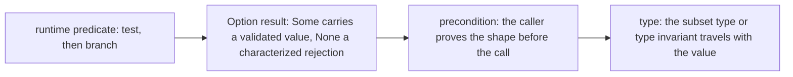
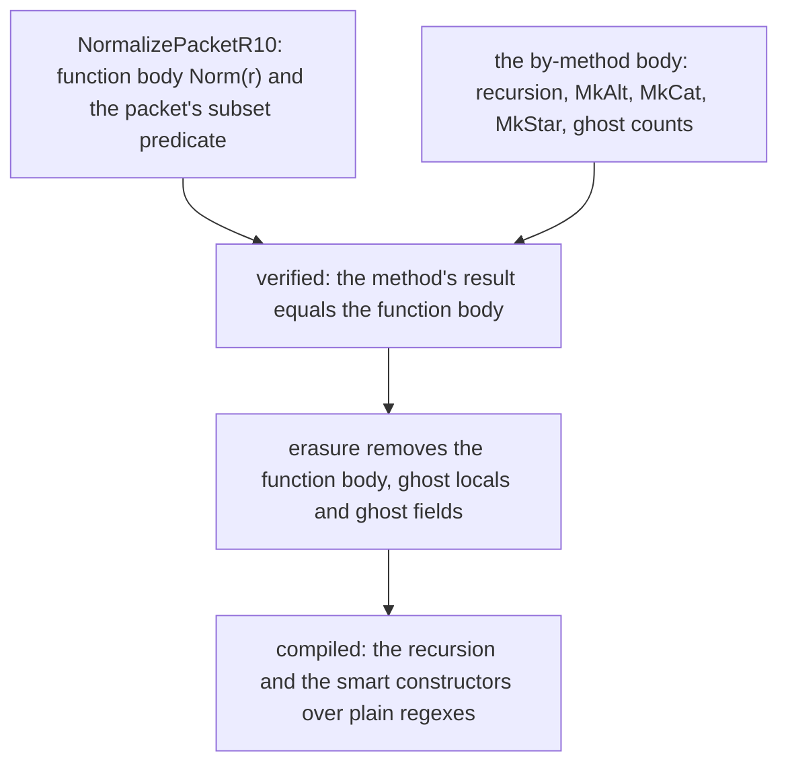
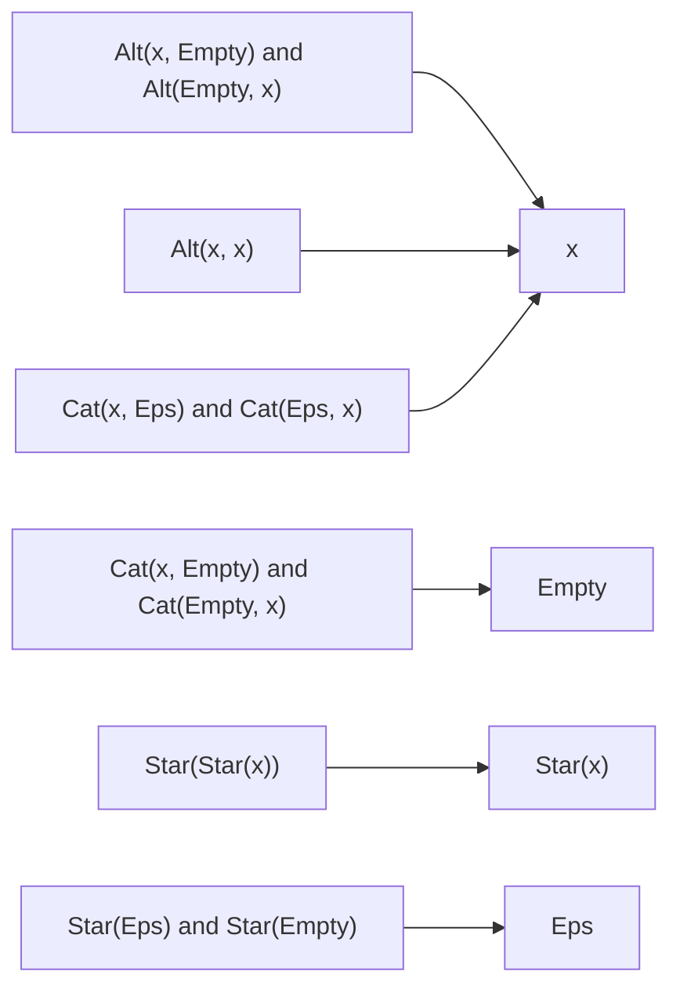

# R10 — Invariants in types

R09 put effects at the parser's boundary: a result or a positioned error, an old state and a new one. R10 moves a different kind of promise into the boundary: a representation invariant. A regex in normal form has no `Empty` operand in an alternation, no `Eps` operand in a concatenation, no star of a star; A4 states that shape as a predicate and gives it a type. Once the shape is in the type, every value of the type carries it, every constructor owes it, and every client may use it. What a client may *not* do is read more into the type than it states: a well-shaped regex can still describe the wrong language.

The module is standalone. It imports the frozen layers A1 to A4 and no earlier learner file. A4 supplies the normal-form predicate and type, the smart constructors `MkAlt`, `MkCat`, `MkStar` and their executable twins, the ghost normalization model `Norm`, a few shape and congruence facts, and the certificate definitions R11 will use. It does not supply the compiled normalizer, the smart constructors' language proofs, or anything about certificates beyond their definitions.

**Three ideas do all the work.**

1. Constructing a refined value is a proof obligation; consuming one exposes exactly the facts its type states. A subset type (Dafny) or a type invariant (Verus) makes the shape travel with the value, and nothing else travels with it.
2. Erased data carries proof information, never runtime decisions. A ghost count or a tracked witness can justify the compiled result and then disappear; the compiled program must still make every choice from compiled data.
3. A mathematical function and the method that computes it are separate objects. `function … by method` (Dafny) and an exec function whose `ensures` names a spec model (Verus) tie them together, and the language a constructor preserves is a third promise that neither the shape nor the model states.

---

## 0. How this module works

**Budget: 408 minutes**, including the module viva and excluding contractor wall time. These are planning estimates; record your own times, interruptions and failed attempts.

| setup | read | worked | cards | predictions | holes | spectrum lab | flagship statements | flagship audit | paper | bench card | viva | calibration | total |
|---|---|---|---|---|---|---|---|---|---|---|---|---|---|
| 5 | 60 | 30 | 8 | 15 | 110 | 30 | 40 | 20 | 30 | 20 | 30 | 10 | **408** |

The hole minutes are 55 in each language: H1 8 (Verus 10), H2 12, H3 10, H4 25 (Verus 23). R10 has no closed-book test-out; its first tries are the five predictions.

**Predictions.** Commit the five answers below before running their scenarios or opening the specimens' expected outputs, the bank or the rubric. The value slots are in `dafny/checks/R10_checks.dfy` (P1) and `specimens/R10/P2v.rs.specimen` (P2), the obligation slot in `specimens/R10/P4v.rs.specimen` (P4), and the two verdicts in `slots/R10.slots`, switched on by the two `CHECK` lines of the Dafny file's prediction block (P3, P5). Respect each printed answer form; then run `scripts/firsttry.sh R10 --check` and keep its receipts.

> **Predict (P1) — commit in the file before reading on.** The given-only check unit builds `MkCat(Eps, Chr('k'))` with A4's smart concatenation and evaluates `NodeCount` of the result as compiled code. Which numeral reaches the slot? Answer form: a numeral.

> **Predict (P2) — commit in the file before reading on.** `specimens/R10/P2v.rs.specimen` asks whether `Star(Alt(Empty, Chr('m')))` satisfies A4's `is_norm`. Answer form: `true` or `false`.

> **Predict (P3) — commit in the file before reading on.** `option-x` validates the raw regex `Alt(Empty, Chr('q'))` at run time and asserts what it receives; `precondition-x` passes the same raw regex to a routine whose parameter type (Dafny) or precondition (Verus) demands normal shape. Answer `D:<x>,<y> V:<x>,<y>`, each one of `ok`, `fail`, `timeout`, `err:<stage>`.

> **Predict (P4) — commit in the file before reading on.** `specimens/R10/P4v.rs.specimen` opens a packet's type invariant and asserts three labelled facts: [a] the pattern is normal, [b] the ghost weight is its node count, [c] the ghost weight is 0. Which labels fail? Answer form: the failing label set, or `none`.

> **Predict (P5) — commit in the file before reading on.** `shape-x` returns `Empty` as a normal regex with no further promise; `language-x` returns the same value under the promise that it matches exactly what `Chr('q')` matches. Answer `D:<x>,<y> V:<x>,<y>` as in P3.

### This module's files

| file | role | shipped state |
|---|---|---|
| `dafny/R/R10_TypeInvariants/std/R10_TypeInvariants.dfy` | the prediction block, worked examples, the Dafny holes and a compiled use-site test | verified, 4 holes, 0 errors |
| `verus/r/r10_type_invariants/src/lib.rs` | the paired Verus crate | verified, 4 holes, 0 errors |
| `dafny/checks/R10_checks.dfy` | given-only compiled value check (P1) | verified, no hole; P1's slot unfilled |
| `dafny/R/R10_TypeInvariants/agent/R10_AgentFlagship.dfy` | the flagship: three constructors whose statements you write | verified, 3 holes, 0 errors |
| `verus/r/r10_type_invariants/src/agent.rs` | the paired flagship | verified, 3 holes, 0 errors |
| `specimens/R10/`, `slots/R10.slots` | prediction specimens, the spectrum scenarios, card demos | slots unfilled; card demos fail by design |
| `dafny/given/R/RG_A4_Norm.dfy`, `verus/given/rg_re_a4/` | the frozen A4 layer: normal forms, smart constructors, models, shape facts | verified; no semantic constructor proof, no compiled normalizer |
| `tools/R10/check_normalizer.py`, `check_statements.py`, `check_constructors.py` | compiled observations and the statement consumer | read the sources they name; run after your work |
| `paper/R10_problems.tex`, `paper/R10_answers.tex` | written problems and your answers | template compiles; answers unfilled |
| `bench/local/r/README.md` | instructions for your ninth local bench card | you create the card |
| `Solutions/`, `paper/solutions/` | references | yours to open LAST, after your attempts, gates and review |

The exercise files run in the learner loop as shipped: the holes are counted, everything else verifies.

<!-- pin: shipped-d -->
```
$ scripts/vcheck dafny/R/R10_TypeInvariants/std
vcheck: dafny/R/R10_TypeInvariants/std [dafny, learner loop]: verified — 73 verified, 4 holes, 0 errors
dafny/R/R10_TypeInvariants/std/R10_TypeInvariants.dfy:93:5: hole assume R10.H1d
dafny/R/R10_TypeInvariants/std/R10_TypeInvariants.dfy:110:5: hole assume R10.H2d
dafny/R/R10_TypeInvariants/std/R10_TypeInvariants.dfy:126:5: hole assume R10.H3d
dafny/R/R10_TypeInvariants/std/R10_TypeInvariants.dfy:151:5: hole assume R10.H4d
```

<!-- pin: shipped-v -->
```
$ scripts/vcheck verus/r/r10_type_invariants
vcheck: verus/r/r10_type_invariants [verus, learner loop]: verified — - verified, 4 holes, 0 errors
verus/r/r10_type_invariants/src/lib.rs:111:1: hole external_body R10.H1v
verus/r/r10_type_invariants/src/lib.rs:131:1: hole external_body R10.H2v
verus/r/r10_type_invariants/src/lib.rs:153:40: hole assume R10.H3v
verus/r/r10_type_invariants/src/lib.rs:175:1: hole external_body R10.H4v
```

<!-- pin: checks-d -->
```
$ scripts/vcheck dafny/checks/R10_checks.dfy
vcheck: dafny/checks/R10_checks.dfy [dafny, learner loop]: verified — 63 verified, 0 holes, 0 errors
```

---

## 1. A representation predicate becomes a boundary

### 1.1 A4's normal form

A4's predicate is a list of reductions that a normal regex has already undergone, one case per constructor, recursively:

```dafny
predicate Normal(r: Re)
  decreases r
{
  match r
  case Empty => true
  case Eps => true
  case Chr(_) => true
  case Alt(a, b) => a != Empty && b != Empty && a != b && Normal(a) && Normal(b)
  case Cat(a, b) => a != Empty && b != Empty && a != Eps && b != Eps && Normal(a) && Normal(b)
  case Star(a) => a != Empty && a != Eps && !a.Star? && Normal(a)
}
type NormRe = r: Re | Normal(r) witness Empty
```

Read it as a policy, not as "simplified". An alternation has no `Empty` branch and no two equal branches; a concatenation has neither an `Empty` nor an `Eps` operand; a star's body is neither `Empty`, nor `Eps`, nor another star. The last line turns the predicate into a type: `NormRe` is the set of regexes satisfying `Normal`, and the witness `Empty` shows that it is inhabited. In Verus the same boundary is a struct with a private field and a type invariant:

```rust
// The type boundary exports shape and exact views, not language preservation.
pub struct NormRe {
    r: Re,
}

impl NormRe {
    #[verifier::type_invariant]
    spec fn normal_shape(&self) -> bool {
        is_norm(self.r)
    }

    pub closed spec fn re(self) -> Re {
        self.r
    }

    pub fn from_normal_r10(r: Re) -> (out: NormRe)
        requires
            is_norm(r),
        ensures
            out.re() == r,
    // ...
}
```

The field is private, so the only way to obtain a `NormRe` is `from_normal_r10`, whose precondition is the shape. Dafny checks membership of a value in a subset type; Verus checks an invariant around an object it builds. Both serve the same client goal, and their syntax, modes and opening rules differ: the paired holes make you meet both.

### 1.2 Building a refined value

Returning a `NormRe` is a promise about the value returned, checked at the return. A routine that combines two normal regexes under `Alt` owes the predicate's `Alt` case, and two non-`Empty` normal children are not enough:

```dafny
module R10_AltDistinctDemo {
  import opened RG_A1_Re
  import opened RG_A4_Norm

  // The result type is the obligation: Alt(a, b) must be Normal at the return.
  method AltOfNormal(a: NormRe, b: NormRe) returns (out: NormRe)
    requires a != Empty && b != Empty
  {
    out := Alt(a, b);
  }
}
```

<!-- pin: alt-bare-d -->
```
$ scripts/vcheck --module R10 alt-distinct.dfy
vcheck: alt-distinct.dfy [dafny, learner loop]: failed — 62 verified, 0 holes, 1 error
alt-distinct.dfy:9:12: error: value does not satisfy the subset constraints of 'NormRe'
```

The missing conjunct is `a != b`. With it as a precondition the same body verifies:

```dafny
module R10_AltDistinctFixedDemo {
  import opened RG_A1_Re
  import opened RG_A4_Norm

  method AltOfNormal(a: NormRe, b: NormRe) returns (out: NormRe)
    requires a != Empty && b != Empty && a != b
  {
    out := Alt(a, b);
  }
}
```

<!-- pin: alt-fixed-d -->
```
$ scripts/vcheck --module R10 alt-distinct-fixed.dfy
vcheck: alt-distinct-fixed.dfy [dafny, learner loop]: verified — 63 verified, 0 holes, 0 errors
```

Verus says the same through `from_normal_r10`'s precondition; the moved patterns keep their shape through `into_pattern_r10`'s postcondition:

```rust
use vstd::prelude::*;
use rg_re_a1::*;
use rg_re_a4::*;

verus! {

// Verus's NormRe is built only through from_normal_r10, whose precondition is the shape.
fn alt_of_normal(a: NormRe, b: NormRe) -> (out: NormRe)
    requires
        !(a.re() is Empty),
        !(b.re() is Empty),
        a.re() != b.re(),
    ensures
        out.re() == Re::Alt(Box::new(a.re()), Box::new(b.re())),
{
    let x = a.into_pattern_r10();
    let y = b.into_pattern_r10();
    NormRe::from_normal_r10(Re::Alt(Box::new(x), Box::new(y)))
}

} // verus!
```

<!-- pin: alt-v -->
```
$ scripts/vcheck --module R10 alt-distinct.rs
vcheck: alt-distinct.rs [verus, learner loop]: verified — 1 verified, 0 holes, 0 errors
```

The WRITE card C1 isolates the obligation: a leaf boundary that returns an unreduced tree in Dafny, and an object whose ghost mark breaks its own invariant in Verus. Both demos fail by design:

```dafny
module R10_SubsetCard {
  import opened RG_A1_Re
  import opened RG_A4_Norm

  // item: R10.C1d write:subset-type
  // WRITE: a subset result requires its predicate at every return.
  method LeafBoundaryR10(c: char) returns (out: NormRe)
  {
    out := Cat(Eps, Chr(c));
  }
}
```

<!-- pin: card-c1d -->
```
$ scripts/vcheck --module R10 card-c1d.dfy
vcheck: card-c1d.dfy [dafny, learner loop]: failed — 62 verified, 0 holes, 1 error
card-c1d.dfy:9:12: error: value does not satisfy the subset constraints of 'NormRe'
```

```rust
use vstd::prelude::*;

verus! {

struct MarkedLeafR10 {
    c: char,
    marked: Ghost<bool>,
}

impl MarkedLeafR10 {
    #[verifier::type_invariant]
    spec fn coherent(&self) -> bool {
        self.marked@
    }
}

// item: R10.C1v write:type-invariant
// WRITE: constructing the object must establish its representation invariant.
fn leaf_boundary_r10(c: char) -> MarkedLeafR10 {
    MarkedLeafR10 { c, marked: Ghost(false) }
}

} // verus!
```

<!-- pin: card-c1v -->
```
$ scripts/vcheck specimens/R10/card-c1v.rs.specimen
vcheck: specimens/R10/card-c1v.rs.specimen [verus, learner loop]: failed — 0 verified, 0 holes, 1 error
specimens/R10/card-c1v.rs.specimen:20:5: error: constructed value may fail to meet its declared type invariant
```

Dafny names the subset constraint at the value that violates it; Verus names the struct expression that "may fail to meet its declared type invariant". Neither waits for a client to misuse the value.

A subset type costs nothing at run time. The compiled program has no `NormRe` tag and no check on assignment: the verifier proved, once, that every value reaching a `NormRe` variable satisfies `Normal`, and the compiler relies on that proof. The witness clause (`witness Empty`) is the same kind of obligation in miniature: Dafny wants one value of the type so that a declaration of a `NormRe` variable without an initializer is sound. Verus's private field plays the role of the subset: code outside the impl cannot build a `NormRe` except through a constructor whose precondition is the shape, so the invariant cannot be skipped by a struct literal elsewhere.

### 1.3 Shape is not language

Normality does not pick one representative per language. Two different normal trees can match exactly the same strings:

```dafny
module R10_SameLanguageDemo {
  import opened RG_A1_Re
  import opened RG_A4_Norm

  // Two different normal trees with one language.
  lemma TwoNormalForms(s: seq<char>)
    ensures Normal(Alt(Chr('a'), Chr('b'))) && Normal(Alt(Chr('b'), Chr('a')))
    ensures Alt(Chr('a'), Chr('b')) != Alt(Chr('b'), Chr('a'))
    ensures Matches(Alt(Chr('a'), Chr('b')), s) <==> Matches(Alt(Chr('b'), Chr('a')), s)
  {
  }
}
```

<!-- pin: same-language-d -->
```
$ scripts/vcheck --module R10 same-language.dfy
vcheck: same-language.dfy [dafny, learner loop]: verified — 63 verified, 0 holes, 0 errors
```

So the type `NormRe` says nothing about *which* normal regex a routine returns. A constructor that returns "some normal regex" has enormous freedom unless its contract also relates the result to its inputs. That relation is the flagship's subject (§10), and §6 shows what goes wrong without it.

The enforcement spectrum orders the ways a program can hold one invariant, from the latest check to the earliest:



Each step moves an obligation from the run to the proof and from the callee to someone else. §4 runs one invariant at three of these points.

None of the points is better in general. A runtime check is the only option when the input comes from outside the program (a parser's output, a file); an `Option` result keeps the check but lets the type say which values passed; a precondition is cheapest when every caller already knows the fact; a type is right when the fact must hold everywhere the value goes. A design review asks which point a boundary chose and whether its callers can meet that choice.

---

## 2. Erased fields carry proof information

### 2.1 Ghost fields and subset types

The worked packet W1 pairs a normal regex with a ghost node count, and a subset type ties the two together:

```dafny
datatype CountPacketR10 = CountPacketR10(expr: NormRe, ghost count: nat)

type TypedPacketR10 = p: CountPacketR10 | p.count == NodeCount(p.expr) witness CountPacketR10(Empty, 1)

datatype PacketChoiceR10 = NoPacketR10 | HasPacketR10(packet: TypedPacketR10)
```

The count is a proof resource. It can justify an assertion, appear in a contract or a subset predicate, and then disappear: the compiled program holds only the regex. The flip side is a mode rule. Compiled code cannot read an erased field, because after erasure there is nothing to read:

```dafny
module R10_GhostReadDemo {
  datatype TaggedR10 = TaggedR10(word: seq<char>, ghost size: nat)

  // Compiled code cannot read an erased field.
  method SizeOfR10(t: TaggedR10) returns (n: nat)
  {
    n := t.size;
  }
}
```

<!-- pin: ghost-read-d -->
```
$ scripts/vcheck --module R10 ghost-read.dfy
vcheck: ghost-read.dfy [dafny, learner loop]: failed — - verified, 0 holes, 1 error, stage resolve
ghost-read.dfy:7:12: error: a ghost field is allowed only in specification contexts
```

The error comes at resolution, before any proof. The WRITE card C3d asks for the converse obligation: building a value of a subset type with an erased field still has to satisfy the subset at construction, ghost or not:

```dafny
module R10_GhostCard {
  import opened RG_A1_Re

  datatype LeafWitnessR10 = LeafWitnessR10(c: char, ghost count: nat)

  type UnitLeafR10 = p: LeafWitnessR10 | p.count == 1 witness LeafWitnessR10('x', 1)

  // item: R10.C3d write:ghost
  // WRITE: the erased witness must still satisfy the subset at construction.
  method WitnessLeafR10(c: char) returns (out: UnitLeafR10)
  {
    ghost var cached := 0;
    out := LeafWitnessR10(c, cached);
  }
}
```

<!-- pin: card-c3d -->
```
$ scripts/vcheck --module R10 card-c3d.dfy
vcheck: card-c3d.dfy [dafny, learner loop]: failed — 63 verified, 0 holes, 1 error
card-c3d.dfy:13:12: error: value does not satisfy the subset constraints of 'UnitLeafR10'
```

### 2.2 `Ghost` and `Tracked` in Verus

Verus wraps erased data in two types. `Ghost<T>` holds a spec value; `Tracked<T>` holds a proof-mode object with ownership (it can be consumed, and a consumed tracked value is gone). The packet W1v keeps a `Ghost<nat>` weight and a `Tracked` evidence object naming the pattern, and its type invariant states all three relations:

```rust
pub tracked struct NormalEvidenceR10 {
    pub ghost pattern: Re,
}

pub struct NormPacketR10 {
    repr: NormRe,
    weight: Ghost<nat>,
    evidence: Tracked<NormalEvidenceR10>,
}

impl NormPacketR10 {
    #[verifier::type_invariant]
    spec fn coherent(&self) -> bool {
        is_norm(self.repr.re()) && self.weight@ == node_count(self.repr.re()) && self.evidence@.pattern == self.repr.re()
    }

    pub closed spec fn re(self) -> Re {
        self.repr.re()
    }
    // ...
}
```

Exec code cannot branch on a ghost value, for the same reason as in Dafny:

```rust
use vstd::prelude::*;

verus! {

pub struct TaggedR10 {
    pub word: Vec<char>,
    pub checked: Ghost<bool>,
}

// Exec code cannot branch on a Ghost's value.
fn was_checked_r10(t: &TaggedR10) -> bool {
    let ghost g = t.checked@;
    if g {
        true
    } else {
        false
    }
}

} // verus!
```

<!-- pin: ghost-read-v -->
```
$ scripts/vcheck --module R10 ghost-read.rs
vcheck: ghost-read.rs [verus, learner loop]: failed — - verified, 0 holes, 1 error, stage resolve
ghost-read.rs:13:8: error: cannot access spec-mode place in executable context
```

The WRITE cards C2v and C3v isolate the two wrappers: a function that keeps the right fact in a ghost and returns the wrong exec value, and a proof call that consumes tracked evidence with the wrong label:

```rust
use vstd::prelude::*;

verus! {

// item: R10.C2v write:ghost
// WRITE: Ghost values retain a proof fact while the executable result uses c.
fn leaf_echo_r10(c: char) -> (out: char)
    ensures
        out == c,
{
    let ghost remembered = c;
    assert(remembered == c);
    'z'
}

} // verus!
```

<!-- pin: card-c2v -->
```
$ scripts/vcheck specimens/R10/card-c2v.rs.specimen
vcheck: specimens/R10/card-c2v.rs.specimen [verus, learner loop]: failed — 0 verified, 0 holes, 1 error
specimens/R10/card-c2v.rs.specimen:9:9: error: postcondition not satisfied
```

```rust
use vstd::prelude::*;

verus! {

tracked struct LeafPermitR10 {
    ghost label: char,
}

// item: R10.C3v write:tracked
// WRITE: construct and consume tracked evidence in proof mode.
proof fn consume_leaf_r10(tracked permit: LeafPermitR10, c: char)
    requires
        permit.label == c,
{
}

fn leaf_permit_r10(c: char) -> char {
    let tracked permit = LeafPermitR10 { label: '!' };
    proof {
        consume_leaf_r10(permit, c);
    }
    c
}

} // verus!
```

<!-- pin: card-c3v -->
```
$ scripts/vcheck specimens/R10/card-c3v.rs.specimen
vcheck: specimens/R10/card-c3v.rs.specimen [verus, learner loop]: failed — 1 verified, 0 holes, 1 error
specimens/R10/card-c3v.rs.specimen:20:9: error: precondition not satisfied
```

A ghost fact about `c` does not make `'z'` equal to `c`; a tracked object is evidence only of the proposition its fields state, and the consumer's `requires` decides which proposition that must be.

### 2.3 What erasure leaves

The packet is a teaching boundary for proof data. Do not describe its count as a constant-time cache: a client wanting a runtime count would need an executable field and an invariant tying it to the regex, which changes the implementation and its costs. The diagram follows one function, H4's normalizer, through erasure:



Two facts survive erasure: the compiled result equals what the verified method computed, and every proof obligation about it was discharged before the ghost parts were removed. `tools/R10/check_normalizer.py` inspects the generated code to show which fields remain; that inspection is about these compiled types, not a general claim about allocation, speed or memory.

A useful exercise is to read the generated code yourself after H4 verifies. The Dafny compiler's Python output for the packet datatype has one field, the expression; the ghost count is gone. The builder's body keeps every branch on the expression and every smart-constructor call, and no arithmetic on counts. If you find a traversal that counts nodes, check where it is: the checker's observer counts nodes to compare with its expected values, and that code is not part of your packet.

---

## 3. A function implemented by a method

### 3.1 `function … by method`

A Dafny `function … by method` has two bodies. The function body is the mathematical definition, usable in specifications; the method body is what compiles, and it must return exactly the function's value. The method may loop, allocate and use ghost locals; the function may be ghost-only, recursive and slow. A small example:

```dafny
module R10_ByMethodDemo {
  // The function body is the specification; the method body is what compiles.
  function DoubledR10(n: nat): nat
  {
    n + n
  } by method {
    return 2 * n;
  }

  method UseDoubledR10() returns (m: nat)
    ensures m == 14
  {
    m := DoubledR10(7);
  }
}
```

<!-- pin: by-method-d -->
```
$ scripts/vcheck --module R10 by-method.dfy
vcheck: by-method.dfy [dafny, learner loop]: verified — 65 verified, 0 holes, 0 errors
```

`UseDoubledR10` reasons with the function body (`7 + 7`), while compiled code runs `2 * 7`. The WRITE card C2d asks for the same discipline with a leaf: its method returns the wrong character, and the agreement obligation fails at the return:

```dafny
module R10_ByMethodCard {
  import opened RG_A1_Re

  ghost function LeafModelR10(c: char): Re
  {
    Chr(c)
  }

  // item: R10.C2d write:by-method
  // WRITE: the compiled method must implement the fixed ghost function model.
  function LeafR10(c: char): Re
  {
    LeafModelR10(c)
  } by method {
    return Chr('z');
  }
}
```

<!-- pin: card-c2d -->
```
$ scripts/vcheck --module R10 card-c2d.dfy
vcheck: card-c2d.dfy [dafny, learner loop]: failed — 62 verified, 0 holes, 1 error
card-c2d.dfy:15:5: error: a postcondition could not be proved on this return path
card-c2d.dfy:14:5: related: this is the postcondition that could not be proved
```

### 3.2 A ghost model cannot be called

A4's `Norm` is a ghost function: it defines the normal form of every regex and compiles to nothing. A method that tries to compute with it is refused at resolution:

```dafny
module R10_GhostCallDemo {
  import opened RG_A1_Re
  import opened RG_A4_Norm

  // A4's Norm is ghost: a method cannot compute with it.
  method NormalizeByModel(r: Re) returns (out: Re)
  {
    out := Norm(r);
  }
}
```

<!-- pin: ghost-call-d -->
```
$ scripts/vcheck --module R10 ghost-call.dfy
vcheck: ghost-call.dfy [dafny, learner loop]: failed — - verified, 0 holes, 1 error, stage resolve
ghost-call.dfy:8:16: error: a call to a ghost function is allowed only in specification contexts (consider declaring the function without the 'ghost' keyword)
```

So H4's method body must do the work the model only describes: walk the input, normalize the children, combine them with the compiled smart constructors, and keep the recursion's measure (`decreases r`, the function's own). Verus states the same split with a spec fn `norm` and an exec fn whose `ensures` mentions it; the exec body cannot call `norm` either.

The model is concrete enough to evaluate. Each case below is one smart-constructor rewrite or a composition of them, and the verifier computes them all:

```dafny
module R10_NormValuesDemo {
  import opened RG_A1_Re
  import opened RG_A4_Norm

  // Norm on concrete trees: each rewrite is one smart constructor.
  lemma NormSamples()
    ensures Norm(Alt(Chr('a'), Chr('a'))) == Chr('a')
    ensures Norm(Cat(Eps, Alt(Empty, Chr('b')))) == Chr('b')
    ensures Norm(Star(Star(Eps))) == Eps
    ensures Norm(Cat(Chr('a'), Empty)) == Empty
  {
  }
}
```

<!-- pin: norm-values-d -->
```
$ scripts/vcheck --module R10 norm-values.dfy
vcheck: norm-values.dfy [dafny, learner loop]: verified — 63 verified, 0 holes, 0 errors
```

The rewrites form a small lattice: `Empty` absorbs a concatenation and vanishes from an alternation, `Eps` vanishes from a concatenation and absorbs a star, equal branches merge, and a star of a star collapses.



Every arrow preserves the language, which is what the flagship asks you to state and the contractor to prove; none of them is stated by A4.

---

## 4. Runtime checks, optional values and preconditions

### 4.1 One invariant at three points

Take one raw regex and three interfaces around the same shape predicate. The worked W2 is the runtime end: a compiled Boolean whose meaning is the predicate.

```dafny
function RuntimeShapeR10(r: Re): bool
{
  Normal(r)
}
```

A caller can branch on it and use the branch's fact while it lasts. An optional validator packages the same test differently: `Some` carries the validated input, `None` comes with a characterization of the rejection. Both halves matter: a contract that says only "every `Some` is valid" admits a body that always returns `None`. H1's statement fixes both, so normal inputs cannot disappear into an always-reject body. A precondition moves the burden to the caller: the routine promises nothing about bad input, and the caller must prove the shape before the call verifies. That can be the right interface when every caller already carries the proof; it is a different public behaviour from validation, and a failed proof at a call site is not a runtime rejection.

### 4.2 The answer to P3

The two scenarios on the same raw regex `Alt(Empty, Chr('q'))`:

```dafny
// after: R10.P3dv
module R10_SpectrumProbe {
  import opened RG_A1_Re
  import opened RG_A4_Norm

  datatype ShapeChoiceR10 = NoShapeR10 | HasShapeR10(value: NormRe)

  function TryShapeR10(r: Re): ShapeChoiceR10
  {
    if Normal(r) then HasShapeR10(r) else NoShapeR10
  }

  method ObserveR10()
  {
    var result := TryShapeR10(Alt(Empty, Chr('q')));
    assert result.NoShapeR10?;
  }
}
```

<!-- pin: option-d -->
```
$ scripts/vcheck --module R10 option-d.dfy
vcheck: option-d.dfy [dafny, learner loop]: verified — 64 verified, 0 holes, 0 errors
```

```dafny
// after: R10.P3dv
module R10_SpectrumProbe {
  import opened RG_A1_Re
  import opened RG_A4_Norm

  method RequireShapeR10(r: NormRe)
  {
  }

  method ObserveR10()
  {
    RequireShapeR10(Alt(Empty, Chr('q')));
  }
}
```

<!-- pin: precondition-d -->
```
$ scripts/vcheck --module R10 precondition-d.dfy
vcheck: precondition-d.dfy [dafny, learner loop]: failed — 62 verified, 0 holes, 1 error
precondition-d.dfy:12:24: error: value does not satisfy the subset constraints of 'NormRe'
```

<!-- pin: option-v -->
```
$ scripts/vcheck specimens/R10/option-v.rs.specimen
vcheck: specimens/R10/option-v.rs.specimen [verus, learner loop]: verified — 2 verified, 0 holes, 0 errors
```

<!-- pin: precondition-v -->
```
$ scripts/vcheck specimens/R10/precondition-v.rs.specimen
vcheck: specimens/R10/precondition-v.rs.specimen [verus, learner loop]: failed — 0 verified, 0 holes, 1 error
specimens/R10/precondition-v.rs.specimen:10:18: error: precondition not satisfied
```

`D:ok,fail V:ok,fail`. The optional validator receives a rejection, and its contract lets the caller prove which one; the precondition version cannot be called on a raw regex that is not normal, and the verifier reports the call site, not a runtime event. The spectrum lab (30 minutes) asks you to place one invariant of your own at all four points of §1.3's diagram, with a normal and a non-normal input each, and to write down for each point who proves what, and when.

### 4.3 The answers to P1 and P2

P1's check evaluates a smart concatenation as compiled code:

```dafny
// after: R10.P1d
// A specimen runs alone, so the A1 and A4 definitions it needs are copied here verbatim.
module R10_P1Observed {
  datatype Re = Empty | Eps | Chr(c: char) | Alt(a: Re, b: Re) | Cat(a: Re, b: Re) | Star(r: Re)

  function NodeCount(r: Re): nat
    decreases r
  {
    match r
    case Empty => 1
    case Eps => 1
    case Chr(_) => 1
    case Alt(a, b) => 1 + NodeCount(a) + NodeCount(b)
    case Cat(a, b) => 1 + NodeCount(a) + NodeCount(b)
    case Star(a) => 1 + NodeCount(a)
  }

  predicate Normal(r: Re)
    decreases r
  {
    match r
    case Empty => true
    case Eps => true
    case Chr(_) => true
    case Alt(a, b) => a != Empty && b != Empty && a != b && Normal(a) && Normal(b)
    case Cat(a, b) => a != Empty && b != Empty && a != Eps && b != Eps && Normal(a) && Normal(b)
    case Star(a) => a != Empty && a != Eps && !a.Star? && Normal(a)
  }

  type NormRe = r: Re | Normal(r) witness Empty

  function MkCat(a: NormRe, b: NormRe): NormRe
  {
    if a == Empty || b == Empty then Empty
    else if a == Eps then b
    else if b == Eps then a
    else Cat(a, b)
  }

  // P1's expression, run as compiled code.
  @Test
  method SmartCountObserved()
  {
    var result := MkCat(Eps, Chr('k'));
    var value := NodeCount(result);
    expect value == 1;
  }
}
```

<!-- pin: p1-d -->
```
$ scripts/vcheck --test specimens/R10/chapter-p1-d.dfy.specimen
vcheck: specimens/R10/chapter-p1-d.dfy.specimen [dafny, test]: verified — 1 passed, 0 failed
PASSED R10_P1Observed.SmartCountObserved
```

`1`: `MkCat(Eps, Chr('k'))` is `Chr('k')`, one node; a count of the unreduced tree would say 3. P2 asks for the predicate on a star of an alternation with an `Empty` branch:

```rust
use vstd::prelude::*;
use rg_re_a1::*;
use rg_re_a4::*;

verus! {

// P2's expression, evaluated by the verifier.
proof fn nested_normal_value_observed() {
    assert(is_norm(Re::Star(Box::new(Re::Alt(Box::new(Re::Empty), Box::new(Re::Chr('m')))))) == false) by (compute_only);
}

} // verus!
```

<!-- pin: p2-v -->
```
$ scripts/vcheck --module R10 p2.rs
vcheck: p2.rs [verus, learner loop]: verified — 1 verified, 0 holes, 0 errors
```

`false`: the star's body is normal-shaped as a star body, but the body itself is not normal, because an alternation may not have an `Empty` branch. The predicate recurses into every child.

---

## 5. A type invariant is opened, not assumed

### 5.1 `use_type_invariant`

Inside an impl, Verus does not put a type's invariant in scope automatically: `use_type_invariant(x)` asserts it for a value `x` of the type, in proof mode. Without it, a fact that the invariant guarantees is just unknown:

```rust
use vstd::prelude::*;

verus! {

pub struct BudgetR10 {
    used: u64,
    cap: u64,
}

impl BudgetR10 {
    #[verifier::type_invariant]
    spec fn within(&self) -> bool {
        self.used <= self.cap
    }

    // Without use_type_invariant the invariant is not in scope.
    fn room_r10(&self) -> (r: u64)
        ensures
            r == self.cap - self.used,
    {
        self.cap - self.used
    }
}

} // verus!
```

<!-- pin: invariant-closed-v -->
```
$ scripts/vcheck --module R10 invariant-closed.rs
vcheck: invariant-closed.rs [verus, learner loop]: failed — 0 verified, 0 holes, 1 error
invariant-closed.rs:21:9: error: possible arithmetic underflow/overflow
```

```rust
use vstd::prelude::*;

verus! {

pub struct BudgetR10 {
    used: u64,
    cap: u64,
}

impl BudgetR10 {
    #[verifier::type_invariant]
    spec fn within(&self) -> bool {
        self.used <= self.cap
    }

    fn room_r10(&self) -> (r: u64)
        ensures
            r == self.cap - self.used,
    {
        proof {
            use_type_invariant(self);
        }
        self.cap - self.used
    }
}

} // verus!
```

<!-- pin: invariant-open-v -->
```
$ scripts/vcheck --module R10 invariant-open.rs
vcheck: invariant-open.rs [verus, learner loop]: verified — 1 verified, 0 holes, 0 errors
```

The subtraction is safe only because `used <= cap` holds of every `BudgetR10`; the verifier needs to be told to use that. Dafny's subset types need no such call: membership is part of the value's type and is available wherever the value is.

### 5.2 The answer to P4

The packet specimen opens its invariant and asserts three facts:

```rust
use vstd::prelude::*;
use rg_re_a1::*;
use rg_re_a4::*;

verus! {

pub tracked struct NormalEvidenceR10 {
    pub ghost pattern: Re,
}

pub struct NormPacketR10 {
    repr: NormRe,
    weight: Ghost<nat>,
    evidence: Tracked<NormalEvidenceR10>,
}

impl NormPacketR10 {
    #[verifier::type_invariant]
    spec fn coherent(&self) -> bool {
        is_norm(self.repr.re()) && self.weight@ == node_count(self.repr.re()) && self.evidence@.pattern == self.repr.re()
    }

    pub closed spec fn re(self) -> Re {
        self.repr.re()
    }
}

// item: R10.P4v obligation
// Commit exactly the unprovable labelled assertions under this packet invariant.
// SLOT: FAILS ???
fn packet_claims_r10(p: &NormPacketR10) {
    proof {
        use_type_invariant(p);
        assert(is_norm(p.re())); // [a]
        assert(p.weight@ == node_count(p.re())); // [b]
        assert(p.weight@ == 0); // [c]
    }
}

} // verus!
```

<!-- pin: obligation-v -->
```
$ scripts/vcheck specimens/R10/P4v.rs.specimen
vcheck: specimens/R10/P4v.rs.specimen [verus, learner loop]: failed — 0 verified, 0 holes, 1 error
specimens/R10/P4v.rs.specimen:36:16: error: assertion failed
```

`FAILS c`. The invariant gives [a] and [b] directly; nothing makes the weight 0, and the weight of a normal regex is at least 1. An erased witness is related to its representation by the invariant, and to nothing else.

---

## 6. What the consumer can and cannot establish

### 6.1 The answer to P5

The two producers return the same value:

```dafny
// after: R10.P5dv
module R10_SpectrumProbe {
  import opened RG_A1_Re
  import opened RG_A4_Norm

  method ProduceR10() returns (out: NormRe)
  {
    out := Empty;
  }
}
```

<!-- pin: shape-d -->
```
$ scripts/vcheck --module R10 shape-d.dfy
vcheck: shape-d.dfy [dafny, learner loop]: verified — 63 verified, 0 holes, 0 errors
```

```dafny
// after: R10.P5dv
module R10_SpectrumProbe {
  import opened RG_A1_Re
  import opened RG_A4_Norm

  method ProduceR10() returns (out: NormRe)
    ensures EquivalentReR10(out, Chr('q'))
  {
    out := Empty;
  }
}
```

<!-- pin: language-d -->
```
$ scripts/vcheck --module R10 language-d.dfy
vcheck: language-d.dfy [dafny, learner loop]: failed — 62 verified, 0 holes, 1 error
language-d.dfy:8:3: error: a postcondition could not be proved on this return path
language-d.dfy:7:28: related: this is the postcondition that could not be proved
dafny/given/R/RG_A4_Norm.dfy:11:46: related: this proposition could not be proved
```

<!-- pin: shape-v -->
```
$ scripts/vcheck specimens/R10/shape-v.rs.specimen
vcheck: specimens/R10/shape-v.rs.specimen [verus, learner loop]: verified — 1 verified, 0 holes, 0 errors
```

<!-- pin: language-v -->
```
$ scripts/vcheck specimens/R10/language-v.rs.specimen
vcheck: specimens/R10/language-v.rs.specimen [verus, learner loop]: failed — 0 verified, 0 holes, 1 error
specimens/R10/language-v.rs.specimen:10:9: error: postcondition not satisfied
```

`D:ok,fail V:ok,fail`. `Empty` is normal, so the shape-only promise holds; it matches nothing, so the language promise fails. The same value satisfies one interface and violates the other: what a delivery is correct *for* is decided by the statement, never by the value.

### 6.2 A consumer over an arbitrary result

A client of a constructor knows only its contract. The honest way to test a proposed contract is to give the client an arbitrary result that satisfies it and ask whether the client's goal follows. With a shape-only contract the result is any normal regex, and the goal does not follow:

```dafny
module R10_ShapeConsumerDemo {
  import opened RG_A1_Re
  import opened RG_A4_Norm

  // A consumer of a canonicalizer that should keep its input's language, knowing
  // only the result type: any normal regex could be out.
  lemma ShapeOnlyConsumer(a: NormRe, out: NormRe)
    ensures EquivalentReR10(out, a)
  {
  }
}
```

<!-- pin: consumer-d -->
```
$ scripts/vcheck --module R10 consumer-shape.dfy
vcheck: consumer-shape.dfy [dafny, learner loop]: failed — 62 verified, 0 holes, 1 error
consumer-shape.dfy:9:3: error: a postcondition could not be proved on this return path
consumer-shape.dfy:8:28: related: this is the postcondition that could not be proved
dafny/given/R/RG_A4_Norm.dfy:11:46: related: this proposition could not be proved
```

That is the whole design problem of the flagship. `tools/R10/check_statements.py` generates exactly this kind of consumer from the clauses you write: arbitrary normal inputs, a fresh arbitrary normal result constrained only by your postconditions, and the language relation a client of `Alt`, `Cat` and `Star` needs. No constructor body is assumed. A native failure there means the consumer was not proved; it is not a proof that your statement is wrong for every purpose.

Logical sufficiency has a classic loophole: a contradictory postcondition implies any goal. So sufficiency is one requirement among four: the consumer follows from your statements; an implementation over the original domain can establish them (the contractor's gate); the statements are not vacuous (your witnesses: a normal input with an accepted word and one with a rejected word, for each constructor); and the statements stay as you wrote them (your snapshot and `specfreeze --against`).

### 6.3 Language facts need language premises

W3 uses one of A4's congruence facts: replacing the right operand of a `Cat` by a language-equal one keeps the language.

```dafny
lemma ReplaceRightR10(a: Re, b1: Re, b2: Re, s: seq<char>)
  requires forall t :: Matches(b1, t) <==> Matches(b2, t)
  ensures Matches(Cat(a, b1), s) <==> Matches(Cat(a, b2), s)
{
  CatCongRight(a, b1, b2, s);
}
```

The premise is a language equality, not a shape. If all you have is that two operands are normal, the lemma does not apply; an available lemma does not manufacture its premise. The smart constructors' language facts are of this kind too, and A4 deliberately does not supply them.

---

## 7. The holes, item by item

H1 accepts exactly the normal inputs into the packet and rejects the rest. Dafny's item is the method half of a `function … by method` whose function body is the model; the method branches on the compiled `Normal` and builds the packet with a ghost count. Verus's is an exec fn returning `Option<NormPacketR10>`, building `Ghost` and `Tracked` fields and a `NormRe` through `from_normal_r10`.

H2 concatenates two packets and rebuilds the erased count from the operands' counts, following `MkCat`'s four branches, rather than traversing the result. In Verus you open both operands' invariants first, and A4's `lemma_cat_shape_r10` gives the result's shape.

H3 is a proof: a normal regex is a fixed point of `Norm`. It is a structural induction, and Dafny's ships with `{:induction false}`, so the hypotheses are yours to call; with the lever removed the empty body verifies, and the freeze reports a removed lever. The given corollary `NormIdempotentR10` derives idempotence from H3 and A4's closure fact.

H4 is the compiled normalizer: a packet whose regex equals `Norm(r)`. It reuses H1 for the leaves and H2 for concatenation, and the alternation and star cases build their own packets. A body that always returns one valid packet keeps the shape and misses the model; the function body is what rules it out. Both languages also ship a compiled test (`PacketSampleTest`, `packet_sample_test`) that runs your H1, H2 and H4 bodies on a few inputs once they are written.

Two pitfalls recur across the four holes. The first is reading a ghost value in a compiled branch: H2's count and H1's weight are erased, so the branch that decides which `MkCat` case applies must test the expressions, never the counts. The second is proving more than the statement asks: H3's statement is about normal inputs only, and an attempt that tries to prove `Norm(r) == r` for every `r` is chasing a false claim (`Norm(Alt(Chr('a'), Chr('a')))` is `Chr('a')`). When a proof attempt seems to need a fact the statement does not mention, write the fact down and ask whether it follows from the precondition.

---

## 8. What the instruments can and cannot see

Run the gate on the shipped files and read why it refuses them:

<!-- pin: gate-d -->
```
$ scripts/vcheck --gate dafny/R/R10_TypeInvariants/std
vcheck: dafny/R/R10_TypeInvariants/std [dafny, gate]: failed — 73 verified, 4 holes, 0 errors, 1 finding
dafny/R/R10_TypeInvariants/std/R10_TypeInvariants.dfy:93:5: hole assume R10.H1d
dafny/R/R10_TypeInvariants/std/R10_TypeInvariants.dfy:110:5: hole assume R10.H2d
dafny/R/R10_TypeInvariants/std/R10_TypeInvariants.dfy:126:5: hole assume R10.H3d
dafny/R/R10_TypeInvariants/std/R10_TypeInvariants.dfy:151:5: hole assume R10.H4d
dafny/R/R10_TypeInvariants/std: warnings-fail-gate: warnings fail the gate (W-D04): holes and every other warning must be gone
```

<!-- pin: gate-v -->
```
$ scripts/vcheck --gate verus/r/r10_type_invariants
vcheck: verus/r/r10_type_invariants [verus, gate]: failed — - verified, 4 holes, 1 error
verus/r/r10_type_invariants/src/lib.rs:111:1: hole external_body R10.H1v
verus/r/r10_type_invariants/src/lib.rs:131:1: hole external_body R10.H2v
verus/r/r10_type_invariants/src/lib.rs:153:40: hole assume R10.H3v
verus/r/r10_type_invariants/src/lib.rs:175:1: hole external_body R10.H4v
(no file): error: gate: 'success' is false, not true; --output-json lacks 'is-verifying-entire-crate'; 'encountered-vir-error' is true, not false; --output-json lacks 'verified'; 4 hole(s); exit 1
```

The audit reports each hole as a finding:

<!-- pin: audit-d -->
```
$ scripts/vaudit dafny/R/R10_TypeInvariants/std
dafny/R/R10_TypeInvariants/std/R10_TypeInvariants.dfy:93: audit-assume — TryPacketR10: Definition has `assume` statement in body
dafny/R/R10_TypeInvariants/std/R10_TypeInvariants.dfy:110: audit-assume — CatPacketR10: Definition has `assume` statement in body
dafny/R/R10_TypeInvariants/std/R10_TypeInvariants.dfy:126: audit-assume — NormalFixedR10: Definition has `assume` statement in body
dafny/R/R10_TypeInvariants/std/R10_TypeInvariants.dfy:151: audit-assume — NormalizePacketR10: Definition has `assume` statement in body
vaudit: dafny/R/R10_TypeInvariants/std [dafny, learner]: 4 finding(s)
```

<!-- pin: audit-v -->
```
$ scripts/vaudit verus/r/r10_type_invariants
verus/r/r10_type_invariants/src/lib.rs:111: hole-external-body — an external_body hole (in try_packet_r10) not on the trust allowlist
verus/r/r10_type_invariants/src/lib.rs:131: hole-external-body — an external_body hole (in cat_packet_r10) not on the trust allowlist
verus/r/r10_type_invariants/src/lib.rs:153: hole-assume — an assume hole (in normal_fixed_r10) not on the trust allowlist
verus/r/r10_type_invariants/src/lib.rs:175: hole-external-body — an external_body hole (in normalize_packet_r10) not on the trust allowlist
vaudit: verus/r/r10_type_invariants [verus, learner]: 4 finding(s)
```

The statement freeze checks every given statement, model and lever, including H3's `{:induction false}`:

<!-- pin: freeze -->
```
$ scripts/specfreeze --check R10
specfreeze: R10: 0 finding(s)
```

| instrument | what it establishes | what it cannot see |
|---|---|---|
| `scripts/vcheck <file>` (learner loop) | every obligation it ran verifies; the holes it counted | whether a statement is the one you meant |
| `scripts/vcheck --gate` | verified, zero holes, no warning | the prose; how the delivery was produced |
| `scripts/vaudit` | the assumptions and trusted interfaces in your files | the layers, the libraries, the solver |
| `scripts/specfreeze --check R10` | every given statement, model and lever is as shipped | whether a frozen statement is strong enough |
| `scripts/specfreeze --against <snapshot> <file>` | your own statements are as you wrote them | whether you wrote the right ones |
| `scripts/vcheck --test` | the compiled tests ran and passed | every input not sampled |
| `python3 tools/R10/check_statements.py` | your constructor statements support the language consumer over arbitrary results | implementability; vacuity; intent beyond the consumer |
| `python3 tools/R10/check_normalizer.py`, `check_constructors.py` | the compiled code agrees with fixed observations, and which fields survive erasure | every input outside the cases; performance |

Keep each result with its target, command, stage and counts. None inherits another row's claims.

---

## 9. On paper, before the keyboard

The written track has two problems in `paper/R10_problems.tex`; answer in `paper/R10_answers.tex`, keeping its labels. Record all predictions first.

**Card 03.5 (SpecGen).** Fill the card's eight fields from the pinned excerpt: task shape, oracle, trust, cheat surface, metric, budget, variance and artifact. SpecGen asks a model for annotations and repairs them by verifier feedback and mutation; an accepted annotation is one that verifies, which says nothing yet about whether it states what the program should do. Keep the two benchmark denominators and the separately reported estimator apart, and report missing variance or replication data as missing. The connection to this module is direct: your flagship statements are the human half of that loop, and §6.2's consumer is one way to check that an annotation is strong enough for its client.

**Erasure and the contract.** Name the packet's executable and ghost fields and their coherence; state the construction and use obligations; justify H2's four concatenation cases from the operands' packet facts; and explain why the by-method agreement still holds for the compiled program although fields disappear. End by separating sufficiency, implementability, witnesses, snapshots and finite observations, each with the claim it supports.

Build the pair with `make -C paper paper`. `/grade-paper R10` runs in a fresh examiner session after you have written the answers.

**The ninth local bench card** (20 minutes): one of your own completed invariant or normalization goals, labelled course-derived and previously exposed, with its statement, the complete and stripped pair, a positive witness and negative controls. Follow `bench/local/r/README.md`.

---

## 10. The exercise file

The hand work is four paired holes, H1 to H4, after the prediction block and the worked examples W1 to W3. Keep the statements, the given code, the given tests and the levers fixed; the freeze checks them.

| item | statement (Dafny · Verus) | minutes D / V | uses |
|---|---|---|---|
| H1 | `TryPacketR10` · `try_packet_r10`: exactly the normal inputs, packed with their count | 8 / 10 | subset type or type invariant, by-method, ghost, tracked |
| H2 | `CatPacketR10` · `cat_packet_r10`: concatenate packets, rebuild the erased count | 12 / 12 | the same, `MkCat`'s branches |
| H3 | `NormalFixedR10` · `normal_fixed_r10`: a normal regex is a fixed point of `Norm` | 10 / 10 | structural induction |
| H4 | `NormalizePacketR10` · `normalize_packet_r10`: the compiled normalizer equals the model | 25 / 23 | by-method, recursion, H1 and H2 |

Each hole's doc comment states the task and asks one guiding question; two hints follow it. **The hint dial:** read the question, try, run the learner loop, and read the diagnostic before you read `Hint(1)`; `Hint(2)` names the given fact or construct, never the answer; `/tutor R10` comes after both. In Verus you also remove each exec item's `external_body`.

Do not strengthen a precondition, narrow a model or delete a lever to get green: the freeze reports it.

Work one hole at a time and keep the learner loop's output for each first attempt. A by-method hole that fails reports the agreement obligation at the method's return; a subset or invariant violation names the constructed value; a Verus mode error stops at resolution before any obligation is generated. Each of these points to a different repair: the value computed, the evidence supplied, or the mode of the data you used.

```bash
scripts/firsttry.sh R10 --check
scripts/vcheck --gate dafny/R/R10_TypeInvariants/std
scripts/vcheck --gate verus/r/r10_type_invariants
scripts/vaudit dafny/R/R10_TypeInvariants/std
scripts/vaudit verus/r/r10_type_invariants
scripts/vcheck --test dafny/R/R10_TypeInvariants/std
scripts/vcheck --test verus/r/r10_type_invariants
scripts/specfreeze --check R10
python3 tools/R10/check_normalizer.py
scripts/firsttry.sh R10 --report --strict
```

**Done:** both units gate with zero tool-counted holes, both audits are clean, both units' compiled tests pass, `scripts/specfreeze --check R10` reports 0 findings, the normalizer check agrees on its fixed cases, and the strict report shows the predictions recorded with every shipped check kept. The spectrum lab, the flagship, the written pair, the bench card and the viva are further deliverables of the module.

---

## 11. Exercise (agentic): the spec-to-proof flagship

Rung 8 of the escalation ladder: you write the statements, the contractor writes the bodies and proofs. The flagship files ship three constructor signatures with shape-typed results and no contract at all; each body is a hole.

<!-- pin: agent-d -->
```
$ scripts/vcheck dafny/R/R10_TypeInvariants/agent/R10_AgentFlagship.dfy
vcheck: dafny/R/R10_TypeInvariants/agent/R10_AgentFlagship.dfy [dafny, learner loop]: verified — 65 verified, 3 holes, 0 errors
dafny/R/R10_TypeInvariants/agent/R10_AgentFlagship.dfy:20:5: hole assume R10.A1d
dafny/R/R10_TypeInvariants/agent/R10_AgentFlagship.dfy:25:5: hole assume R10.A1d
dafny/R/R10_TypeInvariants/agent/R10_AgentFlagship.dfy:30:5: hole assume R10.A1d
```

<!-- pin: agent-v -->
```
$ scripts/vcheck verus/r/r10_type_invariants/src/agent.rs
vcheck: verus/r/r10_type_invariants/src/agent.rs [verus, learner loop]: verified — - verified, 3 holes, 0 errors
verus/r/r10_type_invariants/src/agent.rs:21:1: hole external_body R10.A1v
verus/r/r10_type_invariants/src/agent.rs:27:1: hole external_body R10.A1v
verus/r/r10_type_invariants/src/agent.rs:33:1: hole external_body R10.A1v
```

**Your 40 minutes: the statements.** For each of `BuildAltR10`, `BuildCatR10` and `BuildStarR10` (Verus `build_alt_r10`, …) write the `requires` and `ensures` clauses a client needs: the admissible inputs and the language relation between the result and the corresponding raw constructor (A4's `EquivalentReR10` or `equiv`). Then write non-vacuous witnesses: for each constructor a normal input with an accepted word and one with a rejected word, chosen so that a normal result with the wrong language would be caught. Run `python3 tools/R10/check_statements.py`; it tells you whether your clauses support the consumer, nothing more. Copy each completed file to a fixed snapshot under `research/R10/` before any contractor edit.

> **CONTRACT (for /contract R10 — run it in a FRESH session):**
> goal — implement the three constructor bodies (and private proof helpers) so that the human-written statements hold; allowed-files — the selected agent file; acceptance — after every edit `scripts/vcheck <file>`; finally `scripts/vcheck --gate <file>` exit 0 with zero holes, `scripts/vaudit <file>` with no finding, `scripts/specfreeze --against research/R10/<snapshot> <file>` with 0 findings, and `python3 tools/R10/check_constructors.py` agreeing on its fixed cases; the human's statements, the given models and the snapshots are never edited. Read the file's header before starting; it is the binding text.

**Your 20 minutes: the audit.** Compare the delivery with your snapshot, run the gates and audits, re-run the statement consumer and the compiled constructor observations, and record which claim each supports. A delivery with three correct-looking bodies under a changed language predicate is a changed task. Live contractor sessions are deferred validation debt (D45): do not invent a transcript or a measured success; the reference twins show the task is implementable, not that an actor did it.

### What the dashboard can and cannot see

The gate sees that the bodies meet the statements; it cannot see whether the statements are the ones a client needs, which is why the consumer check exists, and it cannot see whether the consumer's goal is the right one, which is why your witnesses exist. A shape-only delivery passes its own gate (§6.1's `shape-x`), fails the consumer and fails the compiled observations; a false-domain clause makes the bodies easy and fails the consumer; a contradictory postcondition makes the consumer trivial and fails the gate. Three different failures, three different instruments: your audit names which one showed what.

---

## Instructor touchpoints

- **`/tutor R10`** (long-lived, one session per module): after an attempt, with the exact diagnostic and the fact you believe should establish it; it follows the hint dial and never writes a hole's body.
- **`/discuss R10`**: the enforcement spectrum; what erasure removes and what it keeps; shape against language.
- **`/review`**: when the banner says items are due.
- **`/viva R10`** (fresh examiner session): six questions from the bank, at least one a live predict refereed by the verifier; the other draw is the re-viva.
- **`/grade-paper R10`** (fresh examiner session): after your answers are written.
- **`/review-code R10`** (fresh examiner session) at the `design-judgment` bar: does each boundary support its consumer, and does each statement say what its client needs?
- **`/contract R10`** (fresh contractor session): §11, after your statements and snapshot.
- **Solutions last:** compare with `Solutions/` and `paper/solutions/` only after your attempts, gates, review and viva; then finish CALIBRATION and record it with `scripts/firsttry.sh R10 --record`.

---

## What R10 planted

| planted here | harvested in |
|---|---|
| normal forms and the smart constructors' rewrites | R11 (derivations over normal forms), R16 (jump threading as a normal-form pass) |
| erased evidence: ghost counts, tracked witnesses | R11 (certificates checked at run time), R13 (what reaches the compiled pipeline) |
| shape against language; the consumer over an arbitrary result | R15 (statement review), R16 (frozen statements and statement-only review) |
| human statements before contractor bodies | R15 (the ladder's proof rung), R16 (the capstone's statement freeze) |
