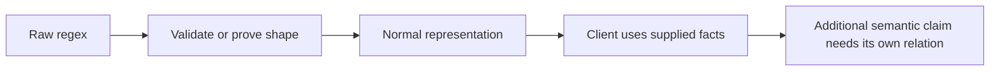
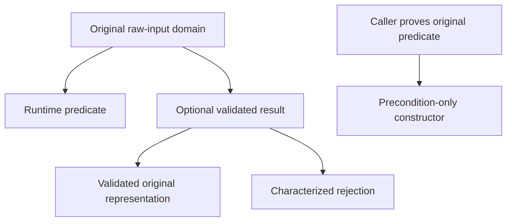
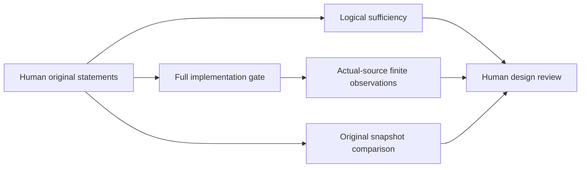

# R10 — Invariants in types

A regex can be well shaped and still describe the wrong language. That distinction
is the starting point of this module. We will put a representation invariant in
a type, carry extra proof evidence that disappears from the executable program,
and ask what a client can actually conclude from the resulting interface. The
answer depends on the promise written at the boundary. A normal-form wrapper
provides a useful shape guarantee; preserving the language of an original
operation needs its own statement.

Three ideas do all the work:

1. Constructing a refined value creates a proof obligation; consuming it exposes
   only the facts its actual interface supplies.
2. Erased proof data can justify an executable result without becoming a runtime
   cache or an executable decision procedure.
3. A proposed contract must support an original consumer over the original
   domain, and must also admit a real implementation.

## 0. How this module works

Allow408minutes: setup5, reading60, worked examples30, cards8, predictions15,
hand holes110, spectrum lab30, flagship statements40 and audit20, paper30,
bench20, viva30 and calibration10. Hand work is55minutes in each language.
These are estimates, not measured learner times. Record interruptions, first
attempts and failed approaches. The actor's wall-clock time is outside the
budget. Live Claude, contractor and grading validation remains recorded D45
debt. A local reference or deliberately scripted control is not a live outcome.

The module is standalone. It imports the provided A1, A1b, A2, A3 and A4
interfaces and does not import an earlier learner solution. A4 provides normal
forms, raw smart operations, mathematical normalization and derivative models,
some shape and congruence facts, and certificate definitions for later work.
It does not supply this module's compiled full normalizer or the flagship's
semantic proofs. Certificate soundness, completeness and executable checking
belong to R11; do not broaden a claim about this chapter to those tasks.

**This module's files** include the following source and validation inputs.

| artifact | purpose |
|---|---|
| `dafny/given/R/RG_A4_Norm.dfy`, `verus/given/rg_re_a4/` | frozen shape definitions, wrappers, models and given facts |
| `dafny/R/R10_TypeInvariants/std/R10_TypeInvariants.dfy`, `verus/r/r10_type_invariants/src/lib.rs` | 4 holes each; complete worked boundaries |
| `dafny/checks/R10_checks.dfy` | given-only std value check, with no hand-hole dependency |
| `specimens/R10/`, `slots/R10.slots` | five predictions, six WRITE cards and paired spectrum probes |
| `dafny/R/R10_TypeInvariants/agent/R10_AgentFlagship.dfy`, `verus/r/r10_type_invariants/src/agent.rs` | 3 holes each, 0 errors; human adds the semantic statements first |
| `tools/R10/check_statements.py` | contract sufficiency without using implementation bodies |
| `tools/R10/check_normalizer.py`, `tools/R10/check_constructors.py` | fixed actual-source compiled observations and retained native evidence |
| `paper/R10_problems.tex`, `paper/R10_answers.tex` | SpecGen card03.5 and an erasure/contract argument |
| `bench/local/r/` | your ninth course-derived benchmark card |
| `Solutions/` | reference twins, read last after original attempts and receipts |

Commit all five predictions before continuing. P1d takes a numeral in the given-only
Dafny check file. P2v takes a Boolean literal in its specimen. P4v takes the set of
failing assertion labels. P3dv and P5dv take ordered native verdicts in
`slots/R10.slots`; enable their CHECK switches only after recording the answer.
Run `scripts/firsttry.sh R10 --check` to retain first tries. A later correction
can help you learn, but does not replace what you committed before observation.

> **Predict (P1) — commit in the file before reading on.** Inspect the complete
> smart-constructor expression and its executable node-count observation in the
> Dafny check file. Which numeral belongs in the value slot? Follow the actual
> fixed operation rather than counting an unreduced syntax tree by habit.

> **Predict (P2) — commit in the file before reading on.** The Verus specimen
> asks whether one concrete nested representation satisfies the supplied normal
> predicate. Commit a Boolean literal. Check the predicate at every constructor,
> including conditions on children and exceptional shapes.

> **Predict (P3) — commit in the file before reading on.** Compare the complete
> optional-validation scenario and the complete precondition-only scenario.
> Commit `D:<x>,<y> V:<x>,<y>` for the actual code and original domain. A caller
> proving a precondition and a caller receiving a rejection are different events.

> **Predict (P4) — commit in the file before reading on.** The packet specimen
> opens its actual type invariant and lists three labelled assertions. Commit
> exactly the unprovable labels before running it. Keep an equality connecting
> the erased witness to its representation distinct from an arbitrary numeral.

> **Predict (P5) — commit in the file before reading on.** Two complete producers
> return the same kind of normal result under different promises. Compare the
> shape-only interface with the original concrete language requirement. Commit
> `D:<x>,<y> V:<x>,<y>` for the printed statements, without replacing a model.

The chapter captures later show the actual learner-loop scope. A typed
placeholder can leave the learner loop green while the full gate still counts
unfinished work. That is a stated course fact, not another prediction. Done
means a complete gate with zero tool-counted holes, an audit, and preserved
original statements. Inspect the native stage whenever a command fails.

---

## 1. A representation predicate becomes a boundary

The supplied normal predicate describes selected syntactic reductions. It
excludes empty operands and duplicate branches where the smart alternation
removes them. It excludes annihilating or identity operands where smart
concatenation reduces them. A normal star has a normal child of an admissible
shape. Leaves provide base cases. Read the actual predicate, because a phrase
such as “simplified regex” can hide many different reduction policies.

Normality does not identify a unique representative for every language. Two
different normal trees may accept the same words. Conversely, two normal
trees may accept different words. The predicate is a representation policy,
not a decision procedure for language equivalence. A constructor returning
some normal regex therefore has considerable freedom unless its contract
also relates that result to an input operation.

Dafny expresses the provided wrapper as a subset of the regex datatype. A
value of the subset satisfies its predicate. The witness makes the subset
inhabited without placing an assumption in every client. A method returning
that type must establish membership for every return. The compiler does not
have to attach a runtime Boolean test to every value merely because the
verifier used the predicate to justify construction.

Verus's provided wrapper has private representation and a type invariant.
Actual executable construction and use must respect that invariant. Its
methods expose a mathematical regex view and executable access under their
contracts. Keep the modes straight: a proof taking an arbitrary spec-mode
wrapper value cannot casually treat it as an executable object whose invariant
has been opened. Use the actual executable getter or state the needed logical
domain explicitly when reasoning about arbitrary model values.



W1d and W1v expose the packet representation built around that boundary. First
identify each field's role without editing the holes. Which part is the regex
that will execute? Which part is mathematical evidence? Where does the
coherence condition mention the actual stored expression? A useful drawing
shows the objects and their logical equalities, rather than a vague box marked
“verified.” Every equality has to connect the values that are really present.

The subset and wrapper are different language mechanisms. Dafny checks a
predicate over a value of the underlying datatype. Verus manages an invariant
around an executable object and offers an abstract view. They serve a similar
client goal here, but their native syntax, mode restrictions and opening rules
are not interchangeable. The purpose of the paired work is to understand both
boundaries, including the differences you must account for in a port.

---

## 2. Erased fields carry proof information

Our packet includes a normal expression and evidence of its mathematical
node count. In Dafny the count field is ghost, and the packet's subset relates
it to the expression. In Verus a Ghost wrapper carries the number, while a
Tracked witness records the expression associated with the evidence. The type
invariant ties all these pieces together. A number with the right name is not
enough: it must be the count of this representation, and the evidence must
refer to this expression.

Ghost and tracked data are proof resources. They can support an assertion,
justify a constructor or express a relation that would otherwise be awkward
to expose. They cannot be read to decide an executable branch. If a runtime
branch depends on whether a regex is empty, inspect the executable regex. If
a proof uses a stored mathematical count to justify the resulting field, keep
that reasoning in proof mode. Erasing the proof must leave a program that can
still make every runtime choice it needs.

A tracked value adds mode and consumption discipline. It does not automatically
make an arbitrary proposition true. Constructing a tracked witness must still
establish its fields and every relevant invariant. Consuming it in a proof
must use the promised relationship. Calling it evidence does not turn it into
runtime authorization, an oracle, or proof that the original input's language
has been preserved. State its actual proposition whenever that distinction
could matter.

This module deliberately makes the cache erased. Do not describe the result
as a constant-time executable node-count cache. A client wanting a runtime
count would need executable data and an appropriate agreement invariant.
That would change the implementation and its costs. The current packet is a
teaching boundary for proof data. Its count supports verification while the
executable payload remains the regex representation.

The compiled checker retains generated Dafny Python before the wrapper's
usual cleanup. Inspect the packet's runtime fields and the actual builder
bodies. Then inspect the observer separately. The observer explicitly walks
the output to check a count; finding that traversal does not show the builder
keeps an executable count field. Likewise, removing a ghost field does not
remove all work related to shape: the executable validator and regex
construction still perform their own operations.

In Verus the compiled layout check compares this packet's size with its
provided normal wrapper. This is a concrete fact about these compiled types.
It is not a universal theorem about all ghost encodings, the optimizer,
allocation sharing, peak heap use, stack depth or runtime speed. Describe the
observed representation and the target configuration. A precise small claim
is more useful than a performance story that the experiment did not measure.

---

## 3. A method implements a mathematical function

Dafny's by-method boundary separates a function's mathematical result from
the executable method supplying it. Here the normalization model is ghost.
The method must compute the chosen result and justify its agreement with the
model. A ghost model alone does not provide compiled normalization. The course
states this as a fact; your task is to write and verify the implementation
under that fixed model.

Agreement includes the logical packet, even when some fields disappear at
runtime. The expression must match the function model, and the ghost witness
must satisfy the packet's constraint. Erasure does not waive either proof
obligation. Instead it explains why the compiled representation can be smaller
than the mathematical object whose correctness you established.

The smart raw operations are already executable in A4. They implement fixed
shape models. Use their contracts as interfaces. Calling one of those
operations is different from writing the recursive full normalizer: the latter
must walk an arbitrary input tree, normalize the relevant children, combine
their results and establish the chosen model for the complete result. Keep the
termination argument aligned with the actual recursive inputs.

W2d and W2v provide a small runtime shape wrapper. The result is a Boolean
whose meaning is fixed by the supplied predicate. This makes a useful contrast
with the ghost normalization model. One interface computes a decision about
an executable representation; the other fixes a mathematical result that the
learner must implement. Both are useful, and neither should be silently
substituted for the other when explaining what a program runs.

W3d and W3v show a provided congruence fact used by a client. Replacing a
concatenation operand with a language-equivalent operand preserves the
language of the whole expression. The premise concerns language equality,
not merely normal shape. Read it before applying the lemma. If all you have
is a shape invariant, a semantic congruence theorem still needs its semantic
premise. An available lemma does not manufacture that missing relationship.

The six WRITE cards isolate subset results, by-method agreement, erased
witnesses, executable type invariants, Ghost values and Tracked consumption.
Attempt each printed failure before consulting its reference. State the exact
failed obligation and preserve the model while repairing the body. H1 and H2
then require actual hand uses of the declared constructs in the full packet
setting, so recognizing a syntax example is not the whole learning objective.

---

## 4. Runtime checks, optional values and preconditions

Take one arbitrary raw regex and imagine three interfaces around the same
shape predicate. A runtime checker returns a Boolean. Its correctness contract
relates the Boolean to the predicate, but it does not change the input's type.
A caller can branch on the result and use the branch fact while it remains
valid. The check's own computation is part of the executable program.

An optional validated constructor packages success differently. On success it
returns a wrapper around the original validated input. On rejection it
characterizes why no wrapper was returned. Both directions matter. A promise
saying only that every successful result is valid allows an implementation
that rejects everything. Our H1 interface also fixes the rejection case, so
normal inputs cannot disappear into an always-reject implementation.

A precondition-only constructor moves the burden to its caller. It does not
promise to detect bad input or return a rejection value. The caller must
establish the domain before the call is verified. That can be the right
interface when callers already carry the proof, but it is a different public
behavior from validation over arbitrary raw inputs. A failed proof at the call
site is not a runtime validation result.



The spectrum lab takes30minutes. Draw the three interfaces, write each
original domain, and describe the result and caller obligations in words.
Use fresh examples rather than changing a prediction after observing it.
Include a normal input and a nonnormal input. For the optional interface,
explain which clause rejects always-None. For the precondition-only interface,
identify the exact fact needed before a call. Retain native source and stage
for any disputed example.

Then consider a change request: clients want to normalize every raw input
rather than reject nonnormal inputs. A validated-input constructor does not
already implement that request. The new operation needs a result relation
between the arbitrary original input and the chosen normalized output. H4
provides exact agreement with the fixed normalization model. Discuss separately
what language theorem would connect that chosen model to the original regex.

Do not strengthen a precondition merely to make a difficult branch disappear.
The original task determines which inputs must remain supported. A smaller
domain can produce an easier proof while changing the service offered to the
client. Write an original valid input that would be excluded, and keep that
witness in the review. The proof's assumptions are part of its result.

---

## 5. The four paired hand exercises

H1 accepts exactly normal inputs into the evidence-carrying packet. Allow8
minutes in Dafny and10in Verus. Preserve the original input relation on
success and the rejection characterization. Establish the packet's erased
coherence at construction. A Boolean shape test alone is insufficient when
the returned object must also contain a correctly related witness.

H2 concatenates two packets. Allow12minutes per language. Open or use the
actual input invariants, follow the supplied smart-concatenation model, and
rebuild the erased evidence from the branches and original caches. Explain
why the expression selected at runtime agrees with the witness established
in proof mode. Keep the original function model or postcondition fixed.

H3 proves that an already normal regex is a fixed point of the normalization
model. Allow15minutes per language. The separate provided corollary derives
idempotence from that fixed-point result and model closure. Dafny's H3
explicitly disables automatic induction. Its empty body verifies when that
lever is removed; this is a disclosed induction-control exercise. Supply the
structural argument in the shipped configuration rather than changing the
attribute to make the task disappear.

H4 implements compiled structural normalization. Allow20minutes in Dafny
and18in Verus. Every returned packet must be valid and its expression must
agree with the fixed ghost model. The complete input tree matters. A method
that always returns one valid packet can preserve shape while missing the
specified normalization result. Use the recursive subproblem contracts and
provided raw smart-operation interfaces, retaining structural termination.

Write a short receipt after each attempt using the item's `did:` convention.
A receipt should say which original obligation you discharged, rather than
reporting that the screen turned green. Run the learner loop during editing,
then the complete gate. A successful fast check of one function cannot stand
in for verification of the whole module, and a typed placeholder remains
unfinished work even when other declarations verify around it.

After all four exercises, run the actual-source normalizer checker. Its fixed
cases cover leaves and the important shape reductions, plus a reproducible
collection of small compound trees. It compares exact normal forms, counts
and normality and checks matching observations on a finite word set. These
checks can expose a wrong implementation or shared model binding, but their
finite nature remains explicit. The full native contract and its domain are
the universal statement you actually proved.

---

## 6. What the consumer can and cannot establish

The statement checker uses the course's native parsers to extract the proposed
requires and ensures clauses. It generates a proof consumer over arbitrary
normal inputs and a fresh arbitrary normal result. First the original domain
must establish the proposed preconditions. Then those preconditions and the
proposed postconditions must establish the required raw-operation language
relationship. No concrete constructor body is assumed in that implication.

This matters because calling a known correct implementation can hide an
inadequate interface. A body might preserve the original language for reasons
that its public contract never mentions. A client restricted to the contract
cannot use those hidden reasons. Quantifying over a fresh result asks which
results the proposed clauses actually permit. If the clauses permit a normal
result with the wrong language, the consumer still has an unproved goal.

A native proof failure means this consumer was not proved under this
configuration. It is not a universal semantic decision procedure for arbitrary
specifications. Inspect whether the failure is a failed obligation, an
unsupported expression, a resolution problem or a resource limit. Keep the
original source and native output. Repairing the wrong problem can otherwise
look like progress while leaving the intended interface unresolved.

Logical sufficiency also has a classic limitation: an inconsistent
postcondition implies any consumer goal. That does not make it a useful
specification. An actual implementation over the original domain must
establish the postcondition, and nonvacuous witness calls must remain
supported. Use the full implementation gate and compiled observations as
separate controls. Do not interpret a green implication as a completed
constructor delivery.



The local negative controls illustrate the distinction. A complete shape-only
delivery can pass its native contract while failing fixed semantic runtime
observations. A false-domain clause can make body verification easy while
failing the original-domain consumer. An inconsistent postcondition can make
the consumer implication easy while failing implementation verification.
Those are distinct failures with different remedies. Keep their evidence
separate in the audit rather than reducing every result to one Boolean.

---

## 7. On paper, before the keyboard

Paper card03.5 covers SpecGen using the exact pinned local excerpt. Fill all
eight fields: Task shape, Oracle, Trust, Cheat surface, Metric, Budget,
Variance and Artifact. Describe the program-to-annotation task and the oracle
that checks it. Then ask what accepted annotations establish about the
program's actual behavior and what remains unknown about an independently
intended requirement.

Preserve the two benchmark denominators and distinguish their total from a
separately reported success-probability estimator. Describe the conversational
round budget, model, examples and mutation priorities without inventing a
matched dollar, token or wall-clock budget. Report unavailable variance or
replication metadata as unavailable. A percentage of verifier calls saved is
a claim about calls in a particular comparison, not automatically a timing
speedup or evidence that every contract is strong.

Relate the paper to your flagship. A proposer can produce annotations that
verify while dropping requirements a consumer needs. A specification for
buggy behavior can faithfully describe that behavior without repairing the
bug. Write one original-domain review question that would expose this gap.
Your question should identify a missing relationship, rather than merely
requesting more tests or a larger model.

The second problem asks for an erasure and contract argument. Name the
executable and ghost fields, state their coherence, explain construction and
use obligations, and justify the concatenation cases from the original
packet facts. Explain why by-method agreement survives the reasoning even
though fields disappear from the executable representation. Finally separate
sufficiency, implementability, witnesses, snapshots and finite observations.
An argument that conflates these evidence types has missed the module's point.

---

## 8. The exercise file

After filling holes, record receipts and run the full code gates and audits
for both hand files and both agent files. Check the course statement snapshot
and your original human snapshots. Run the three supplied actual-source
checkers under the course's memory caps. Keep all concurrent solver lanes
within48GiB, with a16GiB cap and no swap per native lane. Tools print retained
private driver and result paths; read their stage and claim scope.

```sh
scripts/firsttry.sh R10 --check
scripts/vcheck --gate dafny/R/R10_TypeInvariants/std
scripts/vcheck --gate verus/r/r10_type_invariants
scripts/vaudit dafny/R/R10_TypeInvariants/std
scripts/vaudit verus/r/r10_type_invariants
scripts/vcheck --gate dafny/R/R10_TypeInvariants/agent/R10_AgentFlagship.dfy
scripts/vcheck --gate verus/r/r10_type_invariants/src/agent.rs
scripts/specfreeze --check R10
python3 tools/R10/check_normalizer.py
python3 tools/R10/check_statements.py
python3 tools/R10/check_constructors.py
scripts/firsttry.sh R10 --report --strict
```

Complete the paper pair, your bench card, spectrum record, flagship audit and
viva. The strict report checks course receipts; it cannot replace those human
artifacts or infer a contractor session. Keep the original failing observations
when you revise a body. A source change after a capture requires re-capturing
the affected evidence before calling that capture current.


Done means four H solutions per language and all three agent constructors satisfy their original statements, zero-hole gates, audits, snapshots and the required paper/bench/viva work.

---

## 9. Exercise (agentic): human statements before contractor bodies

> **CONTRACT (for /contract R10 — run it in a FRESH session):** Use the
> human's fixed statements and witnesses. Edit only permitted constructor
> bodies and proof helpers, preserve original snapshots and given models,
> and return full zero-hole gates, audits and actual-source observations.
> Human statement design precedes body work; deferred live work is not a pass.

The flagship starts with three fixed constructor signatures and shape-typed
results. You write the semantic requires/ensures clauses yourself. Spend40
minutes on statements and witnesses before any actor body edits. The public
consumer checker exposes the desired client relationship, so this is a guided
Basic design exercise. It is not a blind benchmark of whether an actor can
invent an undisclosed intended specification.

For each operation, state the original admissible input domain in words.
Describe the language relationship a client needs between the output and the
corresponding raw operation. Identify the provided definitions that bind those
words to formal expressions. Decide which statement facts are necessary to
support a client and which merely describe a particular implementation. Do
not assume the raw smart-operation body supplies a promise you omitted.

Write nonvacuous examples before running the checker. Include a normal input
with a meaningful accepted word and one with a meaningful rejection. Cover
identity, annihilating and unreduced shapes where appropriate. The examples
must exercise the actual original domain. A case excluded by your precondition
cannot witness that a constructor implements its promised service there.
Explain what observation would distinguish a normal result with the wrong
language from an acceptable result.

Copy the human-completed agent source to a fixed snapshot under
`research/R10/`, one Dafny file and one Verus file. This copy includes the
original statements and model bindings even though body holes remain. Keep
it unchanged. Later use `scripts/specfreeze --against ORIGINAL DELIVERY` for
each language. The course's base snapshot permits adding the human's clauses;
your own snapshot freezes the clauses after that human design step.

Only then define the actor edit allowlist and ask for bodies and proofs under
those statements. The actor may not weaken clauses, alter models, change given
files or replace the original snapshot. Additional private proof helpers must
fit the permitted delivery boundary and remain subject to the audit. Use a
fresh contractor session when live sessions are available. The current build's
recorded deferral does not establish that such a session took place.

The audit takes20minutes. Compare original snapshots, run full zero-hole
gates and assumption audits, run the statement consumer, and run the compiled
constructor observations. Review each command's scope. A delivery with three
correct-looking bodies but a changed language predicate is a changed task.
A supplied reference demonstrates local implementability; it does not supply
your missing human design work or a measured actor success.

---

## 10. Bench card and viva

Build your ninth card from one of your own completed invariant or normalization
goals. Preserve its original statement and model, complete and stripped
versions, source revision, native commands, witness and negative controls.
Label it course-derived and previously exposed. Reconstructing a known course
problem is useful practice; it is not an independent unseen benchmark result.
The author does not supply a learner's completed card or fabricate a result.

Use the30-minute module viva to explain boundaries aloud. Expect to reconstruct
an invariant, diagnose an erased-cache claim, compare input policies and
critique a proposed contract. A fresh live prediction uses native source and
is committed before the referee runs. The instructor uses disjoint six-question
draws for a re-viva, retaining the original statements and evidence rather
than replacing a difficult question with an easier model.

The design-judgment review asks whether the abstraction supports its intended
consumer. Show where facts enter and leave the boundary. Explain each
precondition's effect on the original domain and each postcondition's effect
on permitted results. Identify one claim that native proof establishes and
one that remains a human judgment. Source fidelity, type correctness, logical
sufficiency and practical usefulness can support one another without becoming
the same criterion.

Calibration uses explicit gold and flawed fixtures with expected rubric
anchors. These are author materials for checking the grading workflow.
Expected scores are not measured live grades. The recorded D45 skip remains
validation debt for actual model and contractor sessions. Keep the status
honest in a progress report, even when every local native and compiled check
has passed.

### A concrete review record

Keep a compact record for each disputed claim. Start with the source revision,
original input domain and the exact observation at issue. Then name the
supporting contract clause or provided invariant. If the claim needs a fact
that the boundary does not supply, write that fact as an open obligation.
This record makes an interface discussion actionable: another reader can
inspect the same values and see which logical step remains unsupported.

For a witness, identify both the input and the observation that makes it
nonvacuous. An accepted empty word can exercise a different branch from an
accepted nonempty word. A rejected word matters when it distinguishes the
original language from an overly permissive result. Avoid treating a long
list of identical observations as diverse coverage. Explain why each chosen
case would detect a particular wrong result or excluded input.

For an erasure claim, record the generated target and which function body you
inspected. A test driver, a library helper and a packet builder may all mention
node counts for different reasons. Follow the data flow in the actual builder
and list the runtime fields of its returned object. If a claim concerns speed
or allocation, identify the missing measurement rather than extrapolating from
that representation inspection. Keep proof acceptance and executable evidence
attached to their respective artifacts.

For an actor delivery, retain the human snapshot even when the actor proposes
a more convenient statement. Discuss a proposed design change separately and
identify which original consumers would lose support. A new task can be useful,
but its result cannot close the old task by renaming it. This habit is central
to design judgment and will matter again when a later evaluation pipeline
reports a large aggregate success count.

The60-minute reading allocation includes the chapter, provided interfaces and
worked source files. Read the prose alongside the actual modes, type
constraints and native statements. A term that feels familiar in one language
is a reason to inspect its paired boundary carefully before assuming the same
construction and use rules apply.

---

## Captured native examples

Dafny card inputs import provided layers. Copy a card to a real `.dfy` file
and give the wrapper its R10 context, for example:

```sh
mkdir -p instructor/scratch/R10
cp specimens/R10/shape-d.dfy.specimen instructor/scratch/R10/shape-d.dfy
scripts/vcheck --module R10 instructor/scratch/R10/shape-d.dfy
```

The capture runner makes that same named copy in fresh scratch and applies
`--module R10`; its manifest pins the copied source and given dependencies.
Verus specimens use their supplied module context through the native wrapper.

The following blocks are generated from the actual learner sources and
complete probes in their provided context. They report shipped scope and failure locations without
filling a learner slot or proof body. Do not infer a zero-hole full gate from
an ordinary learner-loop capture.

<!-- pin: shipped-d -->
```
$ scripts/vcheck dafny/R/R10_TypeInvariants/std
vcheck: dafny/R/R10_TypeInvariants/std [dafny, learner loop]: verified — 71 verified, 4 holes, 0 errors
dafny/R/R10_TypeInvariants/std/R10_TypeInvariants.dfy:20:16: hole assume R10.H1d
dafny/R/R10_TypeInvariants/std/R10_TypeInvariants.dfy:26:16: hole assume R10.H2d
dafny/R/R10_TypeInvariants/std/R10_TypeInvariants.dfy:32:4: hole assume R10.H3d
dafny/R/R10_TypeInvariants/std/R10_TypeInvariants.dfy:41:14: hole assume R10.H4d
```

<!-- pin: shipped-v -->
```
$ scripts/vcheck verus/r/r10_type_invariants
vcheck: verus/r/r10_type_invariants [verus, learner loop]: verified — - verified, 4 holes, 0 errors
verus/r/r10_type_invariants/src/lib.rs:32:1: hole external_body R10.H1v
verus/r/r10_type_invariants/src/lib.rs:39:1: hole external_body R10.H2v
verus/r/r10_type_invariants/src/lib.rs:48:38: hole assume R10.H3v
verus/r/r10_type_invariants/src/lib.rs:55:1: hole external_body R10.H4v
```

<!-- pin: agent-d -->
```
$ scripts/vcheck dafny/R/R10_TypeInvariants/agent/R10_AgentFlagship.dfy
vcheck: dafny/R/R10_TypeInvariants/agent/R10_AgentFlagship.dfy [dafny, learner loop]: verified — 64 verified, 3 holes, 0 errors
dafny/R/R10_TypeInvariants/agent/R10_AgentFlagship.dfy:18:5: hole assume R10.A1d
dafny/R/R10_TypeInvariants/agent/R10_AgentFlagship.dfy:20:5: hole assume R10.A1d
dafny/R/R10_TypeInvariants/agent/R10_AgentFlagship.dfy:22:5: hole assume R10.A1d
```

<!-- pin: agent-v -->
```
$ scripts/vcheck verus/r/r10_type_invariants/src/agent.rs
vcheck: verus/r/r10_type_invariants/src/agent.rs [verus, learner loop]: verified — - verified, 3 holes, 0 errors
verus/r/r10_type_invariants/src/agent.rs:19:1: hole external_body R10.A1v
verus/r/r10_type_invariants/src/agent.rs:24:1: hole external_body R10.A1v
verus/r/r10_type_invariants/src/agent.rs:29:1: hole external_body R10.A1v
```

<!-- pin: card-c1d-dfy -->
```
$ scripts/vcheck --module R10 card-c1d.dfy
vcheck: card-c1d.dfy [dafny, learner loop]: failed — 62 verified, 0 holes, 1 error
card-c1d.dfy:7:8: error: value does not satisfy the subset constraints of 'NormRe'
```

<!-- pin: card-c1v-rs -->
```
$ scripts/vcheck specimens/R10/card-c1v.rs.specimen
vcheck: specimens/R10/card-c1v.rs.specimen [verus, learner loop]: failed — 0 verified, 0 holes, 1 error
specimens/R10/card-c1v.rs.specimen:10:46: error: constructed value may fail to meet its declared type invariant
```

<!-- pin: card-c2d-dfy -->
```
$ scripts/vcheck --module R10 card-c2d.dfy
vcheck: card-c2d.dfy [dafny, learner loop]: failed — 62 verified, 0 holes, 1 error
card-c2d.dfy:7:13: error: a postcondition could not be proved on this return path
card-c2d.dfy:7:2: related: this is the postcondition that could not be proved
```

<!-- pin: card-c2v-rs -->
```
$ scripts/vcheck specimens/R10/card-c2v.rs.specimen
vcheck: specimens/R10/card-c2v.rs.specimen [verus, learner loop]: failed — 0 verified, 0 holes, 1 error
specimens/R10/card-c2v.rs.specimen:6:10: error: postcondition not satisfied
```

<!-- pin: card-c3d-dfy -->
```
$ scripts/vcheck --module R10 card-c3d.dfy
vcheck: card-c3d.dfy [dafny, learner loop]: failed — 63 verified, 0 holes, 1 error
card-c3d.dfy:8:28: error: value does not satisfy the subset constraints of 'UnitLeafR10'
```

<!-- pin: card-c3v-rs -->
```
$ scripts/vcheck specimens/R10/card-c3v.rs.specimen
vcheck: specimens/R10/card-c3v.rs.specimen [verus, learner loop]: failed — 1 verified, 0 holes, 1 error
specimens/R10/card-c3v.rs.specimen:11:9: error: precondition not satisfied
```

<!-- pin: language-d-dfy -->
```
$ scripts/vcheck --module R10 language-d.dfy
vcheck: language-d.dfy [dafny, learner loop]: failed — 62 verified, 0 holes, 1 error
language-d.dfy:7:2: error: a postcondition could not be proved on this return path
language-d.dfy:6:26: related: this is the postcondition that could not be proved
dafny/given/R/RG_A4_Norm.dfy:11:46: related: this proposition could not be proved
```

<!-- pin: language-v-rs -->
```
$ scripts/vcheck specimens/R10/language-v.rs.specimen
vcheck: specimens/R10/language-v.rs.specimen [verus, learner loop]: failed — 0 verified, 0 holes, 1 error
specimens/R10/language-v.rs.specimen:7:10: error: postcondition not satisfied
```

<!-- pin: option-d-dfy -->
```
$ scripts/vcheck --module R10 option-d.dfy
vcheck: option-d.dfy [dafny, learner loop]: verified — 64 verified, 0 holes, 0 errors
```

<!-- pin: option-v-rs -->
```
$ scripts/vcheck specimens/R10/option-v.rs.specimen
vcheck: specimens/R10/option-v.rs.specimen [verus, learner loop]: verified — 2 verified, 0 holes, 0 errors
```

<!-- pin: precondition-d-dfy -->
```
$ scripts/vcheck --module R10 precondition-d.dfy
vcheck: precondition-d.dfy [dafny, learner loop]: failed — 62 verified, 0 holes, 1 error
precondition-d.dfy:6:42: error: value does not satisfy the subset constraints of 'NormRe'
```

<!-- pin: precondition-v-rs -->
```
$ scripts/vcheck specimens/R10/precondition-v.rs.specimen
vcheck: specimens/R10/precondition-v.rs.specimen [verus, learner loop]: failed — 0 verified, 0 holes, 1 error
specimens/R10/precondition-v.rs.specimen:8:13: error: precondition not satisfied
```

<!-- pin: shape-d-dfy -->
```
$ scripts/vcheck --module R10 shape-d.dfy
vcheck: shape-d.dfy [dafny, learner loop]: verified — 63 verified, 0 holes, 0 errors
```

<!-- pin: shape-v-rs -->
```
$ scripts/vcheck specimens/R10/shape-v.rs.specimen
vcheck: specimens/R10/shape-v.rs.specimen [verus, learner loop]: verified — 1 verified, 0 holes, 0 errors
```

<!-- pin: checks-d -->
```
$ scripts/vcheck dafny/checks/R10_checks.dfy
vcheck: dafny/checks/R10_checks.dfy [dafny, learner loop]: verified — 62 verified, 0 holes, 0 errors
```

---

## Instructor touchpoints

Use `/tutor R10` for a legal next step, `/discuss R10` for the type boundary,
`/review R10` for a disputed concept, `/viva R10` for a committed six-question
draw, `/grade-paper R10` for the written pair, and `/review-code R10` for the
complete native evidence and original snapshots. `/contract R10` requires a
fresh available actor session after human statement design. Solutions are
reference-class and yours to open LAST, after attempts and original receipts.

### What the instruments can and cannot see

The gate checks formal obligations and counts unfinished holes. The audit
checks trust escapes; snapshots bind original statements and referenced models.
The statement consumer tests a particular logical consequence over an explicit
domain. Runtime observations compare the fixed finite cases. None decides
whether a formal relation is the requirement a person intended. Keep the
question and evidence paired when explaining a result.

When two results disagree, retain both original artifacts and identify the
first stage at which their claims differ. A changed precondition, different
model binding, unresolved dependency or untested implementation requires a
different repair. Ask the instructor to inspect that exact boundary before
resampling an actor. Do not erase an earlier failed result, report a deferred
live grade as measured, or turn an author fixture into a learner transcript.

---

## What R10 planted

You can now read a representation invariant as an explicit promise, build a
value that satisfies it, and use erased evidence without confusing it with
runtime computation. You can implement a fixed mathematical normalization
model and explain what its interface does and does not promise about language.
You can also challenge a proposed contract using an arbitrary-result consumer,
original-domain obligations and separate implementation controls.

R11 will use the provided certificate definitions for new correctness and
construction work. Its obligations remain distinct from normal-form shape and
from finite observations in this module. Bring forward the habit that matters
most: identify the original domain, the exact formal relation, the actual
native scope and the evidence supporting each claimed result.

| seed | harvest |
|---|---|
| Explicit normal-form type boundary | certificate and VM representation reviews |
| Erased evidence with an executable payload | later resource and trust-report claims |
| Original-domain arbitrary-result consumer | statement-strength audits and fixed-task deliveries |
| Separate implementation, snapshot and runtime controls | evaluations with honest claim scope |

