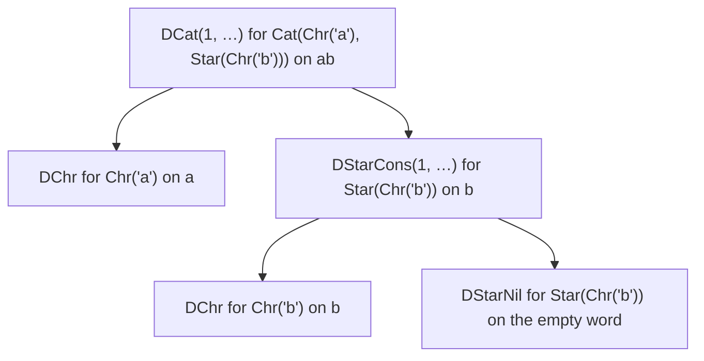
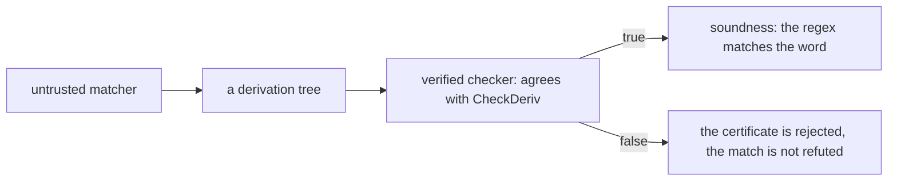
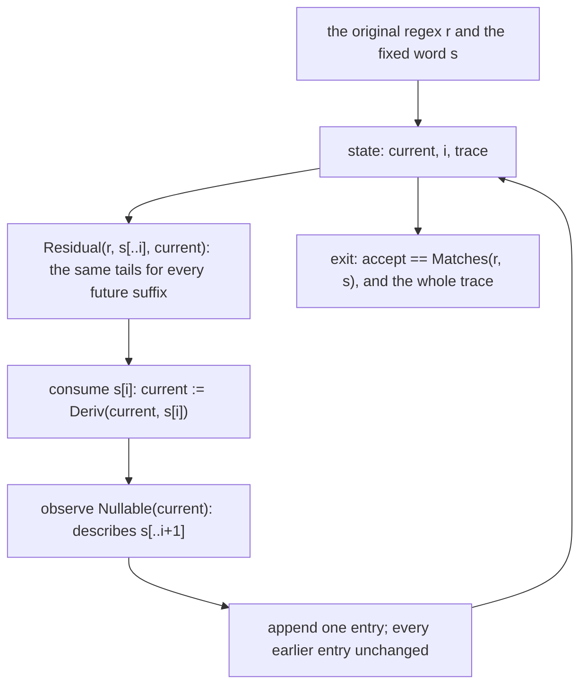
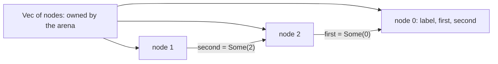

# R11 — Theory

R10 put a shape into a type and showed that the type says nothing about language. R11 turns to evidence that does: a derivation tree, which records *why* a regex matches a word, rule by rule. A tree is ordinary data. It can be built by an untrusted matcher, shipped, stored and checked later by a small verified checker; its meaning is the fixed rule relation that A4 states, never its shape alone. R11 proves the checker agrees with the rules, that the rules are sound and complete for matching, and that a certifying search produces a tree exactly when there is one. It also does the module's other piece of theory by hand: the weakest precondition and the loop invariant of a matcher that reads its input one scalar at a time.

The module is standalone. It imports the frozen layers A1 to A4 and no earlier learner file. A4 supplies `Derivation`, the ghost rule relation `CheckDeriv` (Verus `valid_word_r10`, and `valid` over a slice), and nothing about it: the checker, its soundness, completeness and the search are this module's work.

**Three ideas do all the work.**

1. A certificate carries four separate promises: the checker agrees with the rules, a tree that checks proves the match (soundness), a match has a tree (completeness), and a search finds one or proves there is none. Each has its own premise and its own consumer.
2. A loop proof is a relation to the input. The invariant must say what the state means about the original regex and word, for every future step, and account for every output already produced; a bound on an index is progress, not meaning.
3. A theorem about rules is only as good as the rules. A transport lemma can verify over a rule that accepts bad certificates; comparing the rules with A4's, and running the code on fixed cases, are different evidence from the proof.

---

## 0. How this module works

**Budget: 540 minutes**, including the module viva and excluding contractor wall time. These are planning estimates; record your own times, interruptions and failed attempts.

| setup | test-out | read | worked | cards | predictions | holes | wp lab | certifying search | checkpoint | agent | paper | bench card | viva | calibration | Vec arena | total |
|---|---|---|---|---|---|---|---|---|---|---|---|---|---|---|---|---|
| 8 | 10 | 70 | 30 | 8 | 15 | 125 | 35 | 50 | 22 | 25 | 40 | 20 | 30 | 7 | 45 | **540** |

The registry's admitted rows are the items the files hold: T1 (5 + 5), the hand core H1–H4 (Dafny 18, 17, 20, 15; Verus 15, 15, 15, 10), the search project H5–H7 (Dafny 15, 10, 5; Verus 10, 5, 5), the Vec arena H8–H9 (Verus 20, 25) and the checkpoint X1–X2 (6 + 5 in each language).

**Test-out first.** Before reading on, attempt T1 closed book in both files: the one-step index update of a scanning loop, first in each file. Record the attempt with `scripts/firsttry.sh R11 --check`; the tool keeps the first result.

**Predictions.** Commit the five answers below before running their scenarios or opening the specimens' expected outputs, the bank or the rubric. The value slots are in `dafny/checks/R11_checks.dfy` (P1) and `specimens/R11/P2v.rs.specimen` (P2), the obligation slot in `specimens/R11/P4v.rs.specimen` (P4), and the two verdicts in `slots/R11.slots`, switched on by the two `CHECK` lines of the Dafny file's prediction block (P3, P5). Respect each printed answer form; then run `scripts/firsttry.sh R11 --check` again and keep its receipts.

> **Predict (P1) — commit in the file before reading on.** The given-only check unit takes the certificate `DCat(2, DCat(1, DChr, DChr), DChr)` for a slice that starts at absolute position 4 and computes the absolute position of its root split. Which numeral reaches the slot? Answer form: a numeral.

> **Predict (P2) — commit in the file before reading on.** `specimens/R11/P2v.rs.specimen` evaluates a model of only the root's split bound and progress requirement for `DStarCons(0, DEps, DStarNil)` on a word of length 2. Answer form: `true` or `false`.

> **Predict (P3) — commit in the file before reading on.** On the regex `Star(Chr('a'))`, the word `"ab"` and the tree `DStarCons(1, DChr, DStarNil)`, `changed-rule` asserts a Star rule that checks only the first chunk, and `original-rule` asserts A4's rule. Answer `D:<x>,<y> V:<x>,<y>`, each one of `ok`, `fail`, `timeout`, `err:<stage>`.

> **Predict (P4) — commit in the file before reading on.** `specimens/R11/P4v.rs.specimen` steps `next = i + 1` under `i < len` and asserts [a] `next <= len`, [b] `i < next`, [c] `next < len`. Which labels fail for arbitrary inputs? Answer form: the failing label set, or `none`.

> **Predict (P5) — commit in the file before reading on.** Two producers both return no certificate: `weak-producer` promises only that a present certificate is valid; `complete-producer` also promises that absence means no match. Answer `D:<x>,<y> V:<x>,<y>` as in P3.

### This module's files

| file | role | shipped state |
|---|---|---|
| `dafny/R/R11_Theory/std/R11_Theory.dfy` | test-out, prediction block, the certificate kernel, the streaming matcher and the search | verified, 8 holes, 0 errors |
| `verus/r/r11_theory/src/lib.rs` | the paired Verus crate, with the Vec arena | verified, 10 holes, 0 errors |
| `dafny/checks/R11_checks.dfy` | given-only compiled value check (P1) | verified, no hole; P1's slot unfilled |
| `dafny/R/R11_Theory/exit/R11_Checkpoint.dfy`, `verus/r/r11_theory/src/exit.rs` | the closed-book checkpoint | verified, 2 holes each, 0 errors |
| `dafny/R/R11_Theory/agent/R11_AgentMetatheory.dfy`, `verus/r/r11_theory/src/agent.rs` | the metatheory contractor's theorem | verified, 1 hole each, 0 errors |
| `specimens/R11/`, `slots/R11.slots` | prediction specimens, the rule and producer scenarios, a card demo | slots unfilled; the card demo fails by design |
| `dafny/given/R/RG_A4_Norm.dfy`, `verus/given/rg_re_a4/` | the frozen A4 layer: derivations and their rules | verified; no checker, no metatheory |
| `tools/R11/check_runtime.py`, `tools/R11/check_rule_binding.py` | compiled observations; rule comparison against A4 | read the sources they name; run after your work |
| `paper/R11_problems.tex`, `paper/R11_answers.tex` | written problems and your answers | template compiles; answers unfilled |
| `bench/local/r/README.md` | instructions for your tenth local bench card | you create the card |
| `Solutions/`, `paper/solutions/` | references | yours to open LAST, after your attempts, gates and review |

The exercise files run in the learner loop as shipped: the holes are counted, everything else verifies.

<!-- pin: shipped-d -->
```
$ scripts/vcheck dafny/R/R11_Theory/std
vcheck: dafny/R/R11_Theory/std [dafny, learner loop]: verified — 79 verified, 8 holes, 0 errors
dafny/R/R11_Theory/std/R11_Theory.dfy:43:5: hole assume R11.T1d
dafny/R/R11_Theory/std/R11_Theory.dfy:103:5: hole assume R11.H1d
dafny/R/R11_Theory/std/R11_Theory.dfy:118:5: hole assume R11.H2d
dafny/R/R11_Theory/std/R11_Theory.dfy:133:5: hole assume R11.H3d
dafny/R/R11_Theory/std/R11_Theory.dfy:207:5: hole assume R11.H4d
dafny/R/R11_Theory/std/R11_Theory.dfy:235:5: hole assume R11.H5d
dafny/R/R11_Theory/std/R11_Theory.dfy:252:5: hole assume R11.H6d
dafny/R/R11_Theory/std/R11_Theory.dfy:268:5: hole assume R11.H7d
```

<!-- pin: shipped-v -->
```
$ scripts/vcheck verus/r/r11_theory
vcheck: verus/r/r11_theory [verus, learner loop]: verified — - verified, 10 holes, 0 errors
verus/r/r11_theory/src/lib.rs:37:1: hole external_body R11.T1v
verus/r/r11_theory/src/lib.rs:93:1: hole external_body R11.H1v
verus/r/r11_theory/src/lib.rs:116:40: hole assume R11.H2v
verus/r/r11_theory/src/lib.rs:136:40: hole assume R11.H3v
verus/r/r11_theory/src/lib.rs:156:1: hole external_body R11.H5v
verus/r/r11_theory/src/lib.rs:179:1: hole external_body R11.H6v
verus/r/r11_theory/src/lib.rs:201:1: hole external_body R11.H7v
verus/r/r11_theory/src/lib.rs:285:1: hole external_body R11.H4v
verus/r/r11_theory/src/lib.rs:350:1: hole external_body R11.H8v
verus/r/r11_theory/src/lib.rs:373:1: hole external_body R11.H9v
```

<!-- pin: checks-d -->
```
$ scripts/vcheck dafny/checks/R11_checks.dfy
vcheck: dafny/checks/R11_checks.dfy [dafny, learner loop]: verified — 65 verified, 0 holes, 0 errors
```

---

## 1. A certificate and its four promises

### 1.1 Derivations are data

A4's derivation type has one constructor per matching rule. The two split-carrying constructors store the split `k`; nothing else records the regex or the word, which come with the question:

```dafny
datatype Derivation =
  | DEps
  | DChr
  | DAltL(d: Derivation)
  | DAltR(d: Derivation)
  | DCat(k: nat, d1: Derivation, d2: Derivation)
  | DStarNil
  | DStarCons(k: nat, d1: Derivation, d2: Derivation)
```

The rule relation says when a tree justifies a word for a regex. It reads like `Matches` with the existential replaced by the stored split:

```dafny
ghost predicate CheckDeriv(r: Re, s: seq<char>, d: Derivation)
  decreases d
{
  match d
  case DEps => r == Eps && s == []
  case DChr => r.Chr? && s == [r.c]
  case DAltL(d1) => r.Alt? && CheckDeriv(r.a, s, d1)
  case DAltR(d1) => r.Alt? && CheckDeriv(r.b, s, d1)
  case DCat(k, d1, d2) =>
    r.Cat? && k <= |s| && CheckDeriv(r.a, s[..k], d1) && CheckDeriv(r.b, s[k..], d2)
  case DStarNil => r.Star? && s == []
  case DStarCons(k, d1, d2) =>
    r.Star? && 0 < k <= |s| && CheckDeriv(r.r, s[..k], d1) && CheckDeriv(r, s[k..], d2)
}
```

The same tree can be valid for one subject and invalid for another, and a tree of the right shape can carry the wrong split. Evaluating the relation on small cases makes that concrete:

```dafny
module R11_CheckValuesDemo {
  import opened RG_A1_Re
  import opened RG_A4_Norm

  // CheckDeriv on concrete trees: the tree is data; the rule decides.
  lemma CheckSamples()
    ensures CheckDeriv(Cat(Chr('a'), Chr('b')), ['a', 'b'], DCat(1, DChr, DChr))
    ensures !CheckDeriv(Cat(Chr('a'), Chr('b')), ['a', 'b'], DCat(2, DChr, DChr))
    ensures !CheckDeriv(Alt(Chr('a'), Chr('b')), ['b'], DAltL(DChr))
    ensures CheckDeriv(Alt(Chr('a'), Chr('b')), ['b'], DAltR(DChr))
  {
  }
}
```

<!-- pin: check-values-d -->
```
$ scripts/vcheck --module R11 check-values.dfy
vcheck: check-values.dfy [dafny, learner loop]: verified — 64 verified, 0 holes, 0 errors
```

`DCat(2, …)` puts all of `ab` under `Chr('a')`, which matches one scalar only; `DAltL(DChr)` points at the branch that cannot match `b`. In Verus the relation is `valid_word_r10` over a word, and `valid(d, r, s, lo, hi)` applies it to the slice `s[lo..hi]`:

```rust
// A certificate checked against the slice s[lo..hi] of a word.
pub open spec fn valid(d: Derivation, r: Re, s: Seq<char>, lo: int, hi: int) -> bool {
    0 <= lo <= hi <= s.len() && valid_word_r10(d, r, s.subrange(lo, hi))
}
```

```rust
use vstd::prelude::*;
use rg_re_a1::*;
use rg_re_a4::*;

verus! {

// valid_word_r10 on a concrete tree: the split 1 of "ab" is the right one.
proof fn lemma_check_samples() {
    let r = Re::Cat(Box::new(Re::Chr('a')), Box::new(Re::Chr('b')));
    let s = seq!['a', 'b'];
    let d = Derivation::DCat(1, Box::new(Derivation::DChr), Box::new(Derivation::DChr));
    assert(s.take(1) =~= seq!['a']);
    assert(s.skip(1) =~= seq!['b']);
    reveal_with_fuel(valid_word_r10, 2);
    assert(valid_word_r10(d, r, s));
}

} // verus!
```

<!-- pin: check-values-v -->
```
$ scripts/vcheck --module R11 check-values.rs
vcheck: check-values.rs [verus, learner loop]: verified — 1 verified, 0 holes, 0 errors
```

The Verus proof states the two halves of the word explicitly (`take` and `skip`) and unfolds the relation one level per constructor (`reveal_with_fuel`): the relation is a recursive spec function, opened only as deep as you ask.

### 1.2 Checking, soundness, completeness, search

Four promises, in the order the module proves them:

- **checker agreement** (H1): an executable Boolean equal to the rule relation, for every tree, valid or not;
- **soundness** (H2): a tree that checks proves `Matches(r, s)`; the premise is the rule relation, the conclusion the semantics;
- **direct completeness** (H3): from `Matches(r, s)`, construct a tree that checks; in Verus the word must fit a `usize`, because the tree stores its splits as machine integers;
- **complete search** (H5–H7): an executable producer that returns a tree that checks, and returns none only when there is no match.

The derivation of `ab` by `Cat(Chr('a'), Star(Chr('b')))` shows what a tree records:



Every node knows its rule and, for a split, the length of its left part; the words are recomputed from the root's word by slicing. A checker walks this tree; soundness turns it into the existential witnesses of `Matches`; completeness builds it from those witnesses.

### 1.3 The checker's trust story

A certificate lets the matcher be untrusted. The matcher may be fast, unverified or written by an agent; the checker is small, verified once against the rules, and run on every certificate.



The arrows carry different claims. A `true` from the checker plus soundness proves the match. A `false` refutes only the certificate: the matcher may have sent a bad tree for a word that does match. Refuting a match needs the search's second clause. Lean4Lean (the written card) plays the same game at the scale of a proof assistant: an independent kernel re-checks proofs, and its own metatheory, partial as it is, says how far that re-check can be trusted.

---

## 2. Splits are relative

### 2.1 A node owns a word

A split `k` is measured from the start of the word its own node owns, not from the start of the whole input. A nested `DCat` inside the left child of a root `DCat(2, …)` splits the first two scalars, so its `k` counts from the same start; inside the right child, a split counts from position 2. The checker's recursion passes each child its own slice, and the relativity is automatic. The trouble starts where positions become absolute: in an executable checker over one shared vector with a lower and an upper index.

### 2.2 The answers to P1 and P2

P1's check computes the absolute position of the root's split:

```dafny
// after: R11.P1d
// A specimen runs alone, so the A4 datatype it needs is copied here verbatim.
module R11_P1Observed {
  datatype Derivation =
    | DEps
    | DChr
    | DAltL(d: Derivation)
    | DAltR(d: Derivation)
    | DCat(k: nat, d1: Derivation, d2: Derivation)
    | DStarNil
    | DStarCons(k: nat, d1: Derivation, d2: Derivation)

  method AbsoluteMiddleR11(start: nat, d: Derivation) returns (mid: nat)
    requires d.DCat?
    ensures mid == start + d.k
  {
    mid := start + d.k;
  }

  // P1's expression, run as compiled code.
  @Test
  method RelativeMiddleObserved()
  {
    var certificate := DCat(2, DCat(1, DChr, DChr), DChr);
    var middle := AbsoluteMiddleR11(4, certificate);
    expect middle == 6;
  }
}
```

<!-- pin: p1-d -->
```
$ scripts/vcheck --test specimens/R11/chapter-p1-d.dfy.specimen
vcheck: specimens/R11/chapter-p1-d.dfy.specimen [dafny, test]: verified — 1 passed, 0 failed
PASSED R11_P1Observed.RelativeMiddleObserved
```

`6`: the root split is 2 scalars into a slice that starts at 4. The nested `DCat(1, …)` belongs to the left child and plays no part in the root's position. P2 evaluates the root's local condition on a star certificate with a split of 0:

```rust
use vstd::prelude::*;
use rg_re_a4::*;

verus! {

pub open spec fn root_split_ok_r11(d: Derivation, n: nat) -> bool {
    match d {
        Derivation::DCat(k, _, _) => k <= n,
        Derivation::DStarCons(k, _, _) => 0 < k <= n,
        _ => true,
    }
}

// P2's expression, evaluated by the verifier.
proof fn root_split_value_observed() {
    assert(root_split_ok_r11(Derivation::DStarCons(0, Box::new(Derivation::DEps), Box::new(Derivation::DStarNil)), 2) == false) by (compute_only);
}

} // verus!
```

<!-- pin: p2-v -->
```
$ scripts/vcheck --module R11 p2.rs
vcheck: p2.rs [verus, learner loop]: verified — 1 verified, 0 holes, 0 errors
```

`false`: a star's first chunk must be non-empty, so `0 < k` fails whatever the children are. The predicate checks one node's local condition; full validity needs every node's.

### 2.3 Slices in Verus

The Verus checker receives `s: &Vec<char>` and two indices. Its first task is to refuse an impossible slice (`lo > hi` or `hi > s.len()`); then each split node converts its relative `k` into the absolute middle `lo + k`. W1's lemma states the correspondence once:

```rust
/// The relative split: the first k scalars of a slice are the slice from lo to
/// lo + k of the whole vector, and the rest is the slice from lo + k.
proof fn slice_split_r11(s: Seq<char>, lo: int, hi: int, k: int)
    requires
        0 <= lo <= hi <= s.len(),
        0 <= k <= hi - lo,
    ensures
        s.subrange(lo, hi).take(k) == s.subrange(lo, lo + k),
        s.subrange(lo, hi).skip(k) == s.subrange(lo + k, hi),
{
    assert(s.subrange(lo, hi).take(k) =~= s.subrange(lo, lo + k));
    assert(s.subrange(lo, hi).skip(k) =~= s.subrange(lo + k, hi));
}
```

The lemma is the bridge between the spec relation, which slices words with `take` and `skip`, and the executable recursion, which moves two indices over one vector. Forgetting it gives proofs that are right about the wrong scalars.

The order of the checks is part of the proof. The checker must establish the slice domain first (`lo <= hi <= s.len()`), then compare the relative split with the slice length (`k <= hi - lo`, computed as a subtraction that cannot underflow because of the first check), and only then add `lo + k`, which is now bounded by `hi` and therefore representable. Written in the other order, the same mathematics leaves an arithmetic obligation the verifier cannot discharge: `lo + k` may overflow before anyone has said that `k` is small. A split within bounds is still only necessary. Each child must check its own part against its own child regex, and for a star step the first chunk must be non-empty and the rest must check against the same star. A valid first chunk says nothing about the scalars after it, which is exactly the gap P3's changed rule leaves open.

---

## 3. Weakest preconditions and loop invariants

### 3.1 wp of an assignment

The weakest precondition of an assignment `x := e` with respect to a postcondition `Q` is `Q` with `e` substituted for `x`. For `k := j + 2` and `Q` = `k <= n && k == j + 2`, it is `j + 2 <= n`. A precondition that implies it verifies; a weaker one does not:

```dafny
module R11_WpDemo {
  // wp(j := j + 2, 0 <= j <= n) is 0 <= j + 2 <= n: the precondition below is it.
  method TwoStep(j: nat, n: nat) returns (k: nat)
    requires j + 2 <= n
    ensures k <= n && k == j + 2
  {
    k := j + 2;
  }

  // A weaker precondition does not imply the wp.
  method TwoStepWeak(j: nat, n: nat) returns (k: nat)
    requires j < n
    ensures k <= n && k == j + 2
  {
    k := j + 2;
  }
}
```

<!-- pin: wp-assign-d -->
```
$ scripts/vcheck --module R11 wp-assign.dfy
vcheck: wp-assign.dfy [dafny, learner loop]: failed — 63 verified, 0 holes, 1 error
wp-assign.dfy:14:3: error: a postcondition could not be proved on this return path
wp-assign.dfy:13:15: related: this is the postcondition that could not be proved
```

The error is on the return path of `TwoStepWeak` (line 14), the weak version: `j < n` allows `j == n - 1`, where `j + 2` is past `n`. In machine integers the wp gains a conjunct for every intermediate: `j + 2` must be representable before it is compared with anything.

```rust
use vstd::prelude::*;

verus! {

// wp in machine integers adds the representability of every intermediate.
fn two_step_r11(j: usize, n: usize) -> (k: usize)
    requires
        j < n,
    ensures
        k == j + 2,
{
    j + 2
}

} // verus!
```

<!-- pin: wp-overflow-v -->
```
$ scripts/vcheck --module R11 wp-overflow.rs
vcheck: wp-overflow.rs [verus, learner loop]: failed — 0 verified, 0 holes, 1 error
wp-overflow.rs:12:5: error: possible arithmetic underflow/overflow
```

`j < n` bounds `j` below `usize::MAX`, which makes `j + 1` safe and leaves `j + 2` unknown. T1 is the safe case; its wp is the exercise.

### 3.2 The answer to P4

```rust
use vstd::prelude::*;

verus! {

// item: R11.P4v obligation
// Select failing labelled VCs for arbitrary original i and len.
// SLOT: FAILS ???
fn labelled_step_r11(i: usize, len: usize)
    requires
        i < len,
{
    let next = i + 1;
    assert(next <= len); // [a]
    assert(i < next); // [b]
    assert(next < len); // [c]
}

} // verus!
```

<!-- pin: obligation-v -->
```
$ scripts/vcheck specimens/R11/P4v.rs.specimen
vcheck: specimens/R11/P4v.rs.specimen [verus, learner loop]: failed — 0 verified, 0 holes, 1 error
specimens/R11/P4v.rs.specimen:15:12: error: assertion failed
```

`FAILS c`. From `i < len` the wp of [a] (`i + 1 <= len`) and of [b] (`i < i + 1`) hold; [c] would need `i + 1 < len`, which fails at the last legal index `i == len - 1`. The last legal input is exactly the case a repair must keep: excluding it to make [c] hold changes the task.

### 3.3 An invariant is a relation to the input

A loop's invariant states what its state means about the original input, at every iteration, strongly enough to give the postcondition at exit. Bounds alone are progress, not meaning:

```dafny
module R11_CountLoopNoInvDemo {
  function CountA(s: seq<char>): nat
  {
    if s == [] then 0 else (if s[0] == 'a' then 1 else 0) + CountA(s[1..])
  }

  // The same loop with only its bounds as invariant: the counter is unknown after it.
  method CountLoop(s: seq<char>) returns (n: nat)
    ensures n == CountA(s)
  {
    n := 0;
    var i := 0;
    while i < |s|
      invariant 0 <= i <= |s|
      decreases |s| - i
    {
      n := n + (if s[i] == 'a' then 1 else 0);
      i := i + 1;
    }
  }
}
```

<!-- pin: loop-noinv-d -->
```
$ scripts/vcheck --module R11 loop-noinv.dfy
vcheck: loop-noinv.dfy [dafny, learner loop]: failed — 63 verified, 0 holes, 1 error
loop-noinv.dfy:10:3: error: a postcondition could not be proved on this return path
loop-noinv.dfy:9:15: related: this is the postcondition that could not be proved
```

```dafny
module R11_CountLoopDemo {
  function CountA(s: seq<char>): nat
  {
    if s == [] then 0 else (if s[0] == 'a' then 1 else 0) + CountA(s[1..])
  }

  lemma CountASnoc(s: seq<char>, c: char)
    ensures CountA(s + [c]) == CountA(s) + (if c == 'a' then 1 else 0)
  {
    if s == [] {
      assert s + [c] == [c];
    } else {
      assert (s + [c])[1..] == s[1..] + [c];
      CountASnoc(s[1..], c);
    }
  }

  // The invariant relates the counter to the prefix read so far.
  method CountLoop(s: seq<char>) returns (n: nat)
    ensures n == CountA(s)
  {
    n := 0;
    var i := 0;
    while i < |s|
      invariant 0 <= i <= |s|
      invariant n == CountA(s[..i])
      decreases |s| - i
    {
      CountASnoc(s[..i], s[i]);
      assert s[..i + 1] == s[..i] + [s[i]];
      n := n + (if s[i] == 'a' then 1 else 0);
      i := i + 1;
    }
    assert s[..i] == s;
  }
}
```

<!-- pin: loop-inv-d -->
```
$ scripts/vcheck --module R11 loop-invariant.dfy
vcheck: loop-invariant.dfy [dafny, learner loop]: verified — 65 verified, 0 holes, 0 errors
```

The second version relates the counter to the prefix read so far (`n == CountA(s[..i])`) and proves the step with one lemma about appending a scalar. Verus states the same loop with `take`:

```rust
use vstd::prelude::*;

verus! {

pub open spec fn count_a_r11(s: Seq<char>) -> nat
    decreases s.len(),
{
    if s.len() == 0 {
        0
    } else {
        count_a_r11(s.drop_last()) + if s.last() == 'a' { 1nat } else { 0nat }
    }
}

// The invariant relates the counter to the prefix read so far.
fn count_loop_r11(s: &Vec<char>) -> (n: u64)
    requires
        s.len() < u64::MAX,
    ensures
        n == count_a_r11(s@),
{
    let mut n: u64 = 0;
    let mut i: usize = 0;
    while i < s.len()
        invariant
            i <= s.len(),
            s.len() < u64::MAX,
            n <= i,
            n == count_a_r11(s@.take(i as int)),
        decreases s.len() - i,
    {
        assert(s@.take(i as int + 1).drop_last() =~= s@.take(i as int));
        if s[i] == 'a' {
            n = n + 1;
        }
        i = i + 1;
    }
    assert(s@.take(i as int) =~= s@);
    n
}

} // verus!
```

<!-- pin: loop-inv-v -->
```
$ scripts/vcheck --module R11 loop-invariant.rs
vcheck: loop-invariant.rs [verus, learner loop]: verified — 3 verified, 0 holes, 0 errors
```

The machine counter adds one more conjunct (`n <= i`) so the increment stays representable: an invariant also carries whatever the next iteration's arithmetic needs.

### 3.4 The streaming matcher's residual

H4 reads `s` one scalar at a time with derivatives and records, for every nonempty prefix, whether it matches. Its state is a residual regex, and the relation to the input quantifies over every future suffix:

```dafny
opaque ghost predicate ResidualR11(r: Re, current: Re, prefix: seq<char>)
{
  forall tail: seq<char> :: Matches(current, tail) <==> Matches(r, prefix + tail)
}
```

After reading `prefix`, `current` matches exactly the tails that complete `prefix` to a word of `r`. Three given facts carry the relation through the loop: it holds at the start (W1), one derivative step keeps it (W3, from A2's `DerivCorrect`), and it turns into an observation (`Nullable(current)` is `Matches(r, prefix)`). The predicate is opaque, so it is unfolded only inside those facts.

The loop's state and its obligations fit one picture; each edge is a fact you state and prove, not a step you assume:



The termination measure concerns the input still unread; the trace's preservation concerns the output already produced. They are separate responsibilities, and the invariant must name both. An opaque predicate controls when a quantified definition is unfolded; it does not weaken the relation, add an axiom or raise a resource limit. If a local attempt runs out of resources, record it as inconclusive and look at the proof's structure: a timeout is not a counterexample, and it never justifies a weaker statement.

The output adds obligations that whole-word matching does not have. The trace's length must equal the number of scalars read, every earlier entry must survive the append, and the new entry must describe the extended prefix, not the old one: observe after consuming the scalar, and the indices line up. The empty word is a separate case: the trace is empty and acceptance is `Matches(r, [])`, not `false`.

---

## 4. Proof data: ghost and tracked evidence

Dafny's worked W2 packs a regex, a word and a tree into a datatype of ghost fields; packing needs `CheckDeriv`, and using the fields is free. Verus's W2 is a tracked struct:

```rust
pub tracked struct CertificateEvidenceR11 {
    pub ghost tree: Derivation,
    pub ghost pattern: Re,
    pub ghost word: Seq<char>,
}
```

A tracked object is proof-mode data with ownership: passing it by value moves it, and a moved object is gone. The object states nothing by itself; a consumer's `requires` says what it must prove. H2 consumes one such object and proves the match; H3 overwrites one through `&mut` with a tree it chooses. The WRITE card C1v isolates the move discipline: its demo uses the input twice.

```rust
use vstd::prelude::*;

verus! {

tracked struct TicketR11 {
    pub ghost value: int,
}

// item: R11.C1v write:tracked
// WRITE: move the tracked input exactly once, preserving its proof payload.
proof fn handoff_r11(tracked input: TicketR11) -> (tracked out: TicketR11)
    ensures
        out.value == input.value,
{
    let tracked first = input;
    let tracked second = input;
    second
}

} // verus!
```

<!-- pin: card-c1v -->
```
$ scripts/vcheck specimens/R11/card-c1v.rs.specimen
vcheck: specimens/R11/card-c1v.rs.specimen [verus, learner loop]: failed — 0 verified, 0 holes, 1 error, stage resolve
specimens/R11/card-c1v.rs.specimen:16:26: error: use of moved value: `input`
```

The same rule in a smaller probe, with a consumer that takes the object:

```rust
use vstd::prelude::*;

verus! {

tracked struct PassR11 {
    ghost holder: int,
}

proof fn spend_pass_r11(tracked p: PassR11) {
}

// A tracked value moves: after it is spent, it is gone.
proof fn spend_twice_r11(tracked p: PassR11) {
    spend_pass_r11(p);
    spend_pass_r11(p);
}

} // verus!
```

<!-- pin: tracked-move-v -->
```
$ scripts/vcheck --module R11 tracked-move.rs
vcheck: tracked-move.rs [verus, learner loop]: failed — 0 verified, 0 holes, 1 error, stage resolve
tracked-move.rs:15:20: error: use of moved value: `p`
```

Both stop at resolution: ownership is checked before any obligation is generated, and no proof can spend a tracked value twice. That is what makes tracked evidence usable as a permission elsewhere in Verus; here it is only a carrier for a proposition.

Keep the consumers apart. The compiled checker pattern-matches on an ordinary `Derivation` and reads real split positions; it is the only thing that can decide, at run time, whether an untrusted certificate is valid. A ghost record or a tracked value is erased from the compiled program: it can justify obligations, never supply a branch decision. Possessing a tracked record with public fields proves nothing either; read its construction sites and the `requires` of its consumers before claiming that its fields are related.

H3v's interface explains one design choice. A proof function that returns a fresh tracked object verifies when complete, but its empty body does not even typecheck, because it returns nothing, and an exercise whose unfinished state is a type error cannot be admitted. H3v is therefore a proof function with a tracked `&mut` output: its empty body reaches the verifier and fails there, as every hole's empty body must, with the theorem and its domain unchanged. The WRITE construct here is Verus's `tracked`, with real uses in H2v and H3v; Dafny's ghost record introduces no new construct and builds on the ghost modes of earlier modules. The two languages need not look symmetric; each mechanism is explained for what it proves.

---

## 5. Complete search and the arena

### 5.1 The answer to P5

```dafny
// after: R11.P5dv
module R11_ProducerObservation {
  import opened RG_A1_Re
  import opened RG_A4_Norm

  datatype ChoiceR11 = NoR11 | SomeR11(d: Derivation)

  method ProduceR11(r: Re, s: seq<char>) returns (out: ChoiceR11)
    ensures out.SomeR11? ==> CheckDeriv(r, s, out.d)
  {
    out := NoR11;
  }
}
```

<!-- pin: weak-producer-d -->
```
$ scripts/vcheck --module R11 weak-producer-d.dfy
vcheck: weak-producer-d.dfy [dafny, learner loop]: verified — 64 verified, 0 holes, 0 errors
```

```dafny
// after: R11.P5dv
module R11_ProducerObservation {
  import opened RG_A1_Re
  import opened RG_A4_Norm

  datatype ChoiceR11 = NoR11 | SomeR11(d: Derivation)

  method ProduceR11(r: Re, s: seq<char>) returns (out: ChoiceR11)
    ensures out.SomeR11? ==> CheckDeriv(r, s, out.d)
    ensures out.NoR11? ==> !Matches(r, s)
  {
    out := NoR11;
  }
}
```

<!-- pin: complete-producer-d -->
```
$ scripts/vcheck --module R11 complete-producer-d.dfy
vcheck: complete-producer-d.dfy [dafny, learner loop]: failed — 63 verified, 0 holes, 1 error
complete-producer-d.dfy:11:3: error: a postcondition could not be proved on this return path
complete-producer-d.dfy:10:36: related: this is the postcondition that could not be proved
```

<!-- pin: weak-producer-v -->
```
$ scripts/vcheck specimens/R11/weak-producer-v.rs.specimen
vcheck: specimens/R11/weak-producer-v.rs.specimen [verus, learner loop]: verified — 1 verified, 0 holes, 0 errors
```

<!-- pin: complete-producer-v -->
```
$ scripts/vcheck specimens/R11/complete-producer-v.rs.specimen
vcheck: specimens/R11/complete-producer-v.rs.specimen [verus, learner loop]: failed — 0 verified, 0 holes, 1 error
specimens/R11/complete-producer-v.rs.specimen:10:9: error: postcondition not satisfied
```

`D:ok,fail V:ok,fail`. A producer that only promises validity of what it returns is satisfied by returning nothing; the completeness clause is what turns "never wrong" into "finds a certificate when there is one". H5's statement carries both clauses.

### 5.2 Searching splits with an exclusion invariant

A concatenation's search tries split positions in order. Progress through positions is not enough for the second clause: at the end, the search must know that every position failed. The invariant therefore states an exclusion: for every split below `k`, the left part does not match `a` or the right part does not match `b`. After a failed try at `k` it extends to `k + 1`; when no position is left, a split chosen out of `Matches` would lie inside the excluded range, which proves the no-match clause. Dafny's H6 is a recursion on `k` with the exclusion as its precondition; Verus's H6 is a loop with it as an invariant. A star's search (H7) is the same with chunks of length at least 1 and the same star on the rest: a zero-length first chunk would recurse on the same word and never terminate.

The measure needs care across the three mutually recursive functions: H5 descends in the regex, H6 and H7 in the regex and then in `|s| + 1 - k` (Dafny), or in `node_count`, `hi - lo` and a phase rank (Verus). Read the `decreases` clauses before writing the calls; they are part of the given statements.

A concrete run fixes the exclusion's meaning. Search `Cat(Star(Chr('a')), Chr('b'))` on `aab`:

| `k` | left `s[..k]` in `Star(Chr('a'))`? | right `s[k..]` in `Chr('b')`? | after the try |
|---|---|---|---|
| 0 | yes (empty) | `aab`: no | excluded: k < 1 |
| 1 | `a`: yes | `ab`: no | excluded: k < 2 |
| 2 | `aa`: yes | `b`: yes | return `DCat(2, …, DChr)` |

On `aa` the same search reaches `k = 3 > |s|` with every position excluded: the right part is never `b`, and the exclusion invariant, not the index bound, is what proves the no-match clause. In Verus the endpoint matters twice. The candidates run from 0 to the slice length inclusive, and the loop must test its last candidate before it increments, so that `k + 1` is never computed at `usize::MAX`; excluding the representable boundary input to make the arithmetic easier would change the domain the statement promises.

The measure is uniform across the three functions for a reason. A rank that compares an owned regex in one function with a borrowed child in another can fail even when the descent is obvious, so the shipped statements use one mathematical rank, `node_count`, for every call, plus the slice length and a phase (1 for H5, 0 for its helpers) that lets H5 call a helper on the same regex and slice.

### 5.3 The Vec-backed arena

The gated `PointsTo` arena of PLAN §3 is parked; the admitted fallback is a vector of nodes with index edges, whose validity says every edge stays in range:

```rust
pub struct ArenaNodeR11 {
    pub label: char,
    pub first: Option<usize>,
    pub second: Option<usize>,
}

pub struct ArenaR11 {
    pub nodes: Vec<ArenaNodeR11>,
}

pub open spec fn targets_valid_r11(node: ArenaNodeR11, len: int) -> bool {
    (match node.first {
        Some(k) => k < len,
        None => true,
    }) && (match node.second {
        Some(k) => k < len,
        None => true,
    })
}

pub open spec fn arena_valid_r11(arena: ArenaR11) -> bool {
    forall|i: int| 0 <= i < arena.nodes@.len() ==> targets_valid_r11(#[trigger] arena.nodes@[i], arena.nodes@.len() as int)
}
```

H8 appends a node with no edges; H9 points one node's first edge at a target. Both have frame clauses (old nodes unchanged, the other edge unchanged, the length unchanged or one more), and those clauses are as much of the task as the update itself.



Edges are indices, not references: the vector owns every node, so an edge can never dangle once the indices are in range, and the proof obligation is that range. The parked `PointsTo` version would make each node a separately owned cell with a permission; this fallback proves the same validity with index invariants instead.

Append returns the old length as the fresh index, initialises both edges to `None`, and keeps every old node unchanged; link changes one node's first edge and keeps its label, its second edge, every other node and the length. A body that sets the requested edge but damages an unrelated node satisfies "the edge was set" and fails the frame, and a length invariant alone cannot establish any of these clauses. Rust's borrow of the vector governs executable access; the stated invariants govern indices and contents. Neither is evidence for the parked permission design, whose missing admission results stay recorded: report the fallback as the work it is.

---

## 6. Rules can be wrong: the answer to P3

The agent's theorem transports a certificate across a consistent renaming of one character. It can be proved over A4's rules, and over a wrong rule too. The P3 scenarios show the wrong rule on its own:

```dafny
// after: R11.P3dv
module R11_RuleObservation {
  import opened RG_A1_Re
  import opened RG_A4_Norm

  ghost predicate LeftOnlyR11(r: Re, s: seq<char>, d: Derivation)
  {
    d.DStarCons? && r.Star? && 0 < d.k <= |s| && CheckDeriv(r.r, s[..d.k], d.d1)
  }

  lemma ObserveChangedRuleR11()
  {
    var r := Star(Chr('a'));
    var d := DStarCons(1, DChr, DStarNil);
    assert LeftOnlyR11(r, "ab", d);
  }
}
```

<!-- pin: changed-rule-d -->
```
$ scripts/vcheck --module R11 changed-rule-d.dfy
vcheck: changed-rule-d.dfy [dafny, learner loop]: verified — 64 verified, 0 holes, 0 errors
```

```dafny
// after: R11.P3dv
module R11_RuleObservation {
  import opened RG_A1_Re
  import opened RG_A4_Norm

  ghost predicate LeftOnlyR11(r: Re, s: seq<char>, d: Derivation)
  {
    d.DStarCons? && r.Star? && 0 < d.k <= |s| && CheckDeriv(r.r, s[..d.k], d.d1)
  }

  lemma ObserveChangedRuleR11()
  {
    var r := Star(Chr('a'));
    var d := DStarCons(1, DChr, DStarNil);
    assert CheckDeriv(r, "ab", d);
  }
}
```

<!-- pin: original-rule-d -->
```
$ scripts/vcheck --module R11 original-rule-d.dfy
vcheck: original-rule-d.dfy [dafny, learner loop]: failed — 63 verified, 0 holes, 1 error
original-rule-d.dfy:15:22: error: assertion might not hold
dafny/given/R/RG_A4_Norm.dfy:125:75: related: this proposition could not be proved
```

<!-- pin: changed-rule-v -->
```
$ scripts/vcheck specimens/R11/changed-rule-v.rs.specimen
vcheck: specimens/R11/changed-rule-v.rs.specimen [verus, learner loop]: verified — 1 verified, 0 holes, 0 errors
```

<!-- pin: original-rule-v -->
```
$ scripts/vcheck specimens/R11/original-rule-v.rs.specimen
vcheck: specimens/R11/original-rule-v.rs.specimen [verus, learner loop]: failed — 0 verified, 0 holes, 1 error
specimens/R11/original-rule-v.rs.specimen:21:12: error: assertion failed
```

`D:ok,fail V:ok,fail`. The changed rule checks the first chunk `a` and ignores the rest, so it accepts a certificate for `ab` that A4's rule rejects (the rest `b` is not a word of `Star(Chr('a'))`). A theorem proved over the changed rule is true and useless. `tools/R11/check_rule_binding.py` closes the gap from the other side: it compares the agent file's rule alias with A4's relation over arbitrary subjects, without using the theorem.

---

## 7. What the instruments can and cannot see

Run the gate on the shipped files and read why it refuses them:

<!-- pin: gate-d -->
```
$ scripts/vcheck --gate dafny/R/R11_Theory/std
vcheck: dafny/R/R11_Theory/std [dafny, gate]: failed — 79 verified, 8 holes, 0 errors, 1 finding
dafny/R/R11_Theory/std/R11_Theory.dfy:43:5: hole assume R11.T1d
dafny/R/R11_Theory/std/R11_Theory.dfy:103:5: hole assume R11.H1d
dafny/R/R11_Theory/std/R11_Theory.dfy:118:5: hole assume R11.H2d
dafny/R/R11_Theory/std/R11_Theory.dfy:133:5: hole assume R11.H3d
dafny/R/R11_Theory/std/R11_Theory.dfy:207:5: hole assume R11.H4d
dafny/R/R11_Theory/std/R11_Theory.dfy:235:5: hole assume R11.H5d
dafny/R/R11_Theory/std/R11_Theory.dfy:252:5: hole assume R11.H6d
dafny/R/R11_Theory/std/R11_Theory.dfy:268:5: hole assume R11.H7d
dafny/R/R11_Theory/std: warnings-fail-gate: warnings fail the gate (W-D04): holes and every other warning must be gone
```

<!-- pin: gate-v -->
```
$ scripts/vcheck --gate verus/r/r11_theory
vcheck: verus/r/r11_theory [verus, gate]: failed — - verified, 10 holes, 1 error
verus/r/r11_theory/src/lib.rs:37:1: hole external_body R11.T1v
verus/r/r11_theory/src/lib.rs:93:1: hole external_body R11.H1v
verus/r/r11_theory/src/lib.rs:116:40: hole assume R11.H2v
verus/r/r11_theory/src/lib.rs:136:40: hole assume R11.H3v
verus/r/r11_theory/src/lib.rs:156:1: hole external_body R11.H5v
verus/r/r11_theory/src/lib.rs:179:1: hole external_body R11.H6v
verus/r/r11_theory/src/lib.rs:201:1: hole external_body R11.H7v
verus/r/r11_theory/src/lib.rs:285:1: hole external_body R11.H4v
verus/r/r11_theory/src/lib.rs:350:1: hole external_body R11.H8v
verus/r/r11_theory/src/lib.rs:373:1: hole external_body R11.H9v
(no file): error: gate: 'success' is false, not true; --output-json lacks 'is-verifying-entire-crate'; 'encountered-vir-error' is true, not false; --output-json lacks 'verified'; 10 hole(s); exit 1
```

<!-- pin: audit-d -->
```
$ scripts/vaudit dafny/R/R11_Theory/std
dafny/R/R11_Theory/std/R11_Theory.dfy:43: audit-assume — WpIndexStepR11: Definition has `assume` statement in body
dafny/R/R11_Theory/std/R11_Theory.dfy:103: audit-assume — CheckCertificateR11: Definition has `assume` statement in body
dafny/R/R11_Theory/std/R11_Theory.dfy:118: audit-assume — CheckSoundR11: Definition has `assume` statement in body
dafny/R/R11_Theory/std/R11_Theory.dfy:133: audit-assume — DirectCompleteR11: Definition has `assume` statement in body
dafny/R/R11_Theory/std/R11_Theory.dfy:207: audit-assume — PrefixMatchesR11: Definition has `assume` statement in body
dafny/R/R11_Theory/std/R11_Theory.dfy:235: audit-assume — SearchR11: Definition has `assume` statement in body
dafny/R/R11_Theory/std/R11_Theory.dfy:252: audit-assume — SearchCatR11: Definition has `assume` statement in body
dafny/R/R11_Theory/std/R11_Theory.dfy:268: audit-assume — SearchStarR11: Definition has `assume` statement in body
vaudit: dafny/R/R11_Theory/std [dafny, learner]: 8 finding(s)
```

<!-- pin: audit-v -->
```
$ scripts/vaudit verus/r/r11_theory
verus/r/r11_theory/src/lib.rs:37: hole-external-body — an external_body hole (in wp_index_step_r11) not on the trust allowlist
verus/r/r11_theory/src/lib.rs:93: hole-external-body — an external_body hole (in check_certificate_r11) not on the trust allowlist
verus/r/r11_theory/src/lib.rs:116: hole-assume — an assume hole (in consume_sound_r11) not on the trust allowlist
verus/r/r11_theory/src/lib.rs:136: hole-assume — an assume hole (in direct_evidence_r11) not on the trust allowlist
verus/r/r11_theory/src/lib.rs:156: hole-external-body — an external_body hole (in search_r11) not on the trust allowlist
verus/r/r11_theory/src/lib.rs:179: hole-external-body — an external_body hole (in search_cat_r11) not on the trust allowlist
verus/r/r11_theory/src/lib.rs:201: hole-external-body — an external_body hole (in search_star_r11) not on the trust allowlist
verus/r/r11_theory/src/lib.rs:285: hole-external-body — an external_body hole (in prefix_matches_r11) not on the trust allowlist
verus/r/r11_theory/src/lib.rs:350: hole-external-body — an external_body hole (in append_node_r11) not on the trust allowlist
verus/r/r11_theory/src/lib.rs:373: hole-external-body — an external_body hole (in link_first_r11) not on the trust allowlist
vaudit: verus/r/r11_theory [verus, learner]: 10 finding(s)
```

<!-- pin: freeze -->
```
$ scripts/specfreeze --check R11
specfreeze: R11: 0 finding(s)
```

| instrument | what it establishes | what it cannot see |
|---|---|---|
| `scripts/vcheck --gate` | verified, zero holes, no warning | whether the rules are the right ones |
| `scripts/vaudit` | the assumptions and trusted interfaces in your files | the layers, the libraries, the solver |
| `scripts/specfreeze --check R11` | every given statement, model, frozen import list and lever is as shipped | whether a frozen statement is strong enough |
| `scripts/firsttry.sh R11 --exit` | the checkpoint's first complete run and its score | anything you looked up before it |
| `python3 tools/R11/check_runtime.py` | the compiled search, checker and streaming matcher agree with an independent interpreter on fixed cases | every case outside the corpus |
| `python3 tools/R11/check_rule_binding.py` | the agent's rule alias equals A4's relation | whether the transport theorem is the one a client needs |

A certificate that checks, a search that is complete and a rule that is faithful are three claims; keep each with the instrument that showed it.

---

## 8. On paper, before the keyboard

The written track has two problems in `paper/R11_problems.tex`; answer in `paper/R11_answers.tex`, keeping its labels. Record all predictions first.

**Card 12.10 (Lean4Lean).** Fill the card's eight fields from the pinned excerpt. Lean4Lean is a complete independent implementation of Lean's kernel with partial metatheory: weakening, substitution and regularity are proved, unique typing, inversion and strengthening are open, and the excerpt names shared representation and compiler dependencies and an unsound axiom. Keep the replay experiment apart from the metatheory, state each timing ratio with its numerator, denominator and workload, and say where the source is silent (no replication commit, no repeated-run variance). The reported overflow bug is the case to explain: a failed proof obligation exposed an implementation defect.

**Certificates and the loop, by hand.** Reconstruct the four promises with their premises, the wp of T1's step, the residual relation and the trace argument of H4, including the empty word and an always-absent producer, and explain why a wrong rule admits a true transport theorem. Build and check two derivations by hand, one of them subtly wrong.

Build the pair with `make -C paper paper`. `/grade-paper R11` runs in a fresh examiner session after you have written the answers.

**The tenth local bench card** (20 minutes): one of your own completed R11 goals, labelled course-derived and previously exposed, with its statement, the complete and stripped pair, a positive witness and negative controls. Follow `bench/local/r/README.md`.

---

## 9. The exercise file

| item | statement (Dafny · Verus) | minutes D / V | uses |
|---|---|---|---|
| T1 | `WpIndexStepR11` · `wp_index_step_r11` (closed book) | 5 / 5 | wp of an assignment |
| H1 | `CheckCertificateR11` · `check_certificate_r11`: the checker | 18 / 15 | recursion on the tree; slices (Verus) |
| H2 | `CheckSoundR11` · `consume_sound_r11`: soundness | 17 / 15 | induction on the tree; tracked evidence (Verus) |
| H3 | `DirectCompleteR11` · `direct_evidence_r11`: completeness | 20 / 15 | `:|` / `choose`; tracked evidence (Verus) |
| H4 | `PrefixMatchesR11` · `prefix_matches_r11`: the streaming matcher | 15 / 10 | the residual invariant |
| H5 | `SearchR11` · `search_r11`: complete search | 15 / 10 | both clauses, the measure |
| H6 | `SearchCatR11` · `search_cat_r11`: the split search | 10 / 5 | the exclusion invariant |
| H7 | `SearchStarR11` · `search_star_r11`: the chunk search | 5 / 5 | non-empty chunks |
| H8 | `append_node_r11` (Verus): append to the arena | — / 20 | index invariants, monotone validity |
| H9 | `link_first_r11` (Verus): set one edge | — / 25 | the frame of `set` |

Each item's doc comment states the task and asks one guiding question; two hints follow it. **The hint dial:** read the question, try, run the learner loop, and read the diagnostic before you read `Hint(1)`; `Hint(2)` names the given fact or construct, never the answer; `/tutor R11` comes after both. H2d, H3d and the checkpoint's X1d ship with `{:induction false}`: the hypotheses are yours to call. In Verus you also remove each exec item's `external_body`. Each file ends with a given compiled test (`CertificateSampleTest`, `certificate_sample_test`) that runs your bodies on fixed cases; `scripts/vcheck --test` executes it once they are done.

```bash
scripts/firsttry.sh R11 --check
scripts/vcheck --gate dafny/R/R11_Theory/std
scripts/vcheck --gate verus/r/r11_theory
scripts/vaudit dafny/R/R11_Theory/std
scripts/vaudit verus/r/r11_theory
scripts/specfreeze --check R11
scripts/vcheck --test dafny/R/R11_Theory/std
scripts/vcheck --test verus/r/r11_theory
python3 tools/R11/check_runtime.py
scripts/firsttry.sh R11 --report --strict
```

**Done:** both units gate with zero tool-counted holes, both audits are clean, `scripts/specfreeze --check R11` reports 0 findings, both compiled tests pass, the runtime check agrees on its fixed cases, and the strict report shows the test-outs and predictions recorded. The checkpoint, the agent exercise, the written pair, the bench card and the viva are further deliverables of the module.

---

## 10. Checkpoint with the book closed

After the hand and project work, close the chapter and the references and attempt the four checkpoint items in `dafny/R/R11_Theory/exit/R11_Checkpoint.dfy` and `verus/r/r11_theory/src/exit.rs` (22 minutes): X1, a certificate has one character leaf per scalar of its word; X2, a loop that builds a certificate for a word of `n` copies of one character. Score them once with `scripts/firsttry.sh R11 --exit`; the threshold is at least 3 of 4 with at least 1 in each language.

<!-- pin: exit-d -->
```
$ scripts/vcheck dafny/R/R11_Theory/exit/R11_Checkpoint.dfy
vcheck: dafny/R/R11_Theory/exit/R11_Checkpoint.dfy [dafny, learner loop]: verified — 69 verified, 2 holes, 0 errors
dafny/R/R11_Theory/exit/R11_Checkpoint.dfy:32:5: hole assume R11.X1d
dafny/R/R11_Theory/exit/R11_Checkpoint.dfy:56:5: hole assume R11.X2d
```

<!-- pin: exit-v -->
```
$ scripts/vcheck verus/r/r11_theory/src/exit.rs
vcheck: verus/r/r11_theory/src/exit.rs [verus, learner loop]: verified — - verified, 2 holes, 0 errors
verus/r/r11_theory/src/exit.rs:33:40: hole assume R11.X1v
verus/r/r11_theory/src/exit.rs:56:1: hole external_body R11.X2v
```

The first complete run is the score. Opening a reference and rewriting an attempt does not produce a new closed-book first try; review the concept that failed and keep the record as it is.

---

## 11. Exercise (agentic): the metatheory contractor

Rung 13 of the escalation ladder: the contractor proves a metatheorem, and the audit targets the statements. The theorem transports a certificate across a consistent renaming of one character in the regex and the word, with the same tree. It is forward only: two characters can become equal, so the converse needs more hypotheses.

<!-- pin: agent-d -->
```
$ scripts/vcheck dafny/R/R11_Theory/agent/R11_AgentMetatheory.dfy
vcheck: dafny/R/R11_Theory/agent/R11_AgentMetatheory.dfy [dafny, learner loop]: verified — 67 verified, 1 hole, 0 errors
dafny/R/R11_Theory/agent/R11_AgentMetatheory.dfy:54:5: hole assume R11.A1d
```

<!-- pin: agent-v -->
```
$ scripts/vcheck verus/r/r11_theory/src/agent.rs
vcheck: verus/r/r11_theory/src/agent.rs [verus, learner loop]: verified — - verified, 1 hole, 0 errors
verus/r/r11_theory/src/agent.rs:61:40: hole assume R11.A1v
```

> **CONTRACT (for /contract R11 — run it in a FRESH session):**
> goal — prove the forward replacement theorem under the original models and rules; allowed-files — the selected agent file; acceptance — snapshot the original file under `research/R11/` first; after every edit `scripts/vcheck <file>`; finally `scripts/vcheck --gate <file>` exit 0 with zero holes, `scripts/vaudit <file>` with no finding, `scripts/specfreeze --against research/R11/<snapshot> <file>` with 0 findings, and `python3 tools/R11/check_rule_binding.py` showing the rule alias equal to A4's; no rule, model or domain change. Read the file's header before starting; it is the binding text.

### What the dashboard can and cannot see

The gate sees that the theorem is proved. It cannot see whether the rules it is proved over are A4's: a delivery that weakened the star rule (as P3's changed rule does) and proved the theorem over it would gate clean. The freeze sees a changed rule against your snapshot; the rule-binding tool sees it against A4; neither sees whether forward transport is the theorem a client needs. Live contractor sessions are deferred validation debt (D45): the reference proof shows the theorem is provable, not that an actor proved it.

---

## Instructor touchpoints

- **`/tutor R11`** (long-lived, one session per module): after an attempt, with the exact diagnostic and the fact you believe should establish it; it follows the hint dial and never writes a hole's body.
- **`/discuss R11`**: the four promises; relative splits; what an invariant means about the input; why a true theorem over a wrong rule is useless.
- **`/review`**: when the banner says items are due.
- **`/viva R11`** (fresh examiner session): six questions from the bank, at least one a live predict refereed by the verifier; the other draw is the re-viva.
- **`/grade-paper R11`** (fresh examiner session): after your answers are written.
- **`/review-code R11`** (fresh examiner session) at the `design-judgment` bar: does each interface support its consumer, and where does each premise enter?
- **`/contract R11`** (fresh contractor session): §11, after your snapshot.
- **Solutions last:** compare with `Solutions/` and `paper/solutions/` only after your attempts, gates, review, checkpoint and viva; then finish CALIBRATION and record it with `scripts/firsttry.sh R11 --record`.

---

## What R11 planted

| planted here | harvested in |
|---|---|
| certificates and a small trusted checker | R13 (the trusted computing base), R16 (the trust-report) |
| soundness and completeness as separate promises | R15 (statement review), R16 (emitter soundness and completeness) |
| invariants as relations to the input | R14 (stable proofs of loops), R16 (the VM's simulation invariant) |
| rule fidelity checked apart from the theorem | R13 (forensics), R16 (frozen statements) |
