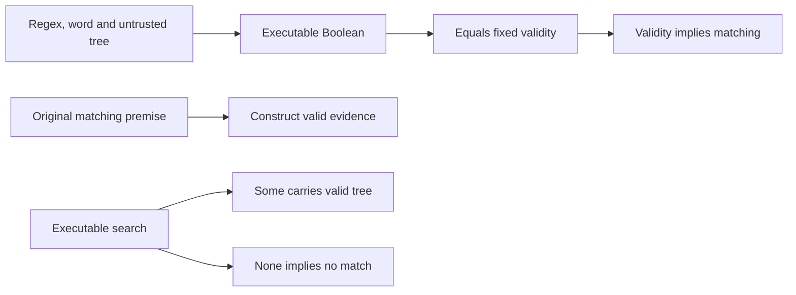
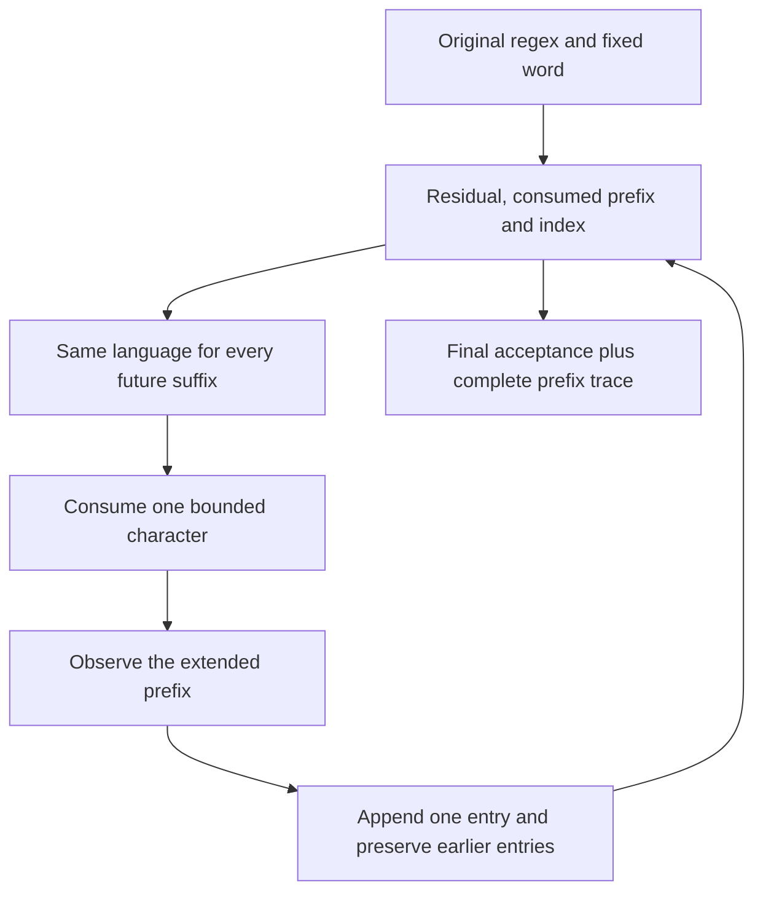
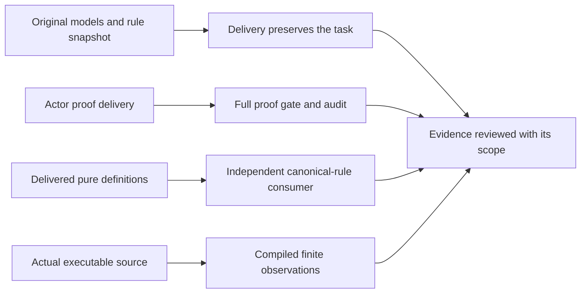

# R11 — Theory

A checker can accept a derivation for the wrong reason. A theorem about that
checker can even verify while its rules omit an essential premise. This module
connects executable checking to fixed mathematical rules, proves those rules
sound and complete for matching, and asks what an independent audit contributes.
The central object is a derivation tree. It is ordinary data at runtime; its
meaning comes from the original rule relation rather than from its type alone.

Three ideas do all the work:

1. Checker agreement, soundness, witness completeness and complete rejection
   are separate promises with different premises and consumers.
2. A loop proof must preserve a relation to the original input while accounting
   for every recorded observation, progress step and machine bound.
3. A metatheorem, an independent implementation and a fixed-rule audit provide
   different evidence. Each claim must remain attached to its actual scope.

## 0. How this module works

Allow540minutes: setup8, test-out10, reading70, worked examples30, cards8,
predictions15, hand core125, wp lab35, certifier project50, checkpoint22,
agent audit25, paper40, bench20, viva30, calibration7 and Vec arena45. These
are estimates, not observed learner timings. Keep first attempts, interruptions
and failed approaches. Live contractor and grading sessions remain recorded
D45 debt; a scripted author control cannot supply a missing live outcome.

This module imports frozen A1–A4 definitions and provided facts. It does not
import earlier learner solutions. A4 supplies certificate constructors and a
ghost validity model, with splits relative to the current word. It does not
supply the executable checker, general certificate soundness, direct witness
construction or complete search that you implement here. A2 already supplies
a whole-word derivative matcher. The new streaming task returns every nonempty
prefix result as well as final acceptance, so copying that given loop alone
cannot satisfy its output contract.

**This module's files** define the work and the checks used to review it.

| artifact | purpose |
|---|---|
| `dafny/given/R/RG_A4_Norm.dfy`, `verus/given/rg_re_a4/` | frozen certificate definitions and relative-word validity |
| `dafny/R/R11_Theory/std/R11_Theory.dfy` | 8 holes, 0 errors; T1 and seven hand/project tasks |
| `verus/r/r11_theory/src/lib.rs` | 10 holes, 0 errors; T1 and nine hand/project tasks |
| `dafny/checks/R11_checks.dfy` | 0 holes; given-only relative split value check |
| `specimens/R11/`, `slots/R11.slots` | five predictions, tracked WRITE card and guarded comparisons |
| `dafny/R/R11_Theory/exit/R11_Checkpoint.dfy`, `verus/r/r11_theory/src/exit.rs` | 2 holes each, 0 errors; independent closed-book checkpoint |
| `dafny/R/R11_Theory/agent/R11_AgentMetatheory.dfy`, `verus/r/r11_theory/src/agent.rs` | 1 hole each, 0 errors; fixed-rule replacement metatheory |
| `tools/R11/check_rule_binding.py`, `tools/R11/check_runtime.py` | independent rule comparison and actual-source compiled observations |
| `paper/R11_problems.tex`, `paper/R11_answers.tex` | card12.10 and a rule/loop argument |
| `bench/local/r/` | your tenth course-derived benchmark card |
| `Solutions/` | protected reference twins; open LAST after attempts and receipts |

Commit all five predictions before continuing. P1d expects a numeral, P2v a
Boolean literal and P4v the failing labelled obligations. P3dv and P5dv use
ordered verdicts in the slot file; enable each CHECK switch only after recording
its answer. Keep the original first try when a later observation changes your
mind. A correct revision is useful learning, but it does not replace a prediction
made before the verifier ran.

> **Predict (P1) — commit in the file before reading on.** The given-only Dafny check observes a split in a nested certificate at a nonzero starting position. Which numeral is the absolute middle position? Identify which certificate node owns the split before combining it with the supplied start.

> **Predict (P2) — commit in the file before reading on.** The Verus value specimen evaluates a ghost model of the root split bound and progress requirement. Which Boolean belongs in the slot? This predicate checks only that local condition; it does not claim full validity for a pattern and word.

> **Predict (P3) — commit in the file before reading on.** The two guarded probes compare a changed Star rule that checks only its first chunk with the canonical rule on the same concrete tree and word. Commit `D:<x>,<y> V:<x>,<y>` for changed then canonical claims. Keep the original subject fixed.

> **Predict (P4) — commit in the file before reading on.** A bounded index step has three labelled assertions. Select the obligations that fail for the original arbitrary inputs. Consider the last legal index as well as an interior position, and distinguish a post-step bound from a strict bound.

> **Predict (P5) — commit in the file before reading on.** Two complete producers return no certificate. One promises only validity when a result is present; the other also promises that absence means no match. Commit `D:<x>,<y> V:<x>,<y>` under the printed original domains.

The learner loop may verify a file containing typed holes. The full gate counts
those holes and refuses completion. That course mechanism is stated here rather
than hidden as a prediction. Read both the native stage and the hole count when
interpreting a result. Parse or resolution failure cannot stand in for a failed
proof, and a successful process exit from a probe driver need not describe its
native verifier verdict.

---

## 1. Four promises around a certificate

Start with three mathematical objects: a regex, a finite word and a derivation
tree. The original validity relation describes whether that tree justifies that
word for that regex. Its constructors mirror matching rules, but the tree remains
untrusted input until the relation is established. A character-shaped tree does
not contain the character itself; its validity depends on the regex and word
being checked. The same tree can therefore be valid for one subject and invalid
for another.

Checker agreement says the executable Boolean equals this fixed validity
relation. It constrains acceptance and rejection of every supplied tree. It does
not yet connect validity to the language semantics. A checker could agree exactly
with a bad rule relation. Keeping the model frozen lets us ask the next question
without silently changing the first one: does validity imply that the regex
matches the word?

That second property is soundness. Its premise is an original-rule derivation,
and its conclusion is matching. A checker and a soundness theorem together
justify positive acceptance, provided the executable checker is actually the
one whose agreement was proved. This chain does not establish that a producer
will find a certificate for every matching word. An implementation that never
produces anything would still avoid producing an invalid witness.

Direct completeness goes in the other direction. Starting from matching, it
constructs a derivation that satisfies the original validity relation. The
Verus version states the representability bound on word length, because split
positions are machine-sized in the runtime certificate. Do not strengthen
soundness to that bounded domain merely for symmetry: its premise already fixes
an existing derivation, and its statement has its own actual requirements.

Complete search adds an executable service. A present result must be valid;
an absent result must mean the original regex does not match. The second clause
rules out always-absent implementations on matching inputs. It matters even if
another function already proves direct mathematical completeness: an existence
theorem does not automatically implement the producer that a runtime caller uses.

The evidence paths can be drawn without merging their claims.



Follow a single arrow when explaining a result. If a claim needs two arrows,
name both theorems and the actual implementation boundary between them. This
habit prevents a large green verification count from obscuring a missing premise
or a producer contract that promises too little for its caller.

---

## 2. Relative splits and complete worked boundaries

A concatenation certificate contains a split measured from the start of its own
word. A nested child owns a smaller word, so its split remains relative to that
child. In Verus the executable checker receives a vector plus lower and upper
indices. It must first establish a valid slice domain, then compare the relative
split against the slice length, and only then add the lower index to obtain an
absolute middle position. Bounds checked in the wrong order can make an otherwise
reasonable mathematical argument fail machine arithmetic obligations.

W1v supplies the slice identity connecting a word-relative take/skip to two
absolute subranges. Read its preconditions as part of the worked example. The
identity is useful only after the checker establishes the bounds that make those
subranges meaningful. It does not validate a derivation or select a split for a
search. W1d's relative observation and the given certificate constructors provide
the corresponding mathematical picture without machine offset arithmetic.

A split within bounds is necessary but insufficient. Each child must validate
its corresponding word, with the matching child regex. For a Star step, progress
must also be positive and the remaining certificate must validate the suffix.
A valid first chunk does not justify arbitrary remaining characters. This is the
specific boundary explored by the changed-rule prediction and later agent audit.

W2d packages already-valid input into erased evidence fields. Notice the direction
of its requirement: the caller supplies validity. Packaging does not create a
new soundness result. The evidence record is useful for carrying related proof
facts together, but the mere existence of a record with those field types does
not establish any relationship among its values.

W2v defines a tracked evidence record. Its ghost fields refer to a tree, pattern
and word. H2v explicitly requires original validity before consuming it. That
premise remains visible even though the input is tracked. H3v writes a valid
record into a tracked mutable output slot under a matching premise. Both tasks
exercise proof-mode ownership, while the runtime checker continues to read an
ordinary derivation tree.

The output slot also keeps the canonical empty-body experiment well typed. A
proof function that returns a complex tracked object can verify when complete,
yet an empty body may fail typechecking because it returns nothing. Such a result
would not admit a proof exercise. This interface uses a void proof function with
a tracked mutable output, so unfinished variants reach verification without an
exception to the gate or a changed theorem domain.

W3 supplies a residual-language step. It unfolds a fixed opaque predicate and
uses provided derivative correctness to connect the next residual to the original
regex. The helper isolates a quantified reasoning obligation at the pinned solver
budget. Read it as a precise reusable fact, then identify the remaining loop state
that the streaming implementation must preserve. It does not supply the complete
loop invariant or the trace construction.

---

## 3. Modes, erasure and the tracked WRITE card

The runtime certificate and the proof evidence serve different consumers. The
compiled checker pattern-matches on an ordinary derivation and examines real
split positions. A ghost record or tracked proof value disappears from executable
computation. It can justify the program's proof obligations, but it cannot supply
an executable branch decision. Use the actual checker when a running program
needs to decide whether an untrusted certificate is valid.

Dafny ghost fields and lemmas let mathematical evidence travel through a proof
without becoming runtime storage. Verus separates spec expressions, proof code
and executable code, and tracked values additionally enforce movement rules in
proof mode. A tracked record with public fields is not automatically a runtime
capability. Read its construction sites and explicit premises before claiming
that possession establishes a semantic property.

The tracked card asks you to hand off a proof value while preserving its payload.
Its faulty version attempts to reuse an already-moved value. Repair the movement
under the original statement, without adding a second fabricated record or
weakening the payload relationship. Then compare the actual mode diagnostic with
a postcondition failure: these occur at different native stages and need different
repairs.

There is one new WRITE construct in Verus, `tracked`, with actual uses in both
H2v and H3v. Dafny introduces no new WRITE construct here. Its ghost evidence
builds on earlier mode knowledge. Do not manufacture extra syntax exercises to
make the two languages look symmetric; explain what each native mechanism proves
and which proof facts remain explicit.

This distinction becomes especially important when reviewing the arena. Rust
borrowing governs executable access to its vector. The stated mathematical
invariants constrain indices and changes to stored nodes. Neither fact means the
course has completed the separate PointsTo permission arena. That lane remains
recorded and skipped because its exec functions lack the required admission
results under the current canonical gate.

---

## 4. The wp lab and streaming-prefix ledger

Spend35minutes deriving verification conditions before filling the streaming
body. Begin with T1d/T1v: advancing a bounded index must establish the exact next
value and its upper bound. In Verus the arithmetic must also remain representable.
The original premise allows the last legal input position, so a proposed repair
that excludes it changes the task. Write the mathematical implication connecting
the premise to the post-step bound before looking for a solver hint.

For the matcher loop, distinguish the original regex from the changing residual.
The original word also remains fixed while a prefix grows. A useful residual
relation quantifies over every possible future suffix: matching that suffix with
the current residual is equivalent to matching the consumed prefix followed by
that suffix with the original regex. The supplied opaque predicate states this
relation once, and the worked helpers establish its start, step and observation
facts.

The output ledger adds obligations beyond ordinary whole-word matching. Its length
must agree with the number of characters already consumed. Every recorded position
must describe the corresponding original prefix. Appending one new observation
requires preserving all earlier entries as well as establishing the new one. An
invariant about only the latest residual cannot by itself describe the entire
returned vector or sequence.

Observe the order of an iteration carefully. An observation of the old residual
concerns the old prefix. An observation after consuming the next character concerns
the extended prefix. Align the appended entry with the state it actually describes.
A proof can establish a plausible relationship at each line and still be off by
one in the final trace contract if these two moments are confused.

Empty input is a useful independent case. There are no nonempty prefixes, so the
trace is empty. Final acceptance still depends on whether the original regex
matches the empty word. An implementation that treats an empty trace as rejection
changes the final Boolean contract. Keep the two outputs distinct in witnesses
and in the written loop argument.

The loop state and obligations fit a compact picture.



Use the picture to locate a missing obligation, not as a substitute for an
invariant. For each edge, write the actual premise and resulting fact. The
termination measure concerns remaining input; the ledger preservation concerns
all previously produced output. Those are separate proof responsibilities.

Opaque helpers control when quantified definitions are unfolded. They do not
weaken the relation, add a trusted axiom or raise the resource pins. If a local
proof hits a resource limit, retain that result as inconclusive and inspect the
proof structure. A timeout is not a counterexample to the desired theorem and
cannot justify a weaker replacement statement.

---

## 5. Complete search and the Vec fallback

H5–H7 form a separate50-minute certifying-matcher project after the hand core.
The search must implement both success validity and complete rejection. Its
constructor branches share an original-domain contract, so a convenient failure
branch cannot silently discard a matching input. Plan witnesses that distinguish
an absent certificate from a valid rejection before writing recursive code.

Concatenation search considers possible split positions, including endpoints.
The loop or helper must account for all candidates that have already been missed.
When no position remains, those recorded failures support the original language's
rejection. Merely tracking a bounded index does not establish that the search has
considered every semantic possibility; it establishes progress through positions.
The missed-candidate relationship connects that progress to completeness.

For a nonempty Star word, recursive chunks must consume positive input. A zero
split can leave the recursive word unchanged, breaking progress even when the
child regex accepts the empty word. Separate the empty-word Star case from the
positive-chunk search. Explain which structural or word-length component decreases
on every recursive edge, including calls through Cat and Star helpers.

Verus uses a common mathematical node-count rank, word length and a finite phase
rank across the mutually recursive functions. The rank must describe the same
mathematical regex whether a helper receives a borrowed child or a newly described
parent. A termination argument that relies on incompatible owned and borrowed
structural comparisons can fail even when the intended recursive descent is clear.
The shipped statement retains its original semantic domain while using uniform
ranks to express that descent.

Check arithmetic before adding offsets or incrementing a machine index. A loop
that checks its last candidate before incrementing can avoid a maximum-index
overflow while still covering the endpoint. Do not exclude representable boundary
inputs to make the arithmetic easier. State how the branch order follows from
the public domain and how it preserves complete search.

The45-minute Verus arena fallback is a distinct pair of tasks. It stores fresh
nodes with character labels and optional index edges. Append initializes absent
edges, keeps every old node unchanged and returns the old length as the fresh
index. Link changes one first edge while preserving the node's label, its second
edge, other nodes and total length. Both operations preserve valid target indices.

These frame clauses matter as much as the updated edge. A body that changes the
requested edge but also damages an unrelated node is not a correct implementation.
For each clause, identify which old state it refers to and which part of the
final state may differ. A vector length invariant alone cannot establish these
exact update guarantees.

The original PointsTo arena is parked, with its missing gate results recorded.
This Vec design is the specified fallback after its own complete admission. It
proves the printed vector/index and frame properties. Keep the skipped permission
coverage visible when reporting progress; a successful fallback is useful work
without becoming evidence for a different ownership model.

---

## 6. On paper, before the keyboard

Open the R11 written pair and spend40minutes on B1/B2. Card12.10 uses the exact
local Lean4Lean excerpt with a recorded line range and hash. Fill all eight
fields, keeping the reported replay experiment separate from formal metatheory.
When the source does not provide a replication commit, repeated-run distribution
or common agent budget, write that the information is unavailable. A plausible
extra detail is not source fidelity.

Lean4Lean supplies a complete independent implementation of a kernel, while its
formal correctness work is partial. Those statements can both be true. The
excerpt describes proved weakening, substitution and regularity alongside open
unique typing, inversion and strengthening. It also names shared representation
and compiler dependencies, missing metatheory and an unsound axiom. Preserve those
qualifications when explaining what independent replay contributes.

Its timing table compares package replay on one single-threaded hardware setup.
State the original numerator, denominator and workload for each ratio. A slower
independent replay can still provide valuable checking diversity. A ratio is not
an agent success probability, and three packages are not a repeated-run variance
estimate for a single workload. Fuel is a bound on nested execution in the stated
implementation, not a count of model samples or a proof that the type theory
terminates.

The reported overflow bug is a concrete example of metatheory work exposing an
implementation defect. Explain the path from a failed proof obligation to the
problematic implementation fact without claiming that one repair removes every
possible soundness bug. Also separate implementation correctness from statement
faithfulness: replaying the wrong theorem correctly does not establish the user's
intended requirement.

B2 asks you to reconstruct the four certificate promises, the bounded index wp,
the uniform residual relation and the output trace argument. Include the empty
word and a producer that always returns no certificate. Explain why a wrong rule
can admit a true replacement theorem. Your written argument should identify the
premise that each claimed conclusion uses, rather than treating verification as
an undifferentiated seal of correctness.

---

## 7. The exercise file

Implement T1 and H1–H7 in Dafny, T1 and H1–H9 in Verus. H1–H4 are the paired
hand core; H5–H7 are the complete-search project; H8/H9 are the Vec fallback.
Preserve all original definitions, statements and representability domains. The
source marks actual proof/exec holes and the paired items; keep explanatory
receipts adjacent to the closing proof steps they describe.

H2d deliberately disables automatic induction. Its empty body can verify with
that lever removed; under the shipped setting the proof task is admitted. Treat
this as an exercise in making the induction argument explicit. It does not show
that the verifier is incapable of proving the theorem automatically. The same
printed lever distinction applies to the independent character-measure checkpoint.

After your original attempts, run the prediction gate, zero-hole implementation
gates, audits and statement snapshot check. The runtime tool first verifies the
actual implementations, then compiles them against finite independent expectations.
The rule-binding tool checks the agent's pure definitions independently of its
transport theorem. Run native commands in lanes capped at16GiB with no swap,
GATE_WORKERS=1 and at most3Verus jobs; keep aggregate solver lanes within48GiB.

```sh
scripts/firsttry.sh R11 --check
scripts/vcheck --gate dafny/R/R11_Theory/std
scripts/vcheck --gate verus/r/r11_theory
scripts/vaudit dafny/R/R11_Theory/std
scripts/vaudit verus/r/r11_theory
scripts/specfreeze --check R11
python3 tools/R11/check_runtime.py
python3 tools/R11/check_rule_binding.py
scripts/firsttry.sh R11 --report --strict
```

Done means T1 and seven H solutions in Dafny, T1 and nine H solutions in Verus,
complete zero-hole gates, audits, original model snapshots and the required
checkpoint, agent, paper, bench and viva work. A strict receipt report checks
course records; it does not infer a missing human artifact or live session.
Keep the original failed attempts when revising a body or proof strategy.

---

## 8. Checkpoint with the book closed

Complete the four exit items independently after the hand and project work.
Allow22minutes, close the chapter and references, and do not call hand-solution
helpers from the checkpoint. Its tasks use a fresh consumed-character measure
and a repeated-character certificate loop under the fixed relative rules. These
are distinct proof and construction goals rather than renamed copies of general
soundness or complete search.

Record the original attempt and run `scripts/firsttry.sh R11 --exit`. The threshold
is≥3/4 with≥1in each language. Read the complete native scope and unfinished-hole
count for each attempt. Passing two items in one language cannot meet the threshold
alone. A proof that changes the original rule relation or requires an impossible
input domain cannot count as a solution.

Separate study recovery from the closed-book record. If a failed attempt reveals
an unclear rule or invariant, retain it, review that exact concept and later use
the appropriate independent reassessment process. Opening a reference and then
rewriting the original attempt does not produce a new closed-book first try.
The course's local author controls demonstrate feasibility; they do not fabricate
your checkpoint transcript.

---

## 9. Exercise (agentic): preserve the rule relation

> **CONTRACT (for /contract R11 — run it in a FRESH session):** Prove forward character replacement under the original models and rules. Edit only permitted proof bodies and helpers, preserve the original source snapshots and return complete gates, audits and independent rule-binding evidence. No rule or domain change is authorized.

The agent task replaces one character consistently in a regex and word while
preserving the same certificate tree. Replacement is forward only. Two different
characters can become equal, so reflection of matching or preservation of normal
form needs additional hypotheses. Read the actual theorem before proposing an
inverse or a stronger representation claim.

Before any actor edit, copy both original agent sources into your own fixed
snapshot directory under `research/R11/`. Keep the copies unchanged. They bind
replacement definitions, the rule alias, theorem domains and the permitted
consumer relationship. A later body-only implementation may supply proof details,
but it may not replace the rule relation with one that happens to be easier to
transport.

The private author controls show why this separation matters. A deliberately
weakened Star rule omits suffix validity. Consistent replacement can preserve that
wrong rule too, so the transport theorem can verify with no holes. Independent
model equality to canonical A4 rejects the altered relation. This is a control
on a specific failure mode, not a claim that a live contractor made the mistake.

The public rule-binding tool extracts pure definitions with the course's native
parsers. It checks the actual rule alias against fixed canonical types and model
paths over arbitrary subjects. No transport theorem or implementation body enters
that consumer. A failure means rule equality was not proved; inspect its native
stage before treating the result as a semantic counterexample.

After delivery, compare each immutable original snapshot against the corresponding
learner source with `scripts/specfreeze --against ORIGINAL DELIVERY`. Then run
full zero-hole gates, audits and the independent rule check. Recheck compiled
behavior where the actual delivered executable source changed. Snapshot fidelity,
proof correctness, rule equality and runtime behavior answer different questions.

The review keeps those questions visibly separate.



No individual path supplies the others automatically. Keep actual actor identity,
source revision, command results and missing evidence in the review record. If
live sessions are unavailable under the recorded deferral, retain that status.
A reference proof and a scripted wrong-rule control are local author evidence,
not substitutes for an observed contractor outcome.

---

## 10. Finite observations and reproducible review

The runtime corpus contains120syntax patterns and11words per pattern. An
independent finite interpreter computes expected acceptance. The actual compiled
search must agree on presence or absence, its returned tree must pass the actual
checker, and the streaming result must match final acceptance and every nonempty
prefix flag. These observations connect the executable source being tested to
concrete expectations that do not assume its proof theorem.

The explicit certificate cases also exercise malformed inputs. They cover the
constructors, wrong child shapes, invalid suffixes, zero progress and oversized
splits. Verus runs searches and checks through shifted vector slices, which helps
detect confusion between relative splits and absolute positions. Invalid slice
bounds are rejection cases for the checker rather than calls admitted by search's
bounded input contract.

The arena observations append several distinguishable labels, link different
nodes, replace an edge and append again. The expected unchanged nodes and fields
make the frame clauses observable. These cases complement the native universal
proof over the stated model. They do not explore every possible arena history,
provide a PointsTo implementation or establish a general performance bound.

For Dafny, the tool embeds the actual implementation into the verified root.
An include can make definitions available without verifying included method
bodies, so checking only an importing test file would miss a crucial control.
For both languages the tool gates first and stops on unfinished holes; compiled
success cannot conceal an unverified implementation behind a successful test
harness.

Retain exact source, tool and corpus hashes with the generated drivers, native
results and independent expected observations. A test result belongs to those
inputs. If a source change affects the implementation or the interpretation of
an output, recapture the affected evidence. Preserve earlier failures so another
reader can understand what changed and whether a reported repair addressed the
original claim.

The finite corpus can expose a defect with one counterexample. Passing all its
cases establishes agreement on that corpus, while universal proof remains a
separate statement with a defined trust boundary. Describe both forms of evidence
without promoting a finite result to a general theorem or a native result to a
judgment about human intent.

---

## 11. Bench card and viva

Build the tenth course-derived bench card from one of your own completed R11
goals. Keep the original statement and model, a complete version, a stripped
version, the source revision and the exact stripping method. Add witnesses,
negative controls, native pins, exposure history and the intended run budget.
Label the card course-derived and previously seen. A new filename cannot make
an exposed solution into an unseen evaluation.

Use the30-minute viva to reconstruct a checker boundary, derive a loop VC,
compare evidence modes and diagnose a wrong-rule theorem. Fresh live predictions
must be committed before the native referee runs. The instructor uses two disjoint
six-question draws; reassessment uses the other draw under the same original
concepts. Do not replace a difficult question with a weaker theorem after seeing
an inconvenient native outcome.

The design-judgment review asks whether the formal interface supports the actual
consumer. Identify the consumer's input domain and needed conclusion, then locate
the premises that justify it. If a proposed assurance needs a missing fact, name
that fact as an open obligation. The answer should explain where evidence enters
the argument rather than merely listing successful commands.

A useful review record starts with the original subject, source revision and
question. It then names the relevant rule, contract clause or invariant, the
native stage, the hole count and the supporting artifact. End with the practical
limit of that evidence. This format lets a reviewer reproduce a disputed result
without reconstructing an entire authoring session.

Calibration uses explicit gold and flawed written fixtures. Their expected scores
exercise rubric anchors; they are not measured live grades. The flawed fixture
contains claims about complete kernels, always-absent producers, runtime tracked
rights and changed snapshots that should be challenged with the appropriate
source or native probe. A legal explanation need not reveal a withheld proof
body to identify the missing premise.

---

## Captured native examples

The following captures use the stated source and provided-layer context. The
hand and agent captures describe the shipped learner loop, including typed
holes; they are not completed exercise gates. The scenario captures follow their
prediction boxes and retain native proof outcomes. Dafny scenario specimens use
real-extension scratch copies with explicit R11 context, so missing imports cannot
masquerade as the intended proof result.

<!-- pin: shipped-d -->
```
$ scripts/vcheck dafny/R/R11_Theory/std
vcheck: dafny/R/R11_Theory/std [dafny, learner loop]: verified — 77 verified, 8 holes, 0 errors
dafny/R/R11_Theory/std/R11_Theory.dfy:29:5: hole assume R11.H2d
dafny/R/R11_Theory/std/R11_Theory.dfy:36:5: hole assume R11.H3d
dafny/R/R11_Theory/std/R11_Theory.dfy:42:3: hole assume R11.H1d
dafny/R/R11_Theory/std/R11_Theory.dfy:81:4: hole assume R11.H4d
dafny/R/R11_Theory/std/R11_Theory.dfy:94:4: hole assume R11.H5d
dafny/R/R11_Theory/std/R11_Theory.dfy:103:4: hole assume R11.H6d
dafny/R/R11_Theory/std/R11_Theory.dfy:112:4: hole assume R11.H7d
dafny/R/R11_Theory/std/R11_Theory.dfy:121:4: hole assume R11.T1d
```

<!-- pin: shipped-v -->
```
$ scripts/vcheck verus/r/r11_theory
vcheck: verus/r/r11_theory [verus, learner loop]: verified — - verified, 10 holes, 0 errors
verus/r/r11_theory/src/lib.rs:23:39: hole assume R11.H2v
verus/r/r11_theory/src/lib.rs:30:38: hole assume R11.H3v
verus/r/r11_theory/src/lib.rs:43:1: hole external_body R11.H1v
verus/r/r11_theory/src/lib.rs:53:1: hole external_body R11.H5v
verus/r/r11_theory/src/lib.rs:62:1: hole external_body R11.H6v
verus/r/r11_theory/src/lib.rs:71:1: hole external_body R11.H7v
verus/r/r11_theory/src/lib.rs:119:1: hole external_body R11.H4v
verus/r/r11_theory/src/lib.rs:142:1: hole external_body R11.H8v
verus/r/r11_theory/src/lib.rs:153:1: hole external_body R11.H9v
verus/r/r11_theory/src/lib.rs:166:1: hole external_body R11.T1v
```

<!-- pin: agent-d -->
```
$ scripts/vcheck dafny/R/R11_Theory/agent/R11_AgentMetatheory.dfy
vcheck: dafny/R/R11_Theory/agent/R11_AgentMetatheory.dfy [dafny, learner loop]: verified — 66 verified, 1 hole, 0 errors
dafny/R/R11_Theory/agent/R11_AgentMetatheory.dfy:40:4: hole assume R11.A1d
```

<!-- pin: agent-v -->
```
$ scripts/vcheck verus/r/r11_theory/src/agent.rs
vcheck: verus/r/r11_theory/src/agent.rs [verus, learner loop]: verified — - verified, 1 hole, 0 errors
verus/r/r11_theory/src/agent.rs:39:38: hole assume R11.A1v
```

<!-- pin: card-c1v -->
```
$ scripts/vcheck specimens/R11/card-c1v.rs.specimen
vcheck: specimens/R11/card-c1v.rs.specimen [verus, learner loop]: failed — 0 verified, 0 holes, 1 error, stage resolve
specimens/R11/card-c1v.rs.specimen:10:21: error: use of moved value: `input`
```

<!-- pin: checks-d -->
```
$ scripts/vcheck dafny/checks/R11_checks.dfy
vcheck: dafny/checks/R11_checks.dfy [dafny, learner loop]: verified — 64 verified, 0 holes, 0 errors
```

<!-- pin: changed-rule-d -->
```
$ scripts/vcheck --module R11 changed-rule-d.dfy
vcheck: changed-rule-d.dfy [dafny, learner loop]: verified — 64 verified, 0 holes, 0 errors
```

<!-- pin: changed-rule-v -->
```
$ scripts/vcheck specimens/R11/changed-rule-v.rs.specimen
vcheck: specimens/R11/changed-rule-v.rs.specimen [verus, learner loop]: verified — 1 verified, 0 holes, 0 errors
```

<!-- pin: original-rule-d -->
```
$ scripts/vcheck --module R11 original-rule-d.dfy
vcheck: original-rule-d.dfy [dafny, learner loop]: failed — 63 verified, 0 holes, 1 error
original-rule-d.dfy:11:20: error: assertion might not hold
dafny/given/R/RG_A4_Norm.dfy:125:75: related: this proposition could not be proved
```

<!-- pin: original-rule-v -->
```
$ scripts/vcheck specimens/R11/original-rule-v.rs.specimen
vcheck: specimens/R11/original-rule-v.rs.specimen [verus, learner loop]: failed — 0 verified, 0 holes, 1 error
specimens/R11/original-rule-v.rs.specimen:18:9: error: assertion failed
```

<!-- pin: weak-producer-d -->
```
$ scripts/vcheck --module R11 weak-producer-d.dfy
vcheck: weak-producer-d.dfy [dafny, learner loop]: verified — 64 verified, 0 holes, 0 errors
```

<!-- pin: weak-producer-v -->
```
$ scripts/vcheck specimens/R11/weak-producer-v.rs.specimen
vcheck: specimens/R11/weak-producer-v.rs.specimen [verus, learner loop]: verified — 1 verified, 0 holes, 0 errors
```

<!-- pin: complete-producer-d -->
```
$ scripts/vcheck --module R11 complete-producer-d.dfy
vcheck: complete-producer-d.dfy [dafny, learner loop]: failed — 63 verified, 0 holes, 1 error
complete-producer-d.dfy:9:2: error: a postcondition could not be proved on this return path
complete-producer-d.dfy:8:34: related: this is the postcondition that could not be proved
```

<!-- pin: complete-producer-v -->
```
$ scripts/vcheck specimens/R11/complete-producer-v.rs.specimen
vcheck: specimens/R11/complete-producer-v.rs.specimen [verus, learner loop]: failed — 0 verified, 0 holes, 1 error
specimens/R11/complete-producer-v.rs.specimen:7:10: error: postcondition not satisfied
```

---

## Instructor touchpoints

Use `/tutor R11` for a legal next step, `/discuss R11` for a rule or invariant,
`/review R11` for a disputed concept, `/viva R11` for the committed draw,
`/grade-paper R11` for the written pair and `/review-code R11` for actual native
evidence and original snapshots. `/contract R11` needs a fresh available actor
session under the fixed rule boundary. Solutions are reference-class and yours
to open LAST, after original attempts and receipts.

### What the instruments can and cannot see

The gate checks formal obligations and unfinished holes. The audit examines trust
escapes, and snapshots bind original statements and referenced definitions. The
rule consumer checks a specific equality to canonical A4 without assuming the
transport proof. Compiled observations compare concrete behavior on a fixed finite
corpus. Each instrument supplies evidence for its stated question; none decides
whether a formal relation expresses a person's intended requirement.

When results disagree, retain both artifacts and identify their earliest differing
assumption or stage. An unresolved import, changed model, smaller input domain,
failed implementation or incomplete finite corpus requires a different repair.
Ask the instructor to inspect that exact boundary before resampling a contractor.
Do not erase failed observations, rewrite the original snapshot or report deferred
live work as measured success.

---

## What R11 planted

You can now separate the meaning of a certificate from its representation, connect
an executable checker to fixed rules, and distinguish positive evidence from
complete rejection. You can carry erased proof evidence without treating it as
runtime computation or a permission that its actual interface does not provide.
You can also preserve a uniform loop relation while accounting for every recorded
prefix and bounded progress step.

The later driving and trust modules will build on these distinctions. Bring the
original domain, exact rule relation, actual implementation and retained evidence
to each evaluation. An independent kernel, a partial metatheory and a faithful
statement remain separate claims even when all their local checks are green.

| seed | harvest |
|---|---|
| Fixed rules versus a true theorem about changed rules | model fidelity and reward-oracle audits |
| Positive certificate validity versus complete rejection | search evaluation and failure interpretation |
| Uniform residual relation plus output ledger | iterative verifier driving and stateful evidence |
| Erased tracked evidence versus runtime data and permissions | later trust reports and resource claims |
| Exact source-bound independent observations | reproducible evaluations with honest limits |
