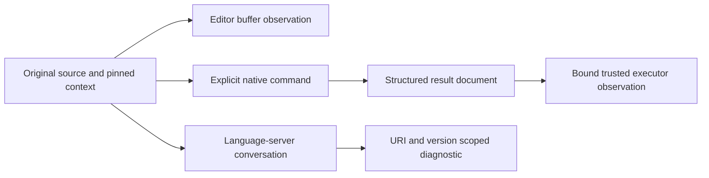
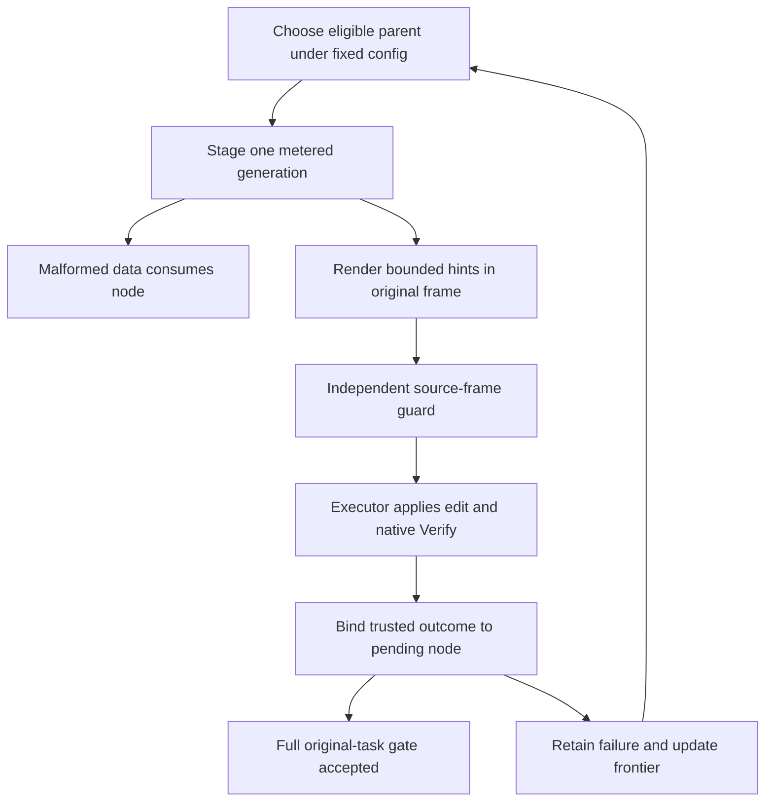
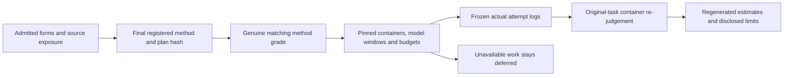

# R12 — Driving the verifier + Lab α

A verifier-driving program has two jobs: preserve what the verifier actually
reported, and decide what to do next without changing what counts as success.
These jobs meet at a small interface. A model proposes annotation data; a trusted
executor applies a bounded edit and obtains a native result. The search engine
can use failures to choose another candidate, but it cannot turn its own score
into evidence that the original program has been proved.

Three ideas do all the work:

1. Preserve language, file, stage, scope and unavailable values when turning a
   native observation into data. Localizing an error does not adjudicate it.
2. Keep proposals, generated-node accounting and trusted observations separate.
   One parametric engine supplies the search regimes without changing the gate.
3. Compare fixed search trajectories at matched budgets, with original source
   bindings, pre-registered estimators and explicit costs and exposure limits.

## 0. How this module works

Allow 786 minutes: practice 396 and Lab α 390. Practice estimates are setup 10,
test-out 10, reading 65, worked examples 30, cards 6, predictions 20, hand hints 40,
doors/trace 25, extractor 80, bounded loop 20, profiler 25, paper 30, viva 30 and
calibration 5. Lab estimates are environment 60, engine 90, pre-registration 40,
grading 10, setup 25, analysis 75, transcript audit 20, post-review 10, report 50
and calibration 10. These are planned learner times, not measured sessions.
Live model arms, live grading and unavailable container work remain recorded
D45 deferrals. Building or replay-testing their software does not fill those rows.

R is standalone. The native practice here uses provided standard definitions;
it does not import an earlier learner solution. The Python exercises compose
frozen `fvh` protocol, executor, result and accounting interfaces through the R
package. You may read a captured language-server conversation, but you do not
write a language-server client. A server diagnostic is an editor observation;
it does not replace the full course gate or its unfinished-hole accounting.

**This module's files** identify the work and its original boundaries.

| artifact | purpose |
|---|---|
| `dafny/given/R/`, `verus/given/` | frozen provided layers; no earlier learner solution is imported |
| `dafny/R/R12_Driving/std/R12_Driving.dfy` | 3 holes, 0 errors; the test-out and two hint-site lemmas over A1 and A3 |
| `verus/r/r12_driving/src/lib.rs` | 3 holes, 0 errors; the same three hint-site lemmas in Verus |
| `dafny/checks/R12_checks.dfy` | 0 holes; given-only source-span observation |
| `harness/r/fvh_r/engine.py` | 5 holes, 0 errors; extractor, localization, bounded loop, engine and renderer |
| `tools/R12/profiler.py` | 1 hole, 0 errors; toolwright body inside the provided CLI and models |
| `tools/R12/test_profiler.py` | frozen behavioral and original-frame acceptance tests |
| `tools/R12/admit_forms.py` | the static and native checks of hint-site forms (Lab α's tasks and the shipped native forms) |
| `specimens/R12/`, `slots/R12.slots` | five predictions, guarded comparisons and the own captured LSP trace |
| `paper/R12_problems.tex`, `paper/R12_answers.tex` | two cards, registration and later report |
| `Solutions/` | protected reference twins; open LAST after attempts and receipts |

All five Python holes share `engine.py` because the frozen reference adapter
replaces one file at a time. The other modules provide stable public imports;
their small type/shape tests are not independent solutions to the five holes.
Read the contracts at the actual learner functions before designing a helper.
The test-out is a one-site witness lemma in each native language.
Keep the original attempt and let its receipt record what happened.

Commit all five predictions before continuing. P1d is a numeral, P2v a Boolean
literal, P4v the failing labels, and P3dv/P5dv ordered language-paired verdicts.
Enable their CHECK switches only after committing their answers. A later correct
revision does not replace the original prediction. Do not infer a native result
from a helper process exit code: inspect its Result's verdict and stage.

> **Predict (P1) — commit in the file before reading on.** The given-only Dafny source-span check stores two inclusive line ranges. Which numeral is the first line of the second declaration? Distinguish the list index from the native source coordinate.

> **Predict (P2) — commit in the file before reading on.** A Verus ghost predicate requires the verification phase, a positive count and zero unfinished holes. The printed record has compilation phase, count7and no holes. Which Boolean belongs in its value slot? This is an illustrative field model, not an authenticated native document.

> **Predict (P3) — commit in the file before reading on.** The same source has one true and one false declaration. Compare the selected good declaration with a full-target check. Commit `D:<x>,<y> V:<x>,<y>` in that order, preserving both original declarations.

> **Predict (P4) — commit in the file before reading on.** A synthetic record has count0and holes0. Three labelled assertions inspect zero holes, zero count and positive count. Which original labelled obligations fail? Keep the distinction between a field value and a full acceptance rule.

> **Predict (P5) — commit in the file before reading on.** A synthetic verified record with positive count and no holes names revision17, while the original subject is revision23. Compare a fields-only consumer with a consumer also requiring the original revision. Commit the ordered verdicts for each language. Revision numbers illustrate identity; they are not cryptographic authentication.

The learner loop accepts typed unfinished holes as an editing mechanism. The
full gate refuses them. This is a stated course fact, not a hidden discovery in
this module. Likewise, automatic induction, resource variation and server hole
visibility are not new prediction surprises here. Keep native scope and course
completion separate in every interpretation below.

---

## 1. Four doors, one verification subject

An editor, a command line, structured JSON and a language server expose different
views of a verification attempt. They do not create four independent proof
oracles. An editor can show a useful location while a command checks the full
file; a selected-symbol command can deliberately ask a smaller question; JSON
can preserve stage and count fields that a short status line omits. Ask first
which source, configuration and declarations each door actually sent to the
pinned verifier.

The editor door is organized around a buffer. Its displayed source can differ
from committed bytes or from another terminal's working directory. A diagnostic
belongs to that buffer and its document version. Saving, changing a dependency
or moving to another worktree can change the verification subject without
changing the visible function name. Before carrying an observation into an
experiment, record the exact source material rather than treating the editor's
last green decoration as a portable certificate.

The CLI door makes target and options explicit. A fast command can select one
symbol so that an edit gets quick feedback. That can be useful during proof
construction, but its result says nothing about a separate failing declaration
that was not checked. The full gate deliberately removes that ambiguity. It
uses the original target and the pinned acceptance rules, including unfinished
holes and assumption findings. Keep fast feedback in the search loop while
requiring a full original-task gate for the final success claim.

The selected-versus-full comparison uses the exact same two declarations in
each language. The following captures name the command and preserve its native
outcome; a failed proof remains a failed proof even when another declaration
was selected successfully first.

<!-- pin: selection-d-fast -->
```
$ scripts/vcheck --module R12 --symbol R12_SelectionProbe.GoodR12 selection-d.dfy
vcheck: selection-d.dfy [dafny, fast channel R12_SelectionProbe.GoodR12]: verified — 1 verified, 0 holes, 0 errors
symbol R12_SelectionProbe.GoodR12: verified
```

<!-- pin: selection-d-full -->
```
$ scripts/vcheck --module R12 selection-d.dfy
vcheck: selection-d.dfy [dafny, learner loop]: failed — 63 verified, 0 holes, 1 error
selection-d.dfy:4:32: error: a postcondition could not be proved on this return path
selection-d.dfy:4:28: related: this is the postcondition that could not be proved
```

<!-- pin: selection-v-fast -->
```
$ scripts/vcheck --symbol good_r12 specimens/R12/selection-v.rs.specimen
vcheck: specimens/R12/selection-v.rs.specimen [verus, fast channel good_r12]: verified — 1 verified, 0 holes, 0 errors
symbol good_r12: verified
```

<!-- pin: selection-v-full -->
```
$ scripts/vcheck specimens/R12/selection-v.rs.specimen
vcheck: specimens/R12/selection-v.rs.specimen [verus, learner loop]: failed — 1 verified, 0 holes, 1 error
specimens/R12/selection-v.rs.specimen:5:28: error: postcondition not satisfied
```

A full-target failure does not contradict a selected true claim. Their scopes
differ. Conversely, a selected success does not license deleting the other
claim, changing a header or presenting the original file as complete. Write
both the selected symbol and the complete target in any profile or report that
uses fast measurements.

The JSON door is a structured observation channel. A normalized native result
contains language, target, exit code, verdict, stage, verified count, holes,
diagnostics, findings and per-symbol statuses. Optional resources may be absent
or unavailable. An unavailable count is not zero, and a Boolean is not a valid
integer measurement merely because Python considers it an `int` subclass.
Preserving those distinctions prevents a parser from quietly manufacturing
favorable evidence.

The doors meet in one provenance chain.



Follow the source binding through the diagram when two observations disagree.
A shared function name does not imply a shared input, context or scope. The
executor must know which candidate bytes its native result describes before
the search engine can treat that observation as belonging to a generated node.
The generated batch plan embeds each original task digest in its statement.
The provided policy checks that binding before proposing its baseline Verify;
a file changed after planning cannot become a new unregistered subject. The
frozen executor may still perform its own final check after refusing a policy,
but that check cannot turn the refused run into an accepted edited delivery.

---

## 2. Native hint sites over regex lemmas

The native exercises are the same kind of object Lab α's engine fills by search: a lemma whose statement and proof skeleton are frozen, with a few marked **sites** where the proof's missing pieces go. A site is either an `expr` site, written `assert /*R12_HINT:<name>*/ true;` in Dafny (`assert(/*R12_HINT:<name>*/ true);` in Verus), which you replace with one boolean expression over the identifiers its entry lists, or a `calls` site, `/*R12_CALLS:<name>*/`, which you replace with calls to the proof declarations it lists. The file's `R12_HINT_SITES` line is the list of sites, with each site's vocabulary. Nothing else in the file is yours to change: not the statement, not the skeleton's case split or its `var … :|` / `choose`, not the imports. The shipped forms pass `python3 tools/R12/admit_forms.py`'s static frame check (each site listed, each marker once, the vocabulary well-formed); for your filled file, `scripts/specfreeze --check R12` holds the statements, and the review compares the rest with the shipped skeleton line by line.

What the learner fills by hand here is exactly what an engine would have to propose: an expression or a call, read off the failing obligation. That is the point of doing it by hand first. A site's content is small, but it is not guessable from the statement alone; it is the witness, the branch or the induction argument that the verifier reports it cannot find. Here is the move on a lemma that is not an exercise: a non-empty word of `a` matches `Star(a)`, with one site for the split.

```dafny
// R12_HINT_SITES: [{"name":"d1","identifiers":["u"]}]
module R12_SiteDemo {
  import opened RG_A1_Re

  lemma OneChunkR12Demo(a: Re, u: seq<char>)
    requires Matches(a, u) && u != []
    ensures Matches(Star(a), u)
  {
    assert /*R12_HINT:d1*/ true;
  }
}
```

<!-- pin: site-blank-d -->
```
$ scripts/vcheck --module R12 probe.dfy
vcheck: probe.dfy [dafny, learner loop]: failed — 62 verified, 0 holes, 1 error
probe.dfy:8:3: error: a postcondition could not be proved on this return path
probe.dfy:7:20: related: this is the postcondition that could not be proved
dafny/given/R/RG_A1_Re.dfy:22:29: related: this proposition could not be proved
```

The failure is at the `Star` case's existential: the verifier needs a chunk length, and nothing in the proof names one. With the site filled, the split at `|u|` is two slice facts, and the lemma verifies:

```dafny
// R12_HINT_SITES: [{"name":"d1","identifiers":["u"]}]
module R12_SiteDemo {
  import opened RG_A1_Re

  lemma OneChunkR12Demo(a: Re, u: seq<char>)
    requires Matches(a, u) && u != []
    ensures Matches(Star(a), u)
  {
    assert /*R12_HINT:d1*/ u[..|u|] == u && u[|u|..] == [];
  }
}
```

<!-- pin: site-filled-d -->
```
$ scripts/vcheck --module R12 probe.dfy
vcheck: probe.dfy [dafny, learner loop]: verified — 63 verified, 0 holes, 0 errors
```

The three native items, in each language, are of this kind.

- **T1d/T1v** `CatWitnessR12` / `lemma_cat_witness_r12`: a word of `a` followed by a word of `b` matches `Cat(a, b)`. One `expr` site; the obligation names the failing existential, and the site names its witness.
- **H1d/H1v** `CopiesAppendR12` / `lemma_copies_append_r12`: `n` copies of `r` then `m` copies make `n + m` copies (A3's `Copies`). The skeleton is an induction on `n` that picks the split of the first word; one `calls` site is the induction call on the tail and one `expr` site regroups the pieces as `u + v`. The two sites depend on each other: a call on the wrong word leaves the regrouped equation about a fact the solver does not have, and verifies nothing.
- **H2d/H2v** `UpToMonoR12` / `lemma_up_to_mono_r12`: a word of at most `j` copies is a word of at most `k >= j` copies (A3's `CopiesUpTo`). The empty word is the `Eps` branch's at every bound, which the skeleton handles; for a non-empty word, an `expr` site says which branch of the `Alt` holds and a `calls` site lifts the tail from `j - 1` to `k - 1`. The branch must be read from the obligation: it is the disjunct the verifier reports it cannot establish.

Each item ships with a counted hole, `assume false;` in Dafny and a `proof_note` assumption in Verus, at the top of its body; delete it when you fill the sites. The shipped files verify in the learner loop while they keep their three counted holes in each language. These captures show the editing state, not completed exercises.

<!-- pin: shipped-d -->
```
$ scripts/vcheck dafny/R/R12_Driving/std
vcheck: dafny/R/R12_Driving/std [dafny, learner loop]: verified — 66 verified, 3 holes, 0 errors
dafny/R/R12_Driving/std/R12_Driving.dfy:47:5: hole assume R12.T1d
dafny/R/R12_Driving/std/R12_Driving.dfy:63:5: hole assume R12.H1d
dafny/R/R12_Driving/std/R12_Driving.dfy:86:5: hole assume R12.H2d
```

<!-- pin: shipped-v -->
```
$ scripts/vcheck verus/r/r12_driving
vcheck: verus/r/r12_driving [verus, learner loop]: verified — - verified, 3 holes, 0 errors
verus/r/r12_driving/src/lib.rs:39:40: hole assume R12.T1v
verus/r/r12_driving/src/lib.rs:58:40: hole assume R12.H1v
verus/r/r12_driving/src/lib.rs:89:40: hole assume R12.H2v
```

After filling the sites, run both full gates and their audits and `scripts/specfreeze --check R12` (the statements are frozen); keep a diff of your file against the shipped one for the review, which reads it for changes outside the sites. None of these lemmas enters Lab α's corpus: the engine's tasks are other modules' lemmas, so your hand fills are never a lab measurement.

---

## 3. Preserve results before localizing obligations

H1py reads an ordered stream with one normalized wrapper Result object per line.
It is not a parser for arbitrary native stdout, a severity counter or a guess
at whether the word `verified` appears somewhere. The wrapper has already
identified the native stage and produced a schema. Your parser preserves that
schema and reports malformed input at its one-based stream line without
partially accepting the bad record.

Validate the complete required field set and its types. Reject duplicate JSON
keys, non-finite numbers, blank lines, non-objects, missing required fields and
Boolean measurements. Keep unknown extra fields rather than stripping evidence
a later consumer may need. Retain all verdicts, stages, warning/related
diagnostics, holes and findings. An empty stream is an empty observation set;
it is not a proof that every attempted task succeeded.

Copy document ownership carefully. A caller may reuse a mutable dictionary for
another observation. Your stored result must continue to describe the original
record rather than silently changing when that caller mutates a nested list.
The profiler has the same obligation. A frozen dataclass around a dictionary
does not recursively freeze the dictionary's contents. Explain the actual
snapshot boundary instead of relying on the word `frozen` in a type decorator.

H2py turns preserved results into obligations. A trusted source span includes
language, exact file, symbol and inclusive line bounds. The first source line
is coordinate1, while a Python list selecting the second span uses index1.
P1d isolates that distinction without asking the parser to infer a declaration
from text. Its given-only observation is captured here after the commitment.

<!-- pin: span-value -->
```
$ scripts/vcheck --module R12 span-value.dfy
vcheck: span-value.dfy [dafny, learner loop]: verified — 63 verified, 0 holes, 0 errors
```

A diagnostic maps to a symbol only when its language and file agree and one
innermost trusted span owns the location. Nested declarations require the
innermost rule; ambiguous equally narrow spans remain unresolved. An unknown
path remains unlocalized. Do not search a message for a familiar function name
or attach an error to whichever task you hoped was being checked.

Localization must retain failures without useful source locations. A failing
per-symbol status, unfinished hole, audit finding, non-proof green stage or
nonverified result with no diagnostic can still require attention. Add the
corresponding obligation without manufacturing a source line or treating the
absence of coordinates as acceptance. Preserve the original document so a
reviewer can distinguish a genuine native error from the localizer's summary.

The illustrative phase model makes one necessary condition concrete.

<!-- pin: phase-value -->
```
$ scripts/vcheck --module R12 phase-value.rs
vcheck: phase-value.rs [verus, learner loop]: verified — 1 verified, 0 holes, 0 errors
```

The printed Boolean concerns those supplied fields only. Actual acceptance also
requires original-source binding, full scope and trusted executor provenance.
A model may quote a true predicate about an invented record; proving that
predicate does not establish that the record came from the pinned verifier.
This distinction is especially useful when reviewing a loop that receives JSON
from multiple possible origins.

The labelled zero-count specimen checks a different boundary of the same idea.

<!-- pin: count-labels -->
```
$ scripts/vcheck specimens/R12/P4v.rs.specimen
vcheck: specimens/R12/P4v.rs.specimen [verus, learner loop]: failed — 0 verified, 0 holes, 1 error
specimens/R12/P4v.rs.specimen:10:9: error: assertion failed
```

A missing or zero proof count cannot be repaired by counting warning messages,
assuming the wrapper was probably successful or dropping the failed label.
Keep diagnostics as evidence of particular obligations, and keep the acceptance
predicate as a separate consumer of the complete native result.

---

## 4. Search proposes, execution observes

A search node records a proposal and, after checking, its trusted outcome. The
model supplies bounded hint data, never a Result document or executable action
list. The engine selects where to generate next; the frozen executor owns file
edits, native Verify actions and provenance. Keeping those capabilities separate
lets you inspect the model's output without granting it a new way to declare
its own success.

H4py implements one engine parameterized by width, depth and priority. Independent
search uses10/1/fifo; sequential repair1/10/lifo; best-first3/10/best. Best-first/raw
keeps the last configuration and changes the feedback representation. Stable
node ids resolve ties. Unknown obligation counts sort after known counts; a
score of0still does not set accepted. The model can improve a heuristic without
having completed the original proof.

The engine stages a request before observing its outcome. Staging selects an
eligible parent, consumes one width slot and records the generated node.
Malformed output consumes a node without a native tool call. A transport failure
must retain its recorded attempt and propagate the frozen infrastructure status;
it cannot erase the request and create a free replacement. If the trusted runner
fails after staging, the pending request remains identifiable until the executor
settles it under the existing accounting rules.

Observation binds exactly one pending proposal to its trusted outcome. Refuse
an observation with no pending request, a second proposal while one is pending,
or feedback for a different file revision. A synchronous `expand` operation can
compose stage and observe, but the real executor has separate turns. Designing
the asynchronous boundary first prevents a convenient private prototype from
assuming capabilities the frozen policy protocol never grants.

The lifecycle separates model generations from native observations.



A missing arrow is an implementation defect. For example, native feedback that
skips the binding check can belong to an earlier candidate, and a proposal that
skips independent frame validation can change the theorem while leaving a
plausible hint string in the transcript. Review these transitions with exact
source hashes and actual executor history rather than a diagram alone.

H3py drives the bounded loop. It obtains a proposal, asks the trusted judge and
stops at accepted, exhausted frontier or the fixed node cap. It does not catch
all exceptions and relabel them as a normal rejected proof. The frozen executor
already distinguishes malformed output, infrastructure failure, truncation and
deferral. Preserve those statuses so a later report cannot turn a provider
interruption into another favorable best-of-many trial.

The seeded policy bridge first verifies the initial form without calling a
model. If that original form already verifies, the bridge rejects the
inadmissible entry rather than counting a zero-call model success. Record and
re-admit such a stratum; do not reinterpret it as a search improvement.
Ten generation requests then need ten metered model calls at most.
The batch allows twelve fixed executor turns for the baseline, generation turns
and closure. A native baseline Verify is not a model generation; malformed
generation still spends a model call. Keep these separate counts in both the
pre-registration and the final cost table.

The shipped Python file is intentionally incomplete. Its provided API facades
may pass their shape checks while these five functions still need solutions.
The excerpt quotes the summary and counted holes; the remaining unfinished
acceptance-case failures are omitted.

<!-- pin: shipped-python -->
```
$ scripts/vcheck harness/r/fvh_r/engine.py
vcheck: harness/r/fvh_r/engine.py [python, learner loop]: failed — 30 passed, 129 failed, 5 holes
harness/r/fvh_r/engine.py:72:1: hole raise-not-implemented R12.H1py
harness/r/fvh_r/engine.py:86:1: hole raise-not-implemented R12.H2py
harness/r/fvh_r/engine.py:164:1: hole raise-not-implemented R12.H4py
harness/r/fvh_r/engine.py:188:1: hole raise-not-implemented R12.H3py
harness/r/fvh_r/engine.py:267:1: hole raise-not-implemented R12.H5py
...
```

Use the frozen acceptance suite to review composition, including malformed
records, ambiguous spans, pending outcomes, stable priorities, budget prefixes,
source escapes and transport deferrals. Passing an isolated helper test cannot
stand in for the executor-level invariants that connect those helpers.

---

## 5. Hint data, original frames and independent checks

H5py renders one bounded hint per committed site. An expression site has a fixed
marker and identifier vocabulary. A call site admits only bounded calls to its
listed local proof declarations. Call sites live in native proof-declaration
bodies, with each bare callee uniquely bound in the same native namespace and
without a shadowing parameter or local use. The model returns a JSON `hints` array in the
same order as the sites. The legacy `invariants` key works only when every site
is an expression. Neither representation grants arbitrary source edits.

This language is deliberately small. It excludes declarations, imports,
attributes, trust statements, comments, quotes, newlines, new bindings and control
flow. Calls have bounded count and balanced argument syntax. Supplied identifiers
and approved proof callees are task material; a model cannot invent a helper
whose implementation assumes the postcondition. Rendering is pure data work,
not execution, native parsing or proof acceptance.

The provided independent frame guard checks the renderer's output against the
original template before any edit is proposed. It preserves bytes outside the
committed sites and rejects structural escapes inside them. This matters even
when the learner renderer passes its ordinary examples. A buggy renderer that
changes a method header or initial accumulator can make the candidate easier
without producing an obvious trust keyword in its hint string.

Form admission checks another boundary. A marker in an `ensures` clause could
preserve most source bytes while weakening the theorem. A marker in an executable
right-hand side could change behavior. The native admission tool compares parsed
original declaration/model identities and executable skeletons under site probes;
it also rejects executable functions as approved proof callees. Its native mode
requires a failing zero-hole proof-stage baseline and clean assumption audit.
Completion, three solver seeds, maximal-automation empty-body failure and
wrong-hint controls are separate requirements.
A static frame pass alone is not a claim that the task is solvable.

P5 illustrates why a fields-only consumer lacks an original-subject condition.
Both consumers see the same synthetic record; the second also requires the
specified original revision. The comparisons preserve the original domain.

<!-- pin: fields-d -->
```
$ scripts/vcheck --module R12 fields-d.dfy
vcheck: fields-d.dfy [dafny, learner loop]: verified — 63 verified, 0 holes, 0 errors
```

<!-- pin: bound-d -->
```
$ scripts/vcheck --module R12 bound-d.dfy
vcheck: bound-d.dfy [dafny, learner loop]: failed — 62 verified, 0 holes, 1 error
bound-d.dfy:9:18: error: assertion might not hold
bound-d.dfy:6:80: related: this proposition could not be proved
```

<!-- pin: fields-v -->
```
$ scripts/vcheck specimens/R12/fields-v.rs.specimen
vcheck: specimens/R12/fields-v.rs.specimen [verus, learner loop]: verified — 1 verified, 0 holes, 0 errors
```

<!-- pin: bound-v -->
```
$ scripts/vcheck specimens/R12/bound-v.rs.specimen
vcheck: specimens/R12/bound-v.rs.specimen [verus, learner loop]: failed — 0 verified, 0 holes, 1 error
specimens/R12/bound-v.rs.specimen:10:9: error: assertion failed
```

The numeric revisions are an explanatory model. They do not authenticate native
evidence, quantify hash security or establish freshness of an actual run. The
real bridge binds source hashes through the frozen executor and checks native
stage, scope, counts, holes, findings and statuses. Keep that actual evidence
path distinct from a theorem about record fields supplied by an arbitrary caller.

---

## 6. Read a language-server trace

The committed trace is this module's own observation, captured through the pinned
Dafny server launcher. It contains initialize, initialized, didOpen, server
notifications, shutdown and exit. Its source intentionally asserts a stronger
fact than its input domain permits, so a native diagnostic is present. You read
that conversation; the author framing client is not a learner artifact.

A JSON-RPC body is framed by an ASCII `Content-Length` header, a blank CRLF line
and exactly that many UTF-8 body bytes. Byte length differs from character count
when text contains non-ASCII characters. Parsing until the next newline is not
a correct substitute: JSON bodies can contain escaped newlines, and multiple
frames can arrive in one transport read. The wire bytes are retained in base64
beside decoded documents so you can independently check the framing.

Requests have ids that connect responses to requests. Notifications do not need
those ids. Do not force every message into the shape of the initialize request:
server notification parameters can have other JSON shapes. A diagnostic includes
its source URI and positions, and the document version may be absent. Preserve
absence rather than guessing which saved file a notification must describe.

Read `specimens/R12/lsp/messages.jsonl` beside `source.dfy.trace`. The `.trace`
suffix marks recorded source data rather than a new compilation target. The
provided `tools/R12/read_trace.py` decodes frames and checks that the didOpen
buffer exactly matches this fixture; it never starts a server. Locate the actual
`assertion might not hold` diagnostic and explain the original domain that makes
it reasonable. Do not infer a complete full-target result from that location.

The recording's clean shutdown and exit show the observation session ended;
they do not strengthen the diagnostic into a universal program judgment. An
editor can be useful precisely because it gives incremental observations before
all proof work is complete. The final exercise gate still checks the committed
original target, unfinished holes, imports and pinned course requirements.

---

## 7. Lab α: fixed trajectories and matched budgets

The lab has one pre-registered question, fixed by the course: at an equal node
budget, does obligation-localized feedback raise best-first search's success
compared with the raw native JSON of the same verification? The other two
regimes, independent sampling and depth-first repair, are run and described, but
they carry no test. Hold the engine, the task forms, the source frame and the
acceptance route fixed. The four arms are configurations of one implementation,
not separately optimized programs with different failure handling or different
notions of a successful proof.

Each budget point from 1 to 10 is a prefix of the same ten-node trajectory, so
one run gives the whole curve. Do not reconfigure width or depth at a smaller
budget, restart a run for each point or discard early nodes. A reply the hint
grammar rejects is a failed node: it consumes its call and its parent's
expansion slot, and the run goes on (the provided `fvh.labalpha` wrapper applies
this rule around your engine, so a malformed reply never ends a run early in one
arm and late in another). Fixed configurations exhaust their frontiers
differently; record that event and its remaining cap instead of giving one
regime extra generations.

The estimand is a mean over clusters. For one run with its first verified and
re-judged success at node call T, the run's value is max(0, B - T + 1) / B, with
B = 10 (0 when no success comes); this is the area under the run's
success-versus-budget step curve. A cluster-arm's value is the mean over its
tasks and repeats, the cluster's difference is the obligation arm's value minus
the raw arm's, and θ is the equal-weight mean of those differences. The primary
test is one two-sided paired sign-flip permutation test on the cluster
differences at α = 0.05, with a percentile cluster bootstrap interval; there is
no Holm family over budget points, because there is one test. `fvh.stats`
supplies `auc_budget`, `success_curve`, `cluster_bootstrap_ci` and
`permutation_test(…, paired=True)`; `fvh report R12 --labalpha` builds every
table from the run logs alone.

The unit of uncertainty is the cluster. A regex cluster is one source lemma
family from the R06–R11 references and the A1b facts, its Dafny and its Verus
forms together; a public cluster is one task from the pinned public pools,
recorded as possibly seen. Repeats, arms and budget points stay inside their
cluster; they never become independent samples. The planning power comes from a
simulation of this design (cluster and task effects shared by the arms, effect
heterogeneity across clusters and tasks): heterogeneity and the number of
clusters drive the detectable difference, and the repeats buy less than more
clusters. The confirmatory size and the regex/public composition are fixed in
the freeze, after the pilot, from the clusters that passed admission.

Keep task admission and exposure records before any generation. Every form fails
at the proof stage with zero unfinished holes, keeps its fixed models and
executable code, has a complete checked reference under three seeds, fails with
an empty body under maximal automation and fails with wrong hints. A fresh
filename does not make a course-derived goal unseen: the regex forms were written
after the pinned model's release, the public ones were not, and the report keeps
the two strata visible.

Resources are matched by construction. Every arm uses the same generation
settings and per-call seeds rule, and the feedback text is capped at the same
token budget in both formats (raw JSON is cut head and tail around a marker;
obligation lists rarely reach the cap). The call records keep tokens in and out,
GPU-seconds, wall clock, feedback bytes and the truncation flag, so a token-axis
sensitivity line and the truncation rate per arm come from the logs. The
pilot's clusters, drawn by a pre-registered seed and run before the freeze, check
the ceilings and the instrumentation and never enter the confirmatory sample.

The confirmatory and descriptive runs are yours. The course author runs the
model only on the pilot's excluded clusters, to check the apparatus; no author
run, smoke test included, ever touches a confirmatory or descriptive cluster. Your
batches open only after `/grade-paper R12` scores your pre-registration at least 3
on every method dimension, inside R12's ceiling of 80 GPU-hours (at about 72
GPU-seconds per call, measured on this corpus); when the ceiling is reached the
batch pauses and resumes later, and never re-issues a scored attempt.

What you register (the written pair's pre-registration) is this fixed primary
contrast, by the freeze's hash, plus your own descriptive analyses: the four
curves with bands, where they appear to cross (read off the bands, never
tested), the by-language and by-source strata and the Claude arm's ten runs. The
claim stays scoped: on these tasks, with this model, these prompts and B = 10.
The lab cannot separate localization from a shorter prompt except through the
token-axis line, and it cannot generalize beyond the corpus.

The registration-to-report chain keeps administrative and empirical evidence
separate.



A mock, scripted or replay run validates software transitions and provenance
checks under controlled inputs. It cannot supply the missing method grade,
model cost, provider window or live experimental outcome. Preserve the distinction
when an apparatus blocker appears: record it, skip the dependent live action
and continue independent construction without weakening any acceptance rule.

---

## 8. On paper, before the keyboard

Read the exact local06.10Cobblestone and01.12HyperTree excerpts pinned in the
problem file. Fill all eight card fields in your own words: task shape, oracle,
trust, cheat surface, metric, budget, variance and artifact. Keep denominators
attached to each system, benchmark and sample budget. A union of several systems'
solved sets is not one system's rate; a cumulative transductive result is not
the same estimand as a fixed pass-at-k experiment.

Cobblestone retains checked prefixes and repairs goals supplied by the prover.
Its fail-safe placeholder denotes work still in progress. HyperTree follows all
children of a selected tactic and uses learned values while training a shared
policy/critic online. Neither a placeholder nor a learned value is an accepted
proof. This lab's bounded native annotation search implements neither a Coq
subgoal splitter nor an online AND-hypertree training system. Compare the ideas
without claiming a replication of mechanisms that are absent from the code.

Complete B1's pre-registration before any live lab run. State the falsifiable
contrasts, estimands, arms, exposure strata, budgets, costs, seeds, settings,
MDE, multiplicity, exclusions, stopping rule, prediction intervals, integrity
controls and disclosure. Finalize the actual batch plan, write its64hex digest
inside the unique PREREG block and obtain a genuine matching grade. Editing
that block or changing the bound plan requires re-grading. Calibration fixtures
can teach the method without creating an unlock row.

B2 comes after actual runs and re-judgement. Its Reproduce command must regenerate
every reported table from logs. Report all deviations, costs, truncation rates,
prediction-interval scores and contamination limits. If live runs remain deferred,
keep those rows empty/deferred and describe the actual blocker. Do not replace
a missing empirical report with a plausible numerical example.

---

## 9. The exercise file

Run `scripts/firsttry.sh R12 --check` after committing predictions. Work the
native test-out and the two hint-site lemmas in order, T1, H1, H2, in each
language: delete the item's counted `assume`, fill its sites and nothing else.
Before you fill a site, read the obligation the verifier reports with the site
left `true` (or the call site empty) and say which witness, branch or call it
lacks. Keep all receipts, including a wrong first prediction or a site text that
did not close its obligation.

In Python, implement the stream parser and localizer before the bounded loop,
then the engine and renderer. A parser defect can corrupt every later search
measurement, so inspect preserved documents and unknown values as carefully as
successful examples. Use the acceptance suite through the actual wrapper;
private imports or alternate modules are not substitutes for the installed
single-file composition.

Run full native gates, assumption audits, the Python gate and `specfreeze --check
R12`, and keep the diff of each native file against the shipped one for the
review. Review form admission independently before any lab task enters a batch.
Use exact command scope when collecting profiler measurements; an isolated
symbol result remains outside the final full-target completion claim.

**Done** means predictions and test-out receipts retained, original native and
Python contracts solved with zero holes, clean gates/audits/freezes, independent
frame review complete, and the paper, toolwright, viva and
lab artifacts assessed at their actual status. Deferred live D45 work stays
separately recorded; it does not become a pass through software construction.
R12 has no additional closed-book checkpoint or invented exit threshold.

---

## 10. Exercise (agentic): a per-symbol profiler

> **CONTRACT (for /contract R12 — run it in a FRESH session):** The toolwright implements only A1py in `tools/R12/profiler.py` under the frozen models and CLI. Keep tests, signatures, target source, prompt and original frame snapshots unchanged. Every measurement comes from the injected trusted wrapper runner with exact symbol/isolation flags; preserve failures and unavailable resources. Run the acceptance tests after each edit and return the original artifact and transcript for review. Live contractor execution remains subject to the recorded D45 deferral.

The profiler requests explicit symbols and repeats. Store requested symbol,
repeat, native language, verdict, stage, selected status, holes, wall time,
available resources and a deep snapshot of the full document. Reject invalid
repeat counts and invalid measurements rather than silently omitting failed
runs. If a wrapper reports more than one plausible symbol status, preserve the
ambiguity instead of choosing the first dictionary entry.

The provided CLI hashes actual target source before and after profiling. Its
report labels per-symbol isolation as measurement scope. A native failure is
still an observation that may consume time and resources; do not filter it out
of a performance comparison merely because its result is inconvenient. A
changed source invalidates the intended repeated-measurement subject.

Before the actor edits, snapshot the provided CLI, models and acceptance tests.
The frozen test file checks that frame in addition to behavioral examples.
After delivery, compare original artifacts, run the tests and inspect exact
wrapper argv and document ownership. Scripted author controls can exercise this
review path, but cannot stand in for an actual contractor transcript or grade.

---

## 11. What the instruments can and cannot see

A full native gate checks its actual subject under the pinned configuration.
An audit checks explicit assumption and trust surfaces. A statement freeze
compares original declarations, imports and levers. Form admission checks a
bounded edit grammar and native code/model frames. Compiled finite clients
observe actual emitted behavior on selected inputs. These instruments complement
one another because their claims differ; no one summary absorbs all the others.

A parser can faithfully preserve a false or invented record. A localizer can
correctly map a diagnostic from an obsolete buffer. A renderer can emit a
syntactically allowed but unhelpful hint. A profiler can measure a symbol while
another symbol still fails. A method can be well designed while live apparatus
is unavailable. State which evidence exists at each boundary before making a
claim about a completed program or an experimental comparison.

Original snapshots and independent consumers make these distinctions reviewable.
They do not prove the solver, compiler, native checker or intended natural-language
task is correct. R12 supplies a disciplined observation-and-search interface;
later trust work examines the remaining pipeline and specification assumptions.
Keep the source/context and the scope of every assurance visible in that handoff.

---

## Instructor touchpoints

Use `/tutor R12` on a single missing invariant or transition, and `/discuss R12`
for the search and paper comparisons. Use `/review R12` for the whole reasoning
chain, `/review-code R12` for original contracts, frames and implementation,
and `/viva R12` for one committed disjoint six-question draw. Fresh native
predictions in the bank are separate subjects from the chapter's five predictions.
Run `/grade-paper R12` on the registration/cards and its `--report` mode only
after actual report evidence. `/contract R12` belongs to a fresh toolwright
session under the preserved frame. Open `Solutions/` LAST after attempts,
receipts, independent review and declared live/deferred outcomes.

Calibrate with gold and flawed method fixtures using source-bound evidence.
Expected fixture quality is not a measured grader session. Keep the actual
registration hash and gradebook provenance separate from fixture exercises.
If a live instruction or provider is blocked, record the blocker and continue
independent source work without changing a lock or inventing a successful event.

---

## What R12 planted

| seed or harvest | connection |
|---|---|
| parser before model | harvested obligations-as-data into a strict native observation boundary |
| matched node trajectories | harvested pass-at-k and evaluation habits into registered curve comparisons |
| original source and context binding | carries frame/fidelity checks into later trust analysis |
| localized obligation evidence | prepares later diagnostic and trust-report consumers without declaring success |
| costs, clustering and deferred evidence | carries actual measurement limits into later labs and capstone review |
