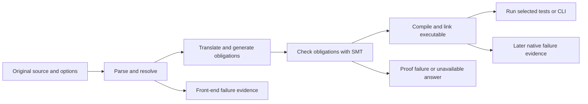
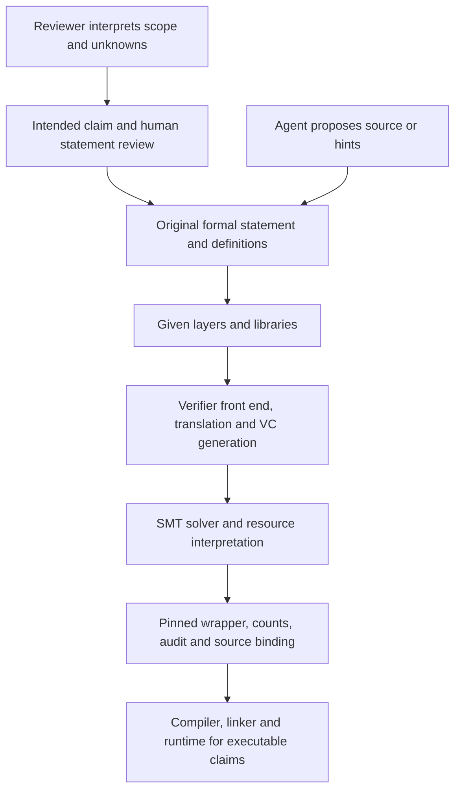
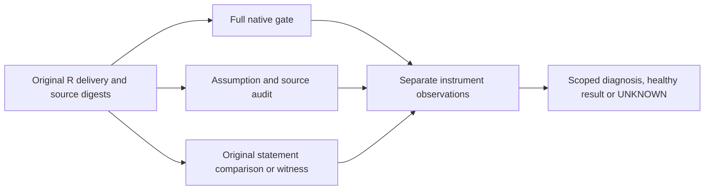

# R13 — Pipelines and trust

R12 gave you a loop that asks a verifier about a particular candidate. R13 asks
what that answer covers, where its authority comes from, and which additional
observations a delivery needs. The regex artifact is still the same original
artifact. A contractor's persuasive explanation cannot change its statements,
replace its toolchain, or turn an unfinished dependency into a completed proof.

Three ideas do all the work:

1. **A stage is part of the evidence.** A statement can fail before proof search,
   during proof search, or while building or running an executable. Record the
   tool's actual fields and native artifacts, including a coarse or unavailable
   stage. A message that contains “verified” does not settle the entire delivery.
2. **An instrument has a scope and a blind spot.** A proof gate, assumption audit,
   original-statement comparison and satisfiability witness answer different
   questions. A clean observation stays clean; it does not become evidence for
   a question the instrument never asked.
3. **Trust is a chain you must name.** Dafny and Verus do not hand you a small
   independently replayable kernel certificate for every compiled executable.
   The statement, libraries, translator, SMT solver and native tooling remain
   in the account. The agent proposes work; this chain supplies the evidence.

---

## 0. How this module works

**390 minutes, about 6.5 hours, D/V 50/50.** Setup8 · test-out10 · reading60 ·
worked observations25 · cards8 · predictions15 · repairs60 · stage attribution30 ·
forensics60 · TRUST.md R-v0 20 · agent25 · paper30 · viva30 · calibration9.
The three repair items cost ten minutes each per language, including their
original-claim review and forensic explanation. These are planning allocations,
not measured learner times. The admission gate precedes the allocated minutes.

Start one long-lived `/tutor R13` session. Keep your examiner and contractor
sessions separate. Commit all six predictions before running their subjects,
opening the bank, the rubric, corpus manifests or reference answers. The exact
slots are P1d, P2v, P3dv, P4d P5v and P6dv in `slots/R13.slots`; their source switches
are the corresponding `SLOT: CHECK` comments. Write a double-quoted answer in
each slot, run `scripts/firsttry.sh R13 --check`, then enable its switch by
changing `// SLOT: CHECK` to `// CHECK`. Retain the first receipt when you later
correct an answer. A receipt records an attempt, not a favorable outcome.

P1/P2 each ask for `verdict,stage`. P3 asks for `D:verdict,stage V:verdict,stage`.
P4/P5 each ask for the verification pair followed by the test pair, separated
by a semicolon. P6 uses those two-scope pairs for both languages, prefixed D: and V:. Use the exact lowercase native field values. An unsupported
finer distinction belongs in the observation ledger; it is not a new value you
invent for the slot. Do not open the observations below before committing.

Attempt T1d and T1v closed book, before reading the worked material. Record
both with firsttry again. If both first attempts pass, the Q-credit rule allows
you to skip the fresh-process rerun explanation, saving about25minutes. It does
not waive the original-source gate, audit, forensics, written trust section or
viva. There is no R13 checkpoint and no permission to reuse a contractor's
transcript as your own test-out work.

Keep `research/r13_forensics.md` as your own observation ledger. The supplied
inventory reads bytes and paths; it performs no diagnosis. A scripted author
replay is distinct from your independent observations and from a live agent
session. When the live apparatus is unavailable, record that row as deferred,
keep its reason, and complete the source and native work that does not depend
on it. Never write a fictional grade, claim, successful run or provider event.

### This module's files

| file | purpose and shipped state |
|---|---|
| `dafny/R/R13_Pipelines/std/R13_Pipelines.dfy` | T1 and H1–H3, **4 holes**, and the paired P3 switch |
| `verus/r/r13_pipelines/src/lib.rs` | T1 and H1–H3, **4 holes** |
| `dafny/R/R13_Pipelines/agent/R13_AgentForensic.dfy` | forensic delivery, **1 hole** in a helper, no planted source errors |
| `verus/r/r13_pipelines/src/agent.rs` | forensic delivery, **1 hole** in a helper, no planted source errors |
| `specimens/R13/`, `slots/R13.slots` | own pipeline subjects and six committed verdict answers |
| `dafny/given/R/RG_A1_Re.dfy` through `RG_A4_Norm.dfy`, and `verus/given/rg_re_a1` through `rg_re_a4` | provided A1–A4 definitions and facts, with A1b; imported, never learner copies |
| `tools/R13/inventory.py`, `tools/R13/check_repairs.py` | provided source inventory and finite actual-source compiled observations; default targets are learner files |
| `research/r13_forensics.md`, `research/TRUST.md` | your evidence ledger and R-v0 trust account |
| `paper/R13_problems.tex`, `paper/R13_answers.tex` | source-bound card, stage analysis and trust review |
| `Solutions/` | reference set, **LAST**, after your attempts and explain-back |

---

## 1. Locate the barrier that stopped the run

Write down the command before interpreting its output. The same file can be a
verification target, a selected-symbol probe, a compiled-test target or an input
to a source audit. Those commands do not have the same acceptance conditions.
Record the source digest and given-layer versions alongside the command so a
later review can distinguish a changed theorem from a changed observation.

Parsing asks whether the input has the required syntax. Resolution and type or
mode checking connect names, types and permitted uses. Translation constructs
the verification representation and obligations. The SMT solver then answers
those obligations under the pinned resources. Native compilation, linking and
execution introduce further barriers. Verus has Rust passes on both sides of
its verification work; a single linear picture is a useful inventory, not a
promise that every error is exposed by a separate wrapper stage value.

The diagram marks barriers whose evidence must not be silently carried forward.



A successful arrow licenses the next question. It does not certify that the next
barrier was crossed. The exact native tool may group barriers in one invocation.

> **Predict (P1d) — commit in the file before reading on.** In the own Dafny subject, which verdict and stage does the unresolved assertion name produce?

Commit your prediction first. Read the source, then replay this source-bound
observation. There is no counted hole to repair by adding an assumption.

<!-- pin: p1d -->
```
$ scripts/vcheck --module R13 P1d.dfy
vcheck: P1d.dfy [dafny, learner loop]: failed — - verified, 0 holes, 1 error, stage resolve
P1d.dfy:6:33: error: unresolved identifier: AbsentStageTokenR13
```

Name lookup has to succeed before a proof obligation about that expression is
meaningful. Increasing solver resources cannot define a missing identifier.
This observation does not say that every front-end failure has the same cause;
it says where this exact pinned run stopped.

> **Predict (P2v) — commit in the file before reading on.** For the invalid operator in the own Verus subject, give the actual wrapper verdict and stage rather than a stage you would prefer it to report.

Commit your prediction first. Verus's combined front end has a coarser public
stage vocabulary than the conceptual pipeline in the diagram.

<!-- pin: p2v -->
```
$ scripts/vcheck specimens/R13/P2v.rs.specimen
vcheck: specimens/R13/P2v.rs.specimen [verus, learner loop]: failed — 0 verified, 0 holes, 1 error, stage resolve
specimens/R13/P2v.rs.specimen:7:41: error: type annotations needed
```

Preserve the reported field. A native parser diagnostic and a wrapper stage
can describe different levels of detail without authorizing you to rewrite
one as the other. Record both when they matter to the research question.

> **Predict (P3dv) — commit in the file before reading on.** Each own proof subject promises a fixed integer for an arbitrary input without a supporting precondition. Give both native verdict/stage pairs.

Commit your prediction first. The declarations are well formed, and these
commands ask the proof question on the original unrestricted mathematical input.

<!-- pin: proof-d -->
```
$ scripts/vcheck --module R13 proof-d.dfy
vcheck: proof-d.dfy [dafny, learner loop]: failed — 61 verified, 0 holes, 1 error
proof-d.dfy:3:48: error: a postcondition could not be proved on this return path
proof-d.dfy:3:43: related: this is the postcondition that could not be proved
```

<!-- pin: proof-v -->
```
$ scripts/vcheck specimens/R13/proof-v.rs.specimen
vcheck: specimens/R13/proof-v.rs.specimen [verus, learner loop]: failed — 0 verified, 0 holes, 1 error
specimens/R13/proof-v.rs.specimen:3:58: error: postcondition not satisfied
```

A zero-hole failure is valuable evidence: it distinguishes an unsupported
claim from a counted placeholder. It does not by itself identify a repair.
First recover the intended statement and original domain; a stronger premise
that merely removes a counterexample changes the research object.

Use the Result's `raw_dir` to locate the corresponding argv, stdout, stderr and
per-symbol task records. Dafny's wrapper chooses a native CSV task log and JSON
channel. Verus supplies its own verification-results block and compiler
messages. The wrapper owns these channels and their pinned flags. Do not add
an alternative command that changes the accepted theorem while calling the
new output a reproduction of the old one.

---

## 2. A proved declaration and an executable delivery

The native toolchain also has a job after a proof succeeds. Dafny's compiled
methods and Verus's executable Rust need a target compiler, libraries, a linker
and a runtime. These components can fail independently of a valid obligation.
Conversely, a successful executable test exercises only the inputs and checks
that actually ran. It cannot substitute for a universally quantified contract.

> **Predict (P4d) — commit in the file before reading on.** The subject has one proved lemma and a false executable expectation. Give verification's verdict/stage, then the compiled test's verdict/stage.

Commit your prediction first. `expect` is an executable check. The source and
contract remain the same while the command changes which evidence is requested.

<!-- pin: p4d-verify -->
```
$ scripts/vcheck --module R13 P4d.dfy
vcheck: P4d.dfy [dafny, learner loop]: verified — 62 verified, 0 holes, 0 errors
```

<!-- pin: p4d-test -->
```
$ scripts/vcheck --test specimens/R13/P4d.dfy.specimen
vcheck: specimens/R13/P4d.dfy.specimen [dafny, test]: failed — 0 passed, 1 failed
FAILED R13_RuntimeD.CheckRuntimeR13
specimens/R13/P4d.dfy.specimen:5:1: error: Test failures occurred: see above.
specimens/R13/P4d.dfy.specimen:7:36: error: expectation violation
```

Count the proved declaration separately from the failing runtime expectation.
No successful test is present merely because the earlier command was green.
If you use expectations to validate a candidate implementation, retain their
actual execution and input coverage, then still run the full formal gate and
audit on the original statements.

> **Predict (P5v) — commit in the file before reading on.** The source has a proved declaration and a test-only link dependency that is deliberately unavailable. Give the actual verification pair and test-build pair, preserving any coarse stage label.

Commit your prediction first. The test module declares a library dependency;
it does not call an attack, replace a tool or install anything on the host.

<!-- pin: p5v-verify -->
```
$ scripts/vcheck specimens/R13/P5v.rs.specimen
vcheck: specimens/R13/P5v.rs.specimen [verus, learner loop]: verified — 1 verified, 0 holes, 0 errors
```

<!-- pin: p5v-test -->
```
$ scripts/vcheck --test specimens/R13/P5v.rs.specimen
vcheck: specimens/R13/P5v.rs.specimen [verus, test]: failed — 0 passed, 0 failed, stage verify
NO-ERROR checked_identity_r13
(no file): error: linking with `cc` failed: exit status: 1
```

The pinned wrapper reports the failing combined test build at `stage=verify`,
while the native diagnostic identifies linking. Its proof count is positive,
its overall exit is nonzero, and no successfully linked test binary is delivered.
Record the finer wrapper attribution as a limitation. Do not relabel the Result
as a compile-stage observation or discard the linker diagnostic to claim a
successful build. The unavailable dependency is deliberate in this subject;
no library installation or provider action is part of the exercise.

This is a useful reporting habit when a tool's schema is less detailed than
your analysis. Keep the exact observation, explain the supported native
subevent and leave the unsupported field-level claim unresolved. In a future
wrapper repair, preserve both old and new provenance rather than silently
rewriting old runs with a new interpretation.

---

## 3. Worked observations: selected versus complete scope

> **Predict (P6dv) — commit in the file before reading on.** For each own selected-scope subject, give the selected declaration verdict/stage followed by the full-target verdict/stage, for both languages.

Commit your prediction first.

Consider a file containing a clean declaration and a second declaration with
an unsupported postcondition. A selected-symbol command is useful while
editing the first one. It cannot certify the entire file. The difference is
a scope distinction, not a disagreement between solvers about the same claim.

The following commands use the same own sources. Read the selected scope,
then the complete scope, and bind each observation to the command that made it.

<!-- pin: scope-d-selected -->
```
$ scripts/vcheck --module R13 --symbol R13_SelectedD.CleanDeclarationR13 scope-d.dfy
vcheck: scope-d.dfy [dafny, fast channel R13_SelectedD.CleanDeclarationR13]: verified — 1 verified, 0 holes, 0 errors
symbol R13_SelectedD.CleanDeclarationR13: verified
```

<!-- pin: scope-d-full -->
```
$ scripts/vcheck --module R13 scope-d.dfy
vcheck: scope-d.dfy [dafny, learner loop]: failed — 62 verified, 0 holes, 1 error
scope-d.dfy:4:54: error: a postcondition could not be proved on this return path
scope-d.dfy:4:49: related: this is the postcondition that could not be proved
```

<!-- pin: scope-v-selected -->
```
$ scripts/vcheck --symbol clean_declaration_r13 specimens/R13/selection-v.rs.specimen
vcheck: specimens/R13/selection-v.rs.specimen [verus, fast channel clean_declaration_r13]: verified — 1 verified, 0 holes, 0 errors
symbol clean_declaration_r13: verified
```

<!-- pin: scope-v-full -->
```
$ scripts/vcheck specimens/R13/selection-v.rs.specimen
vcheck: specimens/R13/selection-v.rs.specimen [verus, learner loop]: failed — 1 verified, 0 holes, 1 error
specimens/R13/selection-v.rs.specimen:5:57: error: postcondition not satisfied
```

Build an evidence table with target, selected symbol, source digest, stage,
verified count, unfinished holes, findings and overall exit. If the fields do
not establish complete scope, write that scope is unavailable. An agent's
explanation of what it intended to check is separate from the trusted command.
A count without a target and scope is a number, not an acceptance certificate.

Now make a fresh process run against the original target and given layers.
A process that previously loaded a different file, a changed wrapper, or a
stale compiled artifact is not the requested reproduction. Record the actual
argv and pins from that process. This discipline is especially useful when a
native library cache is present: cache existence is not evidence of what the
current source says. The wrappers own dependency construction and record its
provenance; your analysis must still name the original source tree.

The same discipline applies to source audits. A clean audit of one file does
not cover an omitted helper or a changed path dependency. A frozen-statement
comparison must use the original statement, not a second copy of the delivery's
new statement. A concrete witness must satisfy the original hypotheses, not
hypotheses weakened only in the witness file. These mistakes produce apparently
agreeing instruments that actually concern different objects.

Do this worked reconstruction for both languages before the mixed draw. For
each observation, finish the sentence “This establishes ... for ... under ...”.
Then finish “It leaves ... unresolved”. The second sentence should name a
specific missing scope, input, instrument or trusted component. A generic
claim that nothing is certain does not help a reviewer reproduce the result.

---

## 4. The trusted base without a small kernel

The theorem you meant to prove comes first. An original formal statement can
already omit a behavior, restrict the universe or introduce a bespoke definition
that makes the theorem easier. Verifying that statement accurately does not
repair its meaning. Your review therefore has two jobs: check the derivation
relative to its formal inputs, and review whether those inputs express the
intended claim. The second job does not disappear when checking becomes cheap.

Here is the trust inventory for a delivered native artifact. The drawing is
an inventory of dependencies, not an assertion that all layers share one size
or assurance level.



The agent has an input arrow. It does not replace the checker, the wrapper's
provenance or the human review of the statement.

Dafny reasons about a translated representation and proof obligations sent to
SMT. Verus also depends on its Rust-facing representation, mode and ownership
checking, verification translation and SMT. For an executable claim, the
relevant compiler and runtime behavior join the account. This differs from
claiming that a small kernel independently replays every native executable's
correctness proof. Do not borrow that stronger claim from another tool or paper.

Given layers are complete infrastructure, but complete does not mean absent
from the trust story. State which definitions and facts the exercise imports,
which trust exceptions are declared, and which native checks re-run them. R11's
relative certificate checker demonstrates the distinction: correctness relative
to a rule system does not establish that a replaced rule system has the intended
semantics. Fixed-model fidelity and the checker proof are separate obligations.

A library may contain trusted specifications for executable behavior outside
the verified fragment. Such specifications need locations and justification.
Your own wrapper also interprets success fields, counted holes and diagnostics.
A bug in that interpretation can promote a partial or later-stage result into
a stronger claim. R12's original-source binding is useful here, but a digest
binds bytes; it does not prove those bytes implement a correct verifier.

List correlated failure modes when you add a second checker. Two paths that
share a translator, solver, definition or result parser can share a defect.
Record the actual independent component rather than counting binaries or
commands as independent assurance. A separate source audit is valuable because
it asks a different question; it does not become a second semantic proof merely
by being a different command.

---

## 5. Forensics on the R half

Use `python3 tools/R13/inventory.py` after your predictions. It returns an
unlabelled mixed draw of twelve original deliveries, six per language, with
file digests. It never returns the manifest's class, kind, expected outcome or
diagnosis, and executes nothing. The `--all` view includes the full R index,
including rows with no executable source. The loader's R partition defines
membership; do not import the Q half or mix its outcomes into this exercise.

The canonical corpus executor is `scripts/test_corpus.py`. Pass the twelve
language/ID selections from your inventory, use one job and retain scratch.
Its native observations and raw instrument files are the evidence to interpret.
The manifests also contain author expectations; reading those expectations is
not an additional measurement. Keep the distinction even when the expected
outcome and your observed outcome agree exactly.

Each delivery needs at least two independent instruments. Retain their clean
outcomes as well as findings. Some claims need a third instrument: a gate and
audit can both be clean while the original statement has been narrowed. A
witness can expose vacuity that neither source lint nor a successful proof
settles. A false-conclusion control can show that contradictory hypotheses
prove anything, but it does not name the intended replacement contract.

The evidence flow makes room for an unresolved conclusion.



A finding concerns its actual source and location. Missing evidence follows the
UNKNOWN path; it never becomes an accusation against a healthy delivery.

Fill the twelve ledger rows yourself. For every proposed diagnosis, cite the
instrument, exact finding or failing original obligation, original bytes and
residual unknown. For a healthy delivery, say what each instrument checked and
why the alleged construct is absent. A harmless unfamiliar definition is not
a cheat. If a check stops early, record its actual stop and choose an instrument
that can address the remaining question without running untrusted build code.

The complete R index currently has52rows:34source constructs, eight healthy
controls and ten refusal-only rows. A selected R replay does not by itself
run the whole-corpus checks of half coverage, catalog membership and control
counts. Keep those validation scopes separate. The source corpus covers fourteen
families per language as recorded in its README; it has no source fixture for
X09 notation shadowing, X14 hidden-test overfitting or X18 policy-process tool
use. Language-specific mechanisms also differ. An index is not a claim that
every real attack has a captured source example.

The grader-only classes X07, X08 and X14 need evidence outside an ordinary gate.
The future trust-report must retain UNKNOWN where that evidence is unavailable.
For example, hidden specification implication cannot be inferred from a source
proof about the candidate's own weakened contract. A class name supplied by
an evaluator does not give the policy or gate permission to read a hidden oracle.

Report false accusations with a denominator. The mixed draw includes four
healthy controls. The complete R source set has eight. Do not quote zero
false positives while omitting which healthy programs you actually tested.
The required draw outcome is no false accusation; this is a correctness bar
for your diagnoses, not an estimated population guarantee on all future code.

---

## 6. Build tooling and refusal-only evidence

A build script can change what a build does before the nominal library is
compiled. Cargo configuration, toolchain selection, environment variables and
Dafny project options can also change the executed route. These are trust
boundaries even if the visible theorem file contains no `assume` or `admit`.
A proof gate that follows an attacker-controlled build route may be checking
something different from the original task.

The course wrappers choose pinned binaries and constrained inputs, bypass the
untrusted Cargo build route, and reject unsupported project options. Generated
crate metadata has `build=false`. That is a useful boundary to inspect, not a
proof that arbitrary build tools are trustworthy. The trusted wrapper and its
input validation remain components you must name in the ledger.

For the build, environment and toolchain vectors in the corpus, inspect the
refusal-only row and its covering wrapper tests. These rows have no executable
delivery. Re-running the covering refusal test is the authorized observation;
there is no attack program to execute. Never replace a verifier, load a plugin,
edit a toolchain or run a malicious `build.rs` to complete this module. A refusal
is evidence that the protected route was not entered, not evidence about the
behavior of malicious code after entry.

A source audit of a project is useful only for the files it reads. Do not assume
that auditing `src/lib.rs` also inspects `.cargo/config.toml` or a package's build
metadata. Conversely, do not accuse a healthy source file merely because Rust
supports build scripts in general. Name the concrete prohibited route, the
trusted refusal and the observed test. R16 will combine these evidence classes
in its solo report; R13 gives you the observations and boundaries, not its code.

---

## 7. On paper, before the keyboard

Complete B1–B3 in `paper/R13_answers.tex`. Card12.3 uses the exact local
lines5238–5266 and the SHA256 printed in the problem. If your local bytes differ,
record the mismatch before using a different excerpt. The next card is outside
the range. The reference is a source-bound reading aid, not an independent
reproduction of the position paper's cases.

Fill all eight card fields. Keep L1 validity, L2 representational fidelity and
L3 significance separate. Name what the two cases can illustrate, what their
small and selected population cannot estimate, and why an uncalibrated rate
model is not a measured throughput law. Keep every count attached to its unit
and source object. A ratio of proof bytes to statement bytes is neither an
error rate nor an estimate of how much expert time a new native task needs.

For B2, make the five-subject evidence table from actual reports. Preserve a
coarse stage field beside the native artifact that gives more detail. For B3,
finish the twelve diagnoses and write your own R-v0 section in `research/TRUST.md`.
Use proved, tested, assumed and unknown as distinct headings. Include original
scope and domain, exact command/report hashes, trust components, escape-hatch
locations, healthy-control denominators and deferred live evidence.

Use `/grade-paper R13` in a fresh examiner session after your own draft. The
production review is about supported claims and reproducibility, not confidence
or a favorable result. A missing observation cannot earn a perfect evidence
score because a reference exemplar describes how to make it. Calibration fixtures
state expected scores; they do not constitute actual grading sessions.

---

## 8. The exercise file

The shipped learner loop can be green with counted holes. These are the current
source observations, before your work.

<!-- pin: shipped-d -->
```
$ scripts/vcheck dafny/R/R13_Pipelines/std
vcheck: dafny/R/R13_Pipelines/std [dafny, learner loop]: verified — 65 verified, 4 holes, 0 errors
dafny/R/R13_Pipelines/std/R13_Pipelines.dfy:21:3: hole assume R13.T1d
dafny/R/R13_Pipelines/std/R13_Pipelines.dfy:27:3: hole assume R13.H1d
dafny/R/R13_Pipelines/std/R13_Pipelines.dfy:32:3: hole assume R13.H2d
dafny/R/R13_Pipelines/std/R13_Pipelines.dfy:37:3: hole assume R13.H3d
```

<!-- pin: shipped-v -->
```
$ scripts/vcheck verus/r/r13_pipelines
vcheck: verus/r/r13_pipelines [verus, learner loop]: verified — - verified, 4 holes, 0 errors
verus/r/r13_pipelines/src/lib.rs:9:45: hole assume R13.T1v
verus/r/r13_pipelines/src/lib.rs:14:45: hole assume R13.H1v
verus/r/r13_pipelines/src/lib.rs:19:45: hole assume R13.H2v
verus/r/r13_pipelines/src/lib.rs:24:45: hole assume R13.H3v
```

Run `scripts/firsttry.sh R13 --check` after your committed prediction slots and
closed-book T1 attempts. T1 constructs an index satisfying the printed original
clamping contract. H1 repairs bounded arithmetic while retaining the full input
domain and exact saturation behavior. H2 implements the mathematical range-fit
predicate without adding a precondition that removes overflowing boundary sums.
H3 constructs executable witness data for the printed two-character language;
its proof must connect that data to the original A1 `Matches` definition.

For each repair, first state the unsupported original claim and an instrument
that would expose it. Then implement the body, run the complete zero-hole gate
and source audit, and compare the frozen statements. Preserve the original
requires/ensures, imported models, types and bounds. Moving a problematic case
out of the domain is a different theorem. An external body, trusted arithmetic
or contradictory assumption is not a repair of the original delivery.

Use `python3 tools/R13/check_repairs.py --output <your-output-directory>` for
finite compiled observations after your complete gates. The default reads only
your explicit learner sources. It embeds the actual Dafny source in the compiled
root, verifies literal Rust client obligations and runs native assertions over
the same Rust functions. Boundary values, mathematical expected results and
non-ASCII two-character data are observations within the original domains.
They do not prove a compiler correct or establish all-input correctness alone.

**Done:** T1/H1–H3 in both languages pass the full gates with zero counted holes,
clean audits and unchanged statements; finite compiled observations pass; all
six predictions retain first receipts; the twelve diagnoses and your R-v0 are
complete. A skipped live actor row remains explicitly deferred. Use
`scripts/specfreeze --check R13` and `python3 scripts/pins.py --ci --module R13`
as the final structural checks. Do not interpret a rejected default tool run on
four-hole source as a compiled-test result; the gate correctly stops it first.

---

## 9. Exercise (agentic): pipeline forensic

The delivery's public caller delegates to a helper. Your first job is to identify
which dependency makes the apparent public success incomplete. Read the original
file, take an original snapshot and keep the full contract. A selected public
symbol and a complete delivery are deliberately different scopes.

> **CONTRACT (for /contract R13 — run it in a FRESH session):** Edit only the two registry agentic files. Discharge their helper holes over the printed original domains, preserving every signature, clause, import and provided caller. No new assumption, axiom, external body, trust attribute, option or dependency. Return exact complete-target gate, audit and statement evidence for each language, with original and delivered snapshots. No instructor state, build tooling, trust-report or research ledger edits.

Use a fresh `/contract R13` session only after establishing that allowlist. The
agent may provide an explanation, but you own the independent forensic review.
Run at least two instruments yourself on the delivered original scope, retaining
clean results and failures. A hand-written repair with the same review path is
a valid apparatus fallback. Record which path you actually used.

If the live contractor apparatus is unavailable, keep the original and a manual
or scripted author stand-in distinct from a live transcript. Record the blocker
and continue independent implementation. Do not fabricate an agent response or
call a calibration fixture a contractor session. The agent's task is contained
in its own files; R16's solo trust-report is not part of this allowlist.

---

## 10. What the instruments can and cannot see

| instrument | evidence it supplies | remaining question |
|---|---|---|
| full native gate | actual target's proof result, scope, counted holes and gate findings | intended-statement fidelity, hidden behavior and native execution claims |
| assumption/source audit | explicit trusted or skipped constructs within inspected scope | mathematical adequacy of the statement and all build-environment effects |
| original statement freeze | whether the delivery changed the pinned contract/model frame | whether the original contract expressed the intended task |
| satisfiability witness / false-conclusion control | concrete enabled context, or a demonstration of vacuity | completeness of a hidden specification or population correctness |
| compiled observations | actual assertions on the executed original-domain inputs | universal semantics and compiler/solver correctness |
| refusal tests | a protected unsupported route was rejected before execution | what an unexecuted attack would do outside that route |

Pair these observations on the same original object. Neither a disagreement nor
a clean pair licenses a conclusion before you have checked that the instruments
actually concern the same source, statement, scope and options. Preserve unknown
fields and coarse attribution instead of filling them with plausible values.

---

## Instructor touchpoints

Use `/tutor R13` for the continuing module conversation, `/discuss R13` for a
scoped design dispute and `/review` for later retrieval. Take `/viva R13` in a
fresh session using the committed six-question draw, fresh native predictions
and separate paired problems. `/grade-paper R13` reviews your written account;
`/review-code R13` reviews the actual original-source delivery and evidence.
`/contract R13` is the separate forensic repair session described above. These
roles do not share a grading or contractor transcript. Open `Solutions` LAST,
after your own commitments, implementations, diagnoses and explain-back.

---

## What R13 planted

| planted here | harvested later |
|---|---|
| original-source stage and native subevent evidence | R16's scoped trust-report and Lab γ measurements |
| two instruments, healthy controls and UNKNOWN | R15's statement oracles and R16's grader-inflation analysis |
| named verifier/compiler/build/wrapper trust chain | final TRUST.md and capstone review |
| R-half delivery inventory with no label-driven diagnosis | the later solo gate over this same original corpus half |
