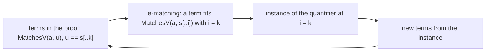
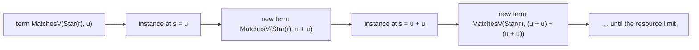
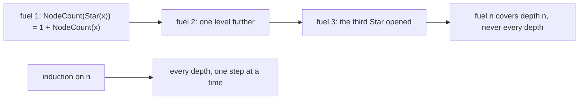
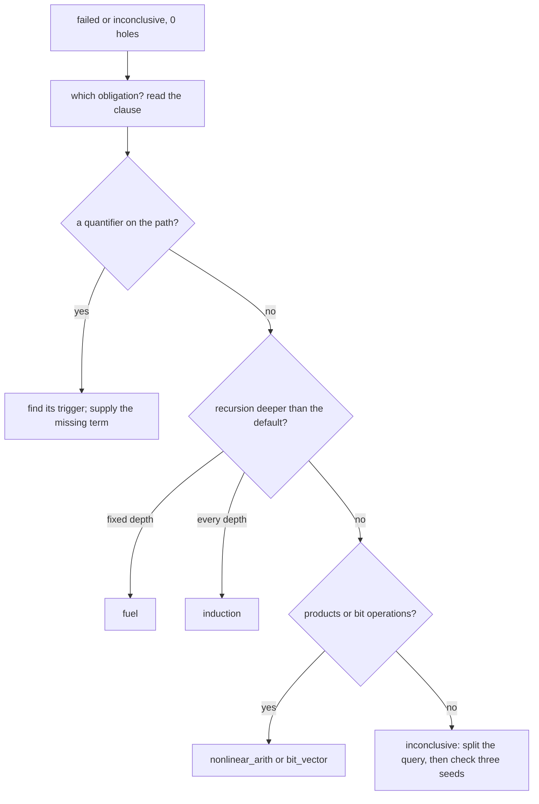

# R14 — SMT mechanics

Three ideas do all the work:

1. A quantifier is used only through its triggers. The solver instantiates `forall` and `exists` facts at terms that match a trigger pattern; a fact whose trigger term never appears is a fact the proof does not have. Most "the solver cannot see it" failures are missing terms, and the repair is an assertion that puts the term in front of the solver.
2. Unfolding is not induction. Fuel says how many times a recursive definition is opened at a term; it can prove a fact about one concrete depth and never a fact about every depth. A matching loop is the same mechanism without a bound: a quantifier whose instances produce new terms for its own trigger.
3. Stability is measured, not assumed. A proof that verifies under one seed can run out of resources under another; a resource count is a measurement with a spread, and the course's three-seed rule and a CV sweep say what that spread licenses.

## 0. How this module works

Allow 390 minutes: setup 10, reading 60, worked examples 25, cards 8, predictions 20, hand holes 70 (H1 10, H2 10, H3 15 in each language), the assertion battery 60, CV sweeps 40, the toolsmith run 30, written work 30, viva 30 and calibration 7. These are planning estimates; record your own times.

R14 is standalone and declares layer A4, so its given chain is A1–A4; it uses A1's `Re` and `NodeCount` and A2's `Deriv`. It does not use A1's `Matches`: R14 states its own copy, `MatchesV` (Verus `matches_v`), with the triggers chosen in R14's file, so every trigger question here is about a definition you can read on the page. No earlier learner file is imported.

**This module's files** keep the hand work, the predictions, the battery and the toolsmith apart.

| path | role and shipping state |
|---|---|
| `dafny/R/R14_Smt/std/R14_Smt.dfy` | hand work: verified, 3 holes, 0 errors |
| `verus/r/r14_smt/src/lib.rs` | hand work: verified, 3 holes, 0 errors |
| `specimens/R14/`, `slots/R14.slots` | prediction scenarios, the trigger card and chapter demonstrations; the trigger-note capture `native-triggers/` |
| `tools/R14/trigscan.py` | toolsmith: 1 hole (`scan_trigger_notes_r14`), with its frozen tests `tools/R14/test_trigscan.py` |
| `tools/R14/battery.py`, `tools/R14/battery.json` | the provided battery executor and its 12 frozen assertions |
| `dafny/given/R/RG_A1_Re.dfy` … `RG_A4_Norm.dfy`, `verus/given/rg_re_a1` … `rg_re_a4` | the given chain A1–A4 |
| `paper/R14_problems.tex`, `paper/R14_answers.tex` | card 02.5 and the CV-sweep analysis |
| `Solutions/`, `paper/solutions/` | completed references — LAST, after your attempt and review |

Commit all five predictions before you run their scenarios. P1dv, P2dv and P5dv are verdicts in `slots/R14.slots`, switched on by the three `CHECK` lines of the Dafny hand file; P3d is a numeral in `specimens/R14/P3d.dfy.specimen`, P4v a numeral in `specimens/R14/P4v.rs.specimen`. Then run `scripts/firsttry.sh R14 --check` and keep its receipts. Verdicts are the wrapper's words: `verified`, `failed` or `inconclusive` (the run ended out of resources at the pinned limit).

> **Predict (P1dv) — commit in the file before reading on.** A lemma assumes `MatchesV(Star(r), u)` and a quantifier that, from any word `s` matching `Star(r)`, gives a match of `s + s`, triggered by `MatchesV(Star(r), s)`. Its goal, `u == []`, does not follow. What does each verifier report?

> **Predict (P2dv) — commit in the file before reading on.** For naturals `x` and `y`, the statement `(x + y) * (x + y) >= x * x + y * y` with an empty body. What does each verifier report?

> **Predict (P3d) — commit in the file before reading on.** For the 32-bit value `x == 0xDABC`, what integer is `x & 0xFFFFF800`?

> **Predict (P4v) — commit in the file before reading on.** What is `0xE7FFu32 & 0xFFFF_F800u32`, as a decimal numeral?

> **Predict (P5dv) — commit in the file before reading on.** `NodeCount(Star(Star(Star(r)))) == NodeCount(r) + 3` for an arbitrary `r`, with an empty body and the default settings. What does each verifier report?

The shipped hand files run in the learner loop: the holes are counted, the rest verifies.

<!-- pin: shipped-d -->
```
$ scripts/vcheck dafny/R/R14_Smt/std
vcheck: dafny/R/R14_Smt/std [dafny, learner loop]: verified — 64 verified, 3 holes, 0 errors
dafny/R/R14_Smt/std/R14_Smt.dfy:82:21: hole bodyless-method R14.H1d
dafny/R/R14_Smt/std/R14_Smt.dfy:95:21: hole bodyless-method R14.H2d
dafny/R/R14_Smt/std/R14_Smt.dfy:109:39: hole bodyless-method R14.H3d
```

<!-- pin: shipped-v -->
```
$ scripts/vcheck verus/r/r14_smt
vcheck: verus/r/r14_smt [verus, learner loop]: verified — - verified, 3 holes, 0 errors
verus/r/r14_smt/src/lib.rs:68:40: hole assume R14.H1v
verus/r/r14_smt/src/lib.rs:85:40: hole assume R14.H2v
verus/r/r14_smt/src/lib.rs:103:40: hole assume R14.H3v
```

---

## 1. Triggers: how a quantifier is used

`MatchesV` is A1's semantics with its two existentials written out and their triggers stated:

```dafny
  ghost predicate MatchesV(r: Re, s: seq<char>)
    decreases r, |s|
  {
    match r
    case Empty => false
    case Eps => s == []
    case Chr(c) => s == [c]
    case Alt(a, b) => MatchesV(a, s) || MatchesV(b, s)
    case Cat(a, b) =>
      exists i {:trigger MatchesV(a, s[..i])} | 0 <= i <= |s| :: MatchesV(a, s[..i]) && MatchesV(b, s[i..])
    case Star(a) =>
      s == [] || exists i {:trigger MatchesV(a, s[..i])} | 0 < i <= |s| :: MatchesV(a, s[..i]) && MatchesV(Star(a), s[i..])
  }
```

To prove `MatchesV(Cat(a, b), s)` the solver must produce a split point `i`. It does not search the integers: it looks for a term of the trigger's shape, `MatchesV(a, s[..k])` for some `k`, among the terms it already has, and tries that `k`. If no such term exists, the existential is never instantiated, and a true goal fails. Here is the smallest case, a one-character word against `Cat(Chr('q'), Eps)`:

```dafny
module R14_TriggerDemo {
  import opened RG_A1_Re

  ghost predicate MatchesV(r: Re, s: seq<char>)
    decreases r, |s|
  {
    match r
    case Empty => false
    case Eps => s == []
    case Chr(c) => s == [c]
    case Alt(a, b) => MatchesV(a, s) || MatchesV(b, s)
    case Cat(a, b) =>
      exists i {:trigger MatchesV(a, s[..i])} | 0 <= i <= |s| :: MatchesV(a, s[..i]) && MatchesV(b, s[i..])
    case Star(a) =>
      s == [] || exists i {:trigger MatchesV(a, s[..i])} | 0 < i <= |s| :: MatchesV(a, s[..i]) && MatchesV(Star(a), s[i..])
  }

  lemma QThenNothing()
    ensures MatchesV(Cat(Chr('q'), Eps), ['q'])
  {
  }
}
```

<!-- pin: trigger-none-d -->
```
$ scripts/vcheck --module R14 probe.dfy
vcheck: probe.dfy [dafny, learner loop]: failed — 63 verified, 0 holes, 1 error
probe.dfy:20:3: error: a postcondition could not be proved on this return path
probe.dfy:19:21: related: this is the postcondition that could not be proved
probe.dfy:13:7: related: this proposition could not be proved
```

The statement is true (`i = 1`), and the failure is about terms: nothing in the proof mentions `['q'][..1]`. Add one assertion that names the term, and say what it is:

```dafny
module R14_TriggerDemo {
  import opened RG_A1_Re

  ghost predicate MatchesV(r: Re, s: seq<char>)
    decreases r, |s|
  {
    match r
    case Empty => false
    case Eps => s == []
    case Chr(c) => s == [c]
    case Alt(a, b) => MatchesV(a, s) || MatchesV(b, s)
    case Cat(a, b) =>
      exists i {:trigger MatchesV(a, s[..i])} | 0 <= i <= |s| :: MatchesV(a, s[..i]) && MatchesV(b, s[i..])
    case Star(a) =>
      s == [] || exists i {:trigger MatchesV(a, s[..i])} | 0 < i <= |s| :: MatchesV(a, s[..i]) && MatchesV(Star(a), s[i..])
  }

  lemma QThenNothing()
    ensures MatchesV(Cat(Chr('q'), Eps), ['q'])
  {
    assert ['q'][..1] == ['q'] && MatchesV(Chr('q'), ['q'][..1]);
  }
}
```

<!-- pin: trigger-term-d -->
```
$ scripts/vcheck --module R14 probe.dfy
vcheck: probe.dfy [dafny, learner loop]: verified — 64 verified, 0 holes, 0 errors
```

It helps to read the Cat case once as the solver does. The goal `MatchesV(Cat(Chr('q'), Eps), ['q'])` unfolds, by the definition, to an existential: there is an `i` with `0 <= i <= 1`, `MatchesV(Chr('q'), ['q'][..i])` and `MatchesV(Eps, ['q'][i..])`. To prove an existential the solver needs a candidate `i`, and its only source of candidates is the trigger: it scans the terms it has for one of the shape `MatchesV(Chr('q'), ['q'][..k])`. In the empty proof it has `MatchesV(Cat(Chr('q'), Eps), ['q'])` and the subterms of the definition, and no slice of `['q']` at all, so the scan finds nothing and the existential stays unproved. The assertion `['q'][..1] == ['q'] && MatchesV(Chr('q'), ['q'][..1])` does three things at once: it creates the slice term `['q'][..1]`, it tells the solver that the slice equals `['q']` (so that `MatchesV(Chr('q'), ['q'][..1])` reduces to the base case `['q'] == ['q']`), and it hands over the trigger term itself. The candidate `k = 1` follows, and the rest of the body, `MatchesV(Eps, ['q'][1..])`, is a sequence fact the solver settles without help.

Two habits follow from this reading, and the hand items rely on both. First, when a proof about a quantified definition fails, look for the term, not for a missing fact: ask which term of the trigger's shape the proof contains, and if the answer is none, write an assertion that contains one. Second, state the equation that makes the term useful. A trigger term whose argument the solver cannot relate to what it knows (a slice it cannot evaluate, a subrange it does not know equals your word) instantiates the quantifier and then leaves the body unproved. In **H1** you know facts about `u` and `v`, and the existential is about slices of `u + v`: the equations you need are the ones that say which slices those are.

The assertion is not a proof step in the logical sense; `['q'][..1] == ['q']` is something the solver knows. What it adds is the term `MatchesV(Chr('q'), ['q'][..1])`, which matches the trigger with `i = 1`. That is the move **H1** asks for, on a general split rather than a one-character word. C1d (`specimens/R14/card-c1d.dfy.specimen`) is the same move on a two-character word; do it before H1.

Verus states the same definition with a different trigger. A trigger on the recursive call, as Dafny has it, names a copy of `matches_v` *inside its own definition*: Verus encodes a recursive spec function with fuel, and the call in the body is the fuel-indexed copy, which no term outside the definition matches. The same one-character proof, with the extensionality assertions and even with extra fuel, fails:

```rust
use vstd::prelude::*;
use rg_re_a1::*;

verus! {

pub open spec fn matches_r(r: Re, s: Seq<char>) -> bool
    decreases r, s.len(),
{
    match r {
        Re::Empty => false,
        Re::Eps => s.len() == 0,
        Re::Chr(c) => s.len() == 1 && s[0] == c,
        Re::Alt(a, b) => matches_r(*a, s) || matches_r(*b, s),
        Re::Cat(a, b) => exists|i: int|
            0 <= i <= s.len() && #[trigger] matches_r(*a, s.subrange(0, i)) && matches_r(
                *b,
                s.subrange(i, s.len() as int),
            ),
        Re::Star(a) => s.len() == 0 || exists|i: int|
            0 < i <= s.len() && #[trigger] matches_r(*a, s.subrange(0, i)) && matches_r(
                r,
                s.subrange(i, s.len() as int),
            ),
    }
}

proof fn lemma_cat_eps_r(a: Re, u: Seq<char>)
    requires
        matches_r(a, u),
    ensures
        matches_r(Re::Cat(Box::new(a), Box::new(Re::Eps)), u),
{
    assert(u.subrange(0, u.len() as int) =~= u);
    assert(u.subrange(u.len() as int, u.len() as int) =~= Seq::<char>::empty());
    reveal_with_fuel(matches_r, 2);
}

} // verus!
```

<!-- pin: rectrig-v -->
```
$ scripts/vcheck --module R14 probe.rs
vcheck: probe.rs [verus, learner loop]: failed — 1 verified, 0 holes, 1 error
probe.rs:31:9: error: postcondition not satisfied
```

So R14's Verus `matches_v` triggers on the subrange term, `matches_v(*a, #[trigger] s.subrange(0, i))`: the proof must produce `s.subrange(0, k)` for the right `k`, and an extensional equality (`=~=`) does that. C4dv is this divergence: Dafny may trigger a definition's existential on its own recursive call; Verus may not, usefully.

A trigger is chosen when the quantifier is written, and the choice is part of the definition's interface: it decides which proofs about the definition are easy. The diagram is the solver's side of it.



An instance can add terms that fit the trigger again; most of the time that stops, because the new terms are smaller or already known. When it does not stop, the loop in the diagram is a matching loop (§3).

---

## 2. Reading what the solver was given: the SMT log

A trigger is a source annotation; what the solver receives is an SMT query in which every quantifier carries its patterns, `:pattern ( … )`, and a name, `:qid …`. For Verus the course's wrapper can save those queries: `scripts/vcheck --smt-log DIR <target>` runs the ordinary learner loop (or the fast channel, with `--symbol`) with Verus's own `--log smt` added, and copies the query files into `DIR`, a new or empty directory outside the reference trees. The run is the same capped run with the same verdict and hole count; the gate refuses the option, because the gate's command is pinned. Dafny has no SMT log route at the course's pins.

```rust
use vstd::prelude::*;

verus! {

pub open spec fn self_cat(s: Seq<int>) -> Seq<int> {
    s + s
}

proof fn lemma_self_cat_len(t: Seq<int>)
    requires
        forall|s: Seq<int>| #[trigger] self_cat(s).len() == 2 * s.len(),
    ensures
        self_cat(t).len() == 2 * t.len(),
{
}

} // verus!
```

<!-- pin: smtlog-v -->
```
$ scripts/vcheck --module R14 --smt-log smt probe.rs
vcheck: probe.rs [verus, learner loop]: verified — 1 verified, 0 holes, 0 errors
smt log: smt/root.smt2 (<n> bytes)
```

The listing names each file the run wrote and its size (the size is masked here: the queries carry source locations, so it depends on the scratch path). Open the file and search for your function's name. A quantifier you wrote has a qid of the form `user_<crate>__<function>_<n>`; for this file, `user_probe__lemma_self_cat_len_0`, with the pattern `((vstd!seq.Seq.len.? $ INT (Poly%vstd!seq.Seq<int.>. (probe!self_cat.? s$))))`: the trigger `self_cat(s).len()`, in Verus's encoding (`probe!self_cat.?` is `self_cat`, `vstd!seq.Seq.len.?` is `len`, the `Poly` wrappers are boxing). That is the check to make when a proof fails for a reason you suspect is a trigger: is the pattern the term you meant, and does the query contain a term of that shape? `python3 tools/R14/trigscan.py --smt FILE` lists every quantifier of a log with its qid and patterns (a provided reader, not the toolsmith's hole), so that you can read them without reading the whole query.

The log is evidence about one run: which patterns were sent. It is not a trace of which instances the solver made; the course's pins give no instantiation profile, and nothing in R14 claims one. A matching loop below is therefore read from the patterns and the source, as a possible cycle, and confirmed or refuted by the verdict and the resource count.

---

## 3. Matching loops

P1's hypothesis is a quantifier whose instance produces a new term of its own trigger's shape: from `MatchesV(Star(r), s)` it gives `MatchesV(Star(r), s + s)`, which matches the trigger again, with `s + s`, and so on. *Commit your prediction first.* The specimens, as they run:

```dafny
  lemma Doubling(r: Re, u: seq<char>)
    requires MatchesV(Star(r), u)
    requires forall s {:trigger MatchesV(Star(r), s)} :: MatchesV(Star(r), s) ==> MatchesV(Star(r), s + s)
    ensures u == []
  {
  }
```

<!-- pin: loop-d -->
```
$ scripts/vcheck --module R14 P1-d.dfy
vcheck: P1-d.dfy [dafny, learner loop]: inconclusive — 63 verified, 0 holes, 1 error
P1-d.dfy:21:9: error: Verification out of resource (R14_LoopD.Doubling)
```

```rust
proof fn lemma_doubling(r: Re, u: Seq<char>)
    requires
        matches_v(Re::Star(Box::new(r)), u),
        forall|s: Seq<char>|
            #[trigger] matches_v(Re::Star(Box::new(r)), s) ==> matches_v(Re::Star(Box::new(r)), s + s),
    ensures
        u.len() == 0,
{
}
```

<!-- pin: loop-v -->
```
$ scripts/vcheck --module R14 P1-v.rs
vcheck: P1-v.rs [verus, learner loop]: failed — 1 verified, 0 holes, 1 error
P1-v.rs:40:9: error: postcondition not satisfied
```

`D:inconclusive V:failed`. The goal is false, so no amount of instantiation proves it, and what each tool does with the loop decides the verdict. Dafny's solver keeps instantiating, `u`, `u + u`, `(u + u) + (u + u)`, …, until the pinned resource limit stops it: `inconclusive`, an out-of-resource result that the course reads as failing at the pin, never as a refutation. Verus's run ends with a plain `failed` inside its limit; the course's pins show the verdict, not why the two solvers' searches ended differently (Verus sends Z3 its own settings), and a matching loop is a cost in both, never an error message. Neither verdict says "the hypothesis loops"; the loop is read from the pattern (§2) and the source.



The cycle is in the instantiations, not in the terms' sizes: each instance's conclusion is a term the trigger accepts. A loop of this kind also costs proofs whose goals are true, because the solver spends its budget on the cycle; two battery cells (§8) carry this hypothesis and ask for a fact the loop never produces, which a lemma call supplies at once.

---

## 4. Fuel: unfolding depth is not induction

A recursive definition is opened a bounded number of times at each term: Dafny's default is twice, Verus's once. `{:fuel F, n}` (Dafny) and `reveal_with_fuel(f, n)` (Verus) raise that bound for a proof. *Commit P5 first.* The specimens, three nested Stars with an empty body:

```dafny
  lemma ThreeStars(r: Re)
    ensures NodeCount(Star(Star(Star(r)))) == NodeCount(r) + 3
  {
  }
```

<!-- pin: fuel-none-d -->
```
$ scripts/vcheck --module R14 P5-d.dfy
vcheck: P5-d.dfy [dafny, learner loop]: failed — 62 verified, 0 holes, 1 error
P5-d.dfy:7:3: error: a postcondition could not be proved on this return path
P5-d.dfy:6:44: related: this is the postcondition that could not be proved
```

```rust
proof fn lemma_three_stars(r: Re)
    ensures
        node_count(Re::Star(Box::new(Re::Star(Box::new(Re::Star(Box::new(r))))))) == node_count(r) + 3,
{
}
```

<!-- pin: fuel-none-v -->
```
$ scripts/vcheck --module R14 P5-v.rs
vcheck: P5-v.rs [verus, learner loop]: failed — 0 verified, 0 holes, 1 error
P5-v.rs:9:9: error: postcondition not satisfied
```

`D:failed V:failed`. Three unfoldings are needed and neither default gives them. With more fuel, the same statement verifies:

```dafny
  lemma {:fuel NodeCount, 4} ThreeStarsFuel(r: Re)
    ensures NodeCount(Star(Star(Star(r)))) == NodeCount(r) + 3
  {
  }
```

<!-- pin: fuel-four-d -->
```
$ scripts/vcheck --module R14 card-c2d.dfy
vcheck: card-c2d.dfy [dafny, learner loop]: verified — 63 verified, 0 holes, 0 errors
```

```rust
proof fn lemma_three_stars_fuel(r: Re)
    ensures
        node_count(Re::Star(Box::new(Re::Star(Box::new(Re::Star(Box::new(r))))))) == node_count(r) + 3,
{
    reveal_with_fuel(node_count, 4);
}
```

<!-- pin: fuel-four-v -->
```
$ scripts/vcheck --module R14 card-c2v.rs
vcheck: card-c2v.rs [verus, learner loop]: verified — 1 verified, 0 holes, 0 errors
```

Fuel proves facts about a fixed depth. **H2** asks for every depth: every power of `c` matches `Star(Chr(c))`. No fuel reaches `PowerWord(c, n)` for an unknown `n`; the proof is an induction, and the induction hypothesis then needs the trigger term of §1 to be usable, because the Star case of `MatchesV` is an existential like the Cat case. The two fuel runs above are C2d and C2v, the recognise cards for `{:fuel}` and `reveal_with_fuel`. For `MatchesV` itself fuel does not even reach a fixed depth: each Star level is an existential, and opening it does not produce the split's trigger term, which is why the battery's fuel cells (§8) close with H2's lemma and not with fuel. In Verus the same depth question appears inside **H3**: the nullable Cat case's size needs `node_count` opened through an `Alt` and a `Cat`, three levels, which Verus's default of one does not give.

The induction for H2 is short once the two halves are seen separately. `PowerWord(c, n)` for `n > 0` is `[c] + PowerWord(c, n - 1)`; the induction hypothesis gives `MatchesV(Star(Chr(c)), PowerWord(c, n - 1))`. What remains is the Star case's existential for `s = PowerWord(c, n)` at `i = 1`: `MatchesV(Chr(c), s[..1])` and `MatchesV(Star(Chr(c)), s[1..])`. The second conjunct is close to the induction hypothesis and the first to the base case of `MatchesV`; which facts connect each to what the solver has, and which term the trigger waits for, is §1's question again, now inside an induction. This tier already turns Dafny's automatic lemma induction off (`manual-lemma-induction` in the unit's options), and the printed `{:induction false}` keeps it off wherever the file is run, so the recursive call is yours to write; Verus has no automatic induction, and its version is written with an explicit `decreases n`.

The unfolding picture, for comparison:



The two paths in the diagram end in different places: fuel reaches a fixed depth, induction reaches all of them.

---

## 5. Nonlinear and bit-vector arithmetic

Linear arithmetic over integers is decidable and the solvers are good at it. Products of unknowns are not, and the two tools differ in what they try by default. *Commit P2 first.*

```dafny
  lemma SquareOfSum(x: nat, y: nat)
    ensures (x + y) * (x + y) >= x * x + y * y
  {
  }
```

<!-- pin: nl-d -->
```
$ scripts/vcheck --module R14 P2-d.dfy
vcheck: P2-d.dfy [dafny, learner loop]: verified — 63 verified, 0 holes, 0 errors
```

```rust
proof fn lemma_square_of_sum(x: nat, y: nat)
    ensures
        (x + y) * (x + y) >= x * x + y * y,
{
}
```

<!-- pin: nl-v -->
```
$ scripts/vcheck --module R14 P2-v.rs
vcheck: P2-v.rs [verus, learner loop]: failed — 0 verified, 0 holes, 1 error
P2-v.rs:8:9: error: postcondition not satisfied
```

`D:verified V:failed`. Dafny lets Z3 use its nonlinear arithmetic on every query (unless a module turns it off with `{:disableNonlinearArithmetic}`); Verus does not, and a nonlinear fact needs `by (nonlinear_arith)`, a separate query in which the solver may multiply, with only the facts the `requires` of the `by` names. C5dv is this divergence, and it decides how **H3** is written in each language. H3 bounds a derivative's size by twice the square of its regex's size: the induction is structural and easy; each case then needs an inequality between products, such as `2 + 2x^2 + y + 2y^2 <= 2(1 + x + y)^2` for the nullable Cat case. Dafny proves it once the square is stated in expanded form; Verus proves it `by (nonlinear_arith)` in a helper of its own, so that the nonlinear query sees two naturals and nothing else.

Where the inequality comes from is worth working once by hand, because it is the part of H3 that no tactic writes for you. Write `x` for `NodeCount(a)` and `y` for `NodeCount(b)`, so `NodeCount(Cat(a, b)) = 1 + x + y`. A2's derivative of a Cat is, when `a` is nullable, `Alt(Cat(Deriv(a, c), b), Deriv(b, c))`, whose size is `1 + (1 + NodeCount(Deriv(a, c)) + y) + NodeCount(Deriv(b, c))`. The two induction hypotheses bound the inner derivatives by `2x^2` and `2y^2`, so the size is at most `2 + 2x^2 + y + 2y^2`. The goal is that this is at most `2(1 + x + y)^2 = 2 + 4x + 4y + 2x^2 + 4xy + 2y^2`, and the difference, `4x + 3y + 4xy`, is non-negative for naturals. The solver can do the last step only once it sees the square multiplied out; the reference states the expansion as an assertion (Dafny) or proves the inequality in a helper `by (nonlinear_arith)` (Verus). The Alt case has the same shape with one fewer constant, and the Star case is the one-variable version, `2 + 2x^2 + x <= 2(1 + x)^2`. A useful check before you write anything: substitute small numbers (`x = y = 1`: the size bound is `7`, the goal `18`) and make sure the inequality you are about to ask for is the one the case needs.

In Verus the Cat case asks for one more thing. The size of the nullable derivative is a `node_count` of an `Alt` whose left part is a `Cat`: three levels of the recursive definition, where Verus opens one by default. Without `reveal_with_fuel(node_count, 3)` in that branch, the solver knows nothing about the size of the `Alt` beyond its name, and the arithmetic fact, however well proved, is about different terms. This is §4's depth question inside an arithmetic proof, and the reason the Verus prompt of H3 asks how deep `node_count` must unfold.

Bit-vectors are the other theory R14 uses, for code points. A code point `c` lies in the surrogate block `0xD800..0xDFFF` exactly when `c & 0xFFFFF800 == 0xD800`. *Commit P3 and P4 first.* P3d's answer is `55296` (`0xD800`) and P4v's is `57344` (`0xE000`): the mask keeps the bits above the low eleven. In Dafny a `bv32` value is a bit-vector and the fact is native:

```dafny
module R14_BvDemoD {
  lemma SurrogateMask(c: bv32)
    requires 0xD800 <= c < 0xE000
    ensures c & 0xFFFFF800 == 0xD800
  {
  }
}
```

<!-- pin: bv-d -->
```
$ scripts/vcheck --module R14 card-c3d.dfy
vcheck: card-c3d.dfy [dafny, learner loop]: verified — 63 verified, 0 holes, 0 errors
```

In Verus a `u32` is an integer in the solver's eyes, and the fact is proved in the bit-vector theory by `by (bit_vector)`, again with exactly the facts its `requires` lists:

```rust
use vstd::prelude::*;

verus! {

proof fn lemma_surrogate_mask(c: u32)
    requires
        0xD800 <= c < 0xE000,
    ensures
        c & 0xFFFF_F800 == 0xD800,
{
    assert(c & 0xFFFF_F800 == 0xD800) by (bit_vector)
        requires
            0xD800 <= c < 0xE000,
    ;
}

} // verus!
```

<!-- pin: bv-v -->
```
$ scripts/vcheck --module R14 card-c3v.rs
vcheck: card-c3v.rs [verus, learner loop]: verified — 2 verified, 0 holes, 0 errors
```

These are C3d and C3v. Moving between the theories has a cost in Dafny too: an `int` cast to `bv32` is a conversion the solver handles badly, and one battery cell (§8) needs the bound restated on the bit-vector side before it closes.

---

## 6. Resource limits, seeds and stability

Every run in this course has a deterministic resource limit (Dafny `--resource-limit 5000000`, Verus `--rlimit 2`), not a time limit, so a verdict does not depend on how busy the machine is. It can still depend on the solver's random seed: the order in which Z3 tries instances and case splits changes with the seed, and a proof near the limit can pass under one seed and run out under another. `scripts/vcheck --brittleness <target>` reruns the learner loop under the three pinned seeds and reports the verdicts and the spread of resource counts; the course's done rule is that a reference is stable under seeds 1–3.

```dafny
module R14_SeedDemo {
  lemma Cubes(x: int, y: int)
    ensures (x + y) * (x + y) * (x + y) == x * x * x + 3 * x * x * y + 3 * x * y * y + y * y * y
  {
  }
}
```

<!-- pin: seeds-d -->
```
$ scripts/vcheck --module R14 --brittleness probe.dfy
vcheck --brittleness: probe.dfy [dafny]: seed 1: verified · seed 2: verified · seed 3: verified — stable
  resource counts: 61 symbol(s); widest spread RG_A1b_Facts.StarConcat 140035..233517 (CV 25.7%); advisory, never gating
  spread above 20%: 2 symbol(s), flagged, never gating: RG_A1b_Facts.StarConcat (CV 25.7%), RG_A1b_Facts.CatAssoc (CV 22.1%)
```

Three agreeing verdicts are the evidence the done gate asks for. They are not a measurement of variance: three numbers do not estimate a spread. The CV sweep (40 minutes) does that, for one target you choose among your H items and the battery: run it under seeds 1 to 10, with `scripts/vcheck --json --measures --seed N <target>`, collect `resource_count` and `wall_s`, and compute the coefficient of variation (the sample standard deviation over the mean, as R05 had you compute it) and a bootstrap interval for the mean with `fvh.stats.bootstrap_ci` (`uv run --directory harness python3 -c "…"`). Record every run, including any that ran out, as a row with its seed; an out-of-resource run is a data point with no resource total, not a gap to fill. The written track's second problem asks what the sweep licenses: a description of these ten runs on this toolchain, not a property of the proof under another solver version, and not a test of anything unless you said beforehand what you would compare.


---

## 7. Diagnosing a failing proof: six questions

Sections 1 to 6 are six mechanisms; a failing proof rarely says which one it met. The order below is the one the course's tools make cheap, and each question has an instrument.

1. **Is it a hole or a proof question?** A run with holes counts them; the done rule needs zero. A `failed` verdict with zero holes and one error is a proof question; anything at stage `resolve` or `cli` is not yet a proof at all.
2. **Which obligation?** The error line names a postcondition, an assertion or a call's precondition, and a `related:` line names the clause. Read the clause before the body: a true statement that is badly stated (an inline existential, a quantifier with an unusable trigger) is fixed in the statement, which in this course is frozen, so it is a question for the author, not a repair.
3. **Is a quantifier involved, and which term is missing?** If the clause or a definition it unfolds has a `forall` or an `exists`, find its trigger (in the source, or for Verus with `--triggers-mode verbose` and in the SMT log, §2) and look for a term of that shape in your proof. Most failures in R14's hand items end here: write the term (§1).
4. **Is it depth?** If the obligation needs a recursive definition opened more often than the default, a fixed depth is reached by fuel and every depth only by induction (§4). A proof that works for `n = 3` and not for `n` is an induction you have not written.
5. **Is it a theory?** Products of unknowns and bit operations are decided by separate reasoning: Dafny's Z3 tries nonlinear facts on every query and treats `bv32` natively; Verus wants `by (nonlinear_arith)` and `by (bit_vector)`, each with its own `requires` (§5).
6. **Is it the budget?** `inconclusive` means the run ended at the resource limit. The fix is a cheaper proof: fewer facts in one query (scoped `assert … by`, split queries, isolation), not a larger limit, which the wrapper refuses. Check the result under three seeds (`--brittleness`) before you call it done (§6).



The diagram is a checklist, not an algorithm: a proof can need two answers at once, as the battery's Verus split cell shows (§8), where the trigger terms and one more unfolding are both required.

---

## 8. The assertion battery and the toolsmith

The battery is twelve assertions, six per language, in `tools/R14/battery.json`: two split-trigger witnesses, two fuel instances on `MatchesV`, two cells whose hypothesis is P1's matching loop, two nonlinear facts (a derivative's size, a square of a sum), two bit-vector facts on code points, and two isolation cells on polynomial identities. Each is a lemma (or proof fn) appended to your completed hand file, with one proof site and a fixed list of candidate statements for that site. `python3 tools/R14/battery.py --output DIR` is the one automation: once your core is complete (zero holes, clean audit, statements as shipped) and your trigscan passes its tests, it runs every cell's empty baseline, which must fail at the proof stage, records the trigger notes (and, for the Verus cells, the SMT log) of that baseline, asks your trigscan for an advisory reading, then tries the candidates in order through the gate and keeps the first that verifies and audits clean. It never edits an assertion, a precondition or a resource setting, and the analyzer's output only orders the candidates; the gate decides.

Your job for the 60 minutes is the audit, cell by cell: for each of the twelve, say why the baseline failed (the missing trigger term, the depth, the loop, the theory), why the closing candidate closes it, and why each earlier candidate did not. The report (`DIR/report.json`) keeps every attempt's native result for that purpose. Two cells deserve attention. The Verus split cell closes only with fuel *and* the trigger terms: neither alone suffices, which is §1 and §4 at once. The isolation cells are polynomial identities, eight to a lemma, each true and cheap on its own: in one query they run out of resources (`inconclusive`, under each of the three seeds), and cut into one query per identity they verify. In Dafny the closing candidate is `assert {:isolate} E;` for each identity (each isolated assertion is its own verification task with the whole budget; the same eight assertions without the attribute still run out); in Verus it is one `by (nonlinear_arith)` assertion per identity (the candidate before it, one `by (nonlinear_arith)` for their conjunction, runs out). Isolation changes how the work is cut, never what is proved.

The toolsmith run (30 minutes) is `scan_trigger_notes_r14` in `tools/R14/trigscan.py`: given a captured Verus diagnostic stream from `--triggers-mode verbose` and the exact source bytes it refers to, group the trigger notes, bind each term to its byte span, and report what is missing as missing. Its frozen tests are `python3 tools/R14/test_trigscan.py`. The file's provided `smt_quantifiers_r14` reads an SMT log from §2 and lists each quantifier's qid and patterns; it is given, not a hole, and like the scan it is advisory: a list of patterns is not a proof that a loop happens.

---

## 9. On paper, before the keyboard

Open `paper/R14_problems.tex` and answer in `paper/R14_answers.tex`; allow 15 minutes per problem. **B1** is card 02.5 (Schwarz et al.: solver-aware agents shown the failed SMT obligation): fill its eight fields from the pinned local source and keep the paper's claims apart from what this course's tools do. `trigscan` and the SMT log route are solver-aware tools built by hand; they read what the solver was given, not what it did. **B2** is the CV-sweep analysis: from your ten-seed sweep of §6, report the per-run values (including runs that ran out), the CV and its interval, the settings that were fixed, and then say what the sweep licenses and what it does not, in particular about another solver version, another seed range and another machine.

---

## 10. The exercise file

Run `scripts/firsttry.sh R14 --check` once your five predictions are committed, then the holes in order. **H1** `CatStarIntroV` / `lemma_cat_star_intro_v`: a word of `a` then a word of `Star(a)` matches `Cat(a, Star(a))` and `Star(a)`; the proof is two trigger terms (§1). **H2** `StarPowV` / `lemma_star_pow_v`: every power of `c` matches `Star(Chr(c))`; an induction whose step needs a trigger term (§1, §4). **H3** `DerivSizeV` / `lemma_deriv_size_v`: a derivative's size is at most twice the square of its regex's size; a structural induction whose cases end in product inequalities (§5), with, in Verus, the fuel the Cat case needs (§4). Each hole has a prompt with a guiding question and two hints; the second names the fact or the lever, never the proof. Do the trigger card, C1d and C1v (`specimens/R14/card-c1*.specimen`), before H1.

Keep the levers that are printed: the Dafny lemmas H2 and H3 carry `{:induction false}`, so that no automatic induction (off in this tier's options, on under Dafny's defaults) makes the recursive call the item asks of you. Do not add a resource attribute, an `{:induction}` or a fuel attribute to a hole's lemma; `scripts/firsttry.sh R14 --report --strict` reports levers that were removed, and the review reads the ones that were added.

Done = `scripts/vcheck --gate dafny/R/R14_Smt/std` and `scripts/vcheck --gate verus/r/r14_smt` print only their summary lines and exit 0, `scripts/vaudit` on both reports no finding, `scripts/specfreeze --check R14` reports none, `python3 tools/R14/test_trigscan.py` passes, `python3 tools/R14/battery.py --output DIR` closes all twelve cells, AND `scripts/firsttry.sh R14 --report --strict` exits 0.

### What the instruments can and cannot see

The gate sees whether each proof checks at the pinned resource limit under the pinned seed; `--brittleness` sees three seeds; a CV sweep sees ten runs of one target on one machine. None of them sees why a quantifier was or was not instantiated: the trigger notes (`--triggers-mode verbose`, Verus) show which triggers were chosen, the SMT log (`--smt-log`, Verus) shows which patterns the solver received, and neither shows which instances it made. An `inconclusive` verdict says the run ran out of resources at the pin, not that the statement is false; a `failed` verdict with zero holes says the obligation was not proved, not that it is false. The battery report says which fixed candidate closed each cell under the gate, not that it is the only or the best proof.

---

## 11. Exercise (agentic): the toolsmith

The agentic file is the toolsmith's: `tools/R14/trigscan.py`, whose one hole is `scan_trigger_notes_r14`. The tests in `tools/R14/test_trigscan.py` are frozen and so is the rest of the file: the capture type, the provided decoder and byte binder, `smt_quantifiers_r14` and the command line. The real native capture in `specimens/R14/native-triggers/` is bound to its source by digest; a capture that no longer matches its source must be refused, never re-bound.

> **CONTRACT (for /contract R14 — run it in a FRESH session):** The toolsmith implements only `scan_trigger_notes_r14` in `tools/R14/trigscan.py`. Keep the tests, the provided functions, the data classes, the command line and the native capture unchanged. Read only the explicitly supplied capture; report missing, external and malformed spans as such, never as triggers. Run `python3 tools/R14/test_trigscan.py` after each edit and return the transcript and the final file for review. The tool is advisory: it decides no proof, and the battery's closure comes from the gate.

Review the delivery against the frozen tests and against one capture of your own: a Verus file of your hand work, run with `scripts/vcheck <file> -- --triggers-mode verbose` and its stderr kept. Live contractor sessions remain recorded validation debt (D45, run in the separate validation lane under D47); the author's reference implementation passes the frozen tests, which shows the task is well-posed, not how an agent does it.

---

## Instructor touchpoints

Use `/tutor R14` while you work the holes, the battery audit and the sweep, and `/discuss R14` for what a trigger, a loop or a seed sweep can and cannot tell you. Use `/review R14` after your own attempt, with the battery audit. `/viva R14` runs in a fresh examiner session from two disjoint six-question draws, each with a live prediction refereed by the verifier. `/grade-paper R14` scores B1 and B2; `/review-code R14` reads your proofs and your trigscan against the production bar (no lever added, every claim of the tool backed by bytes it read). `/contract R14` runs the toolsmith exercise in a fresh contractor session. Keep coach, examiner and contractor sessions apart, and open `Solutions/` and `paper/solutions/` last.

---

## What R14 planted

| seed | later harvest |
|---|---|
| trigger terms on R14's own definitions | R15's verifier loop reads obligations whose fix is a term, not a lemma |
| the SMT log route and trigscan | R16's trust report: what the solver was given, separated from what it proved |
| fuel versus induction | R16's emitter proofs, inductions over programs that no fuel reaches |
| three seeds and a CV sweep | R16's three-seed gate and Lab γ's reporting of variance |
| nonlinear and bit-vector theories | R15's escalation ladder: the cheapest prover that closes a goal |
